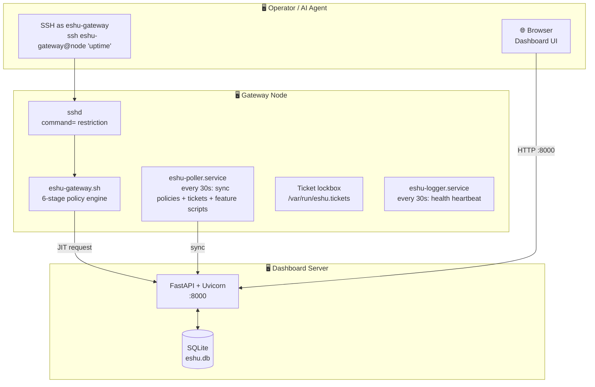
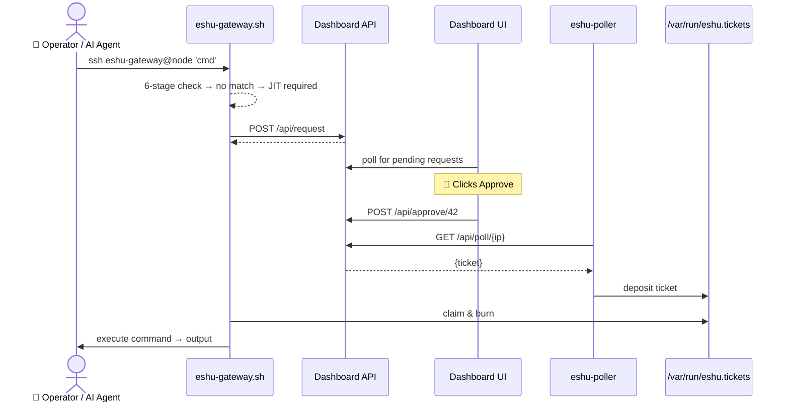

# Architecture

This page holds the technical reference for Eshu Gateway — the deployment
layout, the policy pipeline, and the gateway lifecycle. For setup instructions
see the [README](../README.md); for the developer workflow see
[DEV_GUIDE.md](DEV_GUIDE.md).

## Deployment layout

JIT Approval Sequence Diagram

## Policy Pipeline

Every command passes through these stages in order:

| Stage | Rule Set | Match → Action |
|:-----:|----------|---------------|
| **0** | **Emergency Freeze** (global circuit breaker) — when the operator freezes the fleet, every gateway rejects all commands until unfrozen | **FATAL — rejected while frozen** |
| **1** | Hardcoded core blocklist — **FATAL self-protection** (`/usr/local/bin/eshu-*`, `/etc/eshu*`, `/var/run/eshu*`, `/run/eshu*`, `eshu.db*`, `eshu.tickets`, `eshu-session-key`, `eshu/features.d`, `/etc/sudoers.d/eshu`) and **evasion** (`$(which …)`, `` `which …` ``). Paths are normalised (repeated `/`, `/./`). **Defence in depth, not a sandbox.** | **FATAL — blocked permanently** |
| **1.5** | Broad self-protection matches — any user's `.ssh/authorized_keys`, and wildcard characters next to an `esh` path component (`/esh`, ` esh`, `=esh`, command start) | **Force JIT — never auto-run, human may approve** |
| **2** | Dashboard-managed blacklist (`/etc/eshu-rblack.txt`) — includes the shipped command-safety patterns (`rm -rf`, `mkfs`, `dd`, `iptables -F`, power control) by default, which the operator can relax | **Blocked** |
| **3** | Exact whitelist (`/etc/eshu-exact.txt`) — skipped when the command contains shell metacharacters (stage 2a routes those to JIT) | **Auto-approved** |
| **4** | Regex whitelist (`/etc/eshu-rwhite.txt`) — skipped when the command contains shell metacharacters (stage 2a routes those to JIT) | **Auto-approved** |
| **4.5** | Feature scripts (`/etc/eshu/features.d/*.sh`) — loaded by poller when feature flags are enabled. Prefix windows are skipped for metacharacter commands; exact windows still require byte equality | **Auto-approved by window token** |
| **5** | Claim-and-burn lockbox (`/var/run/eshu.tickets`) | **Execute & consume ticket** |
| **6** | JIT human approval (90s auto-poll) | **Execute on approval** |

The hardcoded core blocklist (Stage 1) is baked into the gateway script and
protects Eshu itself — self-protection and command-substitution evasion **cannot
be relaxed from the dashboard**, even by a compromised dashboard. The command-safety
patterns (`rm -rf`, `mkfs`, `dd`, firewall flush, power control) live in the
dashboard-managed blacklist instead, seeded by default but removable by the
operator (with a confirmation + audit trail).

Stage 1 is **defence in depth, not a sandbox**: approved commands run as root.
The real boundary is the stage-2a metacharacter gate (anything containing
`; & | ` $( > <` newline/CR/backslash is forced to JIT) plus human approval for
every command that is not byte-identical to an allowlisted literal.

Stage 1 FATAL is reserved for the explicit Eshu paths/tokens: a false positive
there is permanent because no human can approve it. Broader self-protection
matches (wildcards near an `esh` path component, any user's
`.ssh/authorized_keys`) are **stage 1.5 force-JIT** instead.

### Writing safe allowlist rules

Regex allowlists are matched with `[[ "$cmd" =~ $pattern ]]` and the result is
run with `bash -c "$cmd"`, so an unanchored pattern widens the rule. Anchor
with `^…$` and avoid `.*` in the argument part; prefer a narrow character class
or an exact rule.

The stage-2a metacharacter gate is not a command parser. **Argument-level
execution is not caught by it**: `find … -exec … +`, `xargs`, `awk
'BEGIN{system(…)}'`, options in `sed`/`git` that run commands, and shell-quote
splitting in a path can still turn an allowlisted literal into a different
command. Put such commands in JIT (no allowlist) or an exact rule that matches
the operator's intent byte-for-byte.

## Tech Stack

| Layer | Technology |
|-------|-----------|
| Dashboard Backend | Python 3 + FastAPI + Uvicorn |
| Dashboard Frontend | Vanilla HTML/CSS/JS + Tailwind CSS CDN |
| Database | SQLite (`eshu.db`) |
| Gateway Agent | Bash (POSIX) |
| Gateway Poller | Bash + systemd service |
| Installer | Single-file Bash script |
| Auth | PBKDF2-SHA256 session cookies |

## Gateway nodes

Requirements: Linux, `bash`, `curl`, `python3`, `systemd`, `sshd`.  
Optional, GNU coreutils 8.24 or later: `tail` capture stops a command promptly
after an agent disconnects (`tee --output-error`, `mv -T`), and F19 run limits
need GNU `timeout`. Without them, `tail` capture posts no output and the
gateway does not report `run_limits: v1`; everything else works.  
Network: Gateway must reach the dashboard on port 8000 (HTTP). No inbound
ports needed.

Installed components:

| Path | Purpose |
|------|---------|
| `/usr/local/bin/eshu-gateway.sh` | SSH-triggered command executor |
| `/usr/local/bin/eshu-poller.sh` | Background policy + ticket + feature sync loop |
| `/usr/local/bin/eshu-logger.sh` | Health heartbeat reporter (30s) |
| `/etc/systemd/system/eshu-poller.service` | Poller systemd unit |
| `/etc/systemd/system/eshu-logger.service` | Logger systemd unit |
| `/etc/eshu-*.txt` | Synced policy files |
| `/etc/eshu/features.d/*.sh` | Feature scripts loaded at runtime |
| `/var/run/eshu.tickets` | JIT ticket lockbox (tmpfs, root-only) |
| `/etc/sudoers.d/eshu-gateway` | Passwordless sudo for the gateway user |

## Gateway lifecycle

- **Updates:** Gateway updates flow through a **Build → Edge → Fleet** pipeline
  managed in the dashboard's Development & Deployment section. The current Build
  is the latest installer; Edge is the dev channel for dev-mode gateways; Deploy
  to Fleet pushes it to all production gateways. That section is hidden by
  default behind the **"Show development tools"** toggle in Settings
  (`dev_tools_enabled`), so non-dev operators don't see the pipeline.
- **Uninstall:** Clicking the uninstall action spawns a transient `systemd-run`
  service on the gateway that cleans up all binaries, services, users, sudoers,
  and SSH keys — then deregisters from the dashboard with live progress
  tracking.
