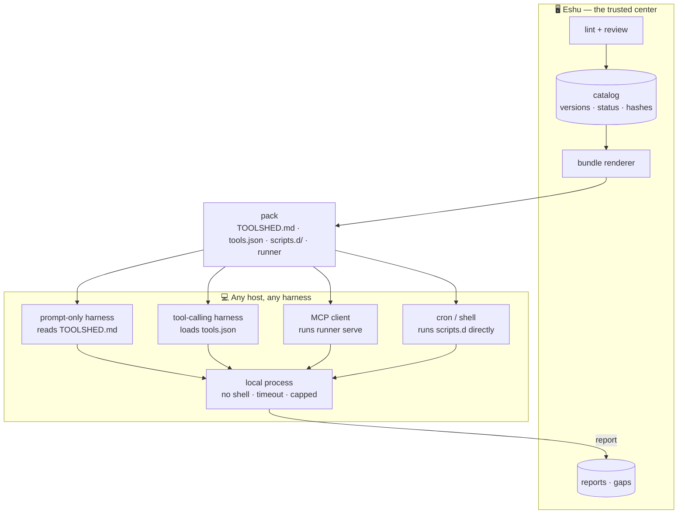
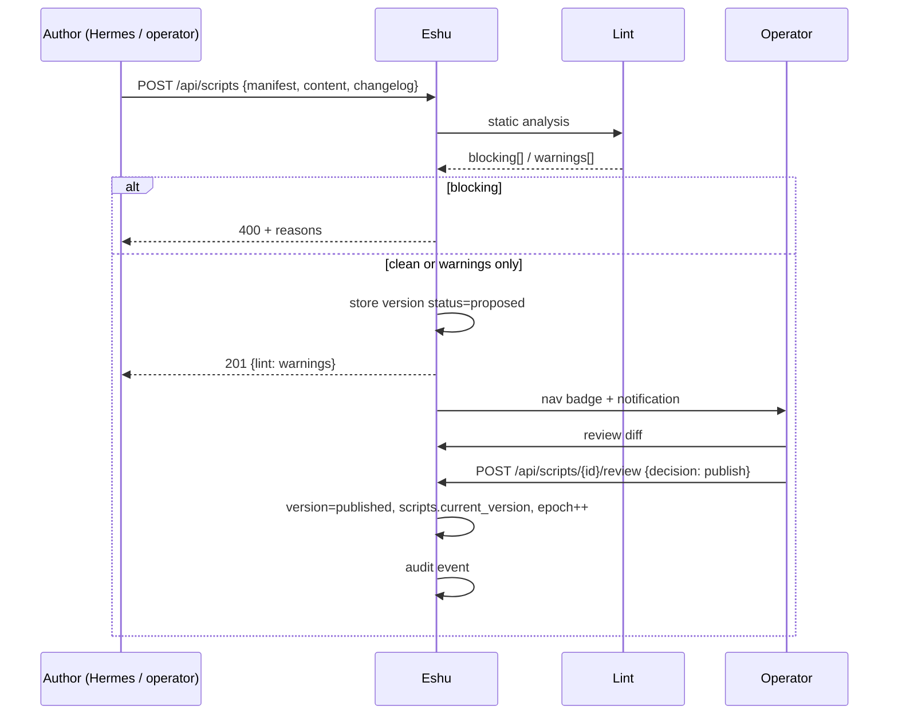
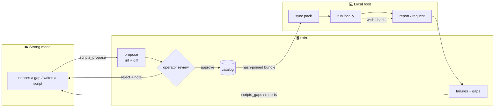

# Eshu Toolshed — index first, registry deferred

**Status:** draft plan, not built · **Date:** 2026-11-06 · **Owner:** operator

> The strong model writes the tools. The weak model uses them. Eshu decides
> which ones exist.

**In one paragraph (revised after the audit).** Eshu should not host a
registry for Hermes's scripts: the corpus is 81 helpers, 2 recurring, none on
more than one host, and already in git with no drift. What survives is a
generated index and manifest layer over that repo, a small read-only pack for
the local model, and an eval that decides whether the pack helps at all. The
durable capability already lives in Eshu's MCP tools; the scripts are the
exhaust around it.

## 0. Should this exist? (answer: index first, registry deferred)

**Verdict after the Hermes audit (2026-11-06): do not build the registry. Build
the index, then let an eval decide whether a small pack is worth exposing.**

### What the audit found

| The plan assumed | Hermes actually has |
|---|---|
| Scripts are reused across hosts | **0 of 81** helpers exist on more than one host; the five md5 duplicates are publish mirrors or an empty `__init__.py` |
| Scripts are durable | **2 of 81** recur (both weekly cron); everything else is ad-hoc, often a single session |
| Central storage adds value | 1166 files already tracked in git, zero drift in five months |
| Review is worth the friction | Review latency would exceed re-derivation (~50–100 lines) for one-offs |
| Distribution is the bottleneck | **Credentials are.** 19 scripts read secrets, 4 hardcode a token path, one carries a **live gateway window token in a tracked file** |
| A catalog would help a small model | Unknown. Three of the eight "no script" prompts are really "an MCP tool exists" |

The corpus is *exhaust*, not a library. The durable capabilities already moved
into `eshu-mcp`; what remains are investigations, probes and deploys that were
meant to be disposable. Indexing exhaust is useful; serving it is not.

Two more findings worth keeping:

- **The schema was wrong for the real corpus.** Every useful script is
  parameterised by *which guest*; several have subcommands; several need a
  secret file; output is often a table, not text. `version` should be the blob
  hash, not a hand-typed semver.
- **There is no index at all.** Hermes finds a script by `grep -rl` then
  `git log`, and half the time rewrites it instead. That is the gap.

### What survives

1. **A generated index and manifest layer over git.** `INDEX.md` plus
   `index.json` from `git ls-files`: language, recurrence, last commit, secret
   reads, target, risk tier. A generator, not a service. This is Hermes's own
   recommendation.
2. **A curated pack for the local model** — Eshu MCP tools plus generic host
   diagnostics. Hermes's scripts are candidates only where they are portable;
   most are credential-bound to its LXC.
3. **The eval**, now using Hermes's real prompts, to decide whether the pack
   helps. Hermes's own bar: **≥15/20 correct args via manifests and <8/20 via
   plain shell.**
4. **The secrets cleanup**, which is an incident, not a feature (§15).

### What is deferred

The registry, review UI, local runner, MCP tool surface, reports, gap queue and
versioning. They are still designed below, because the corpus may change — if a
script becomes recurring *and* crosses a host boundary, revisit — but they are
not v1. Read the rest of this document as a design for the deferred parts, not
as a build order.

### What the evidence says about the pack

The catalog-size result still matters, just at a smaller scale:

- **Catalog size is the dominant variable.** Scaling from 1 to 119 tools dropped
  accuracy from 97% to 66.3% for a 2B model, 99% to 70.0% for a 7.8B, and 98%
  to 83.7% for a 12B
  ([ETRI, ICTC 2026](https://ksp.etri.re.kr/ksp/article/read?id=73481)). A
  curated six-to-ten tool pack sits near the top of each model's range.
- **Selection is not task success.** Qwen3-4B calls tools but "does not reason
  about what a call does": base task success is 53% in an effect-typed
  environment, and multi-turn BFCL is 21.9
  ([Small agents should know what their tools do, 2026](https://arxiv.org/abs/2610.35981)).
  Hence the schema additions — `target`, `requires`, `side_effects`,
  `output_schema` — and a single flat call, never a search chain.

Do **not** build retrieval-first ("Tool RAG"): in the ETRI study it helped only
the 2B model, and only with a 98%-recall retriever; with a normal one it hurt
larger models.

### The decision rule

1. Generate the index. It pays for itself even if nothing else ships.
2. Run the eval on Hermes's 20 prompts. Build the pack only if it clears
   Hermes's bar.
3. Revisit the registry only if a script becomes recurring *and* crosses a host
   boundary. Two conditions, both, not one.

### The honest counter-argument

If the index is all that ships, the original goal — "scripts stored on Eshu to
help local models" — is only partly met. The local model gets a handful of
read-only diagnostics and the MCP tools it already had. That may be enough; the
eval will say. What would *not* be honest is building a review service for 79
scripts that will never run again.

## 1. The problem, stated plainly

*The original premise, kept for the record — §0 is what the audit did to it.*

Today Hermes (DeepSeek over the API) writes helper scripts and leaves them on
whatever host it happens to be on. That works because Hermes is capable enough
to write, debug and remember its own code. A 4B–8B model on the 5070 Ti is not.

A small local model fails in a specific way: it can *call* a well-described
capability reliably, but it cannot *invent* one. So the useful move is not
"give the local model a file share" — it is to let the strong model author
capabilities once, have a human approve them, and then hand the weak model a
short, deterministic menu of things it is allowed to do.

Eshu already sits exactly where that menu belongs: it is the thing every agent
trusts, it already has tokens, audit, approval queues, and a pull-based
distribution model (the poller, `docs/ESHU_CALL_CLIENT.md`). What it does not
have is a place to keep *authored capability* rather than *policy*.

That place is the **Toolshed**.

## 2. Why Eshu and not a git repo

*Written before the audit. The audit found git already sufficient for
storage and distribution; what it lacks is the index, not a server.*

A shared directory or a git remote can store scripts. It cannot do the things
that make this useful:

| Need | Git repo | Eshu Toolshed |
|---|---|---|
| A human gate before agent-written code is distributed | PR review, if everyone remembers | Every publish is an audited operator action |
| Identity: who wrote this, with which model, from which host | Commit metadata, unpoliced | Recorded per version, tied to an agent token |
| A menu sized for a small model | Whatever is in the tree | Server-side profiles by model class |
| "This script is failing on the box" | Nobody knows | Run reports per host and version |
| "I wish I had a tool for X" | A TODO in someone's head | A queue the strong model reads |
| Pull without handing out git credentials | Needs keys everywhere | One bearer token, already rotated/revoked in Eshu |
| Immediate quarantine | Revert and re-pull | One flag; next sync drops it |

None of those are storage problems. They are governance and feedback problems,
which is exactly what Eshu is for.

## 3. Where it sits in Eshu

| Existing surface | Role | Relationship |
|---|---|---|
| Policy pipeline (`docs/ARCHITECTURE.md`) | Gates SSH commands | Untouched. Toolshed scripts are not commands on the pipeline |
| Feature scripts (`features.d/*.sh`) | Gateway-side policy extensions, synced silently | Untouched. Different trust boundary: reviewed by nobody, installed by the poller |
| MCP integrations (`core/mcp_server.py`) | Homelab API calls | Same per-agent policy machinery is reused for `scripts_*` tools |
| Approved Windows | Time-bounded SSH authorization | A script that needs one still uses it; the manifest can declare it |
| Sessions (`core/session.py`) | Groups SSH + MCP work | Reports carry `session_id` |
| Audit log | Every operator action | Publish/reject/quarantine write audit events |
| `eshu_call.py` | Thin transport client per host | Same install/hash pattern; Toolshed is a second client, not a second protocol |

The Toolshed is a **fifth surface** (after SSH, MCP, windows, fleet): authored
capability, distributed to agents.

## 4. What it is (and what it is not)

It **is**:

- A versioned, reviewable catalog of small scripts (bash / Python) with a
  machine-readable manifest.
- A review gate: agent proposes, operator publishes, versions are immutable.
- A distribution plane: one catalog rendered into a harness-agnostic pack
  (files + tool schemas + a thin local runner), plus an optional MCP surface.
- A feedback plane: the harness reports what worked, what failed, and what
  capability it wished existed.

It is **not**:

- A replacement for feature scripts. Those are gateway-side *policy*
  extensions; the Toolshed is *capability* authored by agents and reviewed by
  a human.
- A remote code execution service. The dashboard never runs a script. See §6.
- A cron/scheduler. That is what Approved Windows and the host's own timer are
  for.
- Harness-specific. Eshu serves plain HTTP, plain files, and JSON tool schemas;
  anything from a shell script to a full agent can consume it.

## 5. Naming

| Layer | Name | Notes |
|---|---|---|
| UI + docs | **Toolshed** | Page "Toolshed — scripts your agents can pick up" |
| Artifact | **script** | A single file + manifest |
| Server state | **catalog** | `scripts`, `script_versions`, `script_reports` |
| Local client | **`eshu-toolshed`** | `scripts/eshu_toolshed.py`, installed like `eshu_call.py` |
| Materialized output | **pack** | `TOOLSHED.md`, `tools.json`, `scripts.d/`, runner |

"Capability" is already taken by Commute/TfL (`docs/COMMUTE_CAPABILITY.md`),
so it is avoided. If "Toolshed" feels too cute, plain **Scripts** is the
fallback; the data model does not change.

### Celestial shortlist

Eshu's UI already calls the fleet a constellation, so the motif is established.
The best fits are the **instrument constellations** Lacaille named in the
1750s — a literal toolbox in the sky:

| Name | Meaning | Why it fits | Watch out |
|---|---|---|---|
| **Caelum** | the chisel; also Latin for "sky"; the smallest constellation | A small, curated set of tools, in the sky | pronunciation (SEE-lum) |
| **Norma** | the carpenter's square | Keeps work true: reviewed, measured, standard | reads as a person's name |
| **Circinus** | the drawing compass | Precision and navigation | less familiar |
| **Pyxis** | the mariner's compass; Latin for "small box" | A box of instruments you navigate by | name collisions |
| **Almagest** | Ptolemy's star catalog | The catalog itself | a book, not a place; obscure |
| **Astrolabe** | instrument for finding your way by the stars | Clearest to a newcomer | not distinctive |
| **Arsenal** | a store of instruments | Semantically right | militaristic; loses the motif |

**Recommendation: Caelum** — "Eshu Caelum, the instruments your agents navigate
by." **Norma** if you want it to read as "kept true"; **Astrolabe** if clarity
beats poetry. The rest of this doc keeps *Toolshed* as a placeholder; a rename
is a find-and-replace in UI strings plus the client filename.

## 6. Architecture: one catalog, adapters at the edge, no server-side execution



Three deliberate constraints:

1. **Execution stays local.** The dashboard has no `subprocess` call anywhere
   today (`grep -rn subprocess dashboard/` → nothing). Keeping it that way
   means this feature adds zero new remote-execution surface. The runner runs
   the script on the host that owns it, with that host's permissions.
   Isolation is the operator's choice (container, VM, dedicated user).
2. **No harness assumptions.** The authoritative output is a directory of
   files: a markdown card, JSON tool schemas, the scripts, and a small Python
   runner. If a harness cannot read any of those, it can still `GET` the raw
   script over HTTP. MCP is offered because Eshu already speaks it, not
   because consumers are assumed to.
3. **Review is the security boundary.** A compromised dashboard can already
   serve an installer and feature scripts, so signing on the same host is
   integrity-in-transit, not provenance. The real win is simpler and bigger:
   agent-written code never reaches a host without a human looking at it.

### Execution targets, in order of preference

| Target | When | Notes |
|---|---|---|
| **Local runner** (`eshu-toolshed call`) | Default, v1 | The script runs on the harness's host. No new server surface |
| **Gateway dispatch** (existing Fleet Run path) | Later, opt-in | Reuses `pending_fleet_cmd` injection (`eshu-poller.sh:163`) and the fleet result callback. Runs as root on the gateway, so it needs its own review and a narrower lint profile |
| **Dashboard process** | Never | Would turn Eshu into an execution service and break its threat model |

## 7. Data model

New module `dashboard/db/scripts.py`, wired into `init_db()` in
`dashboard/db/core.py` and re-exported from `dashboard/database.py` (the
pattern every other domain follows).

```sql
CREATE TABLE IF NOT EXISTS scripts (
    id              INTEGER PRIMARY KEY AUTOINCREMENT,
    name            TEXT UNIQUE NOT NULL,      -- stable slug, API identity
    title           TEXT NOT NULL,
    summary         TEXT NOT NULL,             -- ≤160 chars, shown to models
    category        TEXT NOT NULL DEFAULT '',
    tags            TEXT NOT NULL DEFAULT '[]',
    language        TEXT NOT NULL,             -- bash | python3
    tier            TEXT NOT NULL DEFAULT 'standard', -- tiny | small | standard
    risk            TEXT NOT NULL DEFAULT 'read',     -- read | mutate | destructive
    status          TEXT NOT NULL DEFAULT 'draft',
                    -- draft | proposed | published | deprecated | quarantined
    current_version INTEGER,                   -- fk script_versions.id
    created_by      TEXT NOT NULL,             -- agent name or 'operator'
    created_at      INTEGER NOT NULL,
    updated_at      INTEGER NOT NULL
);

CREATE TABLE IF NOT EXISTS script_versions (
    id              INTEGER PRIMARY KEY AUTOINCREMENT,
    script_id       INTEGER NOT NULL,
    version         TEXT NOT NULL,             -- semver
    content         TEXT NOT NULL,
    sha256          TEXT NOT NULL,
    manifest        TEXT NOT NULL,             -- JSON, schema in §8
    changelog       TEXT NOT NULL DEFAULT '',
    author          TEXT NOT NULL,
    author_model    TEXT NOT NULL DEFAULT '',
    author_host     TEXT NOT NULL DEFAULT '',
    base_version    TEXT NOT NULL DEFAULT '',
    status          TEXT NOT NULL DEFAULT 'proposed',
                    -- proposed | published | rejected | superseded
    lint            TEXT NOT NULL DEFAULT '{}',-- JSON: {blocking:[], warnings:[]}
    reviewed_by     TEXT NOT NULL DEFAULT '',
    reviewed_at     INTEGER,
    review_note     TEXT NOT NULL DEFAULT '',
    created_at      INTEGER NOT NULL,
    UNIQUE(script_id, version)
);

CREATE TABLE IF NOT EXISTS script_reports (
    id              INTEGER PRIMARY KEY AUTOINCREMENT,
    script_id       INTEGER NOT NULL,
    version         TEXT NOT NULL,
    host            TEXT NOT NULL DEFAULT '',
    agent           TEXT NOT NULL DEFAULT '',
    session_id      TEXT NOT NULL DEFAULT '',
    outcome         TEXT NOT NULL,             -- ok | error | timeout | missing_tool
    exit_code       INTEGER,
    duration_ms     INTEGER,
    error_summary   TEXT NOT NULL DEFAULT '',  -- scrubbed, ≤500 chars
    created_at      INTEGER NOT NULL
);

CREATE TABLE IF NOT EXISTS script_requests (
    id              INTEGER PRIMARY KEY AUTOINCREMENT,
    what            TEXT NOT NULL,             -- "check the NAS backup"
    why             TEXT NOT NULL DEFAULT '',
    tried           TEXT NOT NULL DEFAULT '[]',-- ["homelab-inventory"]
    requested_by    TEXT NOT NULL DEFAULT '',
    host            TEXT NOT NULL DEFAULT '',
    created_at      INTEGER NOT NULL,
    status          TEXT NOT NULL DEFAULT 'open', -- open | addressed | dismissed
    addressed_by    TEXT NOT NULL DEFAULT ''    -- script name once published
);

CREATE TABLE IF NOT EXISTS script_catalog_state (
    id              INTEGER PRIMARY KEY CHECK (id = 1),
    epoch           INTEGER NOT NULL DEFAULT 0, -- bumped on any publish/remove
    updated_at      INTEGER NOT NULL DEFAULT 0
);
```

Indexes: `script_reports(script_id, created_at)`, `script_versions(script_id)`,
`scripts(status)`.

Published versions are **immutable**. An edit is always a new version. The
catalog `epoch` gives consumers a cheap incremental sync (`?since=`) and
handles removals, which a timestamp cannot.

## 8. The manifest

Every script carries a sidecar manifest. It is what the index reads, what the
lint checks, and what any adapter renders for a model. Hermes's corpus changed
the shape of it: the first version could not express *which guest* a script
targets, a subcommand, a secret requirement, or a side effect.

```json
{
  "manifest_version": 1,
  "name": "pulse-pve3",
  "title": "Pulse health for pve3",
  "summary": "Prints CPU, memory, disk and temperature for pve3.",
  "when_to_use": "The user asks whether pve3 is healthy, hot, or low on memory.",
  "when_not_to_use": "They ask about a different node, or about Jellyfin.",
  "language": "python3",
  "tier": "tiny",
  "risk": "read",
  "target": {"kind": "guest", "value": "pve3"},
  "runtime": ["python3"],
  "requires": {"secrets": [], "preconditions": ["ssh to pve3"]},
  "side_effects": "none",
  "args": [],
  "output_schema": {
    "type": "text",
    "format": "kv",
    "keys": ["cpu_pct", "mem_pct", "temp_c"]
  },
  "source_commit": "f0b2641",
  "last_verified": "2026-11-06",
  "timeout_s": 30
}
```

What the corpus changed:

| Field | Why it exists |
|---|---|
| `target` | Every useful script is parameterised by *which guest*. `{"kind": "guest", "value": "pve3"}` for a pinned one; `{"kind": "guest", "arg": "node"}` when it is an argument |
| `actions` | Subcommands (`fqdn-proxy list/create/rename/delete`) cannot be flattened into an `action` enum and still read well. For `tiny`, flatten to a `verb` enum of at most three values; for larger tiers, one tool per action |
| `requires` | `{"secrets": ["pulse_token"], "preconditions": ["window token held"]}`. The old schema could not say "needs `/home/hermes/.pulse-token`", which is the actual failure mode |
| `side_effects` | `none` / `reads` / `writes` / `spends_tokens` / `mutates_memory`. This is the field the effect-typed result says small models need most |
| `output_schema` | `pulse_pve3.py` prints box-drawing tables; `type: text` says nothing about parseability. `format: kv` with keys is enough for a model to read the result |
| `source_commit` | The blob hash at index time. Immutability without a source digest is unverifiable |
| `last_verified` | The last successful run, filled by the index — not hand-written |

What was dropped:

- `version` — the blob hash is the version. A hand-typed semver on a one-off is
  noise.
- `examples.says` — prose that rots. Keep `examples` for the call *shape* only
  (`{"args": {...}}`), and let `output_schema` describe the result.

### Lint rules that exist *for* small models

These are not style nits. Each one is a failure mode observed when a
low-capacity model is handed a vague tool.

| Rule | Limit | Why |
|---|---|---|
| `summary` | 20–160 chars, one line | It is the only text in context until the pack is loaded |
| `title` | ≤ 60 chars | Renders in a table |
| args (tier `tiny`) | ≤ 5, flat scalars only | Nested args are where small models invent structure |
| arg description | ≤ 80 chars | Long descriptions get truncated or ignored |
| optional arg | must have a default | "Optional" without a default invites omission bugs |
| `when_to_use` | required | Gives the model a decision rule, not just a function |
| `when_not_to_use` | required for tier `tiny` | The most common failure is picking the neighbouring tool |
| `target` | required | "Which guest?" is the question a model forgets |
| `side_effects` | required | The difference between a diagnostic and a mutation |
| `requires.secrets` | required if the static scan finds a token read | A script that silently needs a secret will fail on the next host |
| examples | ≥ 1, args only | One concrete call beats three paragraphs |
| description budget | ≤ 1200 chars total / script | Keeps a 10-tool menu under ~300 tokens |

Only the model-facing half of the manifest — `name`, `title`, `summary`,
`target`, `args`, `side_effects` — counts toward the budget. `source_commit`,
`requires` and `output_schema` are for the operator and the runner.

## 9. Ingest and review
## 9. Ingest and review



### Static analysis (`dashboard/core/script_lint.py`)

| Check | Blocking? | Detail |
|---|---|---|
| Size | yes | ≤ 64 KiB, single file |
| Shebang matches language | yes | `#!/usr/bin/env bash` / `#!/usr/bin/env python3` |
| Syntax | yes | `bash -n` / `python3 -m py_compile` |
| Denied constructs | yes | `curl … \| bash`, `wget … \| sh`, `eval`, `base64 -d`, `nc`, `mkfifo`, `chmod 777`, `sudo`, `setsid`, `nohup`, `systemctl`, `crontab` |
| Eshu self-protection | yes | reads of `/etc/eshu*`, `/var/run/eshu*`, `eshu.db*`, token files |
| Secret material | yes | `core.secret_scrub.scrub_string` + key patterns (`sk-`, `ghp_`, `xoxb-`, AKIA, long hex/base64) |
| Escape writes | warn | paths outside `${ESHU_WORKDIR}` |
| Network | yes unless declared | any `http(s)://`, `curl`, `wget`, `requests`, `socket` requires `runtime` declaration and a host allowlist match |
| Dependencies | warn | names in `runtime` outside the allowlist need an operator note |
| Nondeterminism | info | `$RANDOM`, `date`, `hostname` — flagged so the reviewer knows |

Blocking failures return 400 with the list and nothing is stored. Warnings are
stored on the version and shown in the review diff.

The network host allowlist is operator-managed server-side (a settings list),
not per script — otherwise the proposer writes its own permission.

### Review UI

A diff against the current published version, the manifest rendered as the
model will see it, the lint output, and the "context cost" estimate
(≈ `len(rendered_description) / 4` tokens). Buttons: **Publish**, **Reject**
(requires a note — the note goes back to the author), **Quarantine** (only for
published scripts).

## 10. Delivery

### 10.1 The pack

```
GET /api/scripts/bundle?profile=tiny&since=<epoch>
```

Returns JSON (not a tarball — scripts are small, and one hash beats an archive
parser):

```json
{
  "catalog_epoch": 12,
  "profile": "tiny",
  "generated_at": 1762371123,
  "removed": ["old-script-name"],
  "files": [
    {"path": "TOOLSHED.md",          "sha256": "…", "content": "…"},
    {"path": "tools.json",           "sha256": "…", "content": "…"},
    {"path": "eshu_toolshed.py",     "sha256": "…", "content": "…"},
    {"path": "scripts.d/eshu-health","sha256": "…", "content": "…", "mode": "755"}
  ],
  "bundle_sha256": "…",
  "signature": "hmac-sha256:…"
}
```

The client writes it to a directory atomically. Nothing in the pack is
harness-specific; the consumer picks what it can use.

| File | Consumed by |
|---|---|
| `TOOLSHED.md` | Prompt-only harness: include it, or point a skill/context file at it |
| `tools.json` | Tool-calling harness: OpenAI-style function schemas, one per script |
| `scripts.d/<name>` | Anything that can execute a file (cron, shell, a harness's bash tool) |
| `eshu_toolshed.py` | Runner: validates args, executes, reports. Also serves MCP |
| `manifest.json` | Hashes + catalog snapshot, for verification |

`signature` is HMAC over `bundle_sha256` with a dedicated key (same storage
pattern as the session signing key in `db/misc.py`). Document the limitation
plainly: the key lives on the dashboard, so the signature proves the bundle was
not altered in transit or at rest on the host — it does not survive a
compromised dashboard.

### 10.2 Adapter shapes

The same catalog, three ways in. All are optional; none is privileged.

**a) Files + CLI (universal).** A harness reads `TOOLSHED.md`, or loads
`tools.json` into whatever function-calling API it has, and executes
`eshu_toolshed.py call <name> --args '{...}'`. This works for every harness
that can run a process, including "a cron job".

**b) MCP (agents that mount `/mcp`).** `eshu_toolshed.py serve` exposes the
catalog over stdio, and the same six tools are registered on Eshu's `/mcp` for
agents that talk to Eshu directly. Tools: `scripts_list`, `scripts_get`,
`scripts_propose`, `scripts_report`, `scripts_request`, `scripts_gaps`. They
are registered on the existing FastMCP instance and pass through
`core/agent_policy.py` like every other tool, so per-agent allowlists already
work. Note they are dashboard capabilities, not integration tools — closer to
`session_begin` than to a Proxmox read.

**c) Context card (prompt-only).** `TOOLSHED.md` is generated short enough to
paste into a system prompt or point a skill/`AGENTS.md`-style file at. Detail
is deferred to `eshu_toolshed.py describe <name>`, so the always-loaded part
stays small.

### 10.3 The client (`scripts/eshu_toolshed.py`)

Installed the same way as `eshu_call.py` — served at
`/api/clients/eshu-toolshed.py` with `X-Client-Version` and
`X-Client-SHA256`, verified before install (see `docs/ESHU_CALL_CLIENT.md`).

```
eshu-toolshed doctor                      # deps, token perms, Eshu reachability, runtime deps
eshu-toolshed init --profile tiny          # write config
eshu-toolshed sync                         # fetch pack, verify hashes, install atomically
eshu-toolshed list | describe <name>
eshu-toolshed call <name> --args '{"n":5}' # execute locally, no shell, timeout, output cap
eshu-toolshed schema --format openai       # emit tool schemas for a harness
eshu-toolshed serve                        # MCP stdio
eshu-toolshed request "<what you needed>"
eshu-toolshed import <dir> --dry-run       # adopt an existing pile of scripts
```

`call` is the only execution path and it is deliberately narrow:

- Args are validated against the manifest (type, min/max, enum, required)
  before anything runs. Unknown args are refused, not ignored.
- `subprocess.run([interpreter, path, *argv], shell=False)`.
- `timeout` from the manifest, hard-capped at 120 s.
- stdout/stderr capped at 64 KiB, secrets scrubbed with the same patterns the
  dashboard uses.
- Environment is rebuilt, not inherited: `PATH`, `HOME`, `ESHU_WORKDIR`, and
  only declared pass-through vars. No `ESHU_TOKEN` unless the manifest asks for
  it by name.
- Working directory is a fresh temp dir under `ESHU_WORKDIR`.
- Every call reports outcome, duration and version back (bounded queue,
  best-effort).

`import` is the adoption path: point it at the directory where Hermes or a
harness already keeps its scripts, and it emits manifest stubs + lint results
as proposals, so the existing pile becomes reviewable instead of tribal
knowledge.

## 11. Small-model ergonomics

This is the part that makes the feature worth building rather than a git repo
with extra steps.

1. **Profiles.** `tiny` = tier `tiny` only, max 12 scripts. `small` = tiny +
   small, max 25. `all`. A profile is a server-side filter, so the menu a small
   model sees is a policy decision, not a client accident.
2. **Descriptions come from the reviewed manifest**, never from the script
   source. Source is not injected into the model's context by default, which
   also kills a prompt-injection channel.
3. **Progressive detail.** `TOOLSHED.md` carries names, one-liners and the
   invocation contract. `describe <name>` loads output shape, examples and
   failure modes only when the model asks.
4. **Gap capture.** `request` turns "I didn't have a tool" into a queue item.
   This is the onboarding loop: the local model tells you what it needs, in its
   own words, at the moment it needs it.
5. **Failure reports.** `script_reports` feeds a "Needs attention" column. A
   script that fails three times in a row gets flagged, and optionally a repair
   proposal is drafted for the author.
6. **Eval harness.** `scripts/eval_tool_discovery.py`: 20 in-scope prompts and
   8 out-of-scope prompts, four exposure conditions, run against a given model
   to measure selection, argument validity and refusal. Run it before and after
   any description change. Without this, "small models are bad at tools" stays a
   feeling instead of a number.

## 12. The loop



The important arrow is the last one. A weak model that fails is not a dead end;
it becomes a work order for the strong model. That is how the local fleet gets
useful over time instead of staying frozen at whatever was seeded.

## 13. API surface

Auth follows the existing rules (`docs/API.md`): agent token for the pull and
propose paths; session cookie for review and management. Public docs endpoint
mirrors `/api/docs/agent-manual`.

### Agent / runner (agent token)

| Method | Path | Purpose |
|---|---|---|
| `GET` | `/api/scripts?profile=&since=` | Catalog delta: scripts + removed names + epoch |
| `GET` | `/api/scripts/{name}` | Manifest + usage doc + version summary |
| `GET` | `/api/scripts/{name}/content` | Raw content, `X-Script-Version`, `X-Script-SHA256` |
| `GET` | `/api/scripts/bundle?profile=` | Signed pack (§10.1) |
| `POST` | `/api/scripts` | Propose a version (lint-gated) |
| `POST` | `/api/scripts/{name}/report` | Run outcome |
| `POST` | `/api/script-requests` | Request a missing capability |
| `GET` | `/api/docs/scripts` | Agent-facing manual (public, like agent-manual) |

### Operator (session)

| Method | Path | Purpose |
|---|---|---|
| `GET` | `/api/scripts/pending` | Proposals awaiting review |
| `POST` | `/api/scripts/{id}/review` | `{decision: publish\|reject, note}` |
| `POST` | `/api/scripts/{id}/quarantine` | Pull a published version immediately |
| `POST` | `/api/scripts/{id}/deprecate` | Keep resolvable, exclude from default bundles |
| `GET` | `/api/scripts/{name}/versions` | Version timeline |
| `GET` | `/api/scripts/{name}/diff?from=&to=` | Unified diff for review |
| `GET` | `/api/script-reports?name=` | Run history + failure summary |
| `GET` | `/api/script-requests` | Gap queue |
| `POST` | `/api/script-requests/{id}/dismiss` | Close a request |
| `GET` | `/api/scripts/health` | Card data: counts, failing scripts, stale hosts |

## 14. UI

New nav item **Toolshed** in the *Fleet* section, beside Integrations.

- **Catalog** — cards with name, one-line summary, version, status chip, tier,
  language, and a health dot from reports. Filter by tier/tag/status.
- **Proposals** — the review inbox; nav badge while non-empty. Diff view,
  manifest preview, lint output, context-cost estimate, Publish / Reject.
- **Requested** — the gap queue from weak models, with "address with a script"
  and Dismiss.
- **Reports** — failures grouped by script, with host and version, so "the
  local box is on 1.0.0 and it broke" is visible.
- **Getting started card** (empty state) — the two commands to equip a host,
  and the `import` command for existing scripts.

All in the existing amber-CRT language (`docs/UI_COHESION_PLAN.md`), no new
component vocabulary.

## 15. Security and governance

| Threat | Mitigation |
|---|---|
| Agent self-publishes malware | Operator review is the only path to `published`; no auto-publish in v1 |
| Eshu becomes a malware CDN | Static lint, secret scan, network allowlist, size cap, audit, quarantine |
| Secret exfiltration at runtime | Runner env is rebuilt; no token in env unless declared; lint blocks token reads; outputs scrubbed |
| Prompt injection via content | Descriptions render from the reviewed manifest; source is not injected into context |
| Stale/tampered script on host | Hash-pinned pack, HMAC signature, version stamp in every report, UI "outdated hosts" |
| Weak model running the wrong thing | Tier profiles, `when_not_to_use`, exact invocation string, no shell |
| Operator rubber-stamping | Diff + lint + context-cost + "last published by" on one screen; reject requires a note |
| Script needs a secret | Never in content. Use `eshu_call.py` with a scoped, file-based token the operator provisions, or a future Eshu-mediated capability |

### Incident found by the audit

Hermes reports that `jellyfin_scan_progress.sh` carries a live Eshu gateway
**window token** as a literal inside a git-tracked file. That is not a design
smell; it is a credential in a repository. Remediation, before anything else:

1. Delete (or disable) that window in Eshu. The gateway's authoritative claim —
   `POST /api/approved-windows/execute/{token}` — then fails closed, and the
   poller drops it from `/etc/eshu-windows.txt` within one 30s cycle. Deleting
   is cleaner than disabling.
2. Replace the literal with an env read or a mode-600 token file.
3. Check history (`git log -S` on the token prefix) and assume any remote it was
   pushed to (`hermes-carnival`) has seen it.
4. Add the token pattern to a pre-commit secret scan.
5. Sweep the other secret readers: `requires.secrets` is the long-term fix, but
   the index can flag them now.

Honest limitation: a compromised dashboard can serve anything, exactly as it
can today with the installer and feature scripts. The Toolshed does not make
that worse, and it does not pretend to fix it.

## 16. The pack

Not a seed catalog — a shortlist chosen from the index, all read-only and
secret-free. Candidates from Hermes's exposure list:

| Script | Does | Note |
|---|---|---|
| `pulse_pve3.py` | Pulse host health for pve3 | table output; needs `output_schema` |
| `check_cts.py` | Container and VM status | pinned to CT 122 and VM 101 — `target` matters |
| `surface_wifi_watch.sh` | Wi-Fi band survey from the Surface | read-only |
| `pia_probe.py` | Which PIA regions resolve | read-only |
| `unbound_patch_watch.py` | Whether the unbound patch landed | run with `dry_run` first |
| `fqdn-proxy.py list` / `verify` | Which FQDNs are proxied | read-only subcommands |

Explicitly excluded: `eshu` (arbitrary command by design), the approval pollers
(`mcp_send_and_wait`, `poll_approval`, `mcp_approval_poller` — exposing them
deletes the human gate), `eshu_window_request.py`, anything holding a token, and
the household profile writers.

**Portability is the catch.** A read-only script is not automatically runnable
elsewhere. Most of these read a token (`pulse_pve3`, `check_cts`) or shell into a
guest over `eshu-gateway@`; the 5070 Ti has neither those credentials nor that
network position. The only definitely portable capability is Eshu's MCP surface,
which is token-authenticated over the network. So the pack for the local model is
likely **generic host diagnostics** (disk, load, docker, model smoke) plus MCP
tools — not Hermes's corpus. Decide per script from `requires` in the index.

## 17. Build plan

Estimates are evenings. The order follows the audit: fix the leak, index what
exists, then let the eval decide whether a pack is worth serving.

### P0 — the secrets incident (an hour, do first)

Disable the window whose token is in `jellyfin_scan_progress.sh`, replace the
literal, and check history. Details in §15.

### P1 — the index (1 evening)

A generator over the existing git repo. No database, no server.

- `scripts/index_scripts.py <repo>` walks `git ls-files`, merges sidecar
  manifests, and emits `INDEX.md` + `index.json`.
- Per entry: path, language, sha256, `source_commit`, last commit date, author,
  `risk`, `target`, `requires.secrets`, recurrence hint (cron/systemd
  references), and `last_verified` when a run log exists.
- Flags: missing manifest, secret pattern, stale > 90 days, duplicate hash,
  missing `target`.
- Recurrence comes from grepping the path in crontabs and systemd units, plus
  the run log — not from guesses.

Done when Hermes can find a script by intent from `index.json` instead of
`grep -rl` followed by `git log`.

### P2 — the pack and the eval (1–2 evenings)

Select scripts that run **where the model runs**, not where Hermes runs. For
the 5070 Ti that is probably: Eshu MCP tools (token-auth over the network) plus
generic host diagnostics. Hermes's read-only list is a candidate set, filtered
by `requires` — most of it is credential-bound to the LXC.

Render `TOOLSHED.md` and `tools.json` from the chosen manifests. Run
`scripts/eval_tool_discovery.py` with Hermes's 20 prompts where they apply, and
with prompts for the portable set. Compare against the `bash` baseline.

- Prompts needing a redacted argument (the iPad MAC) score selection only.
- Prompts whose real answer is an MCP tool, not a script, are excluded from the
  script comparison and reported separately.
- Done when the result clears Hermes's bar (≥ 15/20 args via manifests, < 8/20
  via shell), or fails it and the pack is dropped.

### P3 — serve the pack, only if P2 clears (half an evening)

One authenticated endpoint on Eshu serving the generated archive, hash-pinned.
No database, no review UI, no runner. The source of truth stays git.

### Deferred until the corpus changes

Registry, review UI, versioning, runner, MCP tool surface, reports, gap queue,
gateway dispatch. Two triggers, both required: a script becomes recurring, and
it needs to run on a second host. Then reopen §7–§13.

## 18. Testing

Following the existing `tests/` + `conftest.py` pattern (temp DB per test):

- **Lifecycle:** propose → lint → publish → bundle → content hash matches.
- **Gate:** blocking lint returns 400 and stores nothing; reject requires a
  note; published versions are immutable.
- **Auth:** no token / revoked token → 401; agent cannot publish.
- **Quarantine:** removed from bundles immediately, `epoch` bumps.
- **Bundle:** signature verifies; a one-byte change is detected.
- **Runner:** typed args → argv with `shell=False`; unknown args refused;
  timeout enforced; output capped and scrubbed.
- **Reports:** rate-limited, scrubbed, version recorded.
- **Rendering:** `TOOLSHED.md` and `tools.json` are deterministic and under the
  description budget.

`tests/test_scripts.py`, `tests/test_script_lint.py`,
`tests/test_script_bundle.py`, `tests/test_toolshed_client.py`.

## 19. Success metrics

- **Pack gate (Hermes's bar):** ≥ 15/20 correct args via manifests and < 8/20
  via plain shell. Failing this drops the pack; the index still ships.
- **Index usefulness:** Hermes finds a script by intent in under a minute, and
  stops rewriting scripts because it could not find them.
- **Registry trigger:** a script becomes recurring *and* crosses a host
  boundary. Both, not one.
- **Zero** scripts execute on the dashboard host.
- No secret is reachable from an indexed script without `requires.secrets`
  saying so.

## 20. Open decisions

These need your call before the index is built. My recommendation is first in
each row.

| # | Decision | Recommendation |
|---|---|---|
| 1 | Accept the audit verdict: index only, registry deferred | **Yes.** The corpus does not support the registry, and the index is cheap |
| 2 | Remediate the window token now | **Yes, before anything else.** It is a live credential in git |
| 3 | Name | **Almagest** for the index (Ptolemy's star catalog); **Caelum** if the pack becomes the product. Or keep it plain |
| 4 | Pack scope | **Six to ten read-only, secret-free diagnostics**, chosen from the index |
| 5 | The eval bar | **Hermes's, as stated:** ≥ 15/20 args via manifests, < 8/20 via shell. It is harsh; that is the point |
| 6 | Redacted arguments (iPad MAC) | **Selection only**, not argument accuracy; note it in the result |
| 7 | The three MCP-tool prompts | **Exclude from the script comparison** and report separately — they are evidence the durable layer already moved |
| 8 | Where the index lives | **In Hermes's repo, generated by a script.** Eshu serves the pack, never the source of truth |
| 9 | Reopen the registry when | A script is recurring **and** needs a second host. Both, not one |

## 21. First evening: the index

Before any pack or eval, prove the index is worth having:

1. Run `scripts/index_scripts.py ~/.hermes` and read the flags.
2. Ask one question Hermes currently cannot answer — "which scripts touch
   `pve3` and are read-only?" — and answer it from `index.json`.
3. Fix the three worst flag classes, re-run, and commit the generated
   `INDEX.md` beside the scripts.

If that does not earn its keep, no pack will.

## 22. References

- Eshu's existing thin-client philosophy: `docs/ESHU_CALL_CLIENT.md`
- Feature-flag pipeline (the thing this is *not*): `docs/FUTURE_FEATURES.md`
- Policy engine and gateway lifecycle: `docs/ARCHITECTURE.md`
- API auth conventions: `docs/API.md`
- Catalog-size evidence: *Tool-Catalog Scaling and Tool RAG in Local sLLM
  Agents*, ICTC 2026 —
  <https://ksp.etri.re.kr/ksp/article/read?id=73481>
- Effect/task-success evidence: *Small agents should know what their tools
  do*, arXiv 2610.35981 —
  <https://arxiv.org/abs/2610.35981>
- The experiment that settles it: `scripts/eval_tool_discovery.py`
