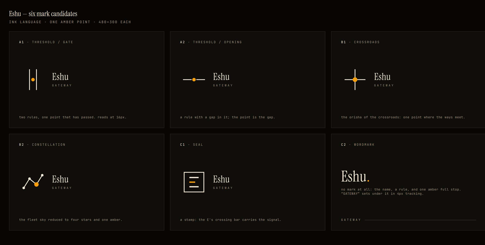

# Brand

The mark is **the gate**: two hairlines with a gap and one amber point — the
threshold a command has just crossed. It is drawn as SVG with non-scaling
hairlines (`dashboard/static/brand/eshu-mark.svg`), so the rules stay 1px-ish
in the rail and on the login card instead of thickening with scale.

Assets:

- `dashboard/static/brand/eshu-mark.svg` — the mark (transparent)
- `dashboard/static/eshu_logo.png` — 512px transparent mark
- `dashboard/static/eshu_logo_tile.png` — 512px on paper (favicon / apple-touch)
- `dashboard/static/favicon-16.png`, `favicon-32.png` — small-size cut
- `dashboard/static/eshu_banner.png` — 1200×400 lockup (README header)

## How it was chosen

Three directions were drawn and shown at real sizes (512/96/30/16, the rail,
the login card, the banner). The chosen one is the first; the other two are
kept here as the record.

| | direction | idea |
|---|---|---|
| **1 · The Gate** *(chosen)* | two rules, one point that has passed through | the product is a threshold |
| 2 · The Crossroads | three roads into one junction | Eshu at the decision point |
| 3 · The Monogram | a serif E and one amber full stop | the name as the mark |

- [Direction 1 — The Gate](direction-1-gate.png)
- [Direction 2 — The Crossroads](direction-2-crossroads.png)
- [Direction 3 — The Monogram](direction-3-monogram.png)

Why the gate won: it is the only one that is both a *wordless* mark (nothing
to read at 16px) and a *sentence* about the product. The crossroads was warmer
but read as an asterisk at small sizes; the monogram was the most elegant in
the rail but had no symbol to give the favicon.
